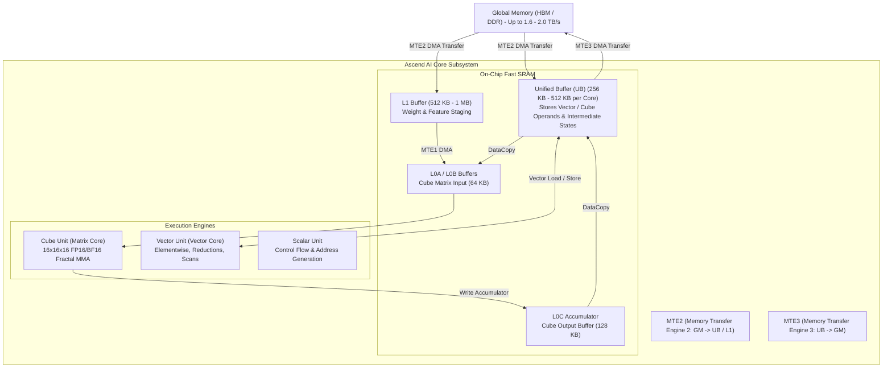

# Ascend NPU Kernel Performance Engineering

Use this skill for profiling, diagnosing, and optimizing NeuralOps operators deployed on Huawei Ascend NPUs under the CANN (Compute Architecture for Neural Networks) software stack and `triton_ascend` backend. Follow [neuralops-optimization-loop](../neuralops-optimization-loop/SKILL.md) for iterative performance cycles and [CONTRIBUTING](../../../CONTRIBUTING.md#benchmarking) for validation standards.

---

## 1. Ascend AI Core Architecture and Memory Hierarchy

NeuralOps kernels execute on Ascend AI Cores. Each AI Core contains distinct compute units and on-chip SRAM partitions:



### Core Architecture Specifications

| Component | Ascend 910B Specification | Constraint / Behavioral Rule |
| :--- | :--- | :--- |
| **Cube Core** | 32 TFLOPS FP32, 280 TFLOPS BF16/FP16 | Optimized for $16 \times 16 \times 16$ matrix multiplication in fractal layout (`FRACTAL_NZ`). |
| **Vector Core** | 14 TFLOPS FP32 / 28 TFLOPS FP16 | Handles linear attention scans, activations (ELU, sigmoid), and normalizations. |
| **Unified Buffer (UB)** | 256 KB – 512 KB per AI Core | Shared between Vector computations and DMA staging. Overflows trigger fatal hardware faults. |
| **MTE2 Engine** | Global Memory (HBM) $\to$ UB/L1 | Requires 32-byte alignment for burst DMA reads. |
| **MTE3 Engine** | UB $\to$ Global Memory (HBM) | Requires continuous memory writes; strided writes degrade burst efficiency by up to $8\times$. |

---

## 2. CANN Environment Setup and Profiling Tools

Profiling on Ascend NPUs is managed via **CANN** tools: the `msprof` CLI utility and `torch_npu.profiler`.

### CANN Environment Configuration

```bash
# Source the CANN toolkit environment
source /usr/local/Ascend/ascend-toolkit/set_env.sh

# Recommended runtime environment variables for deterministic performance profiling
export ASCEND_GLOBAL_LOG_LEVEL=1            # 1: ERROR, 2: WARNING, 3: INFO
export TASK_QUEUE_ENABLE=1                  # Enable asynchronous task queue
export HCCL_BUFFSIZE=128                    # Allocate sufficient collective buffer
export ASCEND_LAUNCH_BLOCKING=0             # 0 for production pipelining; 1 only for debugging
```

### Profiling with `msprof` CLI

The `msprof` tool captures hardware-level timeline traces, AI Core pipeline utilization, and MTE bandwidth:

```bash
# Collect comprehensive AI Core metrics using msprof CLI
msprof --output=profile/kda_ascend_trace \
       --application="python -m benchmarks.ops.run --op chunk_kda --modes fwd --no-base" \
       --aic-mode=aicoreMethod \
       --aic-metrics=PipeUtilization \
       --sys-hardware-mem=on \
       --task-trace=on \
       --aicpu=on
```

### Profiling with NeuralOps `profile_npu.py` Wrapper

NeuralOps provides an operator-agnostic profiling wrapper under `.agents/skills/neuralops-ascend-performance/scripts/profile_npu.py`:

```bash
# 1. Profile PipeUtilization (Cube, Vector, MTE, Scalar distribution)
python .agents/skills/neuralops-ascend-performance/scripts/profile_npu.py \
  --name chunk_kda \
  --out-dir profile/kda-ascend \
  --metrics PipeUtilization \
  --analyze \
  --kernel-filter chunk_kda \
  --exec-file benchmarks/ops/workloads/kda_workload.py

# 2. Profile MemoryUB (Unified Buffer read/write bandwidth and bank stalls)
python .agents/skills/neuralops-ascend-performance/scripts/profile_npu.py \
  --name chunk_kda \
  --out-dir profile/kda-ascend \
  --metrics MemoryUB \
  --analyze \
  --kernel-filter chunk_kda \
  --exec-file benchmarks/ops/workloads/kda_workload.py
```

### Trace CSV Interpretation & Diagnostics

The profiling output directory contains `op_statistic.csv` and `kernel_details.csv`:

```text
profile/kda-ascend/chunk_kda_profiling_TIMESTAMP/
└── ASCEND_PROFILER_OUTPUT/
    ├── op_statistic.csv       <-- Operator runtime breakdown & invocation count
    ├── kernel_details.csv     <-- AI Core cycle breakdown: Cube, Vector, MTE2, MTE3, Scalar
    └── op_summary.csv         <-- Input shapes, data types, memory throughput
```

#### Diagnostic Decision Matrix

| Symptom in `kernel_details.csv` | Pipeline Percentage | Diagnosis | Engineering Remedy |
| :--- | :--- | :--- | :--- |
| **High MTE2 / MTE3 Ratio** | $> 60\%$ of total cycles | **Memory-Bound Bottleneck** | Vector/Cube cores are idling waiting for DMA transfers. Implement double-buffering (ping-pong) in UB and increase chunk size $B_T$. |
| **High Scalar Ratio** | $> 25\%$ of total cycles | **Address Calculation Overhead** | Scalar core is saturated generating strides and pointers. Precompute offsets in int64; avoid per-token branch evaluations. |
| **Cube Ratio Low / Vector High** | Cube $< 10\%$, Vector $> 70\%$ | **Under-utilized Tensor Hardware** | Matrix operations are falling back to Vector ALUs instead of Cube cores. Check tile size alignment ($16 \times 16$) and layout format. |
| **AIV UB Overflow Error** | Process aborted with sigbus | **Unified Buffer Exceeded** | Live tensor footprint in UB exceeds $256\text{ KB}$. Reduce tile dimensions ($B_T, B_K, B_V$) using `neuralops.utils.ascend_ub_manager`. |

---

## 3. Unified Buffer (UB) Tiling and Capacity Planning

The Unified Buffer (UB) is a finite on-chip resource ($256\text{ KB}$ on Ascend 910B standard cores). If the live set of variables inside a Triton-Ascend kernel exceeds available UB capacity, compilation or execution fails immediately.

### Dynamic UB Footprint Calculation

For a chunked recurrent linear attention kernel (e.g. `chunk_kda`), calculate peak live storage:

$$\text{Live Footprint (Bytes)} = \left( B_T \times B_K + B_T \times B_V + B_K \times B_V + 2 \times B_T \right) \times \text{sizeof}(\text{dtype}) \times \text{BufferMultiplier}$$

Where:
- $B_T$: Temporal chunk tile size (e.g. 32, 64)
- $B_K$: Key/Query feature dimension (e.g. 64, 128)
- $B_V$: Value feature dimension (e.g. 64, 128)
- $\text{BufferMultiplier}$: $2$ if double buffering (ping-pong) is enabled, $1$ otherwise.
- $\text{Safety Factor}$: Reserve $15\text{--}20\%$ for compiler scratchpad registers and layout conversion staging.

### UB Allocation Planning with `ascend_ub_manager`

```python
# Copyright (c) 2024-2026, Taha Majlesi
# NeuralOps Systems Engineering Group
"""
Demonstration of UB capacity budgeting for Ascend NPU kernels.
"""
from neuralops.utils.ascend_ub_manager import AscendUBManager

def plan_kda_ub_tiles(
    batch_size: int,
    num_heads: int,
    seq_len: int,
    dim_k: int,
    dim_v: int,
    dtype_bytes: int = 2, # FP16 / BF16
) -> tuple[int, int, int]:
    ub_mgr = AscendUBManager.get_instance()
    total_ub_bytes = ub_mgr.get_ub_capacity_bytes()  # e.g., 262,144 bytes (256 KB)
    usable_ub_bytes = total_ub_bytes * 0.80           # 80% usable budget after safety margin

    best_bt, best_bk, best_bv = 32, 64, 64
    
    # Sweep candidate tile sizes
    for bt_candidate in [128, 64, 32, 16]:
        for bv_candidate in [128, 64, 32]:
            bk_candidate = dim_k
            # Memory required: Q_tile + K_tile + V_tile + S_matrix + intermediate_decay
            q_bytes = bt_candidate * bk_candidate * dtype_bytes
            k_bytes = bt_candidate * bk_candidate * dtype_bytes
            v_bytes = bt_candidate * bv_candidate * dtype_bytes
            s_bytes = bk_candidate * bv_candidate * 4 # FP32 accumulator
            decay_bytes = bt_candidate * 4           # FP32 decay vector

            # Double-buffered GM-to-UB transfers require 2x for Q, K, V
            peak_live = (2 * (q_bytes + k_bytes + v_bytes)) + s_bytes + decay_bytes

            if peak_live <= usable_ub_bytes:
                return bt_candidate, bk_candidate, bv_candidate

    return best_bt, best_bk, best_bv
```

---

## 4. GM-to-UB DMA Transfers and Double Buffering

On Ascend NPUs, data movement between Global Memory (GM) and Unified Buffer (UB) is handled by asynchronous Memory Transfer Engines (**MTE2** and **MTE3**).

### Overlapping Pipeline Stages (Ping-Pong Buffering)

To hide GM latency, partition UB into two symmetric memory buffers: Buffer 0 and Buffer 1.

```
Cycle:      0           1           2           3           4
----------------------------------------------------------------------
MTE2:     Load Tile 0  Load Tile 1 Load Tile 2 Load Tile 3 Drain
Compute:  Idle         Compute 0   Compute 1   Compute 2   Compute 3
MTE3:     Idle         Idle        Store 0     Store 1     Store 2
```

### Triton-Ascend Kernel with Double-Buffered GM-to-UB Staging

```python
import triton
import triton.language as tl

@triton.jit
def ascend_double_buffered_kda_kernel(
    q_ptr, k_ptr, v_ptr, o_ptr,
    stride_b, stride_h, stride_t, stride_d,
    T,
    BT: tl.constexpr, # e.g. 64
    BK: tl.constexpr, # e.g. 64
    BV: tl.constexpr, # e.g. 64
):
    """
    Triton-Ascend chunked recurrence with explicit DMA double-buffering.
    Avoids tl.dot LHS corruption and enforces 32-byte alignment.
    """
    pid_b = tl.program_id(0)
    pid_h = tl.program_id(1)

    offs_k = tl.arange(0, BK)
    offs_v = tl.arange(0, BV)
    offs_t = tl.arange(0, BT)

    # 64-bit base offset calculations to prevent 32-bit address overflow
    base_k = k_ptr + tl.cast(pid_b, tl.int64) * stride_b + tl.cast(pid_h, tl.int64) * stride_h
    base_v = v_ptr + tl.cast(pid_b, tl.int64) * stride_b + tl.cast(pid_h, tl.int64) * stride_h
    base_o = o_ptr + tl.cast(pid_b, tl.int64) * stride_b + tl.cast(pid_h, tl.int64) * stride_h

    # State accumulator pinned in UB in FP32
    s_acc = tl.zeros((BK, BV), dtype=tl.float32)

    num_chunks = tl.cdiv(T, BT)

    # Prologue: Prefetch Chunk 0 via MTE2 DMA into Buffer 0
    t_0 = 0
    ptrs_k_0 = base_k + tl.cast(t_0 * BT + offs_t[:, None], tl.int64) * stride_t + tl.cast(offs_k[None, :], tl.int64) * stride_d
    ptrs_v_0 = base_v + tl.cast(t_0 * BT + offs_t[:, None], tl.int64) * stride_t + tl.cast(offs_v[None, :], tl.int64) * stride_d
    k_buf0 = tl.load(ptrs_k_0, mask=offs_t[:, None] < T, other=0.0)
    v_buf0 = tl.load(ptrs_v_0, mask=offs_t[:, None] < T, other=0.0)

    for c in range(0, num_chunks):
        next_c = c + 1
        is_next_valid = next_c < num_chunks

        # Steady State: Prefetch Next Chunk into Alternate Buffer
        if is_next_valid:
            ptrs_k_next = base_k + tl.cast(next_c * BT + offs_t[:, None], tl.int64) * stride_t + tl.cast(offs_k[None, :], tl.int64) * stride_d
            ptrs_v_next = base_v + tl.cast(next_c * BT + offs_t[:, None], tl.int64) * stride_t + tl.cast(offs_v[None, :], tl.int64) * stride_d
            k_buf1 = tl.load(ptrs_k_next, mask=(next_c * BT + offs_t[:, None]) < T, other=0.0)
            v_buf1 = tl.load(ptrs_v_next, mask=(next_c * BT + offs_t[:, None]) < T, other=0.0)

        # Compute on Current Buffer (Buffer 0)
        # CRITICAL ASCEND FIX: Add + 0.0 copy to prevent tl.dot LHS UB clobbering
        k_compute = k_buf0 + 0.0
        # Rank-1 outer product accumulation: S += K^T @ V
        s_update = tl.dot(tl.trans(k_compute), v_buf0)
        s_acc += s_update

        # Store chunk output via MTE3 DMA
        ptrs_o = base_o + tl.cast(c * BT + offs_t[:, None], tl.int64) * stride_t + tl.cast(offs_v[None, :], tl.int64) * stride_d
        tl.store(ptrs_o, v_buf0, mask=offs_t[:, None] < T)

        # Swap Ping-Pong Buffers
        if is_next_valid:
            k_buf0 = k_buf1
            v_buf0 = v_buf1
```

---

## 5. Memory Layout Alignments and Fractal Formats

The Ascend hardware memory controller enforces rigid alignment and formatting rules. Violating these causes hardware re-alignment penalties or memory bus faults:

### 1. 32-Byte and 512-Byte Alignment Rules
- **32-Byte Alignment**: Every tensor start address, row stride, and DMA block transfer must be a multiple of **32 bytes** (equivalent to 16 elements in FP16/BF16, or 8 elements in FP32).
- **512-Byte Alignment**: For peak MTE burst transfer rates ($\ge 90\%$ of peak bus bandwidth), align chunk sizes and sequence strides to **512 bytes** (256 elements in FP16/BF16).

```python
def align_stride_32b(num_elements: int, dtype: torch.dtype) -> int:
    """Pad element count to guarantee 32-byte alignment."""
    bytes_per_elem = torch.tensor([], dtype=dtype).element_size()
    elements_per_32b = 32 // bytes_per_elem
    return (num_elements + elements_per_32b - 1) & ~(elements_per_32b - 1)
```

### 2. Fractal NZ/ND Layout for Cube Cores
Ascend Cube units do not process standard row-major (ND) matrices natively. They require **Fractal $16 \times 16$ Matrices** ($C0=16, C1=\lceil K/16 \rceil$):

```
Matrix [M, K] in ND format
       |
       v (Fractal NZ conversion)
5D Tensor: [Ceil(M/16), Ceil(K/16), 16, 16]
```

When writing PyTorch NPU extensions or Triton-Ascend kernels, ensure tile sizes $B_T, B_K, B_V$ are strict multiples of 16 so the CANN compiler can map operations directly to Cube fractal instructions without costly layout transposition passes.

---

## 6. Ascend Verification and Regression Checklist

1. **Check Environment**:
   ```bash
   npu-smi info
   python -c "import torch, torch_npu; print('NPU Available:', torch_npu.npu.is_available())"
   ```
2. **Execute Full Correctness Gate with NaN Allocation Guards**:
   ```bash
   pytest tests/ops/test_kda.py -v
   ```
3. **Capture Synchronized NPU Benchmarks**:
   ```bash
   python .agents/skills/neuralops-ascend-performance/scripts/profile_npu.py \
       --name chunk_kda --metrics PipeUtilization --analyze \
       --kernel-filter chunk_kda --exec-file benchmarks/ops/workloads/kda_workload.py
   ```
4. **Audit UB Live Multipliers**:
   Verify that total estimated buffer consumption does not exceed $80\%$ of device UB capacity, and verify that `tl.dot` operands are isolated from later read clobbers.
