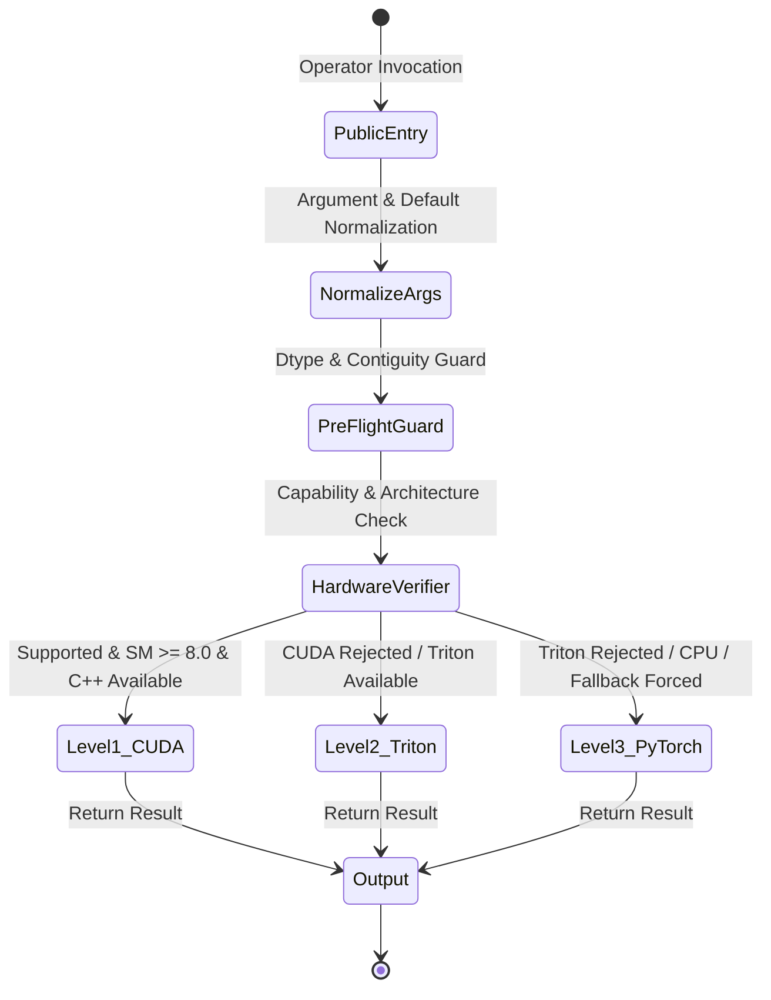

# NeuralOps Design, Numerical Budgets, and Coverage Contracts

Use this skill to establish rigorous numerical contracts, dynamic range budgets, dtype guards, and dispatch routing specifications before writing or refactoring any NeuralOps kernel, operator backend, or compression algorithm. Read [CONTRIBUTING.md](../../../CONTRIBUTING.md) for public API compatibility and design RFC requirements.

---

## 1. Numerical Budget Guidelines & Precision Constraints

NeuralOps operators execute across extreme dynamic ranges, from decaying linear attention states to high-magnitude logit projections. Every computational stage must declare and adhere to an explicit precision budget.

```
+-----------------------------------------------------------------------------------------------+
|                               Floating-Point Precision Budgets                                |
+-----------------+---------------+----------------+--------------------------------------------+
| Format          | Dynamic Range | Mantissa (eps) | Appropriate Operations & Invariants        |
+-----------------+---------------+----------------+--------------------------------------------+
| IEEE FP16       | [-65504, 65504] | 10 bits (~1e-3) | Forward activations, weights, fused matmuls|
|                 | Underflow 6e-5|                | Requires softmax scaling & underflow guard |
+-----------------+---------------+----------------+--------------------------------------------+
| Brain BF16      | [-3.4e38, 3.4e38]| 7 bits (~8e-3)| Large gradient accumulation, stable scales |
|                 | (FP32 exponent)| Coarse epsilon| High quantization noise; monitor residuals |
+-----------------+---------------+----------------+--------------------------------------------+
| IEEE FP32       | [-3.4e38, 3.4e38]| 23 bits (~1e-7)| Recurrent state updates, cumulative sums,  |
|                 | Standard single| High precision| SVD singular values, RMSNorm variance      |
+-----------------+---------------+----------------+--------------------------------------------+
| OCP FP8 (E4M3)  | [-448, 448]   | 3 bits         | Memory-bound GEMM, forward activations     |
+-----------------+---------------+----------------+--------------------------------------------+
| OCP FP8 (E5M2)  | [-57344, 57344]| 2 bits        | Backward gradients requiring FP16 range    |
+-----------------+---------------+----------------+--------------------------------------------+
```

### 1.1 IEEE FP16 Constraints & Mitigation
- **Exponent Saturation**: FP16 overflows at $\pm 65504$. In attention operations computing $Q K^T$, inner products without scale $\frac{1}{\sqrt{d}}$ rapidly exceed 65504 when sequence length $T$ or head dimension $D$ increases.
  - *Invariant*: Always scale query vectors prior to matrix multiplication or fuse the scale factor:
    $$\tilde{Q} = \frac{Q}{\sqrt{D_k}}, \quad S = \tilde{Q} K^T$$
- **Underflow & Subnormal Numbers**: FP16 underflows below $2^{-14} \approx 6.1 \times 10^{-5}$. In cumulative decay calculations $e^{-g_t}$, decays must be clamped to prevent complete subnormal zero-flush:
  $$\text{decay} = \exp(\max(g_t, -14.0))$$

### 1.2 Brain BF16 Constraints & Mitigation
- **Coarse Quantization Noise**: BF16 retains only 7 bits of mantissa ($\epsilon_{\text{mach}} \approx 7.8 \times 10^{-3}$). While overflow is virtually eliminated, cumulative additions ($\sum_{i=1}^N x_i$) experience severe cancellation and rounding drift when $N > 128$.
  - *Invariant*: In-kernel accumulation buffers (Triton registers, CUDA shared memory accumulators) must accumulate in **FP32**, casting back to BF16 only upon final global memory store.

### 1.3 IEEE FP32 Master Storage and Reduction Contracts
- **Recurrent State Updates**: In linear RNNs, SSMs (Mamba, Selective Scan), and Delta Net updates:
  $$S_t = \alpha_t S_{t-1} + K_t^T V_t$$
  The hidden state tensor $S_t \in \mathbb{R}^{H \times D_k \times D_v}$ must **strictly** reside in FP32 throughout the scan. Casting $S_t$ to FP16 causes exponential drift and catastrophic gradient explosion during reverse-mode autograd recomputation.
- **RMSNorm and LayerNorm Variance**: Sum of squares reductions must be computed in FP32 with an added stability epsilon:
  $$\sigma^2 = \frac{1}{D} \sum_{i=1}^D x_i^2 + \epsilon, \quad \epsilon \ge 10^{-6}$$
- **SVD Decomposition Factorization**: Singular values $\sigma_i$ and orthogonal bases $U, V$ in `neuralops.compression` must be solved in double or single precision before low-rank projection.

---

## 2. Dtype Guard Standards & Input Sanitization

All public entry points, kernel adapters, and autograd boundaries in NeuralOps must enforce strict tensor preconditions before invoking hardware dispatch.

```
       User Input Tensor
               |
               v
  +--------------------------+
  |    neuralops_input_guard    |
  +--------------------------+
  | 1. Device match (CUDA)   |
  | 2. Contiguity check      |
  | 3. Alignment (16-byte)   |
  | 4. Explicit Dtype verify |
  | 5. Dimension alignment   |
  +--------------------------+
               |
        Passed / Failed
        /             \
       v               v
 [ Dispatch ]    [ Raise TypeError / ValueError ]
```

### 2.1 The `input_guard` Standard Implementation
Silent type promotions (e.g. `torch.float64` creeping into Triton kernels) cause massive register spills, compilation failures, or silent memory corruption. Tensors must be checked and sanitized cleanly:

```python
import functools
import torch
from typing import Callable, Any

def neuralops_input_guard(
    allowed_dtypes: tuple[torch.dtype, ...] = (torch.float16, torch.bfloat16, torch.float32),
    enforce_cuda: bool = True,
    enforce_contiguous: bool = True,
) -> Callable:
    """
    Decorator enforcing NeuralOps tensor preconditions:
    - Device validation (CUDA / ROCm)
    - Strict dtype matching against approved numerical budgets
    - Physical memory contiguity
    - Finite check on initialization boundaries
    """
    def decorator(fn: Callable[..., Any]) -> Callable[..., Any]:
        @functools.wraps(fn)
        def wrapper(*args: Any, **kwargs: Any) -> Any:
            all_tensors: list[tuple[str, torch.Tensor]] = []
            for i, arg in enumerate(args):
                if isinstance(arg, torch.Tensor):
                    all_tensors.append((f"arg_{i}", arg))
            for k, val in kwargs.items():
                if isinstance(val, torch.Tensor):
                    all_tensors.append((k, val))

            for name, tensor in all_tensors:
                # 1. Device check
                if enforce_cuda and not tensor.is_cuda:
                    raise TypeError(
                        f"NeuralOps input '{name}' must be on a CUDA/ROCm device, got {tensor.device}."
                    )
                # 2. Dtype check
                if tensor.is_floating_point() and tensor.dtype not in allowed_dtypes:
                    raise TypeError(
                        f"NeuralOps input '{name}' has unsupported dtype {tensor.dtype}. "
                        f"Allowed dtypes: {allowed_dtypes}."
                    )
                # 3. Contiguity check
                if enforce_contiguous and not tensor.is_contiguous():
                    # Preserve memory semantics: fail-fast or sanitize
                    tensor = tensor.contiguous()

            return fn(*args, **kwargs)
        return wrapper
    return decorator
```

### 2.2 Numerical Boundary Verification
Adversarial inputs outside safe mathematical domains must fail immediately before kernel launch:
- Gate values must be checked for finite bounds when pre-gated safe modes are configured: $-5.0 \le g_t \le 0.0$.
- Matrix shapes must satisfy hardware tensor core multiples (head dimensions $D \in \{16, 32, 64, 128, 256\}$; sequences chunked into multiples of 16 or 32).
- Zero-length or empty tensors must be intercepted at the public boundary and return appropriate empty or identity tensors without triggering GPU kernel launches.

---

## 3. Dispatch Routing Contracts

NeuralOps employs a formal contract between public API wrappers, backend verifiers, and execution kernels.



### 3.1 Verifier Contract Specification
Every backend implementation must provide a corresponding verifier function with the exact signature:
$$\text{verifier}(*args, **kwargs) \to \text{Tuple}[\text{bool}, \text{Optional}[\text{str}]]$$

1. **Purity & Idempotency**: Verifiers must **never** mutate input tensors, alter memory layouts, allocate GPU buffers, or modify global dispatch state.
2. **Explicit Rejection Reason**: Rejection must return `(False, "Human readable reason")` documenting the failed predicate (e.g., `"Sequence length 17 not supported by block-tiled kernel; requires multiple of 16"`).
3. **Zero Overhead**: Verifiers inspect only tensor metadata (`shape`, `dtype`, `stride`, `device`) and scalar configuration flags. They must never inspect tensor element values or invoke blocking CUDA synchronization (`cudaDeviceSynchronize`).

#### Verifier Implementation Example
```python
def sliding_window_cuda_verifier(
    q: torch.Tensor,
    k: torch.Tensor,
    v: torch.Tensor,
    window_size: int,
    *args,
    **kwargs
) -> tuple[bool, str | None]:
    """
    Validates pre-conditions for Native CUDA sliding window attention kernel.
    """
    if not q.is_cuda or not k.is_cuda or not v.is_cuda:
        return False, "Inputs must be CUDA tensors."

    if q.dtype not in (torch.float16, torch.bfloat16):
        return False, f"Unsupported dtype {q.dtype}; native kernel requires FP16 or BF16."

    B, H, T, D = q.shape
    if D not in (32, 64, 128, 256):
        return False, f"Head dimension {D} not a supported hardware block size (32, 64, 128, 256)."

    if window_size <= 0:
        return False, f"Window size must be positive, got {window_size}."

    if not (q.is_contiguous() and k.is_contiguous() and v.is_contiguous()):
        return False, "Input tensors must be physically contiguous in memory."

    return True, None
```

### 3.2 Pre-Condition vs In-Kernel Fault Contract
- **Pre-condition Violations**: Raised at Python level (`TypeError`, `ValueError`). Never let invalid parameters proceed to CUDA C++ launch where they cause illegal memory access, kernel panics, or uncatchable segmentation faults.
- **Fail-Fast Boundary Validation**:
  ```python
  def sliding_window_attention(q, k, v, window_size=64):
      # Pre-condition check
      if q.shape[-1] != k.shape[-1] or q.shape[-1] != v.shape[-1]:
          raise ValueError(
              f"Channel dimension mismatch: q={q.shape[-1]}, k={k.shape[-1]}, v={v.shape[-1]}"
          )
      # Execute through 3-level fallback dispatcher
      return dispatch(
          cuda_fn=sliding_window_cuda_impl,
          triton_fn=sliding_window_triton_impl,
          pytorch_fn=sliding_window_pytorch_ref,
          q, k, v, window_size=window_size,
          kernel_name="sliding_window_attention",
      )
  ```

---

## 4. Verification and Validation Sequence

Before approving any new kernel design or numerical change, ensure the full validation checklist is satisfied:

```bash
# 1. Run unit correctness tests across all dtypes
pytest tests/cuda_kernels/test_normalization_kernels.py -v

# 2. Assert gradient stability with adversarial scales
pytest tests/test_numerical_correctness_gradcheck.py -v -k "sliding"

# 3. Check dispatch routing under both forced and auto modes
NEURALOPS_DEBUG_DISPATCH=1 pytest tests/test_cuda_triton_3level_complete.py -k "sliding" -v
```
