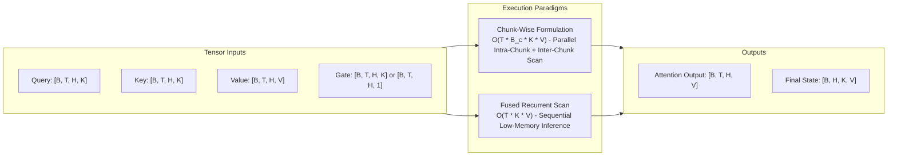
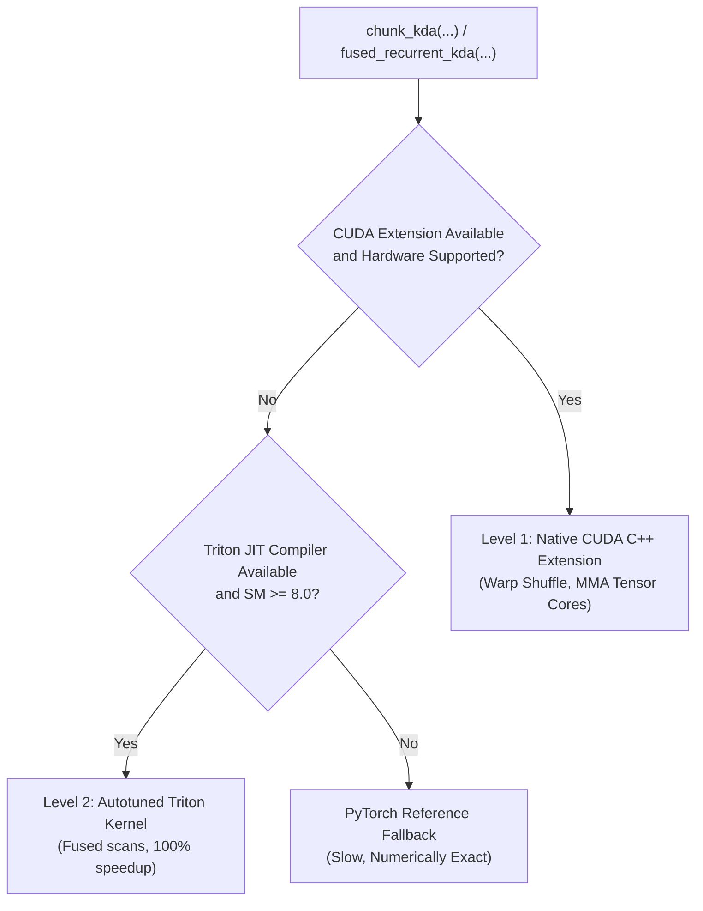

# Kronecker Delta Attention (KDA) Engineering & Kernel Dispatch

Use this skill for modifying, auditing, profiling, or writing unit tests for `neuralops/ops/kda/` and associated attention architectures.
The primary public APIs are `chunk_kda` and `fused_recurrent_kda`, exposed through `neuralops.ops.kda` and dynamic dispatch registries.

---

## 1. Architectural & Mathematical Foundations

KDA introduces fine-grained, data-dependent decay dynamics via generalized Kronecker delta state transitions within linear attention:

$$S_t = \alpha_t \odot S_{t-1} + K_t^\top V_t$$
$$O_t = Q_t S_t$$

where $\alpha_t \in (0, 1)^{H \times D_k}$ represents per-dimension or multi-head gating decay factors, $S_t \in \mathbb{R}^{D_k \times D_v}$ is the recurrent memory state, and $Q_t, K_t, V_t$ are the query, key, and value representations.



---

## 2. Directory Structure and Module Responsibilities

The KDA operator family resides under `neuralops/ops/kda/` and is partitioned into modular stages:

| Module File | Purpose & Architectural Role | Core Invariants |
| :--- | :--- | :--- |
| `gate.py` | Gate activations, log-space transformations, cumulative decay, and lower-bound enforcement. | Continuous gradients; bounded exponent range. |
| `chunk_fwd.py` | Top-level chunked forward coordinator and workspace allocation. | Validates shapes, memory layout, and striding. |
| `chunk_bwd.py` | Analytical backward pass calculating $\partial \mathcal{L}/\partial Q$, $\partial \mathcal{L}/\partial K$, $\partial \mathcal{L}/\partial V$, and $\partial \mathcal{L}/\partial G$. | Preserves exact double-precision gradients. |
| `chunk_intra.py` | Intra-chunk diagonal block computation and local attention matrix assembly. | Uses 16-token diagonal sub-blocks. |
| `chunk_intra_token_parallel.py`| Token-parallel path for intra-chunk processing when sequence length $T$ is very large. | High SM occupancy; avoids serial intra-chunk loop. |
| `wy_fast.py` | Fast WY representation for associative state expansion and triangular solves. | Computes $A = (I - L)^{-1}$ efficiently. |
| `backends/` | Hardware-specialized backends (Triton JIT, CUDA C++, CPU reference). | Strictly adheres to 3-level fallback hierarchy. |

---

## 3. Gate Contracts and Activation Semantics

The parameter `chunk_kda(..., use_gate_in_kernel=...)` determines where gating calculations occur:

### 3.1 Pre-Gated Mode (`use_gate_in_kernel=False`)
- The caller supplies pre-computed log-space decays: $g = \log(\alpha_t) \le 0$.
- Caller is responsible for numerical bounds ($g \in [-5.0, 0.0]$).
- Tensors must be contiguous in head and feature dimensions.

### 3.2 In-Kernel Gating Mode (`use_gate_in_kernel=True`)
When enabled, raw unconstrained logits $g$ and optional learnable bias `dt_bias` are passed directly:

1. **Standard Unbounded Mode** (when `lower_bound is None`):
   $$\text{activation} = -\exp(A_{\text{log}}) \cdot \text{softplus}(g + \text{dt\_bias})$$
   - Requires parameter `A_log` to be supplied.
   - Enforces strictly non-positive decay factors.

2. **Lower-Bounded Mode** (when `lower_bound` is specified, e.g., $-5.0$):
   $$\text{activation} = \text{lower\_bound} \cdot \sigma\left(\exp(A_{\text{log}}) \cdot (g + \text{dt\_bias})\right)$$
   - Bound must satisfy $-5.0 \le \text{lower\_bound} < 0.0$.
   - If `A_log` is omitted, defaults to an effective scaling multiplier of $1.0$.

---

## 4. Numerical Invariants and Stability Safeguards

1. **Midpoint Offsets in Safe Mode (`safe_gate=True`)**:
   - Accumulating decay across long chunks ($B_c = 64$ tokens) at a lower bound of $-5.0$ can yield $-320$ in natural log space, triggering complete underflow to zero.
   - The safe path segments chunks into 16-token diagonal micro-blocks and subtracts the midpoint offset before computing $\exp(\cdot)$:
     $$\tilde{g}_i = g_i - \frac{g_{\text{start}} + g_{\text{end}}}{2}$$
   - This keeps the exponent arguments strictly within $[-40, +40]$, preventing floating-point underflow/overflow.

2. **Monotonic Inter-Block Decay**:
   - Across chunk boundaries, inter-block decay uses paired differences:
     $$\Delta g_{c_1 \to c_2} = g_{c_2} - g_{c_1} \le 0$$
   - Ensure exponents never evaluate to positive numbers during inter-chunk state propagation.

3. **Autograd Precision Budget**:
   - Double-precision finite difference tests (`torch.autograd.gradcheck`) must match analytical Jacobians with $\text{atol} = 10^{-3}$, $\epsilon = 10^{-5}$.
   - Triton JIT intermediate accumulations must use `tl.float32` regardless of whether input tensors are `torch.bfloat16` or `torch.float16`.

---

## 5. Backend Dispatch Routing

KDA dispatches across hardware backends according to the repository-wide contract:



To force a specific execution backend for testing or debugging:
```python
from neuralops.core.backend import force_kernel_backend

# Test pure Triton execution
with force_kernel_backend("triton"):
    output = chunk_kda(q, k, v, g)

# Test pure PyTorch reference execution
with force_kernel_backend("torch"):
    output_ref = chunk_kda(q, k, v, g)
```

---

## 6. Comprehensive Verification and Testing Protocols

When modifying KDA implementations or decay mechanics, run the dedicated test battery:

```bash
# 1. Run all KDA unit tests
pytest tests/ops/test_kda.py -v

# 2. Test forward-backward numerical equivalence across backends
pytest tests/ops/test_kda.py -k "test_backend_equivalence" -v

# 3. Double-precision autograd gradient check
pytest tests/ops/test_kda.py -k "test_gradcheck" -v
```

### Mandatory Verification Checklist
- [ ] Variable sequence lengths with ragged padding masks (`cu_seqlens`).
- [ ] Both `use_gate_in_kernel=True` and `use_gate_in_kernel=False`.
- [ ] Safe mode (`safe_gate=True`) and standard fast mode (`safe_gate=False`).
- [ ] Grouped value heads ($H_q \ne H_v$) and asymmetric key/value dimensions ($D_k \ne D_v$).
- [ ] Initial state injection ($S_0$) and final state return ($S_T$).
- [ ] Dtypes: `torch.float32`, `torch.float16`, and `torch.bfloat16`.
