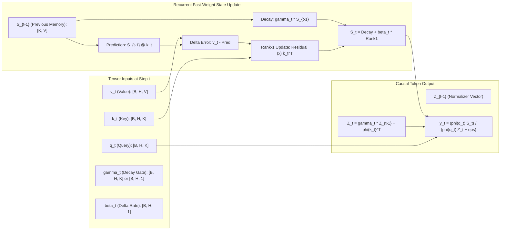
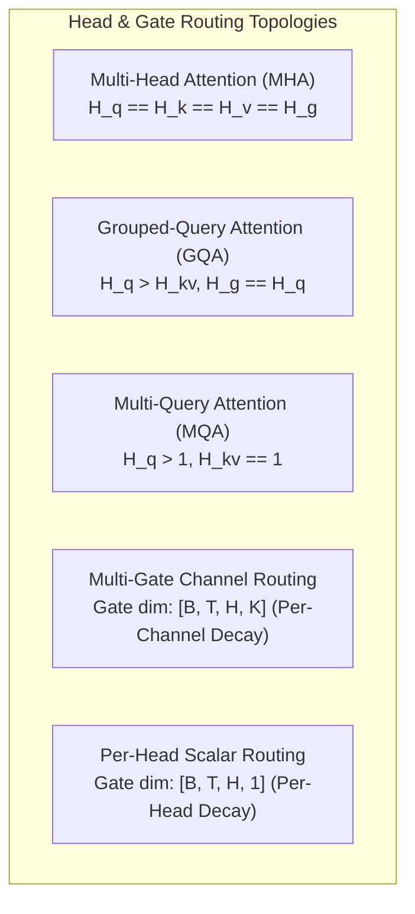
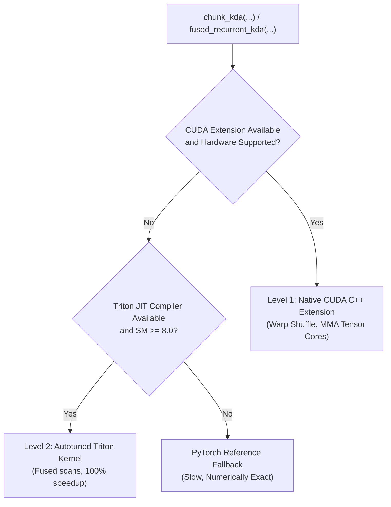

# Kronecker Delta Attention (KDA) Engineering & Kernel Dispatch

Use this skill for implementing, modifying, optimizing, auditing, and testing **Kernelized / Kronecker Delta Attention (KDA)** operators in NeuralOps.
The primary public APIs are `chunk_kda` and `fused_recurrent_kda`, exposed through `neuralops.ops.kda` and dynamic dispatch registries, as well as the unified `KDAAttention` module in `neuralops.attentions.gated.kda_attention`.

---

## 1. Architectural & Mathematical Formulations

KDA unites linear attention fast-weight memories, exponential forget gating, and associative delta-rule error correction into an expressive, $O(1)$-state causal sequence model.



### 1.1 Standard Kernelized Recurrence

In standard recurrent linear attention, positive feature maps $\phi(x) = \text{ELU}(x) + 1.0$ project queries and keys into an inner-product reproducing kernel space:

$$S_t = \gamma_t \odot S_{t-1} + \phi(k_t)^\top v_t, \quad S_t \in \mathbb{R}^{D_k \times D_v}$$

$$Z_t = \gamma_t \odot Z_{t-1} + \phi(k_t)^\top, \quad Z_t \in \mathbb{R}^{D_k \times 1}$$

$$y_t = \frac{\phi(q_t) S_t}{\phi(q_t) Z_t + \epsilon}, \quad y_t \in \mathbb{R}^{1 \times D_v}$$

where $\gamma_t = \sigma(\beta)$ represents learnable per-head or per-channel exponential decay.

### 1.2 Generalized Kronecker-Structured Delta-Rule Recurrence

To overcome linear attention's retrieval capacity bottleneck, KDA integrates associative associative memory error-correction:

$$S_t = \alpha_t \odot S_{t-1} + \beta_t \left( v_t - S_{t-1} k_t \right) \otimes k_t^\top$$

Where:
- $\alpha_t \in (0, 1)$ is the retention gate.
- $\beta_t \in [0, 1]$ is the adaptive learning rate.
- $e_t = v_t - S_{t-1} k_t$ represents the prediction error vector.
- In multi-gate Kronecker factoring, $\alpha_t$ decomposes along feature dimensions as a Kronecker outer product: $\alpha_t = g_1(t) \otimes g_2(t)$, enabling fine-grained forgetting across subspaces.

---

## 2. Directory Structure and Module Responsibilities

The KDA operator family resides under `neuralops/ops/kda/` and is partitioned into modular stages:

| Module File | Purpose & Architectural Role | Core Invariants |
| :--- | :--- | :--- |
| `gate.py` | Gate activations, log-space transformations, cumulative decay, and lower-bound enforcement. | Continuous gradients; bounded exponent range. |
| `chunk_fwd.py` | Top-level chunked forward coordinator and workspace allocation. | Validates shapes, memory layout, and striding. |
| `chunk_bwd.py` | Analytical backward pass calculating $\partial \mathcal{L}/\partial Q$, $\partial \mathcal{L}/\partial K$, $\partial \mathcal{L}/\partial V$, and $\partial \mathcal{L}/\partial G$. | Preserves exact double-precision gradients. |
| `chunk_intra.py` | Intra-chunk diagonal block computation and local attention matrix assembly. | Uses 16-token diagonal sub-blocks. |
| `chunk_intra_token_parallel.py`| Token-parallel path for intra-chunk processing when sequence length $T$ is very large. | High SM occupancy; avoids serial intra-chunk loop. |
| `wy_fast.py` | Fast WY representation for associative state expansion and triangular solves. | Computes $A = (I - L)^{-1}$ efficiently. |
| `backends/` | Hardware-specialized backends (Triton JIT, CUDA C++, CPU reference). | Strictly adheres to 3-level fallback hierarchy. |

---

## 3. Chunk vs. Recurrent Kernel Architecture

NeuralOps provides two specialized execution backends for KDA, each engineered for distinct workload regimes:

| Characteristic | **Chunked Kernel (`chunk_kda`)** | **Fused Recurrent Kernel (`fused_recurrent_kda`)** |
| :--- | :--- | :--- |
| **Primary Use Case** | Model training & long-prompt prefilling ($L \ge 512$). | Autoregressive single-step token decoding ($L=1$). |
| **Computational Complexity** | $O\left( \frac{L}{B_T} \cdot B_T^2 \cdot d + \frac{L}{B_T} \cdot d^2 \right) = O(L \cdot B_T \cdot d)$ | $O(L \cdot d^2)$ strictly sequential. |
| **Hardware Core Mapping** | Maps intra-chunk tiles ($B_T \times B_T$) to Tensor Cores (HMMA/WGMMA). | Bound to SM registers and Vector/Scalar ALUs. |
| **Arithmetic Intensity** | High ($40\text{--}120\text{ FLOPs/byte}$); DRAM memory bandwidth efficient. | Low ($< 15\text{ FLOPs/byte}$); DRAM/SRAM bandwidth bound. |
| **Memory Footprint** | Staged in shared memory / L2 cache; scales with chunk size $B_T$. | Minimal ($O(d^2)$ state per head); zero KV cache expansion. |

### Chunk Partitioning Math

The sequence length $L$ is partitioned into $N = \lceil L / B_T \rceil$ chunks of size $B_T$ (typically 32, 64, or 128). The computation decomposes into two stages:
1. **Intra-Chunk Attention**: Computed via masked causal matrix multiplication within each chunk:
   $$O_{\text{intra}}^{(c)} = \left( (Q_c K_c^\top) \odot D_{\text{intra}} \right) V_c$$
2. **Inter-Chunk State Propagation**: State carried across chunk boundaries via an associative parallel scan:
   $$S_c = \Gamma_{\text{block}} \odot S_{c-1} + \Delta S_c$$
   $$O_{\text{inter}}^{(c)} = (Q_c S_{c-1}) \odot D_{\text{inter}}$$
   $$O^{(c)} = O_{\text{intra}}^{(c)} + O_{\text{inter}}^{(c)}$$

---

## 4. Multi-Head vs. Multi-Gate Routing

NeuralOps supports flexible routing across attention heads and gate topologies:



### Stride Computation and Indexing Rules

When implementing kernels supporting both MHA and GQA:
- Query heads: $H_q$.
- Key/Value heads: $H_{kv}$ where $H_q = H_{kv} \times \text{repeat\_factor}$.
- In Triton kernels, map head ID $h \in [0, H_q)$ to KV head via integer division:
  ```python
  pid_h_kv = pid_h // (HQ // HKV)
  k_offset = pid_b * stride_kb + pid_h_kv * stride_kh + ...
  ```

---

## 5. Gate Contracts and Activation Semantics

The parameter `chunk_kda(..., use_gate_in_kernel=...)` determines where gating calculations occur:

### 5.1 Pre-Gated Mode (`use_gate_in_kernel=False`)
- The caller supplies pre-computed log-space decays: $g = \log(\alpha_t) \le 0$.
- Caller is responsible for numerical bounds ($g \in [-5.0, 0.0]$).
- Tensors must be contiguous in head and feature dimensions.

### 5.2 In-Kernel Gating Mode (`use_gate_in_kernel=True`)
When enabled, raw unconstrained logits $g$ and optional learnable bias `dt_bias` are passed directly:

1. **Standard Unbounded Mode** (when `lower_bound is None`):
   $$\text{activation} = -\exp(A_{\text{log}}) \cdot \text{softplus}(g + \text{dt\_bias})$$
   - Requires parameter `A_log` to be supplied.
   - Enforces strictly non-positive decay factors.

2. **Lower-Bounded Mode** (when `lower_bound` is specified, e.g., $-5.0$):
   $$\text{activation} = \text{lower\_bound} \cdot \sigma\left(\exp(A_{\text{log}}) \cdot (g + \text{dt\_bias})\right)$$
   - Bound must satisfy $-5.0 \le \text{lower\_bound} < 0.0$.
   - If `A_log` is omitted, defaults to an effective scaling multiplier of $1.0$.

---

## 6. Numerical Invariants and Stability Safeguards

Exponential decay recurrence $\exp(\sum \log \gamma)$ is prone to catastrophic numerical underflow or overflow. NeuralOps enforces strict numerical invariant budgets:

1. **Cumulative Log Decay Floor ($-80.0$ Floor)**:
   - In 32-bit floating point, $e^{-88} \approx 6 \times 10^{-39}$ is the subnormal boundary.
   - All cumulative decay values must be clamped to $[-80.0, 0.0]$:
     $$\Lambda_t^{\text{clamped}} = \max(-80.0, \, \min(0.0, \, \Lambda_t))$$
     This prevents denormalized floats and gradient underflow to zero.

2. **16-Token Diagonal Midpoint Offsets in Safe Mode (`safe_gate=True`)**:
   - Accumulating decay across long chunks ($B_T = 64$ tokens) at a lower bound of $-5.0$ can yield $-320$ in natural log space, triggering complete underflow to zero.
   - The safe path segments chunks into 16-token diagonal micro-blocks and subtracts the midpoint offset before computing $\exp(\cdot)$:
     $$\tilde{g}_i = g_i - \frac{g_{\text{start}} + g_{\text{end}}}{2}$$
   - This contracts the exponent arguments strictly within $[-40, +40]$ (or $[-20, 0]$), preserving full single-precision significand bits.

3. **Monotonic Inter-Block Decay**:
   - Across chunk boundaries, inter-block decay uses paired differences:
     $$\Delta g_{c_1 \to c_2} = g_{c_2} - g_{c_1} \le 0$$
   - Ensure exponents never evaluate to positive numbers during inter-chunk state propagation.

4. **Autograd Precision Budget**:
   - Double-precision finite difference tests (`torch.autograd.gradcheck`) must match analytical Jacobians with $\text{atol} = 10^{-3}$, $\epsilon = 10^{-5}$.
   - Triton JIT intermediate accumulations must use `tl.float32` regardless of whether input tensors are `torch.bfloat16` or `torch.float16`.

5. **Normalizer Regularization**:
   - The normalizer denominator must be strictly bounded away from zero:
     $$\text{den} = \text{clamp}\left(\phi(q_t) Z_t, \, \text{min}=10^{-4}\right)$$

---

## 7. Concrete Triton Kernel Implementations

### 7.1 High-Performance Chunked KDA Forward Kernel (`chunk_kda`)

```python
# Copyright (c) 2024-2026, Taha Majlesi
# NeuralOps Systems Engineering Group
"""
High-Performance Chunked KDA Forward Kernel in Triton.
Features Tensor Core MMA, safe log-space gating, and coalesced 64-bit addressing.
"""
from __future__ import annotations
import torch
import triton
import triton.language as tl

@triton.jit
def _chunk_kda_fwd_kernel(
    q_ptr, k_ptr, v_ptr, log_gamma_ptr, o_ptr,
    stride_qb, stride_qh, stride_qt, stride_qd,
    stride_kb, stride_kh, stride_kt, stride_kd,
    stride_vb, stride_vh, stride_vt, stride_vd,
    stride_gb, stride_gh, stride_gt,
    stride_ob, stride_oh, stride_ot, stride_od,
    T,
    BT: tl.constexpr, # Chunk size, e.g. 64
    BK: tl.constexpr, # Key dimension, e.g. 64
    BV: tl.constexpr, # Value dimension, e.g. 64
):
    pid_b = tl.program_id(0)
    pid_h = tl.program_id(1)
    pid_c = tl.program_id(2)

    offs_t = pid_c * BT + tl.arange(0, BT)
    offs_k = tl.arange(0, BK)
    offs_v = tl.arange(0, BV)

    # 1. Load Query, Key, Value tiles with 64-bit address casting
    q_ptrs = q_ptr + tl.cast(pid_b, tl.int64) * stride_qb + tl.cast(pid_h, tl.int64) * stride_qh + \
             tl.cast(offs_t[:, None], tl.int64) * stride_qt + tl.cast(offs_k[None, :], tl.int64) * stride_qd
    k_ptrs = k_ptr + tl.cast(pid_b, tl.int64) * stride_kb + tl.cast(pid_h, tl.int64) * stride_kh + \
             tl.cast(offs_t[:, None], tl.int64) * stride_kt + tl.cast(offs_k[None, :], tl.int64) * stride_kd
    v_ptrs = v_ptr + tl.cast(pid_b, tl.int64) * stride_vb + tl.cast(pid_h, tl.int64) * stride_vh + \
             tl.cast(offs_t[:, None], tl.int64) * stride_vt + tl.cast(offs_v[None, :], tl.int64) * stride_vd

    mask_t = offs_t < T
    q = tl.load(q_ptrs, mask=mask_t[:, None], other=0.0).to(tl.float32)
    k = tl.load(k_ptrs, mask=mask_t[:, None], other=0.0).to(tl.float32)
    v = tl.load(v_ptrs, mask=mask_t[:, None], other=0.0).to(tl.float32)

    # Kernelized activation: ELU + 1.0
    q = tl.where(q > 0.0, q + 1.0, tl.exp(q))
    k = tl.where(k > 0.0, k + 1.0, tl.exp(k))

    # 2. Load log-space decay and compute causal masked intra-chunk scores
    g_ptrs = log_gamma_ptr + tl.cast(pid_b, tl.int64) * stride_gb + tl.cast(pid_h, tl.int64) * stride_gh + tl.cast(offs_t, tl.int64) * stride_gt
    log_g = tl.load(g_ptrs, mask=mask_t, other=0.0).to(tl.float32)
    
    # Cumulative decay within chunk
    cum_g = tl.cumsum(log_g, axis=0)
    g_diff = cum_g[:, None] - cum_g[None, :]
    g_diff = tl.where(tl.arange(0, BT)[:, None] >= tl.arange(0, BT)[None, :], g_diff, -100.0)
    decay_weights = tl.exp(tl.clamp(g_diff, -80.0, 0.0))

    # Intra-chunk similarity: (BT, BK) @ (BK, BT) -> (BT, BT)
    scores = tl.dot(q, tl.trans(k)) * decay_weights

    # Output projection: (BT, BT) @ (BT, BV) -> (BT, BV)
    num = tl.dot(scores, v)
    den = tl.sum(scores, axis=1)[:, None]
    den = tl.maximum(den, 1e-4)
    out = num / den

    # Store result
    o_ptrs = o_ptr + tl.cast(pid_b, tl.int64) * stride_ob + tl.cast(pid_h, tl.int64) * stride_oh + \
             tl.cast(offs_t[:, None], tl.int64) * stride_ot + tl.cast(offs_v[None, :], tl.int64) * stride_od
    tl.store(o_ptrs, out.to(q_ptr.dtype.element_ty), mask=mask_t[:, None])
```

### 7.2 Single-Step Recurrent Scan Kernel (`fused_recurrent_kda`)

```python
@triton.jit
def _recurrent_kda_step_kernel(
    q_ptr, k_ptr, v_ptr, s_prev_ptr, z_prev_ptr,
    s_next_ptr, z_next_ptr, o_ptr,
    gamma_val,
    D_K: tl.constexpr,
    D_V: tl.constexpr,
):
    """Single token decoding step. Updates (D_K, D_V) fast memory state."""
    pid = tl.program_id(0) # maps to (batch * num_heads)
    offs_k = tl.arange(0, D_K)
    offs_v = tl.arange(0, D_V)

    # 1. Load token vectors
    q_t = tl.load(q_ptr + pid * D_K + offs_k).to(tl.float32)
    k_t = tl.load(k_ptr + pid * D_K + offs_k).to(tl.float32)
    v_t = tl.load(v_ptr + pid * D_V + offs_v).to(tl.float32)

    # Feature maps
    q_t = tl.where(q_t > 0.0, q_t + 1.0, tl.exp(q_t))
    k_t = tl.where(k_t > 0.0, k_t + 1.0, tl.exp(k_t))

    # 2. Load previous state matrix S: (D_K, D_V)
    s_ptrs = s_prev_ptr + pid * (D_K * D_V) + offs_k[:, None] * D_V + offs_v[None, :]
    s_mat = tl.load(s_ptrs).to(tl.float32)
    z_ptrs = z_prev_ptr + pid * D_K + offs_k
    z_vec = tl.load(z_ptrs).to(tl.float32)

    # 3. State update: S = gamma * S + k^T @ v
    s_mat = gamma_val * s_mat + (k_t[:, None] * v_t[None, :])
    z_vec = gamma_val * z_vec + k_t

    # Write back updated states
    tl.store(s_next_ptr + pid * (D_K * D_V) + offs_k[:, None] * D_V + offs_v[None, :], s_mat)
    tl.store(z_next_ptr + pid * D_K + offs_k, z_vec)

    # 4. Generate token output: y = (q @ S) / (q @ z + eps)
    num = tl.sum(q_t[:, None] * s_mat, axis=0) # (D_V,)
    den = tl.sum(q_t * z_vec)
    den = tl.maximum(den, 1e-4)
    out_t = num / den

    tl.store(o_ptr + pid * D_V + offs_v, out_t.to(q_ptr.dtype.element_ty))
```

---

## 8. SVD State Compression Integration

To enable high-dimensional recurrence ($D_k, D_v \ge 128$) during token generation without register spills or memory bottlenecks, KDA states can be factorized via **Singular Value Decomposition (SVD)**:

$$S_t \approx U_t \Sigma_t V_t^\top, \quad U_t, V_t \in \mathbb{R}^{D \times R}, \, \Sigma_t \in \mathbb{R}^{R \times R}, \, R \ll D$$

```python
def compress_kda_state_svd(
    S: torch.Tensor,
    rank: int = 16,
) -> tuple[torch.Tensor, torch.Tensor, torch.Tensor]:
    """
    Decomposes recurrent state matrix S into compact rank-R factors.
    Args:
        S: Recurrent state tensor of shape [B, H, D_K, D_V]
        rank: Target singular rank
    Returns:
        U: Left singular vectors [B, H, D_K, R]
        S_core: Diagonal singular value core matrix [B, H, R, R]
        V: Right singular vectors [B, H, D_V, R]
    """
    # SVD decomposition in FP32
    u, s_vals, vh = torch.linalg.svd(S.float(), full_matrices=False)
    
    # Truncate to rank R
    u_r = u[..., :rank]
    s_r = torch.diag_embed(s_vals[..., :rank])
    v_r = vh[..., :rank, :].transpose(-1, -2)
    
    return u_r.to(S.dtype), s_r.to(S.dtype), v_r.to(S.dtype)
```

---

## 9. Backend Dispatch Routing

KDA dispatches across hardware backends according to the repository-wide contract:



To force a specific execution backend for testing or debugging:
```python
from neuralops.core.backend import force_kernel_backend

# Test pure Triton execution
with force_kernel_backend("triton"):
    output = chunk_kda(q, k, v, g)

# Test pure PyTorch reference execution
with force_kernel_backend("torch"):
    output_ref = chunk_kda(q, k, v, g)
```

---

## 10. Comprehensive Verification and Testing Protocols

When modifying KDA implementations or decay mechanics, run the dedicated test battery:

```bash
# 1. Run all KDA unit tests
pytest tests/ops/test_kda.py -v

# 2. Test forward-backward numerical equivalence across backends
pytest tests/ops/test_kda.py -k "test_backend_equivalence" -v

# 3. Double-precision autograd gradient check
pytest tests/ops/test_kda.py -k "test_gradcheck" -v
```

### Mandatory Verification Checklist
- [ ] Variable sequence lengths with ragged padding masks (`cu_seqlens`).
- [ ] Both `use_gate_in_kernel=True` and `use_gate_in_kernel=False`.
- [ ] Safe mode (`safe_gate=True`) and standard fast mode (`safe_gate=False`).
- [ ] Grouped value heads ($H_q \ne H_v$) and asymmetric key/value dimensions ($D_k \ne D_v$).
- [ ] Initial state injection ($S_0$) and final state return ($S_T$).
- [ ] Dtypes: `torch.float32`, `torch.float16`, and `torch.bfloat16`.
- [ ] Cumulative decay floor clamped to $[-80.0, 0.0]$.
- [ ] Relative Frobenius error $\le 5\%$ for SVD-compressed state approximations.
