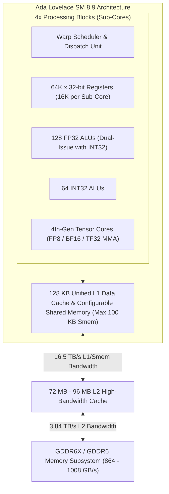

# NVIDIA Kernel Performance Engineering

Use this skill for NVIDIA GPU kernel optimization, performance debugging, architectural characterization, and backend tuning across NeuralOps operators. Follow [CONTRIBUTING](../../../CONTRIBUTING.md#benchmarking) for benchmark validation standards, and [neuralops-optimization-loop](../neuralops-optimization-loop/SKILL.md) for iterative performance engineering.

---

## 1. Hardware Baselines and Microarchitecture

PR performance claims must specify the exact GPU microarchitecture, driver version, CUDA toolkit, and PyTorch runtime.



| Architecture | Compute Capability | Key Features & Constraints | Target NeuralOps Hardware |
| :--- | :--- | :--- | :--- |
| **Ada Lovelace** | `sm_8.9` | 4th-Gen Tensor Cores (FP8 E4M3/E5M2, BF16, TF32), 100 KB configurable shared memory per SM, 64K 32-bit registers/SM, 4 processing blocks/SM, 72–96 MB L2 cache. No hardware TMA (requires `cp.async` software pipelining). | RTX 4090, L40S, L4 |
| **Hopper** | `sm_90a` | 4th-Gen Tensor Cores, Asynchronous Tensor Memory Accelerator (TMA), Warpgroup MMA (`wgmma`), 228 KB shared memory per SM, Distributed Shared Memory (DSMEM). | H100 SXM5, H800, H20 |
| **Blackwell** | `sm_100` / `sm_103` | 5th-Gen Tensor Cores, Tensor Memory (TMEM), Asynchronous `tcgen05` execution, 256+ KB shared memory per SM. | B100, B200, GB200 |

### Ada Lovelace SM 8.9 Profiling Specifics

Ada Lovelace (`sm_8.9`) presents unique architectural trade-offs compared to datacenter Hopper/Blackwell:
1. **Asymmetric Compute vs. Memory Bandwidth**: The RTX 4090 and L40S deliver massive compute density (~83 TFLOPS FP32 non-tensor, ~330 TFLOPS BF16 tensor, ~660 TFLOPS FP8 tensor), while memory bandwidth is capped at 1.0 TB/s (GDDR6X on 4090) or 864 GB/s (GDDR6 on L40S). NeuralOps linear attention kernels quickly become DRAM bandwidth-limited unless arithmetic intensity exceeds $80\text{--}120\text{ FLOPs/byte}$.
2. **L2 Cache Residency & Spatial Locality**: The enlarged 72 MB (RTX 4090) / 96 MB (L40S) L2 cache allows sequence recurrence states ($S_t \in \mathbb{R}^{B \times H \times d \times d}$) to remain resident across sequence chunks when grid scheduling enforces block swizzling (Morton / Hilbert curve scheduling over $B \times H$).
3. **Dual-Issue Pipelines**: SM 8.9 features concurrent execution of FP32 instructions and INT32 operations. Strided index calculations (`tl.cast(offs, tl.int64) * stride`) overlap cleanly with floating-point multiply-accumulate operations if address expressions are unrolled.
4. **SRAM / Shared Memory Partitioning**: Maximum user shared memory is 100 KB per SM (out of a 128 KB unified L1/SRAM block). Thread blocks requesting $>99\text{ KB}$ will fail at launch. Optimal latency hiding requires budgeting shared memory $\le 48\text{ KB}$ (to sustain 2 concurrent CTAs per SM) or $\le 32\text{ KB}$ (3 CTAs per SM).

---

## 2. Nsight Compute (`ncu`) CLI Profiling

To isolate bottlenecks in headless production clusters or CI runners, use `ncu` directly from the command line. NeuralOps benchmark runners spawn child worker processes; always supply `--target-processes all`.

### Step-by-Step Profiling Recipe

```bash
# Step 1: Discover available metric sections on the local GPU
ncu --query-sections

# Step 2: Capture a full baseline profile for a targeted operator
mkdir -p profile/ncu_reports
ncu --target-processes all \
    --set full \
    -k "regex:chunk_kda|chunked_delta" \
    -c 1 \
    -o profile/ncu_reports/chunk_kda_sm89_full \
    python -m benchmarks.ops.run --op chunk_kda --modes fwd --no-base

# Step 3: Extract source counters to pinpoint register spills and branch divergence
ncu --target-processes all \
    --set source \
    --section SourceCounters \
    -k "regex:chunk_kda" \
    -c 1 \
    -o profile/ncu_reports/chunk_kda_source \
    python -m benchmarks.ops.run --op chunk_kda --modes fwd --no-base

# Step 4: Export NCU report to CSV for programmatic regression analysis
ncu --import profile/ncu_reports/chunk_kda_sm89_full.ncurpt \
    --csv --page raw > profile/ncu_reports/chunk_kda_sm89_metrics.csv
```

### Critical NCU Metrics and Hardware Counters

Query targeted metrics without the full-set profiling overhead:

```bash
ncu --target-processes all \
    --metrics \
sm__throughput.avg.pct_of_peak_sustained_elapsed,\
l1tex__t_bytes.sum.per_second,\
l1tex__t_bytes_pipe_lsu_mem_shared_op_ld.sum,\
l1tex__t_bytes_pipe_lsu_mem_shared_op_st.sum,\
sm__pipe_tensor_op_hmma_cycles_active.avg.pct_of_peak_sustained_active,\
sm__pipe_tensor_cycles_active.avg.pct_of_peak_sustained_active,\
launch__registers_per_thread,\
smsp__sass_inst_executed_op_local_ld.sum,\
smsp__sass_inst_executed_op_local_st.sum,\
l1tex__t_bytes_pipe_lsu_mem_local_op_ld.sum,\
l1tex__t_bytes_pipe_lsu_mem_local_op_st.sum,\
dram__throughput.avg.pct_of_peak_sustained_elapsed \
    -k "regex:chunk_kda" -c 1 \
    python -m benchmarks.ops.run --op chunk_kda --modes fwd --no-base
```

#### NCU Metric Diagnostic Table

| Metric | Threshold / Signal | Root Cause | Engineering Remedy |
| :--- | :--- | :--- | :--- |
| `smsp__sass_inst_executed_op_local_ld.sum` | $> 0$ | **Register Spill to Local Memory** | Thread requested more registers than hardware limits. Reduce tile dimensions ($B_T, B_K, B_V$), apply SVD state compression, or declare `launch_bounds`. |
| `sm__pipe_tensor_op_hmma_cycles_active` | $< 35\%$ | **Tensor Core Under-utilization** | Compute pipeline stalled waiting on memory loads or using scalar ALU instead of HMMA/MMA. Ensure block shapes are multiples of 16 and inputs are contiguous BF16/FP16. |
| `l1tex__t_bytes_pipe_lsu_mem_shared_op_ld` | High with bank conflicts | **Shared Memory Bank Conflicts** | Strided loads collide on identical 4-byte bank modules (32 banks total). Pad tile strides by 8 elements (`stride + 8`) or apply XOR layout swizzling. |
| `dram__throughput.avg.pct_of_peak` | $> 85\%$ | **DRAM Memory Bandwidth Bound** | Arithmetic intensity is too low. Fuse gating, activations, and accumulation into a single recurrent pass; enlarge sequence chunk size $B_T$. |

---

## 3. Automated Roofline Analysis

Arithmetic Intensity ($\text{AI}$) and Roofline boundaries dictate whether an operator benefits from memory pipeline optimization vs. compute unrolling.

$$\text{AI}_{\text{DRAM}} = \frac{\text{FLOPs}}{\text{DRAM Bytes Transferred}}, \quad \text{AI}_{\text{L2}} = \frac{\text{FLOPs}}{\text{L2 Bytes Transferred}}, \quad \text{AI}_{\text{SRAM}} = \frac{\text{FLOPs}}{\text{SRAM Bytes Transferred}}$$

$$\text{Performance Ceiling} = \min \left( \text{Peak TFLOPS}, \, \text{AI} \times \text{Peak Bandwidth} \right)$$

### Complete Roofline Extraction & Evaluation Script

```python
#!/usr/bin/env python3
# Copyright (c) 2024-2026, Taha Majlesi
# NeuralOps Systems Engineering Group
"""
Automated Hierarchical Roofline Model Evaluator for NeuralOps Kernels.
Parses NCU counter outputs and classifies kernels into memory or compute bound regimes.
"""
from __future__ import annotations
import argparse
import sys

ROOFLINE_TARGETS = {
    "rtx_4090": {
        "dram_bw_gb_s": 1008.0,
        "l2_bw_tb_s": 3.84,
        "sram_bw_tb_s": 16.5,
        "tensor_bf16_tflops": 330.3,
        "fp32_tflops": 82.6,
    },
    "l40s": {
        "dram_bw_gb_s": 864.0,
        "l2_bw_tb_s": 3.50,
        "sram_bw_tb_s": 15.2,
        "tensor_bf16_tflops": 366.0,
        "fp32_tflops": 91.6,
    },
    "h100_sxm5": {
        "dram_bw_gb_s": 3350.0,
        "l2_bw_tb_s": 12.0,
        "sram_bw_tb_s": 33.0,
        "tensor_bf16_tflops": 989.0,
        "fp32_tflops": 67.0,
    },
}

def compute_hierarchical_roofline(
    flops: float,
    dram_bytes: float,
    l2_bytes: float,
    sram_bytes: float,
    latency_ms: float,
    target: str = "rtx_4090",
) -> dict[str, str | float]:
    spec = ROOFLINE_TARGETS[target]
    time_sec = latency_ms * 1e-3
    
    achieved_tflops = (flops / time_sec) / 1e12
    achieved_dram_bw = (dram_bytes / time_sec) / 1e9
    achieved_l2_bw = (l2_bytes / time_sec) / 1e12
    achieved_sram_bw = (sram_bytes / time_sec) / 1e12

    ai_dram = flops / max(1.0, dram_bytes)
    ai_l2 = flops / max(1.0, l2_bytes)
    ai_sram = flops / max(1.0, sram_bytes)

    dram_knee = (spec["tensor_bf16_tflops"] * 1e12) / (spec["dram_bw_gb_s"] * 1e9)
    l2_knee = (spec["tensor_bf16_tflops"]) / spec["l2_bw_tb_s"]

    if ai_dram < dram_knee:
        bound_class = "DRAM_BANDWIDTH_BOUND"
    elif ai_l2 < l2_knee:
        bound_class = "L2_CACHE_BANDWIDTH_BOUND"
    else:
        bound_class = "COMPUTE_TENSOR_BOUND"

    return {
        "target": target,
        "latency_ms": round(latency_ms, 4),
        "achieved_tflops": round(achieved_tflops, 2),
        "pct_of_peak_tflops": round((achieved_tflops / spec["tensor_bf16_tflops"]) * 100, 2),
        "achieved_dram_bw_gb_s": round(achieved_dram_bw, 2),
        "ai_dram_flops_per_byte": round(ai_dram, 2),
        "dram_knee_point": round(dram_knee, 2),
        "ai_l2_flops_per_byte": round(ai_l2, 2),
        "ai_sram_flops_per_byte": round(ai_sram, 2),
        "classification": bound_class,
    }

if __name__ == "__main__":
    parser = argparse.ArgumentParser(description="Evaluate NeuralOps Roofline Metrics")
    parser.add_argument("--flops", type=float, required=True)
    parser.add_argument("--dram-bytes", type=float, required=True)
    parser.add_argument("--l2-bytes", type=float, required=True)
    parser.add_argument("--sram-bytes", type=float, required=True)
    parser.add_argument("--latency-ms", type=float, required=True)
    parser.add_argument("--target", choices=list(ROOFLINE_TARGETS.keys()), default="rtx_4090")
    args = parser.parse_args()

    res = compute_hierarchical_roofline(
        args.flops, args.dram_bytes, args.l2_bytes, args.sram_bytes, args.latency_ms, args.target
    )
    print("=== NeuralOps Roofline Evaluation ===")
    for k, v in res.items():
        print(f"  {k:28s}: {v}")
```

---

## 4. Launch Bounds Tuning and Register Allocation

Physical register budgeting determines maximum achievable SM occupancy. In SM 8.9 Ada Lovelace, 65,536 32-bit registers are partitioned across 4 sub-cores:

$$\text{Active Warps per SM} = \min \left( \left\lfloor \frac{65536}{\text{Regs per Thread} \times 32} \right\rfloor, \, 48 \right)$$

```
Registers / Thread    Active Warps / SM    Theoretical Occupancy
----------------------------------------------------------------
<= 32                 48                   100.0% (Max)
<= 64                 32                    66.7%
<= 128                16                    33.3%
<= 255 (hardware max)  8                    16.7%
```

### Triton Launch Bounds Configuration

Control warp allocation and thread-block scheduling via `@triton.jit`:

```python
import triton
import triton.language as tl

@triton.jit(launch_bounds=(128, 2))  # (max_threads_per_cta, min_ctas_per_sm)
def chunk_kda_fwd_kernel(
    q_ptr, k_ptr, v_ptr, o_ptr,
    stride_qb, stride_qh, stride_qt, stride_qd,
    T: tl.constexpr,
    BT: tl.constexpr,
    BK: tl.constexpr,
    BV: tl.constexpr,
):
    """
    KDA forward chunk kernel tuned for SM 8.9.
    128 threads per CTA (num_warps=4) with launch_bounds guaranteeing 2 CTAs per SM.
    Forces ptxas to bound register usage to <= 128 registers per thread, preventing spills.
    """
    pid_b = tl.program_id(0)
    pid_h = tl.program_id(1)
    pid_c = tl.program_id(2)

    offs_t = pid_c * BT + tl.arange(0, BT)
    offs_k = tl.arange(0, BK)
    offs_v = tl.arange(0, BV)

    # Coalesced global memory loads with 64-bit address casting
    q_ptrs = q_ptr + tl.cast(pid_b, tl.int64) * stride_qb + tl.cast(pid_h, tl.int64) * stride_qh + \
             tl.cast(offs_t[:, None], tl.int64) * stride_qt + tl.cast(offs_k[None, :], tl.int64) * stride_qd
    
    q_tile = tl.load(q_ptrs, mask=offs_t[:, None] < T, other=0.0)
    # Register-resident computation ...
```

### CUDA C++ Inline PTX Intrinsics for Asynchronous Block Transfers

On Ada Lovelace (SM 8.9), hardware TMA is absent. Asynchronous GM-to-SRAM copies must use `cp.async` PTX instructions to bypass intermediate register staging:

```cuda
#include <cuda_runtime.h>
#include <cuda_fp16.h>

// CUDA Device Function: Asynchronous 16-byte transfer bypassing registers
__device__ __forceinline__ void cp_async_global_to_shared_16b(
    void* __restrict__ smem_dst,
    const void* __restrict__ global_src
) {
    unsigned int smem_addr = __cvta_generic_to_shared(smem_dst);
    asm volatile(
        "cp.async.ca.shared.global [%0], [%1], 16;\n"
        :
        : "r"(smem_addr), "l"(global_src)
        : "memory"
    );
}

// Commit asynchronous pipeline group
__device__ __forceinline__ void cp_async_commit() {
    asm volatile("cp.async.commit_group;\n" ::);
}

// Wait for outstanding groups down to N
template <int N>
__device__ __forceinline__ void cp_async_wait() {
    asm volatile("cp.async.wait_group %0;\n" :: "n"(N));
}

// Launch bounds enforcing 256 threads per block, 2 blocks per SM (<= 128 registers/thread)
extern "C" __global__ void __launch_bounds__(256, 2)
kda_fast_recurrent_kernel(
    const half* __restrict__ q,
    const half* __restrict__ k,
    const half* __restrict__ v,
    half* __restrict__ o,
    int seq_len,
    int dim
) {
    extern __shared__ char smem_buffer[];
    half* s_k = reinterpret_cast<half*>(smem_buffer);
    half* s_v = s_k + 128 * 64;

    int tid = threadIdx.x;
    // Issue async stage load
    cp_async_global_to_shared_16b(&s_k[tid * 8], &k[tid * 8]);
    cp_async_commit();
    cp_async_wait<0>();
    __syncthreads();
}
```

Verify PTX compiler register counts:
```bash
nvcc -arch=sm_89 -Xptxas="-v,-warn-on-spills" -c kda_kernel.cu
# Target: 0 bytes stack frame, 0 bytes lmem, <= 128 registers
```

---

## 5. SVD State and Weight Compression for Register Relief

Large state dimensions ($d \ge 128$) require $128 \times 128 \times 4 = 64\text{ KB}$ of state storage per head. In single-step recurrent generation, this causes catastrophic local memory spilling.

NeuralOps resolves this via **Singular Value Decomposition (SVD) low-rank state factorization**:

$$S_t \approx U_t \Sigma_t V_t^\top \quad \text{where } U_t, V_t \in \mathbb{R}^{d \times r}, \, \Sigma_t \in \mathbb{R}^{r \times r}, \, r \ll d$$

By updating only the compact core matrix $\Sigma_t \in \mathbb{R}^{r \times r}$ ($r=16 \implies 256$ floats = $1\text{ KB}$), register storage drops by **$16\times$**, enabling full warp residency.

```python
import torch
import triton
import triton.language as tl

@triton.jit
def svd_compact_state_update_kernel(
    u_ptr,         # [B, H, D, R]
    v_ptr,         # [B, H, D, R]
    core_s_ptr,    # [B, H, R, R]
    q_ptr,         # [B, H, D]
    k_ptr,         # [B, H, D]
    v_in_ptr,      # [B, H, D]
    out_ptr,       # [B, H, D]
    decay_gamma,   # scalar decay float32
    D: tl.constexpr,
    R: tl.constexpr, # Rank: 16 or 32
):
    pid = tl.program_id(0)
    offs_d = tl.arange(0, D)
    offs_r = tl.arange(0, R)

    # 1. Load low-rank bases (D, R)
    u_mat = tl.load(u_ptr + offs_d[:, None] * R + offs_r[None, :])
    v_mat = tl.load(v_ptr + offs_d[:, None] * R + offs_r[None, :])

    # 2. Project token into rank-R subspace: (D,) @ (D, R) -> (R,)
    k_tok = tl.load(k_ptr + offs_d)
    v_tok = tl.load(v_in_ptr + offs_d)
    k_proj = tl.sum(k_tok[:, None] * v_mat, axis=0) # (R,)

    # 3. Compact state recurrence in registers
    core_ptrs = core_s_ptr + offs_r[:, None] * R + offs_r[None, :]
    core_s = tl.load(core_ptrs)
    
    # Outer product rank-1 update in compact space
    core_s = decay_gamma * core_s + (k_proj[:, None] * k_proj[None, :])
    tl.store(core_ptrs, core_s)

    # 4. Decode output via left singular subspace
    q_tok = tl.load(q_ptr + offs_d)
    q_proj = tl.sum(q_tok[:, None] * u_mat, axis=0) # (R,)
    state_out = tl.sum(core_s * q_proj[None, :], axis=1) # (R,)
    o_val = tl.sum(u_mat * state_out[None, :], axis=1) # (D,)

    tl.store(out_ptr + offs_d, o_val)
```

---

## 6. End-to-End Optimization Checklist

1. **Synchronized Baseline**: Run benchmark with locked clocks and warmups:
   ```bash
   nvidia-smi -lgc 2520,2520  # Lock clocks on RTX 4090 to eliminate clock jitter
   python -m benchmarks.ops.verify --op chunk_kda --base $(git rev-parse HEAD)
   ```
2. **NCU Bottleneck Diagnosis**: Check `launch__registers_per_thread`, `sm__throughput`, and local memory spill counters.
3. **Engineering Intervention**:
   - Register spill $\to$ Lower tile sizes ($B_T=32$), enforce `launch_bounds`, or apply SVD state compression.
   - Bank conflict $\to$ Apply 8-element padding or XOR layout swizzling to shared memory buffers.
   - DRAM bounded $\to$ Enlarge $B_T$ chunk size and maximize L2 tile spatial reuse.
4. **Frozen Gate Verification**: Verify correctness against `pytest tests/ops/test_kda.py` with NaN poisoning enabled before committing.
