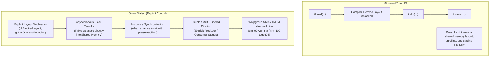
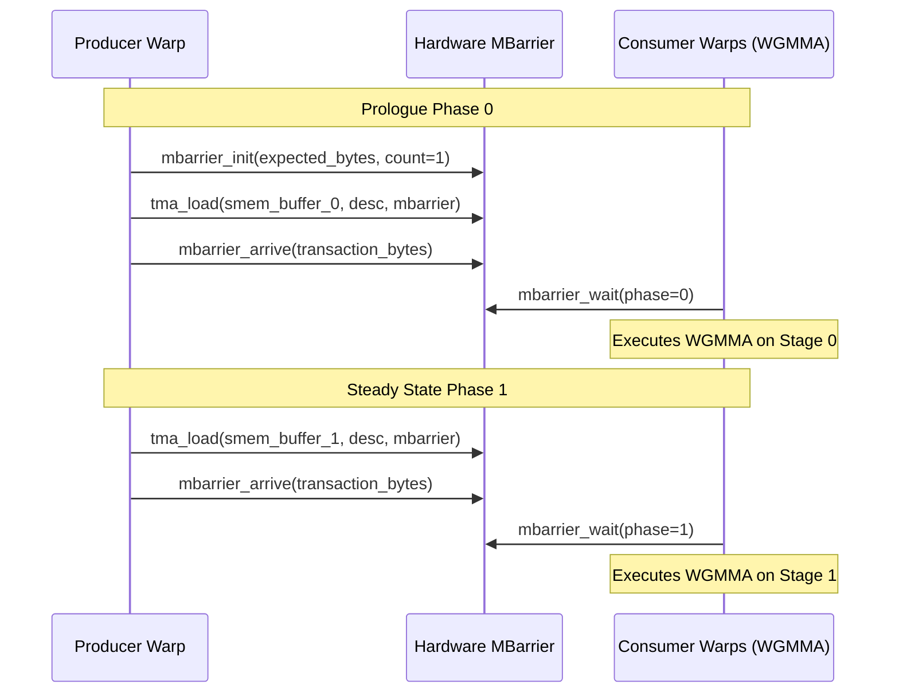

# Triton to Gluon Porting Guide

Use this skill when profiling indicates that standard Triton kernels have reached compiler-imposed performance limits—specifically register spilling, bank conflict stalls in shared memory layout conversions, or suboptimal load/compute overlapping. Follow [neuralops-optimization-loop](../neuralops-optimization-loop/SKILL.md) for benchmark baselines and [neuralops-nvidia-performance](../neuralops-nvidia-performance/SKILL.md) for GPU profiling.

---

## 1. Architectural Foundations of Gluon

The Triton Gluon dialect exposes low-level hardware control over thread-to-data mappings, hardware memory descriptors, and asynchronous execution pipelines.



### Hardware Capability Matrix

| Architecture | Primitives Available | Gluon Feature Set |
| :--- | :--- | :--- |
| **Ampere / Ada (`sm_8.0`, `sm_8.9`)** | `cp.async`, `ldmatrix`, `mma.sync` | Explicit `#blocked` layouts, double-buffered `cp.async` pipelines, manual layout swizzling. |
| **Hopper (`sm_90a`)** | Asynchronous TMA, `wgmma`, Mbarrier | Hardware TMA descriptors, warpgroup MMA directly reading shared memory, multi-stage pipelines ($3\text{--}5$ stages). |
| **Blackwell (`sm_100`)** | `tcgen05`, Tensor Memory (TMEM), Cluster barriers | TMEM accumulator allocation, cluster-wide mbarrier, decoupled memory/compute warpgroups. |

---

## 2. Explicit Tensor Layouts and Transformations

In standard Triton, layouts are inferred automatically, often resulting in silent layout conversions (`gl.convert_layout`) that spill to shared memory and induce bank conflicts. In Gluon, layouts are first-class types.

### Key Layout Encodings

1. **`gl.BlockedLayout`**: Maps multi-dimensional tensor coordinates to threads and warps:
   - `size_per_thread`: Number of contiguous elements per thread (e.g. $[1, 8]$ for coalesced 128-bit loads).
   - `threads_per_warp`: Distribution of 32 threads across dimensions (e.g. $[4, 8]$).
   - `warps_per_cta`: Distribution of warps within the block (e.g. $[2, 2]$ for 4 warps).
   - `order`: Dimension traversal order (e.g. $[1, 0]$ for row-major).

2. **`gl.DotOperandEncoding`**: Custom layout required by Tensor Core MMA instructions:
   - Avoids bank conflicts by matching MMA register placement rules.
   - Converts from `#blocked` with zero cost when layout strides match native tensor core packing.

3. **Layout Swizzling**: Eliminates bank conflicts in shared memory:
   - For a $64 \times 64$ half-precision matrix, standard row-major addressing creates 32-way bank collisions on column slices.
   - Swizzling applies bitwise XOR on row/column indices: $\text{bank} = (\text{col} \oplus \text{row}) \pmod{32}$.

```python
from triton.experimental import gluon
from triton.experimental.gluon import language as gl

# Explicit Blocked Layout definition for a 64x64 tile with 4 warps
# Optimized for 128-bit coalesced memory transactions (8 FP16 elements per thread)
LAYOUT_A = gl.BlockedLayout(
    size_per_thread=[1, 8],
    threads_per_warp=[4, 8],
    warps_per_cta=[2, 2],
    order=[1, 0]
)

# Explicit MMA Dot Operand Layout for Operand A (maps directly to Hopper WGMMA)
LAYOUT_MMA_A = gl.DotOperandEncoding(
    op_idx=0,
    parent=LAYOUT_A,
    k_width=8
)
```

### Safe Layout Conversions

When converting between layouts across warps:
```python
# Free conversion (no shared memory round-trip):
x_converted = gl.convert_layout(x, target_layout, assert_trivial=True)

# Shared-memory mediated conversion:
# Only permit if profiling proves register reduction outweighs SRAM overhead
x_converted = gl.convert_layout(x, target_layout, assert_trivial=False)
```

---

## 3. Asynchronous Block Transfers (TMA & `cp.async`)

Asynchronous block transfers load global memory directly into shared memory without passing through intermediate registers, eliminating register pressure and memory stalling.

### Hopper TMA (Tensor Memory Accelerator) Workflow

On Hopper SM 90, TMA uses hardware descriptors to move multi-dimensional tiles:

```python
# Host-side TMA descriptor initialization
import triton.tools.experimental_descriptor as desc

def create_tma_descriptors(tensor_x: torch.Tensor, block_m: int, block_k: int):
    """
    Creates a 2D TMA hardware descriptor for asynchronous tile transfers.
    Guarantees 128-byte global memory base alignment.
    """
    assert tensor_x.data_ptr() % 128 == 0, "TMA tensors must be 128-byte aligned"
    return desc.create_2d_tma_descriptor(
        ptr=tensor_x.data_ptr(),
        dim_m=tensor_x.shape[0],
        dim_k=tensor_x.shape[1],
        block_m=block_m,
        block_k=block_k,
        element_size=tensor_x.element_size(),
    )
```

### Mbarrier Synchronization Protocol

TMA and asynchronous transfers must be synchronized using hardware transaction barriers (`mbarrier`):

$$\text{Transaction Count} = \text{Total Bytes Loaded in Stage}$$



---

## 4. Double-Buffered and Multi-Stage Pipelines

Multi-stage pipelines decouple data loading from arithmetic execution by maintaining $N$ stages ($N \ge 2$) in shared memory.

### Complete Multi-Stage Gluon Recurrent Kernel

```python
# Copyright (c) 2024-2026, Taha Majlesi
# NeuralOps Systems Engineering Group
"""
High-Performance Multi-Stage Double-Buffered Linear Attention Kernel in Gluon Dialect.
Demonstrates explicit layout assignment, asynchronous staging, and MMA computation.
"""
from __future__ import annotations
import torch
import triton
from triton.experimental import gluon
from triton.experimental.gluon import language as gl

@gluon.jit
def gluon_chunked_kda_fwd_kernel(
    desc_q,          # TMA Descriptor for Query [B, H, T, D]
    desc_k,          # TMA Descriptor for Key   [B, H, T, D]
    desc_v,          # TMA Descriptor for Value [B, H, T, D]
    out_ptr,         # Output Pointer
    stride_ob, stride_oh, stride_ot, stride_od,
    T,
    BT: gl.constexpr,   # Chunk size (e.g. 64)
    BK: gl.constexpr,   # Feature dim K (e.g. 64)
    BV: gl.constexpr,   # Feature dim V (e.g. 64)
    NUM_STAGES: gl.constexpr, # Pipeline depth (e.g. 2 or 3)
):
    pid_b = gl.program_id(0)
    pid_h = gl.program_id(1)

    # 1. Allocate Double-Buffered Shared Memory Buffers
    smem_k = gl.allocate_shared(shape=[NUM_STAGES, BT, BK], dtype=gl.float16)
    smem_v = gl.allocate_shared(shape=[NUM_STAGES, BT, BV], dtype=gl.float16)

    # 2. Initialize Hardware MBarriers for each stage
    barriers = gl.allocate_mbarriers(count=NUM_STAGES)
    bytes_per_stage: gl.constexpr = (BT * BK * 2) + (BT * BV * 2)

    num_chunks = gl.cdiv(T, BT)

    # ------------------ PROLOGUE ------------------
    # Pre-fill initial stages
    for stage in range(NUM_STAGES - 1):
        if stage < num_chunks:
            gl.mbarrier_init(barriers[stage], count=1)
            gl.tma_async_load(smem_k[stage], desc_k, coords=[pid_b, pid_h, stage * BT, 0], barrier=barriers[stage])
            gl.tma_async_load(smem_v[stage], desc_v, coords=[pid_b, pid_h, stage * BT, 0], barrier=barriers[stage])
            gl.mbarrier_arrive(barriers[stage], bytes=bytes_per_stage)

    # State accumulator in registers
    s_state = gl.zeros([BK, BV], dtype=gl.float32)

    # ----------------- STEADY STATE -----------------
    for c in range(0, num_chunks):
        stage_idx = c % NUM_STAGES
        phase = (c // NUM_STAGES) & 1

        # Await producer completion for this stage
        gl.mbarrier_wait(barriers[stage_idx], phase=phase)

        # Issue prefetch for stage + (NUM_STAGES - 1)
        prefetch_c = c + (NUM_STAGES - 1)
        if prefetch_c < num_chunks:
            prefetch_stage = prefetch_c % NUM_STAGES
            gl.tma_async_load(smem_k[prefetch_stage], desc_k, coords=[pid_b, pid_h, prefetch_c * BT, 0], barrier=barriers[prefetch_stage])
            gl.tma_async_load(smem_v[prefetch_stage], desc_v, coords=[pid_b, pid_h, prefetch_c * BT, 0], barrier=barriers[prefetch_stage])
            gl.mbarrier_arrive(barriers[prefetch_stage], bytes=bytes_per_stage)

        # Perform WGMMA / MMA computation directly from Shared Memory
        k_tile = smem_k[stage_idx]
        v_tile = smem_v[stage_idx]

        # Explicit dot-product update: S_state += K^T @ V
        s_update = gl.dot(gl.trans(k_tile), v_tile, out_dtype=gl.float32)
        s_state = s_state + s_update

        # Memory proxy fence to ensure consumer has finished reading before next stage overwrite
        gl.fence_proxy_async()

    # ------------------ EPILOGUE ------------------
    # Flush remaining state to output ...
```

---

## 5. Verification and Correctness Protocol

Porting to Gluon modifies memory ordering and thread scheduling. Always execute the verification gate before timing:

```bash
# 1. Verify analytical equivalence against baseline
python -m benchmarks.ops.verify --op chunk_kda --base $(git rev-parse HEAD)

# 2. Strict numerical autograd test
pytest tests/ops/test_kda.py -k "test_chunk_kda_correctness" -v
```

### Common Gluon Porting Pitfalls
1. **Uninitialized Shared Memory Rows**: Masked TMA loads do not zero unmapped tile boundaries. Always initialize target shared memory tiles to zero (`tl.zeros` or padding) before issuing masked loads.
2. **Missing Memory Proxy Fence**: Generic shared memory reads and async TMA engines use separate hardware pipelines. Failing to insert `fence_proxy_async()` before reusing shared memory leads to non-deterministic data races.
3. **Mbarrier Phase Bit Corruption**: The phase bit alternates ($0 \to 1 \to 0$) upon completion of each stage traversal. Passing an incorrect phase index causes CTAs to deadlock indefinitely.
