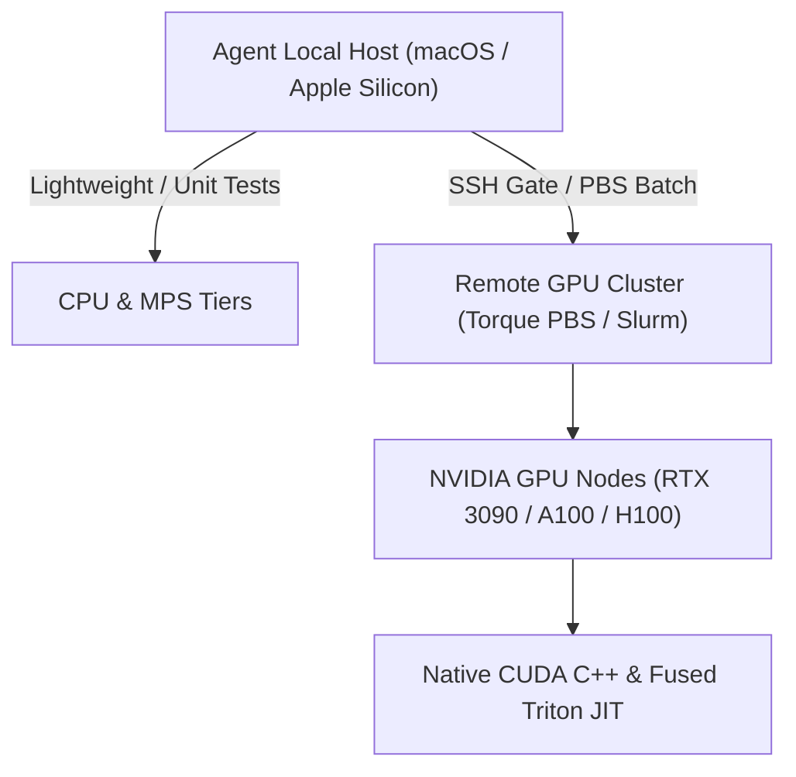
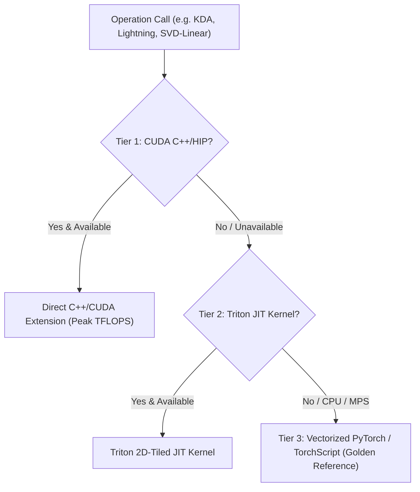

# NeuralOps Agent Operating System & Engineering Standard (AGENTS.md)

> **Document Classification:** High-Authority Repository Directive  
> **Applies to:** All AI Coding Agents (Claude Code, Google Antigravity, OpenAI Codex, Cursor, Cascade), Automated CI Bots, Subagents, and Human Contributors.  
> **Repository:** `neuralops` (Neural Operations Engine for Linear Attention, SVD Compression, and GPU Kernel Microarchitectures)  
> **Current Version Alignment:** `v2.0.6`  
> **Reference Document:** Read `CONTRIBUTING.md` first for foundational code style, docstrings, testing, and PR conventions.

---

## 0. Non-Negotiable Core Operating Principles

Three universal laws supersede all other guidelines in this repository. Any violation is classified as a critical system regression:

1. **Absolute Verification Honesty (Zero Hallucination)**:
   - Never assert or assume that an action, test, script, or kernel works without physical execution evidence.
   - If a test or command failed, output the verbatim error log and stack trace.
   - If an operation was not executed (due to missing hardware, missing environment variable, or tool limitation), state explicitly that it was skipped or deferred.
   - *"It should compile/work"* is strictly forbidden. *"Executed `scripts/orchestrator_5gate.sh` on device X and obtained PASS across all 5 gates"* is valid verification.

2. **Zero-Fake Artifact Law (Never Generate Synthetic Containers or Fallbacks)**:
   - Never emit fake binaries, placeholder files, mock weights, or magic headers pretending to be real engine artifacts (`.onnx`, `.safetensors`, `.engine`, `.trt`, `.gguf`).
   - If an export path or conversion engine is unavailable, explicitly raise `NotImplementedError` or `RuntimeError`.
   - Never fall back to hardcoded numbers (e.g., hardcoded throughput, speedup, or perplexity) when real data is missing.
   - Never write `except Exception: pass` around empirical data producers or mathematical evaluation pipelines.

3. **Strict Invariant Law & Blocker Escalation**:
   - The repository invariants (131 Attentions, 72 Compressors, 58 Triton Files, 141 CUDA Packages, 94 Notebooks) are frozen mathematical contracts.
   - If any proposed change alters these invariants, causes drift, or violates an architectural boundary, halt immediately and request explicit user authorization.

---

## 1. Git Safety, Attribution & Branching Standards

- **Mandatory Author Attribution**:
  All git commits **MUST** strictly specify author attribution:
  ```bash
  git commit -m "..." --author="taha <tahamaj4@gmail.com>"
  ```
- **Never Discard Uncommitted Changes**:
  - Never execute destructive reset commands (`git reset --hard`, `git checkout -- .`, `git restore .`) without explicit, unambiguous user confirmation.
  - Uncommitted changes in working tree are volatile and cannot be recovered via reflog.
- **Direct Pushes to `main`**:
  - On `main`, always verify git status and ensure working tree cleanliness with the 5-Gate orchestrator (`scripts/orchestrator_5gate.sh`) before pushing.
  - Never force-push (`git push --force`) to `main` under any circumstances.
- **Commit Messages**:
  - Use conventional commits: `feat(...)`, `fix(...)`, `perf(...)`, `refactor(...)`, `chore(...)`, `docs(...)`.
  - Do not introduce AI branding, assistant watermarks, or `Co-Authored-By` tags unless requested.

---

### 1.5 Multi-Agent & Delegation Protocol (Strict)
- **No Hero Mode**: When instructed to execute a multi-agent workflow (e.g., spawning 10 sub-agents across waves), you are strictly FORBIDDEN from doing the work yourself sequentially and reporting it as "agents completed". 
- **Tool Dependency**: If your environment lacks a `Task` or Subagent spawning tool, you MUST stop immediately and report: `BLOCKED: This environment does not support multi-agent spawning.` 
- **No Fabricated Agent IDs**: Never invent IDs like `41ddd7df` or report that "Agent X" finished a task unless you actually invoked the sub-agent and received its return payload.
- **Parallel Execution**: For parallel waves, all sub-agents MUST be spawned in the same turn.

### 1.6 Local State & Database Hygiene
- **Never Track SQLite/Binary Ledgers**: The `results/master_ledger.sqlite` and any other local `.sqlite`, `.db`, or `.parquet` result files are local-only state. They MUST be listed in `.gitignore` and untracked via `git rm --cached`.
- **Tests Must Not Dirty Git Status**: If a unit test writes to the SQLite ledger or a local output file, refactor the test to use the `tmp_path` fixture (pytest built-in) or write to a temporary directory. Never use `git checkout --` inside test scripts to hide working tree changes.

---

## 2. Licensing, Copyright Headers & Code Attribution

- **Standard Header Requirement**:
  Every newly authored Python, C++, CUDA, Triton, or Bash script must start with the standard MIT license header:
  ```python
  # Copyright (c) 2024-2026, Taha Majlesi
  #
  # This source code is licensed under the MIT license found in the
  # LICENSE file in the root directory of this source tree.
  # For a list of all contributors, visit:
  #   https://github.com/tahamajs/NeuralOps/graphs/contributors
  ```
- **Prohibition of Duplicate / Trivial Author Tags**:
  - Do not insert inline docstring tags like `Author: Taha Majlesi` or `Created by Agent` inside class or function bodies. The header block at file top is authoritative.
- **Preserve Historical Comments**:
  - Never delete algorithmic "why" comments, mathematical derivations, or hardware workarounds during refactoring.

---

## 3. Execution Environment & Compute Hierarchy



### 3.1 Local Environment
- **Host Platform**: macOS (Apple Silicon).
- **Execution Scope**:
  - Fast CPU and MPS unit tests, code linting, AST syntax verification, and packaging.
  - CUDA kernels and Triton JIT compilation **cannot** run natively on macOS without remote hardware or software emulation.
  - When running locally, utilize the vectorized PyTorch fallback backend:
    ```python
    import neuralops
    neuralops.force_kernel_backend("pytorch")
    ```

### 3.2 Remote GPU Cluster Execution (Sharif HPC & High-Performance Targets)
- **Primary Remote Host**: Sharif University HPC Cluster (`hpc`, Torque PBS scheduler, Rocks 6.1 / Linux, NVIDIA RTX 3090 / A100 GPUs).
- **Remote Environment**: Conda environment configured with CUDA Toolkit, PyTorch CUDA build, and Triton JIT runtime.
- **Submission Protocol**:
  - Benchmarks, full kernel compilation, and heavy KD ablations run via batch PBS jobs in `scripts/hpc/` (e.g. `qsub scripts/hpc/run_triton_58_comprehensive.pbs`).
  - Do not poll remote SSH connections in tight loops. Batch operations, leverage multiplexed SSH `ControlMaster`, and log outputs to `results/` or persistent files.

---

### 3.3 Reporting Deferred Tasks (GPU/HPC Only)
- If a verification step requires CUDA or Triton (e.g., `torch.autograd.gradcheck` or `pytest -m gpu`) and cannot run on macOS, mark it as `DEFERRED`.
- You MUST provide the exact SSH command and Python script snippet that the user needs to run on the remote HPC node to verify the task.
- Example:
  > **DEFERRED (GPU Required):** 
  > Run on `taha@192.168.1.100`:
  > `pytest tests/test_triton_parity.py -v -k "cosformer"`

---

## 4. Frozen Repository Invariants (Canonical 5-Pillars)

The repository's architectural scale is certified by 5 immutable count invariants, verified by `scripts/orchestrator_5gate.sh` and `scripts/utils/verify_readme_counts.py`:

| Invariant Pillar | Canonical Count | Verification Authority / Registry | Description |
|---|---|---|---|
| **Attentions** | **131** | `ATTENTION_REGISTRY` in `neuralops/layers/__init__.py` | Exhaustive collection spanning Linear, Gated, Delta, SSM, and Hybrid attention architectures. |
| **Compressors** | **72** | `COMPRESSOR_REGISTRY` in `neuralops/compression/__init__.py` | Compression engines including SVD, Incoherent Hadamard, Sparse ADMM, and Quantization. |
| **Triton Kernels** | **58** | `neuralops/core/triton_kernels/` (26 canonical) + `neuralops/ops/triton/` (32 modules) | Production-grade 2D-tiled Triton JIT hardware kernels without deprecated block pointers. |
| **CUDA Packages** | **141** | `neuralops/ops/cuda/` (140 directories + plugins) | High-performance C++/CUDA extensions with 128-bit vectorization, warp shuffle, and tensor core tiling. |
| **Notebooks** | **94** | `notebooks/` directory | Fully reproducible Jupyter demonstration and research tutorials. |

### Invariant Rules:
- **No Unapproved Additions or Deletions**: Never modify the number of registered keys without formal instruction and cross-file updates across all matrices, tests, and documentation.
- **Registry Count vs File Count**: Note that canonical counts refer to registry keys and official packages, not arbitrary filesystem counts. Aliases and helper utilities are excluded.

---

### 5.0 Strict Scope Discipline (No Drive-by Refactoring)
- If the user asks to "fix X", fix **only** X. Do not reformat adjacent functions, do not rename variables, and do not add "proactive improvements" (e.g., extra caching, speculative features) unless explicitly instructed.
- A PR that fixes a bug should be reviewable in under 1 minute. If your diff touches more than 3 files for a simple fix, you are likely violating scope.

---

## 5. Architectural Contracts: 3-Level Kernel Fallback Hierarchy

NeuralOps guarantees seamless execution across any hardware platform via its strict 3-tier kernel dispatch fallback contract:



1. **Tier 1 (CUDA C++ / HIP)**:
   - Primary high-throughput path for supported NVIDIA/AMD GPUs.
   - Vectorized memory operations (128-bit `float4` / `half2`), warp-level reduction intrinsics, zero shared memory bank conflicts.
2. **Tier 2 (Triton JIT)**:
   - Automated 2D-tiled JIT compilation for modern GPUs (Ada Lovelace, Hopper, Blackwell, Ampere).
   - Strict block boundary masking (`cdiv` tiling) and autotuned num_warps/num_stages.
3. **Tier 3 (Pure PyTorch / TorchScript Reference)**:
   - High-precision golden fallback ensuring 100% testability on CPU and Apple Silicon MPS.
   - Numerically stable formulations against which Tier 1 and Tier 2 outputs are validated.

---

## 6. Model Surgery & Knowledge Distillation Protocols

### 6.1 Unified Attention Surgery
- The `AttentionSurgery` and `CausalAttentionSurgeonAdapter` subsystems allow zero-recompilation transplant of standard self-attention mechanisms with any of the 131 Linear/Delta/SVD mechanisms.
- **Integrity Requirement**:
  - Always verify output shape parity `(B, T, D)` and KV-cache bridge compatibility (`NeuralOpsHybridHFCache`).
  - Follow the 3-phase surgery protocol:
    1. *Transplant*: Surgical module swap with hook preservation.
    2. *Calibration*: Closed-form Ridge regression / feature whitening on calibration tokens.
    3. *Micro-Healing*: 6-pillar knowledge distillation (Warmup-Stable-Decay schedule).

### 6.2 6-Pillar Knowledge Distillation (KD)
When running model healing, the multi-factor distillation loss consists of:
$$\mathcal{L}_{\text{total}} = \alpha \mathcal{L}_{\text{task}} + \beta \mathcal{L}_{\text{logit}} + \gamma \mathcal{L}_{\text{hidden}} + \delta \mathcal{L}_{\text{attn\_map}} + \epsilon \mathcal{L}_{\text{svd\_spectral}} + \zeta \mathcal{L}_{\text{contrastive}}$$
- Never disable loss components or skip backward pass validation without explicit instruction.

---

### 6.3 Error Traceback Mandate (No Silent Skipping)
- When running benchmarks or evaluation matrices across multiple modules (e.g., all 131 attentions), if a module throws a `RuntimeError` or `ShapeMismatch`, you MUST capture and log the full traceback.
- In the final CSV/JSON report, mark the module as `ERROR`, but in the accompanying markdown report, include an "Error Appendix" section listing the exact exception for each failed module. 
- Never group failures under a generic phrase like "dimension mismatch" without proving the exact tensor shapes that clashed.

---

## 7. Unified CLI System (`neuralops`)

NeuralOps exposes a production-grade CLI built on Click and Rich. AI agents must prefer the unified CLI over fragmented standalone scripts:

| Domain | Command | Key Capabilities |
|---|---|---|
| **Model Surgery** | `neuralops surgery` | 1-line transplant, ridge calibration, and post-surgery healing. |
| **Compression** | `neuralops compress` | SVD, Hadamard Incoherent SVD, W4A16, and structured pruning. |
| **Serving Runtime** | `neuralops serve` | ContinuousBatcher, PagedKVCache, speculative draft-and-verify decoding. |
| **Benchmarking** | `neuralops benchmark` | Standardized execution matrix across modules, shapes, and hardware devices. |
| **System Diagnostics** | `neuralops doctor` | Complete environment diagnostics, CUDA/Triton availability, and invariant checks. |
| **Inspector & UI** | `neuralops inspect` / `ui` | Detailed module architecture inspection and terminal UI. |

---

## 8. 5-Gate Quality & Verification Standard

Before any git commit, PR merge, or release distribution, the agent **MUST** execute and pass the repository's 5-Gate verification orchestrator:

```bash
bash scripts/orchestrator_5gate.sh
```

### The 5 Gates:
1. **Gate A: Working Tree Cleanliness**:
   - Ensures no untracked clutter or uncommitted artifacts corrupt the build.
2. **Gate B: Canonical Invariant Preservation**:
   - Asserts exact equality for the 131 / 72 / 58 / 141 / 94 counts.
3. **Gate C: Package Import & Version Integrity**:
   - Validates that `neuralops` installs and imports cleanly without side-effect crashes.
4. **Gate D: Core Regression Suite**:
   - Runs deterministic CPU unit tests covering registries, adapters, and surgery contracts.
5. **Gate E: Code Quality & AST Linter**:
   - Enforces clean syntax, zero syntax errors, and flake8/ruff conformance.

---

### 8.2 Active Self-Monitoring (The 2-Minute Rule)
- During any long-running operation (e.g., executing a multi-phase cleanup or a 38-hour benchmark), pause every 2 to 3 phases (or after any command that produces unexpected output).
- Run the self-check block:
  ```bash
  git status --porcelain
  python3 -c "import neuralops; print(neuralops.__version__)"
  ```
- If `git status` shows uncommitted files that are NOT part of the current phase, or if the version/invariants drift, HALT execution immediately and report to the user.

---

## 9. Release Engineering & Version Management

- **Single Source of Truth**:
  `neuralops/__init__.py:__version__` is the definitive version string.
- **Synchronization**:
  Every version update must synchronize across:
  - `neuralops/__init__.py`
  - `pyproject.toml`
  - `CITATION.cff`
  - `CHANGELOG.md`
  - `README.md`
- **Verification Command**:
  ```bash
  python3 scripts/utils/sync_version.py --check
  ```
- **Release Packaging**:
  Build and test distributions via:
  ```bash
  python3 -m build
  twine check dist/*
  ```

---

## 10. Summary Protocol for Agent Turns

When concluding a development turn or reporting results to the user, follow this structured format:

1. **Executive Summary**: Clear 1-2 sentence statement of what was accomplished.
2. **Verification Evidence**: Verbatim command execution outputs and confirmation of Gate pass.
3. **Files Modified/Created**: Markdown list of modified file paths with hyperlinks.
4. **Invariant Status**: Confirmation that canonical counts (131/72/58/141/94) remain preserved.
5. **Next Concrete Steps**: Actionable next recommendations.

---

## 13. Version History & Change Log

- **v1.3.0** — Added §1.5 (Multi-Agent Protocol), §1.6 (DB Hygiene), §3.3 (Deferred Reporting), §5.0 (Strict Scope), §6.3 (Error Tracebacks), and §8.2 (Self-Monitoring).

---

*Authored and certified for NeuralOps v2.0.6. Last updated: 2026-11-06.*
