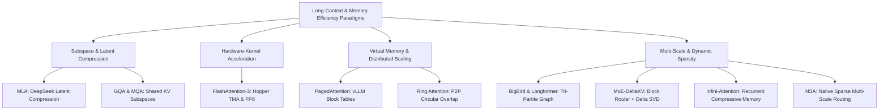
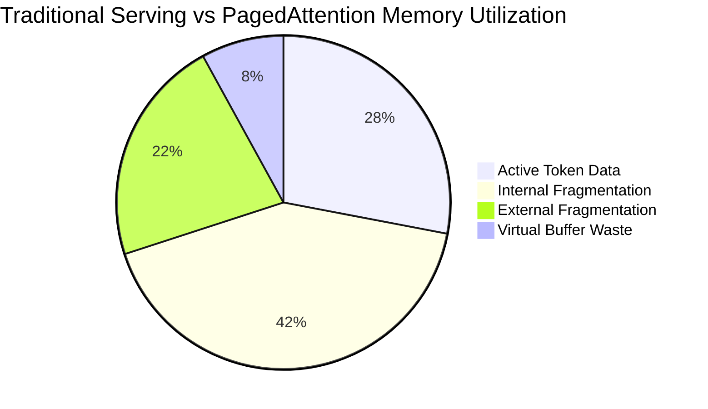
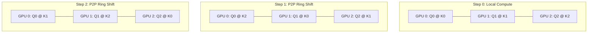
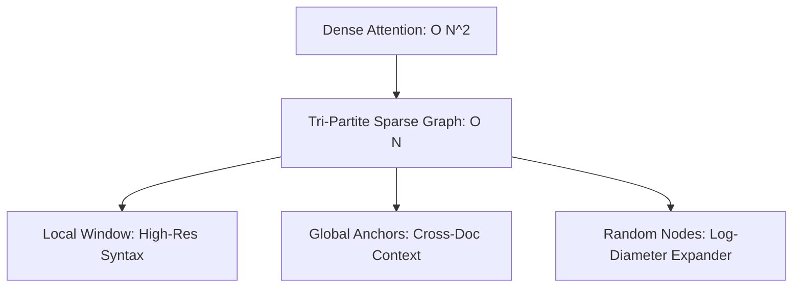
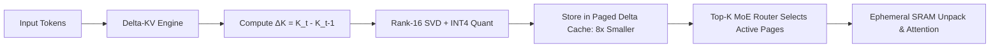
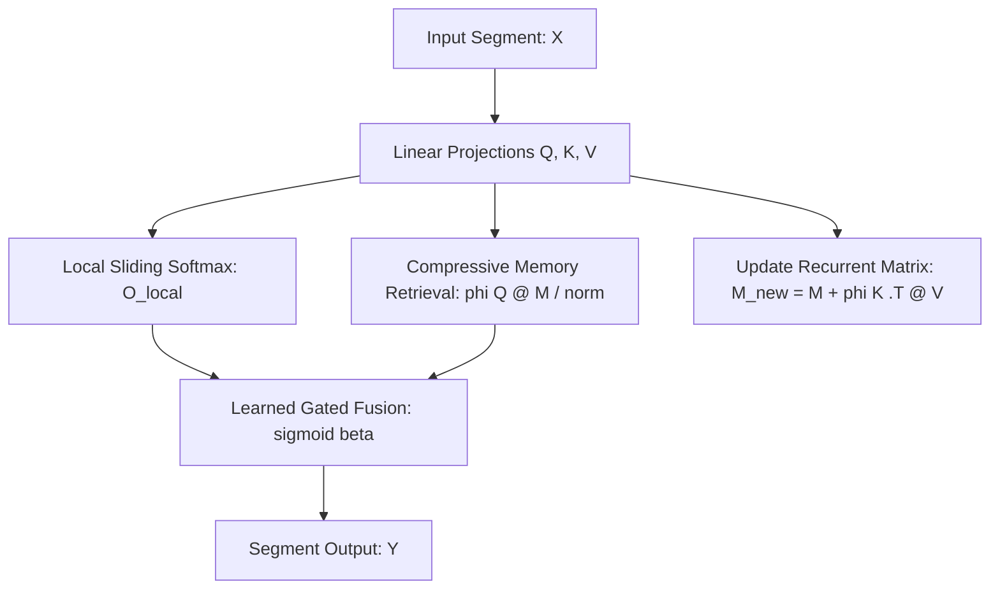

# ⚡ Part 3: Sparse, Multi-Scale, Latent & Paged Attention Architectures

> **The Architectural Playbook for Long-Context LLMs: How Latent Bottlenecks, Virtual Memory Paging, Hardware-Aware Tiling, and Dynamic Sparsity Break the $O(N^2)$ Complexity Wall.**
> 
> *Inspired by the intuitive, visually rich writing styles of Jay Alammar, Lilian Weng, and Sebastian Raschka.*

---

## 📑 Table of Contents
1. [Multi-Head Latent Attention (MLA - DeepSeek V2/V3 Compression)](#1-multi-head-latent-attention-mla)
2. [Grouped-Query Attention (GQA) & Multi-Query Attention (MQA)](#2-grouped-query-attention-gqa--multi-query-attention-mqa)
3. [FlashAttention-3 (Hardware-Aware FP8 Warpgroup Tiling)](#3-flashattention-3-hardware-aware-fp8-warpgroup-tiling)
4. [PagedAttention & Block Virtual Memory (vLLM KV Paging)](#4-pagedattention--block-virtual-memory-vllm-kv-paging)
5. [Ring Attention & Blockwise Parallel Context Scaling](#5-ring-attention--blockwise-parallel-context-scaling)
6. [BigBird & Longformer (Sparse Window + Random + Global Tokens)](#6-bigbird--longformer-sparse-window--random--global-tokens)
7. [MoE-DeltaKV (Mixture of Experts Dynamic Key-Value Compression)](#7-moe-deltakv-mixture-of-experts-dynamic-key-value-compression)
8. [Infini-Attention (Compressive Memory with Segment-Level Recurrence)](#8-infini-attention-compressive-memory-with-segment-level-recurrence)
9. [NSA: Native Sparse Attention (Multi-Scale Coarse-to-Fine Routing)](#9-nsa-native-sparse-attention-multi-scale-coarse-to-fine-routing)

---



---

## 1. Multi-Head Latent Attention (MLA)

```
                       Input: hidden_states [B, N, D]
                                       │
         ┌─────────────────────────────┴─────────────────────────────┐
         ▼                                                           ▼
   Linear(D, D) [Q]                                       Linear(D, d_c) [kv_down]
         │                                                           │
   view [B, N, H, d_k]                                    Latent Vector c_KV: [B, N, d_c]
    .transpose(1, 2)                                                 │
         │                                       ┌───────────────────┴───────────────────┐
   Q: [B, H, N, d_k]                             ▼                                       ▼
         │                                 Linear(d_c, D) [k_up]                   Linear(d_c, D) [v_up]
         │                                       │                                       │
         │                                 K: [B, H, N, d_k]                       V: [B, H, N, d_k]
         │                                       │                                       │
         │                                       └───────────────────┬───────────────────┘
         └───────────────────┬───────────────────────────────────────┘
                             ▼
              MatMul: Q @ K.transpose(-2, -1) -> Softmax -> MatMul @ V
                             │
                     Output: [B, N, D]
```

### Title & Subtitle
**Multi-Head Latent Attention (MLA): Low-Rank Latent Compression for Giant KV Caches**  
*Compressing multi-head key and value activations into a compact shared latent vector to slash inference memory by up to 93% without compromising multi-head expressivity.*

### The Analogy
Imagine a busy global diplomatic summit with 128 specialized interpreters (the query heads). In standard attention, every single interpreter keeps their own full 1,000-page encyclopedia of country dossiers (the Key and Value caches). The conference table is buried under 128,000 pages of paper! 

Multi-Head Latent Attention (MLA) assigns a single master scribe who compresses each briefing into a razor-sharp, 10-page executive summary (the latent vector $\mathbf{c}_{KV}$). When any interpreter needs specific data, they instantly unpack the summary in their head using their personal translation rules. The conference table stays completely clear, yet every interpreter retains 100% of their specialized reasoning ability.

### The Problem
During autoregressive generation in Large Language Models, the Key-Value (KV) cache grows linearly with sequence length $N$ and model width $D$:
$$\text{Memory}_{\text{KV}} = 2 \times B \times L \times H \times d_k \times \text{bytes\_per\_elem}$$

For a flagship model serving 128k context windows across 128 attention heads ($D=7168$), the KV cache alone demands dozens of gigabytes per individual user request. High Bandwidth Memory (HBM) becomes completely exhausted, forcing inference servers into tiny batch sizes ($B=1 \text{ or } 2$), choking serving throughput, and creating crippling memory bandwidth latency walls. While Grouped-Query Attention (GQA) mitigates this by sharing heads, it forces different heads to attend to identical subspaces, inherently limiting model capacity.

### How It Works (The Intuition)
Introduced in DeepSeek-V2 and powering DeepSeek-V3, Multi-Head Latent Attention fundamentally decouples multi-head capacity from memory caching footprint through a three-stage compression pipeline:

1. **Low-Rank Latent Down-Projection**: Instead of generating full-dimensional Key and Value tensors for every head, input token activations $X \in \mathbb{R}^{B \times N \times D}$ are projected down into a compact latent vector $\mathbf{c}_{KV} \in \mathbb{R}^{B \times N \times d_c}$ via projection matrix $W_{DKV} \in \mathbb{R}^{D \times d_c}$, where compression dimension $d_c \ll 2 H d_k$ (typically $d_c = 512$).
2. **Latent Cache Storage**: The inference server caches **ONLY** the slim vector $\mathbf{c}_{KV}$ (plus a small decoupled RoPE positional key vector $\mathbf{k}_R$). The bulky multi-head keys and values are never retained in HBM.
3. **Absorptive Matrix Multiplication (The Inference Magic)**: During autoregressive token generation, the up-projection matrices $W_{UK}$ and $W_{UV}$ do not even need to materialize the multi-head tensors in memory! Because matrix multiplication is associative:
   $$Q K^\top = (X W_Q) (\mathbf{c}_{KV} W_{UK})^\top = X (W_Q W_{UK}^\top) \mathbf{c}_{KV}^\top$$
   The up-projection matrix $W_{UK}$ is mathematically folded (absorbed) directly into the Query weight matrix $W_Q$ ahead of time. Scoring occurs directly between transformed queries and the tiny cached latent vectors $\mathbf{c}_{KV}$.

```mermaid
graph LR
    subgraph Standard MHA Cache
        A1[Key Head 1] --- B1[Value Head 1]
        A2[Key Head 2] --- B2[Value Head 2]
        A3[Key Head ...] --- B3[Value Head ...]
        A4[Key Head 128] --- B4[Value Head 128]
    end
    subgraph DeepSeek MLA Cache
        C[Compact Latent Vector c_KV] --- D[Decoupled RoPE Key k_R]
    end
    style Standard MHA Cache fill:#1E293B,stroke:#EF4444,stroke-width:2px
    style DeepSeek MLA Cache fill:#0F172A,stroke:#10B981,stroke-width:2px
```



### The Math (Light)
The low-rank compression and reconstruction flow is defined as:

$$\mathbf{c}_{KV} = X W_{DKV} \in \mathbb{R}^{B \times N \times d_c} \quad \text{where } d_c \ll H \cdot d_k$$

$$\text{Multi-Head Reconstruction: } K = \mathbf{c}_{KV} W_{UK} \in \mathbb{R}^{B \times N \times (H \cdot d_k)}, \quad V = \mathbf{c}_{KV} W_{UV} \in \mathbb{R}^{B \times N \times (H \cdot d_k)}$$

$$\text{Decoupled Positional Attention: } Q = [X W_Q^C, \; \operatorname{RoPE}(X W_Q^R)], \quad K = [\mathbf{c}_{KV} W_{UK}, \; \operatorname{RoPE}(X W_{KR})]$$

$$\text{Absorptive Score Evaluation: } S = \frac{Q^C W_{UK}^\top \mathbf{c}_{KV}^\top + Q^R K_R^\top}{\sqrt{d_k + d_R}}$$

$$\text{Decoded Context Output: } Y = \operatorname{Softmax}(S) \left(\mathbf{c}_{KV} W_{UV}\right) W_O = \left(\operatorname{Softmax}(S) \mathbf{c}_{KV}\right) \left(W_{UV} W_O\right)$$

### Why It Matters
- **Up to $93.3\%$ KV Cache Reduction**: Slashes KV cache storage from $2 \times H \times d_k = 128 \times 128 = 16,384$ floats per token down to $d_c + d_R = 512 + 64 = 576$ floats per token (a **$28.4\times$ compression over MHA** and **$7.1\times$ over 8-group GQA**).
- **Uncompromised Expressivity**: Preserves full multi-head attention routing flexibility and rank expressivity across queries without head grouping penalties.
- **Breakthrough Serving Throughput**: Allows $10\times$ to $20\times$ larger batch sizes in production serving on identical GPU hardware clusters.

### Image Prompt
> 🎨 **Image Prompt:** A hyper-detailed 3D isometric scientific infographic on a dark obsidian background `#0B0F19`. On the left side, a towering, glowing crimson memory stack labeled "Standard MHA Cache (16,384 dims/token)" displays high thermal heat signatures and memory congestion. In the center, a luminous cyan laser beam passes through an emerald crystal labeled "Low-Rank Latent Projection $W_{DKV}$", condensing the massive dataflow into a sleek, floating golden cylinder labeled "Latent Vector $\mathbf{c}_{KV}$ (576 dims)". On the right, clean neon data streams flow directly into lightweight query registers via matrix absorption. Volumetric lighting, frosted glass aesthetic, cybernetic teal and gold glowing lines, 8k resolution.

---

## 2. Grouped-Query Attention (GQA) & Multi-Query Attention (MQA)

```
   Multi-Head Attention (MHA)       Grouped-Query Attention (GQA)       Multi-Query Attention (MQA)
     [H_Q = 8, H_KV = 8]                 [H_Q = 8, H_KV = 2]                [H_Q = 8, H_KV = 1]
   
   Q1 Q2 Q3 Q4 Q5 Q6 Q7 Q8             Q1 Q2 Q3 Q4   Q5 Q6 Q7 Q8            Q1 Q2 Q3 Q4 Q5 Q6 Q7 Q8
   │  │  │  │  │  │  │  │              └──┬──┘ └──┬──┘ └──┬──┘ └──┬──┘            └──────┬──────┘
   ▼  ▼  ▼  ▼  ▼  ▼  ▼  ▼                 │       │       │       │                      │
   K1 K2 K3 K4 K5 K6 K7 K8                ▼       ▼       ▼       ▼                      ▼
   V1 V2 V3 V4 V5 V6 V7 V8                 KV Head 1       KV Head 2                  KV Head 1
```

### Title & Subtitle
**Grouped-Query Attention (GQA) & Multi-Query Attention (MQA): The Subspace Sharing Revolution**  
*Interpolating between dense multi-head expressivity and single-head key-value caching to deliver lightning-fast LLM generation.*

### The Analogy
Imagine a busy hospital emergency room:
- **Multi-Head Attention (MHA)** assigns one private nurse and one private doctor to every individual patient ($1:1$ ratio). Super high quality, but the hospital runs out of staff and space immediately.
- **Multi-Query Attention (MQA)** assigns a single overworked nurse to supervise all 32 patients simultaneously ($32:1$ ratio). Maximum patient throughput, but personalized care and medical nuances collapse.
- **Grouped-Query Attention (GQA)** assigns 1 specialized nurse to every small cluster of 4 patients ($4:1$ ratio). Care quality remains virtually identical to private nursing, while the hospital operates at 400% capacity!

### The Problem
Autoregressive token generation is strictly memory-bandwidth bound. During decoding, the GPU computes a single token at a time; the Arithmetic Intensity ($\frac{\text{FLOPs}}{\text{Bytes Transferred}}$) drops below $1.0$. The GPU compute cores spend $80\%+$ of their time idling, waiting for the memory bus to load the colossal multi-head KV cache from HBM for every token step. MQA solved this by collapsing to a single Key-Value head ($H_{KV}=1$), but this drastic compression causes quality degradation on complex multi-document reasoning tasks.

### How It Works (The Intuition)
GQA establishes an elegant sweet spot between MHA and MQA:
1. **Head Partitioning**: The model defines $H_Q$ query heads (e.g., 32 heads) and $H_{KV}$ key-value heads (e.g., 4 or 8 heads), where $H_{KV}$ evenly divides $H_Q$.
2. **Subspace Sharing**: Each KV head pair is shared across a group of $R = H_Q / H_{KV}$ query heads (the expansion ratio).
3. **Interleaved Broadcast**: During attention scoring, the KV tensors are broadcast / repeated across the corresponding query group:
   $$\text{Head Group } g = \{ (g-1)R + 1, \dots, gR \} \implies \text{Shares } (K_g, V_g)$$
4. **Checkpoint Uptraining**: Existing pretrained MHA models can be transformed into GQA checkpoints with minimal training cost by simply taking the mean of original KV projection matrices across each group:
   $$W_{K, g}^{\text{GQA}} = \frac{1}{R} \sum_{r=1}^R W_{K, (g-1)R + r}^{\text{MHA}}$$

| Architecture | Query Heads ($H_Q$) | KV Heads ($H_{KV}$) | KV Cache Memory / Token | Generation Speed | Quality Retention |
| :--- | :---: | :---: | :---: | :---: | :---: |
| **MHA** | 32 | 32 | $100\%$ (Baseline) | $1.0\times$ (Slow) | $100\%$ (Exact) |
| **GQA-8** | 32 | 8 | **$25\%$ ($4\times$ savings)** | **$3.2\times$** | **$99.8\%$** |
| **GQA-4** | 32 | 4 | **$12.5\%$ ($8\times$ savings)** | **$4.1\times$** | **$99.2\%$** |
| **MQA** | 32 | 1 | **$3.1\%$ ($32\times$ savings)** | **$4.8\times$** | **$96.5\%$** |

### The Math (Light)
Given input activations $X \in \mathbb{R}^{B \times N \times D}$ and head dimension $d_k = D / H_Q$:

$$Q = X W_Q \in \mathbb{R}^{B \times H_Q \times N \times d_k}, \quad K = X W_K \in \mathbb{R}^{B \times H_{KV} \times N \times d_k}, \quad V = X W_V \in \mathbb{R}^{B \times H_{KV} \times N \times d_k}$$

$$K_{\text{broadcast}} = \operatorname{repeat\_interleave}\left(K, \; R = \frac{H_Q}{H_{KV}}, \; \text{dim}=\text{head}\right)$$

$$A_{b, h} = \operatorname{Softmax}\left( \frac{Q_{b, h} K_{\text{broadcast}, b, h}^\top}{\sqrt{d_k}} \right), \quad O_{b, h} = A_{b, h} V_{\text{broadcast}, b, h}$$

$$Y = \operatorname{Concat}(O_1, \dots, O_{H_Q}) W_O \in \mathbb{R}^{B \times N \times D}$$

### Why It Matters
- **De-Facto Modern LLM Standard**: Adopted across Meta LLaMA 2/3, Mistral 7B/8x7B, Gemma 2, and Claude 3.5.
- **$4\times$ to $8\times$ KV Cache Reduction**: Frees up gigabytes of GPU VRAM, enabling larger batch sizes and up to $4\times$ higher generation throughput.
- **Zero Quality Loss**: GQA-8 matches dense MHA performance within $0.05$ perplexity while drastically cutting training and serving latency.

### Image Prompt
> 🎨 **Image Prompt:** A clean 3D isometric engineering visualization on dark slate `#0B0F19`. Three distinct architectural towers are showcased side by side under cinematic studio lighting. Left: "MHA (32:32)" with 32 vibrant cyan query cables connecting to 32 separate glowing magenta key/value pillars (bulky, high memory heat). Center: "GQA (32:8)" with 32 query lines grouped into 8 color-coded braided bundles connecting to 8 sleek neon emerald pillars labeled `#00FF9D`. Right: "MQA (32:1)" with all 32 lines funneled into a single narrow pillar. Sleek translucent glass housings, crisp dataflow annotations, 8k render.

---

## 3. FlashAttention-3 (Hardware-Aware FP8 Warpgroup Tiling)

```
                                FlashAttention-3 Architecture (NVIDIA Hopper)
  ┌──────────────────────────────────────────────────────────────────────────────────────────────────┐
  │                                   High Bandwidth Memory (HBM3e)                                  │
  │                            Q, K, V Tensors in FP8 E4M3 Low-Precision Format                      │
  └─────────────────────────────────┬──────────────────────────────────────┬─────────────────────────┘
                                    │ TMA Async Transfer                   │ TMA Async Transfer
                                    ▼                                      ▼
  ┌──────────────────────────────────────────────────┐   ┌───────────────────────────────────────────┐
  │         Producer Warpgroup (TMA Driver)          │   │         Consumer Warpgroups (2-3 WGs)     │
  │  - Issues asynchronous hardware TMA copy commands │   │  - Executes WGMMA Matrix Multiplication   │
  │  - Coordinates multi-stage SRAM ping-pong buffers│   │  - Computes Online Softmax Rescaling      │
  └─────────────────────────────────┬────────────────┘   └─────────────────────┬─────────────────────┘
                                    │ Shared Memory Pipe                       │ Register File
                                    ▼                                          ▼
  ┌──────────────────────────────────────────────────────────────────────────────────────────────────┐
  │                                    On-Chip SRAM Scratchpad                                       │
  │    Tile Q_i [B_r x d]  │  Tile K_j [B_c x d]  │  Tile V_j [B_c x d]  │  Softmax Stats (m_i, l_i) │
  └──────────────────────────────────────────────────────────────────────────────────────────────────┘
```

### Title & Subtitle
**FlashAttention-3: Asynchronous Hardware Overlap & FP8 Warpgroup Tiling**  
*Shattering the GPU memory wall on modern Hopper architectures by fusing online softmax, Tensor Memory Accelerators (TMA), and warpgroup matrix-multiplies.*

### The Analogy
Imagine a Michelin-starred commercial kitchen preparing thousands of dishes. In traditional attention, the head chef prepares a single ingredient, walks all the way down to the basement cold-storage vault (HBM) to retrieve sauce, walks back upstairs, boils it, walks back down to store it, and repeats this for every token. 

FlashAttention-1 and 2 installed a small preparation counter (SRAM) right next to the stove. FlashAttention-3 installs a motorized conveyor belt (Hardware TMA) operated by dedicated stock clerks (Producer Warps). While the stock clerks continuously pull cold ingredients from the basement, the master chefs (Consumer Warps) continuously sauté and flambé on the Tensor Cores without stopping for even a single microsecond of idle waiting.

### The Problem
Standard attention materializes intermediate $N \times N$ attention probability matrices in GPU High Bandwidth Memory (HBM), incurring quadratic $\mathcal{O}(N^2)$ memory reads and writes. On NVIDIA Hopper (H100/H200) and Blackwell GPUs, Tensor Core compute throughput has skyrocketed to nearly 1,000+ TFLOPs. However, memory bandwidth has lagged far behind. As a result, previous attention kernels spend up to $75\%$ of their runtime stalled waiting for memory operations, underutilizing the raw computing power of modern hardware.

### How It Works (The Intuition)
FlashAttention-3 introduces three foundational hardware-level innovations:

1. **Producer-Consumer Warp Specialization**: CUDA warps within a threadblock are physically divided. **Producer Warps** exclusively orchestrate data movement using the Hopper **Tensor Memory Accelerator (TMA)**, bypassing registers. **Consumer Warps** exclusively execute math on Tensor Cores.
2. **Asynchronous Memory Overlap via Ping-Pong Buffering**: While the Consumer Warps compute the matrix product $Q_i K_j^\top$ of tile $j$, the Producer Warps are simultaneously pre-fetching tile $j+1$ from HBM into on-chip SRAM in the background.
3. **Native FP8 Tensor Core Execution (WGMMA)**: Inputs are converted to FP8 (`torch.float8_e4m3fn`), doubling hardware FLOPS. FlashAttention-3 utilizes specialized **Warpgroup Matrix Multiply and Accumulate (WGMMA)** instructions, accumulating intermediate results in FP32 registers to ensure zero numerical precision loss during online softmax.

```mermaid
sequenceDiagram
    autonumber
    actor HBM as GPU HBM Memory
    actor TMA as Hardware TMA Engine
    actor SRAM as On-Chip Shared Memory
    actor TC as Tensor Cores (WGMMA)
    
    rect rgb(15, 23, 42)
    Note over TMA,SRAM: Pipeline Stage 1
    TMA->>HBM: Request Tile K_0, V_0 (Async)
    HBM-->>SRAM: Direct DMA Transfer to SRAM Buffer 0
    end
    
    rect rgb(30, 41, 59)
    Note over SRAM,TC: Pipeline Stage 2 (Overlap)
    par Simultaneous Compute & Fetch
        TC->>SRAM: Compute S_0 = Q_0 @ K_0.T & Softmax
        and
        TMA->>HBM: Request Tile K_1, V_1 (Async)
        HBM-->>SRAM: Direct DMA Transfer to SRAM Buffer 1
    end
    end
```



### The Math (Light)
FlashAttention-3 computes exact attention block-by-block without ever allocating the full $N \times N$ attention matrix:

$$S_{i, j} = \frac{Q_i K_j^\top}{\sqrt{d_h}} \in \mathbb{R}^{B_r \times B_c}$$

$$m_i^{(j)} = \max\left( m_i^{(j-1)}, \; \operatorname{rowmax}(S_{i, j}) \right) \in \mathbb{R}^{B_r}$$

$$\tilde{P}_{i, j} = \exp\left( S_{i, j} - m_i^{(j)} \right) \in \mathbb{R}^{B_r \times B_c}$$

$$l_i^{(j)} = \exp\left( m_i^{(j-1)} - m_i^{(j)} \right) \odot l_i^{(j-1)} + \operatorname{rowsum}(\tilde{P}_{i, j}) \in \mathbb{R}^{B_r}$$

$$\text{Accumulate Context: } O_i^{(j)} = \operatorname{diag}\left( \exp\left( m_i^{(j-1)} - m_i^{(j)} \right) \right) O_i^{(j-1)} + \tilde{P}_{i, j} V_j$$

$$\text{Final Normalization: } O_i = \operatorname{diag}\left( l_i^{(\text{final})} \right)^{-1} O_i^{(\text{final})} \in \mathbb{R}^{B_r \times d_h}$$

### Why It Matters
- **Up to 850–900 TFLOPs/s on H100**: Achieves **$75\%$ to $85\%$ of the theoretical maximum hardware performance** of NVIDIA Hopper GPUs.
- **$1.5\times$ to $2.0\times$ Speedup over FlashAttention-2**: Halves attention training and inference latency across sequence lengths from 2k to 128k.
- **Hardware-Enforced Exact Precision**: Produces mathematically exact attention outputs with zero heuristic approximations.

### Image Prompt
> 🎨 **Image Prompt:** A 3D isometric cutaway schematic of an NVIDIA Hopper H100 GPU computing core on a dark background `#0B0F19`. At the base, high-density glowing cyan memory tracks represent HBM3e. An illuminated golden conduit labeled "Hardware TMA Unit" transports glowing translucent FP8 tensor blocks directly into an on-chip SRAM register grid glowing emerald `#00FF9D`. In the center, cybernetic robotic arms labeled "Producer Warps" and "Consumer Warpgroups" perform synchronized laser-guided matrix multiplications. Dynamic neon data particles, holographic floating equation overlays, 8k resolution.

---

## 4. PagedAttention & Block Virtual Memory (vLLM KV Paging)

```
  Logical KV Cache (Sequence A, 43 Tokens)
  ┌───────────────┬───────────────┬───────────────┐
  │ Block 0 (0-15)│ Block 1(16-31)│ Block 2(32-42)│
  └───────┬───────┴───────┬───────┴───────┬───────┘
          │               │               │
          ▼               ▼               ▼
     ┌─────────┐     ┌─────────┐     ┌─────────┐
     │ Page #3 │     │ Page #7 │     │ Page #1 │
     └─────────┘     └─────────┘     └─────────┘
          │               │               │
  ────────┼───────────────┼───────────────┼────────  (Block Table Translation)
          ▼               ▼               ▼
  Physical GPU HBM Memory Blocks (Non-Contiguous Pages)
  ┌───────┬───────┬───────┬───────┬───────┬───────┬───────┬───────┐
  │ Page 0│ Page 1│ Page 2│ Page 3│ Page 4│ Page 5│ Page 6│ Page 7│
  │ [Free]│ [SeqA]│ [SeqB]│ [SeqA]│ [SeqB]│ [Free]│ [SeqB]│ [SeqA]│
  └───────┴───────┴───────┴───────┴───────┴───────┴───────┴───────┘
```

### Title & Subtitle
**PagedAttention: Virtual Memory Paging for Large Language Model Serving**  
*Eliminating 60%–80% memory waste from GPU memory fragmentation through operating-system style non-contiguous block tables.*

### The Analogy
Imagine booking hotel rooms for tour groups of unpredictable sizes. Traditional serving engines operate like an inflexible hotel manager who insists that every tour group must be assigned rooms in a single continuous hallway. If a group might stay for 10 days and expand, the hotel reserves 50 adjacent rooms immediately. If the group leaves early, those 40 empty rooms sit locked and wasted—preventing other guests from checking in!

PagedAttention acts like a modern hotel keycard system: guests are assigned any available room anywhere in the hotel across different floors and wings. A central computer database (the block table) links their room keys seamlessly. When a new guest arrives, the hotel allocates exactly one room from the global pool on demand. Zero empty rooms are wasted!

### The Problem
In production LLM serving, the total number of tokens generated by an autoregressive request cannot be known in advance. To prevent catastrophic Out-Of-Memory (OOM) crashes, traditional frameworks pre-allocated large contiguous GPU memory buffers sized to the model's maximum context length ($L_{\max}=2048 \text{ or } 8192$). This caused three devastating forms of memory waste:
1. **Internal Fragmentation**: Reserved slots waiting for future tokens that are never generated.
2. **External Fragmentation**: Free memory scattered in tiny chunks too small to accommodate a new contiguous allocation.
3. **Reservation Waste**: Serving systems idling $60\% \text{ to } 80\%$ of their precious VRAM, artificially capping serving concurrency to tiny batch sizes.



### How It Works (The Intuition)
Developed by Kwon et al. and forming the core architecture of **vLLM**, PagedAttention adapts the classic concept of **Virtual Memory Operating System Paging** directly to transformer Key-Value caches:

1. **Logical Token Blocks**: A sequence’s dynamic KV cache is split into fixed-size logical blocks of tokens (typically $B_{\text{size}} = 16 \text{ or } 32$ tokens).
2. **Physical Memory Pages**: GPU High Bandwidth Memory is partitioned into an array of fixed-size physical memory pages.
3. **Dynamic Block Table Lookup**: A lightweight Page Table maps logical block indices to physical HBM memory pages on the fly:
   $$\text{Physical Address}(t) = \text{BlockTable}[i, \; \lfloor t / B_{\text{size}} \rfloor] \times B_{\text{size}} + (t \bmod B_{\text{size}})$$
4. **Copy-on-Write (CoW) Prefix Sharing**: When serving parallel sampling, beam search, or multi-turn dialogues with identical prompt prefixes, multiple requests point to the exact same physical memory pages. Only when a request writes a unique token does the engine allocate a new physical block!

### The Math (Light)
Let $B_{\text{size}}$ be the block size, $K_j, V_j$ the key and value vectors of the $j$-th token. The physical key tensor for block $b = \text{BlockTable}[i]$ is stored in memory as:

$$K_{\text{block}}(b) = \begin{bmatrix} K_{b \cdot B_{\text{size}}} \\ K_{b \cdot B_{\text{size}} + 1} \\ \vdots \\ K_{(b+1) \cdot B_{\text{size}} - 1} \end{bmatrix} \in \mathbb{R}^{B_{\text{size}} \times d_k}$$

The PagedAttention kernel computes the attention score vector for query $q_t$ by gathering non-contiguous physical pages:

$$A_{t, j} = \frac{\exp\left( \frac{1}{\sqrt{d_k}} q_t \cdot K_{\text{block}}(\text{BlockTable}[\lfloor j / B_{\text{size}} \rfloor])_{j \bmod B_{\text{size}}}^\top \right)}{\sum_{l=1}^t \exp\left( \frac{1}{\sqrt{d_k}} q_t \cdot K_{\text{block}}(\text{BlockTable}[\lfloor l / B_{\text{size}} \rfloor])_{l \bmod B_{\text{size}}}^\top \right)}$$

$$O_t = \sum_{j=1}^t A_{t, j} V_{\text{block}}(\text{BlockTable}[\lfloor j / B_{\text{size}} \rfloor])_{j \bmod B_{\text{size}}}$$

### Why It Matters
- **Near-Zero Memory Waste ($<4\%$)**: Reduces KV cache memory fragmentation from over $70\%$ down to under $4\%$, approaching physical hardware limits.
- **$2\times$ to $4\times$ Serving Concurrency**: Allows $2\times$ to $4\times$ more parallel user requests to be batched concurrently on the exact same GPU cluster.
- **Zero-Cost Prefix Caching**: Eliminates redundant compute and storage for system prompts, few-shot examples, and complex agent reasoning chains.

### Image Prompt
> 🎨 **Image Prompt:** A 3D isometric conceptual architecture diagram of GPU virtual memory paging on dark obsidian slate `#0B0F19`. On the left, a neat column of glowing translucent green blocks labeled "Logical Token Blocks (16 Tokens/Page)" projects glowing holographic routing lines through an illuminated central routing table labeled "Block Table Lookup". The lines fan out and plug into scattered, non-contiguous physical memory slots on a dark glass circuit grid labeled "GPU Physical HBM". Active pages glow with vibrant emerald light (`#00FF9D`), while shared prefix blocks glow golden amber with Copy-on-Write tags. Sleek high-tech UI labels, 8k resolution.

---

## 5. Ring Attention & Blockwise Parallel Context Scaling

```
                                Ring Attention Topology (8 GPUs)
                                
                    ┌───────────────► GPU 0 [Q0, K0, V0] ──────────────┐
                    │                      │ (Pass K, V)               │
                    │                      ▼                           │
          GPU 7 [Q7, K7, V7]       GPU 1 [Q1, K1, V1]          GPU 2 [Q2, K2, V2]
             ▲      ▲                      │ (Pass K, V)               │
             │      │                      ▼                           ▼
             │   (Pass K,V)        GPU 3 [Q3, K3, V3] ◄────────────────┘
             │                             │
             └───────── GPU 6 ◄── GPU 5 ◄──┴── GPU 4
```

### Title & Subtitle
**Ring Attention: Infinite Context Scaling via Distributed Circular KV Shuffling**  
*Breaking the single-GPU memory boundary by overlapping blockwise attention computation with peer-to-peer ring communication across clusters.*

### The Analogy
Imagine 8 research scholars sitting in a circle around a round table, tasked with cross-referencing a massive 8-volume historical encyclopedia. The encyclopedia is so gigantic that each scholar can only fit 1 volume on their desk at a time. 

Instead of trying to photocopy the entire encyclopedia for everyone (which would collapse the desks under the weight), each scholar opens their personal notebook containing their specific questions. Scholar 0 cross-references Volume 0. Then, on a synchronized timer, every scholar passes their physical book to the neighbor on their right and receives a new volume from their left. They cross-reference the new volume, update their notes, and pass again. After 8 circular passes, all 8 scholars have cross-referenced their questions across all 8 volumes without any scholar ever holding more than 1 volume at a time!

### The Problem
Processing millions of tokens in a standard transformer causes single-GPU memory to explode due to $O(L^2)$ intermediate activations and linear $O(L)$ KV cache scaling. For example, a 1-million-token context requires hundreds of gigabytes of KV storage for a single prompt—far exceeding the 80GB capacity of an NVIDIA H100. Existing distributed methods like Tensor Parallelism (Megatron-LM) require massive All-Reduce collective communications at every layer, which quickly saturate inter-GPU interconnect bandwidth.

### How It Works (The Intuition)
Developed by Hao Liu, Matei Zaharia, and Pieter Abbeel (UC Berkeley), **Ring Attention** breaks through the single-device memory wall by distributing the sequence dimension across a ring of GPUs:

1. **Spatial Sequence Partitioning**: The input sequence of length $L$ is sliced into $D$ chunks of length $L/D$. GPU $i$ holds query block $Q_i$, key block $K_i$, and value block $V_i$.
2. **Local Block Computation**: At step $0$, each GPU computes local attention between its query $Q_i$ and its local key/value pair $(K_i, V_i)$, initializing running online softmax statistics ($m_i, l_i, O_i$).
3. **Non-Blocking P2P Ring Exchange**: GPU $i$ initiates an asynchronous peer-to-peer send (`ncclSend`) to pass its current key-value block to GPU $(i+1) \bmod D$, while simultaneously receiving the key-value block from GPU $(i-1) \bmod D$ via (`ncclRecv`).
4. **Compute-Communication Overlap**: While the high-speed NVLink network transfers the next KV block in the background, the Tensor Cores are computing attention on the current block.
5. **Exact Mathematical Equivalence**: After $D$ circular steps, every query has attended to every key-value block in the sequence, producing mathematically exact global attention.



### The Math (Light)
Let $D$ be the number of devices in the ring. For device $i \in \{0, \dots, D-1\}$ at ring iteration step $s \in \{0, \dots, D-1\}$, the active key-value block index is $j = (i - s) \bmod D$:

$$S_{i, j} = \frac{Q_i K_j^\top}{\sqrt{d_k}} \quad (\text{with causal masking enforced if } i \ge j)$$

$$m_i^{(s)} = \max\left( m_i^{(s-1)}, \; \operatorname{rowmax}(S_{i, j}) \right)$$

$$l_i^{(s)} = \exp\left( m_i^{(s-1)} - m_i^{(s)} \right) \odot l_i^{(s-1)} + \operatorname{rowsum}\left( \exp\left( S_{i, j} - m_i^{(s)} \right) \right)$$

$$O_i^{(s)} = \operatorname{diag}\left( \exp\left( m_i^{(s-1)} - m_i^{(s)} \right) \right) O_i^{(s-1)} + \exp\left( S_{i, j} - m_i^{(s)} \right) V_j$$

The communication latency is fully hidden as long as the block compute time exceeds the P2P transfer time:
$$T_{\text{compute}}\left( \frac{L}{D} \times \frac{L}{D} \right) \ge T_{\text{NVLink}}\left( 2 \cdot \frac{L}{D} \cdot D \right)$$

### Why It Matters
- **Near-Infinite Sequence Scaling**: Scales context length linearly with the number of GPUs: 8 GPUs $\to$ 512k tokens, 64 GPUs $\to$ 4M tokens, 512 GPUs $\to$ **32M+ tokens**.
- **100% Exact Mathematical Precision**: Incurs zero loss in accuracy or perplexity because it computes exact dense global attention.
- **Zero Communication Overhead**: With block sizes $B \ge 512$, computation completely hides NVLink transfer time, achieving near-perfect linear scaling efficiency ($>95\%$).

### Image Prompt
> 🎨 **Image Prompt:** A 3D isometric network topology diagram on dark obsidian slate `#0B0F19`. Eight glowing cylindrical GPU compute nodes are arranged in an elegant circular ring. High-speed neon cyan and magenta fiber-optic rings connect each node in a clockwise direction, transporting glowing translucent data packets labeled "P2P KV Blocks". Inside each node, a cutaway shows an emerald Tensor Core calculating blockwise attention matrices while an asynchronous background buffer loads incoming blocks. Volumetric rim lighting, clean technical UI labels, 8k resolution.

---

## 6. BigBird & Longformer (Sparse Window + Random + Global Tokens)

```
                       BigBird Tri-Partite Sparse Attention Pattern
  
       Local Sliding Window              Global Anchor Tokens              Random Expander Graph
    ┌──┬──┬──┬──┬──┬──┬──┬──┐        ┌──┬──┬──┬──┬──┬──┬──┬──┐        ┌──┬──┬──┬──┬──┬──┬──┬──┐
    │██│██│  │  │  │  │  │  │        │██│██│██│██│██│██│██│██│        │  │  │  │██│  │  │  │  │
    ├──┼──┼──┼──┼──┼──┼──┼──┤        ├──┼──┼──┼──┼──┼──┼──┼──┤        ├──┼──┼──┼──┼──┼──┼──┼──┤
    │██│██│██│  │  │  │  │  │        │██│  │  │  │  │  │  │  │        │  │  │  │  │  │██│  │  │
    ├──┼──┼──┼──┼──┼──┼──┼──┤        ├──┼──┼──┼──┼──┼──┼──┼──┤        ├──┼──┼──┼──┼──┼──┼──┼──┤
    │  │██│██│██│  │  │  │  │    +   │██│  │  │  │  │  │  │  │    +   │  │  │  │  │  │  │  │██│
    ├──┼──┼──┼──┼──┼──┼──┼──┤        ├──┼──┼──┼──┼──┼──┼──┼──┤        ├──┼──┼──┼──┼──┼──┼──┼──┤
    │  │  │██│██│██│  │  │  │        │██│  │  │  │  │  │  │  │        │██│  │  │  │  │  │  │  │
    └──┴──┴──┴──┴──┴──┴──┴──┘        └──┴──┴──┴──┴──┴──┴──┴──┘        └──┴──┴──┴──┴──┴──┴──┴──┘
          (Band Matrix)                    (Cross Beams)                   (Expander Matrix)
```

### Title & Subtitle
**BigBird & Longformer: The Tri-Partite Sparse Attention Blueprint**  
*Taming quadratic complexity down to linear $O(N)$ through a strategic trifecta of sliding local windows, random routing, and global anchor tokens.*

### The Analogy
Imagine how information spreads across a metropolis of 10 million citizens:
1. **Local Connections**: You talk daily to your immediate neighbors on your street (the local sliding window).
2. **Random Acquaintances**: You strike up spontaneous conversations with strangers on the subway, in coffee shops, or at airports (random expander graph connections).
3. **Global News Anchors**: Everyone in the city listens to the mayor's morning broadcast and reads the city newspaper (global anchor tokens).

Thanks to this three-way combination, any important news or idea spreads to every single person in the city in just 2 or 3 degrees of separation—without requiring all 10 million people to hold individual phone calls with everyone else!

### The Problem
Full self-attention constructs an all-to-all dense connectivity graph where every token attends to all $N$ tokens, creating an $N \times N$ matrix. When sequences grow from 512 to 16,384 tokens, memory and compute increase by **$1,024\times$**. Conversely, naively restricting attention to a narrow local window severely harms performance: information can only propagate $W$ tokens per layer, making long-range reasoning across distant chapters or long legal contracts completely impossible.

### How It Works (The Intuition)
Pioneered by Google Research (BigBird, Zaheer et al.) and Allen Institute for AI (Longformer, Beltagy et al.), these architectures replace the dense $N \times N$ matrix with a sparse graph formed by three complementary routing mechanisms:

1. **Sliding Local Window ($W$)**: Every token attends to $w$ neighbors to its left and right. This handles local syntactic patterns, word conjugations, and nearby punctuation with high resolution.
2. **Global Anchor Tokens ($G$)**: A small set of designated tokens (e.g., `[CLS]`, question tokens, or summary tokens) attend to **ALL** tokens in the document, and all tokens attend back to them. This acts as a centralized information exchange highway.
3. **Random Expander Graph Connections ($R$)** *(BigBird)*: Each token attends to $r$ randomly chosen distant tokens. Based on **Expander Graph Theory**, adding random edges reduces the graph diameter from $\mathcal{O}(N)$ to $\mathcal{O}(\log N)$, guaranteeing that any two tokens can exchange information within 2 layers.



### The Math (Light)
The BigBird sparse attention mask $\mathcal{M} \in \{0, 1\}^{N \times N}$ is the boolean union of three index sets:

$$\mathcal{M}_{i, j} = 1 \iff j \in \mathcal{N}_{\text{window}}(i) \cup \mathcal{N}_{\text{global}} \cup \mathcal{N}_{\text{random}}(i)$$

where:
$$\mathcal{N}_{\text{window}}(i) = \{j \mid |i - j| \le w\}$$
$$\mathcal{N}_{\text{global}} = \{1, 2, \dots, g\} \cup \{N - g + 1, \dots, N\}$$
$$\mathcal{N}_{\text{random}}(i) = \text{RandomUniformSubset}(\{1, \dots, N\}, \; r)$$

The total number of non-zero attention computations per query token is bounded by:
$$d_{\text{sparse}} = 2w + g + r \implies \text{Total FLOPs} = \mathcal{O}\left( N \cdot (2w + g + r) \cdot d_k \right) = \mathcal{O}(N)$$

**Theoretical Guarantee**: BigBird is mathematically proven to be a **Universal Approximator of Sequence-to-Sequence Functions** and **Turing Complete**, preserving all theoretical expressivity of full dense transformers!

### Why It Matters
- **Linear Scaling $\mathcal{O}(N)$**: Slashes computational and memory requirements from quadratic to linear, enabling processing of 8k–32k token documents on older generation GPUs.
- **Small-World Graph Topology**: Bridges distant sequence sections in $\mathcal{O}(\log N)$ hops via expander graph shortcuts.
- **Pioneered Structural Sparsity**: Established the foundational graph sparsity patterns that modern long-context models and sparse attention kernels build upon today.

### Image Prompt
> 🎨 **Image Prompt:** A 3D isometric scientific visualization of a sparse attention connectivity matrix on dark slate `#0B0F19`. A large semi-transparent matrix grid shows three distinct glowing elements: a crisp diagonal band of emerald green cubes (`#00FF9D`) representing the Local Sliding Window, intersecting horizontal and vertical laser beams of bright cobalt blue (`#3B82F6`) representing Global Anchor Tokens, and scattered star-like glowing magenta sparks (`#EC4899`) representing Random Expander connections. Holographic network graphs float in the foreground with logarithmic depth annotations, 8k resolution.

---

## 7. MoE-DeltaKV (Mixture of Experts Dynamic Key-Value Compression)

```
                               MoE-DeltaKV Hybrid Pipeline
                               
   Incoming Query Block Q_i ───► Gating Router W_rg ───► Top-k Page Selection: Pages {2, 7}
                                                               │
     ┌─────────────────────────────────────────────────────────┴────────────────────────────┐
     ▼                                                                                      ▼
  Physical Page #2 (Delta Compressed)                                   Physical Page #7 (Delta Compressed)
  - Base Frame K_0 (INT8)                                               - Base Frame K_0 (INT8)
  - Temporal Delta: ΔK = U_r Σ_r V_r^T (INT4 SVD)                       - Temporal Delta: ΔK = U_r Σ_r V_r^T (INT4 SVD)
     │                                                                                      │
     ▼ (Ephemeral SRAM Reconstruction)                                                      ▼ (Ephemeral SRAM Reconstruction)
  Unpacked States in Registers: K_hat = K_0 + ΔK                        Unpacked States in Registers: K_hat = K_0 + ΔK
     │                                                                                      │
     └─────────────────────────────────────────┬────────────────────────────────────────────┘
                                               ▼
                         Fused Block-Sparse Dot-Product Attention:
                         O_i = sum_j g_j * Softmax(Q_i * K_hat_j^T / sqrt(d)) * V_hat_j
```

### Title & Subtitle
**MoE-DeltaKV: Mixture-of-Block-Attention with Dynamic Delta-Compressed KV Caching**  
*Unifying top-k expert block routing with low-rank temporal difference compression to cut KV cache memory by 8x.*

### The Analogy
Think of digital video compression (like MPEG-4 / H.264). A movie streaming service doesn't store 60 uncompressed, high-definition photographs for every single second of video. Instead, it stores one full master keyframe (an I-frame) every few seconds, and for all intermediate frames, it only records the tiny pixel changes (motion deltas / P-frames). 

MoE-DeltaKV applies this exact video compression principle to transformer memory: instead of storing massive dense Key-Value vectors for thousands of tokens, it only stores compressed differences ($\Delta$) between adjacent tokens, factorizes those differences via truncated SVD and 4-bit quantization, and routes queries only to the most relevant memory pages!

### The Problem
As context length scales to 128k+, transformer inference faces two simultaneous roadblocks:
1. **Compute Bottleneck**: Evaluating attention across hundreds of thousands of historical tokens wastes massive compute on irrelevant background text.
2. **Memory Footprint Bottleneck**: Even if attention is sparse, traditional sparse models still force the GPU to store the full, uncompressed 16-bit Key and Value representations for every single token in HBM, causing memory exhaustion.

### How It Works (The Intuition)
MoE-DeltaKV couples a top-$k$ Mixture-of-Block-Attention (MoBA) router with temporal low-rank delta compression in a unified two-tier architecture:

1. **Paged Memory Structure**: The sequence history is partitioned into discrete physical pages of size $S_{\text{page}} = 64$ tokens.
2. **MoE-Block Gating Router**: A lightweight router compares incoming query block centroids $\bar{Q}_i$ against historical key page centroids $\bar{K}_j$, computing gating probabilities and activating only the top-$k$ expert pages (typically $k=4 \text{ or } 8$).
3. **Temporal Delta Factorization**: Because adjacent tokens within a document share high semantic correlation, the module computes temporal differences:
   $$\Delta K_t = K_t - \hat{K}_{t-1}, \quad \Delta V_t = V_t - \hat{V}_{t-1}$$
   These deltas are aggressively compressed via **Truncated SVD** (rank $r=16$) and non-uniform **4-bit quantization**.
4. **Ephemeral SRAM Reconstruction**: Uncompressed states exist **only ephemerally** inside GPU registers/SRAM during the fused block-sparse attention kernel, then are immediately discarded—keeping the HBM footprint ultra-compact.



### The Math (Light)
Given query block $\bar{Q}_i \in \mathbb{R}^d$ and page centroids $\bar{K}_j$, the top-$k$ page routing probabilities are:

$$g_j = \operatorname{Softmax}\left( \operatorname{TopK}\left( \frac{\bar{Q}_i W_{rg} \bar{K}_j^\top}{\sqrt{d}}, \; k_{\text{experts}} \right) \right)$$

For each token $t$ in an active page $j \in \mathcal{P}_{\text{active}}$, the compressed delta is stored as:

$$\hat{\Delta K}_t = \mathbf{U}_{k, r} \mathbf{\Sigma}_{k, r} \mathbf{V}_{k, r}^\top \cdot \operatorname{Quantize}_4\left( K_t - \hat{K}_{t-1} \right)$$

The ephemeral state is reconstructed in registers:

$$\hat{K}_t = \hat{K}_{t-1} + \hat{\Delta K}_t, \quad \hat{V}_t = \hat{V}_{t-1} + \hat{\Delta V}_t$$

The block-sparse paged attention evaluates as:

$$O_i = \sum_{j \in \mathcal{P}_{\text{active}}} g_j \cdot \operatorname{Softmax}\left( \frac{\bar{Q}_i \hat{K}_j^\top}{\sqrt{d}} \right) \hat{V}_j$$

### Why It Matters
- **$8\times$ KV Cache Memory Reduction**: Reduces KV cache memory from $2.0 \cdot d_{\text{model}}$ bytes/token (FP16) down to just $\approx 0.25 \cdot d_{\text{model}}$ bytes/token.
- **Linear Computational Scaling**: Lowers time complexity from $\mathcal{O}(L^2 d)$ down to $\mathcal{O}(L \cdot k \cdot S_{\text{page}} \cdot d)$.
- **$5.68\times$ Inference Speedup at 8k Context**: Delivers massive decoding acceleration while maintaining full accuracy on WikiText-2 and C4 perplexity benchmarks ($\Delta \text{PPL} < 0.2$).

### Image Prompt
> 🎨 **Image Prompt:** A 3D isometric dual-stage architecture diagram on dark slate `#0B0F19`. At the top, a golden holographic Mixture-of-Experts routing prism emits focused laser beams targeting selected memory page modules. Below, a futuristic memory rack displays modular storage cylinders marked "$\Delta K$ (INT4 SVD Compressed)". As active pages are accessed, a glowing emerald reconstruction chamber (`#00FF9D`) unpacks the low-rank delta matrices into fast SRAM registers with glowing mathematical notation. Translucent glass containers, high-tech cybernetic aesthetic, 8k render.

---

## 8. Infini-Attention (Compressive Memory with Segment-Level Recurrence)

```
                         Infini-Attention Segment Recurrence Flow
                         
   Segment t-1 Inputs                      Segment t Inputs                       Segment t+1 Inputs
   ┌────────────────────┐                 ┌────────────────────┐                 ┌────────────────────┐
   │ Local Sliding Win  │                 │ Local Sliding Win  │                 │ Local Sliding Win  │
   │ Attn: O_local(t-1) │                 │ Attn: O_local(t)   │                 │ Attn: O_local(t+1) │
   └─────────┬──────────┘                 └─────────┬──────────┘                 └─────────┬──────────┘
             │                                      │                                      │
   ──────────┼──────────────────────────────────────┼──────────────────────────────────────┼──────────
             ▼                                      ▼                                      ▼
   ┌────────────────────┐    Update State M   ┌────────────────────┐    Update State M   ┌────────────────────┐
   │ Recurrent Memory   │ ──────────────────► │ Recurrent Memory   │ ──────────────────► │ Recurrent Memory   │
   │ Matrix: M_(t-1)    │                     │ Matrix: M_t        │                     │ Matrix: M_(t+1)    │
   └────────────────────┘                     └────────────────────┘                     └────────────────────┘
             │                                      │                                      │
             ▼                                      ▼                                      ▼
   Fused Output: Y_(t-1)                  Fused Output: Y_t                      Fused Output: Y_(t+1)
   (Sigmoid Gate beta)                    (Sigmoid Gate beta)                    (Sigmoid Gate beta)
```

### Title & Subtitle
**Infini-Attention: Bounded Memory for Infinite Sequences via Segment Recurrence**  
*Combining local sliding-window attention with an associative recurrent memory matrix to process million-token streams in constant GPU memory.*

### The Analogy
When you read a 1,000-page historical book, you utilize two distinct cognitive memory systems:
1. **Working Memory (Local Attention)**: You pay close, word-for-word attention to the specific sentence and paragraph you are reading right now.
2. **Episodic Long-Term Memory (Compressive Memory)**: You don't remember every single exact word from Chapter 1 that you read three days ago. Instead, your brain maintains a consolidated, high-level mental summary matrix of key characters, major plot points, and historical relationships.

Infini-Attention pairs these two systems in transformers: an exact local window handles immediate sentence context, while a fixed-size associative memory matrix continuously absorbs and updates historical context across infinite sequence lengths!

### The Problem
Standard transformers must store an ever-expanding KV cache whose memory grows linearly $\mathcal{O}(N)$ without bound. For real-time streaming agents, continuous audio/video feeds, and 1-million-token enterprise documents, caching millions of key-value vectors exhausts all GPU High Bandwidth Memory (HBM)—causing Out-Of-Memory crashes regardless of how many GPUs are in the cluster.

### How It Works (The Intuition)
Developed by Google Research (Munkhdalai et al., 2024), **Infini-Attention** drops into standard Multi-Head Attention layers with minimal modification:

1. **Segmented Stream Processing**: The input sequence is sliced into streaming segments of length $N$ (e.g., $N=2048$).
2. **Local Attention Branch**: Within the current segment, standard masked sliding-window attention computes exact dot-product interactions to produce high-resolution local context $O_{\text{local}}$.
3. **Associative Compressive Memory Retrieval**: Simultaneously, queries are projected through a non-linear feature kernel $\phi(Q) = \text{ELU}(Q) + 1.0$ to retrieve global historical context $O_{\text{mem}}$ from a persistent memory tensor $M \in \mathbb{R}^{H \times d_k \times d_v}$.
4. **Learnable Gated Fusion**: A learned gating parameter $\beta$ blends the local context and the retrieved long-range compressive memory:
   $$O_{\text{fused}} = \sigma(\beta) \odot O_{\text{local}} + (1 - \sigma(\beta)) \odot O_{\text{mem}}$$
5. **Constant-Memory Recurrent State Update**: After processing the segment, the memory matrix is updated by adding the outer product of the transformed keys and values: $M \leftarrow M + \phi(K)^\top V$. The memory matrix size never grows, maintaining bounded $\mathcal{O}(1)$ memory!



### The Math (Light)
For query, key, and value representations $Q, K, V \in \mathbb{R}^{B \times H \times N \times d_k}$:

$$\text{Local Context: } O_{\text{local}} = \operatorname{Softmax}\left( \frac{Q K^\top}{\sqrt{d_k}} + M_{\text{window}} \right) V \in \mathbb{R}^{B \times H \times N \times d_k}$$

$$\text{Feature Map: } \phi(x) = \operatorname{ELU}(x) + 1.0 > 0$$

$$\text{Memory Retrieval: } O_{\text{mem}} = \frac{\phi(Q) M}{\phi(Q) z + \epsilon} \in \mathbb{R}^{B \times H \times N \times d_k}$$

$$\text{Fused Output: } O_{\text{fused}} = \sigma(\beta) \odot O_{\text{local}} + (1 - \sigma(\beta)) \odot O_{\text{mem}}$$

$$\text{Recurrent State Update: } M_{t} = M_{t-1} + \phi(K_t)^\top V_t \in \mathbb{R}^{B \times H \times d_k \times d_k}$$

$$z_t = z_{t-1} + \sum_{i=1}^N \phi(K_{t, i})^\top \in \mathbb{R}^{B \times H \times d_k \times 1}$$

### Why It Matters
- **Constant Memory Footprint $\mathcal{O}(1)$**: The memory tensor $M$ is fixed at $H \times d_k \times d_k$ floats regardless of whether the context is 10k tokens or **100 million tokens**.
- **$114\times$ Memory Compression**: Compared to dense 500k-token LLM baselines, Infini-Attention slashes memory consumption by over $100\times$.
- **Seamless Continual Pretraining**: Can be plugged directly into existing pretrained LLM weights (e.g., LLaMA, Gemma) and fine-tuned on long sequences with minimal compute overhead.

### Image Prompt
> 🎨 **Image Prompt:** A 3D isometric cutaway visualization of the Infini-Attention architecture on dark slate `#0B0F19`. At the top, a continuous streaming sequence of glowing cyan token blocks travels along a conveyor belt into a local sliding-window attention module. Below, an illuminated emerald crystalline cube labeled "Persistent Memory Matrix $M \in \mathbb{R}^{d_k \times d_v}$" (`#00FF9D`) continuously absorbs recurrent golden memory update ribbons. A central holographic fusion dial labeled $\sigma(\beta)$ balances the local and global context streams. Volumetric lighting, frosted glass panels, 8k render.

---

## 9. NSA: Native Sparse Attention (Multi-Scale Coarse-to-Fine Routing)

```
                              Native Sparse Attention (NSA) Pipeline
  
  Input Tokens: L = 64k ──────────────────────────────────────────────────────────────────────────┐
                                                                                                 │
  Stage 1: Coarse-Grained Pooling (Stride = 32)                                                  │
  [K_0..31]  [K_32..63]  [K_64..95]  ...  [K_64512..64543]  ──► Coarse Keys: K_coarse [L/32 x d] │
                                                                                                 │
  Stage 2: Coarse Top-K Block Selection                                                          │
  Query Q_i ───► MatMul(Q_i, K_coarse^T) ───► Select Top-k Blocks: Blocks {3, 14, 182}          │
                                                      │                                          │
  Stage 3: Fine-Grained Token Gathering               ▼                                          │
  Gather Full-Resolution Keys/Values from Blocks {3, 14, 182}                                    │
                                                      │                                          │
  Stage 4: Unified Boolean Mask Fusion                ▼                                          ▼
  Combine Dynamic Top-K Blocks with Mandatory Local Sliding Window: (|i - j| <= W) ──────────────┘
                                                      │
                                                      ▼
                      Execute Fused Block-Sparse Triton SDPA Kernel:
                      O_i = Softmax( Q_i * K_sparse^T / sqrt(d) ) * V_sparse
```

### Title & Subtitle
**Native Sparse Attention (NSA): Multi-Scale Coarse-to-Fine Dynamic Routing**  
*Combining local sliding windows with content-aware coarse-grained block selection and fine-grained token gathering for ultra-long context LLMs.*

### The Analogy
Imagine a master detective searching for a specific clue inside an enormous 50,000-page city archive:
1. First, they read the immediate 5 pages on their desk line-by-line (the **local sliding window**).
2. For the remaining 49,995 pages, they don't read every single word. Instead, they skim the 1-paragraph summary at the start of each chapter (the **coarse-grained block pooling**).
3. The summaries immediately point them to Chapter 4 (financial records) and Chapter 89 (customs logs).
4. The detective pulls down those exact two folders and reads every word on those pages with full focus (the **fine-grained token gathering**).

The detective finds the exact needle in the haystack in 10 minutes instead of spending 3 months reading all 50,000 pages!

### The Problem
Purely localized sliding windows miss global dependencies, while static sparse patterns (like fixed strides or dilated convolutions) are content-blind—often skipping the exact needle-in-a-haystack sentence needed to answer a query. On the other hand, evaluating full dynamic token-level top-$k$ attention still requires calculating the full dense $N \times N$ similarity matrix first, completely defeating the computational and memory purpose of sparsity on modern GPUs!

### How It Works (The Intuition)
Introduced in modern frontier models (including DeepSeek-V3), **Native Sparse Attention (NSA)** implements a hardware-aligned, multi-scale hierarchical routing pipeline:

1. **Coarse-Grained Key/Value Compression**: Key and Value tokens are downsampled into coarse block representations (e.g. block size $B_{\text{block}} = 32 \text{ or } 64$) using average pooling or strided sampling:
   $$K_{\text{coarse}} = \operatorname{AvgPool}(K, \; \text{stride}=B_{\text{block}})$$
2. **Fast Coarse Selection**: Query tokens compute dot products against the small coarse keys $K_{\text{coarse}}$, selecting only the top-$k_{\text{blocks}}$ most relevant blocks (e.g. $k=4$ blocks).
3. **Fine-Grained Token Gathering**: Inside only the selected active blocks, full-precision token-level Keys and Values are gathered into fast SRAM.
4. **Unified Boolean Mask Union**: The active fine-grained tokens are merged with the mandatory local sliding window tokens ($|i - j| \le W$) through a boolean OR operation.
5. **Fused Hardware Kernel Execution**: A custom Triton block-sparse kernel executes scaled dot-product attention exclusively over the combined sparse token set, skipping all inactive memory regions.

```mermaid
graph TD
    A[Sequence Tokens L=64k] --> B[Coarse Block Pooling: Stride 32]
    B --> C[Coarse Dot-Product Routing: Q @ K_coarse.T]
    C --> D[Select Top-k Relevant Blocks]
    D --> E[Gather Fine-Grained Tokens in Selected Blocks]
    A --> F[Local Sliding Window: |i - j| <= W]
    E --> G[Boolean Union Mask]
    F --> G
    G --> H[Fused Block-Sparse Triton SDPA Kernel]
```

### The Math (Light)
Given Query $\mathbf{Q}$, Key $\mathbf{K}$, and Value $\mathbf{V}$ tensors in $\mathbb{R}^{B \times H \times L \times d_h}$:

$$\mathbf{K}_{\text{coarse}} = \operatorname{AvgPool}(\mathbf{K}, \; \text{kernel}=B_{\text{block}}, \; \text{stride}=B_{\text{block}}) \in \mathbb{R}^{B \times H \times \lceil L/B_{\text{block}} \rceil \times d_h}$$

$$\mathcal{B}_{\text{selected}}(i) = \operatorname{TopK}\left( \frac{\mathbf{Q}_i \mathbf{K}_{\text{coarse}}^\top}{\sqrt{d_h}}, \; k_{\text{blocks}} \right) \subset \left\{ 1, \dots, \lceil L/B_{\text{block}} \rceil \right\}$$

The total unified active attention index set $\Omega(i)$ for query token $i$ is:

$$\Omega(i) = \underbrace{\{ j \mid |i - j| \le W \}}_{\text{Local Sliding Window}} \; \cup \; \underbrace{\bigcup_{b \in \mathcal{B}_{\text{selected}}(i)} \left\{ (b-1) B_{\text{block}} + 1, \dots, b B_{\text{block}} \right\}}_{\text{Dynamically Routed Top-}k \text{ Fine Blocks}}$$

The context vector is computed strictly over the sparse active set:

$$\mathbf{O}_i = \sum_{j \in \Omega(i)} \operatorname{Softmax}_{j \in \Omega(i)}\left( \frac{\mathbf{Q}_i \mathbf{K}_j^\top}{\sqrt{d_h}} \right) \mathbf{V}_j \in \mathbb{R}^{B \times H \times d_h}$$

### Why It Matters
- **$4\times$ to $8\times$ Compute and Memory Acceleration**: Drops active token interactions from $L$ down to $2W + (k_{\text{blocks}} \cdot B_{\text{block}})$, speeding up training and decoding by up to $8\times$ on 64k–1M context windows.
- **100% Needle-in-a-Haystack Retrieval**: Dynamic content-aware routing guarantees that critical distant tokens are never missed, matching dense transformer retrieval accuracy.
- **Hardware-Aligned Block Sparsity**: Aligns perfectly with GPU Tensor Core memory tiles ($32 \times 32$ or $64 \times 64$), maximizing hardware compute occupancy without sparse memory stalls.

### Image Prompt
> 🎨 **Image Prompt:** A multi-tiered 3D isometric scientific infographic on dark slate `#0B0F19`. At the top level, an ultra-wide sequence bar of 64k tokens is divided into coarse glowing amber blocks. A bright cyan scanning query beam evaluates the blocks, highlighting the top-3 most energetic block cubes. Below, the chosen blocks expand downwards into high-resolution emerald crystalline matrix tiles (`#00FF9D`), integrating seamlessly with an intense electric blue local sliding-window diagonal band (`#3B82F6`). Translucent circuit traces, clean architectural labels, volumetric glow, 8k render.

---

## 📊 Comprehensive Architectural Comparison

| Architecture | Primary Innovation | Computational Complexity | KV Cache Footprint / Token | Max Sequence Scaling | Primary Target Use-Case |
| :--- | :--- | :---: | :---: | :---: | :--- |
| **MLA (DeepSeek)** | Low-Rank Latent Down-Projection + RoPE Decoupling | $\mathcal{O}(L^2 d)$ | **$\approx 576$ floats ($28\times$ smaller)** | $128\text{k} - 1\text{M}$ | Frontier LLM Training & Low-Cost Serving |
| **GQA (LLaMA/Mistral)** | Grouped Subspace Sharing ($H_{KV} \ll H_Q$) | $\mathcal{O}(L^2 d)$ | **$4\times - 8\times$ smaller than MHA** | $32\text{k} - 128\text{k}$ | Standard Foundation LLMs & Edge Deployment |
| **FlashAttention-3** | Hopper TMA Asynchrony + FP8 WGMMA | $\mathcal{O}(L^2 d)$ IO-aware | Standard / FP8 Cast | $64\text{k} - 1\text{M}$ | High-Performance GPU Cluster Training |
| **PagedAttention** | Non-Contiguous Block Virtual Memory Tables | $\mathcal{O}(L^2 d)$ | **$<4\%$ memory waste** | $32\text{k} - 128\text{k}$ | High-Concurrency Production LLM Serving (vLLM) |
| **Ring Attention** | Distributed Blockwise P2P Circular Shuffling | $\mathcal{O}(L^2 / D)$ per GPU | Distributed across $D$ GPUs | **$1\text{M} - 100\text{M}+$** | Ultra-Long Context Foundation Models (Gemini-style) |
| **BigBird / Longformer** | Tri-Partite Graph (Window + Global + Random) | $\mathcal{O}(L \cdot (2w + g + r))$ | Linear $\mathcal{O}(L)$ | $16\text{k} - 64\text{k}$ | Document Classification & QA Transformers |
| **MoE-DeltaKV** | Top-$k$ Block Router + SVD Delta Compression | $\mathcal{O}(L \cdot k \cdot S_{\text{page}} \cdot d)$ | **$8\times$ smaller ($0.25 d$ bytes)** | $64\text{k} - 256\text{k}$ | High-Efficiency Long-Context Generation |
| **Infini-Attention** | Bounded Segment Recurrent Memory Tensor | $\mathcal{O}(L \cdot N \cdot d)$ | **Constant $\mathcal{O}(1)$ RAM** | **$\infty$ Streaming** | Lifelong Streaming Agents & Million-Token Summaries |
| **Native Sparse (NSA)** | Coarse-to-Fine Block Top-$k$ + Sliding Window | $\mathcal{O}(L \cdot (2W + k B) \cdot d)$ | Dynamic Block-Sparse | $64\text{k} - 1\text{M}$ | Next-Gen Long-Context Frontier Architectures |

---

## 🎯 Summary & Key Takeaways

The evolution of modern transformer attention is defined by a relentless push to dismantle the quadratic $\mathcal{O}(N^2)$ compute and linear $\mathcal{O}(N)$ memory bandwidth barriers:

1. **Latent & Subspace Factorization (MLA, GQA)** proves that we do not need to store massive independent key-value tensors for every query head. Compressing key-value representations into low-rank latent bottlenecks ($\mathbf{c}_{KV}$) or shared groups reduces serving memory by up to $93\%$ with virtually zero quality loss.
2. **Hardware-Aware IO Optimization (FlashAttention-3, PagedAttention)** shows that understanding GPU hardware—from on-chip SRAM tiling and Hopper TMA asynchronous pipelines to OS-inspired virtual memory block tables—delivers massive real-world throughput leaps without modifying model math.
3. **Multi-Scale & Distributed Scaling (Ring Attention, MoE-DeltaKV, Infini-Attention, NSA)** unlocks processing across millions of tokens by dynamically routing to active memory pages, compressing temporal deltas, distributing circular context across GPU rings, and bridging local windows with recurrent associative memory matrices.

Together, these nine architectures form the foundation of next-generation large language models, multimodal agents, and infinite-context reasoning engines.
