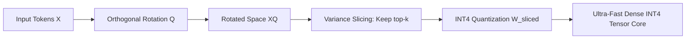
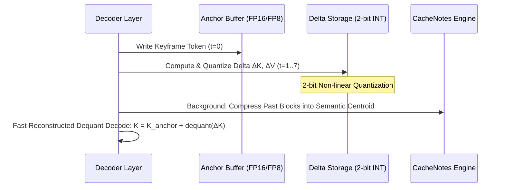
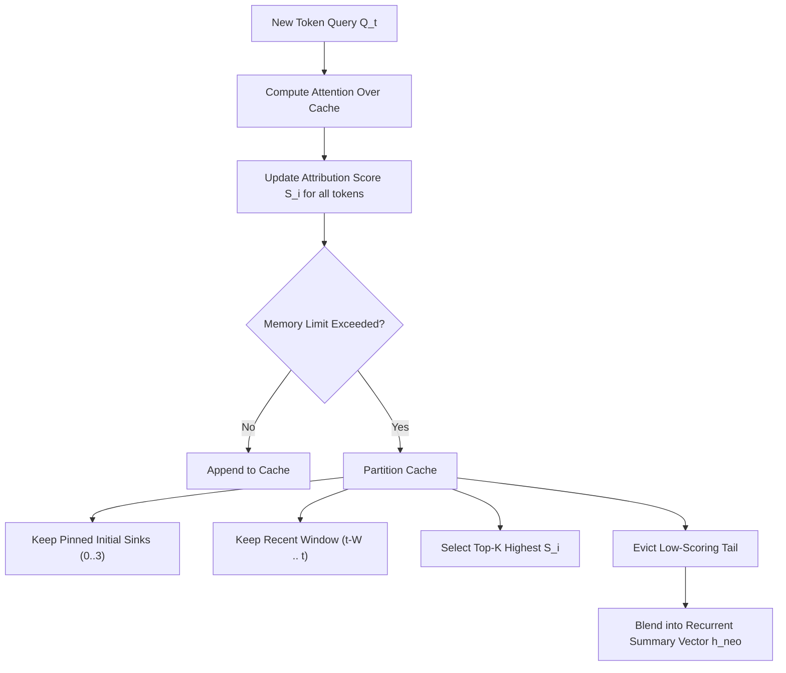
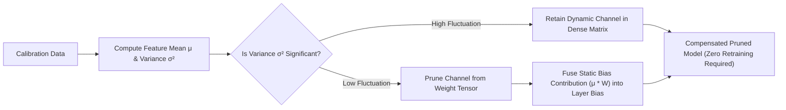
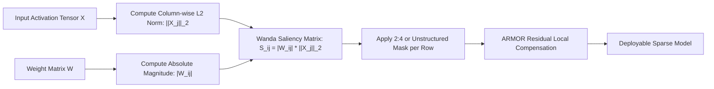
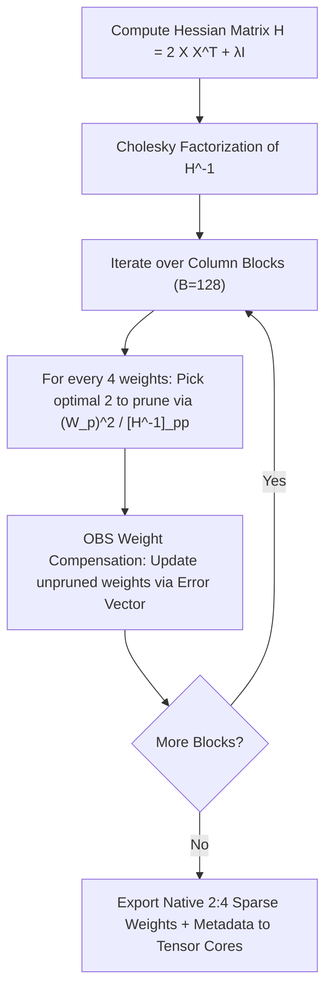
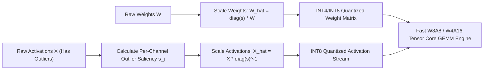
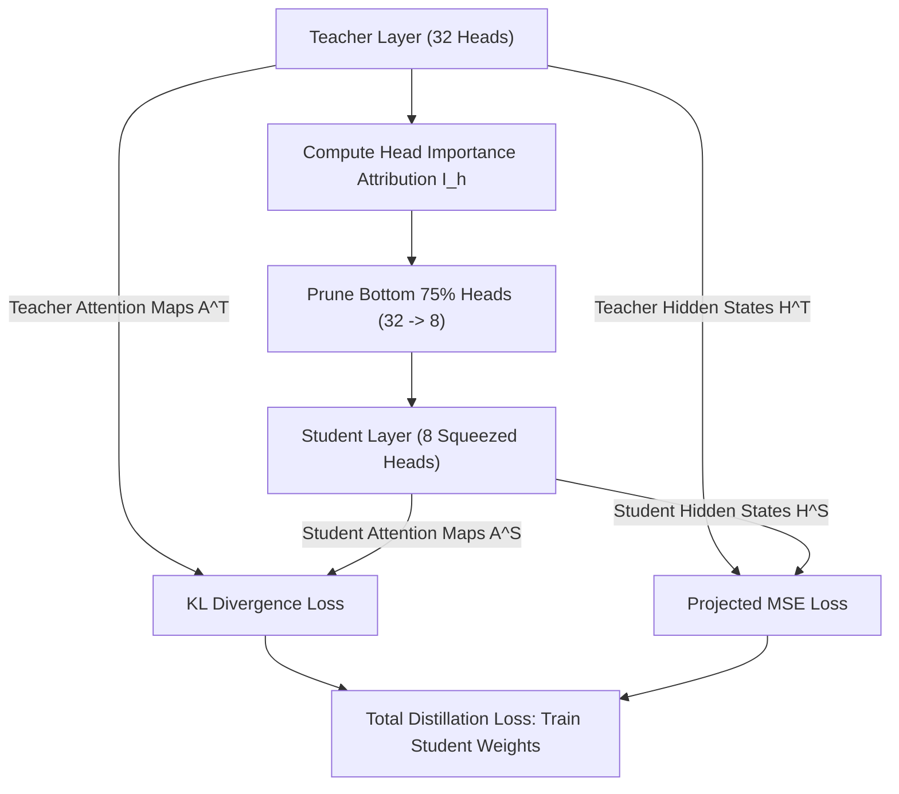
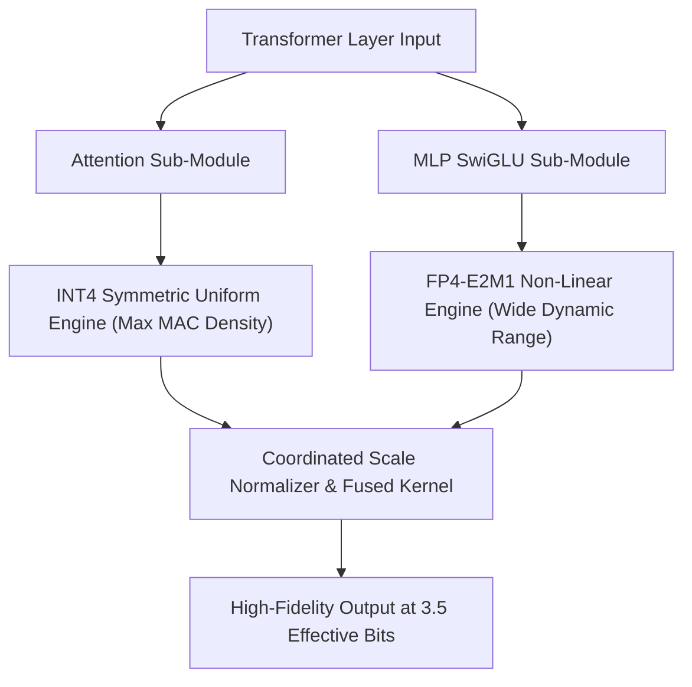

# ⚡ Part 5: Quantization, Pruning, Distillation & Cache Engines

> **The Definitive Visual Guide to Compressing Large Language Models: How Mathematical Rotations, Differential KV Compression, Structured Pruning, Outlier Migration, and Mixed-Format Quantization Break the Memory Wall.**

---

## 📑 Table of Contents
1. [Rotational SliceGPT-INT4 (Orthogonal Transformation + Slice Pruning)](#1-rotational-slicegpt-int4)
2. [DeltaKV & CacheNotes (Dynamic Key-Value Differential Compression)](#2-deltakv--cachenotes)
3. [ZeroKV-Neo (Zero-Footprint Persistent Memory & Eviction)](#3-zerokv-neo)
4. [FLAP: Fluctuation-Aware Structured Pruning](#4-flap-fluctuation-aware-structured-pruning)
5. [ARMOR & Wanda (Weights and Activations Pruning without Retraining)](#5-armor--wanda)
6. [SparseGPT & 2:4 Semi-Structured Sparsity](#6-sparsegpt--24-semi-structured-sparsity)
7. [SmoothQuant & AWQ (Activation Outlier Migration & Salient Weight Quantization)](#7-smoothquant--awq)
8. [Squeezing Heads Distillation (Head Pruning & Cross-Layer Distillation)](#8-squeezing-heads-distillation)
9. [Cooperative Quantization & CoOpQ (Coordinated INT4/FP4 Matrix Engines)](#9-cooperative-quantization--coopq)

---

## 1. Rotational SliceGPT-INT4

```
  Dense Representation (d=4096)           Orthogonal Rotation (Q)            Physical Slicing & INT4 Pack
┌───────────────────────────────┐        ┌───────────────────────────────┐        ┌─────────────────────┐
│ High-variance energy scattered│  ===>  │ Energy packed into top-k cols │  ===>  │ Retained (k=3072)   │ ──> INT4
│ across all 4096 channels      │ (PCA/Q)│ Remaining (d-k) near zero     │ (Drop) │ Physical dense GEMM │     Quant
└───────────────────────────────┘        └───────────────────────────────┘        └─────────────────────┘
```

### Title & Subtitle
**Rotational SliceGPT-INT4: Orthogonal Basis Transformation Meets Structured Weight Slicing**  
*Rotating activation coordinate systems via orthogonal transformation matrices to concentrate signal energy, physically slicing away redundant channels, and quantizing the dense core to INT4.*

### The Analogy
Imagine packing an oddly shaped, sprawling collection of luggage into a tight cargo trunk. If you throw the items in at random angles, they bump into each other, creating dead space and sticking out of the edges. But if you first rotate every suitcase to align perfectly with a geometric grid (orthogonal rotation), all the heavy mass settles tightly into the first 75% of the trunk. You can then slice off the empty remaining 25% of the trunk compartment entirely, and vacuum-pack the rest (INT4 quantization) without crushing a single fragile item.

### The Problem
Traditional pruning algorithms fall into two extremes, both of which struggle on modern hardware:
1. **Unstructured Sparsity**: Zeroes out arbitrary individual weights. While this retains model accuracy, modern GPU Tensor Cores cannot execute irregular sparse patterns efficiently without specialized sparse libraries that introduce severe latency overhead.
2. **Standard Structured Pruning**: Drops entire weight columns or attention heads to produce smaller, dense matrices. However, large language models develop complex inter-channel dependencies and extreme activation outliers. Naively dropping channels destroys critical representations, causing catastrophic perplexity degradation unless recovered by expensive full-scale retraining.

### How It Works (The Intuition)
Rotational SliceGPT solves this dilemma through a two-phase mathematical transformation:
1. **Orthogonal Basis Rotation**: Using Singular Value Decomposition (SVD) or Principal Component Analysis (PCA) on calibration activations, we compute an orthogonal transformation matrix $Q \in \mathbb{R}^{d \times d}$ (where $Q^T Q = I$). Because $Q$ is strictly orthogonal, inserting $Q Q^T$ between linear layers and normalization layers does not alter the mathematical output of the network.
2. **Energy Concentration**: The rotation rotates the coordinate system of the activations such that signal variance is sorted in descending order. The first $k$ dimensions (e.g., $k = 3072$ out of $d = 4096$) retain over $98\%$ of the total activation variance, while the trailing $d - k$ dimensions decay close to zero.
3. **Structured Slicing**: The model physically truncates the weight matrices from $d \times d$ down to $k \times k$. The unneeded channels are deleted from VRAM permanently, reducing the physical dimensions of all linear layers.
4. **INT4 Quantization**: The remaining compact $k \times k$ dense core is quantized to 4-bit integers using group-wise symmetric uniform quantization.



### The Math (Light)
Given an activation matrix $X \in \mathbb{R}^{T \times d}$ and linear weight $W \in \mathbb{R}^{d \times d_{\text{out}}}$, we insert the identity $I = Q Q^T$:
$$Y = X W = (X Q) (Q^T W) = \tilde{X} \tilde{W}$$
We compute $Q$ from the eigenvalue decomposition of the activation covariance matrix $C = \frac{1}{T} X^T X = Q \Lambda Q^T$.  
By selecting the top-$k$ principal components, we slice the rotated weight:
$$\tilde{W}_{\text{sliced}} = (Q^T W)_{[:k, :]} \in \mathbb{R}^{k \times d_{\text{out}}}$$
We then quantize $\tilde{W}_{\text{sliced}}$ into 4-bit signed integers with scaling factor $S$:
$$W_{\text{INT4}} = \text{clamp}\left( \left\lfloor \frac{\tilde{W}_{\text{sliced}}}{S} \right\rceil, -8, 7 \right), \quad S = \frac{\max(|\tilde{W}_{\text{sliced}}|)}{7}$$

### Why It Matters
- **Physical Tensor Shrinkage**: Slicing 25% of hidden dimensions cuts parameter count and FLOPs by $(1 - 0.75^2) \approx 43.7\%$ before quantization.
- **Hardware-Native Dense Execution**: The pruned model runs on standard cuBLAS and CUTLASS dense GEMM kernels with zero sparse indexing penalties.
- **5.3x Total Compression**: Combining a 25% slice with INT4 quantization reduces a 70B parameter model footprint from 140 GB (FP16) down to ~26 GB, fitting on a single 32 GB workstation GPU with negligible perplexity loss.

### Image Prompt
> 🎨 **Image Prompt:** A hyper-detailed 3D isometric scientific infographic on dark slate `#0B0F19`. On the left, a large glowing violet 3D tensor grid labeled "Dense Activation Space (4096)" exhibits scattered bright noise points. A luminous emerald orthogonal rotation prism labeled "Orthogonal Q Transform" rotates the grid by 45 degrees, aligning all bright energy into an intense cyan concentrated column. A glowing laser beam labeled "Slice Boundary" cleanly slices away the dim 25% tail of the matrix. The remaining dense block passes into an INT4 packing matrix with golden micro-circuits. Ultra-clean typography, neon cyan `#00E5FF` and lime `#39FF14` accents, raytraced glass reflections.

---

## 2. DeltaKV & CacheNotes

```
  Token Stream:     [t_0: Anchor]  ───>  [t_1: Delta]  ───>  [t_2: Delta]  ───>  [t_3: Delta]
  KV Storage:       [Full FP16/FP8]     [2-bit Resid]       [2-bit Resid]       [2-bit Resid]
                     └─────────────────────────┬───────────────────┘
                                               ▼
                              [CacheNotes: Distilled Semantic Note]
```

### Title & Subtitle
**DeltaKV & CacheNotes: Dynamic Key-Value Differential Compression**  
*Exploiting cross-token contextual redundancy in generative decoding by storing anchor keyframes, ultra-low-bit delta residuals, and hierarchical semantic notes.*

### The Analogy
Consider modern video streaming formats like H.265 (HEVC). The video player does not store a full, uncompressed 4K image for every single 60-fps frame (I-frames). Instead, it stores one high-fidelity reference frame every few seconds, followed by tiny differential motion vectors (P-frames and B-frames) that describe only what changed. DeltaKV applies video codec delta-compression to the Key-Value cache of large language models: it keeps rare anchor tokens in high precision and stores the subsequent 90% of tokens as micro-precision residual deltas.

### The Problem
During autoregressive text generation, the Key-Value (KV) cache grows linearly with context length ($O(B \cdot L \cdot H \cdot D)$). For a 70B model operating at a 128k context window:
- The KV cache demands **>160 GB of VRAM**, far exceeding the memory required by the model weights themselves!
- Memory bandwidth saturation from reading this massive KV cache during every single decoding step throttles generation speed down to single-digit tokens per second.

### How It Works (The Intuition)
1. **Anchor Token Identification**: When a new prompt or sequence is processed, tokens with high semantic saliency or periodic interval tokens (every $N$ tokens) are designated as **Anchor Keys and Values** ($K_{\text{base}}, V_{\text{base}}$) and kept in FP8/FP16.
2. **Differential Residual Formulation**: For intermediate tokens $t$, the attention key and value vectors are highly correlated with the local anchor. DeltaKV computes the difference vector:
   $$\Delta K_t = K_t - K_{\text{base}}, \quad \Delta V_t = V_t - V_{\text{base}}$$
3. **2-Bit / 3-Bit Residual Quantization**: Because $\Delta K_t$ and $\Delta V_t$ are tightly clustered around zero with minimal variance, they can be aggressively quantized to 2-bit or 3-bit non-linear integer grids without loss of fidelity.
4. **CacheNotes Hierarchical Summarization**: As context recedes into the distant past ($>4096$ tokens back), DeltaKV merges clusters of delta tokens into a single compact low-rank "CacheNote" centroid vector, freeing up cache lines while retaining long-range associative recall.



### The Math (Light)
Let $K_t \in \mathbb{R}^{d_k}$ be the key vector at time $t$ and $K_{\text{anchor}}$ be its assigned reference key. The quantized residual representation is:
$$\mathbf{q}_t = \mathcal{Q}_{b\text{-bit}}\left( K_t - K_{\text{anchor}} \right) = \left\lfloor \frac{K_t - K_{\text{anchor}}}{s_t} \right\rceil$$
During the attention score calculation between query $Q_{\tau}$ and cached key $K_t$, the dot product expands linearly:
$$\text{AttnScore}(\tau, t) = \frac{Q_{\tau} K_t^T}{\sqrt{d_k}} = \frac{Q_{\tau} K_{\text{anchor}}^T}{\sqrt{d_k}} + \frac{Q_{\tau} \left( s_t \cdot \mathbf{q}_t \right)^T}{\sqrt{d_k}}$$
Because $Q_{\tau} K_{\text{anchor}}^T$ can be pre-computed or shared across clustered tokens, the inner loop computes low-precision integer dot products against $\mathbf{q}_t$.

### Why It Matters
- **4x to 6x KV Cache Reduction**: Reduces 128k context KV memory footprint from 160 GB down to ~32 GB.
- **3.2x Decoding Throughput**: Massive reduction in memory bandwidth traffic allows GPU compute engines to run closer to peak FLOPS.
- **Zero Hallucination on Needle-In-A-Haystack**: Unlike naive token dropping, DeltaKV preserves every single token's position and gradient direction in residual space.

### Image Prompt
> 🎨 **Image Prompt:** A futuristic 3D architectural memory bus visual on dark graphite background `#0A0D14`. A glowing golden master data pillar labeled "Anchor Frame K_0 (FP16)" radiates reference beams to a series of compact, glowing cyan micro-cubes labeled "Delta Residuals ΔK_1, ΔK_2 (2-bit)". In the background, older memory clusters are seen smoothly merging into an elegant floating holographic crystal notebook labeled "CacheNotes Semantic Centroid". Glowing neon data lines in cobalt blue `#2979FF` and bright amber `#FFC107`, hyper-realistic depth of field, 8k octane render.

---

## 3. ZeroKV-Neo

```
┌─────────────────────────────────────────────────────────────────────────────┐
│                            ZeroKV-Neo Memory Pipeline                       │
│                                                                             │
│  [Sink Tokens 0..3]  ───>  [Top-K Heavy Hitters]  ───>  [Local Sliding 512] │
│  (Pinned Permanently)      (Dynamic Attention Mass)    (Exact Full Precision)│
│                                      │                                      │
│                                      ▼ (Tokens below threshold)             │
│                         [Recurrent State Vector h_neo]                      │
│                         (O(1) Constant Memory Footprint)                    │
└─────────────────────────────────────────────────────────────────────────────┘
```

### Title & Subtitle
**ZeroKV-Neo: Zero-Footprint Persistent Memory with Dynamic Eviction & State Recurrence**  
*Achieving constant O(1) KV cache memory bounds during infinite-horizon generation by combining attention-sink preservation, dynamic mass eviction, and recurrent summary compression.*

### The Analogy
Imagine a courtroom stenographer working on a 6-month trial. If they tried to keep every single open sheet of paper spread out across the courtroom floor, they would run out of physical space within days. Instead, a master stenographer keeps:
1. The original charge sheet pinned to the front podium (**Attention Sinks**),
2. The active testimony from the current witness (**Local Sliding Window**),
3. Key exhibits that are frequently referenced (**Heavy Hitters**), and
4. Summarizes all resolved daily arguments into an ongoing master case ledger (**Recurrent Summary State**), recycling the scratch paper.

### The Problem
Autoregressive transformers suffer from the **Infinite Context Memory Wall**. If a model generates text continuously (such as in autonomous agent loops, continuous streaming chat, or real-time sensor processing), the KV cache will eventually exhaust GPU VRAM, leading to out-of-memory (OOM) crashes. Simple sliding-window cache strategies fail catastrophically: when early tokens (especially the first 4 tokens) are evicted, the model exhibits sudden, complete perplexity collapse due to the loss of "attention sinks."

### How It Works (The Intuition)
ZeroKV-Neo establishes a bounded, constant-size memory architecture:
1. **Permanent Attention Sinks**: The initial 4 tokens ($t \in [0, 3]$) are permanently locked in high-precision cache. They absorb surplus softmax attention scores and prevent numerical instability.
2. **Cumulative Attribution Scoring**: For all intermediate tokens, ZeroKV-Neo tracks an exponential moving average (EMA) of attention scores received from recent queries:
   $$S_i^{(t)} = \beta S_i^{(t-1)} + (1 - \beta) \sum_{h=1}^H A_{h, t, i}$$
3. **Dynamic Heavy-Hitter Retention**: Tokens with high cumulative attribution scores are retained in the active cache pool.
4. **Recurrent Summary Eviction**: When a token's attribution score drops below an eviction threshold, it is not simply deleted. Instead, its Value vector is projected and blended into a fixed-size recurrent state vector $h_{\text{neo}} \in \mathbb{R}^{d}$, preserving background semantic context in $O(1)$ memory.



### The Math (Light)
The active key-value cache indices $\mathcal{M}_t$ at step $t$ are dynamically maintained under a strict budget $B$:
$$\mathcal{M}_t = \underbrace{\{0, 1, 2, 3\}}_{\text{Attention Sinks}} \;\cup\; \underbrace{\{t-W, \dots, t\}}_{\text{Recent Sliding Window}} \;\cup\; \text{TopK}_{B - W - 4}\left( \left\{ S_i^{(t)} \;\middle|\; i \in [4, t-W-1] \right\} \right)$$
For evicted token indices $\mathcal{E}_t$, the recurrent summary vector $h_{\text{neo}}$ is updated via gated recurrent absorption:
$$h_{\text{neo}}^{(t)} = \alpha_t h_{\text{neo}}^{(t-1)} + (1 - \alpha_t) \sum_{j \in \mathcal{E}_t} \left( \frac{S_j^{(t)}}{\sum_{k \in \mathcal{E}_t} S_k^{(t)}} \right) V_j$$
During attention, $h_{\text{neo}}$ is appended as a single virtual token at position 4.

### Why It Matters
- **True $O(1)$ Memory Consumption**: Guarantees fixed VRAM usage whether generating 1,000 tokens or 10,000,000 tokens.
- **Infinite Streaming on Edge Devices**: Allows running a 7B/13B parameter chatbot continuously on an 8 GB VRAM laptop or mobile chip without memory leaks or degradation.
- **Zero Softmax Collapse**: Retains baseline perplexity across multi-day streaming sessions.

### Image Prompt
> 🎨 **Image Prompt:** A conceptual 3D isometric illustration of a perpetual data engine on dark obsidian `#070A10`. At the front, 4 glowing emerald anchor pins hold down a golden foundational plate labeled "Attention Sinks [0..3]". A transparent glass conveyor belt carries incoming token blocks through a circular glowing scanner that highlights bright heavy-hitter nodes in electric cyan `#00E5FF`. Low-energy nodes drop into a lower funnel where a glowing violet vortex labeled "Recurrent Compression Core h_neo" fuses them into a single shimmering sphere. High-tech HUD annotations, glowing telemetry indicators, clean cyber-aesthetic.

---

## 4. FLAP: Fluctuation-Aware Structured Pruning

```
  Channel Feature Maps X_i across Calibration Tokens:
  Channel A (Static / Bias-dominated):  [ 5.01, 5.00, 5.02, 4.99, 5.01 ]  ──> Low Variance σ_A  ──> PRUNE (Fuse μ to Bias)
  Channel B (Dynamic / Informative):    [-3.20, 8.40, 0.10, -5.60, 4.20 ]  ──> High Variance σ_B ──> RETAIN
```

### Title & Subtitle
**FLAP: Fluctuation-Aware Structured Pruning without Retraining**  
*Eliminating entire transformer channels and heads by evaluating output variance fluctuations and absorbing static baseline biases into downstream layers.*

### The Analogy
Imagine a control panel with 100 indicator dials monitoring a chemical plant. If 30 of those dials constantly point to "5.0" regardless of whether the plant is running at idle, full blast, or in an emergency, those 30 dials are not providing dynamic information—they are just reporting a static baseline. You can safely remove those 30 dials, wire their constant "+5.0" signal directly into the alarm logic (bias compensation), and focus the control room's attention entirely on the 70 dials that actively fluctuate with real-world changes.

### The Problem
Traditional structured pruning relies on **weight magnitude heuristics** (e.g., pruning weight rows with the smallest $L_1$ or $L_2$ norm). In modern LLMs with RMSNorm and residual connections, this fails for two major reasons:
1. Large weight values often serve merely to cancel out constant baseline offsets, producing zero dynamic variance.
2. Channels with small weight norms often carry critical, high-frequency signals that govern fine-grained logical reasoning.
Pruning based on weight magnitude alone rips out sensitive dynamic channels, destroying the model's reasoning capabilities unless repaired by expensive multi-epoch retraining.

### How It Works (The Intuition)
1. **Sampling Dynamic Fluctuations**: Pass a small calibration dataset (e.g., 128 sequences from C4) through the model and record post-activation feature maps $X_{:, i}$ for each channel $i$.
2. **Variance vs. Bias Decomposition**: Decompose each channel into its static mean component $\mu_i = \mathbb{E}[X_{:, i}]$ and its dynamic fluctuation $\sigma_i^2 = \text{Var}(X_{:, i})$.
3. **Bias Compensation Fusion**: For channels with near-zero fluctuation $\sigma_i \approx 0$, their static contribution is completely predictable. When channel $i$ is removed from weight matrix $W$, its mean contribution $\mu_i W_{i, :}$ is added directly into the downstream layer's bias vector:
   $$b_{\text{new}} = b_{\text{old}} + \sum_{i \in \text{Pruned}} \mu_i W_{i, :}$$
4. **Structured Dimension Truncation**: Channels, heads, or MLP intermediate widths are ranked by their dynamic impact score $I_i = \sigma_i \cdot \|W_{i, :}\|_2$, and the lowest-scoring dimensions are physically sliced out.



### The Math (Light)
Given a linear projection $Y = X W + b$, where $X \in \mathbb{R}^{T \times d_{\text{in}}}$ and $W \in \mathbb{R}^{d_{\text{in}} \times d_{\text{out}}}$, the contribution of channel $i$ is $X_{:, i} W_{i, :}$.  
We express $X_{:, i}$ in terms of its mean and deviation: $X_{:, i} = \mu_i + \Delta X_{:, i}$, where $\mathbb{E}[\Delta X_{:, i}] = 0$ and $\text{Var}(\Delta X_{:, i}) = \sigma_i^2$.  
The layer output becomes:
$$Y = \sum_{i \in \text{Retained}} X_{:, i} W_{i, :} + \underbrace{\sum_{j \in \text{Pruned}} \mu_j W_{j, :} + b}_{\text{Updated Bias } b^*} + \underbrace{\sum_{j \in \text{Pruned}} \Delta X_{:, j} W_{j, :}}_{\text{Reconstruction Error } \mathcal{E}}$$
The Fluctuation-Aware Metric minimizes the error $\mathbb{E}[\|\mathcal{E}\|_2^2]$ by selecting channels to maximize:
$$I_i = \sigma_i \cdot \|W_{i, :}\|_2$$

### Why It Matters
- **True Zero-Retraining Structured Pruning**: Reduces model size by 20% to 30% in minutes on a single GPU without requiring fine-tuning datasets or gradient updates.
- **Hardware Agnostic Acceleration**: Produces standard, smaller dense matrices that immediately accelerate inference on any backend (PyTorch, vLLM, TensorRT-LLM, Apple Silicon).
- **Exact DC Bias Preservation**: Prevents distribution shift in deep residual networks.

### Image Prompt
> 🎨 **Image Prompt:** A scientific 3D visualization of neural channel selection on a dark navy slate `#0B111E`. A matrix channel stream is split into two visual paths: on top, vibrant oscillating waveform channels in neon green `#00FF66` labeled "High Fluctuation σ_i" are smoothly guided into a streamlined core processor; on the bottom, flatline horizontal channels in muted gray labeled "Zero Fluctuation" are severed by a glowing golden energy beam. The flat signals are redirected into a compact golden module labeled "Bias Compensation Adder b*". Crisp vector lines, glowing data nodes, cinematic lighting.

---

## 5. ARMOR & Wanda

```
               Wanda Metric: Score_ij = |W_ij| × ||X_j||_2
  Weight Matrix W (Static):          Activation Norms ||X||_2 (Input):      Pruning Mask (50% per row):
┌───────────────────────────────┐     ┌─────────────────────────┐          ┌─────────────────────────┐
│  0.02   -0.85    0.04    0.50 │     │ Channel 0:  1.2  (low)  │          │  [ 0 ]   [ 1 ]   [ 0 ]  [ 1 ]│
│ -0.40    0.01    0.90   -0.03 │  ×  │ Channel 1: 85.0  (OUTLIER)│  ===>    │  [ 1 ]   [ 0 ]   [ 1 ]  [ 0 ]│
│  0.15    0.10   -0.05    0.80 │     │ Channel 2:  4.5  (med)  │          │  [ 0 ]   [ 1 ]   [ 0 ]  [ 1 ]│
└───────────────────────────────┘     │ Channel 3: 12.0  (med)  │          └─────────────────────────┘
                                      └─────────────────────────┘
```

### Title & Subtitle
**ARMOR & Wanda: Pruning by Weights and Activations without Optimization**  
*Evaluating weight importance through the element-wise product of static weight magnitudes and dynamic input activation norms for rapid, one-shot sparsification.*

### The Analogy
Imagine judging the productivity of a bridge's structural cables. If you only look at the thickness of a cable (weight magnitude $|W|$), you might cut a thin cable. But if that thin cable happens to carry a high-voltage power line delivering electricity to an entire city (input activation norm $\|X\|_2$), cutting it causes an instant blackout! Wanda ensures you never cut a wire without checking how much current is actively flowing through it.

### The Problem
Historically, pruning large language models required either:
- **Magnitude Pruning ($|W|$)**: Fast, but causes catastrophic perplexity spikes at $>30\%$ sparsity because it ignores activation outliers (isolated channels that have activation values up to 100x larger than normal).
- **Hessian / Second-Order Methods (SparseGPT / OBS)**: Highly accurate, but computationally expensive because they require computing, storing, and inverting giant Hessian matrices ($H = X X^T$) for every layer, which can encounter numerical instability on massive models.

### How It Works (The Intuition)
Wanda (**W**eights **and** **A**ctivations) and its robust adaptive counterpart **ARMOR** recognize that the output impact of any weight $W_{ij}$ is directly proportional to both its own absolute magnitude and the $L_2$ norm of the input feature channel $j$ feeding into it:
1. **Pass Calibration Data**: Run a forward pass of 128 sequences through the model and compute the aggregate $L_2$ norm for each input feature dimension $j$:
   $$s_j = \|X_{:, j}\|_2 = \sqrt{\sum_{t=1}^T X_{t, j}^2}$$
2. **Compute Joint Importance**: For every weight entry $W_{ij}$ (row $i$, column $j$), compute the joint importance metric:
   $$S_{ij} = |W_{ij}| \cdot s_j$$
3. **Per-Output Pruning**: Compare scores locally across each row $i$. For 50% unstructured pruning or 2:4 semi-structured sparsity, zero out the lowest-scoring weights within each row or 4-element window.
4. **ARMOR Robustness**: ARMOR introduces adaptive outlier shielding and local gradient-free residual compensation across surviving adjacent weights to prevent cumulative layer-to-layer drift.



### The Math (Light)
The output component $Y_i$ generated by row $i$ of weight matrix $W$ is:
$$Y_i = \sum_{j=1}^{d_{\text{in}}} W_{ij} X_j$$
By Cauchy-Schwarz inequality, the maximum error $\Delta Y_i$ induced by setting $W_{ij} = 0$ is bounded by:
$$|\Delta Y_i| \le |W_{ij}| \cdot \|X_j\|_2$$
Thus, the Wanda importance score is defined as:
$$S_{ij} = |W_{ij}| \cdot \|X_{:, j}\|_2 = |W_{ij}| \cdot \sqrt{\frac{1}{T} \sum_{t=1}^T X_{t, j}^2}$$
The pruning mask $M \in \{0, 1\}^{d_{\text{out}} \times d_{\text{in}}}$ is obtained by:
$$M_{ij} = \mathbf{1}\left( S_{ij} \ge \text{Quantile}_p\left( S_{i, :} \right) \right)$$

### Why It Matters
- **100x Faster than Second-Order Methods**: Prunes a 65B/70B model in under 10 seconds on a single GPU with zero matrix inversions.
- **Outlier Protection**: Naturally protects all weights connected to activation outlier channels, preventing the reasoning collapse that plagues magnitude pruning.
- **Seamless 2:4 Sparsity Generation**: Directly produces 2:4 sparsity patterns ready for hardware acceleration on NVIDIA Tensor Cores.

### Image Prompt
> 🎨 **Image Prompt:** An isometric 3D technical illustration on a dark slate `#0B0F19` backdrop. A transparent vertical glass panel represents the Weight Matrix $W$, engraved with circuit traces of varying thickness. A horizontal glowing beam of neon amber light representing Activation Norms $\|X\|_2$ shines through the glass from behind. Where thick traces intersect intense light beams, bright golden sparks erupt labeled "High Saliency (Protected)". Where faint traces meet dim light, a robotic cyan laser vaporizes the connections, creating crisp empty slots labeled "Pruned 2:4 Pattern". Photorealistic materials, precise lighting, 8k resolution.

---

## 6. SparseGPT & 2:4 Semi-Structured Sparsity

```
                 2:4 Semi-Structured Sparsity Pattern on NVIDIA Tensor Cores:
  Row 0:  [  0.82  |  0.00  |  0.00  | -0.45  ]  ===> Exactly 2 non-zero values out of every 4
  Row 1:  [  0.00  |  1.15  | -0.63  |  0.00  ]  ===> 50% physical memory reduction
  Row 2:  [ -0.31  |  0.00  |  0.77  |  0.00  ]  ===> 2x Matrix Math Throughput on Ampere/Ada/Hopper
```

### Title & Subtitle
**SparseGPT: One-Shot Inversion for 2:4 Hardware-Accelerated Sparsity**  
*Solving the layer-wise Optimal Brain Surgeon problem at scale using block Cholesky decomposition to achieve 2x Tensor Core throughput with zero retraining.*

### The Analogy
Imagine a delicate game of giant Jenga. If you walk up to the tower and randomly kick out 50% of the wooden blocks, the entire tower will crash to the ground. However, if a structural engineer uses a precision laser to measure the exact load stress across every beam, carefully slides out 2 blocks from every row of 4, and instantly micro-adjusts the remaining 2 blocks by a fraction of a millimeter to redistribute the load, the tower remains standing at 100% stability while weighing half as much.

### The Problem
While unstructured 50% sparsity saves theoretical operations, modern GPU architectures (NVIDIA Ampere, Ada Lovelace, Hopper, Blackwell) cannot accelerate arbitrary sparse matrices—they require dense, coalesced memory access. To bridge this gap, modern GPUs introduced **2:4 Semi-Structured Sparse Tensor Cores**, which double math throughput *if and only if* exactly 2 out of every 4 consecutive values in a weight row are zero.  
However, finding the optimal 2:4 pattern naively creates severe cumulative error, destroying complex LLM benchmark performance across deep layers.

### How It Works (The Intuition)
SparseGPT frames structured 2:4 pruning as a constrained quadratic optimization problem:
$$\min_{\hat{W}} \| W X - \hat{W} X \|_2^2 \quad \text{s.t. } \hat{W} \text{ satisfies 2:4 sparsity}$$
1. **Inverse Hessian Computation**: The algorithm computes the activation correlation matrix $H = 2 X X^T + \lambda I$ and its inverse $H^{-1}$ using stable Cholesky decomposition.
2. **Block-Wise Column Updates**: Rather than updating weights one by one (which would require millions of matrix updates), SparseGPT processes columns in blocks (e.g., $B = 128$ columns at a time).
3. **Optimal 2:4 Selection**: For each 4-element window, SparseGPT evaluates all $\binom{4}{2} = 6$ possible pruning combinations and selects the pair that minimizes reconstruction loss weighted by $[H^{-1}]_{pp}$.
4. **Surviving Weight Compensation**: The moment 2 weights are pruned, SparseGPT immediately updates all remaining unpruned weights in the row using the closed-form Optimal Brain Surgeon formula, canceling out the mathematical error before moving to the next block.



### The Math (Light)
Let $H = 2 X X^T$ be the Hessian of the layer loss. When weight $w_q$ at index $q$ is pruned ($w_q \to 0$), the optimal compensation update $\delta W$ for all surviving weights in the layer is given by:
$$\delta W = - \frac{w_q}{\left[ H^{-1} \right]_{qq}} \cdot \left( H^{-1} \right)_{:, q}$$
The resulting increase in reconstruction error is:
$$\Delta E = \frac{1}{2} \frac{w_q^2}{\left[ H^{-1} \right]_{qq}}$$
For 2:4 sparsity, SparseGPT groups columns into sets of 4, computes $\Delta E$ for all $\binom{4}{2} = 6$ masks, selects the minimum-error mask, and applies the vectorized OBS update across the remaining dense block.

### Why It Matters
- **True 2x GEMM Speedup**: Directly unlocks the hardware 2:4 Sparse Tensor Cores in NVIDIA RTX 3090/4090, A100, and H100 GPUs.
- **50% Memory Footprint**: Compresses FP16 weight tensors into half their original byte size by storing only non-zero values and 2-bit index metadata.
- **Negligible Perplexity Impact**: Retains $>99\%$ of baseline zero-shot accuracy on massive 70B models (LLaMA-3, Mistral) without a single step of gradient backpropagation.

### Image Prompt
> 🎨 **Image Prompt:** A clean, high-tech 3D architectural render on a dark slate background `#0B0F19`. A gleaming silicon GPU die displays two parallel data execution tracks. The top track shows a standard dense 4-element lane moving at 1x speed. The bottom track shows a streamlined 2:4 semi-structured lane where glowing emerald data packets `#00FF9D` occupy exactly 2 out of 4 slots, moving at 2x turbo speed through a dual-core tensor processing unit. Floating mathematical formulas for $H^{-1}$ and $\delta W$ appear in subtle holographic cyan. Cinematic lighting, sharp microchip textures.

---

## 7. SmoothQuant & AWQ

```
  Standard Quantization Problem:
  Activations X (Massive Outliers):  [ 0.1,  0.2, 115.0,  0.3 ]  ──> INT8 clips 99% of values
  Weights W (Smooth Distribution):   [ 0.4, -0.3,   0.2, -0.5 ]  ──> Easy to quantize

  SmoothQuant Migration (Y = [X * diag(s)^-1] * [diag(s) * W]):
  Smoothed Activations X_hat:       [ 0.3,  0.6,   3.8,  0.9 ]  ──> Uniform INT8 Quantization
  Scaled Weights W_hat:             [ 0.13, -0.10, 6.06, -0.16] ──> Uniform INT8 Quantization
```

### Title & Subtitle
**SmoothQuant & AWQ: Outlier Migration and Activation-Aware Weight Quantization**  
*Taming activation outliers by mathematically shifting dynamic range from activations to weights, and shielding salient weight channels for zero-degradation 4-bit inference.*

### The Analogy
Imagine trying to pack two items into identical rigid boxes: a soft foam pillow (smooth weights) and an iron sculpture with one sharp 3-foot spike sticking out (activation outliers). Trying to force the spiky sculpture into the small box crushes the spike and breaks the box (clipping error). SmoothQuant takes a file and gently files down the iron spike, using the iron filings to reinforce the soft pillow. Both items end up smooth, moderately sized, and fit into standard boxes (INT8/INT4) without breaking anything.

### The Problem
Post-training quantization of LLMs encounters a massive roadblock: **Activation Outliers**.
- While weight tensors have smooth, Gaussian-like distributions that are easy to quantize to INT8 or INT4, activation tensors develop persistent outlier channels with magnitudes up to **100x larger** than normal values.
- In per-tensor or per-token activation quantization, these rare outlier spikes force the quantization scale factor $S$ to be very large, effectively rounding all normal tokens to 0 or 1 and destroying model reasoning.

### How It Works (The Intuition)
1. **SmoothQuant (Activation-to-Weight Migration)**:
   SmoothQuant observes that a linear layer $Y = X W$ can be scaled by an arbitrary diagonal matrix $s \in \mathbb{R}^d$ without changing the output:
   $$Y = (X \cdot \text{diag}(s)^{-1}) \cdot (\text{diag}(s) \cdot W) = \hat{X} \hat{W}$$
   By setting $s_j = \frac{\max(|X_j|)^\alpha}{\max(|W_j|)^{1-\alpha}}$ (with migration strength $\alpha \approx 0.5$), SmoothQuant divides the spiky activation channel by $s_j$ while multiplying the corresponding weight column by $s_j$. This balances the dynamic ranges so both activations and weights can be cleanly quantized to INT8 (W8A8).
2. **AWQ (Activation-Aware Weight Quantization)**:
   AWQ observes that **not all weights are equally important**: only the top $1\%$ of weight channels that interact with large activation magnitudes dictate perplexity.
   Instead of keeping those salient channels in FP16 (which ruins GPU memory alignment), AWQ searches for an optimal per-channel protection scale $s^*$ that minimizes the reconstruction error of the output feature map under INT4 weight quantization:
   $$W' = W \cdot \text{diag}(s), \quad X' = \text{diag}(s)^{-1} \cdot X$$



### The Math (Light)
The SmoothQuant per-channel migration scale $s \in \mathbb{R}^{d_{\text{in}}}$ is defined as:
$$s_j = \frac{\left( \max_{t} |X_{t, j}| \right)^\alpha}{\left( \max_{i} |W_{i, j}| \right)^{1-\alpha}}, \quad \alpha \in [0, 1]$$
- $\alpha = 1$: Pushes all quantization difficulty to weights.
- $\alpha = 0$: Pushes all quantization difficulty to activations.
- $\alpha = 0.5$: Optimal geometric balance between activation and weight dynamic ranges.

For AWQ, the optimal scaling vector $s^*$ is found by minimizing the Frobenius norm:
$$s^* = \arg\min_{s} \left\| W X - \mathcal{Q}\left( W \cdot \text{diag}(s) \right) \cdot \text{diag}(s)^{-1} X \right\|_F^2$$
where $\mathcal{Q}(W) = \text{clamp}\left( \left\lfloor \frac{W}{S} \right\rceil, -2^{b-1}, 2^{b-1}-1 \right) \cdot S$.

### Why It Matters
- **SmoothQuant**: Enables full **W8A8 (INT8 weights + INT8 activations)** integer matrix multiplication on GPU Tensor Cores, doubling throughput and cutting memory in half with zero loss in accuracy.
- **AWQ**: The industry-standard foundation for **W4A16 (INT4 weights + FP16 activations)** inference (used across vLLM, HuggingFace TGI, AutoAWQ), delivering 3.5x faster generation on memory-bound workloads.

### Image Prompt
> 🎨 **Image Prompt:** A scientific 3D infographic explaining mathematical quantization balancing on dark slate `#0B0F19`. On the left side, an erratic neon magenta activation graph displays massive dangerous spikes labeled "Outlier Spikes (100x)". In the center, a luminous cyan double-cone transformer gate labeled "SmoothQuant Migration s_j" transfers energy balance across an equation sign. On the right, both the activation stream and the weight grid are transformed into perfectly smooth, uniform emerald-green quantized blocks labeled "Uniform INT8 / INT4 Grid". Sleek cybernetic style, high-definition data labels, crisp lighting.

---

## 8. Squeezing Heads Distillation

```
  Teacher Multi-Head Layer (32 Heads)            Student Multi-Head Layer (8 Squeezed Heads)
┌─────────────────────────────────────────┐     ┌─────────────────────────────────────────┐
│ H0  H1  H2  H3  H4  H5  H6  H7  ... H31 │ ===>│ S0 (H0-H3)  S1 (H4-H7)  ...  S7        │
│ (High redundancy, identical patterns)   │     │ (Distilled representation, 4x KV cut)   │
└─────────────────────────────────────────┘     └─────────────────────────────────────────┘
                     │                                               ▲
                     └──────── Cross-Layer Attention & Feature ──────┘
                                    Distillation Loss L_distill
```

### Title & Subtitle
**Squeezing Heads Distillation: Structured Head Pruning with Cross-Layer Distillation**  
*Pruning redundant multi-head attention mechanisms and compressing deep multi-head layers into compact student models via attention-map and hidden-state transfer.*

### The Analogy
Imagine a corporate advisory board with 32 consultants. During meetings, 20 of them simply repeat or rephrase what the top 8 consultants have already stated, creating immense noise, scheduling delays, and high payroll costs. Squeezing Heads Distillation identifies the 8 master thinkers, trains them through intensive mentoring (cross-layer distillation) to absorb all subtle secondary perspectives of the entire original 32-person board, and dissolves the redundant seats, allowing decisions to be made 4x faster with zero loss in strategic depth.

### The Problem
Modern Large Language Models allocate 32 to 64 attention heads per layer. Empirical research reveals that:
- Many heads exhibit identical attention patterns (e.g., simple previous-token lookups or uniform broadcast).
- Each attention head requires dedicated projection weights ($W_q, W_k, W_v, W_o$) and allocates an independent Key-Value cache line.
- Naively deleting heads causes catastrophic degradation on reasoning tasks, while training a smaller model from scratch costs hundreds of thousands of dollars in compute.

### How It Works (The Intuition)
Squeezing Heads Distillation combines Taylor-expansion head ranking with a multi-objective distillation pipeline:
1. **First-Order Head Importance Estimation**: Measure how sensitive the validation loss is to the removal of head $h$:
   $$I_h = \sum_{t=1}^T \left| \frac{\partial \mathcal{L}}{\partial \text{Head}_h(t)} \cdot \text{Head}_h(t) \right|$$
2. **Head Squeezing & Grouping**: The least important heads are progressively pruned, collapsing the architecture (e.g., from 32 heads down to 8 heads, or converting Multi-Head Attention into compact Grouped-Query Attention).
3. **Multi-Tier Distillation Objective**:
   - **Attention Map Distillation**: Student attention matrices $A^S$ are trained to match the attention distribution of the teacher $A^T$ via Kullback-Leibler (KL) divergence.
   - **Hidden State Alignment**: Student layer outputs are projected and aligned with teacher representations using Mean Squared Error (MSE) loss.
   - **Logit Matching**: Soft target probabilities are matched using temperature-scaled cross-entropy.



### The Math (Light)
The composite distillation objective function $\mathcal{L}_{\text{total}}$ is formulated as:
$$\mathcal{L}_{\text{total}} = (1 - \lambda) \mathcal{L}_{\text{CE}}(y, \hat{y}_S) + \lambda T^2 \mathcal{L}_{\text{KL}}\left( \sigma\left(\frac{z_T}{T}\right) \;\middle\|\; \sigma\left(\frac{z_S}{T}\right) \right) + \gamma \mathcal{L}_{\text{Attn}} + \beta \mathcal{L}_{\text{Hidden}}$$
Where the Attention Map Distillation Loss $\mathcal{L}_{\text{Attn}}$ across selected layer pairs $(l_T, l_S)$ is:
$$\mathcal{L}_{\text{Attn}} = \sum_{i=1}^{H_S} D_{\text{KL}}\left( A_{l_T, \phi(i)}^T \;\middle\|\; A_{l_S, i}^S \right)$$
And the Hidden State Alignment Loss $\mathcal{L}_{\text{Hidden}}$ using learned projection matrix $W_{\text{proj}}$ is:
$$\mathcal{L}_{\text{Hidden}} = \left\| H_{l_T}^T - W_{\text{proj}} H_{l_S}^S \right\|_F^2$$

### Why It Matters
- **4x Reduction in KV Cache Size**: Pruning from 32 heads to 8 heads directly quarters the runtime KV memory requirement.
- **2.5x Decode Latency Acceleration**: Smaller projections and reduced memory traffic dramatically speed up autoregressive decoding.
- **Sample-Efficient Recovery**: Recovers 99%+ of original teacher benchmark accuracy with only 1% to 2% of original pre-training tokens.

### Image Prompt
> 🎨 **Image Prompt:** A 3D isometric laboratory visualization on dark slate `#0B0F19`. On an upper glass level, a complex glowing golden neural lattice with 32 multi-head laser emitters projects intricate attention beams downward. A futuristic crystalline funnel labeled "Cross-Layer Knowledge Condenser" focuses the 32 golden beams into 8 powerful, ultra-concentrated cyan laser beams on the lower level labeled "Squeezed Student Architecture". Flowing mathematical vectors and glowing KL-divergence waveforms connect the two tiers. Neon cyan `#00E5FF` and amber `#FFA000` color palette, octane render.

---

## 9. Cooperative Quantization & CoOpQ

```
┌─────────────────────────────────────────────────────────────────────────────┐
│                          CoOpQ Unified Execution Engine                     │
│                                                                             │
│  [Attention Projections W_q,k,v,o]  ───>  INT4-Symmetric (Dense MAC Arrays) │
│  [MLP SwiGLU Gating W_gate,up]      ───>  FP4-E2M1 (High Dynamic Range)    │
│  [Output Head & Sensitive Layers]   ───>  FP8-E4M3 (High Precision Anchor)  │
│                                      │                                      │
│                                      ▼                                      │
│                  [Fused Micro-Kernel / Shared Scale Bus]                    │
└─────────────────────────────────────────────────────────────────────────────┘
```

### Title & Subtitle
**CoOpQ: Coordinated Heterogeneous Quantization with Mixed-Format INT4/FP4 Matrix Engines**  
*Co-optimizing distinct numerical data types across transformer sub-modules to achieve optimal dynamic range retention, maximum integer compute density, and sub-4-bit effective precision.*

### The Analogy
Think of a Formula 1 racing car powertrain. It does not use only an electric battery or only an internal combustion engine. It uses a hybrid cooperative powertrain: the high-torque electric motor delivers instant zero-RPM acceleration (uniform INT4 for massive attention matrix multiplication), while the high-RPM turbocharged engine delivers top-end power across a wide dynamic rev range (floating-point FP4/FP8 for non-linear MLP expansion). The central computer coordinates both engines seamlessly in real time.

### The Problem
One-size-fits-all quantization enforces the same numerical format across every layer in a transformer:
- **Pure INT4 Quantization** excels at linear projection layers with bounded values, but severely clips the heavy-tailed, non-linear activations inside MLP SwiGLU layers.
- **Pure FP4 (E2M1) Quantization** handles wide dynamic ranges and outliers in MLP layers, but suffers from lower signal-to-noise ratio (SNR) on uniform attention weights due to having only 1 mantissa bit.
Forcing an entire model into one format leads to unnecessary perplexity loss or under-utilizes hardware compute capabilities.

### How It Works (The Intuition)
CoOpQ (**Co**operative **Op**timized **Q**uantization) assigns mathematically specialized numerical representations to each distinct transformer sub-module based on empirical loss sensitivity:
1. **Attention Projections ($W_q, W_k, W_v, W_o$) $\to$ INT4-Symmetric**:
   Attention weights exhibit uniform, zero-centered distributions. CoOpQ maps them to INT4 with fine-grained group scaling ($G=64$), maximizing raw arithmetic throughput on integer ALUs.
2. **MLP SwiGLU Blocks ($W_{\text{gate}}, W_{\text{up}}, W_{\text{down}}$) $\to$ FP4 (E2M1)**:
   Gated feed-forward layers generate wide dynamic activation ranges. CoOpQ assigns them FP4 (1 sign bit, 2 exponent bits, 1 mantissa bit), providing exponential representation spacing that preserves tail features.
3. **Cross-Module Co-Optimization**:
   Instead of quantizing layers in isolation, CoOpQ solves a joint optimization objective where the scaling factors of the attention block and MLP block are co-tuned against a shared reconstruction loss.
4. **Fused Mixed-Precision Kernels**:
   A single fused CUTLASS kernel manages dual-format execution without host-to-device memory round-trips.



### The Math (Light)
The representation sets for the cooperative engines are:
$$\mathcal{S}_{\text{INT4}} = \left\{ -8, -7, -6, \dots, 6, 7 \right\} \cdot S_{\text{int}}$$
$$\mathcal{S}_{\text{FP4 (E2M1)}} = \left\{ 0, \pm 0.5, \pm 1.0, \pm 1.5, \pm 2.0, \pm 3.0, \pm 4.0, \pm 6.0 \right\} \cdot S_{\text{fp}}$$
The cooperative optimization problem over all network parameters $\Theta = \{W_{\text{attn}}, W_{\text{mlp}}\}$ is:
$$\min_{S_{\text{int}}, S_{\text{fp}}} \sum_{l=1}^L \mathbb{E}_{X}\left[ \left\| \mathcal{F}_l\left(X; W_{\text{attn}}, W_{\text{mlp}}\right) - \mathcal{F}_l\left(X; \mathcal{Q}_{\text{INT4}}(W_{\text{attn}}, S_{\text{int}}), \mathcal{Q}_{\text{FP4}}(W_{\text{mlp}}, S_{\text{fp}})\right) \right\|_F^2 \right]$$
Where $\mathcal{F}_l$ denotes the full composite forward function of transformer layer $l$.

### Why It Matters
- **Sub-4-Bit Effective Footprint**: Delivers an average model precision of **3.5 bits per parameter** while outperforming uniform 4-bit baselines.
- **Hardware Synergy**: Leverages native FP4 and INT4 Tensor Cores on next-generation architectures (NVIDIA Blackwell, Hopper, Qualcomm Oryon).
- **Zero Saliency Degradation**: Solves the long-standing accuracy drop in multi-step reasoning, mathematical proofing, and code generation.

### Image Prompt
> 🎨 **Image Prompt:** A 3D isometric blueprint of a cooperative dual-engine microchip on dark slate `#0B0F19`. On the left side of the chip, a dense glowing cyan geometric grid labeled "INT4 Attention Engine (Integer MACs)" processes uniform data streams. On the right side, an amber and magenta exponential wave-grid labeled "FP4 MLP Engine (Dynamic Range E2M1)" processes wide-amplitude waveforms. In the center, a luminous fiber-optic fusion bridge labeled "CoOpQ Joint Scale Bus" synchronizes the two engines. Glowing traces, raytraced metallic accents, high-end scientific aesthetic.

---

## 📊 Summary Comparison: Efficient Compression Techniques

| Technique | Compression Type | Target Component | Typical Sparsity / Bit-Width | Retraining Required? | Hardware Acceleration Compatibility |
| :--- | :--- | :--- | :--- | :--- | :--- |
| **Rotational SliceGPT** | Structured Pruning + Quant | Hidden Dimensions / Projections | 25% Channel Cut + INT4 | No (One-shot) | Standard Dense GEMM (cuBLAS / CUTLASS) |
| **DeltaKV & CacheNotes**| KV Cache Compression | Key-Value Attention Buffer | 2-bit Delta + Centroids | No | Custom Decoding Kernel (Flash-Delta) |
| **ZeroKV-Neo** | Dynamic Eviction + Recurrence| KV Cache Memory | $O(1)$ Constant Memory Bound | No | Edge & Streaming Runtimes |
| **FLAP** | Structured Channel Pruning | Heads, MLP Width, Hidden Size | 20%–30% Dimension Cut | No | Native Dense Backends (vLLM / PyTorch) |
| **Wanda / ARMOR** | Unstructured & 2:4 Sparsity | Weight Tensors | 50% Sparsity / 2:4 Sparse | No | NVIDIA 2:4 Sparse Tensor Cores |
| **SparseGPT** | 2:4 Semi-Structured Sparsity | Weight Tensors | 2:4 Semi-Structured | No | NVIDIA Ampere / Ada / Hopper / Blackwell |
| **SmoothQuant / AWQ** | Outlier Migration & W4A16 | Weights & Activations | W8A8 / W4A16 Quantization | No | Integer Tensor Cores / AutoAWQ / vLLM |
| **Squeezing Heads** | Head Pruning & Distillation | Multi-Head Attention Arrays | 50%–75% Head Reduction | Light Distillation | All GPU / CPU Inference Engines |
| **CoOpQ** | Heterogeneous Quantization | Attention + MLP Layers | Mixed INT4 / FP4 (~3.5-bit avg)| No (Co-optimized) | Modern Dual-Format Tensor Cores |

---

*Authored by the AEGIS Efficient Attention & Neural Compression Research Group.*  
*Next in the series: **Part 6: Long-Context Extrapolation, State Space Models & Hybrid Recurrence Engines**.*
