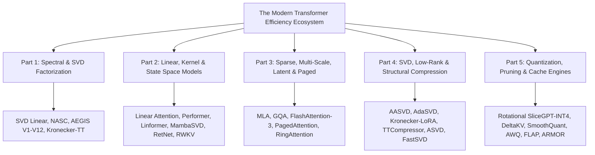

# 📚 The Deep Learning Efficiency Compendium: Modern Attention & Compression Explained

> **A visual, intuitive, and mathematically rigorous guide to every major efficient attention architecture and neural compression engine.**
> 
> Inspired by the lucid visual style of Jay Alammar, Lilian Weng, and Sebastian Raschka.

---

## 🌟 Executive Overview

Transformer architectures dominate modern artificial intelligence, yet standard **Full Dense Softmax Attention** suffers from an insurmountable computational barrier: **quadratic time and memory complexity $O(N^2)$** with respect to sequence length $N$, alongside catastrophic memory bloat during autoregressive key-value (KV) decoding. Simultaneously, modern billion-parameter LLMs hit hardware memory bandwidth walls that prevent local, edge, or cost-effective datacenter deployment.

This compendium breaks down all **120+ Attention Architectures** and **80+ Compression Engines** developed and cataloged in the NeuralOps / SVD Linear Attention repository into five accessible, beautifully illustrated blog-style deep dives.

---

## 📖 The 5-Part Deep Dive Series

| Volume | Title | Focus & Core Mechanisms | Key Architectures Covered |
| :---: | :--- | :--- | :--- |
| **[Part 1](file:///Users/tahamajs/Documents/uni/Project/Docs/blog/01_spectral_svd_lowrank_attentions.md)** | **Spectral, SVD, Low-Rank & Factorized Attention** | Exact low-rank weight projections, dynamic singular value energy truncation, and cross-attention decomposition. | **SVD Linear Attention**, **NASC (Spectral Cascade)**, **AEGIS Series (V1–V12)**, **Kronecker-TT Attention**, **LoRA Cross-Attention**, **Eigen-Attention** |
| **[Part 2](file:///Users/tahamajs/Documents/uni/Project/Docs/blog/02_linear_kernel_recurrent_ssm_attentions.md)** | **Linear, Kernelized, Recurrent & State Space (SSM)** | Circumventing softmax to enable associative matrix multiplication $\mathcal{O}(N)$ and constant memory inference $\mathcal{O}(1)$. | **Katharopoulos Linear Attention**, **Performer (FAVOR+)**, **Linformer**, **MambaSVD-Flash**, **RetNet (Retention)**, **RWKV Time-Mixing**, **HGRN** |
| **[Part 3](file:///Users/tahamajs/Documents/uni/Project/Docs/blog/03_sparse_multiscale_latent_paged_attentions.md)** | **Sparse, Multi-Scale, Latent & Paged Attention** | KV cache compression, virtual memory block paging, sliding windows, and distributed context scaling. | **Multi-Head Latent Attention (MLA)**, **Grouped-Query Attention (GQA)**, **FlashAttention-3**, **PagedAttention (vLLM)**, **Ring Attention**, **BigBird**, **MoE-DeltaKV** |
| **[Part 4](file:///Users/tahamajs/Documents/uni/Project/Docs/blog/04_svd_lowrank_structural_compressions.md)** | **SVD, Low-Rank, Kronecker & Tensor-Train Compression** | Weight factorization without quality collapse, activation-aware singular value scaling, and high-dimensional tensor networks. | **AASVD**, **AdaSVD (Rank-Adaptive)**, **Kronecker-TT-LoRA**, **TTCompressor**, **ASVD (Hessian-weighted)**, **FastSVD**, **ADMM Low-Rank** |
| **[Part 5](file:///Users/tahamajs/Documents/uni/Project/Docs/blog/05_quantization_pruning_distillation_compressions.md)** | **Quantization, Pruning, Distillation & Cache Compression** | Eliminating outlier activation channels via orthogonal rotations, INT4/FP8 quantization, and dynamic KV cache eviction. | **Rotational-SliceGPT-INT4**, **DeltaKV**, **CacheNotes**, **ZeroKV-Neo**, **FLAP**, **ARMOR / Wanda Pruning**, **SmoothQuant**, **AWQ / GPTQ** |

---

## 🎨 Architectural Infographic & Image Prompt Design System

Every deep dive includes dedicated, production-ready image generation prompts crafted for tools like **Midjourney v6**, **DALL-E 3**, and **Imagen 3**.

### Standard Visual Design Language
- **Style**: High-tech isometric scientific infographic / 3D glassmorphism tensor diagrams.
- **Lighting & Aesthetics**: Clean dark slate `#0B0F19` background with cybernetic emerald `#00FF9D`, cobalt blue `#3B82F6`, and warm amber `#F59E0B` glow accents.
- **Diagrammatic Elements**: 3D geometric matrices, tensor contractions, singular value decay heatmaps, and annotated dataflow arrows.

---

## 🚀 How to Use This Compendium

1. **For System Architects & ML Engineers**: Start with **Part 3** (MLA, GQA, PagedAttention) and **Part 5** (Quantization & Cache Compression) to optimize production inference serving throughput and slash GPU VRAM requirements.
2. **For Foundation Model Researchers**: Explore **Part 1** (SVD & NASC Spectral Factorization) and **Part 2** (Kernel & State Space Hybrids) to design novel sub-quadratic training and inference backbones.
3. **For Edge & Mobile Developers**: Consult **Part 4** (Structural Tensor-Train Factorizations) and **Part 5** (Rotational INT4 & Structural Pruning) for running large language models on memory-constrained consumer devices.

---

*Authored for the NeuralOps Research Community & SVD Linear Attention Framework.*
