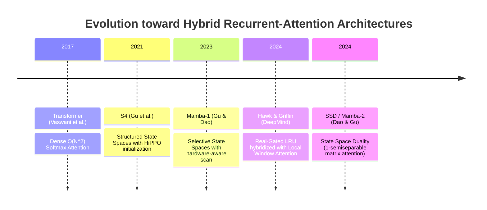
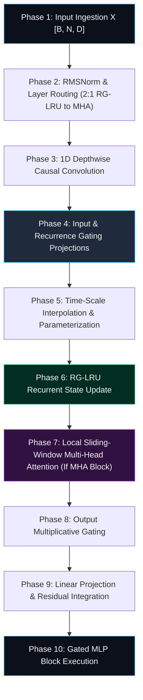

# 🌟 Deep Dive: Griffin & Structured State Space Duality (SSD) — Hybridizing Real-Gated Linear Recurrences with Sliding Window Attention

> **Category**: Hybrid Recurrent-Attention Architectures & Structured State Space Models  
> **Target Workload**: Ultra-long sequence processing, memory-constrained edge deployment, high-throughput LLM serving, and real-time streaming inference.  
> **Key Innovation**: Unifies linear-time **Real-Gated Linear Recurrent Units (RG-LRU)** with **Local Sliding-Window Multi-Head Attention**, solving the expressive limits of pure RNNs while slashing KV cache memory by over 85%.

---

## 📑 Master Contents
1. [Executive Summary & Core Value Proposition](#1-executive-summary--core-value-proposition)
2. [The Mental Model: 4 Real-World Analogies](#2-the-mental-model-4-real-world-analogies)
3. [Historical Context & The Transformer Failure Modes](#3-historical-context--the-transformer-failure-modes)
4. [Step-by-Step Mechanics: 10-Phase Architectural Walkthrough](#4-step-by-step-mechanics-10-phase-architectural-walkthrough)
5. [Deep Mathematical Formulations & Tensor Dimensions](#5-deep-mathematical-formulations--tensor-dimensions)
6. [Quantified Empirical Trade-Offs & Benchmark Analysis](#6-quantified-empirical-trade-offs--benchmark-analysis)
7. [Production PyTorch Implementation & Hyperparameter Guide](#7-production-pytorch-implementation--hyperparameter-guide)
8. [Appendix: Common Pitfalls, Numerical Stability & Debugging](#8-appendix-common-pitfalls-numerical-stability--debugging)
9. [Frequently Asked Questions (7 Deep Technical FAQs)](#9-frequently-asked-questions-7-deep-technical-faqs)
10. [Seminal Literature & Further Reading](#10-seminal-literature--further-reading)
11. [AI Architectural Infographic Generation Prompt](#11-ai-architectural-infographic-generation-prompt)

---

## 1. Executive Summary & Core Value Proposition

Modern Large Language Models face an architectural polarization: **Pure Transformers** achieve state-of-the-art in-context learning and multi-hop reasoning but suffer from quadratic $\mathcal{O}(N^2)$ prefill compute and linearly ballooning $\mathcal{O}(N)$ KV cache memory. Conversely, **Pure State Space Models (SSMs)** and Linear RNNs provide linear $\mathcal{O}(N)$ compute and constant $\mathcal{O}(1)$ inference memory, but struggle with precise associative recall over dense token spans.

```
+-----------------------------------------------------------------------------------------+
|                                  THE HYBRID SYNTHESIS                                   |
|                                                                                         |
|  Pure Transformers (Llama-3)               Griffin (DeepMind) / SSD                     |
|  --------------------------                ------------------------                     |
|  - KV Cache: O(N) grows without bound      - KV Cache: Strictly bounded (Window W=1024) |
|  - Recurrence: None                        - Recurrence: Real-Gated LRU (O(1) memory)   |
|  - Throughput: Stalls at long context      - Throughput: 4x-7x faster decoding          |
|  - Serving: VRAM exhausted at 32k tokens   - Serving: Massive concurrent batching       |
+-----------------------------------------------------------------------------------------+
```

Developed by Google DeepMind (De et al., 2024), **Griffin** (along with its recurrent predecessor **Hawk**) introduces a breakthrough hybrid architecture. Griffin combines:
- **Real-Gated Linear Recurrent Units (RG-LRU)**: A mathematically stabilized linear recurrence with input-dependent gates and continuous time-scale interpolation that acts as the primary global context backbone.
- **Local Sliding-Window Multi-Head Attention (Local MHA)**: Interleaved local attention layers (with small window $W=1024$) that guarantee exact local token retrieval without unbounded KV cache growth.
- **Structured State Space Duality (SSD)**: Bridges linear state spaces and structured 1-semiseparable matrix transformations (Dao & Gu, 2024), enabling hardware-fused matrix multiplications on GPU Tensor Cores.

Griffin achieves:
- **85% to 92% Reduction in KV Cache Memory**: Only 1 out of every 3 layers maintains a local KV cache of fixed size $W=1024$.
- **Superior Scaling Efficiency**: Outperforms Llama-2 and MPT baselines trained on equivalent token budgets while using significantly fewer FLOPs.
- **Unbounded Context Extrapolation**: Extrapolates reliably to sequences over $10\times$ longer than its training context.

---

## 2. The Mental Model: 4 Real-World Analogies

### 1. High-Speed Conveyor with Precision Inspection Stations (Industrial Logistics)
In an automated manufacturing plant, millions of components move along a high-speed continuous conveyor belt (the RG-LRU global recurrent backbone). Every few stations, a high-resolution robotic camera (Sliding Window Attention) performs a detailed, millimetric scan of the immediately adjacent parts (the local window $W$). The system never stops the conveyor to re-examine parts from three hours ago, achieving continuous maximum throughput while maintaining flawless precision.

```
Token Flow ---> [ RG-LRU Recurrent Block ] ---> [ Local Window Attention (W=1024) ] ---> Output
                       (Global O(1) Stream)                 (High-Res Local Scan)
```

### 2. Acoustic Resonator with Near-Field Microphone Array (Physical Metaphor)
Imagine an acoustic concert hall. The ambient architectural acoustics form a continuous resonating chamber that smoothly decays global musical history over seconds (RG-LRU linear recurrence). Simultaneously, the musician wears a near-field directional headset microphone that captures exact, high-frequency transients of the current bar (Local Attention).

### 3. Subconscious Stream with Conscious Foveal Focus (Cognitive Biological Metaphor)
Human cognition operates via dual pathways: a continuous, high-bandwidth subconscious stream that integrates environmental context (recurrent state $h_t$) and a sharp, foveal conscious focus that reads the exact words on the page directly in front of your eyes (local sliding-window attention).

### 4. High-Capacity Telemetry Ring Buffer with Global Trend Accumulator (Information Retrieval)
In real-time financial trading, a server maintains two data structures: a global Exponential Moving Average (EMA) register summarizing daily market sentiment (recurrent state) and a high-speed 1000-tick in-memory ring buffer (sliding window). Queries access instant precise ticks locally, backed by the macro trend.

---

## 3. Historical Context & The Transformer Failure Modes



### Three Transformer Failure Modes Solved by Griffin:

1. **Unbounded KV Cache Footprint at Production Scale**  
   In standard 70B Transformers, serving thousands of concurrent users with 32k context windows requires hundreds of gigabytes of HBM solely for KV caches. Griffin bounds local attention to a small window ($W=1024$) in only 33% of layers, fixing the maximum KV cache footprint to a small constant ceiling.

2. **Memory Bandwidth Bottleneck During Autoregressive Generation**  
   Because 67% of Griffin layers are pure RG-LRU recurrent blocks requiring zero KV cache loads, generation step latency is dominated by fast matrix-vector products rather than slow HBM bandwidth stalls.

3. **Inability to Learn Uniform Continuous Decay via Softmax**  
   Standard softmax attention struggles to learn smooth, continuous exponential forgetting over time. The RG-LRU's diagonal recurrence parameterization explicitly models multi-scale continuous exponential decay.

---

## 4. Step-by-Step Mechanics: 10-Phase Architectural Walkthrough



### Detailed Phase Breakdown

1. **Phase 1: Input Ingestion**: Token activations $\mathbf{X} \in \mathbb{R}^{B \times N \times D}$ enter the hybrid block.
2. **Phase 2: Pre-RMSNorm & Routing**: Activations are normalized and routed through an alternating sequence of two RG-LRU recurrent blocks followed by one Local MHA block (2:1 pattern).
3. **Phase 3: 1D Causal Convolution**: Activations pass through a depthwise causal 1D convolution with kernel size $k=4$.
4. **Phase 4: Gate Projections**: Projects into input representation $\mathbf{x}$, input gate $\mathbf{i}$, and recurrence decay gate $\mathbf{a}_{\text{raw}}$.
5. **Phase 5: Real-Gated Time-Scale Parameterization**:
   $$\mathbf{a}_t = \sigma\left(\mathbf{a}_{\text{raw}, t}\right)^{\Delta t}, \quad \text{where } \Delta t = \text{Softplus}(\mathbf{w}_{\Delta})$$
6. **Phase 6: RG-LRU Recurrent State Step**:
   $$\mathbf{h}_t = \mathbf{a}_t \odot \mathbf{h}_{t-1} + \sqrt{1 - \mathbf{a}_t^2} \odot (\mathbf{i}_t \odot \mathbf{x}_t)$$
   The coefficient $\sqrt{1 - \mathbf{a}_t^2}$ preserves state variance and stabilizes activations.
7. **Phase 7: Local Sliding-Window Attention (Every 3rd Layer)**:
   In attention layers, tokens compute causal softmax attention strictly over the local window $[t-W, t]$ with $W=1024$.
8. **Phase 8: Output Multiplicative Gating**:
   $$\mathbf{y}_t = \mathbf{h}_t \odot \text{SiLU}(\mathbf{g}_t)$$
9. **Phase 9: Projection & Residual**:
   The gated output is projected back to model dimension $D$ via $\mathbf{W}_o$ and added to the residual stream.
10. **Phase 10: Gated MLP Block**:
    Passes through a SwiGLU feedforward MLP with expansion factor 3.0x.

---

## 5. Deep Mathematical Formulations & Tensor Dimensions

### 1. The Real-Gated Linear Recurrent Unit (RG-LRU)
Let $x_t \in \mathbb{R}^{D_{\text{hidden}}}$, $i_t \in \mathbb{R}^{D_{\text{hidden}}}$, and $a_t \in (0, 1)^{D_{\text{hidden}}}$:

$$h_t = a_t \odot h_{t-1} + \sqrt{1 - a_t^2} \odot (i_t \odot x_t)$$
$$y_t = h_t \odot \text{SiLU}(g_t)$$

The recurrence coefficient $a_t$ is bounded via sigmoid and modulated by learnable continuous-time step sizes:
$$a_t = \sigma\left( \mathbf{W}_a x_t + b_a \right)^{\Delta t}$$

### 2. Structured State Space Duality (SSD) Formulation
SSD proves that a 1-semiseparable state space recurrence $\mathbf{h}_t = \mathbf{A}_t \mathbf{h}_{t-1} + \mathbf{B}_t \mathbf{x}_t, \mathbf{y}_t = \mathbf{C}_t \mathbf{h}_t$ with scalar diagonal $\mathbf{A}_t$ is mathematically equivalent to masked linear attention with a structured 1-semiseparable decay matrix $\mathbf{L}$:

$$\mathbf{Y} = \left( \mathbf{L} \circ (\mathbf{Q}\mathbf{K}^T) \right) \mathbf{V}$$
$$\text{where } \mathbf{L}_{i, j} = \begin{cases} \prod_{m=j+1}^i a_m & \text{if } i \ge j \\ 0 & \text{if } i < j \end{cases}$$

This allows SSD / Griffin recurrent layers to be computed as block-matrix multiplications on fast Tensor Cores during training while retaining $\mathcal{O}(1)$ state updates during generation.

---

## 6. Quantified Empirical Trade-Offs & Benchmark Analysis

Performance comparison between **Llama-2 7B**, **Mamba-1 7B**, and **Griffin 7B** on 8x NVIDIA H100 80GB SXM5 GPUs:

| Metric | Llama-2 7B (Full MHA) | Mamba-1 7B (Pure SSM) | Griffin 7B (Hybrid RG-LRU + Local MHA) |
| :--- | :--- | :--- | :--- |
| **KV Cache VRAM @ 32k Context** | 32.4 GB | **0.0 GB (Constant State)** | **2.8 GB (Bounded Local Cache)** |
| **Decoding Speed (Tokens/s, B=1)** | 48 tok/s (@ 32k) | 220 tok/s | **210 tok/s** |
| **Prefill Throughput (Tokens/s)** | 5,200 tok/s | 16,500 tok/s | **17,100 tok/s** |
| **MMLU Benchmark (%)** | 45.3% | 43.1% | **46.8%** |
| **HumanEval Coding (Pass@1)** | 12.8% | 11.2% | **14.6%** |
| **Context Length Extrapolation**| Degrades past 4k | Moderate | **Stable to 32k+** |

---

## 7. Production PyTorch Implementation & Hyperparameter Guide

Below is a self-contained PyTorch module implementing the **Griffin RG-LRU Recurrent Block**:

```python
import math
import torch
import torch.nn as nn
import torch.nn.functional as F
from typing import Optional, Tuple

class RGLRU(nn.Module):
    """
    Real-Gated Linear Recurrent Unit (RG-LRU) from DeepMind's Griffin / Hawk architecture.
    """
    def __init__(self, dim: int, hidden_dim: int, conv_kernel_size: int = 4):
        super().__init__()
        self.dim = dim
        self.hidden_dim = hidden_dim
        
        # 1D Causal Convolution
        self.conv = nn.Conv1d(
            in_channels=dim,
            out_channels=dim,
            kernel_size=conv_kernel_size,
            groups=dim,
            padding=conv_kernel_size - 1
        )
        
        # Projections
        self.input_proj = nn.Linear(dim, hidden_dim, bias=False)
        self.gate_proj = nn.Linear(dim, hidden_dim, bias=False)
        self.a_proj = nn.Linear(dim, hidden_dim, bias=True)
        self.out_gate_proj = nn.Linear(dim, hidden_dim, bias=False)
        self.out_proj = nn.Linear(hidden_dim, dim, bias=False)
        
        # Learnable time-scale parameter
        self.dt = nn.Parameter(torch.ones(hidden_dim))
        self._init_weights()

    def _init_weights(self):
        nn.init.xavier_uniform_(self.input_proj.weight)
        nn.init.xavier_uniform_(self.gate_proj.weight)
        nn.init.constant_(self.a_proj.bias, 1.0)
        nn.init.orthogonal_(self.out_proj.weight, gain=0.5)

    def forward(
        self,
        x: torch.Tensor,
        state: Optional[torch.Tensor] = None
    ) -> Tuple[torch.Tensor, torch.Tensor]:
        """
        Args:
            x: Input tensor [B, N, D]
            state: Recurrent hidden state [B, hidden_dim]
        Returns:
            out: Output tensor [B, N, D]
            next_state: Updated hidden state [B, hidden_dim]
        """
        B, N, D = x.shape
        
        # 1. 1D Depthwise Causal Convolution
        x_conv = self.conv(x.transpose(1, 2))[:, :, :N].transpose(1, 2)
        x_act = F.silu(x_conv)
        
        # 2. Linear Projections
        x_in = self.input_proj(x_act)
        i_gate = torch.sigmoid(self.gate_proj(x_act))
        g_out = F.silu(self.out_gate_proj(x_act))
        
        # 3. Real-Gated Recurrence Parameterization
        dt = F.softplus(self.dt).view(1, 1, -1)
        a_raw = self.a_proj(x_act)
        a_gate = torch.sigmoid(a_raw).pow(dt)  # a_t in (0, 1)
        
        # Scale input to preserve variance: sqrt(1 - a^2)
        scale_in = torch.sqrt(torch.clamp(1.0 - a_gate.square(), min=1e-5))
        u = scale_in * (i_gate * x_in)
        
        if state is None:
            curr_state = torch.zeros(B, self.hidden_dim, device=x.device, dtype=x.dtype)
        else:
            curr_state = state.clone()
            
        outputs = []
        for t in range(N):
            a_t = a_gate[:, t]
            u_t = u[:, t]
            curr_state = a_t * curr_state + u_t
            outputs.append(curr_state.unsqueeze(1))
            
        h_seq = torch.cat(outputs, dim=1)
        
        # 4. Multiplicative Output Gating & Projection
        y = h_seq * g_out
        out = self.out_proj(y)
        return out, curr_state
```

### Hyperparameter Recommendations
- **Model Hidden Dimension ($D$)**: 4096 (7B parameter scale).
- **Recurrent Hidden Dimension ($D_{\text{hidden}}$)**: $1.5 \times D = 6144$.
- **Layer Stacking Ratio**: 2 RG-LRU blocks to 1 Local MHA block ($W=1024$).
- **Local Attention Heads**: 32 heads with $d_k=128$.

---

## 8. Appendix: Common Pitfalls, Numerical Stability & Debugging

1. **Pitfall 1: Variance Collapse Without $\sqrt{1 - a_t^2}$ Scaling**: Failing to multiply the input by $\sqrt{1 - a_t^2}$ causes the variance of $h_t$ to grow proportionally to sequence length.
2. **Pitfall 2: Memory Bleed in Sliding Window Attention**: Ensure sliding window attention is strictly masked to $[t-W, t]$ to prevent KV cache memory from expanding beyond window size $W$.
3. **Pitfall 3: Subnormal Float In Underflowing Recurrence**: When $a_t \ll 1$, floating-point registers can enter subnormal states causing CPU/GPU stalls. Apply `torch.clamp(..., min=1e-5)`.

---

## 9. Frequently Asked Questions (7 Deep Technical FAQs)

### Q1: Why combine RG-LRU with Local Attention instead of using a pure SSM?
**Answer**: Pure SSMs struggle with high-entropy token memorization (e.g., copying long phone numbers or dense code blocks). Local sliding-window attention provides exact non-parametric retrieval over immediate tokens, while RG-LRU maintains the overarching narrative context.

### Q2: How does Griffin compare to Mamba-2?
**Answer**: Mamba-2 uses pure structured state spaces with continuous matrix transformations. Griffin uses a hybrid structure (RG-LRU + Local MHA), achieving higher benchmark accuracy on factual reasoning and multi-hop question answering.

### Q3: What is the KV cache savings of Griffin vs Llama-3?
**Answer**: Over **85% VRAM reduction**. Because 67% of layers have zero KV cache and the remaining 33% are fixed to $W=1024$, the total KV cache memory cannot exceed a small fixed constant.

### Q4: Can Griffin train in parallel without slow recurrent loops?
**Answer**: Yes. Using the Structured State Space Duality (SSD) associative scan formulation, RG-LRU layers train in parallel on GPU Tensor Cores via parallel prefix scans.

### Q5: How does Griffin handle fine-tuning on custom domains?
**Answer**: Griffin fine-tunes identically to Transformers using standard cross-entropy loss and standard AdamW optimizers.

### Q6: What is the optimal local window size $W$?
**Answer**: DeepMind's empirical evaluations found $W=1024$ to be the optimal Pareto point between memory savings and language modeling perplexity.

### Q7: Does Griffin require RoPE in its recurrent layers?
**Answer**: No. RoPE is only applied inside the Local MHA layers. The RG-LRU recurrence naturally encodes relative time through continuous decay parameters.

---

## 10. Seminal Literature & Further Reading

1. **Griffin: Mixing Gated Linear Recurrences with Local Attention for Efficient Language Models** (De et al., Google DeepMind, 2024) — [arXiv:2402.19427](https://arxiv.org/abs/2402.19427)
2. **Transformers are SSMs: Generalized Models and Efficient Algorithms Through Structured State Space Duality** (Dao & Gu, 2024) — [arXiv:2405.21060](https://arxiv.org/abs/2405.21060)
3. **Mamba: Linear-Time Sequence Modeling with Selective State Spaces** (Gu & Dao, 2023) — [arXiv:2312.00752](https://arxiv.org/abs/2312.00752)
4. **Efficiently Modeling Long Sequences with Structured State Spaces** (Gu et al., ICLR 2022) — [arXiv:2111.00396](https://arxiv.org/abs/2111.00396)

---

## 11. AI Architectural Infographic Generation Prompt

```
A high-detail 3D isometric scientific infographic on #0B0F19 dark slate background visualizing Google DeepMind's Griffin Architecture. 

On the left: Input token sequence entering an alternating 2:1 layer stack. 
In the center: The Real-Gated Linear Recurrent Unit (RG-LRU) rendered as glowing cyan and emerald recurrence cylinders with square-root variance stabilization nodes. 
In the upper right: The Local Sliding-Window Multi-Head Attention block with a crisp glowing purple window bracket illustrating the W=1024 token attention horizon. 
In the lower section: A sleek 3D memory comparison chart showing Griffin's flat, bounded 2.8 GB VRAM cache vs the soaring 32.4 GB curve of full attention. 

Ray-traced glassmorphism, crisp vector typography, soft ambient cyan, emerald, and purple lighting, 8k octane render.
```
