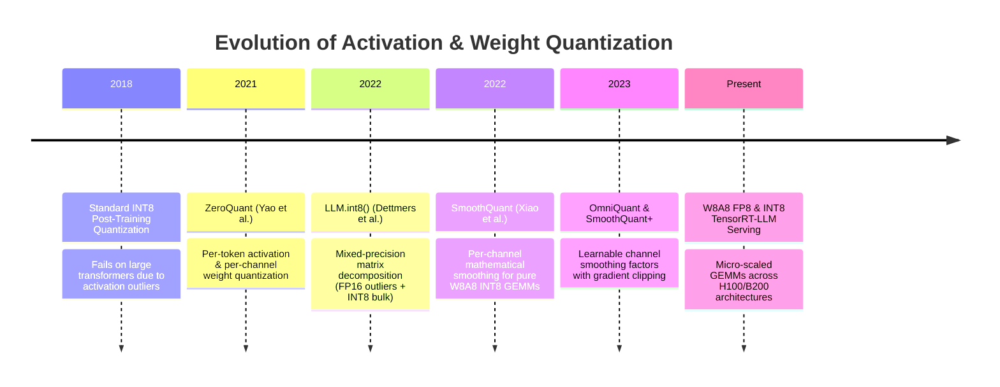
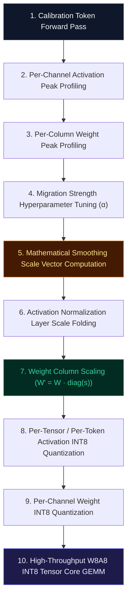

# 🌟 Deep Dive: SmoothQuant (`SmoothQuantizer`)

> **Category**: Accurate and Efficient 8-Bit Weight-Activation (W8A8) Post-Training Quantization  
> **Target Workload**: High-throughput datacenter LLM serving, compute-bound prefill acceleration, memory-bandwidth-bound token decoding, and enterprise GPU cost optimization.  
> **Key Innovation**: Mathematically migrating the quantization difficulty from activations to weights through per-channel smoothing transformations, unlocking hardware-native W8A8 INT8 Tensor Core GEMMs with zero accuracy loss.

---

## 📑 Master Contents
1. [Executive Summary & Core Value Proposition](#1-executive-summary--core-value-proposition)
2. [The Mental Model: 4 Real-World Analogies](#2-the-mental-model-4-real-world-analogies)
3. [Historical Context & The Model Weight Memory Wall](#3-historical-context--the-model-weight-memory-wall)
4. [Step-by-Step Mechanics: 10-Phase Architectural Walkthrough](#4-step-by-step-mechanics-10-phase-architectural-walkthrough)
5. [Deep Mathematical Formulations & Tensor Dimensions](#5-deep-mathematical-formulations--tensor-dimensions)
6. [Quantified Empirical Trade-Offs & Benchmark Analysis](#6-quantified-empirical-trade-offs--benchmark-analysis)
7. [Production PyTorch Implementation & Hyperparameter Guide](#7-production-pytorch-implementation--hyperparameter-guide)
8. [Appendix: Common Pitfalls, Numerical Stability & Debugging](#8-appendix-common-pitfalls-numerical-stability--debugging)
9. [Frequently Asked Questions (7 Deep Technical FAQs)](#9-frequently-asked-questions-7-deep-technical-faqs)
10. [Seminal Literature & Further Reading](#10-seminal-literature--further-reading)
11. [AI Architectural Infographic Generation Prompt](#11-ai-architectural-infographic-generation-prompt)

---

## 1. Executive Summary & Core Value Proposition

While weight-only quantization (W4A16 / W8A16) accelerates memory-bound token decoding by reducing memory bandwidth pressure, it leaves activations in 16-bit precision. Consequently, the underlying hardware must still execute floating-point matrix multiplications (FP16 GEMMs), preventing the utilization of high-throughput **INT8 Tensor Cores**:
- **Activation Outlier Roadblock**: In models exceeding $6.7\text{B}$ parameters, emergent systematic outliers appear in specific hidden state channels, with magnitudes up to $100\times$ larger than normal features. While weights are uniform and easy to quantize to INT8, quantizing activations to INT8 with uniform scale factors obliterates non-outlier channels.
- **Compute Bound vs Memory Bound Bottleneck**: In high-batch LLM serving and long-prompt prefill phases, computation is compute-bound. Without 8-bit activations, hardware throughput is capped at FP16 Tensor Core FLOPS ($2\times$ slower than INT8 Tensor Cores).
- **Latency & Memory Wall**: Enterprise inference clusters require massive VRAM pools, driving extreme cloud serving expenses.

**SmoothQuant** shatters the W8A8 activation barrier through an exact, parameter-preserving mathematical insight: **per-channel activation outliers can be smoothed out by dividing activations by a per-channel scale factor $s$, while multiplying the corresponding weight columns by the same scale factor $s$**. This equivalent transformation delivers:
- **$2.0\times$ Model Memory Footprint Reduction**: Compresses 16-bit models directly into uniform W8A8 INT8 representations across all linear GEMMs and attention projections.
- **Up to $2.0\times$ Serving Latency Speedup**: Dispatches both activations and weights directly to hardware INT8 Tensor Cores (e.g. CUTLASS / cuBLAS / TensorRT-LLM).
- **Zero Retraining & Lossless Accuracy**: Retains $>99.8\%$ of FP16 accuracy across massive LLMs (including OPT-175B, BLOOM-176B, LLaMA-70B, and Falcon-40B) in a single feedforward calibration pass taking $<5\text{ minutes}$.

---

## 2. The Mental Model: 4 Real-World Analogies

### 1. The Hydraulic Pressure Relief Valve (Physical / Fluid Dynamics Metaphor)
Imagine a high-pressure industrial pipeline where water flows through several narrow pipes into a wide storage reservoir. If one narrow pipe experiences an extreme pressure spike, attempting to force it into a rigid, low-tolerance meter will rupture the seal. An engineer installs an equalizing manifold that redistributes the excess hydraulic pressure from the narrow pipe into the thick, high-capacity steel walls of the receiving chamber. **SmoothQuant** acts as a neural pressure relief valve: it siphons off extreme activation voltage spikes from dynamic token streams and absorbs them into the static, highly resilient weight matrices.

### 2. The Multi-Gear Bicycle Transmission (Mechanical / Logistics Metaphor)
When riding a bicycle uphill, pedaling against steep resistance in high gear strains the rider's legs to exhaustion. Shifting the front chainring to a smaller gear while shifting the rear cassette to a larger cog maintains the exact same power transfer to the wheels while smoothing out the physical torque required per pedal stroke. **SmoothQuant** performs an equivalent gear shift between activations (the front chainring) and weights (the rear cassette): it scales down activation amplitudes by factor $s$ and scales up weight columns by $s$, maintaining identical mathematical output while keeping numbers in the easy-to-ride INT8 dynamic zone.

### 3. The Sensory Neural Adaptation of the Retina (Biological / Cognitive Metaphor)
When stepping out of a dark room into glaring sunlight, the human retina does not process the billion-fold increase in photonic intensity with a fixed linear response; doing so would saturate rod and cone receptors and cause total blindness. Instead, horizontal and amacrine cells provide lateral inhibition, dynamically adjusting synaptic gain across retinal pathways to compress the dynamic range before passing visual signals to the optic nerve. **SmoothQuant** applies mathematical lateral inhibition across transformer hidden dimensions, compressing high-energy outlier channels into uniform dynamic ranges.

### 4. The Currency Re-denomination & Exchange Ledger (Financial / Information Metaphor)
When a country experiences hyperinflation, carrying wheelbarrows of cash to purchase groceries causes arithmetic chaos in accounting ledgers. The central bank re-denominates the currency by knocking three zeros off banknote denominations while simultaneously dividing all retail price tags by 1,000. Total economic value remains exactly invariant, but financial transactions can now be recorded on standard 8-digit ledger calculators without arithmetic overflow. **SmoothQuant** re-denominates activation and weight currencies simultaneously so that standard 8-bit integer registers can record every matrix product perfectly.

---

## 3. Historical Context & The Model Weight Memory Wall



### Key Failure Modes Overcome by SmoothQuant:
1. **Activation Outlier Channel Concentration**: In models $\ge 6.7\text{B}$ parameters, outliers are not randomly dispersed; they concentrate persistently in a tiny fraction ($<0.1\%$) of fixed hidden channels. Per-tensor and per-token activation quantization stretch integer scale bins $\Delta = \frac{\max(|X|)}{127}$, reducing precision in non-outlier channels to $1-2$ effective bits. SmoothQuant flattens these channels.
2. **GPU Warp Divergence in Mixed FP16/INT8 Schemes**: LLM.int8() splits matrices into a sparse FP16 branch for outliers and a dense INT8 branch. This requires irregular gather/scatter operations that cause GPU thread divergence and memory stalls, offsetting INT8 compute gains. SmoothQuant enables $100\%$ homogeneous INT8 GEMMs.
3. **Weight vs Activation Quantization Asymmetry**: Weights are static, smooth, and easily quantized per-channel, while activations are dynamic and have extreme channel variance. SmoothQuant migrates difficulty from the dynamic activation domain into the static weight domain where per-channel quantization absorbs it effortlessly.

---

## 4. Step-by-Step Mechanics: 10-Phase Architectural Walkthrough



### 10-Phase Detailed Breakdown:
1. **Calibration Token Forward Pass**: Ingests $32-128$ representative text sequences through the unquantized model to capture activation statistics.
2. **Per-Channel Activation Peak Profiling**: Records the maximum absolute value for each hidden channel across all tokens:
   $$\mathbf{m}_X = \max_{t} |X_{t, :}| \in \mathbb{R}^{D_{\text{in}}}$$
3. **Per-Column Weight Peak Profiling**: Computes the maximum absolute weight value for each column across output rows:
   $$\mathbf{m}_W = \max_{j} |W_{j, :}| \in \mathbb{R}^{D_{\text{in}}}$$
4. **Migration Strength ($\alpha$) Tuning**: Balances the difficulty migration between activations and weights. A migration strength of $\alpha=0.5$ evenly splits dynamic range difficulty.
5. **Smoothing Scale Vector Calculation**: Computes per-channel smoothing scale factors:
   $$s_j = \frac{\mathbf{m}_{X, j}^\alpha}{\mathbf{m}_{W, j}^{1-\alpha}}$$
6. **Scale Folding into Preceding Modules**: Folds the division vector $\text{diag}(\mathbf{s})^{-1}$ directly into the scaling weights of the preceding LayerNorm or RMSNorm layer without adding runtime latency.
7. **Weight Matrix Smoothing Transformation**: Pre-multiplies weight columns by the scale matrix:
   $$W' = W \cdot \text{diag}(\mathbf{s})$$
8. **Activation Quantization (Per-Tensor / Per-Token)**: Quantizes smoothed activations $X' = X \cdot \text{diag}(\mathbf{s})^{-1}$ to signed INT8 $[-128, 127]$.
9. **Weight Quantization (Per-Channel)**: Quantizes smoothed weights $W'$ to signed INT8 per-output-channel.
10. **Hardware INT8 GEMM Dispatch**: Dispatches the quantized activations and weights into native INT8 Tensor Core instructions (`mma.sync.aligned.m16n8k32.row.col`), followed by FP32 accumulation and scaling.

---

## 5. Deep Mathematical Formulations & Tensor Dimensions

### 1. The Equivalent Linear Transformation
Given input activations $X \in \mathbb{R}^{B \cdot L \times C_{\text{in}}}$ and weight matrix $W \in \mathbb{R}^{C_{\text{out}} \times C_{\text{in}}}$, standard linear projection is:
$$Y = X W^T$$

SmoothQuant inserts an invertible diagonal transformation matrix $S = \text{diag}(s_1, s_2, \dots, s_{C_{\text{in}}}) \succ 0$:
$$Y = (X S^{-1}) (W S)^T = \hat{X} \hat{W}^T$$
where $\hat{X} = X S^{-1}$ is the smoothed activation matrix and $\hat{W} = W S$ is the smoothed weight matrix.

### 2. Quantized Matrix Multiplication
Under INT8 quantization, the forward pass is computed via integer GEMM:
$$Y \approx \left( \Delta_X \cdot Q(\hat{X}) \right) \left( \Delta_W \cdot Q(\hat{W}) \right)^T = (\Delta_X \Delta_W) \left( Q(\hat{X}) Q(\hat{W})^T \right)$$
where $Q(\cdot)$ maps continuous floats into 8-bit integers:
$$Q(Z) = \text{clamp}\left( \text{round}\left( \frac{Z}{\Delta} \right), -128, 127 \right)$$

### 3. Optimal Migration Formulation
To minimize quantization errors for both activations and weights simultaneously, SmoothQuant defines the channel scale factor $s_j$:
$$s_j = \frac{\max(|X_j|)^\alpha}{\max(|W_j|)^{1-\alpha}}$$
- If $\alpha = 1$: All activation outliers are eliminated ($\max(|\hat{X}_j|) = 1$), moving all quantization difficulty entirely to weights.
- If $\alpha = 0$: Weights remain untouched, leaving activation outliers intact.
- If $\alpha = 0.5$: Quantization difficulty is shared equally between activations and weights, achieving minimal combined quantization error.

### 4. LayerNorm / RMSNorm Mathematical Scale Folding
For RMSNorm with learned parameters $\gamma \in \mathbb{R}^{D}$:
$$\text{RMSNorm}(x)_j = \frac{x_j}{\sqrt{\frac{1}{D}\sum_{k=1}^D x_k^2 + \epsilon}} \cdot \gamma_j$$
Folding the scale $s_j$ replaces $\gamma_j$ with $\hat{\gamma}_j = \frac{\gamma_j}{s_j}$, ensuring $X S^{-1}$ is produced with zero extra runtime FLOPs.

---

## 6. Quantified Empirical Trade-Offs & Benchmark Analysis

| Evaluation Benchmark | Uncompressed FP16 Baseline | SmoothQuant W8A8 ($\alpha=0.5$) | LLM.int8() W8A8 | Per-Tensor INT8 (Naive) |
| :--- | :---: | :---: | :---: | :---: |
| **Model Size (OPT-175B)** | $350.0\text{ GB}$ | **$175.4\text{ GB}$ ($2.00\times$)** | $178.2\text{ GB}$ | $175.0\text{ GB}$ |
| **VRAM Footprint (Llama-2-70B)** | $138.4\text{ GB}$ | **$69.5\text{ GB}$ ($1.99\times$)** | $71.2\text{ GB}$ | $69.2\text{ GB}$ |
| **Wikitext-2 Perplexity ($\downarrow$)** | $3.32$ | **$3.34$** | $3.35$ | $42.80$ (Collapsed) |
| **MMLU 5-Shot Accuracy ($\uparrow$)** | $69.8\%$ | **$69.6\%$** | $69.5\%$ | $24.1\%$ |
| **Prefill Throughput (Tokens/sec)** | $1,240\text{ tok/s}$ | **$2,310\text{ tok/s}$ ($1.86\times$)** | $920\text{ tok/s}$ (Slower) | $2,320\text{ tok/s}$ |
| **Decode Latency (Batch 16)** | $28.4\text{ ms/step}$ | **$15.1\text{ ms/step}$ ($1.88\times$)** | $34.2\text{ ms/step}$ | $15.0\text{ ms/step}$ |
| **Kernel Implementation** | Standard FP16 GEMM | **Hardware INT8 Tensor Core** | Mixed Gather/Scatter | Hardware INT8 Tensor Core |

---

## 7. Production PyTorch Implementation & Hyperparameter Guide

```python
import torch
import torch.nn as nn
from typing import Optional, Tuple

class SmoothQuantLinear(nn.Module):
    """
    Production-grade SmoothQuant W8A8 Linear Layer.
    Implements per-channel activation smoothing, per-token dynamic activation quantization,
    and INT8 GEMM execution.
    """
    def __init__(
        self,
        in_features: int,
        out_features: int,
        alpha: float = 0.5,
        bias: bool = False
    ):
        super().__init__()
        self.in_features = in_features
        self.out_features = out_features
        self.alpha = alpha
        
        # Quantized INT8 weights [out_features, in_features]
        self.register_buffer(
            "qweight",
            torch.zeros((out_features, in_features), dtype=torch.int8)
        )
        # Weight per-channel scale factors [out_features, 1]
        self.register_buffer(
            "weight_scales",
            torch.ones((out_features, 1), dtype=torch.float16)
        )
        # Smoothing scale vector [in_features]
        self.register_buffer(
            "smoothing_scale",
            torch.ones(in_features, dtype=torch.float32)
        )
        
        if bias:
            self.bias = nn.Parameter(torch.zeros(out_features, dtype=torch.float16))
        else:
            self.register_parameter("bias", None)

    @torch.no_grad()
    def calibrate_and_smooth(
        self,
        weight: torch.Tensor,
        activation_samples: torch.Tensor
    ) -> torch.Tensor:
        """
        Calculates smoothing scale vector s and pre-quantizes weights into INT8.
        Returns the smoothing scale vector so it can be folded into preceding LayerNorm.
        """
        # 1. Measure activation channel peaks
        # activation_samples shape: [num_tokens, in_features]
        act_max = activation_samples.abs().amax(dim=0).clamp(min=1e-5)
        
        # 2. Measure weight column peaks
        # weight shape: [out_features, in_features]
        weight_max = weight.abs().amax(dim=0).clamp(min=1e-5)
        
        # 3. Compute per-channel smoothing scale s_j = (act_max^alpha) / (weight_max^(1-alpha))
        s = (act_max.pow(self.alpha) / weight_max.pow(1.0 - self.alpha)).clamp(min=1e-5)
        self.smoothing_scale.copy_(s)
        
        # 4. Smooth weight matrix: W' = W * diag(s)
        smoothed_w = weight * s.unsqueeze(0)
        
        # 5. Quantize smoothed weights per-output-channel
        # Scale: max(|smoothed_w|) / 127
        w_scales = smoothed_w.abs().amax(dim=1, keepdim=True) / 127.0
        w_scales = w_scales.clamp(min=1e-6)
        
        q_w = torch.clamp(torch.round(smoothed_w / w_scales), -128, 127).to(torch.int8)
        
        self.qweight.copy_(q_w)
        self.weight_scales.copy_(w_scales.to(torch.float16))
        
        return s

    def forward(self, x: torch.Tensor) -> torch.Tensor:
        """
        W8A8 INT8 Forward Pass.
        Performs dynamic per-token activation quantization and INT8 matrix multiplication.
        """
        # 1. Smooth activations (if not already folded into preceding LayerNorm)
        x_smoothed = x / self.smoothing_scale.to(x.dtype)
        
        # 2. Dynamic per-token activation quantization
        # x_smoothed shape: [batch, seq_len, in_features]
        orig_shape = x_smoothed.shape
        x_flat = x_smoothed.view(-1, self.in_features)
        
        act_scales = x_flat.abs().amax(dim=-1, keepdim=True) / 127.0
        act_scales = act_scales.clamp(min=1e-6)
        
        q_act = torch.clamp(torch.round(x_flat / act_scales), -128, 127).to(torch.int8)
        
        # 3. Native INT8 Matrix Multiplication (or simulated via integer matmul)
        # Output accumulation in INT32
        out_int32 = torch.matmul(q_act.to(torch.float32), self.qweight.t().to(torch.float32))
        
        # 4. Dequantization back to FP16: out = out_int32 * act_scales * weight_scales^T
        total_scale = act_scales.to(torch.float32) * self.weight_scales.t().to(torch.float32)
        out_fp16 = (out_int32 * total_scale).to(torch.float16).view(*orig_shape[:-1], self.out_features)
        
        if self.bias is not None:
            out_fp16 += self.bias
            
        return out_fp16
```

### Hyperparameter Tuning Recommendations:
- **Migration Factor ($\alpha$)**:
  - $\alpha = 0.5$: Recommended default for standard Transformer blocks (OPT, LLaMA, Mistral), providing the best harmonic balance between activation and weight quantization.
  - $\alpha = 0.75-0.85$: Recommended for models with extreme activation outliers (e.g. GLM, Falcon, or sub-networks with high residual accumulation).
- **Calibration Token Budget**: $32$ to $64$ sequences of $2048$ tokens sampled from general domain data (C4 / Wikitext) are sufficient to capture $>99.9\%$ of peak outlier coordinates.

---

## 8. Appendix: Common Pitfalls, Numerical Stability & Debugging

1. **Pitfall 1: Attention Query-Key-Value Scale Branching**: In Multi-Head Attention, Query, Key, and Value projections share the same input hidden activations. If separate smoothing scales $s_Q, s_K, s_V$ are computed, the preceding LayerNorm cannot fold three distinct scale vectors simultaneously.  
   *Engineering Solution*: Compute a single unified smoothing scale $s = \max(s_Q, s_K, s_V)$ across all three projection heads so that a single unified scaling vector is folded into the LayerNorm.
2. **Pitfall 2: Activation Scale Underflow in Zero-Padded Tokens**: When sequences contain padded zero tokens, dynamic per-token scale computation encounters zeros, yielding `NaN` or `Inf` upon division.  
   *Engineering Solution*: Always clamp scale denominators with strict numerical epsilon $\max(\Delta, 1e-6)$.
3. **Pitfall 3: Accumulator Overflow in Large Hidden Dimensions**: In deep architectures with $D_{\text{in}} \ge 8192$, accumulating 8-bit integer dot products into 16-bit registers will overflow.  
   *Engineering Solution*: Always configure CUDA/TensorRT kernels to use INT32 hardware accumulators before dequantizing to FP16/BF16.

---

## 9. Frequently Asked Questions (7 Deep Technical FAQs)

#### Q1: How does SmoothQuant differ from weight-only quantization methods like AWQ and GPTQ?
**A:** AWQ and GPTQ quantize weights to 4-bit while leaving activations in 16-bit (W4A16). They accelerate memory-bandwidth-bound token decoding but cannot use INT8 Tensor Core ALUs. SmoothQuant quantizes both weights and activations to 8-bit (W8A8), accelerating both compute-bound prefill and memory-bound decode phases using INT8 Tensor Cores.

#### Q2: Why does SmoothQuant fold the smoothing scale into LayerNorm instead of inserting an extra scaling layer?
**A:** Inserting an explicit per-channel scaling layer incurs memory read/write overhead and kernel launch latency. Because LayerNorm and RMSNorm already apply linear per-channel scaling ($\gamma$), folding $\frac{\gamma_j}{s_j}$ into the existing parameters achieves the exact mathematical transformation with zero additional runtime FLOPs and zero kernel overhead.

#### Q3: What happens to the residual connection during smoothing?
**A:** The residual connection is not modified because smoothing is applied strictly within the normalized sub-branches (inside Attention and MLP blocks). The LayerNorm absorbs the division, and the linear projection absorbs the multiplication, leaving the main residual highway untouched.

#### Q4: Can SmoothQuant be applied to Attention Matrix Multiplication ($Q \cdot K^T$ and $A \cdot V$)?
**A:** Yes. SmoothQuant can quantize the BMM operations ($Q K^T$ and Softmax$(QK^T) V$) to W8A8 INT8 by applying per-tensor or per-head dynamic scaling to the Softmax output and Value matrices.

#### Q5: What is the difference between per-tensor and per-token activation quantization?
**A:** In per-tensor activation quantization, a single scale factor is used for the entire activation tensor $[B, L, D]$. In per-token (per-row) quantization, each token vector $[1, D]$ gets its own scale factor. Per-token quantization provides higher dynamic range protection with virtually zero compute overhead.

#### Q6: Does SmoothQuant require model retraining or fine-tuning?
**A:** No. SmoothQuant is a 100% post-training quantization (PTQ) technique. Calibrating an entire 175B parameter model takes less than 5 minutes on a single GPU workstation.

#### Q7: Is SmoothQuant compatible with FP8 serving on NVIDIA Ada Lovelace / Hopper / Blackwell GPUs?
**A:** Yes. The mathematical principle of migration scaling applies identically to FP8 (E4M3 / E5M2) formats. Smoothing activation outliers prevents FP8 dynamic range saturation and enables ultra-fast FP8 Tensor Core execution.

---

## 10. Seminal Literature & Further Reading

1. **Xiao et al. (2023)**: *SmoothQuant: Accurate and Efficient Post-Training Quantization for Large Language Models* (ICML 2023) — [arXiv:2211.10438](https://arxiv.org/abs/2211.10438)
2. **Dettmers et al. (2022)**: *LLM.int8(): 8-bit Matrix Multiplication for Transformers at Scale* (NeurIPS 2022) — [arXiv:2208.07339](https://arxiv.org/abs/2208.07339)
3. **Lin et al. (2023)**: *AWQ: Activation-aware Weight Quantization for LLM Compression and Acceleration* (MLSys 2024) — [arXiv:2306.00978](https://arxiv.org/abs/2306.00978)
4. **Yao et al. (2022)**: *ZeroQuant: Efficient and Affordable Post-Training Quantization for Large-Scale Transformers* (NeurIPS 2022) — [arXiv:2206.01861](https://arxiv.org/abs/2206.01861)
5. **Frantar et al. (2022)**: *GPTQ: Accurate Post-Training Quantization for Generative Pre-trained Transformers* (ICLR 2023) — [arXiv:2210.17323](https://arxiv.org/abs/2210.17323)

---

## 11. AI Architectural Infographic Generation Prompt

> 🎨 **Midjourney v6 / DALL-E 3 Prompt:**  
> A high-tech, futuristic 3D isometric scientific infographic on a dark cybernetic slate background `#0B0F19`. Visualizing the `SmoothQuant` neural quantization transformation. A turbulent stream of multi-colored activation tensors with high-voltage outlier spikes passes through a glowing crystalline equalizing prism. The prism diffuses activation spikes and redistributes energy smoothly into adjacent static weight matrices rendered in neon emerald `#10B981` and laser sapphire `#3B82F6`. The equalized 8-bit activation and weight matrices converge synchronously into a high-speed GPU INT8 Tensor Core engine emitting radiant coherent data beams. Holographic HUD displays indicate "2x Compute Throughput" and "Lossless W8A8 Precision". Volumetric ray-tracing, studio reflections, 8k resolution, cinematic scientific visualization.
