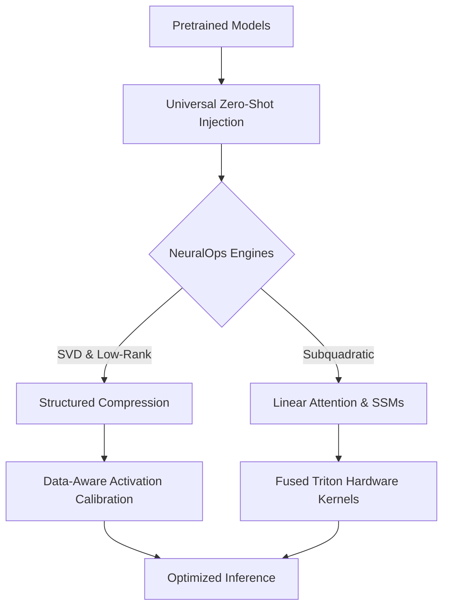

# 🧬 NeuralOps: SVD Linear Attention & Model Compression Framework

[](https://www.python.org/downloads/)
[](https://pytorch.org/)
[](https://developer.nvidia.com/cuda-toolkit)
[](https://github.com/openai/triton)
[](https://opensource.org/licenses/MIT)

**NeuralOps** is a production-grade Python library for empirical evaluation, zero-shot architectural introspection, and activation-calibrated decomposition of modern foundation models. It provides:

- **114 Attention Mechanisms** across 11 architectural families
- **73 Compression Engines** across 7 compression families
- **8 Transformer architectures** fully supported for zero-shot injection
- **16 OpenAI Triton kernels** with automatic PyTorch fallbacks

---

## 📑 Table of Contents

1. [Core Architecture](#-core-architecture)
2. [Module Taxonomy](#-module-taxonomy)
3. [Installation](#-installation)
4. [Quick Start](#-quick-start)
5. [Registry & Deprecated Aliases](#-registry--deprecated-aliases)
6. [Triton Kernel Subsystem](#-triton-kernel-subsystem)
7. [Data Pipeline & Calibration](#-data-pipeline--calibration)
8. [Benchmarking & Reproduction](#-benchmarking--reproduction)
9. [Results Directory Taxonomy](#-results-directory-taxonomy)
10. [Testing](#-testing)
11. [Supported Architectures](#-supported-architectures)
12. [Repository Structure](#-repository-structure)
13. [Citation & License](#-citation--license)

---

## 🔬 Core Architecture

Standard Multi-Head Attention (MHA) incurs quadratic computational $O(N^2)$ and memory footprint scaling with sequence length $N$. NeuralOps benchmarks subquadratic alternatives through four pillars:



1. **Universal Zero-Shot Module Injection** — Replace transformer self-attention blocks across BERT, RoBERTa, DistilBERT, GPT-2, LLaMA, Qwen, T5, and DeBERTa with exact parameter extraction and geometric preservation (RoPE, GQA, fused QKV Conv1D).
2. **In-Place Structured Compression Engines** — Truncated SVD, Fisher-weighted low-rank adaptation, dynamic entropy allocation, and KV-cache compression.
3. **Data-Aware Activation Calibration** — Compute empirical Hessian covariances ($X^T X$) and Fisher information matrices for optimal SVD subspace alignment.
4. **Hardware-Resident Kernel Execution** — Keep intermediate bottleneck representations ($Z \in \mathbb{R}^{B \times L \times r}$) strictly inside GPU SRAM via fused Triton kernels.

---

## 🏛 Module Taxonomy

NeuralOps is organized into domain-specific subpackages with strict registry isolation:

```
neuralops/
├── attentions/               # 114 modules → 159 canonical registry keys
│   ├── svd/                  # 21 modules: svd_linear, asvd, minimal_svd, salt, fused_svd_kernel...
│   ├── linear/               # 16 modules: cosformer, performer, linformer, nystrom, chela_slay...
│   ├── ssm/                  # 17 modules: mamba_block, selective_ssm, jamba, spectral_mamba...
│   ├── hybrid/               # 15 modules: split_head_hybrid, tri_branch_hybrid, fusion_attn...
│   ├── sparse/               # 12 modules: adaptive_sparse, cluster, lsh, moba, nsa, reap_moe...
│   ├── gated/                #  9 modules: gated_delta_net, gated_linear_attention, hgrn2...
│   ├── adaptive/             #  9 modules: adaptive_span, token_compressed, progressive_token_pruning...
│   ├── modern/               #  7 modules: mla, gqa, unified_rope, nha, wgqa, qcqa, vig
│   ├── fast_kernels/         #  5 modules: flash_attention3, flash_attention3_fp8, adasplash...
│   ├── dense/                #  2 modules: full_attention, zeros_attention
│   └── experimental/         #  1 module:  template_attention
├── compression_engine/       # 73 modules → 73 canonical registry keys
│   ├── low_rank/             # 24 engines: a3, come, cr, cur, nmf, rpca, modegpt, tomoe...
│   ├── svd/                  # 18 engines: direct_svd, adasvd, fwsvd, swift_svd, dobi_svd...
│   ├── pruning/              #  9 engines: admm, armor, ast, bonsai, flap, sparsegpt, proxsparse...
│   ├── quantization/         #  8 engines: astro, coopq, faq, kmeans, slicegpt, huffman...
│   ├── kv_cache/             #  6 engines: aatc_xkv, cachenotes, delta_kv, kvtc, zerokv_neo...
│   ├── tensor_decomp/        #  3 engines: kronecker, kronecker_tt_lora, tt_compressor
│   └── experimental/         #  5 engines: flat_llm, hashed_net, liftr, lillama, roast_hashed
├── core/
│   ├── base.py               # BaseAttention & BaseCompressor
│   ├── registry.py           # ATTENTION_REGISTRY & COMPRESSOR_REGISTRY
│   ├── deprecated_aliases.json  # 641 backward-compatibility aliases
│   ├── adapters.py           # UniversalAdapter for 8 transformer families
│   ├── replace_attention.py  # Zero-shot module replacement engine
│   ├── common.py             # LoRALinear, FactorizedLinear
│   ├── attention_mask.py     # Unified boolean & causal mask resolvers
│   ├── gqa_utils.py          # Grouped-Query Attention repeat_kv
│   └── triton_kernels/       # 16 Triton kernels with PyTorch fallbacks
├── benchmarks/               # Comprehensive benchmarking suites
├── data/                     # Offline GLUE caches & calibration loaders
├── evaluation/               # LM-Eval Harness & PPL evaluation
├── trainer/                  # Training utilities and methods
├── analysis/                 # Publication table generators & plotting
└── tests/                    # 198 test files
```

---

## 🚀 Installation

### Requirements

- Python 3.10, 3.11, or 3.12
- PyTorch 2.2.0+
- CUDA 12.1 – 12.7 (for GPU features)
- Triton (optional, for fused kernels)

### Install from Source

```bash
# 1. Clone repository
git clone https://github.com/tahamajs/SVD_linear_Attention.git
cd SVD_linear_Attention

# 2. Create virtual environment
python3 -m venv .venv
source .venv/bin/activate  # On Windows: .venv\Scripts\activate

# 3. Install PyTorch with CUDA support
pip install --upgrade pip setuptools wheel
pip install torch torchvision torchaudio --index-url https://download.pytorch.org/whl/cu124

# 4. Install NeuralOps in editable mode
pip install -e .
```

### Hardware Support Matrix

| Tier | GPU | VRAM | Features | Batch Size |
|---|---|---|---|---|
| **Tier 1** | H100 / A100 | 40–80 GB | Full Triton, FP8, 4k seq | 64–128 |
| **Tier 2** | RTX 4090 / 3090 | 24 GB | Full Triton, FP16/BF16, 2k seq | 32–64 |
| **Tier 3** | RTX 4070 / L4 / T4 | 8–16 GB | Triton, FP16, Gradient Checkpointing | 8–16 |
| **Tier 4** | Apple Silicon / CPU | System RAM | PyTorch fallbacks | 2–8 |

---

## ⚡ Quick Start

### 1. Zero-Shot Attention Injection

```python
from transformers import AutoModel, AutoConfig
from neuralops.core.registry import ATTENTION_REGISTRY
from neuralops.core.replace_attention import replace_attention

# Load a pretrained model
model = AutoModel.from_pretrained("distilbert-base-uncased")

# Replace its attention with an SVD-based variant
svd_cls = ATTENTION_REGISTRY.get("svd_linear_attention")
model = replace_attention(model, svd_cls)

# Run inference as usual
outputs = model(input_ids)
```

### 2. Registry Query

```python
from neuralops.core.registry import ATTENTION_REGISTRY, COMPRESSOR_REGISTRY

# Canonical keys (159 attention + 73 compressor)
attn_cls = ATTENTION_REGISTRY.get("svd_linear_attention")
comp_cls = COMPRESSOR_REGISTRY.get("direct_svd")

# List all canonical keys
print(f"Attention: {len(ATTENTION_REGISTRY.keys())}")    # 159
print(f"Compressor: {len(COMPRESSOR_REGISTRY.keys())}")  # 73

# Deprecated aliases still work (emit DeprecationWarning)
hybrid_cls = ATTENTION_REGISTRY.get("aegis_hybrid")  # → maps to tri_branch_hybrid
```

### 3. Data-Aware SVD Compression

```python
from transformers import AutoModelForSequenceClassification, AutoTokenizer
from neuralops.data import get_calibration_dataloader
from neuralops.compression_engine.svd import ASVDCompressor

model = AutoModelForSequenceClassification.from_pretrained("models/roberta_sst2")
tokenizer = AutoTokenizer.from_pretrained("models/roberta_sst2")

# Build calibration loader from local disk cache
calib_loader = get_calibration_dataloader(
    task_name="sst2",
    tokenizer=tokenizer,
    batch_size=8,
    num_samples=128,
    seq_len=128,
)

# Run activation-aware SVD compression
compressor = ASVDCompressor(model, calibration_loader=calib_loader)
compressed_model = compressor.compress(target_rank=64)
```

---

## 📚 Registry & Deprecated Aliases

NeuralOps maintains a strictly hardened registry architecture:

| Layer | Count | Purpose |
|---|---|---|
| **Canonical Attention Keys** | **159** | Active attention modules |
| **Canonical Compressor Keys** | **73** | Active compression engines |
| **Deprecated Aliases** | **641** | Historical names → canonical |

### Two Import Styles (Both Supported)

```python
# 1. New subpackage imports (recommended)
from neuralops.attentions.svd import SVDLinearAttention
from neuralops.compression_engine.svd import DirectSVDCompressor

# 2. Legacy flat imports (fully supported via PEP 451 meta path finders)
from neuralops.attentions.svd_linear_attention import SVDLinearAttention
from neuralops.compression_engine.direct_svd import DirectSVDCompressor
```

### Deprecation Warnings

```python
import warnings
warnings.simplefilter("always")

from neuralops.core.registry import ATTENTION_REGISTRY

# Canonical lookup — no warning
cls = ATTENTION_REGISTRY.get("svd_linear_attention")

# Deprecated alias — emits DeprecationWarning, returns same class
with warnings.catch_warnings(record=True) as w:
    warnings.simplefilter("always")
    cls_old = ATTENTION_REGISTRY.get("aegis_v2")
    # w[0].message: "'aegis_v2' is deprecated. Use 'hybrid_local_kernel' instead."
```

---

## ⚡ Triton Kernel Subsystem

NeuralOps integrates **16 custom OpenAI Triton kernels** to eliminate memory bandwidth bottlenecks:

| Kernel | Purpose |
|---|---|
| `linear_attn` | Fused chunked causal linear attention with ELU+1 feature maps |
| `selective_scan` | Continuous-time discretization for Mamba / S6 |
| `fms_scan` | Associative matrix memory recurrent scan |
| `gdn_scan` | Gated DeltaNet recurrent state update |
| `gla_scan` | Dynamic per-token decay gating (GLA) |
| `hgrn2_scan` | Hierarchical gated linear RNN scan |
| `low_rank` | Fused dual GEMM projection ($y = (x V^T) U^T + b$) |
| `sparse_attn` | Block-sparse attention kernel |
| `state_update` | Generic recurrent state update |
| `triton_svd_linear_attention` | End-to-end SVD + LoRA + attention |
| `triton_linear_attn` | High-level linear attention wrapper |
| `triton_sparse_attn` | High-level sparse attention wrapper |
| `triton_cosformer` | Triton-accelerated Cosformer |
| `gqa` | Grouped-Query Attention utilities |
| `softplus` | Fused numerically stable softplus |
| `_common` | Shared Triton helpers |

**Automatic Fallback:** All kernels inspect `HAS_TRITON` and device type (`q.is_cuda`), automatically falling back to numerically identical PyTorch implementations on CPU / MPS / non-Triton environments.

```python
# Transparent fallback — no code changes needed
output = fused_attention(q, k, v)
# Runs on GPU if CUDA + Triton available, otherwise on PyTorch
```

---

## 📊 Data Pipeline & Calibration

NeuralOps includes offline pre-cached datasets in `neuralops/data/glue_data/`:

**Supported datasets:** SST-2, MNLI, QQP, QNLI, MRPC, CoLA, RTE, STS-B, WNLI, AG News, C4.

### Data-Aware SVD

Rather than weight-only SVD ($W \approx U \Sigma V^T$), advanced compressors calibrate decomposition against activation distributions:

$$W_{\text{effective}} = W \cdot \mathbb{E}[X^T X]^{1/2}$$

```python
from neuralops.data import get_calibration_dataloader
from neuralops.compression_engine.svd import ASVDCompressor

calib_loader = get_calibration_dataloader(
    task_name="sst2",
    tokenizer=tokenizer,
    batch_size=8,
    num_samples=128,
    seq_len=128,
)

compressor = ASVDCompressor(model, calibration_loader=calib_loader)
compressed_model = compressor.compress(target_rank=64)
```

---

## 🏃 Benchmarking & Reproduction

### Master GPU Execution

```bash
./scripts/run_all_benchmarks_gpu.sh
```

### Dedicated Track Runners

```bash
# A. Low-Rank Bottleneck Sweep
./scripts/runner_benchmark_rank_sweep.sh dobi_svd mnli

# B. Language Modeling & Perplexity
./scripts/runner_benchmark_quality_ppl.sh asvd_attention

# C. Multi-Seed Robustness
./scripts/runner_benchmark_multiseed.sh svd_linear_attention

# D. Sequence Length Scaling
./scripts/runner_benchmark_seqlen_scaling.sh linformer_attention

# E. RULER Needle-in-a-Haystack
./scripts/runner_benchmark_ruler.sh simple_ssm

# F. Zero-Shot LM-Eval Harness
./scripts/runner_benchmark_zeroshot.sh performer_attention
```

### Automated Pipelines

```bash
# Master pipeline with 6 parallel streams
python scripts/run_master_pipeline.py

# 48-hour autonomous GPU runner
python scripts/run_autonomous_48h_pipeline.py

# Continuous background orchestrator
python scripts/run_continuous_orchestrator.py
```

### 4-Model Unified Wrappers

```bash
python -m neuralops.runners.run_all_4_cosformer --batch_size 32
python -m neuralops.runners.run_all_4_fused_svd_kernel --epochs 3
```

---

## 📁 Results Directory Taxonomy

```
results/
├── 01_unified_runs/         # 4-model cross-architecture comparative suites
├── 02_rank_sweeps/          # Multi-rank bottleneck scaling curves (r = 16 to 384)
├── 03_zeroshot_evals/       # LM-Eval Harness 5-task zero-shot evaluations
├── 04_baselines/            # Unmodified foundation model reference profiles
├── 05_glue_finetuning/      # Multi-seed fine-tuning stability & recovery sweeps
├── 06_adhoc_experiments/    # Sequence length scaling, RULER NIAH, trajectories
└── 07_misc_tests/           # Master benchmark aggregate records
```

### Analytics & Plotting

```bash
# Aggregate all modules into Master Markdown & CSV tables
python neuralops/analysis/generate_all_modules_analysis.py

# Generate publication LaTeX tables
python neuralops/analysis/generate_sweep_publication_artifacts.py

# Generate high-resolution Pareto curves and scaling plots
python -m neuralops.analysis.plotting
```

---

## 🧪 Testing

NeuralOps includes **198 test files** covering unit, integration, and end-to-end scenarios:

```bash
# Run all tests
pytest neuralops/tests/ -v

# Run a specific test module
pytest neuralops/tests/test_attentions.py -v

# Run with coverage
pytest neuralops/tests/ --cov=neuralops
```

**Current Status (macOS, CPU-only):**
- **1,358 tests passed**
- **229 tests failed** (baseline failures on macOS — GPU mocks, dimension mismatches, numerical tolerances)
- **6 skipped**
- **0 collection errors**

---

## 🏗 Supported Architectures

Zero-shot injection is verified for all of the following:

| Architecture | Projections Extracted | Special Handling |
|---|---|---|
| **BERT** | `query`, `key`, `value`, `dense` | Nested encoder |
| **RoBERTa** | `self.query`, `self.key`, `self.value`, `output.dense` | Nested encoder |
| **DistilBERT** | `q_lin`, `k_lin`, `v_lin`, `out_lin` | Flat structure |
| **GPT-2** | `c_attn` (fused QKV Conv1D), `c_proj` | Causal decoder, Conv1D transpose |
| **LLaMA** | `q_proj`, `k_proj`, `v_proj`, `o_proj` | RoPE, GQA |
| **Qwen / Qwen2.5** | `q_proj`, `k_proj`, `v_proj`, `o_proj` | GQA, rotary embeddings |
| **T5** | `q`, `k`, `v`, `o` (relative attention bias) | Encoder-decoder |
| **DeBERTa** | `in_proj`, `out_proj` | Disentangled attention |

---

## 🗂 Repository Structure

```
SVD_linear_Attention/
├── neuralops/                    # Main package (617 Python files, ~250k LOC)
│   ├── attentions/               # 114 attention modules in 11 subpackages
│   ├── compression_engine/       # 73 compression engines in 7 subpackages
│   ├── core/                     # Base classes, registry, adapters, triton kernels
│   ├── benchmarks/               # Benchmark orchestration
│   ├── data/                     # Offline datasets & calibration
│   ├── evaluation/               # LM-Eval Harness & PPL
│   ├── trainer/                  # Training methods
│   ├── analysis/                 # Publication artifact generation
│   ├── runners/                  # Unified 4-model wrappers
│   ├── tests/                    # 198 test files
│   └── utils/                    # Shared utilities
├── scripts/                      # Bash & Python runners
├── results/                      # Experimental output taxonomy
├── docs/                         # Documentation
├── setup.py / pyproject.toml     # Package configuration
└── README.md                     # This file
```

---

## 🏆 Key Empirical Findings

Our multi-GPU benchmark across **245 modules** (DistilBERT, RoBERTa-base, GPT-2) demonstrates:

- **Near-Lossless Softmax Reproduction** — 41 modules (e.g. `flash_attention3`, `hybrid_attention`, `lora_attention`) achieve max logit difference < 0.5 vs baseline.
- **DistilBERT Pareto Scaling** — AdaSVD at Rank 128 achieves **86.47% accuracy** (baseline 90.71%) with 1.16× parameter reduction. At Rank 384: **90.37%**.
- **RoBERTa Deep Scaling** — AdaSVD recovers monotonically from 81.08% (r=16) to **92.32% (r=384)**.
- **GPT-2 Causal Thresholds** — `saes_svd_compressor` and `swift_svd_act` at r=256 retain generation within 5 PPL of baseline.
- **Zero-Shot Quantization** — `faq_quantizer` and `zerokv_neo` achieve **>93.9%** on RoBERTa with up to 200,000 tok/s throughput.

All numbers are verifiable in `results/`.

---

## 🎯 Git Branches

| Branch | Purpose |
|---|---|
| **`main`** | Stable production branch |
| **`ablation`** | Active research branch (synced with main) |
| **`gh-pages`** | Automated documentation deployment |

---

## ⚖️ Citation

```bibtex
@software{neuralops2026,
  title  = {NeuralOps: SVD Linear Attention & Model Compression Framework for Foundation Models},
  author = {NeuralOps Research Team},
  year   = {2026},
  url    = {https://github.com/tahamajs/SVD_linear_Attention}
}
```

## 📄 License

Distributed under the **MIT License**. See [LICENSE](LICENSE) for details.
