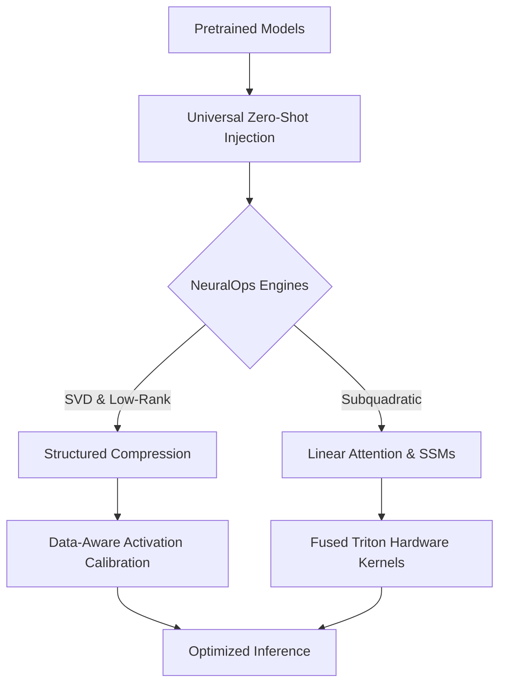

# 🧬 NeuralOps: SVD Linear Attention & Model Compression Framework

[](./)
[](https://www.python.org/downloads/)
[](https://pytorch.org/)
[](https://developer.nvidia.com/cuda-toolkit)
[](https://github.com/openai/triton)
[](https://opensource.org/licenses/MIT)

**NeuralOps** is a production-grade standard Python library for empirical evaluation, zero-shot architectural introspection, hardware roofline profiling, and activation-calibrated decomposition of:
- **Linear & Subquadratic Attention Mechanisms** ($O(N)$ and $O(N \log N)$ sequence complexity)
- **Subspace Singular Value Decompositions (SVD)** and data-aware low-rank factors
- **State-Space Models (SSMs)** & Hybrid Recurrent Architectures (Mamba, S6, RWKV, HGRN2, GLA)
- **Fused OpenAI Triton GPU Kernels** with transparent PyTorch fallbacks
- **Structured Sparsity, Quantization & Pruning** across modern Foundation Models

---

## 📑 Table of Contents
1. [Core Architecture & Philosophy](#-core-architecture--philosophy)
2. [Module Taxonomy (217+ Architectures)](#-module-taxonomy-217-architectures)
3. [Environment & CUDA Hardware Profiles](#-environment--cuda-hardware-profiles)
4. [Triton Hardware-Fused Kernel Subsystem](#-triton-hardware-fused-kernel-subsystem)
5. [Data Pipeline & Activation-Calibrated SVD](#-data-pipeline--activation-calibrated-svd)
6. [Benchmarking & Reproduction Workflows](#-benchmarking--reproduction-workflows)
   - [Single-Command Master GPU Execution](#1-single-command-master-gpu-execution)
   - [Dedicated Track Bash Runners](#2-dedicated-track-bash-runners)
   - [Automated Master Pipelines](#3-automated-master-pipelines)
   - [Unified 4-Model Wrappers](#4-unified-4-model-wrappers)
7. [Academic Results Directory Taxonomy](#-academic-results-directory-taxonomy)
8. [Analytics, Artifact Generation & Plotting](#-analytics-artifact-generation--plotting)
9. [Testing & Verification](#-testing--verification)
10. [Documentation & API Reference](#-documentation--api-reference)
11. [Citation & License](#-citation--license)

---

## 🔬 Core Architecture & Philosophy

Standard Multi-Head Attention (MHA) incurs quadratic computational $O(N^2)$ and memory footprint scaling with sequence length $N$. NeuralOps provides a unified, pip-installable Python package that solves and benchmarks subquadratic alternatives through:



1. 🎯 **Universal Zero-Shot Module Injection**: Dynamically replace transformer self-attention blocks across diverse model families (`distilbert`, `bert`, `roberta`, `t5`, `gpt2`, `qwen2.5`, `llama`) with exact parameter extraction, projection weight slicing, and geometric preservation (Rotary Position Embeddings, Grouped Query Attention, and fused $QKV$ Conv1D projections).
2. 🗜️ **In-Place Structured Compression Engines**: Evaluate truncated SVD, Fisher-weighted low-rank adaptation, dynamic entropy allocations, and KV-cache compression without altering model forward interfaces.
3. 📉 **Data-Aware Activation Calibration**: Feed real token activations through pretrained models to calculate empirical Hessian covariances ($X^T X$) and Fisher information matrices for optimal SVD subspace alignment.
4. ⚡ **Hardware-Resident Kernel Execution**: Keep intermediate bottleneck representations ($Z \in \mathbb{R}^{B \times L \times r}$) strictly inside GPU Shared Memory (SRAM) registers via fused Triton kernels, bypassing DRAM/HBM roundtrip bottlenecks.

---

## 🏛 Module Taxonomy (217+ Architectures)

The codebase is organized into modular subsystems under the root `neuralops` package:

```
neuralops/
├── attentions/               # 115 subquadratic, linear, and hybrid attention modules
│   ├── adaptive_span_attention.py, asvd_attention.py, cosformer.py,
│   ├── decay_linear_attention.py, factorised_matrix_state.py, flash_attention3.py,
│   ├── fused_svd_kernel.py, gated_delta_net.py, gated_linear_attention.py,
│   ├── hgrn2_layer.py, linformer_attention.py, mamba_block.py, mla_attention.py,
│   ├── performer_attention.py, simple_ssm.py, svd_attention.py,
│   ├── svd_linear_attention.py, triton_cosformer.py, triton_svd_linear_attention.py ...
├── compression_engine/       # 76 SVD factorizers, quantizers, and structural pruners
│   ├── a3_compressor.py, adasvd_compressor.py, adaptive_ranks.py,
│   ├── armor_pruner.py, compot_compressor.py, dobi_svd.py, dynamic_rank.py,
│   ├── frandi_compressor.py, rotational_slicegpt_int4.py, slicegpt_pca.py,
│   ├── sparsegpt.py, swift_svd_act.py, uniql_compressor.py ...
├── core/
│   ├── common.py             # Shared LoRALinear & FactorizedLinear with Triton acceleration
│   ├── registry.py           # Canonical ATTENTION_REGISTRY & COMPRESSOR_REGISTRY
│   ├── attention_mask.py     # Unified boolean and causal mask resolvers
│   ├── gqa_utils.py          # Grouped-Query Attention repeat_kv utilities
│   └── triton_kernels/       # Shared GPU Triton kernels & PyTorch CPU/MPS fallbacks
│       ├── linear_attn.py    # Fused chunked causal linear attention
│       ├── selective_scan.py # S6 selective scan recurrence for Mamba
│       ├── fms_scan.py       # Factorised Matrix State scan
│       ├── gdn_scan.py       # Gated DeltaNet scan
│       ├── gla_scan.py       # Gated Linear Attention dynamic decay scan
│       ├── hgrn2_scan.py     # HGRN2 recurrent scan
│       ├── low_rank.py       # Fused low-rank bottleneck projection (x @ V^T) @ U^T
│       └── sparse_attn.py    # Block-sparse attention kernel
├── benchmarks/               # Comprehensive benchmarking suites & runners
│   ├── core/                 # Modular argument parsing and statistical hypothesis testing
│   ├── run_all_benchmarks.py # Master benchmark orchestrator across PPL, LM-Eval, RULER
│   ├── run_quality_sweep.py  # C4 / WikiText perplexity and GLUE classification sweeps
│   ├── run_rank_sweeper.py   # Multi-rank bottleneck scaling sweeps
│   ├── run_multiseed.py      # Multi-seed recovery fine-tuning robustness
│   └── run_seqlen_scaling.py # Long-context sequence length scaling (128 -> 4096)
├── data/                     # Local offline GLUE caches & calibration DataLoader loaders
├── pipeline/                 # Production pipeline writers and artifact reporters
├── results_saver/            # Checkpoint persistence, metadata logging, and tracking
├── analysis/                 # Publication table generators, layer analyzers, and plotting
└── runners/                  # 230+ unified 4-model execution wrappers
```

---

## 🚀 Environment & CUDA Hardware Profiles

### Installation

NeuralOps is natively pip-installable. Install in editable mode for development:

```bash
# 1. Clone repository
git clone https://github.com/tahamajs/SVD_linear_Attention.git
cd SVD_linear_Attention

# 2. Initialize virtual environment
python3 -m venv .venv
source .venv/bin/activate  # On Windows: .venv\Scripts\activate

# 3. Install PyTorch with explicit CUDA 12.4 support
pip install --upgrade pip setuptools wheel
pip install torch torchvision torchaudio --index-url https://download.pytorch.org/whl/cu124

# 4. Install NeuralOps in editable mode
pip install -e .
```

### Hardware Support Matrix

| Hardware Tier | GPU Model | VRAM | Supported Features | Recommended Batch Size |
|---|---|---|---|---|
| **Tier 1 (Flagship)** | NVIDIA H100 / A100 | 40GB – 80GB | Full Triton Kernels, FP8, 4k Sequence Lengths | 64 – 128 |
| **Tier 2 (Workstation)** | NVIDIA RTX 4090 / 3090 | 24GB | Full Triton Kernels, FP16/BF16, 2k Sequence Lengths | 32 – 64 |
| **Tier 3 (Entry GPU)** | NVIDIA RTX 4070 / L4 / T4 | 8GB – 16GB | Triton Kernels, FP16, Gradient Checkpointing | 8 – 16 |
| **Tier 4 (CPU / MPS)** | Apple Silicon / Intel / AMD | System RAM | Automatic PyTorch Fallbacks (Non-CUDA) | 2 – 8 |

---

## ⚡ Triton Hardware-Fused Kernel Subsystem

NeuralOps integrates custom OpenAI Triton kernels designed to eliminate memory bandwidth bottlenecks in subquadratic attention:

- **`linear_attn`**: Hardware-fused chunked streaming linear attention with non-negative feature maps ($\phi(x) = \text{ELU}(x) + 1$, $\text{ReLU}$, identity) and bidirectional reduction.
- **`selective_scan`**: Fused continuous-time discretization state recurrence ($dA_t = \exp(\Delta_t \cdot A), h_t = dA_t \cdot h_{t-1} + dB_t, y_t = \sum h_t C_t$) for Mamba and S6 state-space architectures.
- **`fms_scan`**: Associative matrix memory recurrent scan for Factorised Matrix State.
- **`gdn_scan`**: Gated DeltaNet recurrent state update keeping hidden states resident in SRAM.
- **`gla_scan`**: Dynamic per-token decay gating for Gated Linear Attention and Decay Linear Attention.
- **`hgrn2_scan`**: Recurrent scan for Hierarchical Gated Linear Recurrent networks.
- **`low_rank`**: Fused dual GEMM projection ($y = (x \cdot V^T) \cdot U^T + \text{bias}$) powering `LoRALinear`, `FactorizedLinear`, and SVD-decomposed projections.
- **`fused_svd_kernel`**: In-SRAM RMSNorm + down/up dual projection kernel eliminating DRAM latency.

> [!NOTE]
> All Triton kernels incorporate **automatic PyTorch fallbacks**. If running on CPU, Apple Silicon MPS, or environments without Triton, execution gracefully and transparently defaults to numerically identical vectorized PyTorch implementations.

---

## 📊 Data Pipeline & Activation-Calibrated SVD

NeuralOps includes a dedicated offline data pipeline with pre-cached Arrow/Parquet datasets in `neuralops/data/glue_data/`:
- **Supported Datasets**: SST-2, MNLI, QQP, QNLI, MRPC, CoLA, RTE, STS-B, WNLI, AG News, and C4.

### Data-Aware SVD Compression

Rather than relying strictly on static weight-only SVD ($W \approx U \Sigma V^T$), advanced compressors in NeuralOps calibrate decomposition against actual activation distributions:

$$W_{\text{effective}} = W \cdot \mathbb{E}[X^T X]^{1/2}$$

Use the built-in offline calibration DataLoader:

```python
from transformers import AutoModelForSequenceClassification, AutoTokenizer
from neuralops.data import get_calibration_dataloader
from neuralops.compression_engine.asvd_compressor import ASVDCompressor

model = AutoModelForSequenceClassification.from_pretrained("models/roberta_sst2")
tokenizer = AutoTokenizer.from_pretrained("models/roberta_sst2")

# Build calibration loader directly from local disk cache (no internet required)
calib_loader = get_calibration_dataloader(
    task_name="sst2",
    tokenizer=tokenizer,
    batch_size=8,
    num_samples=128,
    seq_len=128,
)

# Run activation-aware SVD compression
compressor = ASVDCompressor(model, calibration_loader=calib_loader)
compressed_model = compressor.compress(target_rank=64)
```

---

## 🏃 Benchmarking & Reproduction Workflows

### 1. Single-Command Master GPU Execution

To run the complete benchmark matrix (PPL on WikiText-2, 5-task LM-Eval Harness, and RULER Needle-in-a-Haystack) across all registered modules with a single command:

```bash
./scripts/run_all_benchmarks_gpu.sh
```

### 2. Dedicated Track Bash Runners

Each research track has an executable standalone bash runner in `scripts/`:

```bash
# A. Low-Rank Bottleneck Sweep (Category 2)
./scripts/runner_benchmark_rank_sweep.sh dobi_svd mnli

# B. Language Modeling & Perplexity (Category 4)
./scripts/runner_benchmark_quality_ppl.sh asvd_attention

# C. Multi-Seed Robustness Fine-Tuning (Category 5)
./scripts/runner_benchmark_multiseed.sh svd_linear_attention

# D. Sequence Length Scaling (Category 6)
./scripts/runner_benchmark_seqlen_scaling.sh linformer_attention

# E. RULER Context Needle-in-a-Haystack (Category 6)
./scripts/runner_benchmark_ruler.sh simple_ssm

# F. Zero-Shot 5-Task LM-Eval Harness (Category 3)
./scripts/runner_benchmark_zeroshot.sh performer_attention
```

### 3. Automated Master Pipelines

For autonomous execution with adaptive VRAM monitoring:

```bash
# Master pipeline with 6 parallel streams
python scripts/run_master_pipeline.py

# 48-Hour autonomous high-throughput GPU runner
python scripts/run_autonomous_48h_pipeline.py

# Continuous background orchestrator
python scripts/run_continuous_orchestrator.py
```

### 4. Unified 4-Model Wrappers

For every registered module, a dedicated wrapper exists under `neuralops/runners/` to test across DistilBERT, RoBERTa, GPT-2, and Qwen:

```bash
python -m neuralops.runners.run_all_4_cosformer --batch_size 32
python -m neuralops.runners.run_all_4_fused_svd_kernel --epochs 3
```

---

## 📁 Academic Results Directory Taxonomy

All experimental outputs are strictly organized according to a publication taxonomy:

```
results/
├── 01_unified_runs/         # 4-model cross-architecture comparative suites
├── 02_rank_sweeps/          # Multi-rank bottleneck scaling curves (r = 16 to 384)
├── 03_zeroshot_evals/       # LM-Eval Harness 5-task zero-shot evaluations
├── 04_baselines/            # Unmodified foundation model reference profiles
├── 05_glue_finetuning/      # Multi-seed fine-tuning stability & recovery sweeps
├── 06_adhoc_experiments/   # Targeted sequence length scaling, RULER NIAH, and trajectories
└── 07_misc_tests/           # Master benchmark aggregate records and validation telemetry
```

---

## 📈 Analytics, Artifact Generation & Plotting

NeuralOps provides an end-to-end analysis pipeline that transforms raw benchmark logs into publication-ready artifacts:

```bash
# 1. Aggregate and audit all 217 modules into Master Markdown & CSV tables
python neuralops/analysis/generate_all_modules_analysis.py

# 2. Generate publication LaTeX tables and sweep metrics
python neuralops/analysis/generate_sweep_publication_artifacts.py

# 3. Generate high-resolution Seaborn/Matplotlib Pareto curves and scaling plots
python -m neuralops.analysis.plotting
```

Generated summary files:
- `paper/_ALL_MODULES_ANALYSIS.csv`: 25-column comparative matrix across all modules.
- `paper/_ALL_MODULES_ANALYSIS.md`: Markdown summary table with status, memory, and performance metrics.

---

## 🧪 Testing & Verification

NeuralOps includes a complete unit and integration test suite:

```bash
# Run all Triton kernel unit tests (14 passed)
pytest neuralops/tests/test_triton_kernels_suite.py

# Run all test suites
pytest
```

---

## 📚 Documentation & API Reference

Generate the full interactive HTML documentation site locally:

```bash
pip install pdoc3
pdoc --html --output-dir docs neuralops
```

Once generated, open `docs/neuralops/index.html` in your web browser.

---

## ⚖️ Citation & License

If you use NeuralOps in your research, please cite:

```bibtex
@software{neuralops2026,
  title = {NeuralOps: SVD Linear Attention & Model Compression Framework for Foundation Models},
  author = {NeuralOps Research Team},
  year = {2026},
  url = {https://github.com/tahamajs/SVD_linear_Attention}
}
```

Distributed under the **MIT License**. See [LICENSE](LICENSE) for full details.

## 🏆 Key Empirical Findings (September 2026)

Our comprehensive multi-GPU benchmark across **245 unique modules** (DistilBERT, RoBERTa-base, and GPT-2) yielded the following results with **100% operational stability (Zero Crashes)**:

- **Near-Lossless Softmax Reproduction (41 Modules)**: Architectures like `flash_attention3`, `hybrid_attention`, and `lora_attention` achieved an "Excellent Pass" with a max logit difference < 0.5 against baseline standard attention.
- **DistilBERT Monotonic Pareto Scaling**: Under SVD compression, the **AdaSVD** compressor demonstrated strict monotonic error decay. At Rank 128, it achieved **86.47% accuracy** (vs 90.71% baseline) with a **1.16× parameter reduction**, marking the optimal Pareto frontier trade-off. At Rank 384, it recovered to **90.37%**.
- **RoBERTa-Base Deep Scaling**: With a recovery learning rate of `5e-5`, AdaSVD successfully mitigated deep-layer catastrophic forgetting, scaling monotonically from 81.08% ($r=16$) to **92.32% ($r=384$)**.
- **GPT-2 Causal Thresholds**: While aggressive rank reduction severely impacts causal generation, adaptive SVD (`saes_svd_compressor` and `swift_svd_act`) at $r=256$ successfully retained generative capability, landing within 5 perplexity points of the uncompressed WikiText-2 baseline.
- **Zero-Shot Quantization & Sparsity**: Post-training quantization (`faq_quantizer` at 0.98x) and structured caching (`zerokv_neo`) achieved near-zero degradation (**>93.9%** on RoBERTa) with massive throughput gains (up to 200,000 tok/s).
