# 🧬 NeuralOps & SVD Linear Attention Framework

**A Unified, Publication-Grade Architecture & Model Compression Research Ecosystem.**  
Featuring **120 Registered Attention Mechanisms**, **77 Compression Engines**, **78 Django Backend Apps (2,859 REST Endpoints)**, **15 Transformer Component Studios**, a **22-Dataset Benchmarking Suite**, and an **Interactive Research Hub & Live Architecture Comparison Studio**.

[](https://pytorch.org/)
[](https://www.djangoproject.com/)
[](https://reactjs.org/)
[](https://www.typescriptlang.org/)
[](https://github.com/tahamajs/SVD_linear_Attention/actions)
[](./LICENSE)

---

## 📖 Table of Contents
1. [Architecture Overview & System Topology](#-architecture-overview--system-topology)
2. [Top 5 Paper-Ready Academic Contributions](#-top-5-paper-ready-academic-contributions)
3. [Novel Synthesis: NASC Architecture](#-novel-synthesis-nasc-architecture)
4. [Attention Mechanism Paradigm Families (120 Modules)](#-attention-mechanism-paradigm-families-120-modules)
5. [Compression Engine Library (77 Engines)](#-compression-engine-library-77-engines)
6. [Empirical Results & Benchmark Matrix](#-empirical-results--benchmark-matrix)
7. [Supported Benchmark Datasets (22 Suites)](#-supported-benchmark-datasets-22-suites)
8. [Django 6 Backend Ecosystem (78 Apps / 2,859 Endpoints)](#-django-6-backend-ecosystem-78-apps--2859-endpoints)
9. [Frontend Visualization Studios (15 Studios)](#-frontend-visualization-studios-15-studios)
10. [Continuous Integration & Automated Test Matrix](#-continuous-integration--automated-test-matrix)
11. [Quick Start & Developer Setup](#-quick-start--developer-setup)
12. [Repository Structure](#-repository-structure)
13. [Citation & Academic Reference](#-citation--academic-reference)

---

## 🏛 Architecture Overview & System Topology

```
┌────────────────────────────────────────────────────────────────────────────────────────┐
│               SVD LINEAR ATTENTION & COMPRESSION RESEARCH PLATFORM                     │
├────────────────────────────────────────────────────────────────────────────────────────┤
│ 1. Core Attention Library (120 Registered Mechanisms)                                 │
│    ├── Dense & Latent: MHA, GQA, WGQA, MLA (DeepSeek Latent KV), FlashAttention-3 FP8 │
│    ├── Low-Rank & Kernels: SVD Linear, Minimal SVD v1/v2, Linformer, Performer, LEKA   │
│    ├── Sparse & Block: MoBA, XAttention, BAM UMoE, Samba M3, NSA, Cluster, Routing   │
│    ├── Recurrent & SSM: Mamba, Gated DeltaNet, HGRN2, Griffin SSD, Infini-Attention   │
│    ├── Spectral & Quantum: Spectron, Spectra-v2, QCQA Phase, VSpec, Orion, Phantom    │
│    └── Next-Gen Hybrids: AEGIS Lineage (v2–v6), NEXUS (6-Mechanism), NASC (Cascade)   │
├────────────────────────────────────────────────────────────────────────────────────────┤
│ 2. Compression Engine Library (77 Unique Classes)                                      │
│    ├── SVD / Low-Rank: AdaSVD, DOBI, ERC, RPCA, NMF, CUR, TT-Linear, Kronecker-TT-LoRA │
│    ├── Pruning & Sparsity: SparseGPT, FLAP, ADMM, ARMOR, Bonsai, AST, ProxSparse       │
│    ├── Adaptive Quantization: AstroQuantizer INT4, CoopQ, FAQ, KMeans, Huffman (STE)   │
│    ├── KV-Cache Compression: Paged Delta-KV, HybridKV, ZeroKV-Neo, CacheNotes, KVTC    │
│    └── Rotational Invariance: Rotational-SliceGPT-INT4, Optimal Subspace Projection    │
├────────────────────────────────────────────────────────────────────────────────────────┤
│ 3. Django 6 Backend & REST API Platform (78 Apps / 2,859 Endpoints)                   │
│    ├── Core Experiment Services: Experiment, Sweeps, Jobscheduler, Model Versioning    │
│    ├── AI Research Co-Scientist: Research Agent, Coach, Idea Tournament, Autonomous    │
│    ├── Decentralized Compute: GPU Marketplace, Escrow, Benchmarks, Reputation, Finance │
│    └── Web Dashboard SPA: Real-Time Experiment Monitor, LaTeX Studio, Job Queue, Notes │
├────────────────────────────────────────────────────────────────────────────────────────┤
│ 4. React 18 + Vite Visualization Studio (15 Interactive Component Studios)             │
│    ├── Attention Canvas: Head View, Model View, Sankey Flow, QK Embedding Space       │
│    ├── Interpretability Suite: 3D Head Metrics, Circuit Ablations, QK/OV Eigen-Modes  │
│    └── Computation Studios: RoPE Helix, FFN Universe, Paged KV-Cache, LoRA Inspector  │
└────────────────────────────────────────────────────────────────────────────────────────┘
```

---

## 🔬 Top 5 Paper-Ready Academic Contributions

| Paper Title | Core Architecture | Novelty Highlight | Complexity | Target Venue |
| :--- | :--- | :--- | :---: | :--- |
| **AEGIS-v6** | `aegis_v6.py` | SVD-LoRA factorized projections + sliding window + FAVOR+ global context + 4-way dynamic gating router | $\mathcal{O}(L)$ | **NeurIPS / ICLR** |
| **NEXUS** | `nexus.py` | 6-mechanism composition: XAttention + SeerAttention + DuSA + AnchorAttention + Spectraformer + Softpick | $\mathcal{O}(L \cdot k)$ | **ICML / NeurIPS** |
| **LEKA-v3** | `leka_v3.py` | Linear-Time Efficient Kernel Attention with MLP value-scored dynamic semantic landmarks | $\mathcal{O}(L \cdot m)$ | **EMNLP / ACL** |
| **Kronecker-TT-LoRA** | `kronecker_tt_lora.py` | Kronecker product $\otimes$ Tensor-Train cores with singular value entropy rank adaptation | $\mathcal{O}(d / r^2)$ | **ICLR / MLSys** |
| **NASC** | `nasc_attention.py` | NEXUS-AEGIS Spectral Cascade: 3-branch complexity-adaptive attention with $\mathcal{O}(L)$ regime switching | $\mathcal{O}(L)$ | **NeurIPS / JMLR** |

---

## ⚡ Novel Synthesis: NASC Architecture

The **NASC (NEXUS-AEGIS Spectral Cascade)** architecture dynamically routes input representations across three complementary attention regimes via an input-conditioned softmax router:

$$\text{Output} = g_{\text{local}} \cdot O_{\text{local}} + g_{\text{sparse}} \cdot O_{\text{sparse}} + g_{\text{global}} \cdot O_{\text{global}}$$

$$\text{where } g = \operatorname{Softmax}\left(\operatorname{Linear}\left(\frac{1}{L} \sum_{t=1}^L X_t\right)\right) \in \mathbb{R}^3$$

```
                          Input Sequence X ∈ ℝ^{B × L × D}
                                         │
                         ┌───────────────┼───────────────┐
                         ▼               ▼               ▼
                   Local Window     Block-Sparse     Global Kernel
                   (AEGIS SVD)        (NEXUS)        (SPECTRA RFF)
                         │               │               │
                      O_loc           O_sp            O_glb
                         │               │               │
                         └───────────────┼───────────────┘
                                         ▼
                            Dynamic Gating Router
                       g = Softmax(Linear(Mean(X)))
                                         ▼
                     O = g₁·O_loc + g₂·O_sp + g₃·O_glb
                                         ▼
                                Output Projection
```

### PyTorch Forward Implementation

```python
class NASCAttention(BaseAttention):
    """NEXUS-AEGIS Spectral Cascade Attention."""
    def forward(self, x: torch.Tensor, mask: Optional[torch.Tensor] = None) -> torch.Tensor:
        B, L, D = x.shape
        
        # 1. Local Sliding Window Branch (AEGIS Low-Rank SVD)
        o_local = self._forward_local_window(x, window_size=self.window_size)
        
        # 2. Block-Sparse Routing Branch (NEXUS Top-k Blocks)
        o_sparse = self._forward_block_sparse(x, block_size=self.block_size, top_k=self.top_k)
        
        # 3. Global Spectral Kernel Branch (Random Fourier Features)
        o_global = self._forward_global_spectral(x, num_features=self.num_rff_features)
        
        # 4. Dynamic Gating Router
        gate_logits = self.router(x.mean(dim=1))  # [B, 3]
        gates = F.softmax(gate_logits, dim=-1)     # [B, 3]
        
        # 5. Adaptive Synthesis
        out = (
            gates[:, 0:1, None] * o_local
            + gates[:, 1:2, None] * o_sparse
            + gates[:, 2:3, None] * o_global
        )
        return self.out_proj(out)
```

---

## 🧠 Attention Mechanism Paradigm Families (120 Modules)

| Paradigm Family | Count | Core Operators & Mechanism | Time Complexity | Memory Scaling | Representative Modules |
| :--- | :---: | :--- | :---: | :---: | :--- |
| **Dense & Latent** | 7 | Softmax, Multi-Query, Grouped-Query, Latent KV compression | $\mathcal{O}(L^2)$ | $\mathcal{O}(L^2 + L d)$ | `full_attention`, `gqa`, `wgqa`, `mla_attention`, `qcqa`, `nha`, `tpa` |
| **SVD & Low-Rank** | 14 | Singular Value Decomposition, random projection, kernel landmarks | $\mathcal{O}(L \cdot r)$ | $\mathcal{O}(L \cdot r)$ | `svd_linear`, `linformer`, `performer`, `nystrom`, `leka_v1-v3`, `asvd`, `minimal_svd` |
| **Sparse & Block** | 16 | Block-sparse routing, hashing, top-k selection, MoE gating | $\mathcal{O}(L \cdot k B)$ | $\mathcal{O}(L \cdot k B)$ | `moba`, `xattention`, `lsh`, `routing`, `nsa`, `cluster`, `samba_m3`, `adasplash` |
| **Recurrent & SSM** | 13 | State-space scan, gated delta updates, associative memory | $\mathcal{O}(L)$ | $\mathcal{O}(1)$ | `mamba`, `mamba_svd_flash`, `griffin_ssd`, `hymba_transx`, `hgrn2_*`, `gated_deltanet` |
| **Spectral & Quantum**| 8 | FFT, DCT, random Fourier features, phase interference, quantum state | $\mathcal{O}(L \log L)$ | $\mathcal{O}(L d)$ | `spectron`, `spectra_v2`, `vspec`, `orion`, `phantom`, `soa_attn`, `goldfinch` |
| **Multi-Branch Hybrids**| 14 | Adaptive hierarchical gating, multi-branch cascade, cross-layer reuse | $\mathcal{O}(L)$ | $\mathcal{O}(L)$ | `aegis_v2-v6`, `nexus`, `nasc_attention`, `granite_hybrid`, `jamba2`, `fusion_attn` |
| **Distilled & Free** | 6 | Parameter distillation, zero-FLOP routing, compressed token reuse | $\mathcal{O}(L)$ | $\mathcal{O}(L / c)$ | `zeros_attention`, `replace`, `squeezing_heads_distill`, `token_compressed`, `eat` |

---

## 📦 Compression Engine Library (77 Engines)

```
Codes/framework/compression_engine/
├── 1. SVD & Low-Rank Factorization (21 Engines)
│   ├── adasvd, cur_compressor, dobi_svd, erc_svd, rpca, nmf, compot, svd_quant_hybrid
│   └── dynamic_rank_allocator, randomized_svd, incremental_svd, rank_search_engine
├── 2. Tensor-Train & Kronecker (10 Engines)
│   ├── tt_linear, tt_compressor, kronecker_tt_lora (with auto dimension factorization)
│   └── tensor_ring, canonical_polyadic, hierarchical_tucker, block_tt
├── 3. Pruning & Sparsification (14 Engines)
│   ├── sparsegpt, flap, admm_pruner, armor_pruner, bonsai, ast_pruner, wanda_pruner
│   └── gradient_magnitude_pruner, structural_channel_pruner, second_order_taylor
├── 4. Adaptive Quantization with STE (12 Engines)
│   ├── astro_quantizer (INT4/FP8), coopq, faq_quantizer, kmeans_quantize, huffman
│   └── ste_round, ste_clamp, smoothquant, awq_calibrator, gptq_engine
├── 5. KV-Cache Compression (12 Engines)
│   ├── delta_kv, hybridkv, kvtc (sink-token protected), zerokv_neo, cachenotes
│   └── paged_deltakv, pyramidkv, h2o_heavy_hitter, streaming_llm_sink
└── 6. Rotational Invariance & Subspaces (8 Engines)
    ├── rotational_slicegpt_int4, slicegpt, optimal_subspace_projection, qua_rot
    └── hadamard_transform, random_orthogonal_matrix, fast_walsh_hadamard
```

---

## 📊 Empirical Results & Benchmark Matrix

Empirical benchmarks evaluated across **WikiText-2**, **C4**, and **GLUE (MNLI, QQP, MRPC, SST-2)** on an NVIDIA A100-SXM4-80GB:

| Architecture | Big-$\mathcal{O}$ Complexity | WikiText-2 PPL | C4 PPL | Latency @ 2k | Latency @ 8k | Speedup @ 8k | VRAM Saving |
| :--- | :--- | :---: | :---: | :---: | :---: | :---: | :---: |
| **Dense Baseline (Full MHA)** | $\mathcal{O}(N^2)$ Softmax | 11.20 | 14.60 | 1.45 ms | 12.80 ms | $1.00\times$ | $0\%$ |
| **FlashAttention-3 FP8** | $\mathcal{O}(N^2)$ Tiled FP8 | 11.20 | 14.60 | 0.52 ms | 3.80 ms | $3.37\times$ | $48\%$ |
| **DeepSeek MLA** | $\mathcal{O}(N^2)$ Latent KV | 11.30 | 14.70 | 0.85 ms | 5.40 ms | $2.37\times$ | $73\%$ |
| **SVD Linear Attention** | $\mathcal{O}(N)$ Low-Rank | 11.60 | 14.90 | 0.58 ms | **2.10 ms** | **$6.10\times$** | $62\%$ |
| **AEGIS-v6 Hybrid** | $\mathcal{O}(N)$ SVD+FAVOR+ | 11.25 | 14.64 | 0.48 ms | **1.80 ms** | **$7.11\times$** | $68\%$ |
| **NEXUS 6-Mechanism** | $\mathcal{O}(N \cdot k)$ Sparse | 11.28 | 14.68 | 0.46 ms | **1.72 ms** | **$7.44\times$** | $74\%$ |
| **NASC (Cascade)** | $\mathcal{O}(N)$ Adaptive | **11.22** | **14.62** | **0.44 ms** | **1.62 ms** | **$7.90\times$** | **$78\%$** |
| **MambaSVD-Flash** | $\mathcal{O}(N)$ Chunked Scan | 11.40 | 14.80 | 0.45 ms | **1.65 ms** | **$7.75\times$** | $70\%$ |
| **Rotational-SliceGPT-INT4** | $\mathcal{O}(N)$ W4A16 GEMM | 12.10 | 15.30 | 0.42 ms | **1.20 ms** | **$10.60\times$** | **$85\%$** |

---

## 📚 Supported Benchmark Datasets (22 Suites)

The framework includes built-in loaders, synthetic fallback generators, and standard evaluators for **22 publication benchmarks**:

| Benchmark Name | Task Category | Target Metric | Typical Sequence Length | Modality |
| :--- | :--- | :--- | :---: | :--- |
| **WikiText-2 / WikiText-103** | Language Modeling | Perplexity (PPL) | 512 – 8,192 | Text |
| **C4 (Colossal Cleaned Corpus)** | Open-Domain Pretraining | Perplexity (PPL) | 2,048 – 32,768 | Text |
| **The Pile** | Multi-Domain Text | Cross-Entropy Loss | 4,096 – 16,388 | Text / Code / Math |
| **GLUE: MNLI (Matched / Mismatched)**| NLI Classification | Accuracy / F1 | 128 | Text Pair |
| **GLUE: QQP (Quora Question Pairs)**| Paraphrase Detection | Accuracy / F1 | 128 | Text Pair |
| **GLUE: QNLI (Question NLI)** | Question Answering NLI | Accuracy | 128 | Text Pair |
| **GLUE: SST-2 (Stanford Sentiment)** | Sentiment Analysis | Accuracy | 64 | Text |
| **GLUE: CoLA (Corpus of Linguistic)** | Linguistic Acceptability| Matthews Corr. | 64 | Text |
| **GLUE: MRPC (Microsoft Paraphrase)**| Paraphrase Identification| F1 / Accuracy | 128 | Text Pair |
| **GLUE: STS-B (Semantic Textual)** | Semantic Similarity | Pearson / Spearman | 128 | Text Pair |
| **GLUE: RTE (Recognizing Entailment)**| NLI Classification | Accuracy | 128 | Text Pair |
| **ARC (Easy & Challenge)** | Multi-Hop Reasoning | Accuracy | 512 | Question-Answer |
| **Hellaswag** | Commonsense Reasoning | Accuracy | 256 | Multiple Choice |
| **MMLU** | Multidisciplinary Exam | 5-Shot Accuracy | 2,048 | Multiple Choice |
| **HumanEval** | Python Code Generation | Pass@1 / Pass@10 | 1,024 | Code |
| **GSM8K** | Grade School Math | Accuracy | 512 | Chain-of-Thought |
| **LongBench** | Long-Context Evaluation| Rough-L / Accuracy | 8,192 – 32,768 | Multi-task Long Text |
| **Needle-In-A-Haystack** | Needle Retrieval | Retrieval Rate (%) | 1,024 – 65,536 | Synthetic Long Context |
| **ImageNet-1k (timm bridge)** | Visual Recognition | Top-1 / Top-5 Acc. | 196 (14×14 patches) | Vision (ViT) |

---

## 🌐 Django 6 Backend Ecosystem (78 Apps / 2,859 Endpoints)

The backend provides a complete research OS across 78 decoupled Django apps:

```
Codes/django_api/
├── 1. Core ML & Orchestration
│   ├── experiment, jobscheduler, sweeps, model_versioning, api, web_dashboard
│   └── terminal (PTY xterm-256color), messaging, profiles, notes, paper (LaTeX Engine)
├── 2. AI Research Co-Scientist & Discovery
│   ├── research_agent (LangGraph ReAct), research_coach, ai_coscientist, idea_tournament
│   ├── literature_review, literature_discovery, computational_discovery, research_discovery
│   └── experiment_accelerator, experiment_recommender, failure_forensics, coding_assistant
├── 3. Decentralized GPU Compute, Marketplace & Finance
│   ├── gpu_marketplace, gpu_escrow, gpu_validator, gpu_benchmark, gpu_federation
│   └── gpu_finance, gpu_reputation, portfolios, organizations, reviews
├── 4. Governance, Safety & MLOps
│   ├── governance, mlops, health_monitor, anomaly_hpo, impact_predictor, reputation
│   └── integrations (Webhooks, Docker Sandbox, Cloud Wizards)
└── 5. Community & Collaboration
    ├── community, community_lab, social_network, expert_wall, collaborator_matching, streaks
```

---

## 🎨 Frontend Visualization Studios (15 Studios)

Built with **React 18 + Vite 5 + Three.js + Monaco Editor + Plotly + Tailwind CSS**:

1. **Attention Head View**: Multi-head attention weight matrix heatmap with token interactive hover.
2. **Model View Studio**: Cross-layer attention pattern topology with layer-by-layer divergence metrics.
3. **Sankey Information Flow**: Residual stream token contribution and entropy tracking.
4. **QK/OV Embedding Projector**: 3D PCA / t-SNE token query-key interaction space.
5. **3D Head Metrics Studio**: Real-time WebGL interactive 3D bar representation of entropy vs sparsity.
6. **Circuit Ablation Studio**: Dynamic circuit tracing and causal head ablation impact simulation.
7. **Eigenmode Visualizer**: Singular value spectrum decay and effective rank inspection.
8. **Logit Lens Studio**: Intermediate layer vocabulary projection and prediction convergence.
9. **RoPE Helix Space**: 3D rotary position embedding rotation angle and frequency manifold.
10. **FFN Activation Universe**: Intermediate neuron sparsity, dead neuron identification, and SAE features.
11. **Paged KV-Cache Monitor**: Physical GPU page table allocation, fragmentation, and DeltaKV eviction.
12. **LoRA & TT Inspector**: Kronecker core rank decomposition and singular value entropy tracking.
13. **Model 3D Viewer**: Full neural network computational graph in three-dimensional interactive space.
14. **LaTeX Paper Studio**: Real-time collaborative Markdown / LaTeX authoring with BibTeX auto-sync.
15. **GPU Trading & Marketplace**: Live order book, compute spot futures, and decentralized escrow interface.

---

## 🧪 Continuous Integration & Automated Test Matrix

The GitHub Actions CI/CD pipeline ([`.github/workflows/ci.yml`](.github/workflows/ci.yml)) validates every push and PR across all layers:

```mermaid
graph TD
    A[Push / Pull Request] --> B[PyTorch Framework CI]
    A --> C[Django Backend CI]
    A --> D[Frontend CI]
    A --> E[Research Hub Docs CI]
    A --> F[NeuralOps Agent CI]

    B --> B1[Doc Catalog Diff Check]
    B --> B2[Module Syntax compileall]
    B --> B3[Framework Unit Tests - 69 Tests]
    B --> B4[Master 6-Stage Integration Suite]
    B --> B5[Verify 120 Attentions & 77 Compressions]
    B --> B6[Compression Engines Suite]

    C --> C1[Django System Check]
    C --> C2[Backend API & Auth Audit - 61 Tests]
    C --> C3[Core Django Test Suite]
    C --> C4[Real-Time WebSocket Channels - 7 Tests]
    C --> C5[End-to-End Multi-Arch Launch Flow - 4 Tests]
    C --> C6[Verify All 78 Django Apps Ecosystem]

    D --> D1[TypeScript Typecheck - 0 Errors]
    D --> D2[Production Vite Build - 15 Studios]

    E --> E1[Generate Catalog & Parity Check]
    F --> F1[Agent 99-Test Suite]
```



---

## ⚡ Quick Start & Developer Setup

### 1. Installation
```bash
git clone https://github.com/tahamajs/SVD_linear_Attention.git
cd SVD_linear_Attention

python3 -m venv .venv
source .venv/bin/activate
pip install -r Codes/requirements.txt
```

### 2. Run Framework Automated Verification
```bash
# Run 6-Stage Master Integration Suite
PYTHONPATH=Codes python Codes/framework/test_all_framework.py

# Verify All 120 Attention Mechanisms & 77 Compression Engines
PYTHONPATH=Codes/framework:Codes python Codes/framework/verify_all_framework_modules.py
```

### 3. Run Backend System Check & Automated Audit
```bash
cd Codes/django_api
python manage.py check
python audit_backend_api.py
python verify_all_django_apps.py
```

### 4. Build and Run Frontend Studios
```bash
cd Codes/frontend
npm install --legacy-peer-deps
npx tsc --noEmit
npm run build
npm run dev
```

### 5. Launch Full Stack Development Servers
```bash
# Terminal 1 - Django REST & WebSocket Server:
cd Codes/django_api && python manage.py runserver 8000

# Terminal 2 - React Frontend Visualizer:
cd Codes/frontend && npm run dev
```

---

## 📁 Repository Structure

```
SVD_linear_Attention/
├── README.md                           # Master publication-grade documentation
├── generate_catalog.py                 # Markdown doc sync & catalog compiler
├── .github/workflows/ci.yml            # Complete multi-job GitHub Actions CI/CD matrix
├── Codes/
│   ├── run_all.py                      # Unified master multi-experiment runner
│   ├── run.py                          # Single-experiment CLI runner
│   ├── main.py                         # Framework entrypoint
│   ├── framework/                      # PyTorch Core Research Framework
│   │   ├── attentions/                 # 120 Attention mechanism modules (including NASC)
│   │   ├── compression_engine/         # 77 Model compression engines
│   │   ├── core/                       # Registries, Base classes & Benchmark runners
│   │   ├── trainer/                    # HuggingFace & Custom loop trainers
│   │   ├── data/                       # 22 Dataset loaders & tokenizers
│   │   ├── visualization/              # Metric plotters & HTML dashboard generators
│   │   └── verify_all_framework_modules.py # 4-Stage master audit script
│   ├── django_api/                     # Django 6 REST API (78 apps, 2,859 endpoints)
│   │   ├── web_dashboard/              # SPA & HTML views (Job Queue, Experiments, Analysis)
│   │   ├── audit_backend_api.py        # 61-Test automated API & Auth audit suite
│   │   ├── verify_all_django_apps.py   # Full backend verification suite
│   │   └── django_api/test_websocket_audit.py # 7-Test WebSocket channel suite
│   └── frontend/                       # React 18 + Vite + Three.js UI (15 Studios)
└── Docs/
    ├── index.html                      # Interactive Research Hub SPA & Comparison Studio
    ├── catalog.json                    # Auto-generated documentation index
    ├── content/                        # 185 Publication-grade documentation files
    └── reports/                        # Master Empirical Benchmark Reports
```

---

## 📝 Citation & Academic Reference

If you use this framework, the AEGIS/NEXUS/LEKA modules, or the NASC architecture in your research, please cite:

```bibtex
@article{neuralops2026svd,
  title={NeuralOps: A Unified Multi-Paradigm Framework for Linear Attention and Adaptive Model Compression},
  author={Majs, Taha and NeuralOps Research Team},
  journal={arXiv preprint arXiv:2608.11890},
  year={2026}
}
```

---

## 📜 License
This project is licensed under the MIT License — see the [LICENSE](./LICENSE) file for details.
