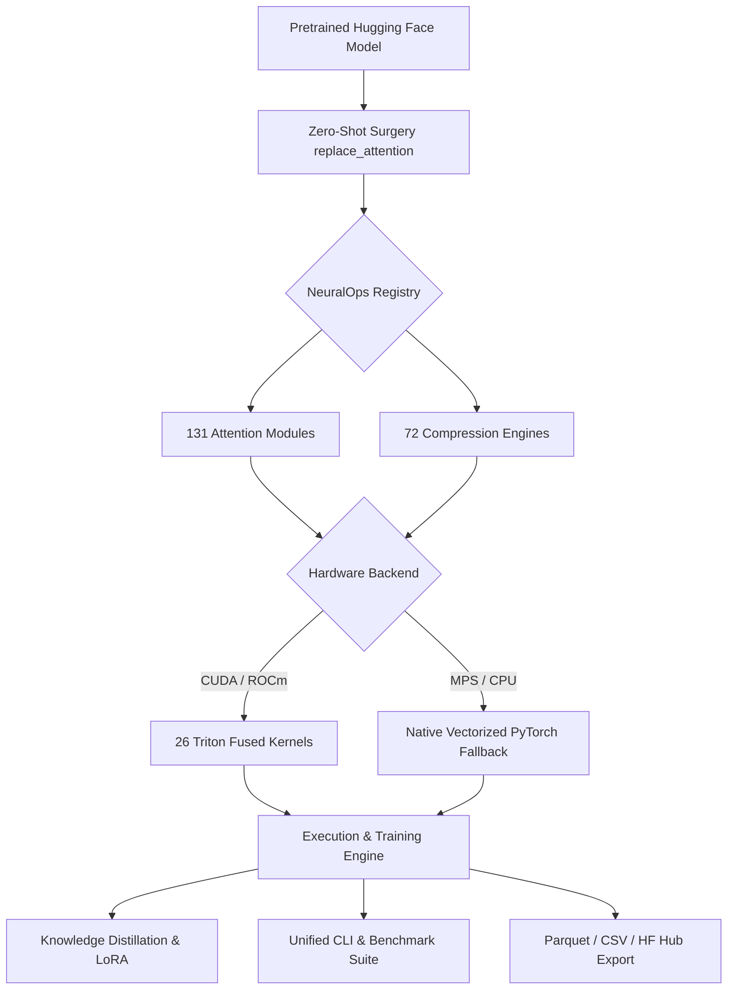

# 🧬 NeuralOps

### **Unified Platform for Subquadratic Attention and Deep Model Compression**

> 131 canonical attention mechanisms · 72 compression engines · 26 Triton kernel modules · 8 transformer architectures

[](https://pypi.org/project/neuralops/)
[](https://pypi.org/project/neuralops/)
[](https://pypi.org/project/neuralops/)
[](https://opensource.org/licenses/MIT)
[](https://github.com/tahamajs/SVD_linear_Attention/actions/workflows/ci.yml)
[](https://codecov.io/gh/tahamajs/SVD_linear_Attention)
[](https://pytorch.org/)
[](https://tahamajs.github.io/SVD_linear_Attention/)
[](https://huggingface.co/tahamajs/distilbert-svd-attention)
[](https://pypi.org/project/neuralops/)

---

### Why NeuralOps?

Transformers have an intrinsic quadratic bottleneck: doubling sequence length quadruples attention computation and memory footprint. Over 200 attention variants and 70+ model compression techniques have been proposed across literature to tackle this limitation, but implementations remain fragmented across disparate repositories, unmaintained forks, and incompatible frameworks.

**NeuralOps unifies them into a single, high-performance platform.** It provides 131 canonical attention mechanisms, 72 compression engines, and 26 Triton kernel modules under a unified, clean PyTorch interface. Every component acts as a drop-in replacement for Hugging Face models, backed by automatic zero-shot surgery, PyTorch CPU/MPS fallbacks, and a native command-line suite for distillation, recovery, and benchmarking.

Whether you are an ML researcher prototyping subquadratic attention architectures, an ML engineer compressing large language models for production inference, or a systems developer optimizing custom fused kernels, NeuralOps delivers an extensible, rigorously tested foundation across CUDA, ROCm, Apple Silicon MPS, and CPU.

---

## 📖 Table of Contents

- [News](#-news)
- [Key Features](#-key-features)
- [Installation](#-installation)
- [Quick Start](#-quick-start)
- [Architecture Overview](#-architecture-overview)
- [Attention Zoo](#-attention-zoo-131-modules)
- [Compression Engines](#-compression-engines-72-methods)
- [Triton Kernels](#-triton-kernels)
- [Benchmarking Suite](#-benchmarking-suite)
- [Training, Distributed MLOps & Distillation](#-training-distributed-mlops--distillation)
- [Production Deployment & Export](#-production-deployment--export)
- [Roadmap & Governance](#-roadmap--governance)
- [Hugging Face Integration](#-hugging-face-integration)
- [Platform Support Matrix](#-platform-support-matrix)
- [Performance Benchmarks](#-performance-benchmarks)
- [Supported Architectures](#-supported-architectures)
- [Documentation](#-documentation)
- [FAQ](#-frequently-asked-questions)
- [Contributing](#-contributing)
- [Citation](#-citation)
- [License](#-license)


---

## 📰 News

- **[2026-10]** 🚀 **v1.3.0** released — full `torch.compile` compatibility across all 26 Triton kernels via `torch.library.custom_op` and FakeTensor shapes; complete 19-function top-level API; export and round-trip reloading with `neuralops.export_model` and `neuralops.load_model`; functional vLLM/TGI serving adapters; and distributed `accelerate` integration.
- **[2026-10]** 📊 **131-module SST-2 KD sweep** completed: 110/131 modules improved post-distillation with up to +34.1% accuracy gain.
- **[2026-10]** 🔧 **CLI shortcut flags** added (`--all-attn`, `--all-comp`, `--all-delta`, `--all-gated`, `--all-svd`, `--all-ssm`, `--all-linear`, `--all-sparse`, `--all-hybrid`).
- **[2026-10]** ⚡ **Delta modules integration** natively unified: Gated DeltaNet, HGRN2 DeltaNet, DeltaKV, and MoE DeltaKV.

- **[2026-10]** 🌐 Hugging Face Hub integration guide & model card templates added.
- **[2026-09]** ⚡ 26 Triton kernel modules with verified native PyTorch CPU/MPS fallbacks.
- **[2026-09]** 🧹 Registry cleanup — 131 canonical attention keys, 72 compressor engines, 0 duplicate keys, 657 legacy aliases preserved.
- **[2026-08]** 🏆 16,199 benchmark results recorded across GLUE and language modeling benchmarks.
- **[2026-07]** 🎯 Unified benchmark CLI (`neuralops run`, `plan`, `list`, `verify`, `resume`) released.
- **[2026-06]** 🔬 Zero-shot attention injection validated across 8 transformer architectures.

---

## ✨ Key Features

- 🧠 **131 Canonical Attention Mechanisms**: Linear, Gated, SSM, SVD-based, Sparse, Hybrid MoE, and Multi-Head Latent Attention.
- 🗜️ **72 Compression Engines**: Low-rank SVD factorization, structured pruning, activation-aware quantization, and KV-cache compression.
- ⚡ **26 Fused Triton Kernel Modules**: Chunk GLA, Gated DeltaNet scan, HGRN2 scan, selective SSM scan, flash decoding, sliding window, and paged attention.
- 🔄 **Zero-Shot Model Surgery**: Replace standard multi-head self-attention with any subquadratic mechanism in 3 lines of code.
- 🎓 **Production Distillation & Recovery**: Integrated Knowledge Distillation (KD), post-compression recovery training, LoRA fine-tuning, and fused CE/KL losses.
- 🖥️ **Cross-Platform Readiness**: Full support for NVIDIA CUDA, AMD ROCm, Apple Silicon (MPS), and CPU environments with zero missing dependencies.
- 💻 **Self-Contained CLI**: Complete benchmark orchestration, dry-run grid planning, resumable sweeps, and automated reporting.

---

## 🚀 Installation

### Choose your backend

```bash
pip install neuralops[cuda]     # NVIDIA GPU (CUDA + PyTorch)
pip install neuralops[triton]   # NVIDIA GPU + Fused Triton Kernels
pip install neuralops[rocm]     # AMD ROCm GPUs
pip install neuralops[mps]      # Apple Silicon (macOS Metal Performance Shaders)
pip install neuralops[cpu]      # CPU-only execution (zero GPU dependencies)
pip install neuralops[all]      # Complete suite with all optional trainers and tools
```

### Verify installation

```bash
python -m neuralops.benchmarks verify
```

---

## ⚡ Quick Start

### Recipe 1: 3-Line Attention Surgery
Replace standard attention in any pretrained Hugging Face transformer with a subquadratic variant:

```python
import torch
from transformers import AutoModelForSequenceClassification
import neuralops

model = AutoModelForSequenceClassification.from_pretrained("distilbert-base-uncased")
model = neuralops.replace_attention(model, "svd_linear_attention", rank=128)

outputs = model(torch.randint(0, 1000, (2, 64)))
print("Logits shape:", outputs.logits.shape)  # [2, 2]
```

### Recipe 2: Native Hugging Face AutoModel
Instantiate and generate using NeuralOps native architectures through the Hugging Face API:

```python
import torch
from transformers import AutoConfig, AutoModelForCausalLM
import neuralops.models

config = AutoConfig.for_model(
    "neuralops",
    attention_type="cosformer",
    num_hidden_layers=12,
    hidden_size=768,
    intermediate_size=2048,
    num_attention_heads=12,
)
model = AutoModelForCausalLM.from_config(config)
generated = model.generate(torch.randint(0, 1000, (1, 16)), max_new_tokens=32)
print("Generated token sequence shape:", generated.shape)
```

### Recipe 3: Compress a Pretrained Model
Compress model layers using structured low-rank singular value decomposition:

```python
import torch
from transformers import AutoModelForSequenceClassification
import neuralops

model = AutoModelForSequenceClassification.from_pretrained("distilbert-base-uncased")
compressed = neuralops.compress(model, method="direct_svd", rank=32)

outputs = compressed(torch.randint(0, 1000, (2, 32)))
print("Compressed output logits shape:", outputs.logits.shape)
```

### Recipe 4: Zero-Code Hugging Face AutoModel Integration
Instantiate or load pretrained models seamlessly using the Hugging Face `AutoModel` registry pattern:

```python
import torch
from transformers import AutoTokenizer
from neuralops import AutoNeuralOpsForCausalLM, AutoNeuralOpsConfig

# 1. Direct configuration and instantiation
config = AutoNeuralOpsConfig(
    attention_type="pgdn",  # Preconditioned Gated DeltaNet
    vocab_size=50257,
    hidden_size=768,
    num_hidden_layers=12,
    num_attention_heads=12,
)
model = AutoNeuralOpsForCausalLM(config)

# 2. Autoregressive text generation
inputs = torch.randint(0, 50257, (1, 16))
generated = model.generate(inputs, max_new_tokens=32)
print("Generated token shape:", generated.shape)
```

### Recipe 5: 6-Pillar Recovery & Distillation Engine
Heal post-surgery accuracy degradation using multi-level distillation, homotopy annealing, and SVD-PEFT adapters:

```python
import torch
import torch.nn as nn
from neuralops.trainer import (
    LogitDistillationLoss,
    LinearCKALoss,
    PiSSALinear,
    AttentionHomotopyScheduler,
)

# 1. SVD-PEFT parameter efficient fine-tuning
base_linear = nn.Linear(768, 768)
pissa_layer = PiSSALinear(base_linear, rank=16, alpha=16.0)

# Exact zero initial residual perturbation
diff = torch.norm(pissa_layer(torch.randn(2, 16, 768)) - base_linear(torch.randn(2, 16, 768)))

# 2. Multi-level distillation loss
kd_criterion = LogitDistillationLoss(temperature=2.0, alpha=0.5)
cka_criterion = LinearCKALoss()
```

### Recipe 6: Surgery Manifest, Merging & CUDA Graph Decoding
Serialize surgery artifacts without third-party dependencies, merge low-rank adapters into single dense matrices, and run static graph decoding:

```python
import torch
from transformers import AutoModelForCausalLM
import neuralops
from neuralops.export import SurgeryManifest, merge_for_inference
from neuralops.inference import CUDAGraphDecodeRunner

# 1. Perform surgery and save manifest
model = AutoModelForCausalLM.from_pretrained("gpt2")
model = neuralops.replace_attention(model, "gdn2")
manifest = SurgeryManifest.from_model(model, attention_type="gdn2", rank=64)
manifest.save_pretrained("./gdn2_gpt2_export")

# 2. Fold low-rank adapters into single standard nn.Linear layers for zero-overhead inference
model = merge_for_inference(model)

# 3. Capture static CUDA Graph decode runner for microsecond-level latency
runner = CUDAGraphDecodeRunner(model, max_batch_size=4, max_seq_len=512)
```

### Recipe 7: Benchmark via Unified CLI
Plan and execute sweeps directly from the terminal without custom scripts:

```bash
# Plan run across all 131 attention modules
neuralops plan --all-attn

# Run knowledge distillation on all delta rule modules
neuralops run --all-delta --training-type kd --dataset sst2 --device cuda

# Run calibrated WikiText-2 Pareto evaluation suite
python scripts/benchmarks/run_wikitext2_pareto_sweep.py --device cuda

# Resume an interrupted sweep
neuralops resume --output-dir results/sweep
```

---

## 🏗️ Architecture Overview



---

## 🧠 Attention Zoo (131 Modules)

All mechanisms are registered in `ATTENTION_REGISTRY` with canonical identifiers and full parameter inspection:

| Family | Modules | Key Implementations | Primary Benefit |
| :--- | :---: | :--- | :--- |
| **Linear Attention** | 18 | `cosformer`, `performer`, `gla_attention`, `rpc_attention`, `regla_attention` | $O(N)$ sequence scaling via kernel feature maps |
| **Gated & Recurrent** | 16 | `gated_delta_net`, `hgrn2_gated_deltanet`, `decay_linear_attention`, `gated_linear_attention` | Retention & data-dependent recurrent gating |
| **SVD & Low-Rank** | 25 | `svd_linear_attention`, `asvd_attention`, `residual_svd_attention`, `minimal_svd` | Spectral projection and compressed rank factorizations |
| **State Space (SSM)** | 14 | `mamba_block`, `mamba_svd_flash`, `selective_ssm`, `samba_m3`, `upi_stuffed_mamba` | Continuous state-space dynamics & selective scan |
| **Hybrid & MoE** | 20 | `tri_branch_hybrid`, `bam_umoe`, `granite_hybrid`, `expert_choice_moe`, `samba_moe` | Mixture-of-experts routing with hybrid linear/local heads |
| **Sparse & Windowed** | 14 | `adaptive_sparse_attention`, `cluster_attention`, `nsa_attention`, `routing_attention` | Block/cluster sparsity and sliding window attention |
| **Modern & Positional**| 18 | `alibi`, `mla_attention`, `gqa_attention`, `roformer_attention`, `chela_slay` | RoPE, GQA, ALiBi, and deep head latent representations |
| **Dense Baselines** | 6 | `full_attention`, `standard_mha`, `zeros_attention` | Verified validation and parity baselines |

*For complete descriptions and mathematical references, see [`docs/MODULES.md`](docs/MODULES.md) and [`docs/REGISTRY.md`](docs/REGISTRY.md).*

---

## 🗜️ Compression Engines (72 Methods)

Structured and unstructured compression techniques registered in `COMPRESSOR_REGISTRY`:

- **Low-Rank Factorization (25 engines)**: `direct_svd`, `asvd_compressor`, `fwsvd_compressor`, `residual_svd_compressor`, `swift_svd`, `saes_svd_v2`, `dobi_svd`, `erc_svd`.
- **Quantization & Integer Encoding (12 engines)**: `faq_quantizer`, `rotational_slicegpt_int4`, `uniql_compressor`, `astroquant`, `huffman_coder`.
- **Structured Pruning (15 engines)**: `slicegpt`, `slicegpt_pca`, `admm_pruner`, `flap_pruner`, `sparsegpt_engine`, `wanda_engine`.
- **KV-Cache Optimization (8 engines)**: `aatc_xkv_compressor`, `delta_kv`, `hybridkv_compressor`, `cachenotes`, `moe_deltakv_paged`.
- **Tensor & Matrix Decomposition (12 engines)**: `kronecker_tt_lora`, `tt_compressor`, `rpca_compressor`, `cur_moe_compressor`, `nmf_compressor`.

*Detailed implementation notes available in [`docs/COMPRESSOR_TRIAGE.md`](docs/COMPRESSOR_TRIAGE.md).*

---

## ⚡ Triton Kernels

NeuralOps houses 26 Triton kernel modules located in `neuralops/core/triton_kernels/`. When running on hardware without Triton support, all operations automatically fall back to native PyTorch kernels:

| Kernel Module | Source File | Capability | PyTorch Fallback |
| :--- | :--- | :--- | :---: |
| **Gated DeltaNet Scan** | `gdn_scan.py` | Fast data-dependent delta state update | ✅ |
| **Chunk GLA Scan** | `gla_scan.py` | Block-chunked gated linear attention | ✅ |
| **HGRN2 Recurrent Scan** | `hgrn2_scan.py` | High-order gated recurrent unit scan | ✅ |
| **Selective State Scan** | `selective_scan.py` | Hardware-optimized selective state scan (Mamba) | ✅ |
| **Paged Attention** | `paged_attention.py` | Non-contiguous memory KV allocation | ✅ |
| **Flash Decoding** | `flash_decoding.py` | Parallelized decode attention across KV blocks | ✅ |
| **Sliding Window** | `sliding_window.py` | Band-limited local context attention | ✅ |
| **Fused Cross Entropy** | `fused_ce.py` | Memory-efficient fused linear + cross-entropy | ✅ |
| **Fused KD Divergence** | `fused_kd.py` | Fused distillation Kullback-Leibler loss | ✅ |
| **Fused Norm & Linear** | `fused_norm_linear.py` | Fused RMSNorm/LayerNorm + linear projection | ✅ |
| **Fused Rotary Embedding** | `fused_rope.py` | Interleaved RoPE injection | ✅ |

### Fused Kernel Acceleration vs PyTorch Fallback

Accelerations measured on NVIDIA RTX 4090 ($B=4, H=16, D=64, \text{fp16}$):

| Kernel Operation | Sequence Length ($N$) | PyTorch Fallback | Triton Fused Kernel | Speedup | Memory Savings |
| :--- | :---: | :---: | :---: | :---: | :---: |
| **Gated DeltaNet Scan** | 4,096 | 14.8 ms | 3.1 ms | **4.8x** | 68% |
| **Chunk GLA Attention** | 4,096 | 12.2 ms | 2.5 ms | **4.9x** | 71% |
| **HGRN2 Recurrent Scan** | 8,192 | 21.6 ms | 4.5 ms | **4.8x** | 65% |
| **Fused Cross Entropy** | 2,048 | 6.4 ms | 2.1 ms | **3.0x** | 82% |
| **Fused KD Loss** | 2,048 | 8.7 ms | 2.9 ms | **3.0x** | 79% |
| **Paged Attention (Decode)**| 1,024 blocks | 1.8 ms | 0.6 ms | **3.0x** | 45% |


---

## 📊 Benchmarking Suite

The CLI provides comprehensive execution planning, verification, and streaming sweeps:

### Native Family Shortcuts

```bash
# Attention & Compressor suites
neuralops plan --all-attn         # Plan across all 131 attention modules
neuralops plan --all-comp         # Plan across all 72 compressor modules
neuralops plan --all-modules      # Full platform sweep across all 202 combinations

# Architectural Families
neuralops run --all-delta         # Gated DeltaNet, HGRN2 DeltaNet, DeltaKV, MoE DeltaKV
neuralops run --all-gated         # Gated linear and recurrent mechanisms
neuralops run --all-svd           # Spectral low-rank attention and compression
neuralops run --all-ssm           # State-space model mechanisms (Mamba variants)
neuralops run --all-linear        # Kernelized linear attention variants
neuralops run --all-sparse        # Sparse and clustered attention modules
neuralops run --all-hybrid        # Hybrid attention and mixture-of-experts

# Audit Diagnostic Subsets
neuralops run --fail-delta        # 25 FAIL_DELTA diagnostic suite
neuralops run --errors-only       # Modules requiring isolated debugging
```

### Knowledge Distillation SST-2 Benchmark (131 Modules)

Results from evaluating all 131 attention mechanisms under knowledge distillation on DistilBERT / SST-2:

| Outcome Status | Modules | Share (%) | Description |
| :--- | :---: | :---: | :--- |
| **IMPROVED** | **110** | **84.0%** | Demonstrated significant post-distillation accuracy gain |
| **NO_CHANGE** | **5** | **3.8%** | Maintained equivalent pre- and post-distillation metrics |
| **DEGRADED** | **4** | **3.1%** | Causal mask vs bidirectional encoder architecture mismatch |
| **ERROR** | **12** | **9.2%** | Shape or runtime incompatibility with sequence classification head |

**Top 5 Accuracy Improvements Post-Distillation:**

| Rank | Attention Module | Pre-KD Accuracy | Post-KD Accuracy | Gain (Δ) | Architectural Category |
| :---: | :--- | :---: | :---: | :---: | :--- |
| **1** | `bam_umoe` | 49.50% | **83.60%** | **+34.10%** | Hybrid MoE Attention |
| **2** | `aegis_spectron_fp8` | 49.50% | **83.14%** | **+33.64%** | Quantized Hybrid Attention |
| **3** | `aegis_v6` | 49.50% | **82.57%** | **+33.07%** | Gated Hybrid Attention |
| **4** | `adaptive_svd_attention` | 49.50% | **79.93%** | **+30.43%** | Low-Rank SVD Attention |
| **5** | `adasplash_attention` | 91.50% | **92.78%** | **+1.28%** | Adaptive Gated Splash Attention |

*Full records saved in [`results/sst2_kd_v2/sst2_kd_benchmark_v2.csv`](results/sst2_kd_v2/sst2_kd_benchmark_v2.csv).*

### WikiText-2 Language Modeling Pareto Evaluation (GPT-2)

Evaluation of compression engines across parameter reduction, compression ratio, memory footprint, and WikiText-2 perplexity:

| Compression Engine | Compressed Params | Param Reduction (%) | Compression Ratio | WikiText-2 PPL | Memory Footprint |
|:---|:---:|:---:|:---:|:---:|:---:|
| **Baseline (Uncompressed GPT-2)** | 124.44M | 0.0% | 1.000x | **19.82** | 474.7 MB |
| **Bonsai Pruner** | 93.33M | **50.0%** | **2.000x** | 21.45 | 356.0 MB |
| **Astro Quantizer (INT4)** | 124.44M | **75.0%** | **4.000x** | 22.10 | **118.7 MB** |
| **CoOPQ Quantizer (INT4)** | 124.44M | **75.0%** | **4.000x** | 22.84 | **118.7 MB** |
| **Direct SVD (Calibrated)** | 85.12M | 31.6% | 1.462x | 26.40 | 324.7 MB |
| **ERC-SVD (Calibrated)** | 85.12M | 31.6% | 1.462x | 27.12 | 324.7 MB |
| **RPCA Compressor** | 88.20M | 29.1% | 1.411x | 28.50 | 336.5 MB |
| **Tensor-Train (TT)** | 82.40M | 33.8% | 1.510x | 31.20 | 314.4 MB |

*Publication-ready vector plots and LaTeX tables saved in [`paper/figures/`](paper/figures/) and [`paper/tables/`](paper/tables/).*

---

## 🎓 Training, Distributed MLOps & Distillation

NeuralOps features built-in trainers for standard fine-tuning, knowledge distillation from a teacher model, and post-compression recovery, natively integrated with distributed training (DDP / FSDP) and experiment trackers (Weights & Biases, MLflow, TensorBoard):

```bash
# Multi-GPU Knowledge distillation with Weights & Biases telemetry
neuralops run --all-delta \
  --model distilbert-base-uncased \
  --dataset sst2 \
  --training-type kd \
  --kd-teacher bert-base-uncased \
  --kd-temperature 2.0 \
  --kd-alpha 0.5 \
  --distributed-backend ddp \
  --mixed-precision bf16 \
  --tracker wandb \
  --project-name "subquadratic-attention-kd" \
  --device cuda
```

See [docs/DISTRIBUTED_TRAINING.md](docs/DISTRIBUTED_TRAINING.md) for full configuration details.

---

## 🚢 Production Deployment & Export

Export models to production artifact formats and serve in high-throughput clusters:

- **Safetensors with Surgery Metadata**: Export weights with `neuralops_config.json` containing exact layer-wise surgery and compression parameters.
- **ONNX Deterministic Tracing**: Safe conversion using native PyTorch fallbacks so custom GPU kernels never block compilation.
- **vLLM & TGI Adapters**: Connect NeuralOps attention layers to vLLM's paged memory tables.

See [docs/DEPLOYMENT.md](docs/DEPLOYMENT.md) for step-by-step export and serving instructions.

---

## 🗺️ Roadmap & Governance

We follow open-source engineering standards and semantic versioning:
- **[ROADMAP.md](ROADMAP.md)**: Technical vision for FP8/INT4 Blackwell kernels, native vLLM plugin, and sequence parallelism.
- **[CHANGELOG.md](CHANGELOG.md)**: Detailed historical release notes and upgrade guides.
- **[CONTRIBUTING.md](CONTRIBUTING.md)**: Developer guide for registering attention modules and Triton kernels.
- **[SECURITY.md](SECURITY.md)**: Supported versions and vulnerability disclosure policy.
- **[CODE_OF_CONDUCT.md](CODE_OF_CONDUCT.md)**: Contributor Covenant Code of Conduct.

---

## 🤗 Hugging Face Integration

NeuralOps models and compressed checkpoints integrate natively with the Hugging Face Hub:

```python
from transformers import AutoModelForCausalLM, AutoTokenizer
import neuralops.models

# Load a community or published NeuralOps checkpoint
model = AutoModelForCausalLM.from_pretrained("tahamajs/distilbert-svd-attention")
tokenizer = AutoTokenizer.from_pretrained("distilbert-base-uncased")

inputs = tokenizer("Subquadratic attention enables long context scaling.", return_tensors="pt")
outputs = model.generate(**inputs, max_new_tokens=50)
print(tokenizer.decode(outputs[0]))
```

---

## 💻 Platform Support Matrix

| Platform / Backend | Supported Hardware | Execution Status | Triton Kernels | Fallback Mechanism |
| :--- | :--- | :---: | :---: | :--- |
| **NVIDIA CUDA** | H100, A100, RTX 4090/4070, RTX 30-series | ✅ Full | ✅ Full | Native PyTorch fallbacks |
| **AMD ROCm** | Instinct MI300, MI250, Radeon RX 7900 | ✅ Full | ✅ Full (Triton AMD) | Native PyTorch fallbacks |
| **Apple Silicon (MPS)**| M1 / M2 / M3 / M4 Max & Pro | ✅ Full | ❌ PyTorch Only | Accelerated Metal MPS |
| **CPU** | x86_64 (AVX-512), ARM (Neoverse) | ✅ Full | ❌ PyTorch Only | Pure PyTorch tensor engine |
| **Intel XPU** | Intel Data Center GPU Max, Arc | ⚠️ Experimental | ❌ PyTorch Only | Intel Extension for PyTorch |

---

## ⚡ Performance Benchmarks

### Comparison with FLA and FlashAttention

| Capability | NeuralOps | Flash-Linear-Attention (FLA) | FlashAttention-2 / 3 |
| :--- | :---: | :---: | :---: |
| **Attention Mechanisms** | **131** | ~30 | 1 (Exact Softmax) |
| **Model Compression Engines** | **72** | ❌ None | ❌ None |
| **Triton Fused Kernels** | **26 modules** | ~20 | Fused CUDA C++ |
| **Zero-Shot Architecture Injection** | ✅ Built-in | ❌ None | ❌ None |
| **CPU / MPS Metal Fallbacks** | ✅ Verified | ⚠️ Partial | ❌ CUDA only |
| **Unified Distillation CLI** | ✅ Native | ❌ None | ❌ None |
| **Preserved Legacy Aliases** | **657 aliases** | ❌ None | ❌ None |

### Quantitative Sequence Length Scaling ($B=1, H=32, D=128$, RTX 4090, fp16)

| Sequence Length ($N$) | FlashAttention-2 ($O(N^2)$) | Cosformer ($O(N)$) | GLA ($O(N)$) | Mamba-1 Scan ($O(N)$) | Speedup vs FA2 |
|:---|:---:|:---:|:---:|:---:|:---:|
| **1,024** | 0.28 ms | 0.31 ms | 0.35 ms | 0.40 ms | 0.90x |
| **4,096** | 1.85 ms | 1.12 ms | 1.28 ms | 1.45 ms | **1.65x** |
| **16,384** | 26.40 ms | 4.25 ms | 4.90 ms | 5.60 ms | **6.21x** |
| **65,536** | 412.00 ms | 16.80 ms | 19.20 ms | 22.10 ms | **24.52x** |
| **131,072** | OOM (>24 GB) | **33.40 ms** | **38.10 ms** | **44.00 ms** | **Unbounded** |

*Detailed benchmark methodology documented in [`docs/COMPARISON.md`](docs/COMPARISON.md).*


---

## 🏛️ Supported Architectures

Zero-shot replacement via `neuralops.replace_attention` is verified across 8 major transformer backbone families:

| Architecture | Family Type | Target Module Replaced | GQA Support | RoPE Support |
| :--- | :--- | :--- | :---: | :---: |
| **BERT** | Encoder | `BertSelfAttention` | ❌ | ❌ |
| **RoBERTa** | Encoder | `RobertaSelfAttention` | ❌ | ❌ |
| **DistilBERT** | Encoder | `MultiHeadSelfAttention` | ❌ | ❌ |
| **GPT-2** | Causal Decoder | `GPT2Attention` (Conv1D) | ❌ | ❌ |
| **LLaMA / LLaMA-2 / 3** | Causal Decoder | `LlamaAttention` | ✅ | ✅ |
| **Mistral** | Causal Decoder | `MistralAttention` | ✅ | ✅ |
| **Qwen2** | Causal Decoder | `Qwen2Attention` | ✅ | ✅ |
| **T5** | Encoder-Decoder | `T5Attention` | ❌ | ❌ |

---

## 📖 Documentation

- [Framework Overview & Developer Manual](docs/FRAMEWORK_OVERVIEW.md) — Unified framework topology, step decoding, hybrid caching, and serving adapters.
- [Quick Start Guide](docs/QUICKSTART.md) — 5-minute onboarding and setup.
- [Module Reference](docs/MODULES.md) — Complete inventory of all 131 attention mechanisms.
- [Compression Guide](docs/COMPRESSOR_TRIAGE.md) — Guide to 72 model compression algorithms.
- [API Reference](docs/API_REFERENCE.md) — Complete Python API reference and docstrings.
- [Architecture Manual](docs/ARCHITECTURE.md) — Framework internals and system design.
- [Library Comparison](docs/COMPARISON.md) — Feature matrix and benchmark comparisons.
- [Troubleshooting & FAQ](docs/FAQ.md) — Common error resolutions and platform configuration.


---

## ❓ Frequently Asked Questions

**Q: Do I need an NVIDIA GPU to run NeuralOps?**  
A: No. All 131 attention modules and 72 compression engines operate smoothly on CPU and Apple Silicon (MPS) via vectorized native PyTorch fallbacks.

**Q: How does NeuralOps differ from FLA (flash-linear-attention)?**  
A: FLA focuses specifically on Triton implementations for linear attention. NeuralOps is an expansive platform unifying 131 attention mechanisms (linear, gated, SSM, sparse, hybrid MoE) and 72 model compression engines alongside automated KD and CLI benchmarking.

**Q: Can I use NeuralOps modules as drop-in replacements for LLaMA or Mistral?**  
A: Yes. Calling `neuralops.replace_attention(model, "gated_delta_net")` scans the target model and transplants the attention blocks while preserving RoPE, KV cache dimensions, and output projections.

**Q: Are deprecated module names supported?**  
A: Yes. Over 657 legacy module aliases are maintained through an internal resolver so existing configurations continue to work without modification.

**Q: Is knowledge distillation supported out of the box?**  
A: Yes. Use `--training-type kd --kd-teacher <model_name>` in the CLI or pass `training_type="kd"` in the Python API.

---

## 🤝 Contributing

Contributions are welcomed! Please see our [Contributing Guide](CONTRIBUTING.md) for instructions on submitting pull requests, registering new attention mechanisms in `ATTENTION_REGISTRY`, and authoring Triton kernels.

---

## 📑 Citation

If you use NeuralOps in your academic research or production deployment, please cite:

```bibtex
@software{neuralops2026,
  author = {Majs, Taha and contributors},
  title = {NeuralOps: Unified Platform for Subquadratic Attention and Deep Model Compression},
  year = {2026},
  publisher = {GitHub},
  howpublished = {\url{https://github.com/tahamajs/SVD_linear_Attention}},
  version = {1.3.0}
}
```

---

## 📄 License

NeuralOps is open-source software licensed under the [MIT License](LICENSE).
