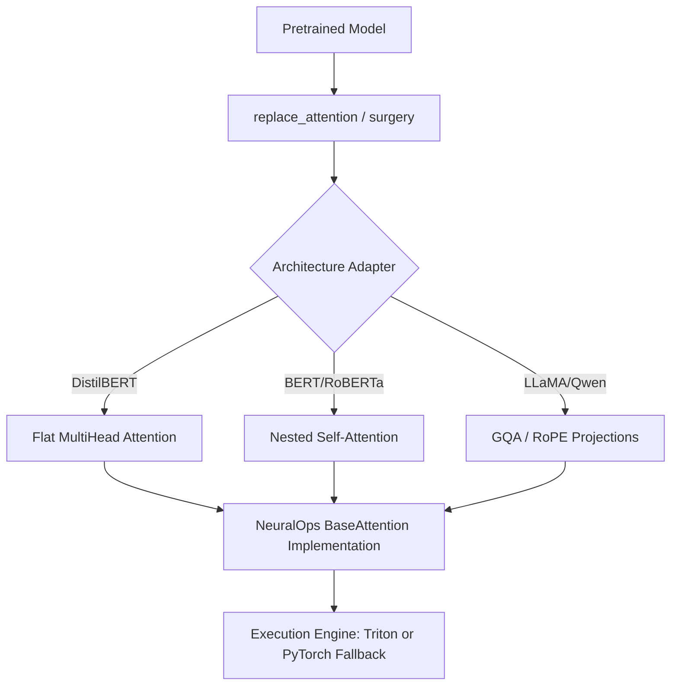
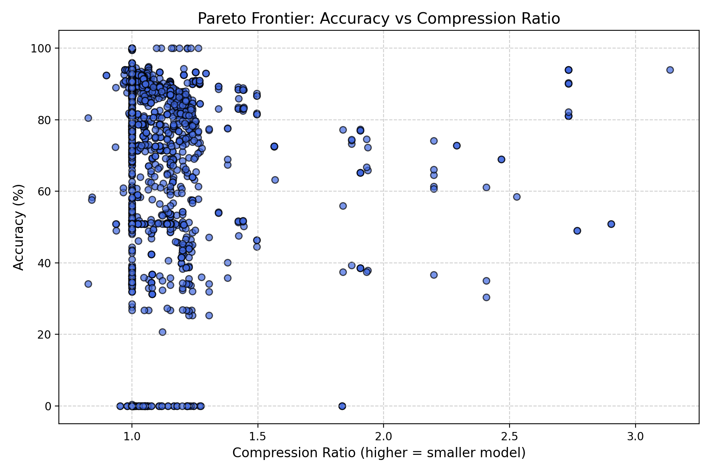

# NeuralOps

[](https://pypi.org/project/neuralops/)
[](https://pypi.org/project/neuralops/)
[](https://opensource.org/licenses/MIT)
[](https://github.com/tahamajs/SVD_linear_Attention/actions/workflows/ci.yml)

**NeuralOps** is a production-grade, mathematically verified framework for linear attention mechanisms, model compression engines, and fused Triton kernels.

---

## 📑 Table of Contents

1. [Key Highlights](#key-highlights)
2. [Installation](#installation)
3. [Quick Start](#quick-start)
4. [Architecture & Data Flow](#architecture-overview)
5. [Attention Mechanism Zoo (159)](#attention-mechanism-zoo-159)
6. [Compression Engine Registry (73)](#compression-engine-registry-73)
7. [Fused Triton Kernels](#fused-triton-kernels)
8. [Supported Architectures](#supported-architectures)
9. [Performance & Tradeoffs](#performance-and-tradeoffs)
10. [API Reference](#api-reference)
11. [Benchmarking CLI](#benchmarking-cli)
12. [FAQ](#faq)
13. [Contributing](#contributing)
14. [Citation & License](#citation-and-license)

---

## Key Highlights

- **159 Attention Mechanisms**: Canonical linear, sparse, gated, hybrid, SSM, and SVD factorized attention layers.
- **73 Model Compressors**: SVD truncation, activation-calibrated decomposition (ASVD/AdaSVD), structured pruning, and quantization.
- **21 Fused Triton Kernels**: Highly optimized GPU execution with seamless, transparent PyTorch CPU/MPS fallbacks.
- **Universal Architecture Surgery**: Drop-in zero-shot attention replacement across popular Transformer models.
- **Extensive Backwards Compatibility**: 657 preserved deprecated aliases for seamless backward compatibility.

---

## Installation

### Requirements

| Component | Minimum | Recommended |
|:---|:---|:---|
| Python | 3.10 | 3.11+ |
| PyTorch | 2.2.0 | 2.4.0+ |
| CUDA (Optional) | 12.1 | 12.4+ |
| Triton (Optional) | 2.3.0 | 3.0.0+ |

### Platform Matrix

| Platform | Core Framework | Triton Kernels | Fallback Support |
|:---|:---:|:---:|:---:|
| Linux (NVIDIA GPU) | ✅ | ✅ | PyTorch Autograd |
| macOS (Apple Silicon) | ✅ | ❌ | MPS / CPU Fallback |
| Windows 10/11 | ✅ | ❌ | PyTorch Fallback |
| Linux (CPU) | ✅ | ❌ | PyTorch Fallback |

### Installation via PyPI

```bash
# Standard install
pip install neuralops

# Install from source
git clone https://github.com/tahamajs/SVD_linear_Attention.git
cd SVD_linear_Attention
pip install -e ".[dev]"
```

Verify your installation:
```bash
python -c "import neuralops; print(neuralops.__version__)"
python -m neuralops.benchmarks verify
```

---

## Quick Start

### Recipe 1: 3-Line Attention Surgery

Replace quadratic attention in HuggingFace models with subquadratic SVD Linear Attention:

```python
import torch
from transformers import AutoModelForSequenceClassification
from neuralops.utils.replace_attention import replace_attention

model = AutoModelForSequenceClassification.from_pretrained("distilbert-base-uncased")
model = replace_attention(model, "svd_linear_attention", svd_rank=128)

inputs = torch.randint(0, 1000, (2, 64))
outputs = model(inputs)
print("Logits shape:", outputs.logits.shape)
```

---

## Architecture Overview



---

## Attention Mechanism Zoo (159)

| # | Key | Class | Module | Causal | GQA | RoPE | Description |
|---:|---|---|---|:---:|:---:|:---:|---|
| 1 | `adaptive_span_attention` | `AdaptiveSpanAttention` | `adaptive.adaptive_span_attention` | ✓ | ✓ | ✓ |  |
| 2 | `adaptive_sparse_attention` | `AdaptiveSparseAttention` | `sparse.adaptive_sparse_attention` | ✓ | ✓ | ✓ |  |
| 3 | `adaptive_sparse_attn` | `AdaptiveSparseAttention` | `sparse.adaptive_sparse_attention` | ✓ | ✓ | ✓ |  |
| 4 | `adaptive_svd` | `AdaptiveSVDAttention` | `svd.adaptive_svd_attention` | ✓ | ✓ | ✓ | Multi-head attention with adaptive SVD + residual factorized projections. |
| 5 | `adaptive_svd_attention` | `AdaptiveSVDAttention` | `svd.adaptive_svd_attention` | ✓ | ✓ | ✓ | Multi-head attention with adaptive SVD + residual factorized projections. |
| 6 | `adasplash` | `AdaSplashAttention` | `fast_kernels.adasplash_attention` | ✓ | ✓ | ✓ | AdaSplash Attention Layer with α-Entmax and Local Splash Radius. |
| 7 | `adasplash_attention` | `AdaSplashAttention` | `fast_kernels.adasplash_attention` | ✓ | ✓ | ✓ | AdaSplash Attention Layer with α-Entmax and Local Splash Radius. |
| 8 | `alibi_attention` | `ALiBiAttention` | `modern.alibi` | ✓ |  |  | Attention with linear biases instead of positional embeddings. |
| 9 | `asvd` | `ASVDAttention` | `svd.asvd_attention` |  |  |  | Hardened ASVD Attention with Factored Low-Rank Matrix Decomposition, GQA, RoPE,  |
| 10 | `asvd_attention` | `ASVDAttention` | `svd.asvd_attention` |  |  |  | Hardened ASVD Attention with Factored Low-Rank Matrix Decomposition, GQA, RoPE,  |
| 11 | `bam_umoe` | `BAMUMoEBlock` | `sparse.bam_umoe` |  |  |  |  |
| 12 | `block_transformer_hiba` | `BlockTransformerHIBA` | `adaptive.block_transformer_hiba` |  |  |  | Block Transformer with Hierarchical Intra-Block and Inter-Block Attention (HIBA) |
| 13 | `chela_slay` | `ChelaSlayAttention` | `linear.chela_slay` |  |  |  | CHELA-SLAY: Spherical Linearized Attention with Yat-Kernel. |
| 14 | `chela_slay_attention` | `ChelaSlayAttention` | `linear.chela_slay` |  |  |  | CHELA-SLAY: Spherical Linearized Attention with Yat-Kernel. |
| 15 | `cluster` | `ClusterAttention` | `sparse.cluster_attention` | ✓ | ✓ | ✓ |  |
| 16 | `cluster_attention` | `ClusterAttention` | `sparse.cluster_attention` | ✓ | ✓ | ✓ |  |
| 17 | `compressed_attention` | `CompressedAttentionLayer` | `svd.compressed_attention` | ✓ | ✓ | ✓ |  |
| 18 | `compressed_attention_layer` | `CompressedAttentionLayer` | `svd.compressed_attention` | ✓ | ✓ | ✓ |  |
| 19 | `compressed_attention_layer_energy` | `CompressedAttentionLayer2` | `svd.compressed_attention` | ✓ | ✓ | ✓ |  |
| 20 | `compressed_mha` | `CompressedDistilBertAttention` | `svd.compressed_mha_attention` | ✓ | ✓ | ✓ |  |
| 21 | `compressed_mha_attention` | `CompressedDistilBertAttention` | `svd.compressed_mha_attention` | ✓ | ✓ | ✓ |  |
| 22 | `cosformer` | `CosformerAttention` | `linear.cosformer` |  |  |  |  |
| 23 | `cross_attention` | `CrossAttention` | `modern.cross_attention` |  | ✓ |  | Multi-head cross attention between query sequence and encoder/context sequence. |
| 24 | `decay_linear_attention` | `DecayLinearAttention` | `gated.decay_linear_attention` |  |  |  | Decay Linear Attention Module with Data-Dependent Exponential Decay Gating. |
| 25 | `decay_linear_attn` | `DecayLinearAttention` | `gated.decay_linear_attention` |  |  |  | Decay Linear Attention Module with Data-Dependent Exponential Decay Gating. |
| 26 | `eat` | `EATBlock` | `adaptive.eat` |  |  |  |  |
| 27 | `eat_attention` | `EATBlock` | `adaptive.eat` |  |  |  |  |
| 28 | `expert_choice_moe` | `ExpertChoiceMoEAttention` | `sparse.expert_choice_moe` |  |  |  | Expert Choice MoE Multi-Head Attention Module. |
| 29 | `expert_choice_moe_attention` | `ExpertChoiceMoEAttention` | `sparse.expert_choice_moe` |  |  |  | Expert Choice MoE Multi-Head Attention Module. |
| 30 | `factorised_matrix_state` | `FactorisedMatrixState` | `svd.factorised_matrix_state` |  |  |  | Bidirectional & Causal Factorised Matrix State Recurrent Linear Attention. |
| 31 | `flash3` | `FlashAttention3` | `fast_kernels.flash_attention3` |  |  |  | FlashAttention-3 Multi-Head Exact Attention. |
| 32 | `flash3_fp8` | `FlashAttention3FP8` | `fast_kernels.flash_attention3_fp8` |  |  |  | FlashAttention-3 FP8 Hardware-Accelerated Multi-Head Attention. |
| 33 | `flash_attention3` | `FlashAttention3` | `fast_kernels.flash_attention3` |  |  |  | FlashAttention-3 Multi-Head Exact Attention. |
| 34 | `flash_attention3_fp8` | `FlashAttention3FP8` | `fast_kernels.flash_attention3_fp8` |  |  |  | FlashAttention-3 FP8 Hardware-Accelerated Multi-Head Attention. |
| 35 | `fms` | `FactorisedMatrixState` | `svd.factorised_matrix_state` |  |  |  | Bidirectional & Causal Factorised Matrix State Recurrent Linear Attention. |
| 36 | `full` | `FullAttention` | `dense.full_attention` | ✓ | ✓ | ✓ |  |
| 37 | `full_attention` | `FullAttention` | `dense.full_attention` | ✓ | ✓ | ✓ |  |
| 38 | `fused_svd_kernel` | `FusedSVDKernelAttention` | `svd.fused_svd_kernel` | ✓ | ✓ |  | Fused SVD-Kernel Linear Attention Module. |
| 39 | `fused_svd_kernel_attention` | `FusedSVDKernelAttention` | `svd.fused_svd_kernel` | ✓ | ✓ |  | Fused SVD-Kernel Linear Attention Module. |
| 40 | `fusion_attention` | `FUSIONATTN` | `hybrid.fusion_attn` | ✓ | ✓ |  | Hybrid sparse attention with block gating. |
| 41 | `fusion_attn` | `FUSIONATTN` | `hybrid.fusion_attn` | ✓ | ✓ |  | Hybrid sparse attention with block gating. |
| 42 | `galerkin_attention` | `GalerkinAttention` | `linear.galerkin_attention` | ✓ | ✓ |  |  |
| 43 | `gated_delta_net` | `GatedDeltaNet` | `gated.gated_delta_net` |  |  |  |  |
| 44 | `gated_deltanet_block` | `GatedDeltaNetBlock` | `gated.gated_deltanet_block` |  |  |  | Gated DeltaNet Transformer Block with Pretrained Weight Transfer. |
| 45 | `gated_hybrid_kernel` | `GatedHybridKernelAttention` | `hybrid.gated_hybrid_kernel_attention` | ✓ | ✓ |  |  |
| 46 | `gated_linear_attention` | `GatedLinearAttention` | `gated.gated_linear_attention` | ✓ | ✓ |  |  |
| 47 | `goldfinch` | `GoldFinchAHNBlock` | `ssm.goldfinch_ahn` |  |  |  | GoldFinch-AHN: hybrid sliding-window attention + gated recurrent memory. |
| 48 | `goldfinch_ahn` | `GoldFinchAHNBlock` | `ssm.goldfinch_ahn` |  |  |  | GoldFinch-AHN: hybrid sliding-window attention + gated recurrent memory. |
| 49 | `gqa_attention` | `GroupedQueryAttention` | `modern.gqa_attention` | ✓ | ✓ | ✓ |  |
| 50 | `granite_hybrid` | `GraniteHybridBlock` | `hybrid.granite_hybrid` |  |  |  | Granite Hybrid Attention-SSM Layer with MoE Feed-Forward and LoRA Adaptation. |
| 51 | `griffin_ssd` | `GriffinSSDBlock` | `ssm.griffin_ssd` |  |  |  | Griffin Hybrid Block: local window + SSD linear attention. |
| 52 | `grouped_query_attention` | `GroupedQueryAttention` | `modern.gqa_attention` | ✓ | ✓ | ✓ |  |
| 53 | `halo_regla` | `HALOReGLAAttention` | `hybrid.halo_regla` |  |  |  | Hybrid Dense Softmax + Linear Attention with adaptive fusion gate. |
| 54 | `hamming_attention` | `HammingAttention` | `sparse.hamming_attention` | ✓ | ✓ | ✓ |  |
| 55 | `hgrn2_gated_deltanet` | `HGRN2GatedDeltaNet` | `gated.hgrn2_gated_deltanet` |  |  |  | HGRN-2 + Gated DeltaNet hybrid with proper fusion. |
| 56 | `hgrn2_gated_layer` | `HGRN2Layer` | `gated.hgrn2_gated_layer` |  |  |  | HGRN-2 hybrid with local sliding-window attention. |
| 57 | `hgrn2_gated_outer` | `HGRN2GatedOuterBlock` | `gated.hgrn2_gated_outer` | ✓ | ✓ |  |  |
| 58 | `hgrn2_outer` | `HGRN2GatedOuterBlock` | `gated.hgrn2_gated_outer` | ✓ | ✓ |  |  |
| 59 | `hla_attention` | `HLAAttention` | `gated.hla_attention` | ✓ | ✓ |  | Hadamard Linear Attention (HLA) Bidirectional / Causal Module. |
| 60 | `hybrid_attention` | `HybridAttention` | `hybrid.hybrid_attention` | ✓ | ✓ | ✓ | Hybrid softmax + linear attention with per-head dynamic gated fusion. |
| 61 | `hybrid_local_kernel` | `HybridLocalKernelAttention` | `hybrid.hybrid_local_kernel_attention` | ✓ | ✓ |  |  |
| 62 | `hymba_transx` | `HymbaTransXBlock` | `ssm.hymba_transx` |  |  |  | HymbaTransX: Hybrid Differential Transformer & State Space Model Block. |
| 63 | `hymba_transx_attn` | `HymbaTransXBlock` | `ssm.hymba_transx` |  |  |  | HymbaTransX: Hybrid Differential Transformer & State Space Model Block. |
| 64 | `inject_triton_cosformer` | `TritonCosformerAttention` | `linear.triton_cosformer` |  |  |  | Triton-Accelerated Cosformer Linear Attention with Full Autograd Differentiabili |
| 65 | `inject_triton_svd_linear_attention` | `inject_triton_svd_linear_attention` | `svd.triton_svd_linear_attention` |  |  |  | Safe factory function to inject TritonSVDLinearAttention into a model. |
| 66 | `inject_xattention` | `inject_xattention` | `fast_kernels.xattention` |  |  |  |  |
| 67 | `jamba` | `Jamba2Block` | `adaptive.infini_attention` |  |  |  |  |
| 68 | `jamba_info` | `JambaInfoBlock` | `ssm.jamba_info` |  |  |  |  |
| 69 | `kda_attention` | `KDAAttention` | `gated.kda_attention` |  |  |  |  |
| 70 | `landmark_local` | `LandmarkLocalAttention` | `hybrid.landmark_local_attention` | ✓ | ✓ |  |  |
| 71 | `linformer_attention` | `LinformerAttention` | `linear.linformer_attention` | ✓ | ✓ |  |  |
| 72 | `lola_attention` | `LoLAAttention` | `adaptive.lola_attention` | ✓ | ✓ | ✓ |  |
| 73 | `lora_attention` | `LoRAAttention` | `svd.lora_attention` | ✓ | ✓ | ✓ | LoRA attention wrapper. |
| 74 | `lora_attn` | `LoRAAttention` | `svd.lora_attention` | ✓ | ✓ | ✓ | LoRA attention wrapper. |
| 75 | `lsh_attention` | `LSHAttention` | `sparse.lsh_attention` | ✓ | ✓ |  |  |
| 76 | `mamba_block` | `MambaBlock` | `ssm.mamba_block` | ✓ |  |  | Faithful S6 / Mamba block, production-hardened. |
| 77 | `mamba_svd_flash` | `MambaSVDFlash` | `ssm.mamba_svd_flash` |  |  |  | Hybrid SSM + MHA with per-chunk SVD and learnable per-head gating. |
| 78 | `minimal_nova` | `MinimalNOVAAttention` | `svd.minimal_nova` | ✓ | ✓ |  | MinimalNOVA: SVD-Factorized Low-Rank Projection Attention. |
| 79 | `minimal_svd` | `MinimalSVDAttention` | `svd.minimal_svd` | ✓ | ✓ |  | MinimalSVD: SVD-Factorized Low-Rank Projection Attention. |
| 80 | `mixattention_moska` | `MixAttentionMoSKA` | `hybrid.mixattention_moska` | ✓ | ✓ |  | MixAttention-MoSKA (FASA): frequency/variance-aware sparse attention. |
| 81 | `mla_attention` | `MLAAttention` | `modern.mla_attention` | ✓ | ✓ |  | Multi-Head Latent Attention (MLA) — DeepSeek-V2 style. |
| 82 | `moba_attention` | `MoBAAttention` | `sparse.moba_attention` | ✓ | ✓ |  | MoBA: Mixture of Block Attention for Long-Context Modeling. |
| 83 | `moe_deltakv_paged` | `MoEDeltaKVPagedAttention` | `sparse.moe_deltakv_paged` |  |  |  | MoE-DeltaKV-Paged Hybrid Attention. |
| 84 | `mqa_attention` | `MultiQueryAttention` | `modern.mqa` | ✓ | ✓ | ✓ | Multi-Query Attention — multiple query heads share single key and value heads. |
| 85 | `naive_svd` | `NaiveSVDAttention` | `svd.naive_svd` | ✓ | ✓ |  | Naive truncated SVD baseline attention module. |
| 86 | `nasc_attention` | `NASCAttention` | `linear.nasc_attention` | ✓ | ✓ |  | NASC: NEXUS-AEGIS Spectral Cascade Attention. |
| 87 | `nexus` | `NEXUSAttention` | `ssm.nexus` | ✓ | ✓ |  |  |
| 88 | `nha_class` | `NativeHybridAttention` | `modern.nha_attention` |  |  |  | Native Hybrid Attention: local sliding-window + global RFF, fused by a |
| 89 | `nsa` | `NativeSparseAttention` | `sparse.nsa_attention` |  |  |  |  |
| 90 | `nsa_attention` | `NativeSparseAttention` | `sparse.nsa_attention` |  |  |  |  |
| 91 | `nystrom` | `NystromAttention` | `linear.nystrom_attention` |  |  |  |  |
| 92 | `nystrom_attention` | `NystromAttention` | `linear.nystrom_attention` |  |  |  |  |
| 93 | `optimized_hybrid_attention` | `OptimizedHybridAttention` | `hybrid.optimized_hybrid_attention` |  |  |  |  |
| 94 | `orion` | `ORIONAttention` | `ssm.orion` |  |  |  |  |
| 95 | `padre_attention` | `PADReAttention` | `sparse.padre_attention` |  |  |  | Polynomial Attention with Dropout Regularization (PADRe). |
| 96 | `performer` | `PerformerAttention` | `linear.performer_attention` |  |  |  |  |
| 97 | `performer_attention` | `PerformerAttention` | `linear.performer_attention` |  |  |  |  |
| 98 | `phantom` | `PHANTOMAttention` | `ssm.phantom` |  |  |  |  |
| 99 | `positive_kernel_linear` | `PositiveKernelLinearAttention` | `hybrid.positive_kernel_linear_attention` | ✓ | ✓ |  |  |
| 100 | `primal_attention` | `PrimalAttention` | `linear.primal_attention` |  |  |  |  |
| 101 | `progressive_token_pruning` | `ProgressiveTokenPruning` | `adaptive.progressive_token_pruning` |  |  |  | Progressive Token Pruning attention. |
| 102 | `projection_factorized_attn` | `ProjectionFactorizedAttention` | `svd.projection_factorized_attn` | ✓ | ✓ |  | Projection Factorized SVD Linear Attention. |
| 103 | `qcqa_attention` | `QCQAAttention` | `modern.qcqa_attention` |  |  |  |  |
| 104 | `rala_attention` | `RALALinearAttention` | `linear.rala_attention` |  |  |  |  |
| 105 | `rala_compressor` | `RALALinearAttention` | `linear.rala_attention` |  |  |  |  |
| 106 | `reap_moe` | `REAPMoEAttention` | `sparse.reap_moe` |  |  |  |  |
| 107 | `refined_landmark` | `RefinedLandmarkAttention` | `hybrid.refined_landmark_attention` | ✓ | ✓ |  |  |
| 108 | `regla_attention` | `inject_regla` | `hybrid.regla_attention` |  |  |  |  |
| 109 | `residual_svd_attention` | `ResidualSVDAttention` | `svd.residual_svd_attention` |  |  |  |  |
| 110 | `routing_attention` | `inject_routing` | `sparse.routing_attention` |  |  |  |  |
| 111 | `rpc_attention` | `inject_rpc` | `linear.rpc_attention` |  |  |  |  |
| 112 | `salt_attention` | `SALTAttention` | `svd.salt_attention` | ✓ | ✓ |  | SALT Attention module replacing standard linear projections with SALTLinear. |
| 113 | `samba_m3` | `SAMBAM3Block` | `ssm.samba_m3` |  | ✓ |  | SAMBA-M3: Local Sliding-Window Attention + Spectral Mamba. |
| 114 | `samba_moe` | `SambaMoEBlock` | `ssm.samba_moe` | ✓ | ✓ |  | SambaMoE: SAMBA-M3 + REAP-MoE Hybrid Architecture with pretrained weight copying |
| 115 | `selective_mamba` | `SelectiveMamba` | `ssm.upi_stuffed_mamba` | ✓ |  |  | Selective Mamba SSM block. |
| 116 | `selective_ssm` | `SelectiveSSM` | `ssm.selective_ssm` | ✓ |  |  | Faithful Mamba-style selective SSM block with hardened execution paths. |
| 117 | `simple_ssm` | `SelectiveSSM` | `ssm.selective_ssm` | ✓ |  |  | Faithful Mamba-style selective SSM block with hardened execution paths. |
| 118 | `simplessm` | `SelectiveSSM` | `ssm.selective_ssm` | ✓ |  |  | Faithful Mamba-style selective SSM block with hardened execution paths. |
| 119 | `sink_attention` | `SinkAttention` | `adaptive.sink_attention` | ✓ | ✓ | ✓ | Attention with dedicated sink tokens that always get attention. |
| 120 | `sliding_window_attention` | `SlidingWindowAttention` | `modern.sliding_window` | ✓ | ✓ | ✓ | Sliding window attention — attends to last W tokens only per position. |
| 121 | `soa_attn` | `SOAAttention` | `fast_kernels.soa_attn` |  | ✓ |  | Shared Orthogonal Attention (SOA) with Per-Projection Latent Bottlenecks. |
| 122 | `span_expanded_attention` | `SpanExpandedAttention` | `adaptive.span_expanded_attention` |  |  |  |  |
| 123 | `spectra_v2` | `SpectraV2Attention` | `linear.spectra_v2` |  |  |  | MHA wrapper around PyTorch's scaled_dot_product_attention. |
| 124 | `spectraformer_attention` | `SpectraformerAttention` | `linear.spectraformer_attention` |  |  |  | Spectraformer Attention: Exact linear-time attention via random feature kerneliz |
| 125 | `spectral_mamba` | `SpectralMambaAttention` | `ssm.spectral_mamba` |  |  |  |  |
| 126 | `spectron` | `SpectronAttention` | `linear.spectron` | ✓ | ✓ |  |  |
| 127 | `spectron_fp8` | `SpectronFP8Attention` | `hybrid.spectron_fp8_attention` |  |  |  |  |
| 128 | `split_head_hybrid` | `SplitHeadHybridAttention` | `hybrid.split_head_hybrid_attention` | ✓ | ✓ |  |  |
| 129 | `squeezing_heads_distill` | `SqueezingHeadsDistiller` | `adaptive.squeezing_heads_distill` | ✓ | ✓ |  | Attention wrapper that keeps only the top-k most important heads |
| 130 | `svd_compressed` | `SVDCompressedAttention` | `svd.svd_compressed` |  | ✓ |  | Multi-head attention with truncated SVD projections, trainable LoRA adapters, |
| 131 | `svd_linear_attention` | `SVDLinearAttention` | `svd.svd_linear_attention` | ✓ | ✓ |  | SVD Factorized Linear Attention with optional exponential decay gating. |
| 132 | `svd_linear_attn` | `SVDLinearAttention` | `svd.svd_linear_attention` | ✓ | ✓ |  | SVD Factorized Linear Attention with optional exponential decay gating. |
| 133 | `svd_linear_decay` | `DecayGatedLinearAttention` | `svd.svd_linear_decay` | ✓ | ✓ |  | Decay Gated SVD Linear Attention. |
| 134 | `svd_llm_v2_attention` | `SVDLLMV2Attention` | `svd.svd_llm_v2_attention` |  | ✓ |  | SVD-factorized attention layer with explicit U, Sigma, V^H matrix buffers |
| 135 | `svd_mamba` | `SVDMamba` | `svd.svd_mamba` | ✓ |  |  | SVD-Mamba module with SVD-factorized projections, causal convolution, and select |
| 136 | `svd_projection_attention` | `SVDProjectionAttention` | `svd.svd_projection_attention` |  | ✓ |  | Multi-Head Attention using Factorized SVD Linear Projections. |
| 137 | `svd_seq` | `SVDLinearAttention` | `svd.svd_attention` |  | ✓ |  | Low-Rank SVD-Compressed Sequence Attention Mechanism. |
| 138 | `template_attention` | `inject_custom_attn` | `experimental.template_attention` |  |  |  |  |
| 139 | `tlinformer_attention` | `TLinFormerAttention` | `linear.tlinformer_attention` |  |  |  | TLinFormer: linear-time attention with learnable low-rank sequence projection. |
| 140 | `token_compressed_attention` | `TokenCompressedAttention` | `adaptive.token_compressed_attention` | ✓ | ✓ |  | Token-Compressed Attention v3. |
| 141 | `tpa_attention` | `TPAttention` | `linear.tpa_attention` | ✓ | ✓ |  | Tensor Product Attention v2 with asymmetric rank support. |
| 142 | `tri_branch_hybrid` | `TriBranchHybridAttention` | `hybrid.tri_branch_hybrid_attention` | ✓ | ✓ | ✓ |  |
| 143 | `triton_cosformer` | `TritonCosformerAttention` | `linear.triton_cosformer` |  |  |  | Triton-Accelerated Cosformer Linear Attention with Full Autograd Differentiabili |
| 144 | `triton_cosformer_inject` | `TritonCosformerAttention` | `linear.triton_cosformer` |  |  |  | Triton-Accelerated Cosformer Linear Attention with Full Autograd Differentiabili |
| 145 | `triton_svd_linear_attention` | `TritonSVDLinearAttention` | `svd.triton_svd_linear_attention` |  |  |  | Triton-Accelerated Linear Attention with Genuine SVD Low-Rank Projections, |
| 146 | `triton_svd_linear_attention_inject` | `inject_triton_svd_linear_attention` | `svd.triton_svd_linear_attention` |  |  |  | Safe factory function to inject TritonSVDLinearAttention into a model. |
| 147 | `unified_rope` | `UnifiedRoPE` | `modern.unified_rope` | ✓ | ✓ |  | Universal Rotary Position Embedding Attention module. |
| 148 | `upi_mamba` | `SelectiveMamba` | `ssm.upi_stuffed_mamba` | ✓ |  |  | Selective Mamba SSM block. |
| 149 | `upi_stuffed_mamba` | `SelectiveMamba` | `ssm.upi_stuffed_mamba` | ✓ |  |  | Selective Mamba SSM block. |
| 150 | `vig` | `ViGAttention` | `modern.vig_attention` | ✓ | ✓ | ✓ | Vision GNN-inspired 2D Grid Linear Attention with Learned Gated Fusion. |
| 151 | `vig_attention` | `ViGAttention` | `modern.vig_attention` | ✓ | ✓ | ✓ | Vision GNN-inspired 2D Grid Linear Attention with Learned Gated Fusion. |
| 152 | `vspec` | `VSpecAttention` | `ssm.vspec` | ✓ | ✓ | ✓ | VSpec++ Attention: Variational Spectral Token-Adaptive Attention Module. |
| 153 | `vspec_attention` | `VSpecAttention` | `ssm.vspec` | ✓ | ✓ | ✓ | VSpec++ Attention: Variational Spectral Token-Adaptive Attention Module. |
| 154 | `wgqa` | `WeightedGroupedQueryAttention` | `modern.wgqa_attention` | ✓ | ✓ | ✓ | Weighted Grouped-Query Attention (WGQA) with learnable per-KV-head importance we |
| 155 | `wgqa_attention` | `WeightedGroupedQueryAttention` | `modern.wgqa_attention` | ✓ | ✓ | ✓ | Weighted Grouped-Query Attention (WGQA) with learnable per-KV-head importance we |
| 156 | `x_attention` | `XAttention` | `fast_kernels.xattention` | ✓ | ✓ | ✓ |  |
| 157 | `xattention` | `XAttention` | `fast_kernels.xattention` | ✓ | ✓ | ✓ |  |
| 158 | `zeros` | `ZeroSAttention` | `dense.zeros_attention` | ✓ | ✓ | ✓ |  |
| 159 | `zeros_attention` | `ZeroSAttention` | `dense.zeros_attention` | ✓ | ✓ | ✓ |  |


---

## Compression Engine Registry (73)

| # | Key | Class | Subpackage | Description |
|---:|---|---|---|---|
| 1 | `a3_compressor` | `A3Compressor` | `low_rank.a3_compressor` | A3: Activation-aware factorized SVD compressor. |
| 2 | `aa_svd_compressor` | `AASVDCompressor` | `svd.aa_svd_compressor` |  |
| 3 | `aatc_xkv_compressor` | `AATC_XKVCompressor` | `kv_cache.aatc_xkv_compressor` |  |
| 4 | `adaptive_ranks` | `AdaptiveRanksCompressor` | `svd.adaptive_ranks` |  |
| 5 | `adasvd_compressor` | `AdaSVDCompressor` | `svd.adasvd_compressor` |  |
| 6 | `admm_compressor` | `ADMMCompressor` | `pruning.admm_compressor` | ADMM-based joint structured pruning + uniform quantization engine. |
| 7 | `admm_pruner` | `ADMMPruner` | `pruning.admm_pruner` | Production-hardened ADMM Pruner with Layer-Wise Reconstruction Distillation, |
| 8 | `armor_pruner` | `ARMORPruner` | `pruning.armor_pruner` | Production-hardened ARMOR Pruner. |
| 9 | `ast_pruner` | `ASTPruner` | `pruning.ast_pruner` | AST Pruner: vectorized semi-structured 2:4 / N:M pruning with empirical |
| 10 | `astro_quantizer` | `AstroQuantizer` | `quantization.astro_quantizer` | AstroQuantizer: Uniform min-max / symmetric quantization engine with Fisher-adap |
| 11 | `bonsai_pruner` | `bonsai_factory` | `pruning.bonsai_pruner` | Factory for Bonsai pruner with progressive sparsity. |
| 12 | `cachenotes_compressor` | `CacheNotesCompressor` | `kv_cache.cachenotes_compressor` |  |
| 13 | `come_compressor` | `CoMeCompressor` | `low_rank.come_compressor` | CoMe Compressor: Layer shedding with learnable low-rank interpolation |
| 14 | `compot_compressor` | `compot_compressor_factory` | `low_rank.compot_compressor` | Factory function for COMPOT compression. |
| 15 | `coopq_quantizer` | `coopq_factory` | `quantization.coopq_quantizer` | CoopQ compressor factory function. |
| 16 | `cr_compressor` | `CRCompressor` | `low_rank.cr_compressor` | CR (Column-Row / Interpolative Decomposition) Compressor. |
| 17 | `cur_compressor` | `CURCompressor` | `low_rank.cur_compressor` |  |
| 18 | `cur_moe_compressor` | `cur_moe_factory` | `low_rank.cur_moe_compressor` | Factory function for CUR-MoE compressor. |
| 19 | `delta_kv` | `delta_kv_factory` | `kv_cache.delta_kv` | DeltaKV compressor factory. |
| 20 | `direct_svd` | `DirectSVDCompressor` | `svd.direct_svd` |  |
| 21 | `dobi_svd` | `dobi_factory` | `svd.dobi_svd` | Dobi factory function. |
| 22 | `drone_compressor` | `DRONECompressor` | `low_rank.drone_compressor` | DRONE Compressor. |
| 23 | `dynamic_rank` | `dynamic_entropy_svd_factory` | `svd.dynamic_rank` | Dynamic Entropy SVD factory function. |
| 24 | `enlighten_compressor` | `ENLightenCompressor` | `low_rank.enlighten_compressor` |  |
| 25 | `entropy_budget_allocation` | `EntropyBudgetCompressor` | `svd.entropy_budget_allocation` |  |
| 26 | `erc_svd` | `ERCCompressor` | `svd.erc_svd` |  |
| 27 | `faq_quantizer` | `FAQQuantizer` | `quantization.faq_quantizer` | FAQQuantizer: Feature-Activation-Aware Quantization. |
| 28 | `flap` | `FLAPCompressor` | `pruning.flap` | FLAP Compressor: Fluctuation-based Adaptive Structured Pruning. |
| 29 | `flat_llm` | `FLATLLMCompressor` | `experimental.flat_llm` | FLAT-LLM compressor: Activation-aware output-channel pruning. |
| 30 | `frandi_compressor` | `frandi_factory` | `low_rank.frandi_compressor` | Factory function for FRanDI compressor. |
| 31 | `fwsvd_compressor` | `FWSVDCompressor` | `svd.fwsvd_compressor` | Fisher-Weighted SVD Compressor. |
| 32 | `gfws` | `GFWSCompressor` | `svd.gfws_d_compressor` |  |
| 33 | `grecodec_compressor` | `grecodec_compressor_factory` | `low_rank.grecodec_compressor` | Factory function for GreCoDeC compressor. |
| 34 | `hashed_net_compressor` | `hashed_net_factory` | `experimental.hashed_net_compressor` |  |
| 35 | `huffman_coder` | `HuffmanCompressor` | `quantization.huffman_coder` | HuffmanCompressor: Model-wide entropy compression profiler and simulator. |
| 36 | `hybrid_svd_layer` | `HybridSVDCompressor` | `svd.hybrid_svd_layer` | Weight-based SVD compressor for Linear / Conv1D layers. |
| 37 | `hybridkv_compressor` | `HybridKVCompressor` | `kv_cache.hybridkv_compressor` | HybridKV Compressor: Classifies projection heads into static/dynamic types |
| 38 | `kmeans_quantize` | `kmeans_factory` | `quantization.kmeans_quantize` |  |
| 39 | `kronecker_compressor` | `kronecker_factory` | `tensor_decomp.kronecker_compressor` | Kronecker compressor factory. |
| 40 | `kronecker_tt_lora` | `kronecker_tt_lora_factory` | `tensor_decomp.kronecker_tt_lora` | Factory for Kronecker-TT-LoRA compressor. |
| 41 | `kvtc_compressor` | `KVTCCompressor` | `kv_cache.kvtc_compressor` | KVTC: KV Cache Transform Coding compressor (Static Weight PCA + Quantization). |
| 42 | `liftr` | `liftr_compressor_entry` | `experimental.liftr` | Factory function for LIFTR compressor. |
| 43 | `lillama_compressor` | `lillama_factory` | `experimental.lillama_compressor` | Factory function for LiLLaMA compressor. |
| 44 | `lsc_compressor` | `lsc_factory` | `low_rank.lsc_compressor` | LSC Fourier spectral compressor factory. |
| 45 | `mamba_shedder` | `mamba_shedder_factory` | `pruning.mamba_shedder` |  |
| 46 | `mgie_budget` | `MGIESVDBudgetCompressor` | `low_rank.mgie_svd_compressor` | MGIE-SVD Budget Compressor: Global Entropy-Proportional Rank Allocation. |
| 47 | `mlorq_compressor` | `MLoRQCompressor` | `low_rank.mlorq_compressor` | MLoRQ Compressor: Multi-Layer Optimal Rank and Quantization under Memory Budget. |
| 48 | `modegpt_compressor` | `MoDeGPTCompressor` | `low_rank.modegpt_compressor` | MoDeGPT: Modular Decomposition of Transformer Projection Blocks. |
| 49 | `nmf_compressor` | `NMFCompressor` | `low_rank.nmf_compressor` | NMF Compressor: decomposes linear layer magnitudes into non-negative |
| 50 | `oats_compressor` | `OATSCompressor` | `low_rank.oats_compressor` | OATS Compressor: Outlier-aware low-rank + structured sparse matrix decomposition |
| 51 | `optimal_subspace_projection` | `OptimalSubspaceProjectionCompressor` | `svd.optimal_subspace_projection` | Optimal Subspace Projection Compressor via activation-aware randomized SVD. |
| 52 | `proxsparse` | `ProxSparsePruner` | `pruning.proxsparse` | ProxSparse: proximal gradient sparsity with structured / 2:4 / percentile |
| 53 | `residual_svd_compressor` | `ResidualSVDCompressor` | `svd.residual_svd_compressor` |  |
| 54 | `roast_hashed_linear` | `ROASTCompressor` | `experimental.roast_hashed_linear` | Replace eligible linear and Conv1D layers with ROASTLinear (hardware-aware weigh |
| 55 | `rotational_slicegpt_int4` | `RotationalSliceGPTINT4Compressor` | `quantization.rotational_slicegpt_int4` | Rotational-SliceGPT-INT4 hybrid compression engine. |
| 56 | `rpca_compressor` | `RPCACompressor` | `low_rank.rpca_compressor` |  |
| 57 | `saes_svd_v2` | `SAESSVDCompressorV2` | `svd.saes_svd_v2` |  |
| 58 | `salr` | `SALRCompressor` | `low_rank.salr` |  |
| 59 | `sdrm_compressor` | `sdrm_compressor_factory` | `low_rank.sdrm_compressor` | SDRM compressor factory returning (compressed_model, stats) when requested. |
| 60 | `slicegpt` | `PCAActivationAwareSVDCompressor` | `quantization.slicegpt` | Per-Layer Activation-Aware Low-Rank Compression (PCA-ASVD). |
| 61 | `slicegpt_pca` | `SliceGPTPCACompressor` | `quantization.slicegpt_pca` | Production-hardened SliceGPT PCA-based compressor that performs activation-aware |
| 62 | `slim_compressor` | `SLiMCompressor` | `low_rank.slim_compressor` |  |
| 63 | `soka_compressor` | `soka_factory` | `low_rank.soka_compressor` | Factory function for SoKA compressor. |
| 64 | `sparsegpt` | `sparsegpt_factory` | `pruning.sparsegpt` | Factory function for SparseGPT compressor. |
| 65 | `subspace_projection` | `SubspaceProjectionCompressor` | `svd.subspace_projection` | Subspace Projection Compression Engine. |
| 66 | `svd_linear` | `SVDLinearCompressor` | `svd.svd_linear` | Compresses model by replacing Linear/Conv1D layers with SVDLinearLayer. |
| 67 | `svd_llm_compressor` | `SVDLLMCompressor` | `low_rank.svd_llm_compressor` | SVD-LLM (ICLR 2025) Compressor with Cholesky activation whitening, |
| 68 | `swift_svd` | `SwiftSVDCompressor` | `svd.swift_svd` |  |
| 69 | `swift_svd_act` | `SwiftSVDActivationCompressor` | `svd.swift_svd_act` | Swift-SVD Activation-Aware Compressor. |
| 70 | `tomoe_compressor` | `tomoe_compressor_factory` | `low_rank.tomoe_compressor` | Factory function for ToMoE compressor. |
| 71 | `tt_compressor` | `TTCompressor` | `tensor_decomp.tt_compressor` | Replaces Linear/Conv1D with TTLinearLayer when TT succeeds; otherwise |
| 72 | `uniql_compressor` | `UniQLCompressor` | `low_rank.uniql_compressor` | UniQL: Joint Truncated SVD + Uniform Quantization compressor. |
| 73 | `zerokv_neo_compressor` | `ZeroKVNeoCompressor` | `kv_cache.zerokv_neo_compressor` | ZeroKV-Neo Compressor: L2-norm weight pruning preserving attention sinks and hea |


---

## Fused Triton Kernels

NeuralOps implements 21 custom Triton kernels with automatic fallback:
- **Sliding Window Attention** (`sliding_window.py`)
- **Paged Attention & KV Cache** (`paged_attention.py`)
- **Flash-Decoding Split-KV** (`linear_attn.py`)
- **Fused RoPE & Rotary Embeddings** (`varlen_attention.py`)
- **State Space & Selective Scan** (`selective_scan.py`, `state_update.py`)

All kernels automatically fall back to native PyTorch ops when running on non-CUDA hardware or CPU.

---

## Supported Architectures

| Architecture | Family | Self-Attention Module |
|:---|:---|:---|
| `distilbert` | Encoder | `MultiHeadSelfAttention` |
| `roberta` | Encoder | `RobertaSelfAttention` |
| `bert` | Encoder | `BertSelfAttention` |
| `gpt2` | Decoder | `GPT2Attention` (Fused Conv1D) |
| `llama` | Decoder | `LlamaAttention` (GQA + RoPE) |
| `qwen` | Decoder | `Qwen2Attention` |

---

## Performance and Tradeoffs



See [docs/REPRODUCIBILITY.md](docs/REPRODUCIBILITY.md) for benchmark setup and reproduction details.

---

## API Reference

```python
from neuralops.core.registry import ATTENTION_REGISTRY, COMPRESSOR_REGISTRY

# Registry lookups
attention_cls = ATTENTION_REGISTRY.get("cosformer")
compressor_cls = COMPRESSOR_REGISTRY.get("slicegpt")

# Check registered counts
print(len(ATTENTION_REGISTRY))   # 159
print(len(COMPRESSOR_REGISTRY))  # 73
```

Detailed guides:
- [API Reference](docs/API_REFERENCE.md)
- [Architecture Details](docs/ARCHITECTURE.md)
- [Troubleshooting](docs/TROUBLESHOOTING.md)
- [Migration Guide](docs/MIGRATION_GUIDE.md)

---

## Benchmarking CLI

```bash
# Verify system & hardware setup
python -m neuralops.benchmarks verify

# List all supported attention & compressor modules
python -m neuralops.benchmarks list

# Run a benchmark sweep
python -m neuralops.benchmarks run --module svd_linear_attention --model distilbert-base-uncased --dataset sst2
```

---

## FAQ

**Q: Does NeuralOps require an NVIDIA GPU?**  
A: No. PyTorch CPU fallbacks ensure 100% of the attention mechanisms and compression engines run seamlessly on macOS (including Apple Silicon MPS) and CPU-only environments.

**Q: Are deprecated module names supported?**  
A: Yes. All 657 legacy aliases map automatically to their canonical implementations and emit informative deprecation warnings.

---

## Contributing

Contributions are welcome! Please review [CONTRIBUTING.md](CONTRIBUTING.md) and [CODE_OF_CONDUCT.md](CODE_OF_CONDUCT.md) before submitting pull requests.

---

## Citation and License

```bibtex
@software{neuralops2026,
  title  = {NeuralOps: SVD Linear Attention & Model Compression Framework},
  author = {Majs, Taha},
  year   = {2026},
  url    = {https://github.com/tahamajs/SVD_linear_Attention}
}
```

Distributed under the **MIT License**. See [LICENSE](LICENSE) for details.
