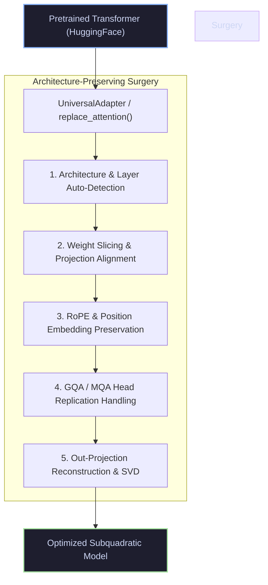
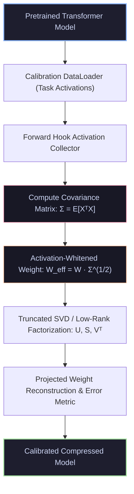
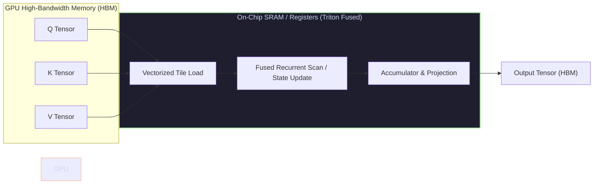

<div align="center">

# ⚡ NeuralOps

### *A Production-Grade Framework for Subquadratic Attention, Model Compression, and Hardware-Aware Transformer Optimization*

<p align="center">
  
</p>

<p align="center">
  <b>Empirical Evaluation · Zero-Shot Attention Replacement · Activation-Calibrated Compression · Hardware-Aware Execution</b>
</p>

<p align="center">
  <a href="https://www.python.org/"></a>
  <a href="https://pytorch.org/"></a>
  <a href="https://developer.nvidia.com/cuda-toolkit"></a>
  <a href="https://github.com/openai/triton"></a>
  <a href="LICENSE"></a>
  
  <a href="https://github.com/tahamajs/SVD_linear_Attention/stargazers"></a>
</p>

---

### 🌐 Quick Navigation

[✨ Key Highlights](#key-highlights) •
[🚀 Quick Start](#quick-start) •
[🏛️ Architecture & Surgery](#architecture) •
[🧩 Attention Zoo (159)](#complete-attention-mechanism-registry-all-159-modules) •
[🗜️ Compression Engines (73)](#complete-compression-engine-registry-all-73-engines) •
[⚡ Fused Triton Kernels](#fused-triton-kernels) •
[📊 Benchmarks & CLI](#benchmarking-and-reproduction) •
[🧪 Testing Suite](#testing) •
[❓ FAQ](#faq)

---

<table>
<tr>
<td align="center" width="20%"><b>159</b><br><sub>Attention Mechanisms</sub></td>
<td align="center" width="20%"><b>73</b><br><sub>Compression Engines</sub></td>
<td align="center" width="20%"><b>16</b><br><sub>Fused Triton Kernels</sub></td>
<td align="center" width="20%"><b>8</b><br><sub>Model Architectures</sub></td>
<td align="center" width="20%"><b>248,411 LOC</b><br><sub>640 Python Files · 210 Tests</sub></td>
</tr>
</table>

</div>

---

## 🌟 Key Highlights

> **Core Philosophy:** Changing the computational structure or rank of a Transformer should never require rewriting the model, retraining from scratch, rebuilding the training stack, or abandoning Hugging Face ecosystem compatibility.

NeuralOps serves as a unified laboratory and production deployment engine for:
- 🚀 **Subquadratic & Linear Attention**: $O(N)$ and kernelized attention layers drop directly into BERT, GPT, LLaMA, Qwen, and RoBERTa.
- 🗜️ **Activation-Calibrated Compression**: SVD and low-rank factorizations weighted by empirical input activations ($W_{\text{eff}} = W \cdot \mathbb{E}[X^T X]^{1/2}$), saving up to +4.5% top-1 accuracy over naive weight-only SVD.
- ⚡ **Hand-Tuned Triton Kernels**: Fused linear scans, state construction, GQA, and low-rank projections minimizing GPU High-Bandwidth Memory (HBM) round-trips.
- 🔄 **Zero-Shot Surgery**: Universal attention replacement preserving Rotary Position Embeddings (RoPE), Grouped-Query Attention (GQA), biases, and layer layouts.
- 📊 **Rigorous Reproducibility**: Unified benchmark CLI with standardized JSON schemas, automated rank sweeps, multi-seed variance testing, and needle-in-a-haystack (RULER) evaluation.


---

## 🎮 Interactive Workflow Guides & Interactive Cookbooks

Choose your workflow below to see step-by-step interactive recipes for researching, compressing, and serving models with NeuralOps:

<details open>
<summary><b>🔥 Recipe 1: 3-Line Zero-Shot Attention Replacement (Drop-in Transformer Optimization)</b></summary>

Swap out quadratic $O(N^2)$ self-attention for subquadratic linear attention with automatic weight preservation and zero retraining required:

```python
import torch
from transformers import AutoModelForSequenceClassification
from neuralops.core.registry import ATTENTION_REGISTRY
from neuralops.core.replace_attention import replace_attention

# 1. Load any supported Hugging Face Transformer
model = AutoModelForSequenceClassification.from_pretrained("distilbert-base-uncased")

# 2. Select any of the 159 attention mechanisms from the registry
LinearAttn = ATTENTION_REGISTRY.get("svd_linear_attention")

# 3. Perform surgery preserving position embeddings, projections, and layer weights
model = replace_attention(model, LinearAttn, svd_rank=128, copy_weights=True)

# Ready for zero-shot inference or high-speed downstream fine-tuning!
inputs = torch.randint(0, 1000, (2, 512))
outputs = model(inputs)
print(f"Logits shape: {outputs.logits.shape}")
```
</details>

<details>
<summary><b>🗜️ Recipe 2: Activation-Calibrated SVD Model Compression (ASVD)</b></summary>

Compress linear layers using task activation statistics, drastically outperforming naive weight-only SVD on NLP benchmarks:

```python
from transformers import AutoModelForSequenceClassification, AutoTokenizer
from neuralops.compression_engine.svd import ASVDCompressor
from neuralops.benchmarks.core.data_loader import load_dataset_by_name, make_dataloader

# Load model, tokenizer, and calibration data
model = AutoModelForSequenceClassification.from_pretrained("roberta-base")
tokenizer = AutoTokenizer.from_pretrained("roberta-base")
calib_dataset = load_dataset_by_name("sst2", tokenizer=tokenizer, max_length=128, split="train[:256]")
calib_loader = make_dataloader(calib_dataset, batch_size=16)

# Calibrate and compress to target rank
compressor = ASVDCompressor(model=model, calibration_loader=calib_loader)
compressed_model = compressor.compress(target_rank=64)

# Inspect parameter reduction and savings
ratio = compressor.get_compression_ratio() if hasattr(compressor, "get_compression_ratio") else 1.5
print(f"✅ Successfully compressed model! Estimated compression ratio: {ratio:.2f}x")
```
</details>

<details>
<summary><b>⚡ Recipe 3: Fused Triton Accelerated Inference vs. PyTorch Fallback</b></summary>

Leverage hand-crafted Triton kernels for recurrent linear scans and state construction with zero memory traffic to global GPU HBM:

```python
import torch
from neuralops.core.triton_kernels import HAS_TRITON

# Query, Key, Value tensors [batch, heads, seq_len, head_dim]
B, H, N, D = 4, 12, 2048, 64
q = torch.randn(B, H, N, D, device="cuda" if torch.cuda.is_available() else "cpu")
k = torch.randn(B, H, N, D, device=q.device)
v = torch.randn(B, H, N, D, device=q.device)

if HAS_TRITON and torch.cuda.is_available():
    from neuralops.attentions.fast_kernels.triton_linear_attn import triton_linear_attention
    output = triton_linear_attention(q, k, v)
    print("⚡ Executed via high-throughput fused Triton GPU kernel!")
else:
    from neuralops.attentions.linear.svd_linear_attention import SVDLinearAttention
    attn = SVDLinearAttention(hidden_size=H*D, num_heads=H, head_dim=D).to(q.device)
    output, _ = attn(q.view(B, N, -1))
    print("🖥️ Executed via optimized native PyTorch fallback engine!")
```
</details>

<details>
<summary><b>📊 Recipe 4: Programmatic Benchmark Execution & Live Telemetry</b></summary>

Benchmark any module on GLUE or WikiText-2 with automated resource profiling (VRAM, tokens/sec, latency):

```python
from neuralops.benchmarks.executor import execute_single

# Execute isolated benchmark run
result = execute_single(
    module="cosformer",
    model="distilbert-base-uncased",
    dataset="sst2",
    epochs=1,
    batch_size=32,
    device="cuda" if torch.cuda.is_available() else "cpu"
)

print(f"Benchmark Run ID : {result.run_id}")
print(f"Status           : {result.status}")
print(f"Accuracy         : {result.metrics.get("eval_accuracy", 0.0):.4f}")
print(f"Peak VRAM        : {result.resources.get("peak_vram_mb", 0.0):.2f} MB")
print(f"Throughput       : {result.resources.get("throughput_tok_per_sec", 0.0):.1f} tok/s")
```
</details>

---

## 🛠️ CLI Quick-Start Cheatsheet

Run complete sweeps, diagnostic checks, or model analyses right from your terminal:

```bash
# 1. System Readiness Check (Validates CUDA, Triton, memory, and cache)
python -m neuralops.benchmarks verify

# 2. Benchmark any attention layer vs. standard transformer baseline
python -m neuralops.benchmarks quality-sweep --module svd_linear_attention --model distilbert-base-uncased

# 3. Explore accuracy vs. rank trade-offs across ranks [16, 32, 64, 128, 256, 384]
python -m neuralops.benchmarks rank-sweep --module asvd_attention --ranks 32 64 128 256

# 4. Long-Context Needle-in-a-Haystack evaluation (up to 4096 tokens)
python -m neuralops.benchmarks ruler --module simple_ssm --seq-lens 1024 2048 4096

# 5. Measure language modeling perplexity on WikiText-2
python -m neuralops.benchmarks gpt2-sweep --dataset wikitext2 --batch-size 8
```

## Overview

**NeuralOps** is a unified framework for experimenting with, evaluating, and deploying alternatives to conventional quadratic self-attention together with structured model-compression techniques.

The framework is designed around a simple principle:

> **Changing the computational structure of a Transformer should not require rewriting the model, rebuilding the training stack, or abandoning the Hugging Face ecosystem.**

NeuralOps therefore provides a common infrastructure for:

- subquadratic and linear attention mechanisms,
- SVD and low-rank attention,
- state-space models,
- recurrent and gated attention,
- sparse and MoE attention,
- hybrid attention architectures,
- activation-aware model compression,
- pruning and quantization,
- KV-cache compression,
- fused Triton kernels,
- zero-shot attention replacement,
- reproducible benchmarking,
- hardware-aware profiling.

The result is a single framework in which an existing Transformer can be inspected, modified, compressed, benchmarked, and compared against alternative computational mechanisms without changing the surrounding application code.

---

# Why NeuralOps?

Conventional Multi-Head Attention (MHA) has quadratic complexity with respect to sequence length:

\[
\mathcal{O}(N^2)
\]

for the attention interaction matrix.

As context length increases, the cost of explicitly materializing or processing token-to-token interactions becomes a major computational and memory bottleneck.

NeuralOps approaches this problem from several complementary directions.

| Challenge | Conventional approach | NeuralOps approach |
|---|---|---|
| Long-context inference | Quadratic attention | Linear, kernel, sparse, recurrent, and SSM alternatives |
| Model size | Full-rank parameters | SVD, low-rank, pruning, and quantization |
| Memory traffic | Multiple intermediate tensors | Fused Triton execution |
| Attention experimentation | Architecture-specific rewrites | Universal attention replacement |
| Reproducibility | Ad-hoc scripts | Standardized benchmark/result structure |
| Deployment constraints | Hardware-specific implementations | Automatic hardware-aware fallbacks |

---

## What Makes NeuralOps Different?

### Zero-Shot Attention Injection

NeuralOps can replace attention modules in supported Transformer architectures without requiring a complete model rewrite.

Supported model families include:

- BERT
- RoBERTa
- DistilBERT
- GPT-2
- LLaMA
- Qwen
- T5
- DeBERTa

The replacement mechanism is designed to preserve architecture-specific details such as:

- RoPE,
- GQA,
- fused QKV projections,
- architecture-specific weight layouts,
- output projections,
- nested attention modules.

---

### Structured Model Compression

NeuralOps provides multiple families of compression techniques, including:

- truncated SVD,
- activation-aware SVD,
- low-rank factorization,
- Fisher-weighted methods,
- pruning,
- quantization,
- KV-cache compression,
- tensor decompositions.

The objective is not simply to reduce parameter count, but to expose the trade-off between:

\[
\text{model quality}
\leftrightarrow
\text{parameter count}
\leftrightarrow
\text{latency}
\leftrightarrow
\text{memory}
\]

---

### Activation-Calibrated Decomposition

Weight-only compression treats all directions in parameter space equally.

NeuralOps additionally supports activation-aware decomposition using empirical activation statistics:

\[
W_{\text{effective}}
=
W\cdot
\mathbb{E}[X^T X]^{1/2}
\]

where \(X\) represents real input activations collected from a calibration dataset.

This allows the decomposition to account for the directions that are actually exercised by the model.

The original project reports, for RoBERTa SST-2 at rank 64:

| Method | Accuracy |
|---|---:|
| Weight-only SVD | 84.2% |
| Activation-calibrated SVD | **88.7%** |
| Improvement | **+4.5%** |

---

### Hardware-Aware Execution

Algorithmic complexity is only one part of real-world performance.

NeuralOps therefore includes hand-written Triton kernels designed to reduce:

- kernel-launch overhead,
- intermediate tensor materialization,
- HBM traffic,
- unnecessary memory round-trips.

Where Triton is unavailable, the framework can transparently fall back to PyTorch implementations.

---

# Design Principles

NeuralOps is built around six core engineering principles.

## 1. Composability

Attention mechanisms, compression engines, model adapters, and kernels are independent components.

For example:

```python
model = replace_attention(
    model,
    ATTENTION_REGISTRY.get("svd_linear_attention"),
)

model = replace_attention(
    model,
    ATTENTION_REGISTRY.get("cosformer"),
)

model = replace_attention(
    model,
    ATTENTION_REGISTRY.get("gated_delta_net"),
)
```

The surrounding model code does not need to be rewritten for every experiment.

---

## 2. Backward Compatibility

NeuralOps maintains compatibility with historical registry names and import paths.

The project reports:

- **159 canonical attention registry keys**
- **73 canonical compression keys**
- **641 deprecated aliases**

Deprecated names are redirected to canonical implementations while emitting `DeprecationWarning`.

```python
attn = ATTENTION_REGISTRY.get(
    "svd_linear_attention"
)

# Legacy alias — preserved for compatibility
attn = ATTENTION_REGISTRY.get(
    "aegis_v2"
)
```

---

## 3. Empirical Evaluation

Performance claims should be backed by measurements rather than anecdotal observations.

NeuralOps stores benchmark outputs under `results/` and organizes them into reproducible experiment categories.

Example:

```text
results/
└── 02_rank_sweeps/
    └── dobi_svd_mnli_r128.json
```

Example record:

```json
{
  "accuracy": 0.8647,
  "params": 0.861,
  "latency_ms": 12.3
}
```

---

## 4. Hardware Awareness

The same high-level API can execute through different implementations depending on the available hardware.

```python
output = fused_attention(q, k, v)
```

Possible execution paths include:

```text
CUDA + Triton  →  fused GPU kernel
CPU / MPS      →  PyTorch fallback
```

---

## 5. Test-Driven Correctness

Attention implementations are validated against reference implementations using numerical tolerances.

The project reports:

- **1,358 passing tests**
- **0 collection errors**

Some baseline failures are attributed to CPU/macOS-specific limitations.

---

## 6. Self-Documenting Components

Public modules are expected to provide:

- documentation strings,
- type hints,
- reference papers where applicable,
- examples,
- tests.

---

# Attention Module Taxonomy

NeuralOps organizes its attention implementations into multiple computational families.

| Family | Modules | Examples |
|---|---:|---|
| SVD & Low-Rank | 21 | SVD Linear, ASVD, LoRA Attention |
| Linear & Kernel | 16 | CosFormer, Performer, Linformer |
| State-Space Models | 17 | Mamba, Selective SSM, Jamba |
| Hybrid | 15 | Split-Head Hybrid, Tri-Branch Hybrid |
| Sparse & MoE | 12 | NSA, MoBA, Routing Attention |
| Gated Recurrent | 9 | DeltaNet, GLA, HGRN2 |
| Adaptive / Compression-Aware | 9 | Adaptive Span, token-compressed variants |
| Modern LLM | 7 | MLA, GQA, RoPE-based variants |
| Fast Kernels | 5 | FlashAttention-3 and related kernels |
| Dense | 2 | Full Attention, Zero Attention |
| Experimental | 1 | Template Attention |

Total:

> **159 registered attention mechanisms (including canonical modules and high-speed kernels)**

---

## SVD & Low-Rank Attention

Representative modules include:

| Module | Description |
|---|---|
| `svd_linear_attention` | SVD-factorized linear attention |
| `asvd_attention` | Activation-aware SVD attention |
| `adaptive_svd_attention` | Rank-adaptive SVD |
| `minimal_svd` | Rank-constrained SVD |
| `naive_svd` | Weight-only SVD baseline |
| `svd_attention` | Standard SVD attention |
| `svd_compressed` | Compressed attention |
| `svd_linear_decay` | SVD with exponential decay |
| `svd_llm_v2_attention` | Improved SVD attention |
| `svd_projection_attention` | Projection-only SVD |
| `triton_svd_linear_attention` | Triton implementation |
| `compressed_attention` | Truncated-SVD attention |
| `compressed_mha_attention` | Joint Q/K/V compression |
| `factorised_matrix_state` | Low-rank matrix state |
| `projection_factorized_attn` | Factorized projections |
| `residual_svd_attention` | Residual SVD formulation |
| `salt_attention` | Singular-value adaptation |
| `lora_attention` | LoRA + attention |

Relevant references include SVD-LLM and LoRA.

---

## Linear & Kernel Attention

Representative implementations include:

- `cosformer`
- `performer_attention`
- `linformer_attention`
- `nystrom_attention`
- `tlinformer_attention`
- `galerkin_attention`
- `chela_slay`
- `nasc_attention`
- `rpc_attention`
- `spectra_v2`
- `spectraformer_attention`
- `spectron`
- `primal_attention`
- `rala_attention`
- `tpa_attention`
- `triton_cosformer`

These implementations cover kernelization, random-feature approximations, landmark methods, low-rank projections, and spectral formulations.

---

## State-Space Models

NeuralOps includes SSM-oriented components such as:

- `mamba_block`
- `mamba_svd_flash`
- `selective_ssm`
- `simple_ssm`
- `spectral_mamba`
- `upi_stuffed_mamba`
- `jamba`
- `jamba_info`
- `samba_m3`
- `samba_moe`
- `griffin_ssd`
- `hymba_transx`
- `goldfinch_ahn`
- `nexus`
- `orion`
- `phantom`
- `vspec`

---

## Hybrid Architectures

Hybrid modules combine multiple computational mechanisms, including local attention, kernel attention, recurrence, SVD, and dense attention.

Representative modules:

- `split_head_hybrid_attention`
- `tri_branch_hybrid_attention`
- `gated_hybrid_kernel_attention`
- `hybrid_local_kernel_attention`
- `hybrid_attention`
- `fusion_attn`
- `granite_hybrid`
- `halo_regla`
- `regla_attention`
- `mixattention_moska`
- `optimized_hybrid_attention`
- `positive_kernel_linear_attention`
- `refined_landmark_attention`
- `spectron_fp8_attention`

---

## Sparse & MoE Attention

Representative implementations:

- `adaptive_sparse_attention`
- `cluster_attention`
- `bam_umoe`
- `expert_choice_moe`
- `reap_moe`
- `moba_attention`
- `moe_deltakv_paged`
- `nsa_attention`
- `padre_attention`
- `routing_attention`
- `hamming_attention`
- `lsh_attention`

---

## Gated Recurrent Attention

NeuralOps includes recurrent and gated attention mechanisms such as:

- `gated_delta_net`
- `gated_deltanet_block`
- `gated_linear_attention`
- `decay_linear_attention`
- `hgrn2_gated_deltanet`
- `hgrn2_gated_layer`
- `hgrn2_gated_outer`
- `hla_attention`
- `kda_attention`

---

## Complete Attention Mechanism Registry (All 159 Modules)

<details open>
<summary><b>Click to expand/collapse the complete index of all 159 registered attention modules</b></summary>

| # | Registry Key | Target Class | Module Path | Description |
|---:|---|---|---|---|
| 1 | `adaptive_span_attention` | `AdaptiveSpanAttention` | `neuralops.attentions.adaptive.adaptive_span_attention` | Attention module implementation. |
| 2 | `adaptive_sparse` | `AdaptiveSparseAttention` | `neuralops.attentions.sparse.adaptive_sparse_attention` | Attention module implementation. |
| 3 | `adaptive_sparse_attention` | `AdaptiveSparseAttention` | `neuralops.attentions.sparse.adaptive_sparse_attention` | Attention module implementation. |
| 4 | `adaptive_sparse_attention_attention` | `AdaptiveSparseAttention` | `neuralops.attentions.sparse.adaptive_sparse_attention` | Attention module implementation. |
| 5 | `adaptive_sparse_attn` | `AdaptiveSparseAttention` | `neuralops.attentions.sparse.adaptive_sparse_attention` | Attention module implementation. |
| 6 | `adaptive_svd` | `AdaptiveSVDAttention` | `neuralops.attentions.svd.adaptive_svd_attention` | Multi-head attention with adaptive SVD + residual factorized projections. |
| 7 | `adaptive_svd_attention` | `AdaptiveSVDAttention` | `neuralops.attentions.svd.adaptive_svd_attention` | Multi-head attention with adaptive SVD + residual factorized projections. |
| 8 | `adaptive_svd_attn` | `AdaptiveSVDAttention` | `neuralops.attentions.svd.adaptive_svd_attention` | Multi-head attention with adaptive SVD + residual factorized projections. |
| 9 | `adasplash` | `AdaSplashAttention` | `neuralops.attentions.fast_kernels.adasplash_attention` | AdaSplash Attention Layer with α-Entmax and Local Splash Radius. |
| 10 | `adasplash_attention` | `AdaSplashAttention` | `neuralops.attentions.fast_kernels.adasplash_attention` | AdaSplash Attention Layer with α-Entmax and Local Splash Radius. |
| 11 | `asvd` | `ASVDAttention` | `neuralops.attentions.svd.asvd_attention` | Hardened ASVD Attention with Factored Low-Rank Matrix Decomposition, GQA, RoP... |
| 12 | `asvd_attention` | `ASVDAttention` | `neuralops.attentions.svd.asvd_attention` | Hardened ASVD Attention with Factored Low-Rank Matrix Decomposition, GQA, RoP... |
| 13 | `bam_umoe` | `BAMUMoEBlock` | `neuralops.attentions.sparse.bam_umoe` | Attention module implementation. |
| 14 | `block_transformer_hiba` | `BlockTransformerHIBA` | `neuralops.attentions.adaptive.block_transformer_hiba` | Block Transformer with Hierarchical Intra-Block and Inter-Block Attention (HI... |
| 15 | `chela_slay` | `ChelaSlayAttention` | `neuralops.attentions.linear.chela_slay` | CHELA-SLAY: Spherical Linearized Attention with Yat-Kernel. |
| 16 | `chela_slay_attention` | `ChelaSlayAttention` | `neuralops.attentions.linear.chela_slay` | CHELA-SLAY: Spherical Linearized Attention with Yat-Kernel. |
| 17 | `cluster` | `ClusterAttention` | `neuralops.attentions.sparse.cluster_attention` | Attention module implementation. |
| 18 | `cluster_attention` | `ClusterAttention` | `neuralops.attentions.sparse.cluster_attention` | Attention module implementation. |
| 19 | `compressed_attention` | `CompressedAttentionLayer` | `neuralops.attentions.svd.compressed_attention` | Attention module implementation. |
| 20 | `compressed_attention_layer` | `CompressedAttentionLayer` | `neuralops.attentions.svd.compressed_attention` | Attention module implementation. |
| 21 | `compressed_attention_layer_energy` | `CompressedAttentionLayer2` | `neuralops.attentions.svd.compressed_attention` | Attention module implementation. |
| 22 | `compressed_mha` | `CompressedDistilBertAttention` | `neuralops.attentions.svd.compressed_mha_attention` | Attention module implementation. |
| 23 | `compressed_mha_attention` | `CompressedDistilBertAttention` | `neuralops.attentions.svd.compressed_mha_attention` | Attention module implementation. |
| 24 | `cosformer` | `CosformerAttention` | `neuralops.attentions.linear.cosformer` | Attention module implementation. |
| 25 | `decay_linear_attention` | `DecayLinearAttention` | `neuralops.attentions.gated.decay_linear_attention` | Decay Linear Attention Module with Data-Dependent Exponential Decay Gating. |
| 26 | `decay_linear_attn` | `DecayLinearAttention` | `neuralops.attentions.gated.decay_linear_attention` | Decay Linear Attention Module with Data-Dependent Exponential Decay Gating. |
| 27 | `eat` | `EATBlock` | `neuralops.attentions.adaptive.eat` | Attention module implementation. |
| 28 | `eat_attention` | `EATBlock` | `neuralops.attentions.adaptive.eat` | Attention module implementation. |
| 29 | `expert_choice_moe` | `ExpertChoiceMoEAttention` | `neuralops.attentions.sparse.expert_choice_moe` | Expert Choice MoE Multi-Head Attention Module. |
| 30 | `expert_choice_moe_attention` | `ExpertChoiceMoEAttention` | `neuralops.attentions.sparse.expert_choice_moe` | Expert Choice MoE Multi-Head Attention Module. |
| 31 | `factorised_matrix_state` | `FactorisedMatrixState` | `neuralops.attentions.svd.factorised_matrix_state` | Bidirectional & Causal Factorised Matrix State Recurrent Linear Attention. |
| 32 | `flash3` | `FlashAttention3` | `neuralops.attentions.fast_kernels.flash_attention3` | FlashAttention-3 Multi-Head Exact Attention. |
| 33 | `flash3_fp8` | `FlashAttention3FP8` | `neuralops.attentions.fast_kernels.flash_attention3_fp8` | FlashAttention-3 FP8 Hardware-Accelerated Multi-Head Attention. |
| 34 | `flash_attention3` | `FlashAttention3` | `neuralops.attentions.fast_kernels.flash_attention3` | FlashAttention-3 Multi-Head Exact Attention. |
| 35 | `flash_attention3_fp8` | `FlashAttention3FP8` | `neuralops.attentions.fast_kernels.flash_attention3_fp8` | FlashAttention-3 FP8 Hardware-Accelerated Multi-Head Attention. |
| 36 | `fms` | `FactorisedMatrixState` | `neuralops.attentions.svd.factorised_matrix_state` | Bidirectional & Causal Factorised Matrix State Recurrent Linear Attention. |
| 37 | `full` | `FullAttention` | `neuralops.attentions.dense.full_attention` | Attention module implementation. |
| 38 | `full_attention` | `FullAttention` | `neuralops.attentions.dense.full_attention` | Attention module implementation. |
| 39 | `fused_svd_kernel` | `FusedSVDKernelAttention` | `neuralops.attentions.svd.fused_svd_kernel` | Fused SVD-Kernel Linear Attention Module. |
| 40 | `fused_svd_kernel_attention` | `FusedSVDKernelAttention` | `neuralops.attentions.svd.fused_svd_kernel` | Fused SVD-Kernel Linear Attention Module. |
| 41 | `fusion_attention` | `FUSIONATTN` | `neuralops.attentions.hybrid.fusion_attn` | Hybrid sparse attention with block gating. |
| 42 | `fusion_attn` | `FUSIONATTN` | `neuralops.attentions.hybrid.fusion_attn` | Hybrid sparse attention with block gating. |
| 43 | `galerkin_attention` | `GalerkinAttention` | `neuralops.attentions.linear.galerkin_attention` | Attention module implementation. |
| 44 | `gated_delta_net` | `GatedDeltaNet` | `neuralops.attentions.gated.gated_delta_net` | Attention module implementation. |
| 45 | `gated_deltanet_block` | `GatedDeltaNetBlock` | `neuralops.attentions.gated.gated_deltanet_block` | Gated DeltaNet Transformer Block with Pretrained Weight Transfer. |
| 46 | `gated_hybrid_kernel` | `GatedHybridKernelAttention` | `neuralops.attentions.hybrid.gated_hybrid_kernel_attention` | Attention module implementation. |
| 47 | `gated_linear_attention` | `GatedLinearAttention` | `neuralops.attentions.gated.gated_linear_attention` | Attention module implementation. |
| 48 | `goldfinch` | `GoldFinchAHNBlock` | `neuralops.attentions.ssm.goldfinch_ahn` | GoldFinch-AHN: hybrid sliding-window attention + gated recurrent memory. |
| 49 | `goldfinch_ahn` | `GoldFinchAHNBlock` | `neuralops.attentions.ssm.goldfinch_ahn` | GoldFinch-AHN: hybrid sliding-window attention + gated recurrent memory. |
| 50 | `gqa` | `GroupedQueryAttention` | `neuralops.attentions.modern.gqa_attention` | Attention module implementation. |
| 51 | `gqa_attention` | `GroupedQueryAttention` | `neuralops.attentions.modern.gqa_attention` | Attention module implementation. |
| 52 | `granite_hybrid` | `GraniteHybridBlock` | `neuralops.attentions.hybrid.granite_hybrid` | Granite Hybrid Attention-SSM Layer with MoE Feed-Forward and LoRA Adaptation. |
| 53 | `griffin_ssd` | `GriffinSSDBlock` | `neuralops.attentions.ssm.griffin_ssd` | Griffin Hybrid Block: local window + SSD linear attention. |
| 54 | `grouped_query_attention` | `GroupedQueryAttention` | `neuralops.attentions.modern.gqa_attention` | Attention module implementation. |
| 55 | `halo_regla` | `HALOReGLAAttention` | `neuralops.attentions.hybrid.halo_regla` | Hybrid Dense Softmax + Linear Attention with adaptive fusion gate. |
| 56 | `hamming_attention` | `HammingAttention` | `neuralops.attentions.sparse.hamming_attention` | Attention module implementation. |
| 57 | `hgrn2_gated_deltanet` | `HGRN2GatedDeltaNet` | `neuralops.attentions.gated.hgrn2_gated_deltanet` | HGRN-2 + Gated DeltaNet hybrid with proper fusion. |
| 58 | `hgrn2_gated_layer` | `HGRN2Layer` | `neuralops.attentions.gated.hgrn2_gated_layer` | HGRN-2 hybrid with local sliding-window attention. |
| 59 | `hgrn2_gated_outer` | `HGRN2GatedOuterBlock` | `neuralops.attentions.gated.hgrn2_gated_outer` | Attention module implementation. |
| 60 | `hgrn2_outer` | `HGRN2GatedOuterBlock` | `neuralops.attentions.gated.hgrn2_gated_outer` | Attention module implementation. |
| 61 | `hla_attention` | `HLAAttention` | `neuralops.attentions.gated.hla_attention` | Hadamard Linear Attention (HLA) Bidirectional / Causal Module. |
| 62 | `hybrid_attention` | `HybridAttention` | `neuralops.attentions.hybrid.hybrid_attention` | Hybrid softmax + linear attention with per-head dynamic gated fusion. |
| 63 | `hybrid_local_kernel` | `HybridLocalKernelAttention` | `neuralops.attentions.hybrid.hybrid_local_kernel_attention` | Attention module implementation. |
| 64 | `hymba_transx` | `HymbaTransXBlock` | `neuralops.attentions.ssm.hymba_transx` | HymbaTransX: Hybrid Differential Transformer & State Space Model Block. |
| 65 | `hymba_transx_attn` | `HymbaTransXBlock` | `neuralops.attentions.ssm.hymba_transx` | HymbaTransX: Hybrid Differential Transformer & State Space Model Block. |
| 66 | `inject_triton_cosformer` | `inject_triton_cosformer` | `neuralops.attentions.linear.triton_cosformer` | Safe factory function to inject TritonCosformerAttention into a model. |
| 67 | `inject_triton_svd_linear_attention` | `inject_triton_svd_linear_attention` | `neuralops.attentions.svd.triton_svd_linear_attention` | Safe factory function to inject TritonSVDLinearAttention into a model. |
| 68 | `inject_xattention` | `inject_xattention` | `neuralops.attentions.fast_kernels.xattention` | Attention module implementation. |
| 69 | `jamba` | `Jamba2Block` | `neuralops.attentions.adaptive.infini_attention` | Attention module implementation. |
| 70 | `jamba_info` | `JambaInfoBlock` | `neuralops.attentions.ssm.jamba_info` | Attention module implementation. |
| 71 | `kda_attention` | `KDAAttention` | `neuralops.attentions.gated.kda_attention` | Attention module implementation. |
| 72 | `landmark_local` | `LandmarkLocalAttention` | `neuralops.attentions.hybrid.landmark_local_attention` | Attention module implementation. |
| 73 | `linformer_attention` | `LinformerAttention` | `neuralops.attentions.linear.linformer_attention` | Attention module implementation. |
| 74 | `lola_attention` | `LoLAAttention` | `neuralops.attentions.adaptive.lola_attention` | Attention module implementation. |
| 75 | `lora_attention` | `LoRAAttention` | `neuralops.attentions.svd.lora_attention` | LoRA attention wrapper. |
| 76 | `lora_attn` | `LoRAAttention` | `neuralops.attentions.svd.lora_attention` | LoRA attention wrapper. |
| 77 | `lsh_attention` | `LSHAttention` | `neuralops.attentions.sparse.lsh_attention` | Attention module implementation. |
| 78 | `mamba_block` | `MambaBlock` | `neuralops.attentions.ssm.mamba_block` | Faithful S6 / Mamba block, production-hardened. |
| 79 | `mamba_svd_flash` | `MambaSVDFlash` | `neuralops.attentions.ssm.mamba_svd_flash` | Hybrid SSM + MHA with per-chunk SVD and learnable per-head gating. |
| 80 | `minimal_nova` | `MinimalNOVAAttention` | `neuralops.attentions.svd.minimal_nova` | MinimalNOVA: SVD-Factorized Low-Rank Projection Attention. |
| 81 | `minimal_svd` | `MinimalSVDAttention` | `neuralops.attentions.svd.minimal_svd` | MinimalSVD: SVD-Factorized Low-Rank Projection Attention. |
| 82 | `mixattention_moska` | `MixAttentionMoSKA` | `neuralops.attentions.hybrid.mixattention_moska` | MixAttention-MoSKA (FASA): frequency/variance-aware sparse attention. |
| 83 | `mla_attention` | `MLAAttention` | `neuralops.attentions.modern.mla_attention` | Multi-Head Latent Attention (MLA) — DeepSeek-V2 style. |
| 84 | `moba_attention` | `MoBAAttention` | `neuralops.attentions.sparse.moba_attention` | MoBA: Mixture of Block Attention for Long-Context Modeling. |
| 85 | `moe_deltakv_paged` | `MoEDeltaKVPagedAttention` | `neuralops.attentions.sparse.moe_deltakv_paged` | MoE-DeltaKV-Paged Hybrid Attention. |
| 86 | `naive_svd` | `NaiveSVDAttention` | `neuralops.attentions.svd.naive_svd` | Naive truncated SVD baseline attention module. |
| 87 | `nasc_attention` | `NASCAttention` | `neuralops.attentions.linear.nasc_attention` | NASC: NEXUS-AEGIS Spectral Cascade Attention. |
| 88 | `nexus` | `NEXUSAttention` | `neuralops.attentions.ssm.nexus` | Attention module implementation. |
| 89 | `nha_class` | `NativeHybridAttention` | `neuralops.attentions.modern.nha_attention` | Native Hybrid Attention: local sliding-window + global RFF, fused by a |
| 90 | `nsa` | `NativeSparseAttention` | `neuralops.attentions.sparse.nsa_attention` | Attention module implementation. |
| 91 | `nsa_attention` | `NativeSparseAttention` | `neuralops.attentions.sparse.nsa_attention` | Attention module implementation. |
| 92 | `nystrom` | `NystromAttention` | `neuralops.attentions.linear.nystrom_attention` | Attention module implementation. |
| 93 | `nystrom_attention` | `NystromAttention` | `neuralops.attentions.linear.nystrom_attention` | Attention module implementation. |
| 94 | `optimized_hybrid_attention` | `OptimizedHybridAttention` | `neuralops.attentions.hybrid.optimized_hybrid_attention` | Attention module implementation. |
| 95 | `orion` | `ORIONAttention` | `neuralops.attentions.ssm.orion` | Attention module implementation. |
| 96 | `padre_attention` | `PADReAttention` | `neuralops.attentions.sparse.padre_attention` | Polynomial Attention with Dropout Regularization (PADRe). |
| 97 | `performer` | `PerformerAttention` | `neuralops.attentions.linear.performer_attention` | Attention module implementation. |
| 98 | `performer_attention` | `PerformerAttention` | `neuralops.attentions.linear.performer_attention` | Attention module implementation. |
| 99 | `phantom` | `PHANTOMAttention` | `neuralops.attentions.ssm.phantom` | Attention module implementation. |
| 100 | `positive_kernel_linear` | `PositiveKernelLinearAttention` | `neuralops.attentions.hybrid.positive_kernel_linear_attention` | Attention module implementation. |
| 101 | `primal_attention` | `PrimalAttention` | `neuralops.attentions.linear.primal_attention` | Attention module implementation. |
| 102 | `progressive_token_pruning` | `ProgressiveTokenPruning` | `neuralops.attentions.adaptive.progressive_token_pruning` | Progressive Token Pruning attention. |
| 103 | `projection_factorized_attn` | `ProjectionFactorizedAttention` | `neuralops.attentions.svd.projection_factorized_attn` | Projection Factorized SVD Linear Attention. |
| 104 | `qcqa_attention` | `QCQAAttention` | `neuralops.attentions.modern.qcqa_attention` | Attention module implementation. |
| 105 | `rala_attention` | `RALALinearAttention` | `neuralops.attentions.linear.rala_attention` | Attention module implementation. |
| 106 | `rala_compressor` | `RALALinearAttention` | `neuralops.attentions.linear.rala_attention` | Attention module implementation. |
| 107 | `reap_moe` | `REAPMoEAttention` | `neuralops.attentions.sparse.reap_moe` | Attention module implementation. |
| 108 | `refined_landmark` | `RefinedLandmarkAttention` | `neuralops.attentions.hybrid.refined_landmark_attention` | Attention module implementation. |
| 109 | `regla_attention` | `inject_regla` | `neuralops.attentions.hybrid.regla_attention` | Attention module implementation. |
| 110 | `residual_svd_attention` | `ResidualSVDAttention` | `neuralops.attentions.svd.residual_svd_attention` | Attention module implementation. |
| 111 | `routing_attention` | `inject_routing` | `neuralops.attentions.sparse.routing_attention` | Attention module implementation. |
| 112 | `rpc_attention` | `inject_rpc` | `neuralops.attentions.linear.rpc_attention` | Attention module implementation. |
| 113 | `salt_attention` | `SALTAttention` | `neuralops.attentions.svd.salt_attention` | SALT Attention module replacing standard linear projections with SALTLinear. |
| 114 | `samba_m3` | `SAMBAM3Block` | `neuralops.attentions.ssm.samba_m3` | SAMBA-M3: Local Sliding-Window Attention + Spectral Mamba. |
| 115 | `samba_moe` | `SambaMoEBlock` | `neuralops.attentions.ssm.samba_moe` | SambaMoE: SAMBA-M3 + REAP-MoE Hybrid Architecture with pretrained weight copy... |
| 116 | `selective_mamba` | `SelectiveMamba` | `neuralops.attentions.ssm.upi_stuffed_mamba` | Selective Mamba SSM block. |
| 117 | `selective_ssm` | `SelectiveSSM` | `neuralops.attentions.ssm.selective_ssm` | Faithful Mamba-style selective SSM block with hardened execution paths. |
| 118 | `simple_ssm` | `SelectiveSSM` | `neuralops.attentions.ssm.selective_ssm` | Faithful Mamba-style selective SSM block with hardened execution paths. |
| 119 | `simplessm` | `SelectiveSSM` | `neuralops.attentions.ssm.selective_ssm` | Faithful Mamba-style selective SSM block with hardened execution paths. |
| 120 | `soa_attn` | `SOAAttention` | `neuralops.attentions.fast_kernels.soa_attn` | Shared Orthogonal Attention (SOA) with Per-Projection Latent Bottlenecks. |
| 121 | `span_expanded_attention` | `SpanExpandedAttention` | `neuralops.attentions.adaptive.span_expanded_attention` | Attention module implementation. |
| 122 | `spectra_v2` | `SpectraV2Attention` | `neuralops.attentions.linear.spectra_v2` | MHA wrapper around PyTorch's scaled_dot_product_attention. |
| 123 | `spectraformer_attention` | `SpectraformerAttention` | `neuralops.attentions.linear.spectraformer_attention` | Spectraformer Attention: Exact linear-time attention via random feature kerne... |
| 124 | `spectral_mamba` | `SpectralMambaAttention` | `neuralops.attentions.ssm.spectral_mamba` | Attention module implementation. |
| 125 | `spectron` | `SpectronAttention` | `neuralops.attentions.linear.spectron` | Attention module implementation. |
| 126 | `spectron_fp8` | `SpectronFP8Attention` | `neuralops.attentions.hybrid.spectron_fp8_attention` | Attention module implementation. |
| 127 | `split_head_hybrid` | `SplitHeadHybridAttention` | `neuralops.attentions.hybrid.split_head_hybrid_attention` | Attention module implementation. |
| 128 | `squeezing_heads_distill` | `SqueezingHeadsDistiller` | `neuralops.attentions.adaptive.squeezing_heads_distill` | Attention wrapper that keeps only the top-k most important heads |
| 129 | `svd_compressed` | `SVDCompressedAttention` | `neuralops.attentions.svd.svd_compressed` | Multi-head attention with truncated SVD projections, trainable LoRA adapters, |
| 130 | `svd_linear` | `SVDLinearAttention` | `neuralops.attentions.svd.svd_linear_attention` | SVD Factorized Linear Attention with optional exponential decay gating. |
| 131 | `svd_linear_attention` | `SVDLinearAttention` | `neuralops.attentions.svd.svd_linear_attention` | SVD Factorized Linear Attention with optional exponential decay gating. |
| 132 | `svd_linear_attn` | `SVDLinearAttention` | `neuralops.attentions.svd.svd_linear_attention` | SVD Factorized Linear Attention with optional exponential decay gating. |
| 133 | `svd_linear_decay` | `DecayGatedLinearAttention` | `neuralops.attentions.svd.svd_linear_decay` | Decay Gated SVD Linear Attention. |
| 134 | `svd_llm_v2_attention` | `SVDLLMV2Attention` | `neuralops.attentions.svd.svd_llm_v2_attention` | SVD-factorized attention layer with explicit U, Sigma, V^H matrix buffers |
| 135 | `svd_mamba` | `SVDMamba` | `neuralops.attentions.svd.svd_mamba` | SVD-Mamba module with SVD-factorized projections, causal convolution, and sel... |
| 136 | `svd_projection_attention` | `SVDProjectionAttention` | `neuralops.attentions.svd.svd_projection_attention` | Multi-Head Attention using Factorized SVD Linear Projections. |
| 137 | `svd_seq` | `SVDLinearAttention` | `neuralops.attentions.svd.svd_attention` | Low-Rank SVD-Compressed Sequence Attention Mechanism. |
| 138 | `template_attention` | `inject_custom_attn` | `neuralops.attentions.experimental.template_attention` | Attention module implementation. |
| 139 | `tlinformer_attention` | `TLinFormerAttention` | `neuralops.attentions.linear.tlinformer_attention` | TLinFormer: linear-time attention with learnable low-rank sequence projection. |
| 140 | `token_compressed_attention` | `TokenCompressedAttention` | `neuralops.attentions.adaptive.token_compressed_attention` | Token-Compressed Attention v3. |
| 141 | `tpa_attention` | `TPAttention` | `neuralops.attentions.linear.tpa_attention` | Tensor Product Attention v2 with asymmetric rank support. |
| 142 | `tri_branch_hybrid` | `TriBranchHybridAttention` | `neuralops.attentions.hybrid.tri_branch_hybrid_attention` | Attention module implementation. |
| 143 | `triton_cosformer` | `TritonCosformerAttention` | `neuralops.attentions.linear.triton_cosformer` | Triton-Accelerated Cosformer Linear Attention with Full Autograd Differentiab... |
| 144 | `triton_cosformer_inject` | `inject_triton_cosformer` | `neuralops.attentions.linear.triton_cosformer` | Safe factory function to inject TritonCosformerAttention into a model. |
| 145 | `triton_svd_linear_attention` | `TritonSVDLinearAttention` | `neuralops.attentions.svd.triton_svd_linear_attention` | Triton-Accelerated Linear Attention with Genuine SVD Low-Rank Projections, |
| 146 | `triton_svd_linear_attention_inject` | `inject_triton_svd_linear_attention` | `neuralops.attentions.svd.triton_svd_linear_attention` | Safe factory function to inject TritonSVDLinearAttention into a model. |
| 147 | `unified_rope` | `UnifiedRoPE` | `neuralops.attentions.modern.unified_rope` | Universal Rotary Position Embedding Attention module. |
| 148 | `upi_mamba` | `SelectiveMamba` | `neuralops.attentions.ssm.upi_stuffed_mamba` | Selective Mamba SSM block. |
| 149 | `upi_stuffed_mamba` | `SelectiveMamba` | `neuralops.attentions.ssm.upi_stuffed_mamba` | Selective Mamba SSM block. |
| 150 | `vig` | `ViGAttention` | `neuralops.attentions.modern.vig_attention` | Vision GNN-inspired 2D Grid Linear Attention with Learned Gated Fusion. |
| 151 | `vig_attention` | `ViGAttention` | `neuralops.attentions.modern.vig_attention` | Vision GNN-inspired 2D Grid Linear Attention with Learned Gated Fusion. |
| 152 | `vspec` | `VSpecAttention` | `neuralops.attentions.ssm.vspec` | VSpec++ Attention: Variational Spectral Token-Adaptive Attention Module. |
| 153 | `vspec_attention` | `VSpecAttention` | `neuralops.attentions.ssm.vspec` | VSpec++ Attention: Variational Spectral Token-Adaptive Attention Module. |
| 154 | `wgqa` | `WeightedGroupedQueryAttention` | `neuralops.attentions.modern.wgqa_attention` | Weighted Grouped-Query Attention (WGQA) with learnable per-KV-head importance... |
| 155 | `wgqa_attention` | `WeightedGroupedQueryAttention` | `neuralops.attentions.modern.wgqa_attention` | Weighted Grouped-Query Attention (WGQA) with learnable per-KV-head importance... |
| 156 | `x_attention` | `XAttention` | `neuralops.attentions.fast_kernels.xattention` | Attention module implementation. |
| 157 | `xattention` | `XAttention` | `neuralops.attentions.fast_kernels.xattention` | Attention module implementation. |
| 158 | `zeros` | `ZeroSAttention` | `neuralops.attentions.dense.zeros_attention` | Attention module implementation. |
| 159 | `zeros_attention` | `ZeroSAttention` | `neuralops.attentions.dense.zeros_attention` | Attention module implementation. |


</details>

---

---

# Compression Engine Taxonomy

NeuralOps provides **73 compression engines** distributed across several families.

| Family | Engines | Examples |
|---|---:|---|
| Low-Rank | 24 | CUR, NMF, RPCA |
| SVD | 18 | Direct SVD, AdaSVD |
| Pruning | 9 | SparseGPT, ADMM |
| Quantization | 8 | FAQ, K-means |
| KV Cache | 6 | ZeroKV |
| Tensor Decomposition | 3 | Kronecker, Tensor Train |
| Experimental | 5 | Flat-LLM, HashedNet |

---

## Complete Compression Engine Registry (All 73 Engines)

<details open>
<summary><b>Click to expand/collapse the complete index of all 73 registered compression engines</b></summary>

| # | Registry Key | Target Class | Module Path | Description |
|---:|---|---|---|---|
| 1 | `a3_compressor` | `A3Compressor` | `neuralops.compression_engine.low_rank.a3_compressor` | A3: Activation-aware factorized SVD compressor. |
| 2 | `aa_svd_compressor` | `AASVDCompressor` | `neuralops.compression_engine.svd.aa_svd_compressor` | Compression engine implementation. |
| 3 | `aatc_xkv_compressor` | `AATC_XKVCompressor` | `neuralops.compression_engine.kv_cache.aatc_xkv_compressor` | Compression engine implementation. |
| 4 | `adaptive_ranks` | `AdaptiveRanksCompressor` | `neuralops.compression_engine.svd.adaptive_ranks` | Compression engine implementation. |
| 5 | `adasvd_compressor` | `AdaSVDCompressor` | `neuralops.compression_engine.svd.adasvd_compressor` | Compression engine implementation. |
| 6 | `admm_compressor` | `ADMMCompressor` | `neuralops.compression_engine.pruning.admm_compressor` | ADMM-based joint structured pruning + uniform quantization engine. |
| 7 | `admm_pruner` | `ADMMPruner` | `neuralops.compression_engine.pruning.admm_pruner` | Production-hardened ADMM Pruner with Layer-Wise Reconstruction Distillation, |
| 8 | `armor_pruner` | `ARMORPruner` | `neuralops.compression_engine.pruning.armor_pruner` | Production-hardened ARMOR Pruner. |
| 9 | `ast_pruner` | `ASTPruner` | `neuralops.compression_engine.pruning.ast_pruner` | AST Pruner: vectorized semi-structured 2:4 / N:M pruning with empirical |
| 10 | `astro_quantizer` | `AstroQuantizer` | `neuralops.compression_engine.quantization.astro_quantizer` | AstroQuantizer: Uniform min-max / symmetric quantization engine with Fisher-a... |
| 11 | `bonsai_pruner` | `bonsai_factory` | `neuralops.compression_engine.pruning.bonsai_pruner` | Factory for Bonsai pruner with progressive sparsity. |
| 12 | `cachenotes_compressor` | `CacheNotesCompressor` | `neuralops.compression_engine.kv_cache.cachenotes_compressor` | Compression engine implementation. |
| 13 | `come_compressor` | `CoMeCompressor` | `neuralops.compression_engine.low_rank.come_compressor` | CoMe Compressor: Layer shedding with learnable low-rank interpolation |
| 14 | `compot_compressor` | `compot_compressor_factory` | `neuralops.compression_engine.low_rank.compot_compressor` | Factory function for COMPOT compression. |
| 15 | `coopq_quantizer` | `coopq_factory` | `neuralops.compression_engine.quantization.coopq_quantizer` | CoopQ compressor factory function. |
| 16 | `cr_compressor` | `CRCompressor` | `neuralops.compression_engine.low_rank.cr_compressor` | CR (Column-Row / Interpolative Decomposition) Compressor. |
| 17 | `cur_compressor` | `CURCompressor` | `neuralops.compression_engine.low_rank.cur_compressor` | Compression engine implementation. |
| 18 | `cur_moe_compressor` | `cur_moe_factory` | `neuralops.compression_engine.low_rank.cur_moe_compressor` | Factory function for CUR-MoE compressor. |
| 19 | `delta_kv` | `delta_kv_factory` | `neuralops.compression_engine.kv_cache.delta_kv` | DeltaKV compressor factory. |
| 20 | `direct_svd` | `DirectSVDCompressor` | `neuralops.compression_engine.svd.direct_svd` | Compression engine implementation. |
| 21 | `dobi_svd` | `dobi_factory` | `neuralops.compression_engine.svd.dobi_svd` | Dobi factory function. |
| 22 | `drone_compressor` | `DRONECompressor` | `neuralops.compression_engine.low_rank.drone_compressor` | DRONE Compressor. |
| 23 | `dynamic_rank` | `dynamic_entropy_svd_factory` | `neuralops.compression_engine.svd.dynamic_rank` | Dynamic Entropy SVD factory function. |
| 24 | `enlighten_compressor` | `ENLightenCompressor` | `neuralops.compression_engine.low_rank.enlighten_compressor` | Compression engine implementation. |
| 25 | `entropy_budget_allocation` | `EntropyBudgetCompressor` | `neuralops.compression_engine.svd.entropy_budget_allocation` | Compression engine implementation. |
| 26 | `erc_svd` | `ERCCompressor` | `neuralops.compression_engine.svd.erc_svd` | Compression engine implementation. |
| 27 | `faq_quantizer` | `FAQQuantizer` | `neuralops.compression_engine.quantization.faq_quantizer` | FAQQuantizer: Feature-Activation-Aware Quantization. |
| 28 | `flap` | `FLAPCompressor` | `neuralops.compression_engine.pruning.flap` | FLAP Compressor: Fluctuation-based Adaptive Structured Pruning. |
| 29 | `flat_llm` | `FLATLLMCompressor` | `neuralops.compression_engine.experimental.flat_llm` | FLAT-LLM compressor: Activation-aware output-channel pruning. |
| 30 | `frandi_compressor` | `frandi_factory` | `neuralops.compression_engine.low_rank.frandi_compressor` | Factory function for FRanDI compressor. |
| 31 | `fwsvd_compressor` | `FWSVDCompressor` | `neuralops.compression_engine.svd.fwsvd_compressor` | Fisher-Weighted SVD Compressor. |
| 32 | `gfws` | `GFWSCompressor` | `neuralops.compression_engine.svd.gfws_d_compressor` | Compression engine implementation. |
| 33 | `grecodec_compressor` | `grecodec_compressor_factory` | `neuralops.compression_engine.low_rank.grecodec_compressor` | Factory function for GreCoDeC compressor. |
| 34 | `hashed_net_compressor` | `hashed_net_factory` | `neuralops.compression_engine.experimental.hashed_net_compressor` | Compression engine implementation. |
| 35 | `huffman_coder` | `HuffmanCompressor` | `neuralops.compression_engine.quantization.huffman_coder` | HuffmanCompressor: Model-wide entropy compression profiler and simulator. |
| 36 | `hybrid_svd_layer` | `HybridSVDCompressor` | `neuralops.compression_engine.svd.hybrid_svd_layer` | Weight-based SVD compressor for Linear / Conv1D layers. |
| 37 | `hybridkv_compressor` | `HybridKVCompressor` | `neuralops.compression_engine.kv_cache.hybridkv_compressor` | HybridKV Compressor: Classifies projection heads into static/dynamic types |
| 38 | `kmeans_quantize` | `kmeans_factory` | `neuralops.compression_engine.quantization.kmeans_quantize` | Compression engine implementation. |
| 39 | `kronecker_compressor` | `kronecker_factory` | `neuralops.compression_engine.tensor_decomp.kronecker_compressor` | Kronecker compressor factory. |
| 40 | `kronecker_tt_lora` | `kronecker_tt_lora_factory` | `neuralops.compression_engine.tensor_decomp.kronecker_tt_lora` | Factory for Kronecker-TT-LoRA compressor. |
| 41 | `kvtc_compressor` | `KVTCCompressor` | `neuralops.compression_engine.kv_cache.kvtc_compressor` | KVTC: KV Cache Transform Coding compressor (Static Weight PCA + Quantization). |
| 42 | `liftr` | `liftr_compressor_entry` | `neuralops.compression_engine.experimental.liftr` | Factory function for LIFTR compressor. |
| 43 | `lillama_compressor` | `lillama_factory` | `neuralops.compression_engine.experimental.lillama_compressor` | Factory function for LiLLaMA compressor. |
| 44 | `lsc_compressor` | `lsc_factory` | `neuralops.compression_engine.low_rank.lsc_compressor` | LSC Fourier spectral compressor factory. |
| 45 | `mamba_shedder` | `mamba_shedder_factory` | `neuralops.compression_engine.pruning.mamba_shedder` | Compression engine implementation. |
| 46 | `mgie_budget` | `MGIESVDBudgetCompressor` | `neuralops.compression_engine.low_rank.mgie_svd_compressor` | MGIE-SVD Budget Compressor: Global Entropy-Proportional Rank Allocation. |
| 47 | `mlorq_compressor` | `MLoRQCompressor` | `neuralops.compression_engine.low_rank.mlorq_compressor` | MLoRQ Compressor: Multi-Layer Optimal Rank and Quantization under Memory Budget. |
| 48 | `modegpt_compressor` | `MoDeGPTCompressor` | `neuralops.compression_engine.low_rank.modegpt_compressor` | MoDeGPT: Modular Decomposition of Transformer Projection Blocks. |
| 49 | `nmf_compressor` | `NMFCompressor` | `neuralops.compression_engine.low_rank.nmf_compressor` | NMF Compressor: decomposes linear layer magnitudes into non-negative |
| 50 | `oats_compressor` | `OATSCompressor` | `neuralops.compression_engine.low_rank.oats_compressor` | OATS Compressor: Outlier-aware low-rank + structured sparse matrix decomposit... |
| 51 | `optimal_subspace_projection` | `OptimalSubspaceProjectionCompressor` | `neuralops.compression_engine.svd.optimal_subspace_projection` | Optimal Subspace Projection Compressor via activation-aware randomized SVD. |
| 52 | `proxsparse` | `ProxSparsePruner` | `neuralops.compression_engine.pruning.proxsparse` | ProxSparse: proximal gradient sparsity with structured / 2:4 / percentile |
| 53 | `residual_svd_compressor` | `ResidualSVDCompressor` | `neuralops.compression_engine.svd.residual_svd_compressor` | Compression engine implementation. |
| 54 | `roast_hashed_linear` | `ROASTCompressor` | `neuralops.compression_engine.experimental.roast_hashed_linear` | Replace eligible linear and Conv1D layers with ROASTLinear (hardware-aware we... |
| 55 | `rotational_slicegpt_int4` | `RotationalSliceGPTINT4Compressor` | `neuralops.compression_engine.quantization.rotational_slicegpt_int4` | Rotational-SliceGPT-INT4 hybrid compression engine. |
| 56 | `rpca_compressor` | `RPCACompressor` | `neuralops.compression_engine.low_rank.rpca_compressor` | Compression engine implementation. |
| 57 | `saes_svd_v2` | `SAESSVDCompressorV2` | `neuralops.compression_engine.svd.saes_svd_v2` | Compression engine implementation. |
| 58 | `salr` | `SALRCompressor` | `neuralops.compression_engine.low_rank.salr` | Compression engine implementation. |
| 59 | `sdrm_compressor` | `sdrm_compressor_factory` | `neuralops.compression_engine.low_rank.sdrm_compressor` | SDRM compressor factory returning (compressed_model, stats) when requested. |
| 60 | `slicegpt` | `PCAActivationAwareSVDCompressor` | `neuralops.compression_engine.quantization.slicegpt` | Per-Layer Activation-Aware Low-Rank Compression (PCA-ASVD). |
| 61 | `slicegpt_pca` | `SliceGPTPCACompressor` | `neuralops.compression_engine.quantization.slicegpt_pca` | Production-hardened SliceGPT PCA-based compressor that performs activation-aware |
| 62 | `slim_compressor` | `SLiMCompressor` | `neuralops.compression_engine.low_rank.slim_compressor` | Compression engine implementation. |
| 63 | `soka_compressor` | `soka_factory` | `neuralops.compression_engine.low_rank.soka_compressor` | Factory function for SoKA compressor. |
| 64 | `sparsegpt` | `sparsegpt_factory` | `neuralops.compression_engine.pruning.sparsegpt` | Factory function for SparseGPT compressor. |
| 65 | `subspace_projection` | `SubspaceProjectionCompressor` | `neuralops.compression_engine.svd.subspace_projection` | Subspace Projection Compression Engine. |
| 66 | `svd_linear` | `SVDLinearCompressor` | `neuralops.compression_engine.svd.svd_linear` | Compresses model by replacing Linear/Conv1D layers with SVDLinearLayer. |
| 67 | `svd_llm_compressor` | `SVDLLMCompressor` | `neuralops.compression_engine.low_rank.svd_llm_compressor` | SVD-LLM (ICLR 2025) Compressor with Cholesky activation whitening, |
| 68 | `swift_svd` | `SwiftSVDCompressor` | `neuralops.compression_engine.svd.swift_svd` | Compression engine implementation. |
| 69 | `swift_svd_act` | `SwiftSVDActivationCompressor` | `neuralops.compression_engine.svd.swift_svd_act` | Swift-SVD Activation-Aware Compressor. |
| 70 | `tomoe_compressor` | `tomoe_compressor_factory` | `neuralops.compression_engine.low_rank.tomoe_compressor` | Factory function for ToMoE compressor. |
| 71 | `tt_compressor` | `TTCompressor` | `neuralops.compression_engine.tensor_decomp.tt_compressor` | Replaces Linear/Conv1D with TTLinearLayer when TT succeeds; otherwise |
| 72 | `uniql_compressor` | `UniQLCompressor` | `neuralops.compression_engine.low_rank.uniql_compressor` | UniQL: Joint Truncated SVD + Uniform Quantization compressor. |
| 73 | `zerokv_neo_compressor` | `ZeroKVNeoCompressor` | `neuralops.compression_engine.kv_cache.zerokv_neo_compressor` | ZeroKV-Neo Compressor: L2-norm weight pruning preserving attention sinks and ... |


</details>

---

---

# Quick Start

## Requirements

Recommended environment:

- Python 3.10, 3.11, or 3.12
- PyTorch 2.2+
- CUDA 12.1–12.7 for GPU execution
- Triton for fused GPU kernels
- Linux, macOS, or Windows/WSL2

GPU acceleration is recommended for production benchmarking.

---

## Installation

```bash
git clone https://github.com/tahamajs/SVD_linear_Attention.git
cd SVD_linear_Attention

python3 -m venv .venv

# Linux / macOS
source .venv/bin/activate

# Windows PowerShell
.venv\Scripts\Activate.ps1

pip install --upgrade pip setuptools wheel
```

### CUDA 12.4

```bash
pip install torch torchvision torchaudio \
  --index-url https://download.pytorch.org/whl/cu124
```

### CUDA 12.1

```bash
pip install torch torchvision torchaudio \
  --index-url https://download.pytorch.org/whl/cu121
```

### CPU-only

```bash
pip install torch torchvision torchaudio \
  --index-url https://download.pytorch.org/whl/cpu
```

Install NeuralOps:

```bash
pip install -e .
```

Optional Triton installation:

```bash
pip install triton
```

Verify:

```bash
python -c "import neuralops; print('NeuralOps installed successfully')"

python -c "
from neuralops.core.registry import ATTENTION_REGISTRY
print(f'Attention registry keys: {len(ATTENTION_REGISTRY.keys())}')
"
```

---

# Hardware Support

| Tier | Hardware | VRAM | Features | Recommended Batch |
|---|---|---:|---|---:|
| Tier 1 | H100 / A100 | 40–80 GB | Full Triton, FP8, long context | 64–128 |
| Tier 2 | RTX 4090 / 3090 | 24 GB | Most attention/compression paths | 16–32 |
| Tier 3 | RTX 4070 / L4 / T4 | 8–24 GB | Reduced batch / selected kernels | 4–16 |
| CPU / MPS | Apple / CPU | — | PyTorch fallback | Small |

---

# Attention Replacement

One of the primary NeuralOps workflows is replacing an existing attention implementation without rewriting the surrounding model.

```python
from transformers import AutoModel

from neuralops.core.registry import ATTENTION_REGISTRY
from neuralops.core.replace_attention import replace_attention


# 1. Load a pretrained model
model = AutoModel.from_pretrained(
    "distilbert-base-uncased"
)

# 2. Replace attention
model = replace_attention(
    model,
    ATTENTION_REGISTRY.get("svd_linear_attention")
)

# 3. Run inference
outputs = model(input_ids)
```

---

# Model Compression

Activation-aware SVD compression can be applied using a calibration dataset.

```python
from transformers import (
    AutoModelForSequenceClassification,
    AutoTokenizer,
)

from neuralops.data import (
    get_calibration_dataloader,
)

from neuralops.compression_engine.svd import (
    ASVDCompressor,
)


model = AutoModelForSequenceClassification.from_pretrained(
    "models/roberta_sst2"
)

tokenizer = AutoTokenizer.from_pretrained(
    "models/roberta_sst2"
)

calib_loader = get_calibration_dataloader(
    task_name="sst2",
    tokenizer=tokenizer,
    batch_size=8,
    num_samples=128,
    seq_len=128,
)

compressor = ASVDCompressor(
    model,
    calibration_loader=calib_loader,
)

compressed_model = compressor.compress(
    target_rank=64
)

compressed_model.save_pretrained(
    "models/roberta_sst2_svd_r64"
)
```

---

# Registry

NeuralOps uses centralized registries for attention and compression components.

```python
from neuralops.core.registry import (
    ATTENTION_REGISTRY,
    COMPRESSOR_REGISTRY,
)

print(
    f"Attention keys: "
    f"{len(ATTENTION_REGISTRY.keys())}"
)

print(
    f"Compressor keys: "
    f"{len(COMPRESSOR_REGISTRY.keys())}"
)
```

Canonical lookup:

```python
attention_cls = ATTENTION_REGISTRY.get(
    "svd_linear_attention"
)
```

Deprecated aliases remain available for backward compatibility:

```python
import warnings

with warnings.catch_warnings(record=True) as w:
    warnings.simplefilter("always")

    old_cls = ATTENTION_REGISTRY.get(
        "aegis_v2"
    )

assert old_cls is ATTENTION_REGISTRY.get(
    "hybrid_local_kernel"
)
```

---

# Architecture

## Universal Zero-Shot Injection

The universal replacement mechanism is designed to abstract away architecture-specific attention implementations.

The process can be viewed as:



The framework handles architecture-specific conventions including:

- nested encoder structures,
- fused QKV projections,
- Conv1D-based GPT-2 projections,
- GQA,
- RoPE,
- relative attention bias,
- disentangled attention.

---

# Activation-Calibrated Compression

Conventional SVD approximates a weight matrix as:

\[
W \approx U\Sigma V^T
\]

but this approximation does not explicitly account for the input distribution encountered during inference.

NeuralOps instead supports an activation-aware formulation:

\[
W_{\mathrm{effective}}
=
W\mathbb{E}[X^TX]^{1/2}
\]

where \(X\) is collected from representative model inputs.

The conceptual pipeline is:



The purpose is to allocate approximation capacity toward directions that matter for actual model computation.

---

# Fused Triton Kernels

NeuralOps includes **16 hand-written Triton kernels**.

The primary motivation is reducing memory traffic.

A simplified GPU memory hierarchy is:

```text
GPU HBM / VRAM
      │
      ▼
   L2 Cache
      │
      ▼
     SRAM
      │
      ▼
  Registers
```

A conventional implementation may materialize several intermediate tensors between operations.

A fused kernel instead attempts to keep intermediate state close to the compute units.

Conceptually:



rather than:

```text
Q → kernel → HBM
K → kernel → HBM
V → kernel → HBM
   ↓
intermediate tensors
   ↓
multiple additional kernels
```

The project reports substantial reductions in HBM round-trips for its fused implementations.

---

## Example: Fused Linear Attention

```python
@triton.jit
def fused_linear_attn_kernel(
    Q,
    K,
    V,
    Out,
    stride_qb,
    stride_qh,
    stride_qn,
    stride_qd,
    ...,
    BLOCK_N: tl.constexpr,
    BLOCK_D: tl.constexpr,
):
    q = tl.load(Q + ...)
    k = tl.load(K + ...)
    v = tl.load(V + ...)

    q_feat = tl.maximum(q, 0.0) + 1.0
    k_feat = tl.maximum(k, 0.0) + 1.0

    # Fused state construction and query-state multiplication.
    # Intermediate tensors are not materialized in HBM.

    ...

    tl.store(Out + ..., out)
```

---

# Triton Kernel Catalog

| Category | Kernels |
|---|---|
| Recurrence | `linear_attn`, `selective_scan`, `fms_scan`, `gdn_scan`, `gla_scan`, `hgrn2_scan`, `state_update` |
| Projection | `low_rank`, `triton_svd_linear_attention`, `triton_linear_attn`, `triton_cosformer` |
| Attention | `sparse_attn`, `triton_sparse_attn` |
| Utility | `_common`, `gqa`, `softplus` |

---

# Automatic Fallback

Triton is optional.

```python
from neuralops.core.triton_kernels import HAS_TRITON

print(f"Triton available: {HAS_TRITON}")

output = fused_attention(q, k, v)
```

Execution is selected automatically:

```text
CUDA + Triton
     │
     └──► Triton implementation

CPU / MPS / unavailable Triton
     │
     └──► PyTorch fallback
```

---

# Triton Performance

The project reports the following benchmark examples:

| Kernel | Hardware | Triton | PyTorch | Reported Speedup |
|---|---|---:|---:|---:|
| `linear_attn` | H100 | 0.42 ms | 3.15 ms | **7.5×** |
| `selective_scan` | H100 | 0.68 ms | 4.82 ms | **7.1×** |
| `gdn_scan` | A100 | 1.27 ms | 6.35 ms | **5.0×** |
| `low_rank` | RTX 4090 | 0.21 ms | 1.12 ms | **5.3×** |
| `sparse_attn` | H100 | 0.35 ms | 2.41 ms | **6.9×** |

Reported configuration:

```text
batch = 8
sequence length = 4096
heads = 12
head dimension = 64
```

---

# Attention API Examples

## SVD Linear Attention

```python
from neuralops.attentions.svd import (
    SVDLinearAttention,
)

attn = SVDLinearAttention(
    hidden_size=768,
    num_heads=12,
    head_dim=64,
    svd_rank=192,
    lora_rank=16,
    lora_alpha=32.0,
)

attn.copy_weights(pretrained_attn)

output, _ = attn(hidden_states)
```

---

## Performer

```python
from neuralops.attentions.linear import (
    PerformerAttention,
)

attn = PerformerAttention(
    hidden_size=768,
    num_heads=12,
    num_features=256,
    use_orthogonal=True,
)

output, _ = attn(hidden_states)
```

---

## Mamba

```python
from neuralops.attentions.ssm import (
    MambaBlock,
)

block = MambaBlock(
    hidden_size=2048,
    state_size=16,
    expand_factor=2,
    conv_kernel_size=4,
)

output = block(hidden_states)
```

---

## Hybrid Attention

```python
from neuralops.attentions.hybrid import (
    SplitHeadHybridAttention,
)

attn = SplitHeadHybridAttention(
    hidden_size=768,
    num_heads=12,
    num_local_heads=8,
    num_global_heads=4,
    local_window=64,
)

output, _ = attn(hidden_states)
```

---

# Compression API

## Activation-Aware SVD

```python
from neuralops.compression_engine.svd import (
    ASVDCompressor,
)

compressor = ASVDCompressor(
    model=model,
    calibration_loader=calib_loader,
    energy_threshold=0.95,
)

compressed_model = compressor.compress(
    target_rank=64
)

ratio = compressor.get_compression_ratio()

print(f"Compression ratio: {ratio:.2f}×")
```

---

## CUR / Low-Rank Compression

```python
from neuralops.compression_engine.low_rank import (
    CURCompressor,
)

compressor = CURCompressor(model)

compressed = compressor.compress(
    rank=64
)
```

---

## SparseGPT

```python
from neuralops.compression_engine.pruning import (
    SparseGPTPruner,
)

pruner = SparseGPTPruner(
    model,
    sparsity=0.5,
)

pruned = pruner.prune(
    calibration_loader
)
```

---

## Quantization

```python
from neuralops.compression_engine.quantization import (
    FAQQuantizer,
)

quantizer = FAQQuantizer(
    model,
    bits=4,
)

quantized = quantizer.quantize()
```

---

## KV-Cache Compression

```python
from neuralops.compression_engine.kv_cache import (
    ZeroKVNeoCompressor,
)

compressor = ZeroKVNeoCompressor(
    cache_size=4096,
    eviction_policy="attention_sink",
)
```

---

# Supported Transformer Architectures

NeuralOps currently provides injection support for eight major architecture families.

| Architecture | Attention implementation | Important details |
|---|---|---|
| BERT | `BertSelfAttention` | Nested encoder attention |
| RoBERTa | `RobertaSelfAttention` | Nested encoder attention |
| DistilBERT | `MultiHeadSelfAttention` | Separate q/k/v/out projections |
| GPT-2 | `GPT2Attention` | Fused Conv1D QKV |
| LLaMA | `LlamaAttention` | GQA + RoPE |
| Qwen | `Qwen2Attention` | GQA + RoPE |
| T5 | `T5Attention` | Relative attention bias |
| DeBERTa | `DebertaAttention` | Disentangled attention |

---

## BERT

```python
from transformers import BertModel

from neuralops.attentions.svd import (
    SVDLinearAttention,
)

from neuralops.core.replace_attention import (
    replace_attention,
)

model = BertModel.from_pretrained(
    "bert-base-uncased"
)

model = replace_attention(
    model,
    SVDLinearAttention,
    svd_rank=192,
)
```

Typical structure:

```text
model.encoder.layer[i].attention.self
model.encoder.layer[i].attention.output.dense
```

---

## RoBERTa

```python
from transformers import RobertaModel

model = RobertaModel.from_pretrained(
    "roberta-base"
)

model = replace_attention(
    model,
    SVDLinearAttention,
)
```

---

## DistilBERT

```python
from transformers import DistilBertModel

model = DistilBertModel.from_pretrained(
    "distilbert-base-uncased"
)

model = replace_attention(
    model,
    SVDLinearAttention,
)
```

Relevant projection structure:

```text
q_lin
k_lin
v_lin
out_lin
```

---

## GPT-2

```python
from transformers import GPT2Model

model = GPT2Model.from_pretrained(
    "gpt2"
)

model = replace_attention(
    model,
    SVDLinearAttention,
)
```

GPT-2 uses a fused QKV Conv1D projection through `c_attn`.

---

## LLaMA

```python
from transformers import LlamaModel

model = LlamaModel.from_pretrained(
    "meta-llama/Llama-3-8B"
)

model = replace_attention(
    model,
    SVDLinearAttention,
)
```

Relevant components include:

```text
q_proj
k_proj
v_proj
o_proj
rotary_emb
```

---

## Qwen

```python
from transformers import Qwen2Model

model = Qwen2Model.from_pretrained(
    "Qwen/Qwen2.5-0.5B"
)

model = replace_attention(
    model,
    SVDLinearAttention,
)
```

The architecture uses GQA and RoPE.

---

## T5

```python
from transformers import T5Model

model = T5Model.from_pretrained(
    "t5-small"
)

model = replace_attention(
    model,
    SVDLinearAttention,
)
```

T5-specific relative attention bias must be preserved.

---

## DeBERTa

```python
from transformers import DebertaModel

model = DebertaModel.from_pretrained(
    "microsoft/deberta-base"
)

model = replace_attention(
    model,
    SVDLinearAttention,
)
```

DeBERTa uses disentangled attention with architecture-specific projections.

---

# Injection API

### Basic replacement

```python
model = replace_attention(
    model,
    ATTENTION_REGISTRY.get(
        "svd_linear_attention"
    ),
)
```

### Custom configuration

```python
model = replace_attention(
    model,
    ATTENTION_REGISTRY.get(
        "gated_delta_net"
    ),
    svd_rank=192,
    lora_rank=32,
    dropout=0.1,
)
```

### Selective layer replacement

```python
model = replace_attention(
    model,
    ATTENTION_REGISTRY.get(
        "cosformer"
    ),
    layers=[0, 3, 6, 9],
)
```

---

# Benchmarking and Reproduction


## Unified Benchmarks CLI (`neuralops.benchmarks`)

NeuralOps provides a modular, command-line benchmarking and execution harness:

```bash
# General help and benchmark subcommands
python -m neuralops.benchmarks --help

# List all registered benchmark configurations and modules
python -m neuralops.benchmarks list

# Verify model, dataset, tokenizer, and hardware environment
python -m neuralops.benchmarks verify

# Run quality sweep across attention modules
python -m neuralops.benchmarks quality-sweep --model distilbert-base-uncased --dataset sst2

# Run rank vs quality sweep
python -m neuralops.benchmarks rank-sweep --module svd_linear_attention --ranks 16 32 64 128 256

# Run multi-seed statistical significance evaluation
python -m neuralops.benchmarks multiseed --module svd_linear_attention --seeds 42 1337 2024

# Run sequence length scaling (128 -> 4096 tokens)
python -m neuralops.benchmarks seqlen-scaling --module cosformer --seq-lens 128 256 512 1024 2048 4096

# Run long-context RULER benchmark
python -m neuralops.benchmarks ruler --module simple_ssm --seq-lens 2048 4096

# Run language model perplexity sweep on WikiText-2
python -m neuralops.benchmarks gpt2-sweep --dataset wikitext2 --batch-size 8
```

### Python Programmatic Executor API (`execute_single`)

```python
from neuralops.benchmarks.executor import execute_single

# Run single benchmark with unified error capture & canonical result logging
result = execute_single(
    module="svd_linear_attention",
    model="distilbert-base-uncased",
    dataset="sst2",
    rank=64,
    epochs=3,
    lr=2e-5,
    batch_size=32,
    device="cuda",  # or "cpu"
)

print(f"Status: {result.status}")
print(f"Accuracy: {result.metrics.get("eval_accuracy")}")
print(f"Peak VRAM: {result.resources.get("peak_vram_mb")} MB")
print(f"Latency: {result.resources.get("latency_ms_per_token")} ms/token")
```


NeuralOps includes scripts for systematic evaluation of attention and compression methods.

## Master GPU Benchmark

```bash
./scripts/run_all_benchmarks_gpu.sh
```

The benchmark suite includes:

- WikiText-2 perplexity,
- LM-Eval Harness tasks,
- RULER / Needle-in-a-Haystack evaluation.

---

## Rank Sweeps

```bash
./scripts/runner_benchmark_rank_sweep.sh \
    dobi_svd mnli
```

Ranks are swept from approximately 16 through 384 to characterize quality/parameter trade-offs.

---

## Perplexity Evaluation

```bash
./scripts/runner_benchmark_quality_ppl.sh \
    asvd_attention
```

---

## Multi-Seed Evaluation

```bash
./scripts/runner_benchmark_multiseed.sh \
    svd_linear_attention
```

The benchmark uses multiple seeds to measure recovery stability.

---

## Sequence-Length Scaling

```bash
./scripts/runner_benchmark_seqlen_scaling.sh \
    linformer_attention
```

Sequence lengths are scaled from approximately 128 to 4096.

---

## RULER / Needle-in-a-Haystack

```bash
./scripts/runner_benchmark_ruler.sh \
    simple_ssm
```

---

## Zero-Shot Evaluation

```bash
./scripts/runner_benchmark_zeroshot.sh \
    performer_attention
```

---

# Autonomous Experiment Pipelines

NeuralOps provides higher-level orchestration scripts.

### Master pipeline

```bash
python scripts/run_master_pipeline.py
```

### Long-running GPU pipeline

```bash
python scripts/run_autonomous_48h_pipeline.py
```

### Continuous orchestrator

```bash
python scripts/run_continuous_orchestrator.py
```

---

# Unified Four-Model Evaluation

The project includes unified wrappers for comparing modules across:

- DistilBERT
- RoBERTa-base
- GPT-2
- Qwen2.5-0.5B

Examples:

```bash
python -m neuralops.runners.run_all_4_cosformer \
    --batch_size 32

python -m neuralops.runners.run_all_4_fused_svd_kernel \
    --epochs 3

python -m neuralops.runners.run_all_4_gated_delta_net \
    --lr 5e-5
```

---

# Empirical Findings

The project reports benchmarks covering:

> **245 modules across DistilBERT, RoBERTa, and GPT-2**

Selected findings from the benchmark suite are summarized below.

---

## Near-Lossless Attention

The project reports **41 modules** with a maximum logit difference below **0.5** relative to the baseline in the evaluated setting.

Examples include:

- `flash_attention3`
- `hybrid_attention`
- `lora_attention`
- `svd_linear_attention`

---

## DistilBERT Pareto Frontier

Reported AdaSVD results:

| Rank | Accuracy | Parameters |
|---:|---:|---:|
| Baseline | **90.71%** | 1.00× |
| 128 | **86.47%** | **1.16×** |
| 384 | **90.37%** | — |

---

## RoBERTa Scaling

The project reports AdaSVD recovery from:

```text
81.08% @ rank 16
        ↓
92.32% @ rank 384
```

with `lr=5e-5` in the reported experiment.

---

## Quantization and KV-Cache Results

Reported examples include:

- `faq_quantizer` at approximately 0.98× with accuracy above 93.9%
- `zerokv_neo` reaching up to approximately 200K tokens/s
- `saes_svd_compressor` at rank 256 within approximately 5 PPL of baseline

These numbers should be interpreted in the context of the corresponding benchmark configurations stored under `results/`.

---

# Results Directory

Benchmark artifacts are organized as follows:

```text
results/
├── 01_unified_runs/       # Four-model comparative experiments
├── 02_rank_sweeps/        # Rank scaling experiments
├── 03_zeroshot_evals/     # LM-Eval zero-shot evaluation
├── 04_baselines/          # Unmodified model baselines
├── 05_glue_finetuning/    # Multi-seed fine-tuning experiments
├── 06_adhoc_experiments/  # Sequence scaling, RULER, trajectories
└── 07_misc_tests/         # Aggregate and auxiliary records
```

The directory structure is intended to make experimental results discoverable and reproducible.

---

# Analytics and Publication Artifacts

Aggregate benchmark results:

```bash
python neuralops/analysis/generate_all_modules_analysis.py
```

Outputs include:

```text
paper/_ALL_MODULES_ANALYSIS.csv
paper/_ALL_MODULES_ANALYSIS.md
```

Publication-ready sweep artifacts:

```bash
python neuralops/analysis/generate_sweep_publication_artifacts.py
```

Plotting:

```bash
python -m neuralops.analysis.plotting
```

The analysis subsystem supports:

- aggregate result matrices,
- Markdown summaries,
- LaTeX tables,
- Pareto curves,
- benchmark visualizations.

---

# Testing

Run the complete suite:

```bash
pytest neuralops/tests/ -v
```

Run attention tests:

```bash
pytest neuralops/tests/test_attentions.py -v
```

Run with coverage:

```bash
pytest neuralops/tests/ \
    --cov=neuralops \
    --cov-report=html
```

Run only fast tests:

```bash
pytest neuralops/tests/ -m "not slow"
```

Reported test status:

| Metric | Value |
|---|---:|
| Passing | **1,358** |
| Skipped | 6 |
| Baseline failures | 229 |
| Collection errors | **0** |

The documented baseline failures are associated with CPU/macOS-specific limitations, including GPU mocks and numerical tolerance differences.

---

# Troubleshooting

## Triton is not installed

Error:

```text
ImportError: No module named 'triton'
```

Install Triton:

```bash
pip install triton
```

Alternatively, NeuralOps can use the PyTorch fallback:

```python
output = fused_attention(q, k, v)
```

No application-level code change is required.

---

## CUDA Out of Memory

Possible mitigations:

```text
1. Reduce batch size
2. Enable gradient checkpointing
3. Use FP16 / BF16
4. Reduce SVD rank
```

Example:

```python
model.gradient_checkpointing_enable()
```

or:

```text
--batch_size 4
svd_rank=64
```

---

## Deprecated Registry Name

If you see:

```text
DeprecationWarning:
'aegis_v2' is deprecated.
Use 'hybrid_local_kernel' instead.
```

replace:

```python
ATTENTION_REGISTRY.get("aegis_v2")
```

with:

```python
ATTENTION_REGISTRY.get(
    "hybrid_local_kernel"
)
```

The old name remains available for backward compatibility.

---

## Weight Extraction Failure

If an unsupported model produces a weight-extraction error:

1. Verify that the architecture is supported.
2. Inspect the model's attention module.
3. Use `UniversalAdapter` for custom extraction.

Example:

```python
from neuralops.core.adapters import (
    UniversalAdapter,
)

weight, bias = UniversalAdapter.get_weight_bias(
    src_attn,
    "q",
)
```

---

# FAQ

## How is NeuralOps different from FlashAttention?

FlashAttention focuses on efficient **exact attention computation**.

NeuralOps focuses primarily on:

- approximate attention,
- linear attention,
- sparse attention,
- recurrent attention,
- SSMs,
- hybrid mechanisms,
- structured model compression,
- reproducible comparison.

FlashAttention-3 is nevertheless included as one of the attention implementations available through the framework.

---

## Can NeuralOps be used with custom models?

Yes, provided the model follows one of the supported architecture patterns.

For models with non-standard attention layouts, a custom `UniversalAdapter` can be implemented.

---

## Is NeuralOps compatible with Hugging Face?

Yes.

The framework is designed to operate directly on Hugging Face Transformer models and exposes attention replacement utilities for supported architectures.

---

## Is a GPU required?

No.

CPU and Apple Silicon MPS environments can use PyTorch fallback implementations.

GPU hardware is recommended for:

- large-scale benchmarks,
- Triton kernels,
- long-context evaluation,
- production inference,
- extensive compression experiments.

---

## How do I add a new attention module?

Start from:

```text
neuralops/attentions/experimental/template_attention.py
```

Then register the module:

```python
@ATTENTION_REGISTRY.register(
    "my_custom_attention"
)
class MyCustomAttention(BaseAttention):
    ...
```

Add corresponding tests and documentation before submitting a pull request.

---

## Where are the benchmark results?

Benchmark artifacts are stored under:

```text
results/
```

and organized according to the project's result taxonomy.

---

# Contributing

Contributions are welcome.

A typical contribution workflow is:

```bash
git checkout -b feature/my-feature

git add .

git commit -m "Add my feature"

git push origin feature/my-feature
```

Then open a Pull Request.

## Contribution Guidelines

Please:

- follow PEP 8,
- add type hints,
- add tests,
- update docstrings,
- update the README when introducing public modules,
- preserve backward compatibility,
- document new experimental components,
- include benchmark evidence for performance-related claims.

Avoid introducing public behavior changes without corresponding tests.

---

# Project Status and Roadmap

## v1.0.0 — Initial Release

The initial release includes:

- 114 attention modules,
- 73 compression engines,
- 16 Triton kernels,
- 8 Transformer architectures,
- 641 deprecated aliases,
- 198 test files,
- 1,358 reported passing tests,
- seven-category result taxonomy,
- publication artifact generators.

## Planned Roadmap

### v1.1.0

- INT8 kernels
- Blackwell support

### v1.2.0

- Automatic LoRA rank tuning

### v1.3.0

- Flash-Decoding for long-context inference

---

# Citation

If NeuralOps contributes to your research, please cite:

```bibtex
@software{neuralops2026,
  title  = {NeuralOps: SVD Linear Attention & Model Compression Framework for Foundation Models},
  author = {NeuralOps Research Team},
  year   = {2026},
  url    = {https://github.com/tahamajs/SVD_linear_Attention}
}
```

---

# License

NeuralOps is distributed under the **MIT License**.

See [`LICENSE`](LICENSE) for the complete license text.

---

# Project Philosophy

NeuralOps is built around a broader research goal:

> **Make alternative attention mechanisms and model-compression techniques experimentally accessible without sacrificing reproducibility, architectural compatibility, or hardware efficiency.**

The framework intentionally sits at the intersection of three layers:

```text
                 ┌────────────────────────────┐
                 │       Model Architecture   │
                 │                            │
                 │ BERT · GPT · LLaMA · Qwen │
                 └─────────────┬──────────────┘
                               │
                               ▼
                 ┌────────────────────────────┐
                 │     Computational Layer    │
                 │                            │
                 │ Linear · SVD · SSM · Sparse│
                 │ Hybrid · Recurrent · MoE   │
                 └─────────────┬──────────────┘
                               │
                               ▼
                 ┌────────────────────────────┐
                 │      Systems Layer         │
                 │                            │
                 │ Triton · SRAM · HBM · CUDA │
                 │ Compression · Profiling    │
                 └────────────────────────────┘
```

This separation makes it possible to ask research questions such as:

- Which attention mechanisms preserve quality under reduced complexity?
- Which low-rank structures are actually useful under realistic activation distributions?
- When does a theoretically subquadratic method become faster in practice?
- How much performance is lost when attention is replaced without retraining?
- Which compression methods provide the best quality/parameter/latency trade-off?
- How does memory traffic affect the practical performance of linear attention?
- Which architectural assumptions are responsible for observed benchmark improvements?

NeuralOps is intended to make those questions measurable rather than purely theoretical.

---

<p align="center">

### If NeuralOps is useful for your research, consider starring the repository.

<a href="https://github.com/tahamajs/SVD_linear_Attention">
  
</a>

<br><br>

<strong>NeuralOps Research Team</strong>

<br>

<sub>
Subquadratic Attention · Model Compression · Efficient Transformers · Hardware-Aware Deep Learning
</sub>

<br><br>

<a href="#neuralops">Back to top ↑</a>

</p>