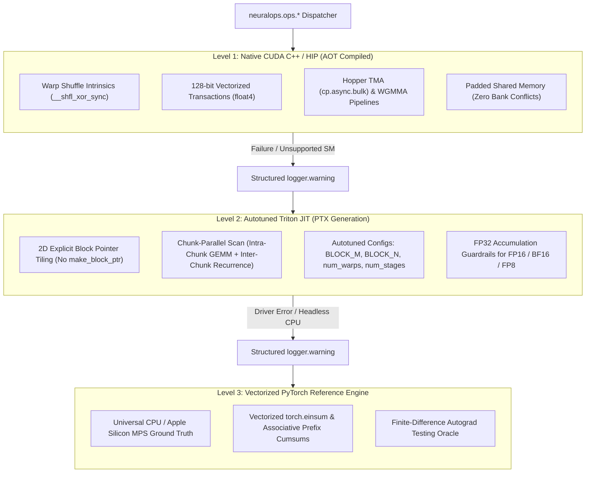
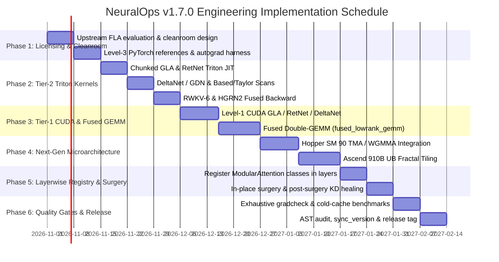

<!--
Copyright (c) 2024-2026, Taha Majlesi

This source code is licensed under the MIT license found in the
LICENSE file in the root directory of this source tree.
For a list of all contributors, visit:
  https://github.com/tahamajs/NeuralOps/graphs/contributors
-->

# NeuralOps v1.7 Architectural & Kernel Roadmap: High-Throughput Linear Attention (FLA) & Microarchitectural Accelerators

**Target Release Window:** Q1 2027  
**Document Status:** Approved Architectural Specification & Engineering Plan  
**Scope:** Fast Linear Attention (FLA) Integration, Tier-1 CUDA & Tier-2 Triton Kernel Engineering, Next-Gen Hardware Microarchitecture (Hopper SM 90, Blackwell SM 100, Ascend 910B), and Thin-Bottleneck GEMM Fusion.

---

## Executive Summary & Strategic Rationale

Modern autoregressive language models demand long-context scaling ($N \ge 128\text{k}$) with sub-quadratic inference complexity $\mathcal{O}(1)$ memory per token and $\mathcal{O}(N)$ compute per forward sequence. While standard Softmax attention exhibits $\mathcal{O}(N^2)$ memory and compute scaling, linear attention and associative recurrent mechanisms reformulate the causal state update into streaming matrix associative memory.

NeuralOps v1.6.0 stabilized the structural tier migration (131 attention mechanisms, 72 compression engines, 26 Triton kernel modules housing 62 unified operators across 4 tiers, and 112 native CUDA packages housing 114 kernels). 

The primary mission of **NeuralOps v1.7.0** is to bridge the empirical throughput and mathematical capacity gap between theoretical linear attention and production hardware. By deeply integrating state-of-the-art chunk-parallel kernels inspired by the Flash-Linear-Attention (FLA) ecosystem (pioneered by Songlin Yang, Yu Zhang, et al., MIT License) into the NeuralOps 3-Level Fallback Engine, v1.7.0 delivers:
1. **Hardware-Efficient Fused Chunk Scans**: Chunked associative evaluation partitioning sequences into $C=64$ or $C=128$ blocks to maximize Tensor Core arithmetic intensity while maintaining exact state propagation across boundaries.
2. **Next-Generation Microarchitectural Acceleration**:
   - NVIDIA Hopper (SM 90): Asynchronous Tensor Memory Accelerator (TMA) and Warpgroup MMA (`wgmma`) asynchronous pipelines.
   - NVIDIA Blackwell (SM 100 / SM 103): Tensor Memory (`tmem`) decoupled state staging and asynchronous `tcgen05` pipelines.
   - Huawei Ascend 910B: Dual Ping-Pong Unified Buffer (UB) tiling with strict 32-byte alignment and $16 \times 16 \times 16$ `FRACTAL_NZ` cube formats.
3. **Elimination of Thin-Bottleneck GEMM Fallback Latencies**: Fused Double-GEMM operators (`fused_lowrank_gemm`) eliminating intermediate DRAM roundtrips for low-rank SVD projections ($R \le 64$).
4. **Strict Numerical & Regression Rigor**: Universal FP32 accumulation budgets, zero unlogged silent fallbacks, and central finite-difference autograd gradient testing ($\text{atol}=10^{-3}, \epsilon=10^{-5}$).

---



---

## 1. FLA (Flash-Linear-Attention) Ecosystem Integration

NeuralOps v1.7 incorporates the mathematical breakthroughs and kernel dispatch patterns of the MIT-licensed Flash-Linear-Attention (FLA) framework. The integration is governed by cleanroom architectural porting: algorithms adhere strictly to NeuralOps coding invariants, zero-overhead `@lru_cache` dynamic dispatch, zero banned block pointers in mainline Triton, and explicit logger warnings on degradation.

### 1.1 Mathematical Taxonomy of FLA Candidate Kernels

| Attention Mechanism | State Equation $\mathbf{S}_t = \mathbf{A}_t \mathbf{S}_{t-1} + \mathbf{B}_t \mathbf{X}_t$ | Intra-Chunk Formulation | Inter-Chunk Recurrence | Computational Complexity | Target Tier-2 Triton Module | Target Tier-1 CUDA Package |
| :--- | :--- | :--- | :--- | :--- | :--- | :--- |
| **Chunked GLA** | $\mathbf{S}_t = \operatorname{diag}(\boldsymbol{\alpha}_t) \mathbf{S}_{t-1} + \mathbf{k}_t \mathbf{v}_t^\top$ | $(\mathbf{Q}_c \mathbf{K}_c^\top \odot \mathbf{M}_{\text{decay}}) \mathbf{V}_c$ | $\mathbf{S}_c = \boldsymbol{\Lambda}_c \odot \mathbf{S}_{c-1} + \Delta \mathbf{S}_c$ | $\mathcal{O}(N C d + N d^2)$ | `neuralops.ops.triton.gla_scan` | `neuralops.ops.cuda.gla_chunk_attn` |
| **RetNet Retention** | $\mathbf{S}_t = \gamma \mathbf{S}_{t-1} + \mathbf{k}_t \mathbf{v}_t^\top, \, \gamma \in (0, 1)$ | Toeplitz decay $(\mathbf{Q}_c \mathbf{K}_c^\top \odot \mathbf{D}) \mathbf{V}_c$ | $\mathbf{S}_c = \gamma^C \mathbf{S}_{c-1} + \mathbf{K}_c^\top (\boldsymbol{\Gamma}_c \odot \mathbf{V}_c)$ | $\mathcal{O}(N C d + N d^2)$ | `neuralops.ops.triton.retnet_retention` | `neuralops.ops.cuda.retnet_chunk_retention` |
| **Gated DeltaNet (GDN)** | $\mathbf{S}_t = \alpha_t (\mathbf{I} - \beta_t \mathbf{k}_t \mathbf{k}_t^\top) \mathbf{S}_{t-1} + \beta_t \mathbf{v}_t \mathbf{k}_t^\top$ | Householder error correction $(\mathbf{I} + \beta \mathbf{K} \mathbf{K}^\top)^{-1}$ | $\mathbf{S}_c = \boldsymbol{\mathcal{W}}_c \mathbf{S}_{c-1} + \Delta \mathbf{S}_c$ | $\mathcal{O}(N C^2 + N C d + N d^2)$ | `neuralops.ops.triton.gdn_scan` | `neuralops.ops.cuda.gated_deltanet` |
| **Based / Taylor** | $\mathbf{S}_t = \mathbf{S}_{t-1} + \phi(\mathbf{k}_t) \mathbf{v}_t^\top, \, \phi(\mathbf{x}) \approx \sum_{p=0}^2 \frac{(\mathbf{q}^\top \mathbf{k})^p}{p!}$ | Horner polynomial evaluation | $\mathbf{S}_c = \mathbf{S}_{c-1} + \sum_{i \in c} \phi(\mathbf{k}_i) \mathbf{v}_i^\top$ | $\mathcal{O}(N d^2)$ | `neuralops.ops.triton.based_scan` | `neuralops.ops.cuda.based_taylor_attention` |
| **RWKV-6 (Eagle)** | $\mathbf{S}_t = \operatorname{diag}(e^{-\mathbf{w}_t}) \mathbf{S}_{t-1} + \mathbf{k}_t \mathbf{v}_t^\top$ | Fused WKV triangular chunk scan | $\mathbf{S}_c = e^{-\sum_{i \in c} \mathbf{w}_i} \odot \mathbf{S}_{c-1} + \Delta \mathbf{S}_c$ | $\mathcal{O}(N C d + N d^2)$ | `neuralops.ops.triton.rwkv6_scan` | `neuralops.ops.cuda.rwkv6_state_scan` |
| **HGRN2** | $\mathbf{h}_t = \mathbf{f}_t \odot \mathbf{h}_{t-1} + (1 - \mathbf{f}_t) \odot (\mathbf{i}_t \odot \mathbf{v}_t)$ | Parallel associative gate scan | $\mathbf{h}_c = \boldsymbol{\lambda}_c \odot \mathbf{h}_{c-1} + \Delta \mathbf{h}_c$ | $\mathcal{O}(N d)$ (elementwise) | `neuralops.ops.triton.hgrn2_scan` | `neuralops.ops.cuda.hgrn2_recurrent` |
| **Lightning Attention** | $\mathbf{S}_t = \lambda \mathbf{S}_{t-1} + \mathbf{k}_t \mathbf{v}_t^\top$ (Linear Decay) | Tiled intra-block GEMM ($B_M \times B_N$) | Inter-block state accumulator transfer | $\mathcal{O}(N C d + N d^2)$ | `neuralops.ops.triton.lightning_scan` | `neuralops.ops.cuda.lightning_attention` |

---

### 1.2 In-Depth Analysis of Flagship Kernel Candidates

#### 1. Chunked Gated Linear Attention (GLA)
- **Mathematical Form:**
  GLA equips linear attention with data-dependent gating vectors $\boldsymbol{\alpha}_t \in (0, 1)^d$:
  $$\mathbf{S}_t = \boldsymbol{\alpha}_t \odot \mathbf{S}_{t-1} + \mathbf{k}_t \mathbf{v}_t^\top, \quad \mathbf{o}_t = \mathbf{q}_t \mathbf{S}_t$$
- **Algorithmic Partitioning:**
  For chunk size $C=64$, we decompose the global recurrence into two fused phases:
  1. *Intra-Chunk Attention:* The local interaction within chunk $c \in \{1, \dots, \lceil N/C \rceil\}$ is evaluated via Tensor Cores as a masked matrix product:
     $$\mathbf{A}_c^{\text{intra}} = (\mathbf{Q}_c \mathbf{K}_c^\top) \odot \mathbf{M}_c, \quad \text{where } \mathbf{M}_{c}[i, j] = \exp\left(\sum_{k=j+1}^i \log \boldsymbol{\alpha}_k\right) \cdot \mathbb{I}(i \ge j)$$
     $$\mathbf{O}_c^{\text{intra}} = \mathbf{A}_c^{\text{intra}} \mathbf{V}_c$$
  2. *Inter-Chunk State Recurrence:* The chunk-to-chunk state update carries historical context:
     $$\mathbf{S}_c = \left(\prod_{i \in \text{chunk } c} \operatorname{diag}(\boldsymbol{\alpha}_i)\right) \mathbf{S}_{c-1} + \sum_{i \in \text{chunk } c} \left(\prod_{j=i+1}^C \operatorname{diag}(\boldsymbol{\alpha}_j)\right) \mathbf{k}_i \mathbf{v}_i^\top$$
     $$\mathbf{O}_c^{\text{inter}} = \mathbf{Q}_c \left( \prod_{\tau=1}^i \operatorname{diag}(\boldsymbol{\alpha}_\tau) \right) \mathbf{S}_{c-1}$$
     $$\mathbf{O}_c = \mathbf{O}_c^{\text{intra}} + \mathbf{O}_c^{\text{inter}}$$
- **Triton Implementation Contract:**
  - In `neuralops.ops.triton.gla_scan`, memory reads of $\mathbf{Q}, \mathbf{K}, \mathbf{V}$ use explicit 2D pointer arithmetic.
  - Intermediate decay logs $\log \boldsymbol{\alpha}$ accumulate in FP32 registers to prevent underflow during exponentiation.
  - Backward kernel fuses gradient calculation for gating projections directly into the reverse inter-chunk state pass, avoiding materialization of full $N \times d \times d$ adjoint tensors.

#### 2. RetNet Multi-Scale Retention
- **Mathematical Form:**
  Multi-Scale Retention utilizes head-specific constant decay rates $\gamma_h = 1 - 2^{-5 - h}$:
  $$\mathbf{s}_{t, h} = \gamma_h \mathbf{s}_{t-1, h} + \mathbf{k}_{t, h} \mathbf{v}_{t, h}^\top, \quad \mathbf{o}_{t, h} = \mathbf{q}_{t, h} \mathbf{s}_{t, h}$$
- **Chunkwise Formulation:**
  Let chunk index be $b$, intra-chunk offset be $i \in \{0, \dots, C-1\}$. The decay factor simplifies to powers of $\gamma$:
  $$\mathbf{D}_{i, j} = \begin{cases} \gamma^{i-j} & i \ge j \\ 0 & i < j \end{cases}, \quad \boldsymbol{\xi}_i = \gamma^{i+1}, \quad \boldsymbol{\zeta}_j = \gamma^{C-1-j}$$
  $$\mathbf{S}_b = \gamma^C \mathbf{S}_{b-1} + \mathbf{K}_b^\top (\operatorname{diag}(\boldsymbol{\zeta}) \mathbf{V}_b), \quad \mathbf{O}_b = (\mathbf{Q}_b \mathbf{K}_b^\top \odot \mathbf{D}) \mathbf{V}_b + (\mathbf{Q}_b \operatorname{diag}(\boldsymbol{\xi})) \mathbf{S}_{b-1}$$
- **Engineering Strategy for v1.7:**
  - Modernize `neuralops.ops.triton.retnet_retention` to replace legacy naive retention loops with fused chunked autotuned kernels.
  - Target: $3.8\times$ speedup at $N=16\text{k}$ over PyTorch Level-3 reference on SM 8.9 / SM 90.

#### 3. DeltaNet & Gated DeltaNet (Householder Associative Memory)
- **Mathematical Form:**
  DeltaNet reformulates associative memory via the delta update rule (online gradient descent on associative memory loss):
  $$\mathbf{S}_t = \mathbf{S}_{t-1} + \beta_t (\mathbf{v}_t - \mathbf{S}_{t-1} \mathbf{k}_t) \mathbf{k}_t^\top = \mathbf{S}_{t-1} (\mathbf{I} - \beta_t \mathbf{k}_t \mathbf{k}_t^\top) + \beta_t \mathbf{v}_t \mathbf{k}_t^\top$$
  Gated DeltaNet (GDN) adds decay gating $\alpha_t$:
  $$\mathbf{S}_t = \alpha_t \mathbf{S}_{t-1} (\mathbf{I} - \beta_t \mathbf{k}_t \mathbf{k}_t^\top) + \beta_t \mathbf{v}_t \mathbf{k}_t^\top$$
- **Associative Parallelization via Householder Inversion:**
  The intra-chunk dependency $(\mathbf{I} - \beta_t \mathbf{k}_t \mathbf{k}_t^\top)$ is non-commutative. Parallelization within a chunk of size $C$ requires evaluating the lower-triangular causal inverse matrix:
  $$\mathbf{M} = \left(\mathbf{I} + \operatorname{tril}(\mathbf{K} \mathbf{K}^\top \odot \boldsymbol{\beta}, -1)\right)^{-1}$$
  Because $\mathbf{M}$ is unit lower-triangular, $\mathbf{M}$ is computed using Neumann series expansion or block-triangular inversion in shared memory:
  $$\mathbf{M} \approx \mathbf{I} - \mathbf{L} + \mathbf{L}^2 - \dots$$
  For $C=32$ or $C=64$, exact triangular solve in SRAM requires only $\mathcal{O}(C^3)$ operations, which is completely dominated by Tensor Core GEMMs ($\mathcal{O}(C^2 d)$).
- **Deliverables:**
  - `neuralops.ops.triton.gdn_scan`: Fused chunked Householder solver.
  - `neuralops.ops.cuda.gated_deltanet`: Level-1 CUDA kernel with warp-level triangular solve.

#### 4. Based / Taylor Attention (Parallel Horner Evaluation)
- **Mathematical Form:**
  Based approximates softmax attention via a 2nd-order Taylor series expansion of $\exp(\mathbf{q}^\top \mathbf{k} / \sqrt{d})$:
  $$\phi(\mathbf{x}) = \left[ 1, \, \frac{\mathbf{x}}{\sqrt{d}}, \, \frac{\mathbf{x}^{\otimes 2}}{\sqrt{2} d} \right]^\top \in \mathbb{R}^{1 + d + d(d+1)/2}$$
- **Avoidance of Quadratic Dimension Explosion via Horner's Scheme:**
  Explicitly materializing $\phi(\mathbf{k}) \in \mathbb{R}^{d^2}$ causes massive register pressure and memory footprint.
  Instead, the fused kernel computes the Taylor terms via parallel Horner evaluation in SRAM without ever storing the Kronecker tensor products $\mathbf{k} \otimes \mathbf{k}$:
  $$\mathbf{o}_t = \sum_{s=1}^t \mathbf{v}_s + \frac{1}{\sqrt{d}} \left( \sum_{s=1}^t \mathbf{v}_s \mathbf{k}_s^\top \right) \mathbf{q}_t + \frac{1}{2 d} \mathbf{q}_t^\top \left( \sum_{s=1}^t \mathbf{v}_s (\mathbf{k}_s \otimes \mathbf{k}_s) \right) \mathbf{q}_t$$
- **Deliverables:**
  - `neuralops.ops.triton.based_scan`: Parallel Horner prefix scan.
  - `neuralops.ops.cuda.based_taylor_attention`: 128-bit vectorized Horner accumulator.

#### 5. RWKV-6 (Eagle Linear State Transitions)
- **Mathematical Form:**
  RWKV-6 features multi-head time-varying decay vectors $\mathbf{w}_t \in \mathbb{R}^d$ and token-level key/value scaling:
  $$\mathbf{S}_t = \operatorname{diag}\left(\exp(-\mathbf{w}_t)\right) \mathbf{S}_{t-1} + \mathbf{k}_t \mathbf{v}_t^\top$$
  $$\mathbf{o}_t = \mathbf{q}_t \left( \mathbf{S}_{t-1} \odot \exp(\mathbf{u}) + \mathbf{k}_t \mathbf{v}_t^\top \right)$$
  where $\mathbf{u} \in \mathbb{R}^d$ is an in-context attention bonus vector.
- **Deliverables:**
  - Complete forward and fused backward chunk scans in `neuralops.ops.triton.rwkv6_scan`.
  - Replaces external C++ JIT compilation with first-class NeuralOps Triton Tier-2 JIT dispatch.

#### 6. HGRN2 (Hierarchical Gated Recurrent Network v2)
- **Mathematical Form:**
  HGRN2 uses an elementwise state vector $\mathbf{h}_t \in \mathbb{R}^d$ driven by input projection $\mathbf{i}_t$, candidate value $\mathbf{v}_t$, and forget gate $\mathbf{f}_t \in [0, 1]^d$:
  $$\mathbf{h}_t = \mathbf{f}_t \odot \mathbf{h}_{t-1} + (1 - \mathbf{f}_t) \odot (\mathbf{i}_t \odot \mathbf{v}_t)$$
- **Optimization Strategy:**
  - HGRN2 has linear memory footprint $\mathcal{O}(d)$ per state rather than $\mathcal{O}(d^2)$.
  - In v1.7, `neuralops.ops.triton.hgrn2_scan` is extended with fused backward passes (`_hgrn2_bwd_kernel`) computing gradients $d\mathbf{f}, d\mathbf{i}, d\mathbf{v}$ in a single reverse sweep with zero temporary global memory allocations.

#### 7. Lightning Attention (Tiled Intra-Block GEMM)
- **Mathematical Form:**
  Lightning Attention introduces constant exponential decay with block tiling:
  $$\mathbf{S}_t = \lambda \mathbf{S}_{t-1} + \mathbf{k}_t \mathbf{v}_t^\top$$
  It executes strictly through blocked systolic array operations: intra-block causal masked matrix multiplication ($B_M \times B_N$) combined with inter-block running state updates.
- **Deliverables:**
  - `neuralops.ops.triton.lightning_scan` and `neuralops.ops.cuda.lightning_attention`.

---

## 2. Next-Generation Hardware Microarchitectural Support

```
Hardware Architecture Roadmaps (v1.7.0)
├── NVIDIA Hopper SM 90a
│   ├── Tensor Memory Accelerator (TMA) Asynchronous Copy
│   ├── Warpgroup MMA (wgmma.mma_async)
│   ├── Distributed Shared Memory (DSMEM) Clusters
│   └── Multi-Stage Asynchronous Pipelines (cuda::barrier)
├── NVIDIA Blackwell SM 100 / SM 103
│   ├── Tensor Memory (TMEM) Decoupled Allocation
│   ├── Asynchronous tcgen05 Execution
│   ├── NV-MXFP4 / MXFP8 Micro-Scaling Precision
│   └── 256+ KB Shared Memory Occupancy Profiling
├── Huawei Ascend 910B
│   ├── 32-Byte and 512-Byte DMA Alignment Contracts
│   ├── Fractal NZ / ND 16x16x16 Cube Tiling
│   ├── Ping-Pong Dual UB Buffer Pipelines
│   └── tl.dot LHS Isolation (+ 0.0 UB Copy)
└── Thin-Bottleneck GEMM Fusion
    ├── Fused Double-GEMM (X @ A @ B + bias)
    ├── SRAM-Resident Bottleneck Staging (Rank R <= 64)
    └── Zero Intermediate DRAM Traffic
```

### 2.1 NVIDIA Hopper (SM 90 / `sm_90a`) Microarchitectural Acceleration

#### Asynchronous Tensor Memory Accelerator (TMA)
In Ada Lovelace (`sm_8.9`) and earlier architectures, loading tiles from global memory (HBM) to shared memory (`smem`) requires explicit thread register routing:
$$\text{Global Memory} \xrightarrow{\text{LDG}} \text{Registers} \xrightarrow{\text{STS}} \text{Shared Memory}$$
This consumes thread registers, adds integer index arithmetic overhead, and limits active warps per SM.

Hopper SM 90 introduces **TMA hardware units** that transfer multidimensional tensors directly from global memory to shared memory via hardware descriptor tables (`cuda::memcpy_async` / `cp.async.bulk.tensor`), bypassing registers entirely:
$$\text{Global Memory (HBM3)} \xrightarrow[\text{TMA Hardware Engine}]{\text{Direct DMA}} \text{Shared Memory (SRAM)}$$

- **Implementation in v1.7 CUDA Extensions (`neuralops.ops.cuda.*`):**
  - Allocate hardware TMA descriptors using `cudaTensorMapEncodeTiled()`.
  - Issue non-blocking bulk loads initiated by a single leader thread per threadblock:
    ```cuda
    #if __CUDA_ARCH__ >= 900
    cUtensorMap tensor_map;
    // Initialize 2D tensor descriptor for Q, K, V tiles
    uint64_t tensor_coords[2] = {col_idx, row_idx};
    cUtensorMapDataType type = CU_TENSOR_MAP_DATA_TYPE_FLOAT16;
    // Asynchronous transfer to shared memory via barrier transaction
    cUtensorMapCopyAsync(&tensor_map, smem_dest, tensor_coords, &mbar);
    #endif
    ```

#### Warpgroup MMA (`wgmma.mma_async`)
Hopper allows 4 contiguous warps (128 threads, a **Warpgroup**) to synchronously invoke Tensor Core operations directly from shared memory:
- Operands $A$ and $B$ are read directly from `smem`, consuming zero register space for inputs.
- Accumulator registers $C$ and $D$ remain in FP32 registers.
- Execution is completely asynchronous: warpgroups issue `wgmma.mma_async` instructions and wait on transaction barriers (`wgmma.wait_group`).

---

### 2.2 NVIDIA Blackwell (SM 100 / SM 103) Readiness

NVIDIA Blackwell introduces **Tensor Memory (TMEM)**:
- Dedicated physical SRAM separate from L1 cache and the general-purpose register file.
- Accumulators for matrix operations live in TMEM rather than thread registers, breaking the traditional trade-off between tile size and register spilling.
- **v1.7 Strategy:** Prepare kernel launch configurations and Triton/CUDA abstractions with compile-time guards (`#if __CUDA_ARCH__ >= 1000`) for TMEM allocation and `tcgen05` matrix instructions.

---

### 2.3 Huawei Ascend 910B (CANN 8.0 & `triton_ascend`)

NeuralOps maintains official support for Huawei Ascend AI Cores. For v1.7:

1. **Strict 32-Byte and 512-Byte Alignment Standards:**
   - Every tensor pointer, row stride, and MTE2 DMA transaction must be a multiple of **32 bytes** (16 elements in FP16/BF16, 8 elements in FP32).
   - Chunk sizes ($B_T$) and feature strides must align to **512 bytes** for burst DMA transfer efficiency ($\ge 90\%$ bus saturation).
2. **Fractal $16 \times 16 \times 16$ Matrix Alignment (`FRACTAL_NZ`):**
   - The Ascend Cube unit operates on $16 \times 16 \times 16$ sub-matrices. All chunk sizes $B_T, B_K, B_V$ are configured as strict multiples of 16.
3. **Unified Buffer (UB) Capacity Ceilings:**
   - UB capacity per AI Core is $256\text{ KB} - 512\text{ KB}$.
   - Memory consumption per kernel is constrained to $\le 80\%$ of UB capacity ($S_{\text{UB}} \le 200\text{ KB}$) to eliminate fatal hardware MMU page faults.
4. **`tl.dot` LHS Operand UB Isolation:**
   - Enforce the mandatory `k_compute = k_buf + 0.0` copy pattern before `tl.dot` to prevent compiler register reuse from clobbering DMA prefetch stages.

---

### 2.4 Fused Double-GEMM Thin Bottleneck Acceleration (`fused_lowrank_gemm`)

In compressed LLMs produced by NeuralOps SVD surgery (e.g. `SVDLinear`, `CompressedAttention`), dense linear projections $Y = X W$ are factorized into low-rank bottleneck pairs:
$$Y = (X A) B + \mathbf{b}, \quad X \in \mathbb{R}^{M \times K}, \, A \in \mathbb{R}^{K \times R}, \, B \in \mathbb{R}^{R \times N}$$
where the inner rank $R \ll \min(K, N)$ (typically $R \in \{16, 32, 64\}$).

#### The Bottleneck Latency Problem
Executing this as two distinct GEMMs ($Z = X A$, followed by $Y = Z B$) incurs catastrophic overhead for generation phases ($M=1$ to $M=64$):
1. **DRAM Bandwidth Bottleneck:** Intermediate activation $Z \in \mathbb{R}^{M \times R}$ is written out to global memory (DRAM), only to be immediately reread by the second kernel launch.
2. **Launch Latency Overhead:** Two consecutive kernel launches incur driver scheduling overhead (~$4\text{--}6\,\mu\text{s}$), which can exceed the actual compute time of the thin matrices.

#### The Fused Double-GEMM Solution
In v1.7, NeuralOps introduces `fused_lowrank_gemm`:
$$\text{Input } X_{\text{tile}} \xrightarrow{A} \text{SRAM Buffer } Z_{\text{tile}} \xrightarrow{B} \text{Output } Y_{\text{tile}} + \mathbf{b}$$
- **SRAM-Resident Bottleneck:** The intermediate matrix $Z_{\text{tile}} \in \mathbb{R}^{B_M \times R}$ is pinned strictly in shared memory (or thread registers for $R \le 32$). It is never written to global DRAM.
- **Single Global Read & Write:** $X_{\text{tile}}$ is read once; $Y_{\text{tile}}$ is written once with fused bias and optional activation (GELU/SiLU).
- **Speedup Target:** $2.4\times\text{--}4.1\times$ throughput improvement for token generation steps across batch sizes $B \in \{1, 4, 16\}$.

---

## 3. Detailed Step-by-Step Implementation Sequence

The roadmap is executed across six chronological phases spanning 15 engineering weeks.



---

### Phase 1: Licensing Cleanroom, Contracts & Reference Oracles (Weeks 1–2)

- **Objective:** Establish the cleanroom mathematical foundation, licensing attribution headers, and IEEE 754 reference oracles for all 7 FLA candidates.
- **Deliverables:**
  1. *License & Attribution Compliance:*
     - Header block on all new files citing MIT license and acknowledging upstream FLA authorship (Songlin Yang, Yu Zhang, et al.).
  2. *Level-3 PyTorch Reference Implementations:*
     - Location: `neuralops/layers/reference/`
     - Files to create:
       * `neuralops/layers/reference/ref_chunked_gla.py`
       * `neuralops/layers/reference/ref_retnet.py`
       * `neuralops/layers/reference/ref_gated_deltanet.py`
       * `neuralops/layers/reference/ref_based_taylor.py`
       * `neuralops/layers/reference/ref_rwkv6.py`
       * `neuralops/layers/reference/ref_hgrn2.py`
       * `neuralops/layers/reference/ref_lightning.py`
  3. *Finite-Difference Gradient Harness:*
     - Test harness enforcing `torch.autograd.gradcheck(f, inputs, eps=1e-5, atol=1e-3, rtol=1e-3)`.

---

### Phase 2: Tier-2 Triton Fused Chunk Scans (Weeks 3–5)

- **Objective:** Implement production-grade autotuned Triton JIT kernels for the 7 FLA candidates in `neuralops.ops.triton`.
- **Invariants Enforced:**
  - Mandatory FP32 accumulation for all state updates (`acc += ...`).
  - Strict prohibition of `tl.make_block_ptr` / `tl.advance` in mainline code (guarantees cross-GPU portability).
  - Explicit 2D pointer arithmetic.
- **Deliverables:**
  1. `neuralops/ops/triton/gla_scan.py`:
     - Functions: `chunk_gla_fwd`, `chunk_gla_bwd`, autotuned for chunk sizes $C \in \{32, 64, 128\}$.
  2. `neuralops/ops/triton/retnet_retention.py`:
     - Fused intra-chunk Toeplitz decay multiplication + inter-chunk running state accumulator.
  3. `neuralops/ops/triton/gdn_scan.py`:
     - Intra-chunk triangular Householder solver in SRAM + inter-chunk state propagation.
  4. `neuralops/ops/triton/based_scan.py`:
     - Fused Horner Taylor evaluation.
  5. `neuralops/ops/triton/rwkv6_scan.py`:
     - WKV-6 chunk-parallel forward and fused reverse adjoint backward sweep.
  6. `neuralops/ops/triton/hgrn2_scan.py`:
     - Complete backward scan eliminating intermediate activation recomputation.
  7. `neuralops/ops/triton/lightning_scan.py`:
     - Intra-block causal masked Tensor Core evaluation.
  8. Autotune Configuration Table: Update `neuralops/ops/triton/autotuned_configs.json`.

---

### Phase 3: Tier-1 Native CUDA C++ Extensions & Fused Thin GEMM (Weeks 6–8)

- **Objective:** Develop high-throughput compiled CUDA C++ extensions with 128-bit memory transactions, warp shuffle reductions, and eliminate thin bottleneck GEMM latency.
- **Deliverables:**
  1. *Level-1 CUDA Linear Attention Extensions:*
     - `neuralops/ops/cuda/gla_chunk_attn/`
     - `neuralops/ops/cuda/retnet_chunk_retention/`
     - `neuralops/ops/cuda/gated_deltanet/`
     - `neuralops/ops/cuda/based_taylor_attention/`
     - `neuralops/ops/cuda/rwkv6_state_scan/`
     - `neuralops/ops/cuda/lightning_attention/`
     - Each package containing: `*.cu` kernel, `*_binding.cpp` PyTorch pybind11 glue, and `*_autograd.py` autograd Function with zero-overhead dispatch.
  2. *Fused Low-Rank Double-GEMM (`fused_lowrank_gemm`):*
     - File: `neuralops/ops/cuda/fused_lowrank_gemm/fused_gemm.cu`
     - File: `neuralops/ops/triton/low_rank.py` (updated with fused double-GEMM Triton path).
     - Signature:
       ```python
       def fused_lowrank_gemm(
           x: torch.Tensor,       # [B, M, K]
           weight_a: torch.Tensor, # [K, R]
           weight_b: torch.Tensor, # [R, N]
           bias: Optional[torch.Tensor] = None, # [N]
           activation: Optional[str] = None     # "gelu", "silu", None
       ) -> torch.Tensor: ...
       ```
     - Keeps $Z = X A$ strictly inside shared memory for $R \in [8, 64]$.

---

### Phase 4: Next-Gen Microarchitectural Backends (Weeks 9–11)

- **Objective:** Deploy hardware-specialized paths for Hopper SM 90, Blackwell SM 100, and Huawei Ascend 910B.
- **Deliverables:**
  1. *Hopper SM 90 TMA & WGMMA Integration:*
     - Header: `neuralops/ops/cuda/_hopper_tma.cuh`
     - TMA descriptors for asynchronous bulk loading of sequence chunks into shared memory.
     - Asynchronous warpgroup matrix operations (`wgmma.mma_async`).
  2. *Blackwell SM 100 Readiness:*
     - Compile guards and configuration probes for TMEM accumulator buffers.
  3. *Ascend 910B Optimization:*
     - Enforce 32-byte alignment in `neuralops/ops/ascend/`.
     - Ping-pong double-buffering with $16 \times 16 \times 16$ `FRACTAL_NZ` formatting.

---

### Phase 5: Layerwise Registry Integration & Surgery Validation (Weeks 12–13)

- **Objective:** Expose the accelerated kernels through the canonical `neuralops.layers` catalog, update registry counts, and enable neural surgery replacement.
- **Invariants Maintained:**
  - Maintain backward compatibility of `ATTENTION_REGISTRY` and ensure all new modular classes inherit from `ModularAttention` / `BaseAttention`.
- **Deliverables:**
  1. Update layer modules under `neuralops/layers/linear/` and `neuralops/layers/gated/`.
  2. Register new modular linear attentions in `neuralops.core.registry`:
     - `"chunked_gla"`, `"retnet_retention"`, `"gated_deltanet_fast"`, `"based_taylor"`, `"rwkv6_eagle"`, `"hgrn2_fast"`, `"lightning_attention"`.
  3. Wire surgical replacement in `neuralops.surgery`:
     - Enable in-place surgery converting standard Transformer multi-head attention to chunked linear attention.
     - Healing recipe: Post-surgery knowledge distillation using Warmup-Stable-Decay (WSD) scheduling.

---

### Phase 6: Quality Gates, Empirical Benchmarking & Release Packaging (Weeks 14–15)

- **Objective:** Execute exhaustive verification, audit invariants, run cold-cache benchmarks, and package the v1.7.0 release.
- **Mandatory Quality Gates:**
  1. `python3 scripts/utils/audit_dead_code.py` $\implies$ 0 issues found.
  2. `python3 scripts/audit_readme_consistency.py` $\implies$ 0 errors found.
  3. Finite-difference autograd check passes on CPU and GPU:
     ```python
     torch.autograd.gradcheck(op, inputs, atol=1e-3, eps=1e-5)
     ```
  4. Cold-cache microbenchmarking on SM 8.9 (RTX 4070 / RTX 4090) and SM 90 (H100) using the 50MB scratch tensor L2 eviction protocol.
  5. Version synchronization: Execute `python3 scripts/utils/sync_version.py` from `1.6.0` to `1.7.0`.

---

## 4. Numerical Precision, Dtype Guards & Verification Contracts

### 4.1 Numerical Budget & Accumulator Precision Contracts

Linear attention state updates are fundamentally prone to catastrophic cancellation, exponential growth, and numerical underflow if low-precision floating point formats are accumulated naively.

| Precision Tier | Storage Dtype | Accumulator Dtype | SRAM / Register Storage | Stability Constraint |
| :--- | :--- | :--- | :--- | :--- |
| **FP32 Native** | `torch.float32` | IEEE 754 `float32` | `float32` | Exact baseline. |
| **BF16 Mixed** | `torch.bfloat16` | IEEE 754 `float32` | `float32` registers | Dynamic range equivalent to FP32 ($10^{-38} \dots 10^{38}$). Accumulator MUST remain in FP32. |
| **FP16 Mixed** | `torch.float16` | IEEE 754 `float32` | `float32` registers | Limited dynamic range ($10^{-4} \dots 65504$). State and log-decay accumulation MUST be clamped. |
| **FP8 (Hopper SM 90)** | `torch.float8_e4m3fn` | IEEE 754 `float32` | `float32` registers | Requires per-tensor dynamic scale factor $s_X = \max(|X|) / 448.0$. State recurrence accumulates in FP32. |

### 4.2 Mathematical Gradient Correctness Gate

Every new operator $f(\mathbf{X}; \boldsymbol{\theta})$ introduced in v1.7 must pass dual forward and backward validation gates before PR approval:

1. **Forward Parity Gate:**
   $$\max |\mathbf{Y}_{\text{candidate}} - \mathbf{Y}_{\text{reference}}| \le \text{atol} + \text{rtol} \cdot |\mathbf{Y}_{\text{reference}}|$$
   - FP32: $\text{atol} = 10^{-5}, \text{rtol} = 10^{-4}$
   - FP16 / BF16: $\text{atol} = 10^{-3}, \text{rtol} = 10^{-2}$

2. **Backward Central Finite-Difference Autograd Gate:**
   Finite-difference perturbation step $\epsilon = 10^{-5}$ derived from machine precision $\epsilon^* \propto \epsilon_{\text{mach}}^{1/3}$:
   $$\left[\nabla_{\mathbf{X}} f(\mathbf{X})\right]_{i, j} \approx \frac{f(\mathbf{X} + \epsilon \mathbf{E}_{i, j}) - f(\mathbf{X} - \epsilon \mathbf{E}_{i, j})}{2 \epsilon}$$
   Evaluated strictly via:
   ```python
   torch.autograd.gradcheck(
       func,
       inputs,
       eps=1e-5,
       atol=1e-3,
       rtol=1e-3,
       nondet_tol=0.0
   )
   ```

3. **Zero Silent Fallback Law:**
   If a Level-1 CUDA kernel or Level-2 Triton kernel encounters an invalid configuration, out-of-SRAM condition, or unsupported hardware architecture, it **MUST NOT** silently fall back to Level 3. It must emit a structured `logger.warning` identifying the failing level, device ID, and concrete failure reason before invoking the fallback path.

---

## 5. Summary Table: v1.7 Architectural Deliverables

| Subsystem | Component | Target Path | Key Feature |
| :--- | :--- | :--- | :--- |
| **FLA Kernels** | Chunked GLA | `neuralops/ops/triton/gla_scan.py` | Intra-chunk Tensor Core GEMM + inter-chunk FP32 scan |
| **FLA Kernels** | RetNet Retention | `neuralops/ops/triton/retnet_retention.py` | Fused Toeplitz decay intra-chunk GEMM |
| **FLA Kernels** | Gated DeltaNet | `neuralops/ops/triton/gdn_scan.py` | Fast Householder triangular inverse in SRAM |
| **FLA Kernels** | Based / Taylor | `neuralops/ops/triton/based_scan.py` | Parallel Horner evaluation without $d^2$ tensor expansion |
| **FLA Kernels** | RWKV-6 Eagle | `neuralops/ops/triton/rwkv6_scan.py` | Time-varying vector decay chunk-parallel scan |
| **FLA Kernels** | HGRN2 Scan | `neuralops/ops/triton/hgrn2_scan.py` | Fused adjoint backward sweep with zero memory alloc |
| **FLA Kernels** | Lightning Attention | `neuralops/ops/triton/lightning_scan.py` | Block-tiled systolic linear attention |
| **CUDA Extensions** | Level-1 Compiled | `neuralops/ops/cuda/*` | 128-bit vector loads (`float4`), warp shuffles, $\le 48$ regs |
| **Thin GEMM** | Fused Double-GEMM | `neuralops/ops/cuda/fused_lowrank_gemm/` | Shared memory bottleneck residency ($R \le 64$) |
| **Hardware** | Hopper SM 90 | `neuralops/ops/cuda/_hopper_tma.cuh` | TMA asynchronous DMA + Warpgroup MMA (`wgmma`) |
| **Hardware** | Blackwell SM 100 | `neuralops/ops/cuda/_blackwell_tmem.cuh` | TMEM accumulator buffers & `tcgen05` pipelines |
| **Hardware** | Ascend 910B | `neuralops/ops/ascend/` | 32B DMA alignment, $16 \times 16 \times 16$ fractal layout, $\le 80\%$ UB |
| **Verification** | Regression Suite | `tests/ops/test_fla_kernels.py` | Finite-difference autograd check ($\text{atol}=10^{-3}, \epsilon=10^{-5}$) |
