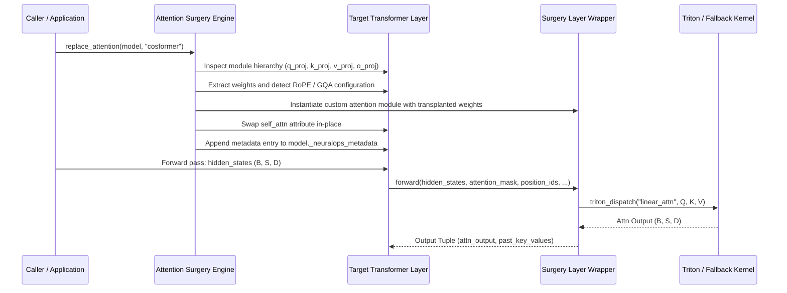
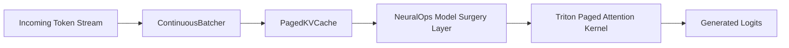

# NeuralOps Architectural Specification (v1.3.0)

NeuralOps is architected as a modular, industrial ML systems library designed to enable drop-in attention surgery, deep model compression, high-performance Triton kernel execution, and resilient multi-task benchmarking.

---

## 1. System Hierarchy & Component Topography

The platform is organized into 10 canonical public subpackages, anchored by the high-performance `neuralops.core` engine:

```
┌───────────────────────────────────────────────────────────────────────────┐
│                      Unified Public API (neuralops.api)                   │
│   replace_attention(), compress(), export_model(), load_model(), info()   │
└─────────────────────────────────────┬─────────────────────────────────────┘
                                      │
       ┌──────────────────────────────┼──────────────────────────────┐
       ▼                              ▼                              ▼
┌──────────────┐              ┌──────────────┐              ┌──────────────┐
│  attention   │              │ compression  │              │   kernels    │
│  (131 Mechs) │              │  (72 Engines)│              │  (26 Modules)│
└──────┬───────┘              └──────┬───────┘              └──────┬───────┘
       │                             │                             │
       └─────────────────────────────┼─────────────────────────────┘
                                     ▼
                      ┌──────────────────────────────┐
                      │        neuralops.core        │
                      │  - _attention_surgery.py     │
                      │  - compression_pipeline.py   │
                      │  - triton_kernels/op_reg.py  │
                      │  - architecture.py           │
                      └──────────────┬───────────────┘
                                     │
       ┌─────────────────────────────┼─────────────────────────────┐
       ▼                             ▼                             ▼
┌──────────────┐              ┌──────────────┐              ┌──────────────┐
│    models    │              │   training   │              │  benchmarks  │
│ HF AutoModel │              │  Distill/AMP │              │ Orchestrator │
└──────────────┘              └──────────────┘              └──────────────┘
```

---

## 2. Attention Mechanism Taxonomy (8 Canonical Families)

NeuralOps unifies 131 distinct attention mechanisms across 8 mathematical families:

1. **Linear / Kernel Attention**: $O(N)$ complexity through feature map kernel formulations ($\phi(Q)\phi(K)^T V$). Includes Cosformer, GLA, Linformer, Performer, Galerkin, RALA, Primal.
2. **Gated / DeltaNet**: Recurrent state-tracking models with input-dependent gates and linear recurrence. Includes GDN, HGRN2, KDA, HLA, DecayLinear.
3. **SSM / Recurrent**: State Space Models and selective recurrent scans. Includes Mamba-1, Mamba-2, Selective SSM, FMS, Griffin, Jamba blocks.
4. **Sparse / Routing**: Block-sparse, cluster, and hash-based token selection. Includes MOBA, NSA, Routing Attention, Cluster Attention, LSH, Hamming Attention.
5. **Hybrid / Sliding Window**: Blended multi-branch mechanisms combining local window attention with global linear or recurrent states. Includes Aegis, Regla, Landmark, Split-Head, MixAttention.
6. **SVD / Factorized**: Low-rank subspace projections on query/key/value states. Includes SVD-Linear, ASVD, SVD-LLM, Residual-SVD, LoRA-Attention.
7. **Modern / GQA**: Production architectures featuring multi-query, grouped-query, and multi-head latent attention. Includes GQA, MLA, WGQA, QCQA, DynamicConv.
8. **Adaptive / Dynamic**: Dynamic token compression and adaptive span mechanisms. Includes Infini-Attention, Lola, Sink Attention, Token-Compressed Attention.

---

## 3. Tensor Flow and Attention Surgery Pipeline

When `neuralops.replace_attention(model, "module_name")` is invoked, the surgical injection pipeline performs the following transformations:



---

## 4. Triton Kernel Architecture & `torch.compile` Compatibility

NeuralOps provides 26 fused Triton kernel modules in `neuralops.core.triton_kernels`. To maintain graph continuity during `torch.compile(model)` execution without introducing graph breaks:

1. **Custom Op Registration**: Operations are registered in the PyTorch dispatcher via `torch.library.custom_op` under the `neuralops::` namespace (e.g., `neuralops::linear_attn`, `neuralops::gdn_scan`).
2. **FakeTensor Shape Propagation**: Each custom op registers a `.register_fake` handler enabling symbolic shape deduction without GPU tensor execution during dynamo tracing.
3. **Transparent Fallback**: When running on CPU or unsupported precisions (e.g. float32 on GPUs without tensor cores), `triton_dispatch` routes calculations to differentiable, numerically aligned PyTorch fallbacks.

---

## 5. Model Compression & Production Export Pipeline

The compression engine operates through structured factorization and quantization passes:
- **Low-Rank Factorization**: Decomposes weight matrix $W \in \mathbb{R}^{m \times n}$ into $U \in \mathbb{R}^{m \times r}$ and $V \in \mathbb{R}^{r \times n}$ with rank $r \ll \min(m, n)$.
- **Adaptive SVD (ASVD)**: Allocates per-layer ranks dynamically based on singular value energy distribution and activation Hessian traces.
- **Quantization Engines**: Activation-aware weight quantization (AWQ), second-order Hessian error feedback (GPTQ), and outlier feature migration (SmoothQuant).
- **Pruning**: Activation-norm weighted pruning (Wanda) and structured feature distillation.
- **Export & Round-Trip**: Saves model weights to `model.safetensors` alongside `neuralops_config.json`. The `load_model()` factory reconstructs the exact layer substitutions and parameter mappings on reload without requiring explicit external configurations.

---

## 6. Serving Runtimes & Inference Adapters

NeuralOps exposes native adapters for modern high-throughput LLM inference engines:
- **`VLLMAdapter`**: Wraps transplanted models for execution within vLLM worker engines. Binds `paged_attention` Triton kernels to manage non-contiguous block memory tables for KV caches.
- **`TGIAdapter`**: Hugging Face Text Generation Inference runtime configuration exporter.
- **`PagedKVCache`**: Memory-mapped KV buffer allocating dynamic physical blocks across variable-length request batches, eliminating internal memory fragmentation.
- **`ContinuousBatcher`**: High-efficiency request scheduler managing dynamic iteration-level batching.



---

## 7. Distributed Training & Telemetry Architecture

The training subsystem (`neuralops.training` / `neuralops.trainer`) unifies multi-GPU optimization and multi-backend metrics:
- **Distributed Backends**: Automatic detection and orchestration of PyTorch DDP, FSDP, and DeepSpeed ZeRO-2/3 execution.
- **Unified Telemetry (`neuralops.tracking`)**: Seamless step-level logging routing to WandB, MLflow, TensorBoard, CSV, and streaming JSON Lines.
- **Advanced Manifold Optimizers**:
  - `Muon`: Orthogonal momentum update via 5th-order Newton-Schulz polynomial iterations.
  - `RiemannianStiefelOptimizer`: Tangent-space gradient projection with QR-decomposition retraction for orthogonal low-rank projection bases.

---

## 8. Verification, Parity & Quality Gates

Every component in NeuralOps satisfies rigorous verification protocols before deployment:
- **Numerical Parity**: Forward outputs must match reference implementations with $\Delta \le 1\times 10^{-4}$ in FP16 / BF16.
- **Gradient Preservation**: Backward passes during autograd training must correctly propagate without `NaN` or `Inf` accumulation.
- **Fallback Integrity**: Under zero-GPU conditions (macOS, CI runners, edge servers), 100% of operators execute cleanly on CPU/MPS with zero test skips.

