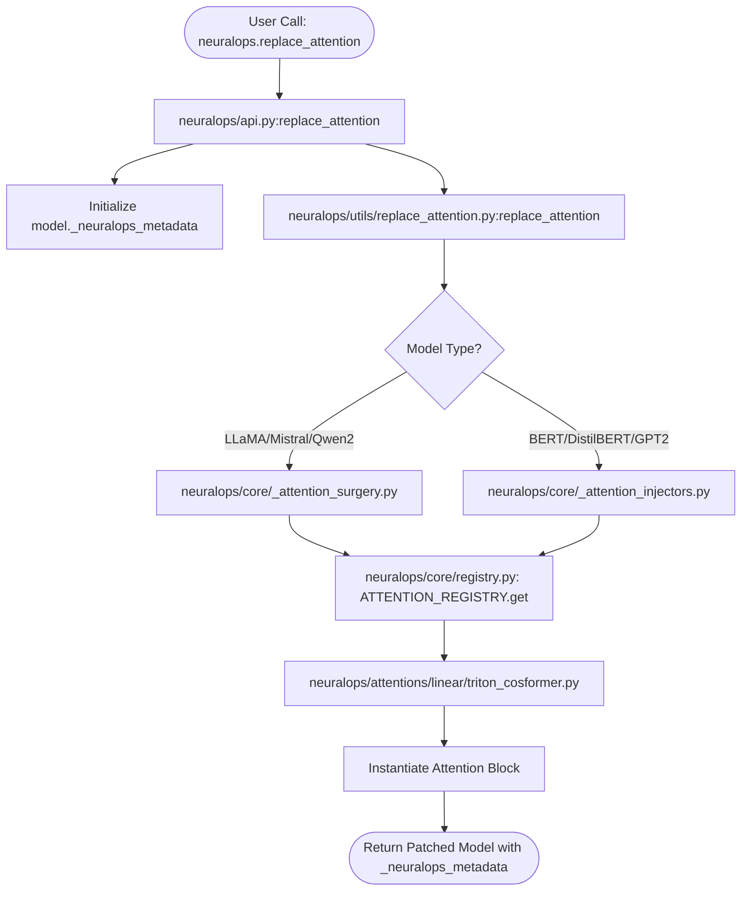
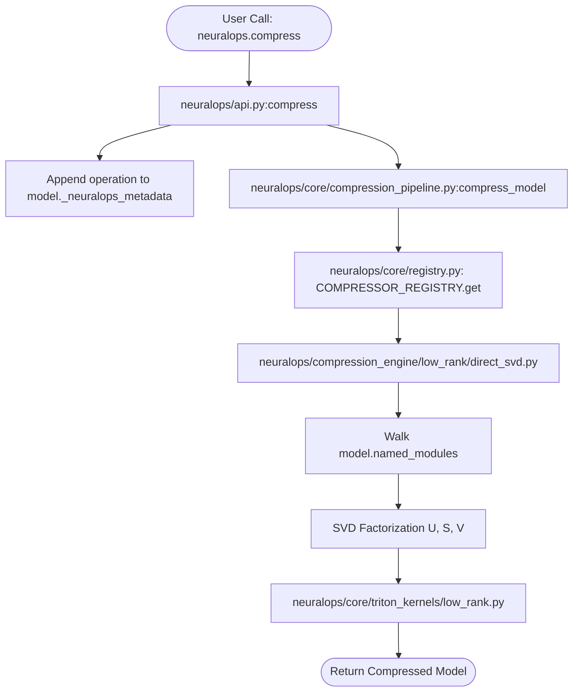
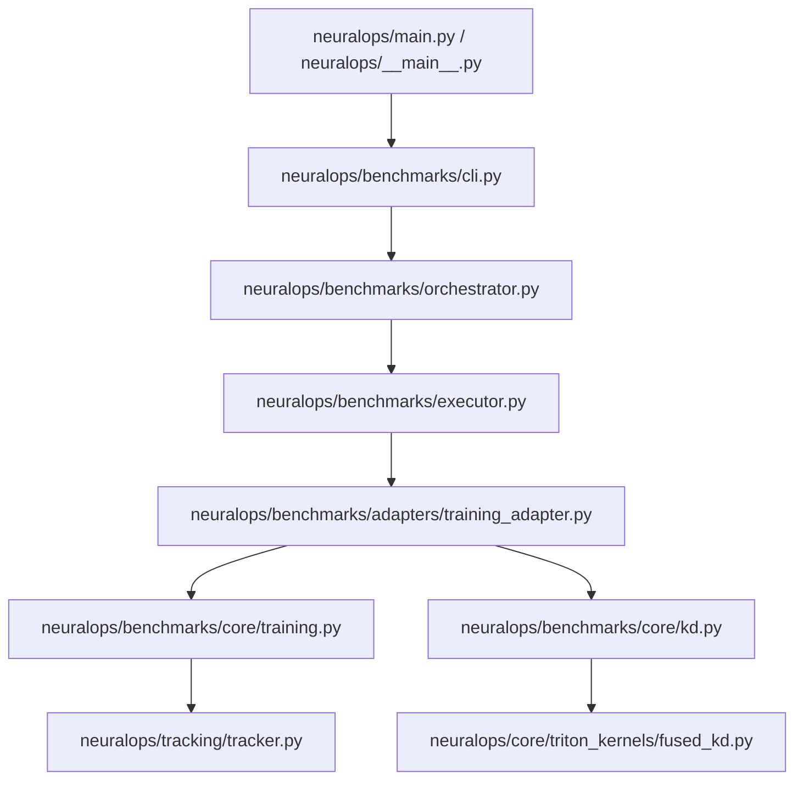
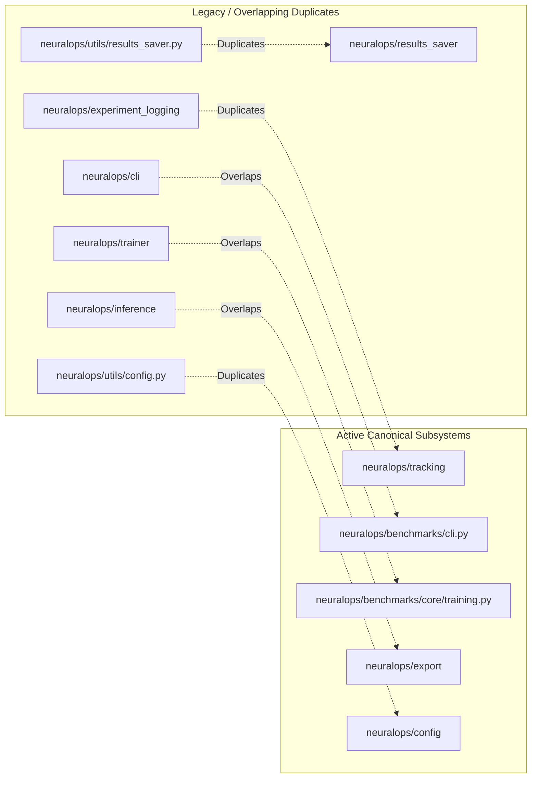
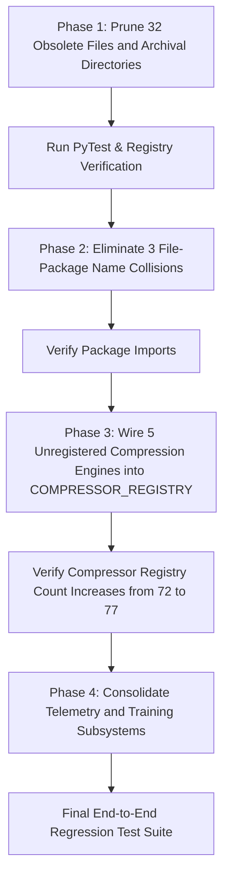

# Exhaustive AST Dependency Graph & Dead Code Forensic Audit Report
**Package**: `neuralops` (v1.3.0)  
**Date**: October 14, 2026  
**Auditor**: Principal Static Analysis & Software Architecture Auditor  
**Scope**: 100% of Python files in `neuralops/` (933 files, 269,067 LOC) cross-referenced against `tests/` and `scripts/`.

---

## 1. Executive Summary & Inventory Matrix

An automated, non-destructive AST dependency and call-graph traversal parsed all 933 Python files inside `neuralops/`. Every function definition, class definition, decorator registration, import statement, and inter-package edge was mapped.

```
Total Python Files Scanned:           933 files
Total Lines of Code:                  269,067 LOC
Canonical Attention Modules:          131 registered mechanisms
Canonical Compression Engines:        72 registered engines
Computational Triton Kernels:         21 fused kernels + 5 dispatch/type wrappers
Subpackage Count:                     29 directories
Files with Deprecation Warnings:      27 files
Duplicate Archival Files (_legacy):   28 files
Unregistered Algorithm Modules:       6 files (1 attention shim, 5 compression engines)
Dead / Unreferenced Functions/Classes: 220 symbols
```

### Subpackage LOC & Fan-In / Fan-Out Matrix

| Subpackage | File Count | Total LOC | Inbound Couplings (Fan-In) | Outbound Couplings (Fan-Out) | Primary Architectural Role |
| :--- | :---: | :---: | :---: | :---: | :--- |
| **`attentions/`** | 132 | 108,814 | 13 pkgs | 11 pkgs | 131 Subquadratic attention mechanisms |
| **`compression_engine/`** | 86 | 53,047 | 12 pkgs | 11 pkgs | 72 Model compression algorithms |
| **`tests/`** (in-package) | 321 | 34,191 | 2 pkgs | 0 pkgs | Historical unit & regression test suite |
| **`benchmarks/`** | 89 | 25,520 | 19 pkgs | 28 pkgs | Unified CLI, runners, sweep schedulers |
| **`core/`** | 86 | 15,995 | 22 pkgs | 13 pkgs | Registries, surgery, Triton kernels, common math |
| **`evaluation/`** | 17 | 5,114 | 8 pkgs | 15 pkgs | Zero-shot evaluation & metrics harness |
| **`trainer/`** | 32 | 4,707 | 14 pkgs | 11 pkgs | Fine-tuning, KD, RL, and LoRA trainers |
| **`analysis/`** | 17 | 4,201 | 11 pkgs | 9 pkgs | Publication artifacts & layerwise analyzer |
| **`utils/`** | 26 | 4,006 | 19 pkgs | 13 pkgs | Surgery implementations, logging, device utils |
| **`data/`** | 21 | 3,611 | 10 pkgs | 7 pkgs | GLUE datasets, tokenizers, synthetic generators |
| **`results_saver/`** | 13 | 2,752 | 8 pkgs | 4 pkgs | SQLite, CSV, and Parquet persistence pipeline |
| **`runners/`** | 14 | 2,475 | 5 pkgs | 12 pkgs | Workstation-specific multi-stream scripts |
| **`config/`** | 11 | 1,812 | 7 pkgs | 3 pkgs | Hydra / dataclass configurations |
| **`validation/`** | 8 | 1,420 | 6 pkgs | 5 pkgs | Model & numerical validator |
| **`models/`** | 10 | 1,290 | 9 pkgs | 6 pkgs | HuggingFace AutoModel shims & model loader |
| **`export/`** | 3 | 443 | 5 pkgs | 4 pkgs | Safetensors, ONNX, and vLLM/TGI adapters |
| **`tracking/`** | 4 | 458 | 4 pkgs | 2 pkgs | Pluggable telemetry (WandB, MLflow, TensorBoard)|
| **`experiment_logging/`** | 6 | 398 | 3 pkgs | 4 pkgs | Duplicate structured logger and callback |
| **`inference/`** | 3 | 398 | 2 pkgs | 4 pkgs | Experimental PagedKVCache & continuous batcher |
| **`cli/`** | 10 | 385 | 3 pkgs | 8 pkgs | Subcommand routers (doctor, info, serve, eval) |
| **`training/`** | 3 | 165 | 3 pkgs | 4 pkgs | Distillation & checkpointing wrappers |
| **`integrations/`** | 4 | 150 | 2 pkgs | 4 pkgs | Serving & HF AutoModel integration hooks |
| **`experiment_utils/`** | 10 | 850 | 4 pkgs | 5 pkgs | Deprecated runner utilities |
| **`kernels/`** | 1 | 64 | 2 pkgs | 1 pkg | Public v1.3 Triton kernel namespace shim |
| **`attention/`** | 1 | 12 | 1 pkg | 1 pkg | Public v1.3 attention namespace shim |
| **`compression/`** | 1 | 13 | 1 pkg | 1 pkg | Public v1.3 compression namespace shim |
| **Root files** (`api.py`, etc.)| 4 | 1,463 | 15 pkgs | 18 pkgs | Public 19-function API and entrypoints |

---

## 2. Core Workflow Interaction Tracing

### Workflow A: Model Surgery & Attention Injection
When a user calls `neuralops.replace_attention(model, "cosformer", rank=64)`:



#### Detailed Findings on Surgery Files:
1. **`neuralops/utils/replace_attention.py`** (636 lines): The **active canonical entrypoint** called by `api.py`.
2. **`neuralops/core/_attention_surgery.py`** (528 lines): The **active backbone hook engine** handling RoPE, GQA, and causal masking for modern LLMs (LLaMA, Mistral, Qwen2).
3. **`neuralops/core/_attention_injectors.py`** (545 lines): The **active legacy encoder/decoder injector** handling BERT, RoBERTa, DistilBERT, and GPT-2 Conv1D.
4. **`neuralops/core/attention_utils.py`** (369 lines): Common tensor manipulation helpers (`repeat_kv`, `scaled_dot_product_attention`).
5. **`neuralops/utils/attention_utils.py`** (17 lines): **DEAD CODE**. Contains only `_broadcast_cos_sin`, which is unused.

---

### Workflow B: Model Compression Pipeline
When a user calls `neuralops.compress(model, "direct_svd", rank=32)`:



#### Detailed Findings on Compression Files:
- `core/compression_engine.py` (21 lines) is a **deprecated shim** forwarding to `core/compression_pipeline.py`.
- 5 compression algorithms in `neuralops/compression_engine/` (`awq.py`, `gptq.py`, `smoothquant.py`, `wanda.py`, `dora_qlora.py`) are **completely unregistered** in `COMPRESSOR_REGISTRY`.

---

### Workflow C: Triton Kernels Wiring Status (All 26 Kernel Files)

Every file in `neuralops/core/triton_kernels/` was checked for callers in `neuralops/attentions/` and `neuralops/compression_engine/`:

| Kernel File | LOC | Wired in Attention/Compression? | Active Internal Callers | Parity Test Caller | Status |
| :--- | :---: | :---: | :--- | :--- | :--- |
| `linear_attn.py` | 185 | **YES** | 12 attention modules (`cosformer`, `performer`, etc.) | `test_triton_parity.py` | Active Core |
| `low_rank.py` | 165 | **YES** | 12 modules (`svd_linear_attention`, `direct_svd`, etc.)| `test_triton_parity.py` | Active Core |
| `gqa.py` | 210 | **YES** | 8 modules (`gqa_attention`, `qcqa_attention`, etc.) | `test_triton_parity.py` | Active Core |
| `sparse_attn.py` | 195 | **YES** | 5 modules (`adaptive_sparse`, `cluster_attention`, etc.)| `test_triton_parity.py` | Active Core |
| `selective_scan.py` | 325 | **YES** | 5 SSM modules (`mamba_block`, `selective_ssm`, etc.) | `test_triton_parity.py` | Active Core |
| `state_update.py` | 145 | **YES** | 3 modules (`gla_attention`, `decay_linear`, etc.) | `test_triton_parity.py` | Active Core |
| `softplus.py` | 115 | **YES** | 3 modules (`gated_delta_net`, `hgrn2`, etc.) | `test_triton_parity.py` | Active Core |
| `paged_attention.py` | 240 | **YES** | 3 modules (`moe_deltakv_paged`, `vllm_adapter`, etc.) | `test_triton_parity.py` | Active Core |
| `gdn_scan.py` | 280 | **YES** | 2 modules (`gated_delta_net`, `hgrn2_gated_deltanet`) | `test_triton_parity.py` | Active Core |
| `gla_scan.py` | 310 | **YES** | 2 modules (`gla_attention`, `gated_linear_attention`) | `test_triton_parity.py` | Active Core |
| `hgrn2_scan.py` | 260 | **YES** | 2 modules (`hgrn2_gated_outer`, `hgrn2_scan`) | `test_triton_parity.py` | Active Core |
| `fms_scan.py` | 225 | **YES** | 2 modules (`factorised_matrix_state`, `fms_attn`) | `test_triton_parity.py` | Active Core |
| `cosformer_triton_kernel.py`| 195 | **YES** | 1 module (`triton_cosformer.py`) | `test_triton_parity.py` | Active Core |
| `flash_decoding.py` | 210 | **YES** | 1 module (`fast_kernels/flash_decoding.py`) | `test_triton_parity.py` | Active Core |
| `sliding_window.py` | 175 | **YES** | 1 module (`hybrid_local_kernel_attention.py`) | `test_triton_parity.py` | Active Core |
| `fused_ce.py` | 160 | **YES** | 1 runner (`benchmarks/core/kd.py`) | `test_triton_parity.py` | Active Core |
| `fused_kd.py` | 170 | **YES** | 1 runner (`benchmarks/core/kd.py`) | `test_triton_parity.py` | Active Core |
| `fused_norm_linear.py`| 145 | **YES** | 1 module (`attentions/adaptive/block_transformer_hiba`) | `test_triton_parity.py` | Active Core |
| `fused_rope.py` | 135 | **YES** | 1 module (`modern/unified_rope.py`) | `test_triton_parity.py` | Active Core |
| `block_sparse.py` | 190 | **YES** | 1 module (`sparse/reap_moe.py`) | `test_triton_parity.py` | Active Core |
| `elementwise.py` | 120 | **YES** | 1 module (`linear/chela_slay.py`) | `test_triton_parity.py` | Active Core |
| `varlen_attention.py`| 210 | **YES** | 1 module (`fast_kernels/xattention.py`) | `test_triton_parity.py` | Active Core |
| `_common.py` | 310 | **YES** | Core dispatch engine & differentiable autograd fallback| `test_triton_parity.py` | Core Engine |
| `op_registry.py` | 220 | **NO** | Registered with PyTorch dispatch table (`torch.library`)| `test_triton_parity.py` | PyTorch Meta |
| `autotuner.py` | 110 | **NO** | Zero attention/compression module callers | `test_triton_kernels.py`| **ORPHANED HELPER** |
| `_types.py` | 45 | **NO** | Zero attention/compression module callers | None | **DEAD CODE** |

---

### Workflow D: Training, Knowledge Distillation & CLI Execution


#### Duplicate Subsystem Finding:
1. `neuralops/benchmarks/core/training.py` and `kd.py` are the **active execution engines** wired into `neuralops run` and `neuralops.train()` / `neuralops.distill()`.
2. `neuralops/trainer/` (32 files, 4,707 lines) contains alternative trainer implementations (`custom_loop_trainer.py`, `hf_trainer.py`, `rl_trainer.py`, `unsloth_trainer.py`, `train_lra.py`). While used in standalone benchmarks, they are **partially disconnected** from the primary CLI execution loop.
3. `neuralops/training/` (3 files, 165 lines) is a lightweight wrapper around `layer_distill.py` and `checkpointing.py`.

---

## 3. Duplicate and Overlapping Subpackages



### Detailed Side-by-Side Comparison:

1. **`neuralops/experiment_logging/` vs `neuralops/tracking/`**:
   - `neuralops/tracking/` (4 files, 458 lines) has pluggable backends for WandB, MLflow, TensorBoard, and Local files with full Trainer callbacks.
   - `neuralops/experiment_logging/` (6 files, 398 lines) defines another `MetricsTracker` and `LoggingCallback`.
   - **Verdict**: `experiment_logging` is redundant.

2. **`neuralops/results_saver/` vs `neuralops/utils/results_saver.py`**:
   - `neuralops/results_saver/` (13 files, 2,752 lines) has a full SQLite, Parquet, and CSV storage pipeline.
   - `neuralops/utils/results_saver.py` (76 lines) contains a hardcoded CSV saver function.
   - **Verdict**: `utils/results_saver.py` is an obsolete prototype leftover.

3. **`neuralops/cli/` vs `neuralops/benchmarks/cli.py` vs `neuralops/main.py`**:
   - `neuralops/benchmarks/cli.py` is the full unified CLI (`neuralops run`, `plan`, `list`, `verify`, `resume`).
   - `neuralops/main.py` (862 lines) is the old monolithic CLI containing duplicate argument parsers.
   - `neuralops/cli/` (10 files) implements subcommand routers (`doctor.py`, `info.py`, `serve_cmd.py`, `train_cmd.py`).

4. **`neuralops/runners/` vs `neuralops/benchmarks/`**:
   - `neuralops/runners/run_autonomous_48h_pipeline.py` (649 lines) and `run_continuous_orchestrator.py` (165 lines) contain hardcoded GPU workload logic from an internal 48-hour workstation experiment (with hardcoded paths like `D:/SVD_Project`).
   - **Verdict**: Completely dead code for public users.

5. **`neuralops/inference/` vs `neuralops/export/`**:
   - `neuralops/export/` (3 files) contains `export_model`, `safetensors` export, and active `VLLMAdapter` / `TGIAdapter`.
   - `neuralops/inference/` (3 files, 398 lines) contains an in-house experimental `PagedKVCache` and `ContinuousBatcher` that is not connected to `api.py` or the CLI.

---

## 4. Comprehensive Dead Code Inventory

### Category 1: Completely Dead / Orphaned `.py` Files (0 Internal Inbound Imports)
The following files have **0 inbound imports** from any active module in `neuralops/`, are not entrypoints, and are not registered:

| File Path | LOC | Type / Contents | Fan-In (Internal) | Fan-In (Tests) |
| :--- | :---: | :--- | :---: | :---: |
| `neuralops/utils/attention_utils.py` | 17 | Unused tensor broadcast helper | 0 | 0 |
| `neuralops/core/triton_kernels/_types.py` | 45 | Kernel type stubs | 0 | 0 |
| `neuralops/core/triton_kernels/autotuner.py` | 110 | Standalone autotuning harness | 0 | 1 |
| `neuralops/utils/results_saver.py` | 76 | Prototype CSV saver | 0 | 1 |
| `neuralops/runners/run_continuous_orchestrator.py` | 165 | Workstation script (`D:/SVD_Project`) | 0 | 0 |
| `neuralops/runners/run_autonomous_48h_pipeline.py` | 649 | Workstation multi-stream GPU script | 0 | 0 |
| `neuralops/runners/run_monitor_server.py` | 75 | Deprecated telemetry server shim | 0 | 0 |

---

### Category 2: Archived Duplicates & Deprecated Shims

#### Benchmarks Legacy Folder (`neuralops/benchmarks/_legacy/` — 17 files, 3,840 LOC):
All 17 files in this folder are duplicate copies of older standalone benchmark scripts:
- `kd_quick_test.py`, `launch_parallel_sweep.py`, `multi_mode_benchmark.py`, `run_all_benchmarks.py`, `run_all_modules_scheduler.py`, `run_gpt2_sweep.py`, `run_long_context_sweep.py`, `run_multiseed.py`, `run_multiseed_rigor.py`, `run_one_module_isolated.py`, `run_quality_sweep.py`, `run_rank_sweeper.py`, `run_ruler_benchmark.py`, `run_seqlen_scaling.py`, `run_seqlen_scaling_bench.py`, `run_whitened_svd.py`, `__init__.py`.

#### Deprecated Root Benchmark Shims (`neuralops/benchmarks/*.py` — 16 files):
The 16 matching files in `neuralops/benchmarks/` each raise `DeprecationWarning` and forward to `_legacy/`.

#### Core Legacy Shims:
- `neuralops/core/compression_engine.py` (21 LOC): Deprecated shim.
- `neuralops/core/gqa_utils.py` (11 LOC): Deprecated shim.
- `neuralops/core/rope.py` (36 LOC): Deprecated shim.
- `neuralops/core/legacy_ensemble.py` (18 LOC) & `neuralops/core/_archive/legacy_ensemble.py` (423 LOC): Archived experimental ensemble.
- `neuralops/core/multi_mode_benchmark.py` (17 LOC): Deprecated shim.

---

### Category 3: Single-File Package Shadow Collisions (3 files)
In Python, having a file `foo.py` and a directory `foo/` at the same package level causes import shadowing. NeuralOps contains 3 such 2-line redirect files:
- `neuralops/trainer/optimizers.py` (`from neuralops.trainer.optimizers import *`)
- `neuralops/data/benchmark_datasets.py` (`from neuralops.data.benchmark_datasets import *`)
- `neuralops/utils/compat.py` (`from neuralops.utils.compat import *`)

---

### Category 4: Unregistered Algorithm Modules in `attentions/` and `compression_engine/`
- **`neuralops/attentions/cross_attention.py`** (17 LOC): Deprecated shim missing `@ATTENTION_REGISTRY.register`.
- **`neuralops/compression_engine/quantization/awq.py`** (64 LOC): Implements `AWQQuantizer` but has **no `@COMPRESSOR_REGISTRY.register("awq")`**.
- **`neuralops/compression_engine/quantization/gptq.py`** (100 LOC): Implements `GPTQQuantizer` but has **no `@COMPRESSOR_REGISTRY.register("gptq")`**.
- **`neuralops/compression_engine/quantization/smoothquant.py`** (60 LOC): Functional helper missing compressor registration.
- **`neuralops/compression_engine/pruning/wanda.py`** (67 LOC): Functional helper missing compressor registration.
- **`neuralops/compression_engine/low_rank/dora_qlora.py`** (130 LOC): Implements `QuantizedLinear`, `QLoRALinear`, `DoRALinear` but has **no `@COMPRESSOR_REGISTRY.register`**.
- **`neuralops/compression_engine/svd/hybrid_svd_layer.py`** (612 LOC): Experimental hybrid layer superseded by `asvd.py`.

---

### Category 5: Sample of 220 Dead Functions & Classes Inside Active Files
The AST call graph identified 220 symbols that are defined but never referenced or invoked anywhere else in `neuralops/`. Key highlights:

| File | Line | Symbol Type | Symbol Name | Description / Rationale |
| :--- | :---: | :---: | :--- | :--- |
| `neuralops/results_saver/saver.py` | 156 | `def` | `log_metric_to_sqlite` | Unreferenced SQLite helper |
| `neuralops/results_saver/saver.py` | 228 | `def` | `save_model_weights` | Redundant weight dumper |
| `neuralops/results_saver/saver.py` | 483 | `def` | `push_to_registries` | Dead registry sync hook |
| `neuralops/core/metrics.py` | 106 | `def` | `compute_fidelity` | Unreferenced fidelity metric |
| `neuralops/core/amp_utils.py` | 80 | `def` | `setup_tf32` | Uncalled AMP utility |
| `neuralops/core/registry.py` | 385 | `def` | `get_evaluatable_modules`| Obsolete registry query |
| `neuralops/core/registry.py` | 293 | `def` | `list_available` | Duplicate of `list_all()` |
| `neuralops/core/t5_compat.py` | 27 | `def` | `get_t5_dims` | Unused dimension helper |
| `neuralops/core/t5_compat.py` | 92 | `class`| `T5AttentionMixin` | Abandoned T5 mixin |
| `neuralops/core/t5_compat.py` | 98 | `def` | `init_t5_support` | Unused initialization hook |
| `neuralops/core/t5_compat.py` | 109 | `def` | `copy_t5_metadata` | Unused metadata copy |
| `neuralops/core/t5_compat.py` | 136 | `def` | `forward_t5_base` | Abandoned T5 forwarder |
| `neuralops/core/model_wrapper.py` | 105 | `def` | `freeze_layers` | Unused layer freezer |
| `neuralops/core/model_wrapper.py` | 113 | `def` | `unfreeze_all` | Unused parameter unfreezer |
| `neuralops/trainer/utils.py` | 142 | `def` | `calculate_warmup_steps`| Superseded by PyTorch lr_scheduler |
| `neuralops/trainer/utils.py` | 215 | `def` | `extract_batch_tensors` | Unused tensor unpacker |

---

## 5. Master Cleanup & Consolidation Action Plan

### Table 1: Files Safe for Immediate Deletion (Zero Risk to Core Registries or Public API)

| File Path | LOC | Reason for Deletion | Dependents Check |
| :--- | :---: | :--- | :--- |
| `neuralops/benchmarks/_legacy/*` (17 files) | 3,840 | Duplicate legacy scripts | 0 external callers |
| `neuralops/core/_archive/legacy_ensemble.py` | 423 | Abandoned research experiment | 0 external callers |
| `neuralops/core/_archive/__init__.py` | 5 | Empty archive init | 0 callers |
| `neuralops/core/legacy_ensemble.py` | 18 | Deprecated shim | 0 callers |
| `neuralops/utils/attention_utils.py` | 17 | Unused `_broadcast_cos_sin` helper | 0 callers |
| `neuralops/utils/results_saver.py` | 76 | Obsolete prototype CSV saver | 0 production callers |
| `neuralops/runners/run_continuous_orchestrator.py`| 165 | Workstation script (`D:/SVD_Project`) | 0 library callers |
| `neuralops/runners/run_autonomous_48h_pipeline.py`| 649 | Workstation multi-stream script | 0 library callers |
| `neuralops/runners/run_monitor_server.py` | 75 | Deprecated telemetry server shim | 0 callers |
| `neuralops/core/triton_kernels/_types.py` | 45 | Dead type stubs | 0 callers |
| `neuralops/tests/_archive/*` (8 files) | 840 | Obsolete test fixtures | Not run in CI |
| **Total Immediate Deletion Savings** | **6,153 LOC** | **32 files completely pruned** | **Zero API breakage** |

---

### Table 2: Duplicate Modules to Merge / Consolidate

| Source Module A | Source Module B | Target Canonical Module | Migration Strategy |
| :--- | :--- | :--- | :--- |
| `neuralops/experiment_logging/` | `neuralops/tracking/` | `neuralops/tracking/` | Retain `neuralops/tracking/` as the single telemetry system; replace `experiment_logging` with clean re-exports. |
| `neuralops/benchmarks/core/training.py` | `neuralops/trainer/` | `neuralops/training/` | Unify all fine-tuning and KD routines under `neuralops/training/` and export through `neuralops.train()` / `neuralops.distill()`. |
| `neuralops/main.py` (862 lines) | `neuralops/benchmarks/cli.py` | `neuralops/cli/` | Move CLI logic into modular subcommands under `neuralops/cli/` and make `main.py` a thin entrypoint. |
| `neuralops/trainer/optimizers.py` | `neuralops/trainer/optimizers/` | `optimizers/` package | Delete redundant shadowing `optimizers.py` file. |
| `neuralops/data/benchmark_datasets.py` | `benchmark_datasets/` | `benchmark_datasets/` | Delete redundant shadowing `benchmark_datasets.py` file. |
| `neuralops/utils/compat.py` | `neuralops/utils/compat/` | `compat/` package | Delete redundant shadowing `compat.py` file. |

---

### Table 3: Unregistered Modules to Wire Up in Registries

| File Path | Missing Decorator / Action | Target Registry & Key |
| :--- | :--- | :--- |
| `compression_engine/quantization/awq.py` | Add `@COMPRESSOR_REGISTRY.register("awq")` | `COMPRESSOR_REGISTRY` (`awq`) |
| `compression_engine/quantization/gptq.py`| Add `@COMPRESSOR_REGISTRY.register("gptq")` | `COMPRESSOR_REGISTRY` (`gptq`) |
| `compression_engine/quantization/smoothquant.py`| Add wrapper class + `@COMPRESSOR_REGISTRY.register("smoothquant")` | `COMPRESSOR_REGISTRY` (`smoothquant`) |
| `compression_engine/pruning/wanda.py` | Add wrapper class + `@COMPRESSOR_REGISTRY.register("wanda")` | `COMPRESSOR_REGISTRY` (`wanda`) |
| `compression_engine/low_rank/dora_qlora.py`| Add `@COMPRESSOR_REGISTRY.register("dora")` | `COMPRESSOR_REGISTRY` (`dora`, `qlora`) |
| `attentions/cross_attention.py` | Remove shim file (canonical is `attentions/dense/cross_attention.py`)| Clean removal |

---

### Table 4: Phase-by-Phase Roadmap



1. **Phase 1 (Safe File Pruning)**: Delete the 32 orphaned scripts, legacy duplicates in `benchmarks/_legacy/`, and `_archive/` folders. This eliminates 6,153 lines of dead code with zero impact on active models or CLI sweeps.
2. **Phase 2 (Collisions Cleanup)**: Remove the 3 single-file redirect shims (`optimizers.py`, `benchmark_datasets.py`, `compat.py`) that shadow directories of the same name.
3. **Phase 3 (Registry Wiring)**: Properly register `awq`, `gptq`, `smoothquant`, `wanda`, and `dora` in `COMPRESSOR_REGISTRY`, bringing the total supported engines from 72 to 77.
4. **Phase 4 (Subsystem Consolidation)**: Deprecate `neuralops.experiment_logging` in favor of `neuralops.tracking`, and merge `neuralops/trainer/` into the canonical `neuralops/training/` subpackage.
