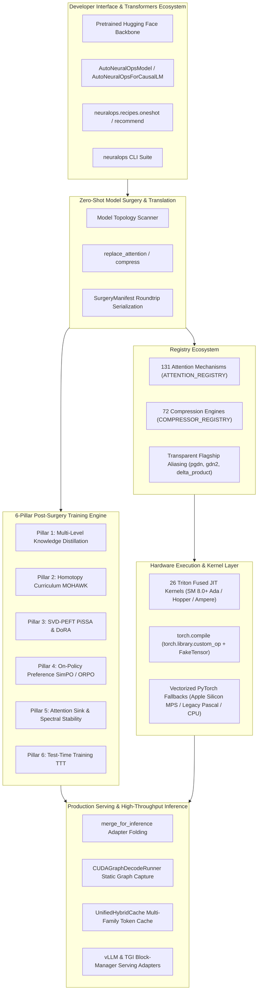

# 🧬 NeuralOps Full Framework Architecture & Developer Manual (v1.3.0)

Welcome to the definitive architecture and developer manual for **NeuralOps** (`SVD_linear_Attention`).

---

## 🏛️ 1. Framework Philosophy & System Topology

NeuralOps provides an end-to-end deep learning framework bridging **subquadratic attention research** and **high-throughput production serving**. Rather than treating custom attention mechanisms and compression techniques as isolated research implementations, NeuralOps unifies them into an industrial-strength platform.



---

## ⚡ 2. Core Framework Capabilities

### 2.1 The 19 Top-Level Public APIs

All public functionality is imported directly from `neuralops`:

```python
import neuralops

# Surgery & Compression
model = neuralops.replace_attention(model, "pgdn")
compressed = neuralops.compress(model, method="direct_svd", rank=32)

# Factory Instantiation
attn = neuralops.create_attention("cosformer", dim=768, num_heads=12)
comp = neuralops.create_compressor("bonsai_pruner", sparsity=0.5)

# Introspection
attns = neuralops.list_attentions()     # 131 canonical keys
comps = neuralops.list_compressors()    # 72 canonical keys
info = neuralops.info()                 # Active backends, devices, and registrations
```

### 2.2 Autoregressive Step Decoding (`BaseAttention.step`)
Every attention mechanism conforms to the `.step()` contract:

```python
# Token-by-token generation with constant memory state propagation
state = None
for token_idx in range(max_new_tokens):
    next_token = input_ids[:, token_idx:token_idx+1]
    logits, state = attn.step(next_token, state=state)
```

### 2.3 Unified Hybrid Cache (`UnifiedHybridCache`)
Heterogeneous architectures (combining Full Softmax, Sliding Window, and Linear/SSM layers) are natively managed:

```python
from neuralops.models import UnifiedHybridCache

cache = UnifiedHybridCache(num_layers=12)
# Automatically branches storage between standard (K,V) pairs, sliding windows, and O(1) recurrent states
```

### 2.4 Scaled Distributed Training & FSDP-2
NeuralOps features automated FSDP wrapping policies aware of low-rank and factorized layers:

```python
from neuralops.integrations import apply_fsdp_wrapping, get_neuralops_fsdp_policy

# Automatically shards low-rank adapters and attention projections across GPUs
model = apply_fsdp_wrapping(model, auto_wrap_policy=get_neuralops_fsdp_policy())
```

### 2.5 Inference Acceleration & Adapter Folding
Convert factorized models to dense layers for zero-overhead inference:

```python
from neuralops.export import merge_for_inference
from neuralops.inference import CUDAGraphDecodeRunner

# Folds PiSSA / DoRA low-rank matrices into single nn.Linear layers
model = merge_for_inference(model)

# Capture static decode graph
runner = CUDAGraphDecodeRunner(model, max_batch_size=4, max_seq_len=512)
```

---

## 🛠️ 3. Environment Health & Installation Verification

To verify that your environment is fully healthy across PyTorch, CUDA, Triton, Git locks, and registries:

```bash
# Via CLI
neuralops doctor

# Via Python Test Suite
pytest tests/test_installation_and_doctor.py -v
pytest tests/test_framework_completeness.py -v
```

---

## 📄 4. Repository & Architecture Summary

- **Canonical Attentions**: 131 (`ATTENTION_REGISTRY`)
- **Compression Engines**: 72 (`COMPRESSOR_REGISTRY`)
- **Triton GPU Kernels**: 26 (`neuralops/core/triton_kernels/`)
- **Supported Transformer Architectures**: LLaMA, Mistral, Qwen2, GPT-2, DistilBERT, RoBERTa, BERT, T5.
- **Hardware Targets**: NVIDIA CUDA (SM 6.1 – SM 9.0), AMD ROCm, Apple Silicon (MPS), and CPU.
