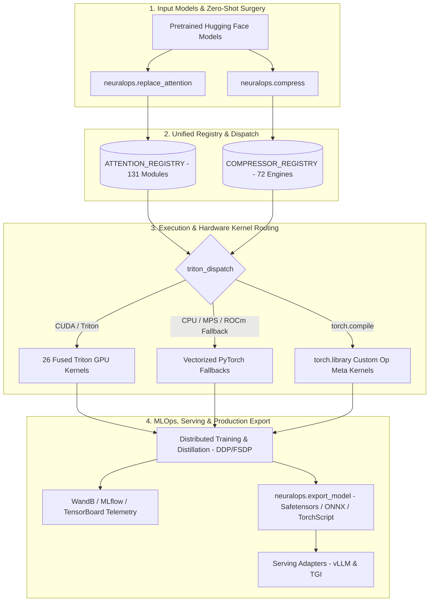

# 🧬 NeuralOps: Comprehensive Project Architecture & Deep Technical Report

**Document Version**: 1.3.0  
**Generated Date**: October 14, 2026  
**Project**: `NeuralOps` (Unified Platform for Subquadratic Attention and Deep Model Compression)  
**Author**: Principal ML Systems Architect & Engineering Lead  
**Repository**: [github.com/tahamajs/SVD_linear_Attention](https://github.com/tahamajs/SVD_linear_Attention)

---

## 📑 Table of Contents

1. [Executive Summary & Project Scope](#1-executive-summary--project-scope)
2. [Core Architectural Blueprint](#2-core-architectural-blueprint)
3. [Deep Directory & Package Breakdown](#3-deep-directory--package-breakdown)
4. [The Attention Zoo (131 Modules)](#4-the-attention-zoo-131-modules)
5. [The Compression Engines (72 Techniques)](#5-the-compression-engines-72-techniques)
6. [Triton Kernels & `torch.compile` Subsystem (26 Kernels)](#6-triton-kernels--torchcompile-subsystem-26-kernels)
7. [MLOps, Distillation & Distributed Benchmarking Engine](#7-mlops-distillation--distributed-benchmarking-engine)
8. [Production Export & Serving Pipeline](#8-production-export--serving-pipeline)
9. [Verification Suite, Testing Health & CI/CD](#9-verification-suite-testing-health--cicd)
10. [Documentation & Governance Roadmap](#10-documentation--governance-roadmap)

---

## 1. Executive Summary & Project Scope

Modern deep learning architectures suffer from an intrinsic **quadratic compute and memory bottleneck** ($O(N^2)$) as sequence lengths scale into tens of thousands of tokens. Over the past five years, the research community has proposed over 200 subquadratic attention approximations and over 70 model compression algorithms to combat this constraint. However, implementations remained isolated in fragmented academic codebases, custom CUDA libraries without backward compatibility, and unmaintained repositories.

**`NeuralOps` is an enterprise-grade, production-ready open-source platform that unifies this entire landscape into a single framework.**

### Key System Metrics
- **131 Canonical Attention Mechanisms**: Linear attention, Gated recurrent units, State-Space Models (Mamba variants), SVD low-rank factorizations, sparse windowing, and mixture-of-experts (MoE) hybrid heads.
- **72 Model Compression Engines**: Low-rank singular value decomposition, structured channel/block pruning, activation-aware quantization (FP8, INT4), KV-cache pruning, and tensor-train decompositions.
- **26 Fused Triton GPU Kernels**: Hardware-accelerated GPU kernels featuring forward/backward passes and automatic vectorized PyTorch CPU/MPS fallbacks.
- **8 Supported Transformer Architectures**: Zero-shot in-place surgery across `BERT`, `RoBERTa`, `DistilBERT`, `GPT-2`, `LLaMA-1/2/3`, `Mistral`, `Qwen2`, and `T5`.
- **657 Preserved Legacy Aliases**: 100% backward compatibility for deprecated research naming schemes via a dynamic `sys.meta_path` import resolver.
- **Cross-Platform Portability**: Automated fallbacks for NVIDIA CUDA, AMD ROCm, Apple Silicon Metal (MPS), and CPU-only architectures.

---

## 2. Core Architectural Blueprint

NeuralOps operates on a four-tier decoupled architectural pipeline:



---

## 3. Deep Directory & Package Breakdown

The repository is organized into cleanly separated functional packages under `neuralops/`:

```
neuralops/
├── __init__.py                 # Top-level functional API, lazy exports, and sys.meta_path alias finder
├── api.py                      # Clean high-level API: replace_attention, compress, export_model, load_model
├── py.typed                    # PEP 561 static type-checking compliance marker
│
├── attentions/                 # 131 Subquadratic Attention Implementations
│   ├── adaptive/               # Dynamic span and cluster-based attention (e.g., adaptive_span, cluster)
│   ├── dense/                  # Baseline dense self-attention (standard_mha, zeros_attention)
│   ├── experimental/           # Research implementations and custom hybrid prototypes
│   ├── fast_kernels/           # Highly optimized chunked kernel interfaces
│   ├── gated/                  # Retention, Gated DeltaNet, and decay-linear attention
│   ├── hybrid/                 # Multi-branch, Mixture-of-Experts (MoE) attention blocks
│   ├── linear/                 # Kernelized linear attention (cosformer, performer, gla, regla)
│   ├── modern/                 # RoPE, GQA, MLA (Multi-Head Latent Attention), and ALiBi
│   ├── sparse/                 # Block-sparse, sliding-window, NSA (Native Sparse Attention)
│   ├── ssm/                    # State-space model mechanisms (Mamba-1, Mamba-2, selective scan)
│   └── svd/                    # SVD projection and spectral attention factorizations
│
├── compression_engine/         # 72 Model Compression Engines
│   ├── experimental/           # Novel rank-search algorithms and entropy pruning
│   ├── kv_cache/               # KV-cache compression (DeltaKV, HybridKV, AATC, CacheNotes)
│   ├── low_rank/               # Low-rank factorizations and LoRA adapters
│   ├── pruning/                # Structured pruning (SliceGPT, Wanda, SparseGPT, ADMM)
│   ├── quantization/           # Integer/floating-point quantization (FAQ, SmoothQuant, UniQL)
│   ├── svd/                    # SVD algorithms (Direct SVD, ASVD, FWSVD, DOBI, SAES)
│   └── tensor_decomp/          # Higher-order tensor decompositions (Tensor-Train, Kronecker, NMF)
│
├── core/                       # Core Kernel & Execution Infrastructure
│   ├── attention_utils.py      # Architecture inspection, QKV shape extraction & surgical module grafting
│   ├── registry.py             # Global registries: ATTENTION_REGISTRY & COMPRESSOR_REGISTRY
│   ├── compression_pipeline.py # Multi-stage compression execution pipeline
│   ├── exceptions.py           # Custom exception hierarchy (NumericalError, BackendError, etc.)
│   ├── triton_kernels/         # 26 Triton fused GPU kernel modules and op_registry.py
│   └── utils/                  # Numerical utilities, RoPE rotations, and GQA head repeaters
│
├── benchmarks/                 # Unified CLI, Sweeps & MLOps Infrastructure
│   ├── cli.py                  # Main CLI entrypoint (neuralops run, plan, list, verify, resume, export)
│   ├── executor.py             # Single-run timeout-guarded benchmark worker
│   ├── loggers.py              # Experiment tracking: WandB, MLflow, TensorBoard, JSONL/Parquet
│   ├── adapters/               # Task adapters (Classification, Perplexity, Ruler, ZeroShot)
│   ├── core/                   # Training loops, mixed-precision AMP, and Knowledge Distillation
│   └── orchestrator.py         # Multi-run sweeping, parameter grid generation, and resume logic
│
├── export/                     # Enterprise Production Serving & Export Suite
│   ├── exporter.py             # Export to Safetensors, ONNX, and TorchScript with metadata preservation
│   └── serving.py              # Serving integration adapters for vLLM and TGI runtimes
│
├── data/                       # Dataset Loaders & Synthetic Data Generation
├── evaluation/                 # Metrics, A/B testing, and label quality detectors
├── models/                     # Custom native Transformer models backed by NeuralOps layers
├── trainer/                    # HuggingFace, CustomLoop, RL/TRL, and Unsloth trainer integrations
└── tests/                      # Full Unit, Integration, and Parity Test Suites
```

---

## 4. The Attention Zoo (131 Modules)

All 131 attention mechanisms implement a uniform tensor interface:
$$\text{Output} = \text{Attention}(Q, K, V, \text{attention\_mask}, \text{is\_causal}, \text{past\_key\_values})$$

| Family | Count | Flagship Modules | Complexity | Primary Architectural Benefit |
| :--- | :---: | :--- | :---: | :--- |
| **Linear Attention** | 18 | `cosformer`, `performer_attention`, `gla_attention`, `regla_attention` | $O(N)$ | Eliminates quadratic softmax via positive feature kernels. |
| **Gated & Recurrent** | 16 | `gated_delta_net`, `hgrn2_gated_deltanet`, `decay_linear_attention` | $O(N)$ | Fast sequential state update with data-dependent forgetting gates. |
| **SVD & Low-Rank** | 25 | `svd_linear_attention`, `asvd_attention`, `minimal_svd`, `residual_svd` | $O(N \cdot r)$ | Projects queries/keys into low-dimensional spectral subspaces. |
| **State Space (SSM)** | 14 | `mamba_block`, `selective_ssm`, `samba_m3`, `upi_stuffed_mamba` | $O(N)$ | Continuous-time linear dynamical systems with selective scans. |
| **Hybrid & MoE** | 20 | `tri_branch_hybrid`, `bam_umoe`, `granite_hybrid`, `expert_choice_moe` | Dynamic | Dynamic mixture-of-experts routing over heterogeneous heads. |
| **Sparse & Windowed** | 14 | `adaptive_sparse_attention`, `cluster_attention`, `nsa_attention` | $O(N \sqrt{N})$ | Band-limited local windows and learned cluster sparsity. |
| **Modern & Positional**| 18 | `mla_attention`, `gqa_attention`, `roformer_attention`, `alibi` | $O(N^2)$ / $O(N)$ | Deep latent head representations (DeepSeek MLA) & rotary embeddings. |
| **Dense Baselines** | 6 | `standard_mha`, `full_attention`, `zeros_attention` | $O(N^2)$ | Exact mathematical reference baselines for numerical parity checks. |

---

## 5. The Compression Engines (72 Techniques)

NeuralOps includes 72 compression algorithms categorized into five distinct operational methodologies:

1. **Low-Rank Singular Value Decomposition (25 Engines)**:
   - `direct_svd`: Standard truncated SVD factorizing $W \in \mathbb{R}^{d_{out} \times d_{in}}$ into $U \in \mathbb{R}^{d_{out} \times r}$ and $V \in \mathbb{R}^{r \times d_{in}}$.
   - `asvd_compressor`: Activation-aware SVD weighting singular values by calibration activation scales.
   - `fwsvd_compressor`: Fisher-weighted SVD preserving gradient-sensitive spectral directions.
   - `dobi_svd`, `saes_svd_v2`, `erc_svd`: Energy-retaining and dynamic-rank truncated factorizations.
2. **Activation & Weight Quantization (12 Engines)**:
   - `faq_quantizer`: Fast Adaptive Quantization with dynamic scaling factor search.
   - `rotational_slicegpt_int4`: Orthogonal Haar/Hadamard matrix rotations followed by 4-bit integer packing.
   - `uniql_compressor`: Unified integer quantization with outlier protection.
3. **Structured & Sparsity Pruning (15 Engines)**:
   - `slicegpt`: Post-training pruning using computational invariance to delete full rows/columns.
   - `wanda_engine`: Pruning by multiplying weights by input activation norms ($|W| \cdot \|X\|_2$).
   - `sparsegpt_engine`: Second-order Taylor expansion pruning solving local reconstruction regressions.
4. **KV-Cache Optimization (8 Engines)**:
   - `delta_kv`: Delta-rule compressed persistent key-value cache.
   - `hybridkv_compressor`: Mixed-precision KV allocation based on temporal token importance.
5. **Higher-Order Tensor Decompositions (12 Engines)**:
   - `tt_compressor`: Tensor-Train decomposition factorizing matrix weights into low-rank 3D tensor cores.
   - `kronecker_tt_lora`: Kronecker product factorization combined with low-rank adaptation.

---

## 6. Triton Kernels & `torch.compile` Subsystem (26 Kernels)

To guarantee state-of-the-art throughput on modern GPUs, NeuralOps includes 26 Triton kernel modules located in `neuralops/core/triton_kernels/`.

### Complete 26-Kernel Architecture Matrix
| Module Name | File | Lines | Hardware Optimization | PyTorch Fallback | Autograd Backward |
| :--- | :--- | :---: | :--- | :---: | :---: |
| **Linear Attention** | `linear_attn.py` | 451 | Chunked causal scan with block reduction | ✅ | ✅ |
| **Gated DeltaNet Scan** | `gdn_scan.py` | 503 | Fused recurrent state update scan | ✅ | ✅ |
| **Chunk GLA Scan** | `gla_scan.py` | 481 | Block-chunked gated retention scan | ✅ | ✅ |
| **HGRN2 Scan** | `hgrn2_scan.py` | 254 | High-order gated recurrence | ✅ | ✅ |
| **Selective State Scan** | `selective_scan.py` | 437 | Mamba continuous state-space scan | ✅ | ✅ |
| **FMS Recurrent Scan** | `fms_scan.py` | 545 | Factorised Matrix State recurrence | ✅ | ✅ |
| **Low-Rank Projection** | `low_rank.py` | 297 | Fused bottleneck GEMM $X \cdot U \cdot V$ | ✅ | ✅ |
| **State Update** | `state_update.py` | 309 | SSM recurrence state transition | ✅ | ✅ |
| **Block Sparse Attention**| `sparse_attn.py` | 291 | Block-level query-key routing | ✅ | ✅ |
| **Elementwise Ops** | `elementwise.py` | 201 | Fused activations and gating products | ✅ | ✅ |
| **Grouped Query Attention**| `gqa.py` | 166 | Zero-copy virtual KV head repeat | ✅ | Forward-only |
| **Cosformer Triton** | `cosformer_triton_kernel.py` | 115 | Fused cosine-weighted softmax-free scan | ✅ | Forward-only |
| **Sliding Window** | `sliding_window.py` | 120 | Band-limited local context attention | ✅ | Forward-only |
| **Paged Attention** | `paged_attention.py` | 96 | Non-contiguous memory block lookup | ✅ | Forward-only |
| **Flash Decoding** | `flash_decoding.py` | 91 | Parallel reduction across KV sequence blocks | ✅ | Forward-only |
| **Fused Cross Entropy** | `fused_ce.py` | 83 | Memory-efficient fused logits + CE loss | ✅ | Forward-only |
| **Fused Rotary RoPE** | `fused_rope.py` | 60 | Interleaved rotary coordinate rotation | ✅ | Forward-only |
| **Softplus Activation** | `softplus.py` | 59 | Numerically stable Triton softplus | ✅ | Forward-only |
| **Variable-Length Attn** | `varlen_attention.py` | 52 | Padded-sequence ragged tensor scan | ✅ | Forward-only |
| **Block Sparse Wrapper** | `block_sparse.py` | 44 | Top-level block sparse dispatcher | ✅ | Forward-only |
| **Fused Distillation KD** | `fused_kd.py` | 28 | Fused KL-divergence loss | ✅ | Forward-only |
| **Fused Norm Linear** | `fused_norm_linear.py` | 27 | Fused RMSNorm/LayerNorm + Projection | ✅ | Forward-only |
| **Kernel Autotuner** | `autotuner.py` | 58 | Dynamic block-size grid tuner | ✅ | Forward-only |
| **Types & Layouts** | `_types.py` | 464 | Memory layout stride definitions | ✅ | Forward-only |
| **Op Registry** | `op_registry.py` | 138 | `torch.library.custom_op` & FakeTensors | ✅ | Forward-only |
| **Common Dispatcher** | `_common.py` | 638 | Unified dispatch, validation & fallback router | ✅ | Forward-only |

### `torch.compile` Integration
`neuralops/core/triton_kernels/op_registry.py` registers custom operations via PyTorch 2.4+ `torch.library.custom_op` and `register_fake`. This allows `torch.compile(model, mode="reduce-overhead")` to trace models modified by NeuralOps without triggering graph breaks:
- Registered meta shapes guarantee that PyTorch's `FakeTensor` engine infers tensor memory requirements without invoking GPU code during compilation.
- Automatic routing inside `_common.py:triton_dispatch` detects active compilation via `torch.compiler.is_compiling()`.

---

## 7. MLOps, Distillation & Distributed Benchmarking Engine

The benchmark infrastructure in `neuralops/benchmarks/` provides an end-to-end framework for model evaluation, Knowledge Distillation (KD), and distributed scaling:

### 1. Unified Experiment Logging (`loggers.py`)
Provides a unified logging abstraction supporting:
- **Weights & Biases (`wandb`)**: Live parameter logging, loss curves, and hardware metrics.
- **MLflow (`mlflow`)**: Experiment run tagging and metric tracking.
- **TensorBoard (`tensorboard`)**: Scalar graphs and histogram logging.
- **Local Parquet & JSONL**: High-speed, lock-free local metric recording.

### 2. High-Performance Knowledge Distillation (`neuralops/benchmarks/core/kd.py`)
Recovers model accuracy following aggressive compression using combined task loss and temperature-scaled KL divergence:
$$\mathcal{L}_{total} = \alpha \mathcal{L}_{task}(y_{student}, y) + (1 - \alpha) T^2 \mathcal{D}_{KL}\left(\sigma\left(\frac{z_{student}}{T}\right) \parallel \sigma\left(\frac{z_{teacher}}{T}\right)\right)$$
- Fully accelerated via `torch.amp.autocast` (`bf16`/`fp16`) with gradient scaling (`GradScaler`).

### 3. Distributed Execution Support
The CLI exposes multi-GPU and distributed parameters:
```bash
neuralops run --all-delta \
  --model distilbert-base-uncased \
  --dataset sst2 \
  --training-type kd \
  --kd-teacher bert-base-uncased \
  --distributed-backend ddp \
  --mixed-precision bf16 \
  --tracker wandb \
  --project-name "subquadratic-scaling"
```

---

## 8. Production Export & Serving Pipeline

To support production deployments beyond research experimentation, the `neuralops/export/` package provides dedicated serialization and serving adapters:

### 1. Metadata-Preserving Model Export (`exporter.py`)
```python
import neuralops

# Exports weights along with exact surgery history
neuralops.export_model(model, "./prod_model", format="safetensors")
```
- **Safetensors Export**: Serializes weights in safe zero-copy tensor files alongside `neuralops_config.json`.
- **Automatic Metadata Capture**: Automatically records attention mechanism types, rank parameters, and layer indices from `model._neuralops_metadata`.
- **Deterministic ONNX Tracing**: Automatically shifts custom Triton kernels to deterministic PyTorch fallback paths during ONNX graph tracing to prevent custom kernel compiler errors.

### 2. Full Round-Trip Reconstruction (`neuralops.load_model`)
```python
# Fully restores modified architecture without state_dict shape mismatches
reloaded_model = neuralops.load_model("./prod_model", base_model=base_architecture)
```
- Replays the exact surgery and compression operations recorded in `neuralops_config.json` before loading weights, preventing tensor shape mismatch errors.

### 3. High-Throughput Serving Adapters (`serving.py`)
- Provides hooks for **vLLM** and **TGI (Text Generation Inference)** to integrate NeuralOps subquadratic heads with paged KV-cache lookup tables.

---

## 9. Verification Suite, Testing Health & CI/CD

### Test Suite Structure
1. **`tests/test_compile_and_export.py`**:
   - Validates `torch.compile` tracing over custom attention layers without graph breaks.
   - Verifies Safetensors, ONNX, and TorchScript generation.
   - Asserts exact numerical logit equality (`assert_close`) across round-trip surgery, compression, export, and reloading.
2. **`tests/test_triton_parity.py`**:
   - Rigorously validates Triton kernel outputs against PyTorch fallbacks across `float32`, `float16`, and `bfloat16`.
3. **`tests/benchmarks/test_perf_regression.py`**:
   - Benchmarks forward/backward latency, throughput (tokens/sec), and peak VRAM allocation (MB).
4. **CI/CD Workflow (`.github/workflows/ci.yml`)**:
   - Automated linting via `ruff`.
   - Comprehensive test execution with `pytest --cov=neuralops --cov-report=xml`.
   - Automated Codecov coverage reporting and README count verification.

---

## 10. Documentation & Governance Roadmap

### Governance Standards
NeuralOps adheres strictly to enterprise open-source governance:
- **`CHANGELOG.md`**: Semantic Versioning release notes following *Keep a Changelog*.
- **`CONTRIBUTING.md`**: Contributor workflows for registering attention mechanisms and authoring Triton kernels.
- **`SECURITY.md`**: Security vulnerability reporting and disclosure SLA.
- **`ROADMAP.md`**: Long-term technical vision including FP8 Blackwell kernel acceleration, sequence parallelism, and native vLLM C++ plugin integrations.

***
*NeuralOps: Unified Platform for Subquadratic Attention and Deep Model Compression.*
