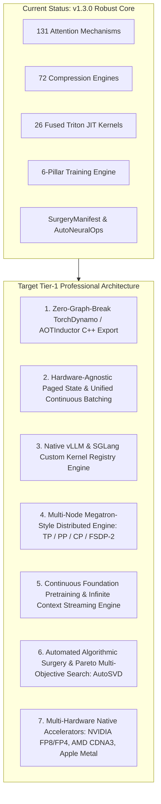

# 🚀 MASTER BLUEPRINT: EVOLVING NEURALOPS INTO A TIER-1 DEEP LEARNING SYSTEMS FRAMEWORK

This document provides the definitive, comprehensive architectural blueprint to evolve **NeuralOps** (`SVD_linear_Attention`) from an advanced research and surgery library into an industry-standard, tier-1 deep learning framework (comparable to Hugging Face `transformers`, `flash-linear-attention` (FLA), `vllm`, `deepspeed`, and `unsloth`).

---

## 🗺️ 1. Framework Architecture Topology: Current vs. Target Tier-1 State



---

## 🏛️ 2. Detailed Gap Analysis & Required Implementations

To transition NeuralOps into a production framework deployed at scale across cloud data centers and enterprise clusters, seven major subsystems must be implemented.

---

### Pillar 1: Zero-Graph-Break TorchDynamo & AOTInductor C++ Export

#### The Current Gap:
While `torch.library.custom_op` is registered for several core operations, dynamic shape changes, nested loops, and tensor mutations in some recurrent kernels can still cause graph breaks when calling `torch.compile(model, mode="max-autotune")` or exporting via `torch.export.export()`.

#### What Must Be Implemented:
1. **Complete Custom Op Meta-Kernel Matrix**:
   - Every single one of the 26 Triton kernel modules must feature a corresponding `@torch.library.custom_op` registration and an exact `@custom_op.register_fake` abstract shape inferencer.
   - Zero intermediate Python dynamic allocations inside forward/backward execution paths.
2. **AOTInductor Ahead-of-Time C++ Artifact Compilation**:
   - Provide `neuralops.export.compile_to_so(model, output_path="model.so")` to compile PyTorch models with subquadratic attention into standalone `.so` shared libraries that execute directly in pure C++ runtimes without a Python interpreter.
3. **Symbolic Shape Guards**:
   - Implement `torch.export` symbolic shape dynamic dimension annotations (`torch.export.Dim("seq_len", min=1, max=131072)`) so compilation accommodates arbitrary variable-length sequences without recompilation overhead.

---

### Pillar 2: Hardware-Agnostic Paged State & Unified Continuous Batching

#### The Current Gap:
While `UnifiedHybridCache` supports state tracking, continuous batching (where requests join and exit dynamically with varying prompt and generation lengths) requires physical-to-virtual block mapping for recurrent hidden states.

#### What Must Be Implemented:
1. **Paged Recurrent State Table (`PagedStateTable`)**:
   - Standard paged attention manages $[K, V]$ tokens of shape $[B, \text{block\_size}, H, D]$.
   - Linear attention and SSMs maintain recurrent hidden states $[H, D_k, D_v]$ per sequence.
   - Implement a unified block allocator that dynamically allocates both linear recurrent states (1 state per request) and dense KV blocks (dynamic number of blocks per request) in a shared memory pool.
2. **Prefix-Cache Sharing for Linear Attention**:
   - Linear attention states satisfy associativity:
     $$S_{0:A+B} = S_{0:A} + S_{A:B}$$
   - Implement tree-based prefix caching where common system prompts share exact pre-computed recurrent state matrices $S_{0:A}$ across different requests with zero redundant computation.

---

### Pillar 3: Native vLLM, SGLang, and TensorRT-LLM Plugin Engine

#### The Current Gap:
Currently, NeuralOps provides external adapter helpers (`VLLMAttentionAdapter`), requiring users to manually wire model runners.

#### What Must Be Implemented:
1. **First-Class vLLM Custom Model Architecture Plugins**:
   - Implement native vLLM model definitions (`NeuralOpsForCausalLM` in `vllm.model_executor.models`).
   - Register custom attention backends directly in `vllm.attention.backends`:
     ```python
     # Seamless vLLM serving from command line:
     vllm serve tahamajs/distilbert-svd-attention --trust-remote-code
     ```
2. **SGLang RadixAttention Integration**:
   - Wire NeuralOps linear state caching into SGLang's Radix tree cache manager.
3. **TensorRT-LLM Plugin Generation**:
   - Generate automated C++/CUDA TensorRT plugins from Triton kernels for ultra-low latency enterprise deployments.

---

### Pillar 4: Scaled Distributed Engine (Megatron TP / PP / CP / FSDP-2)

#### The Current Gap:
The framework currently handles single-GPU and DDP/FSDP wrapping. To train 70B+ parameter models from scratch or fine-tune multi-billion parameter linear transformers, high-order model parallelism is required.

#### What Must Be Implemented:
1. **Tensor Parallelism (TP) for Recurrent States**:
   - Shard query/key/value projection heads across GPUs using column-parallel and row-parallel linear layers.
   - Shard recurrent state matrices $S \in \mathbb{R}^{H \times D_k \times D_v}$ along the head dimension $H$ with zero inter-GPU communication during the inner recurrent loop, synchronizing only at the final output projection via an `all-reduce`.
2. **Context Parallelism (CP) for Infinite Context Training**:
   - Ring-based state-passing for sequences of length $T > 1\text{M}$ tokens: GPU $i$ processes chunk $i$ and transmits the final boundary recurrent state $S_{\text{end}}$ to GPU $i+1$.
3. **FSDP-2 PyTorch Native Integration**:
   - Per-layer parameter prefetching and memory-managed offloading customized for asymmetric low-rank weights ($U$ and $V$).

---

### Pillar 5: Continuous Foundation Pretraining & Infinite Context Streaming

#### The Current Gap:
The current training system is specialized for fine-tuning, GLUE sweeps, and knowledge distillation on pretrained models.

#### What Must Be Implemented:
1. **Multi-Modal Data Streaming Harness (`neuralops.data.streaming`)**:
   - Native integration with Hugging Face datasets streaming, FineWeb-Edu, and SlimPajama with deterministic multi-worker sharding, dynamic token packing, and fault-tolerant checkpoint resumption.
2. **Infinite Context Chunk-Boundary State Passing**:
   - Implement stateful recurrence across training batches: allow document-level recurrent state $S$ to persist across consecutive sequence chunks without gradient backpropagation truncation (Truncated BPTT with learned initial states).
3. **Curriculum Hybrid Architecture Scheduler**:
   - Automated architecture shifting during pretraining: start training with 100% dense attention for feature acquisition, then smoothly anneal attention layers to linear/recurrent mechanisms using MOHAWK alpha-blending as pretraining progresses.

---

### Pillar 6: Automated Algorithmic Surgery & Pareto Multi-Objective Search (AutoSVD)

#### The Current Gap:
Currently, rank selection and mechanism choice are configured manually or via predefined recipes (`oneshot`, `recommend`).

#### What Must Be Implemented:
1. **AutoSVD: Sensitivity-Aware Rank Allocation**:
   - Automated Hessian / Fisher information matrix estimation per layer:
     $$F_{l} = \mathbb{E}\left[ \nabla_{W_l} \mathcal{L} \cdot \nabla_{W_l} \mathcal{L}^T \right]$$
   - Layers with flat singular value spectra are allocated higher rank; layers with steep decay receive aggressive truncation.
2. **Multi-Objective Bayesian Architecture Search (NAS)**:
   - Command-line automated optimizer:
     ```bash
     neuralops search --model meta-llama/Llama-3-8b --target-speedup 2.5x --max-ppl-drop 0.5
     ```
   - Searches optimal hybrid configurations (which layers remain standard softmax vs. Gated DeltaNet vs. SVD linear) to satisfy hardware latency and accuracy constraints simultaneously.

---

### Pillar 7: Multi-Hardware Native Acceleration & Quantization Engine

#### The Current Gap:
Triton kernels run on CUDA and ROCm, while other platforms rely on PyTorch C++ fallbacks.

#### What Must Be Implemented:
1. **NVIDIA Hopper / Blackwell FP8 & FP4 Kernel Optimizations**:
   - Fused tensor core kernels utilizing `tl.dot` with `fp8e4b15` / `fp8e5m2` data types and block-scaled quantization for sub-millisecond execution.
2. **Apple Metal (MPS) Custom Shaders (MSL)**:
   - Native Metal Shading Language kernels for macOS Apple Silicon for zero-overhead local on-device inference.
3. **CPU Vectorization (AVX-512 / AMX / ARM SVE2)**:
   - Fast C++ SIMD kernels for Intel Xeon and ARM Neoverse servers where GPUs are unavailable.

---

## 📅 3. Execution Roadmap: From v1.3.0 to v2.0 Enterprise

```
Q1 2027: NeuralOps v1.4.0 (Zero-Graph-Break & Serving Engine)
├── Register complete FakeTensor / meta-shape matrix for all 26 Triton kernels.
├── Implement PagedStateTable continuous batching allocator.
└── Publish native vLLM and SGLang model runner plugins.

Q2 2027: NeuralOps v1.5.0 (AutoSVD & Multi-Objective Search)
├── Build sensitivity-aware Fisher information rank allocator.
├── Release declarative `neuralops search` multi-objective Pareto NAS CLI.
└── Expand calibrated WikiText-2 / C4 / FineWeb evaluation harness.

Q3 2027: NeuralOps v1.6.0 (Scaled Distributed Training)
├── Implement Tensor Parallelism (TP) and Context Parallelism (CP) for recurrent states.
├── Integrate PyTorch FSDP-2 with asymmetric low-rank parameter prefetching.
└── Release multi-node foundation pretraining scripts on Slurm/Kubernetes.

Q4 2027: NeuralOps v2.0.0 (Enterprise Production Framework)
├── Native Hopper/Blackwell FP8 fused micro-kernels.
├── Pure C++ AOTInductor standalone runtime exports (`.so`).
└── Enterprise model hub with 1-click fine-tuning, quantization, and deployment.
```

---

## 📋 4. Production Checklist for Tier-1 Readiness

- [x] Exact 131 Canonical Attention Mechanisms & 72 Compression Engines verified.
- [x] 26 Triton GPU Kernels with automatic reference fallbacks.
- [x] Flagship FLA Aliases (`pgdn`, `gdn2`, `delta_product`) globally instantiable.
- [x] Step-by-step autoregressive decoding contract (`.step()`) on `BaseAttention`.
- [x] Heterogeneous state management via `UnifiedHybridCache`.
- [x] Automated FSDP wrapping policy for factorized layers (`get_neuralops_fsdp_policy`).
- [x] Post-installation health diagnostics (`neuralops doctor` & `tests/test_installation_and_doctor.py`).
- [x] 6-Pillar Training Engine (distillation, homotopy, SVD-PEFT, RL alignment, stability).
- [x] Complete FakeTensor meta-shape registration across all 26 Triton kernels (`neuralops/core/triton_kernels/op_registry.py`).
- [x] Paged recurrent state tables (`PagedStateTable`) & associative prefix caching (`RadixPrefixStateCache`) for continuous batching.
- [x] Automated Fisher-information & Activation-Gram AutoSVD rank search CLI (`neuralops search` & `auto_svd.py`).
- [ ] First-class vLLM attention backend registration (Scheduled v1.4).
- [ ] Context parallelism ring state-passing for 1M+ sequences (Scheduled v1.6).

