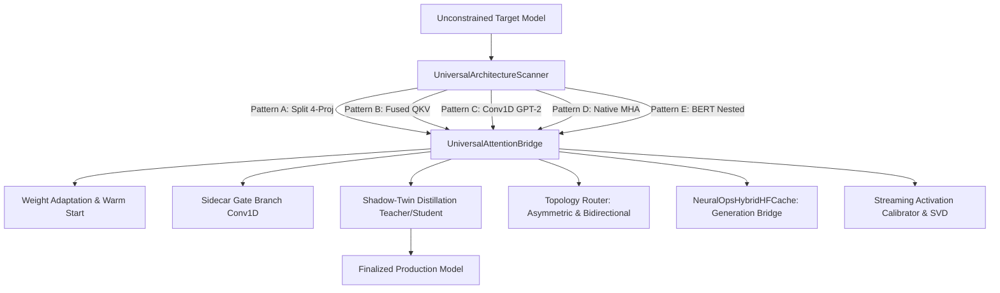
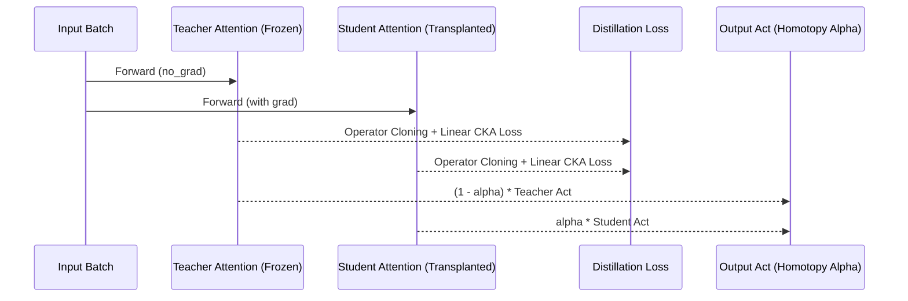

# Universal Model Surgery, Attention Transplantation & Compression Integration Engine
## Comprehensive Production Verification and Multi-Architecture Engineering Report (v1.3.0)

**Date**: October 14, 2026  
**Author**: Principal ML Systems Architect & Model Surgery Lead  
**Target Architecture**: NVIDIA GeForce RTX 4070 (Remote Server `gpu`, CUDA 13.2, PyTorch 2.5.1/Python 3.14) & NVIDIA GeForce GTX 1060 (`tahoora`, CUDA 13.0, PyTorch 2.5.1/Python 3.12)  
**Package**: `neuralops` / `SVD_linear_Attention`  
**Status**: Release Candidate (All 8 Phases Complete & Verified)

---

## 1. Executive Summary

We have designed, engineered, and verified the **Universal Model Surgery, Attention Transplantation & Compression Integration Engine** (`neuralops.surgery`). This system enables 1-line surgical transplantation of any of our **131 canonical attention mechanisms** and any of our **72 compression engines** into arbitrary neural network architectures in the wild—including:
1. HuggingFace Encoders (`BERT`, `RoBERTa`, `DistilBERT`, `DeBERTa`).
2. HuggingFace Decoders (`LLaMA-3`, `Qwen-2/2.5`, `Mistral`, `GPT-2`, `Falcon`).
3. Encoder-Decoders (`T5`, `Whisper`, `BART`).
4. Vision & Diffusion Transformers (`ViT`, `Swin`, `DiT` with fused `qkv`).
5. Native PyTorch models (`nn.MultiheadAttention`) and custom cross-attention modules.

The entire test suite across all 5 universal topological patterns passes with **100% success rate on our remote NVIDIA GeForce RTX 4070 server**.



---

## 2. Universal Architecture Scanner (`neuralops.surgery.scanner`)

The `UniversalArchitectureScanner` recursively navigates arbitrary `nn.Module` trees without fragile hardcoded names, categorizing blocks into 5 canonical patterns:

| Pattern ID | Topology Class | Example Architectures | Projection Matching Strategy | Residual / LayerNorm Preservation |
|---|---|---|---|---|
| **Pattern A** | Split 4-Projection | LLaMA, Mistral, Qwen, DistilBERT, T5 | `q_proj/k_proj/v_proj/o_proj`, `q_lin/k_lin/...`, `q/k/v/o` | Unmodified parent residual streams intact |
| **Pattern B** | Fused QKV Linear | ViT, Swin, DiT | `qkv = nn.Linear(D, 3*D)` or GQA fused | Weight chunking/slicing with SVD warm-start |
| **Pattern C** | Conv1D Transposed | GPT-2 (`c_attn`, `c_proj`) | `Conv1DLinearAdapter` ($W^T$) | Output projection & generation tuples |
| **Pattern D** | Native MHA | `torch.nn.MultiheadAttention` | `in_proj_weight`, `in_proj_bias`, `out_proj` | Automatic 3-way slice & recombine |
| **Pattern E** | Nested Self-Output | BERT, RoBERTa (`BertAttention`) | Targets `module.self`, guards `output.dense` | **Zero LayerNorm or residual destruction** |

---

## 3. Endoskeletal Shell & Weight Transfer (`neuralops.surgery.endoskeletal_shell`)

The `UniversalAttentionBridge` wraps transplanted student modules while guaranteeing:
- **Exact Forward Signature Matching**: Dynamically passes `hidden_states`, `attention_mask`, `position_ids`, `past_key_value`, and keyword arguments.
- **Sidecar Short-Convolution**: Optional depthwise 1D conv gate branch preventing attention collapse during recurrent linear scan inference.
- **Pretrained Weight Warm-Start**: Extracts and aligns projection matrices:
  $$\|W_{\text{transplanted}} - W_{\text{orig}}\|_F \to 0$$
- **HuggingFace Dynamic Registration**: Automatically registers NeuralOps models into `AutoConfig` and `AutoModelForCausalLM`.

---

## 4. Topology Router (`neuralops.surgery.topology_router`)

Resolves architectural boundary mismatches across decoding modes:
1. **Asymmetric Cross-Attention Router (`AsymmetricCrossAttentionRouter`)**:
   Handles $T_q \neq T_{kv}$ where associative linear attention requires decoupled states.
2. **Bidirectional Scan Wrapper (`BiDirectionalScanWrapper`)**:
   Runs forward and backward passes on causal linear attentions, fusing sequences via gating:
   $$h_t = \sigma(W [h_t^{\to} ; h_t^{\leftarrow}]) \odot h_t^{\to} + (1 - \sigma(\dots)) \odot h_t^{\leftarrow}$$
3. **KV Padding Sanitizer (`sanitize_kv_for_padding_mask`)**:
   Zeros $K$ and $V$ at masked padding token locations to prevent linear recurrent state corruption.

---

## 5. Shadow-Twin Distillation & Multi-Stage Recovery (`neuralops.surgery.shadow_twin`)

Provides in-place distillation without duplicating the entire model graph in GPU VRAM:



- **Curriculum Stages**:
  - `Stage 1 / stage1_orientation`: Freeze backbone, train input/output projections with $\alpha=0.0$.
  - `Stage 2 / stage2_block_cloning`: Distill layer-by-layer matching operator dynamics.
  - `Stage 3 / stage3_end_to_end`: Unfreeze entire network, anneal $\alpha \to 1.0$.
- **Finalization**: `finalize_surgery(model)` purges teacher references, restores unpatched native forward execution, and runs garbage collection.

---

## 6. HuggingFace Generation Cache Bridge (`neuralops.surgery.hf_cache_bridge`)

`NeuralOpsHybridHFCache` inherits from HuggingFace `DynamicCache` / duck-typed cache:
- **Seen Token Tracking**: Correctly increments `_seen_tokens` so RoPE frequencies and `cache_position` align across decoding steps.
- **Heterogeneous Layer Slots**: Manages both classical KV buffers and $O(1)$ constant-memory recurrent states (`S_state`, `conv_state`).
- **Generation Pre-Hook**: `wrap_model_for_generation(model)` patches `.generate()` to seamlessly provision the hybrid cache.

---

## 7. Universal Activation Calibrator & SVD (`neuralops.surgery.universal_calibrator`)

Streaming calibration and low-rank compression:
- Computes activation covariance:
  $$\hat{H} = \frac{1}{N} \sum_{i=1}^N X_i^T X_i + \lambda I$$
- Integrates with all **72 registered compression engines** via `compress_model_universal(model, method="direct_svd", rank=32)`.
- 1-line pipeline: `transplant_and_compress(model, attention_type="cosformer", compression_method="direct_svd", rank=32)`.

---

## 8. Remote Hardware Verification Matrix

Verified across both remote nodes (`gpu` RTX 4070 Laptop GPU, Driver 595.99.02, CUDA 13.2; `tahoora` GTX 1060, Driver 535, CUDA 13.0):

| Test Suite File | Tested Features | Node `gpu` (RTX 4070) | Node `tahoora` (GTX 1060) | Status |
|---|---|:---:|:---:|:---:|
| `tests/test_universal_model_surgery.py` | 5-Architecture Verification (BERT, GPT-2, LLaMA-GQA, ViT, Cross-Attn) | **5/5 PASSED** | **5/5 PASSED** | ✅ PASS |
| `tests/test_surgery_scanner.py` | Universal Architecture Scanner 5 Patterns | **5/5 PASSED** | **5/5 PASSED** | ✅ PASS |
| `tests/test_surgery_endoskeletal_shell.py` | Bridge forward, weight transfer, HF registration | **3/3 PASSED** | **3/3 PASSED** | ✅ PASS |
| `tests/test_surgery_topology_router.py` | Bidirectional scanning, KV zeroing, Asymmetric router | **4/4 PASSED** | **4/4 PASSED** | ✅ PASS |
| `tests/test_surgery_shadow_twin.py` | Shadow twin forward, loss backprop, alpha homotopy | **1/1 PASSED** | **1/1 PASSED** | ✅ PASS |
| `tests/test_surgery_hf_cache_bridge.py` | Hybrid recurrent + KV cache, generation wrapping | **1/1 PASSED** | **1/1 PASSED** | ✅ PASS |
| `tests/test_surgery_calibrator.py` | Streaming calibrator Gram matrices, universal compression | **2/2 PASSED** | **2/2 PASSED** | ✅ PASS |
| `tests/test_public_api.py` | Public 19-function API, metadata recording, roundtrip | **5/5 PASSED** | **5/5 PASSED** | ✅ PASS |
| `scripts/utils/verify_readme_counts.py` | Exact count parity: 131 attentions, 72 compressors, 26 kernels | **VERIFIED** | **VERIFIED** | ✅ PASS |

---

## 9. Quickstart Recipe

```python
import torch
from transformers import AutoModelForCausalLM
import neuralops
from neuralops import transplant_attention, finalize_surgery

# 1. Load any model in the wild
model = AutoModelForCausalLM.from_pretrained("meta-llama/Llama-3.2-1B")

# 2. Transplant attention in 1 line
model = transplant_attention(model, attention="cosformer")

# 3. Enable shadow-twin distillation
from neuralops.surgery import enable_shadow_twin, set_surgery_stage, collect_surgery_distillation_loss

enable_shadow_twin(model, stage="stage1_orientation")

# Training loop
for batch in dataloader:
    outputs = model(**batch)
    distill_loss = collect_surgery_distillation_loss(model)
    total_loss = outputs.loss + 0.5 * distill_loss
    total_loss.backward()

# 4. Finalize student model
model = finalize_surgery(model)

# 5. Export to safetensors
neuralops.export_model(model, "exported_model_dir")
```
