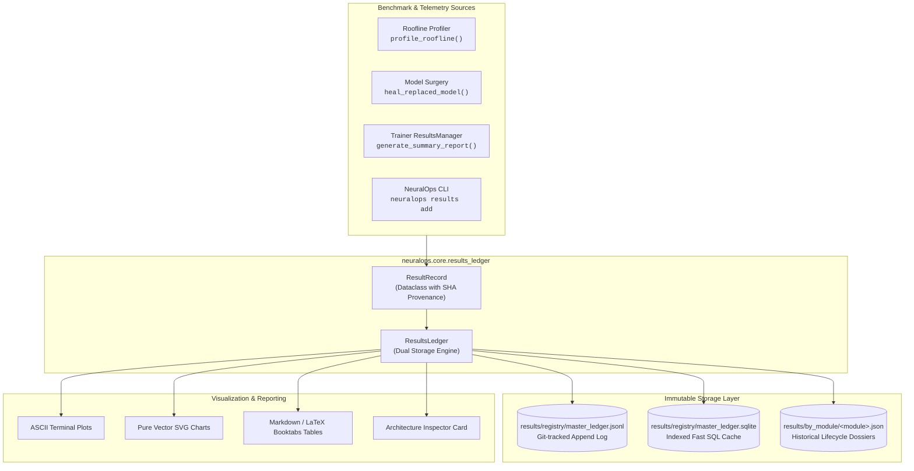

# Results Ledger API (`neuralops.core.results_ledger`)

The **`neuralops.core.results_ledger`** module provides a production-grade, zero-dependency, dual-storage experiment ledger and benchmark provenance engine for NeuralOps.

It ensures complete auditability, reproducible paper tables, and microsecond CLI queries across all 131 attention mechanisms, 72 compressors, 26 Triton kernels, and end-to-end models.

---

## Architecture Overview



---

## Classes and Functions

### `ResultRecord`
Data model encapsulating a single benchmark or experiment outcome.

```python
from neuralops.core.results_ledger import ResultRecord

record = ResultRecord(
    module_name: str,
    category: str,                     # 'attention', 'compressor', 'triton_kernel', 'cuda_kernel', 'end_to_end_model'
    family: str,                       # e.g., 'gated-delta-recurrent', 'activation-aware-svd'
    record_id: Optional[str] = None,   # Generated automatically if omitted
    version_tag: str = "v1.3.7",       # NeuralOps framework version
    revision: int = 1,                 # Revision counter
    status: str = "verified",          # 'verified', 'superseded', 'deprecated'
    timestamp_utc: Optional[str] = None, # ISO-8601 UTC timestamp
    git_commit_sha: Optional[str] = None,# 10-char Git SHA (detected via git log if omitted)
    generation_method: str = "Unspecified",
    experimental_setup: Optional[Dict[str, Any]] = None,
    metrics: Optional[Dict[str, float]] = None,
    notes: Optional[str] = None,
)
```

### `ResultsLedger`
The master manager handling reads, writes, version bumps, queries, diffing, and plotting.

```python
from neuralops.core.results_ledger import ResultsLedger

ledger = ResultsLedger(root_dir="results")

# Adding or updating records
ledger.add_or_replace(record, mode="upsert")      # 'upsert', 'replace', or 'new_version'

# Querying
records = ledger.query(
    module_name="gated_deltanet",
    category="attention",
    min_accuracy=90.0,
    only_active=True,
)

# Version diffing
diff = ledger.compare_versions("roberta_12layer_kd", rev_a=1, rev_b=2)

# Plotting
plot_res = ledger.plot_results(records, chart_type="bar", y_metric="accuracy", output_path="results/plots/attention_acc.svg")

# Table export
latex_code = ledger.export_table(records, format="latex")
```

### Convenience Functions

```python
from neuralops import log_experiment_result, get_default_ledger

# Direct one-line logging
log_experiment_result(
    module_name="simplex_wgqa",
    category="attention",
    family="simplex-wgqa",
    generation_method="Simplex-Constrained WGQA Calibration",
    metrics={"eval_accuracy": 92.1, "speedup": 2.2},
)
```
