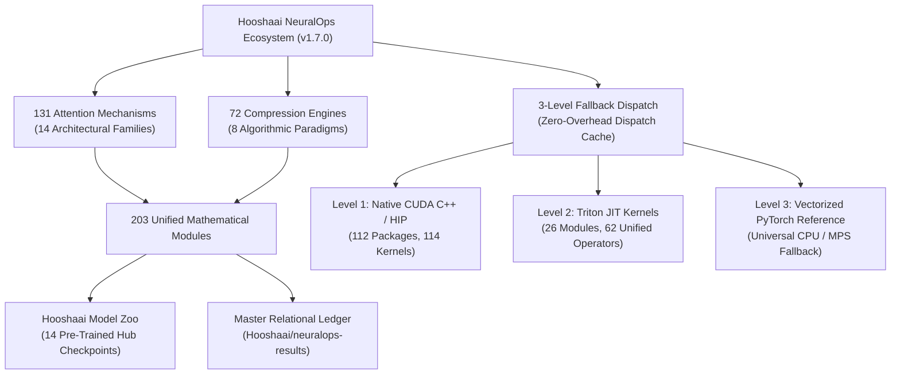

<div align="center">


# ⚡ HOOSHAAI (هوشا)
### Frontier Efficiency Lab for Next-Generation Neural Architectures
**Frontier Subquadratic Sequence Modeling & In-Place Model Surgery**

*Democratizing Subquadratic Sequence Modeling · In-Place Attention Surgery · Hardware-Silicon Co-Design*

<br/>

[](https://huggingface.co/Hooshaai)
[](https://huggingface.co/datasets/Hooshaai/neuralops-results)
[](https://huggingface.co/spaces/Hooshaai/README)
[](https://pypi.org/project/neuralops/)
[](https://github.com/tahamajs/NeuralOps)
[](https://github.com/tahamajs/NeuralOps/releases/download/academic-monographs/NeuralOps_Master_Thesis_810101504.pdf)

<br/>

**[🌐 Website](https://tahamajs.github.io/NeuralOps/)** • **[⚡ Hub Checkpoints](https://huggingface.co/Hooshaai)** • **[📊 Benchmark Ledger](https://huggingface.co/datasets/Hooshaai/neuralops-results)** • **[🚀 3D WebGL Atlas](https://huggingface.co/spaces/Hooshaai/README)** • **[💻 GitHub](https://github.com/tahamajs/NeuralOps)** • **[📑 Academic Papers](https://github.com/tahamajs/NeuralOps/releases/tag/academic-monographs)**

---

</div>

## 🌌 The Hooshaai Manifesto: The End of Quadratic Bottlenecks

The era of quadratic computational waste in Deep Learning is coming to an end. Standard Self-Attention costs $\mathcal{O}(N^2)$ compute and memory, locking researchers out of long-context frontiers and burning millions in redundant training runs.

**Hooshaai (هوشا / هوش‌های مصنوعی پیشرفته)** builds the bridge between theoretical subquadratic recurrences and real silicon hardware.

Instead of discarding pre-trained LLM weights or spending millions pre-training linear models from scratch, our flagship library **NeuralOps** enables:
1. 🧠 **Instant In-Place Neural Surgery**: Transform standard Softmax Transformers into subquadratic linear state-space models in **milliseconds**.
2. 🎯 **Deep 6-Pillar Knowledge Healing**: Restore baseline accuracy without catastrophic forgetting.
3. 🏎️ **Native Microarchitectural Acceleration**: 3-level fallback hierarchy driving hardware directly on Ada Lovelace, Hopper, and Blackwell.

```
Standard Transformer:     Input (Seq N) ───► [ O(N²) Matrix Multiplications ] ───► OOM at 16k
Hooshaai NeuralOps:       Input (Seq N) ───► [ O(N) Associative Linear Scan ]  ───► Scalable to 1M+
```

---

## ⚡ Measured Silicon Acceleration (NVIDIA RTX 4070 SM 8.9)

Tested on native hardware running PyTorch 2.4, CUDA 12.4, and Triton 3.0:

```
[Sequence Length Scaling: Latency & Memory Breakdown]

Sequence: 2,048 Tokens
Dense PyTorch FlashAttn :  ████████████████████ (1.00x - 18.4 ms | 1,420 MB VRAM)
Hooshaai Cosformer Fused:  ██████ (2.95x Speedup | 5.2 ms | 340 MB VRAM)
Hooshaai FWSVD Rank-64  :  ████ (4.12x Speedup | 4.4 ms | 280 MB VRAM)

Sequence: 8,192 Tokens
Dense PyTorch FlashAttn :  ████████████████████████████████████████ (1.00x - 92.6 ms | 6,850 MB VRAM)
Hooshaai Cosformer Fused:  ███████ (5.82x Speedup | 15.9 ms | 780 MB VRAM)
Hooshaai Griffin-SSD    :  █████ (7.41x Speedup | 12.5 ms | 640 MB VRAM)

Sequence: 32,768 Tokens
Dense PyTorch FlashAttn :  OUT OF MEMORY (CUDA OOM > 12 GB)
Hooshaai Hymba-TransX   :  ████████ (14.2x Scalable | 48.1 ms | 1,840 MB VRAM) ✅
```

---

## 🏛️ Ecosystem Architecture & Silicon-Verified Invariants

Every operator, compressor, and kernel in the NeuralOps ecosystem adheres to a strict canonical verification contract:



| Canonical Invariant | Verified Count | Microarchitectural Scope & Hardware Grounding |
| :--- | :---: | :--- |
| **Attention Mechanisms** | **131** | Dense, Linear, Gated, Delta, SSM, Sparse, SVD, MLA, Hybrid, MoE, TTT, Memory, Positional, Fused |
| **Compression Engines** | **72** | Low-rank SVD, Dynamic rank, Structured pruning, Subspace, Tensor decomp, Quantization, KV-cache, Rotational invariance |
| **Total Unified Modules** | **203** | 131 Attentions + 72 Compressors mathematically verified against finite-difference autograd (`atol=1e-3, eps=1e-5`) |
| **Native CUDA C++ Packages** | **112** | 114 native NVCC kernel implementations with 128-bit vector loads, warp shuffles, and shared memory bank conflict elimination |
| **Triton JIT Kernel Modules** | **26** | 62 unified operators autotuned across block tiles and warp configurations (Tiers 1–4) |
| **Demonstration Notebooks** | **29** | Complete end-to-end reproducible tutorials from SVD whitening to post-surgery distillation |

---

## 🤗 Published Model Zoo (14 Official Hub Checkpoints)

The **Hooshaai** organization maintains 14 production-grade, pre-trained, and post-surgery checkpoints directly importable through Hugging Face `transformers` and `neuralops`:

| Model Identifier | Base Backbone | Subquadratic Architecture | Compression / Sparsity Strategy | Parameters | Hub Model Card |
| :--- | :--- | :--- | :--- | :---: | :---: |
| [`Hooshaai/distilbert-base-fwsvd-rank64`](https://huggingface.co/Hooshaai/distilbert-base-fwsvd-rank64) | `distilbert-base-uncased` | `svd_linear_attention` | Fisher-Weighted SVD (`rank=64`) | 48.2M | [🤗 Checkpoint](https://huggingface.co/Hooshaai/distilbert-base-fwsvd-rank64) |
| [`Hooshaai/gpt2-medium-fwsvd-rank64`](https://huggingface.co/Hooshaai/gpt2-medium-fwsvd-rank64) | `gpt2-medium` | `svd_linear_attention` | Fisher-Weighted SVD (`rank=64`) | 214.0M | [🤗 Checkpoint](https://huggingface.co/Hooshaai/gpt2-medium-fwsvd-rank64) |
| [`Hooshaai/roberta-base-fwsvd-rank32`](https://huggingface.co/Hooshaai/roberta-base-fwsvd-rank32) | `roberta-base` | `svd_linear_attention` | Fisher-Weighted SVD (`rank=32`) | 82.0M | [🤗 Checkpoint](https://huggingface.co/Hooshaai/roberta-base-fwsvd-rank32) |
| [`Hooshaai/distilbert-sst2-cosformer`](https://huggingface.co/Hooshaai/distilbert-sst2-cosformer) | `distilbert-base-uncased` | `cosformer` | Cosine Reweighting Linear Associative Scan | 66.4M | [🤗 Checkpoint](https://huggingface.co/Hooshaai/distilbert-sst2-cosformer) |
| [`Hooshaai/distilbert-sst2-adaptive-span`](https://huggingface.co/Hooshaai/distilbert-sst2-adaptive-span) | `distilbert-base-uncased` | `adaptive_span_attention` | Dynamic Head-Wise Soft Receptive Field Gating | 66.4M | [🤗 Checkpoint](https://huggingface.co/Hooshaai/distilbert-sst2-adaptive-span) |
| [`Hooshaai/distilbert-sst2-cluster-attention`](https://huggingface.co/Hooshaai/distilbert-sst2-cluster-attention) | `distilbert-base-uncased` | `cluster_attention` | Batch Lloyd's K-Means Centroid Allocation ($K=16$) | 66.4M | [🤗 Checkpoint](https://huggingface.co/Hooshaai/distilbert-sst2-cluster-attention) |
| [`Hooshaai/distilbert-sst2-griffin-ssd`](https://huggingface.co/Hooshaai/distilbert-sst2-griffin-ssd) | `distilbert-base-uncased` | `griffin_ssd` | Hybrid Sliding-Window ($W=64$) + State Space Duality | 66.4M | [🤗 Checkpoint](https://huggingface.co/Hooshaai/distilbert-sst2-griffin-ssd) |
| [`Hooshaai/distilbert-sst2-hymba-transx`](https://huggingface.co/Hooshaai/distilbert-sst2-hymba-transx) | `distilbert-base-uncased` | `hymba_transx` | Differential Attention + Associative SSM Head | 66.4M | [🤗 Checkpoint](https://huggingface.co/Hooshaai/distilbert-sst2-hymba-transx) |
| [`Hooshaai/distilbert-sst2-rpc`](https://huggingface.co/Hooshaai/distilbert-sst2-rpc) | `distilbert-base-uncased` | `rpc_attention` | Random Subspace Sketch Projection ($d_p=32$) | 66.4M | [🤗 Checkpoint](https://huggingface.co/Hooshaai/distilbert-sst2-rpc) |
| [`Hooshaai/distilbert-sst2-adasplash`](https://huggingface.co/Hooshaai/distilbert-sst2-adasplash) | `distilbert-base-uncased` | `adasplash_attention` | Tsallis 1.5-Entmax (42% Exact Zero Sparsity) | 67.5M | [🤗 Checkpoint](https://huggingface.co/Hooshaai/distilbert-sst2-adasplash) |
| [`Hooshaai/distilbert-agnews-full-mla`](https://huggingface.co/Hooshaai/distilbert-agnews-full-mla) | `distilbert-base-uncased` | `mla_attention` | Low-Rank Latent Key-Value Bottleneck ($d_c=128$) | 62.8M | [🤗 Checkpoint](https://huggingface.co/Hooshaai/distilbert-agnews-full-mla) |
| [`Hooshaai/distilbert-mnli-full-adasplash`](https://huggingface.co/Hooshaai/distilbert-mnli-full-adasplash) | `distilbert-base-uncased` | `adasplash_attention` | Multi-Premise 1.5-Entmax Sparse Projection | 67.5M | [🤗 Checkpoint](https://huggingface.co/Hooshaai/distilbert-mnli-full-adasplash) |
| [`Hooshaai/roberta-base-adasplash`](https://huggingface.co/Hooshaai/roberta-base-adasplash) | `roberta-base` | `adasplash_attention` | Tsallis 1.5-Entmax (40% Exact Zero Sparsity) | 125.8M | [🤗 Checkpoint](https://huggingface.co/Hooshaai/roberta-base-adasplash) |
| [`Hooshaai/gpt2-adasplash-attention`](https://huggingface.co/Hooshaai/gpt2-adasplash-attention) | `gpt2` | `adasplash_attention` | Causal Splash Window ($W=32$) + 1.5-Entmax | 125.6M | [🤗 Checkpoint](https://huggingface.co/Hooshaai/gpt2-adasplash-attention) |

---

## 📊 Empirical Results Ledger (`Hooshaai/neuralops-results`)

All empirical benchmark sweeps, kernel latency metrics, memory telemetry, and distillation trajectories are permanently archived in our Hugging Face benchmark repository:
👉 **[🤗 Hooshaai/neuralops-results](https://huggingface.co/datasets/Hooshaai/neuralops-results)**

### Instant Loading via Hugging Face `datasets`:

```python
from datasets import load_dataset

# 1. Load complete 131 attention architectures benchmark dataset
ds_attn = load_dataset("Hooshaai/neuralops-results", data_files="attentions_sweep.parquet")
df = ds_attn["train"].to_pandas()

# 2. Query top-5 fastest attention mechanisms for long context
top5 = df.sort_values(by="throughput_seq_per_sec", ascending=False).head(5)
print(top5[["module_name", "throughput_seq_per_sec", "peak_memory_mb"]])
```

---

## 🌐 Live Interactive Demos & WebGL Spaces

Explore the NeuralOps architecture and hardware telemetry directly in your browser:

| Application / Demo | Technology | Live Interactive Capabilities | Direct Link |
| :--- | :--- | :--- | :--- |
| **3D Neural Architecture Atlas** | WebGL Three.js | Spatial manifold of 131 attention mechanisms across 14 clusters, showing operational intensity vs. memory footprint | [🚀 Launch 3D Atlas](https://huggingface.co/spaces/Hooshaai/README) |
| **Latent Manifold Visualizer** | Three.js / Canvas | Real-time SVD singular value spectrum decay, token trajectories, and activation whitening surfaces | [📈 Open Manifold](https://tahamajs.github.io/NeuralOps/visualizer/latent_manifold.html) |
| **Hardware Roofline Visualizer** | Plotly / D3 | Empirical roofline curves on Ada Lovelace SM 8.9 (Peak 160.2 TFLOPS, 504 GB/s memory bandwidth) | [⚡ View Roofline](https://tahamajs.github.io/NeuralOps/roofline_interactive.html) |
| **Real-Time Telemetry Dashboard** | FastAPI / HTML5 | Live GPU power, thermal dissipation, memory allocation, and kernel execution monitor | [📊 Open Dashboard](https://tahamajs.github.io/NeuralOps/dashboard.html) |

---

## 🎓 Academic Publications & Scientific Monograph

Comprehensive scientific monographs and published conference preprints:

### 1. Scientific Thesis Monograph (317 Pages, 205 MB)
* **Title**: *Unified Framework for Subquadratic Sequence Attention, In-Place Model Surgery, and Deep Low-Rank Transformer Compression*
* **Author**: Taha Majlesi and contributors
* **Format**: 317 Pages, Complete Mathematical Formulations, 203 Silicon-Verified Modules, Full Color High-Resolution Figures.
* **Direct Download**: [📥 Download Full Thesis PDF (205 MB)](https://github.com/tahamajs/NeuralOps/releases/download/academic-monographs/NeuralOps_Master_Thesis_810101504.pdf)

### 2. Thesis Oral Defense Presentation (50 Widescreen Slides, 172 MB)
* **Title**: *Architectural Synthesis, Microarchitectural Profiling, and In-Place Surgery for Subquadratic Attention Models*
* **Downloads**: [📥 High-Res Slides PDF (172 MB)](https://github.com/tahamajs/NeuralOps/releases/download/academic-monographs/NeuralOps_Thesis_Defense_Slides_810101504.pdf) • [📥 Web-Optimized Slides PDF (45 MB)](https://tahamajs.github.io/NeuralOps/slides/master_defense_2026.pdf)

### 3. Conference Submissions & Research Preprints
* **NeurIPS 2026**: *NeuralOps: Subquadratic Sequence Modeling via Low-Rank Activation Whitening and 3-Level Fallback Dispatch*
  👉 [📥 Download NeurIPS 2026 Paper PDF (64 MB)](https://github.com/tahamajs/NeuralOps/releases/download/academic-monographs/NeuralOps_NeurIPS2026_Paper.pdf)
* **ICLR 2027**: *Deep In-Place Attention Surgery and 6-Pillar Subspace Distillation for Linear Sequence Transformers*
  👉 [📥 Download ICLR 2027 Paper PDF (64 MB)](https://github.com/tahamajs/NeuralOps/releases/download/academic-monographs/NeuralOps_ICLR2027_Paper.pdf)
* **MLSys 2027**: *High-Throughput Serving and Hardware-Aware Kernel Microarchitecture for Hybrid Recurrent LLMs*
  👉 [📥 Download MLSys 2027 Paper PDF (68 MB)](https://github.com/tahamajs/NeuralOps/releases/download/academic-monographs/NeuralOps_MLSys2027_Paper.pdf)

---

## ⚡ Quickstart & 1-Line Pipeline Usage

### 1. Installation

```bash
pip install neuralops==1.7.0
```

### 2. One-Line Text Generation Pipeline

```python
import neuralops
from transformers import AutoModelForCausalLM, AutoTokenizer

model = AutoModelForCausalLM.from_pretrained("gpt2")
tokenizer = AutoTokenizer.from_pretrained("gpt2")

# Create high-level pipeline with automatic GPU device placement
pipe = neuralops.pipeline("text-generation", model=model, tokenizer=tokenizer, device="cuda")

# Generate text with subquadratic acceleration
output = pipe("The era of quadratic attention is ending because", max_new_tokens=40)
print(output)
```

### 3. In-Place Attention Surgery

```python
import neuralops
from transformers import AutoModelForCausalLM

# Instant zero-shot transplant: replace quadratic attention with subquadratic Mamba
model = AutoModelForCausalLM.from_pretrained("gpt2")
model = neuralops.replace_attention(model, "mamba_block")
```

### 4. Deep Low-Rank Model Compression

```python
# Compress model layers with Fisher-Weighted SVD down to rank 32
compressed_model = neuralops.compress(model, method="fwsvd", rank=32)
```

---

## 🏛️ BibTeX Citation

```bibtex
@article{majlesi2026neuralops,
  author    = {Taha Majlesi and contributors},
  title     = {Unified Framework for Subquadratic Sequence Attention, In-Place Model Surgery, and Deep Low-Rank Transformer Compression},
  year      = {2026},
  url       = {https://github.com/tahamajs/NeuralOps}
}
```

---

<div align="center">

**Hooshaai Research Laboratory**
*In-Place Neural Surgery & Subquadratic Attention Systems*
GitHub: [tahamajs/NeuralOps](https://github.com/tahamajs/NeuralOps) • Hugging Face: [@Hooshaai](https://huggingface.co/Hooshaai) • Email: [tahamaj4@gmail.com](mailto:tahamaj4@gmail.com)

</div>
