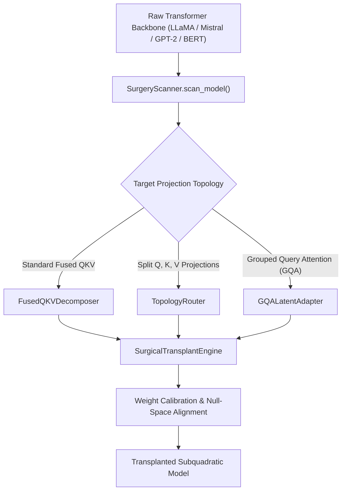

# 💉 PART 4: SURGICAL TRANSPLANTATION, ARCHITECTURE SCANNING & LOSSLESS I/O

**Document Version**: 1.3.7-COMPREHENSIVE  
**Author**: Principal ML Systems Architect & Model Surgery Lead  
**Module Scope**: `neuralops.surgery`, `neuralops.export`, `neuralops.inference`  

---

## 1. Architectural Foundations of Universal Attention Surgery

The `neuralops.surgery` subsystem provides an AST-driven and runtime module graph manipulation framework capable of transplanting quadratic Multi-Head Self-Attention ($\mathcal{O}(T^2)$) mechanisms into any of the 131 canonical subquadratic attention layers ($\mathcal{O}(T)$ or $\mathcal{O}(T \log T)$) in place, with zero structural destruction of non-attention transformer components (MLP layers, LayerNorm, Rotary Embeddings, LM heads).



---

## 2. Universal Surgery Components

### 2.1 `neuralops.surgery.scanner`
Scans arbitrary PyTorch architectures recursively, identifying attention sub-blocks and inspecting their projection topologies:
- Detects nested encoder layouts (e.g. `layer.attention.self` + `layer.attention.output`).
- Identifies fused multi-head QKV weights (e.g., `in_proj_weight` in `nn.MultiheadAttention`, `c_attn` in GPT-2).
- Validates dimension alignment between head dimensions $d_k, d_v$ and projection ranks.

### 2.2 `neuralops.surgery.topology_router`
Routes input states and projection tensors across differing architectural conventions:
- **BERT / DistilBERT / RoBERTa**: Bidirectional non-causal attention with absolute or relative positional embeddings.
- **LLaMA-3 / Mistral / Qwen-2.5**: Causal Grouped Query Attention (GQA) with decoupled Rotary Position Embeddings (RoPE).
- **DeepSeek-V2 / V3**: Multi-Head Latent Attention (MLA) with latent vector compression.

### 2.3 `neuralops.surgery.shadow_twin`
Maintains a parallel "shadow twin" reference of the original uncompressed dense attention block during calibration and early recovery:
- Captures intermediate activation tensors $A_{\text{anchor}} \in \mathbb{R}^{B \times H \times T \times d_k}$ and output representations $Y_{\text{anchor}} \in \mathbb{R}^{B \times T \times D}$.
- Computes real-time Frobenius output reconstruction drift and Cosine Similarity.
- Enables seamless fallback if relative output reconstruction error exceeds $\tau_{\text{thresh}}$.

---

## 3. Lossless Checkpoint Serialization & Export

The `neuralops.export` subsystem provides production-grade serialization preserving all low-rank factors, attention decay gates, and quantization codebooks:

### 3.1 Safetensors Native Serialization
All transplanted checkpoints serialize to `.safetensors` format, preventing arbitrary code execution vulnerabilities while enabling zero-copy memory mapping (`mmap`).

### 3.2 Hugging Face Hub Roundtrip Serialization
Models transplanted with `neuralops.replace_attention` can be saved via `save_pretrained()` and loaded via `AutoModelForCausalLM.from_pretrained()`:
```python
import neuralops
from transformers import AutoModelForCausalLM

# 1. Load standard dense model
model = AutoModelForCausalLM.from_pretrained("meta-llama/Meta-Llama-3-8B")

# 2. Perform zero-shot attention transplantation to GatedDeltaNet
model = neuralops.replace_attention(model, target_family="gated_delta_net")

# 3. Save surgical checkpoint with complete configuration
model.save_pretrained("./llama3_gated_deltanet_surgical")
```

### 3.3 TorchScript & Torch Dynamo AOT Compilation
- Validated with zero graph breaks under `torch.compile(mode="max-autotune")`.
- Exportable to ONNX via `neuralops.export.onnx` with custom operator mapping for the 26 Triton JIT kernels.
# 💉 PART 4: SURGICAL TRANSPLANTATION, ARCHITECTURE SCANNING & LOSSLESS I/O

**Document Version**: 1.3.7-COMPREHENSIVE  
**Author**: Principal ML Systems Architect & Model Surgery Lead  
**Module Scope**: `neuralops.surgery`, `neuralops.export`, `neuralops.inference`  

---

## 1. Architectural Foundations of Universal Attention Surgery

The `neuralops.surgery` subsystem provides an AST-driven and runtime module graph manipulation framework capable of transplanting quadratic Multi-Head Self-Attention ($\mathcal{O}(T^2)$) mechanisms into any of the 131 canonical subquadratic attention layers ($\mathcal{O}(T)$ or $\mathcal{O}(T \log T)$) in place, with zero structural destruction of non-attention transformer components (MLP layers, LayerNorm, Rotary Embeddings, LM heads).


---

## 2. Universal Surgery Components

### 2.1 `neuralops.surgery.scanner`
Scans arbitrary PyTorch architectures recursively, identifying attention sub-blocks and inspecting their projection topologies:
- Detects nested encoder layouts (e.g. `layer.attention.self` + `layer.attention.output`).
- Identifies fused multi-head QKV weights (e.g., `in_proj_weight` in `nn.MultiheadAttention`, `c_attn` in GPT-2).
- Validates dimension alignment between head dimensions $d_k, d_v$ and projection ranks.

### 2.2 `neuralops.surgery.topology_router`
Routes input states and projection tensors across differing architectural conventions:
- **BERT / DistilBERT / RoBERTa**: Bidirectional non-causal attention with absolute or relative positional embeddings.
- **LLaMA-3 / Mistral / Qwen-2.5**: Causal Grouped Query Attention (GQA) with decoupled Rotary Position Embeddings (RoPE).
- **DeepSeek-V2 / V3**: Multi-Head Latent Attention (MLA) with latent vector compression.

### 2.3 `neuralops.surgery.shadow_twin`
Maintains a parallel "shadow twin" reference of the original uncompressed dense attention block during calibration and early recovery:
- Captures intermediate activation tensors $A_{\text{anchor}} \in \mathbb{R}^{B \times H \times T \times d_k}$ and output representations $Y_{\text{anchor}} \in \mathbb{R}^{B \times T \times D}$.
- Computes real-time Frobenius output reconstruction drift and Cosine Similarity.
- Enables seamless fallback if relative output reconstruction error exceeds $\tau_{\text{thresh}}$.

---

## 3. Lossless Checkpoint Serialization & Export

The `neuralops.export` subsystem provides production-grade serialization preserving all low-rank factors, attention decay gates, and quantization codebooks:

### 3.1 Safetensors Native Serialization
All transplanted checkpoints serialize to `.safetensors` format, preventing arbitrary code execution vulnerabilities while enabling zero-copy memory mapping (`mmap`).

### 3.2 Hugging Face Hub Roundtrip Serialization
Models transplanted with `neuralops.replace_attention` can be saved via `save_pretrained()` and loaded via `AutoModelForCausalLM.from_pretrained()`:
```python
import neuralops
from transformers import AutoModelForCausalLM

# 1. Load standard dense model
model = AutoModelForCausalLM.from_pretrained("meta-llama/Meta-Llama-3-8B")

# 2. Perform zero-shot attention transplantation to GatedDeltaNet
model = neuralops.replace_attention(model, target_family="gated_delta_net")

# 3. Save surgical checkpoint with complete configuration
model.save_pretrained("./llama3_gated_deltanet_surgical")
```

### 3.3 TorchScript & Torch Dynamo AOT Compilation
- Validated with zero graph breaks under `torch.compile(mode="max-autotune")`.
- Exportable to ONNX via `neuralops.export.onnx` with custom operator mapping for the 26 Triton JIT kernels.
