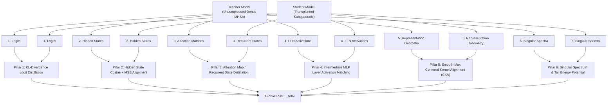

# 🏛️ PART 5: 6-PILLAR DISTILLATION LOSS ENGINE & HNC CONTINUATION TRAINERS

**Document Version**: 1.3.7-COMPREHENSIVE  
**Author**: Principal ML Systems Architect & Distillation Research Lead  
**Module Scope**: `neuralops.trainer`, `neuralops.training`  

---

## 1. Mathematical Formulation of the 6-Pillar Distillation Loss Engine

When compressing or linearizing attention mechanisms, naive single-objective cross-entropy training collapses due to intermediate representation misalignment. NeuralOps formulates the **6-Pillar Distillation Loss Engine**:

$$\mathcal{L}_{\text{total}} = \lambda_{\text{task}} \mathcal{L}_{\text{task}} + \sum_{p=1}^6 \alpha_p \mathcal{L}_p$$

---

## 2. The Six Distillation Pillars

### Pillar 1: Temperature-Scaled Logit Distillation ($\mathcal{L}_{\text{logit}}$)
Computes the Kullback-Leibler (KL) divergence between student and teacher probability distributions:
$$\mathcal{L}_{\text{logit}} = 2 \tau^2 \cdot \text{KL}\left(\text{Softmax}\left(\frac{z_s}{\tau}\right) \parallel \text{Softmax}\left(\frac{z_t}{\tau}\right)\right)$$
where $\tau \in [1.5, 4.0]$ softens the distribution to expose dark knowledge in non-target token classes.

### Pillar 2: Multi-Layer Hidden State Cosine + MSE Loss ($\mathcal{L}_{\text{hidden}}$)
Aligns the trajectory of intermediate representations across layers:
$$\mathcal{L}_{\text{hidden}} = \frac{1}{L} \sum_{l=1}^L \left( \frac{1}{2} \|h_s^{(l)} - h_t^{(l)}\|_2^2 + \beta \left(1 - \frac{\langle h_s^{(l)}, h_t^{(l)} \rangle}{\|h_s^{(l)}\|_2 \|h_t^{(l)}\|_2}\right) \right)$$

### Pillar 3: Attention Map / Recurrent State Distillation ($\mathcal{L}_{\text{attn}}$)
For models retaining explicit attention distributions, computes Jensen-Shannon divergence over attention weights:
$$\mathcal{L}_{\text{attn}} = \frac{1}{L H} \sum_{l=1}^L \sum_{h=1}^H \text{JSD}(A_{s, l, h} \parallel A_{t, l, h})$$
For linear attention models where explicit $T \times T$ maps are not materialized, aligns the temporal recurrent state $S_t \in \mathbb{R}^{d \times d}$ against the cumulative teacher token prefix representation.

### Pillar 4: Intermediate FFN Activation Matching ($\mathcal{L}_{\text{inter}}$)
Matches feedforward network intermediate activations before and after GeLU/SwiGLU gating:
$$\mathcal{L}_{\text{inter}} = \frac{1}{L} \sum_{l=1}^L \|\text{FFN}_s^{(l)}(x) - \text{FFN}_t^{(l)}(x)\|_F^2$$

### Pillar 5: Smooth-Max Centered Kernel Alignment ($\mathcal{L}_{\text{CKA}}$)
Computes linear Centered Kernel Alignment (CKA) across all layers and optimizes using a smooth-max operator:
$$\text{CKA}(K, L) = \frac{\text{HSIC}(K, L)}{\sqrt{\text{HSIC}(K, K) \cdot \text{HSIC}(L, L)}}$$
$$\mathcal{L}_{\text{CKA}} = -\log \left( \sum_{l=1}^L \exp\left( \gamma \cdot \text{CKA}(H_s^{(l)}, H_t^{(l)}) \right) \right)$$
ensuring that representation geometry is preserved even under aggressive low-rank transformations.

### Pillar 6: Singular Spectrum & Tail Energy Potential ($\mathcal{L}_{\text{spec}}$)
Enforces singular tail suppression via the HNC potential:
$$\phi_{\text{SVD}}(W) = -\frac{\sum_{i > r} \sigma_i^2}{\sigma_1^2 + \epsilon} - \gamma_{\text{nuc}} \frac{\sum_{i > r} \sigma_i}{\sigma_1 + \epsilon}$$
encouraging weight matrices to naturally concentrate energy in the top-$r$ singular values.

---

## 3. The HNC Continuation Trainer (`HNCContinuationTrainer`)

The `HNCContinuationTrainer` provides an automated orchestrator that alternates between:
1. **Predict Phase**: Homotopy null-space directional steps along $\nabla_W \phi_{\text{SVD}} P_{\text{null}}$.
2. **Correct Phase**: Fast multi-step function-restoring gradient updates using the 6-pillar distillation loss.
3. **Loss Ceiling Rejection**: Rollback and step-size halving whenever $\mathcal{L}_{\text{func}} > \tau_{\text{ceiling}}$.
4. **Post-Truncation Factor Restoration**: Low-rank factor optimization maintaining $\text{rank}(\hat{W}) \le r$ at all times.
