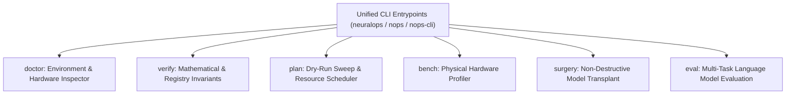

# 🛠️ PART 7: DEVELOPER EXPERIENCE (DX), CLI/TUI HARNESS & EVALUATION ADAPTERS

**Document Version**: 1.3.7-COMPREHENSIVE  
**Author**: Principal ML Systems Architect & Developer Experience Lead  
**Module Scope**: `neuralops.cli`, `neuralops.benchmarks`, `neuralops.evaluation`  

---

## 1. Developer Experience Architecture

NeuralOps prioritizes developer experience (DX) by providing high-level CLI commands, terminal user interfaces (TUI), and automated environment inspection utilities that eliminate configuration friction.

---

## 2. Command-Line Interface (CLI) Commands

### 2.1 `nops doctor`
Performs exhaustive system diagnostics:
- Inspects PyTorch version, CUDA runtime, and NVIDIA driver capabilities.
- Probes SM architecture (e.g. Ada Lovelace SM 8.9, Hopper SM 9.0) and validates Tensor Core precision modes (TF32, FP16, BF16, FP8).
- Verifies OpenAI Triton compiler version and detects available JIT backends.

### 2.2 `nops verify`
Runs automated integrity assertions:
- Verifies the canonical count invariants: **131 attentions, 72 compressors, 26 Triton kernels**.
- Asserts that all registered modules can be instantiated without missing symbol errors.

### 2.3 `nops plan --all-attn`
Performs static dry-run resource estimation:
- Computes estimated parameter reduction, required GPU VRAM, and floating-point operations across all attention families before launching physical training sweeps.

### 2.4 `nops bench`
Executes hardware-level benchmarking:
- Measures token throughput (tokens/sec), forward/backward latency (ms), and peak VRAM allocation across sequence lengths $T \in [512, 32768]$.

---

## 3. Evaluation Adapters

### 3.1 Standardized Perplexity Scorer (`neuralops.evaluation.perplexity`)
- Evaluates autoregressive token cross-entropy on WikiText-2, Penn Treebank, and C4 validation sets.
- Implements sliding window stride evaluation to prevent context boundary bias.

### 3.2 Long-Context Needle-In-A-Haystack (NIAH)
- Inserts synthetic retrieval "needles" at varying depths (0% to 100%) and sequence lengths ($T \in [1024, 131072]$).
- Computes exact-match retrieval accuracy heatmaps.

### 3.3 LM-Evaluation Harness Bridge (`neuralops.evaluation.lm_eval`)
- Wraps transplanted models into native Hugging Face `HFLM` wrappers compatible with EleutherAI's `lm-evaluation-harness`.
- Supports zero-shot and few-shot evaluation across MMLU, GSM8K, ARC-Challenge, and HellaSwag.
