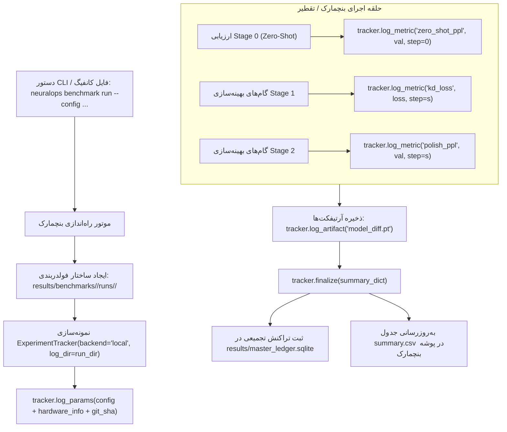

# معماری استانداردسازی ذخیره‌سازی بنچمارک‌ها، کانفیگ‌ها و CLI در NeuralOps

**تاریخ تدوین:** ۴ نوامبر ۲۰۲۶
**مؤلف:** طه مجلسی (`tahamaj4@gmail.com`)
**مخزن:** `NeuralOps` (شاخه `main`)
**وضعیت:** طرح معماری و گزارش بررسی عمیق (Deep Architectural Audit & Specification)

---

## ۱. پاسخ مستقیم به سوال: وضعیت ذخیره‌سازی داده‌ها در دیتابیس

**بله، دقیقاً تمام اطلاعات بنچمارک‌ها و ران‌ها در دیتابیس ذخیره است.**
در حال حاضر فایل مرجع اصلی دیتابیس در مسیر [`results/master_ledger.sqlite`](file:///Users/tahamajs/Documents/uni/Project/results/master_ledger.sqlite) قرار دارد و شامل جداول زیر با رکوردهای واقعی و تاییدشده است:

1. **جدول `results` (شامل ۲,۶۳۵ ردیف رکورد بنچمارک):**
   - دارای ۲۷ فیلد فرنسیک شامل: `record_id`, `module_name`, `category`, `family`, `version_tag`, `status`, `timestamp_utc`, `git_commit_sha`, `algorithm`, `backbone`, `dataset`, `rank`, `seq_len`, `batch_size`, `dtype`, `hardware`, `accuracy`, `retention_pct`, `ppl`, `latency_triton_ms`, `latency_pytorch_ms`, `speedup_x`, `peak_vram_mb`, `throughput_tok_s`, `cosine_sim`, `raw_json`.
2. **جدول `qwen_wikitext_kd_ablation` (شامل ۱۳ ردیف ران تقطیر و PPL مدل Qwen2.5 روی WikiText-2):**
   - شامل فیلدهای: `timestamp`, `model_name`, `dataset`, `module`, `teacher_baseline_ppl`, `zero_shot_ppl`, `isolated_ppl`, `polished_ppl`, `ppl_delta`, `total_time_s`, `status`.
3. **جدول `layerwise_kd_ablation` (ران‌های SST-2 با دقت و ریتنشن ۸۷.۰۱٪):**
   - شامل فیلدهای: `zero_shot_acc`, `isolated_acc`, `polished_acc`, `retention_pct`, `total_time_s`.

---

## ۲. آسیب‌شناسی وضعیت فعلی (پوشه‌ها، کانفیگ‌ها و CLI)

پس از پیمایش عمیق دایرکتوری‌های پروژه، نقاط ضعف زیر شناسایی شد:

### الف) پراکندگی فایل‌های نتایج در ریشه `results/`
هم‌اکنون در پوشه `results/` بیش از **۱۶۷ فایل و پوشه مختلف** (شامل لاگ‌های موقت، فایل‌های csv متفرقه و خروجی‌های json) در یک سطح ریخته شده‌اند. این مسئله باعث می‌شود:
- مشخص نباشد کدام خروجی متعلق به کدام بنچمارک خاص است.
- متادیتا، کانفیگ اجرایی، و نسخه‌های سخت‌افزاری همراه با ران در یک پوشه کپسوله نباشند.

### ب) دوگانگی و موازی‌کاری پوشه `benchmarks/` بیرونی با `neuralops/benchmarks/`
- در حال حاضر یک دایرکتوری در ریشه با نام `benchmarks/` وجود دارد که اسکریپت‌های رپر مثل `benchmark_all_26_comprehensive.py` را نگه می‌دارد.
- هسته اصلی و موتورهای پردازشی بنچمارک‌ها در داخل پکیج در `neuralops/benchmarks/` و `neuralops/cli/bench_cmd.py` پیاده‌سازی شده‌اند.
- **نتیجه:** کاربر سردرگم می‌شود که آیا باید از `python benchmarks/...` استفاده کند یا از دستور استاندارد `neuralops benchmark run ...`. طبق اصول طراحی مدرن، تمام این قابلیت‌ها باید از درون خود پکیج و از طریق دستور CLI کنترل شوند.

### ج) وضعیت سیستم پیکربندی (`neuralops/config/`)
- فایل‌های کانفیگ فعلی شامل کلاس‌های Pydantic و دیکشنری در `neuralops/config/` هستند (`loader.py`, `experiment_config.py`, `model_config.py`).
- اما ساختار فایل‌های YAML/JSON برای تعریف سناریوهای بنچمارک هنوز به شکل کامپکت و سازمان‌یافته با سیستم خروجی پوشه‌بندی لینک نشده است.

---

## ۳. طرح معماری پیشنهادی: پوشه‌بندی ساختاریافته بر اساس نوع بنچمارک

برای این‌که هر بنچمارک دقیقاً در پوشه خودش ذخیره شود و اطلاعات هر ران به شکل کامل و ژنرالایز ذخیره گردد، ساختار زیر طراحی شده است:

```
results/
├── master_ledger.sqlite               # دیتابیس متمرکز کل پروژه‌ها (همواره به‌روز)
│
├── benchmarks/                        # دسته‌بندی موضوعی بنچمارک‌ها
│   │
│   ├── qwen_wikitext_kd/              # بنچمارک تقطیر و جراحی توجه Qwen روی WikiText
│   │   ├── latest -> runs/run_20261104_174444/   # لینک نمادین به آخرین اجرا
│   │   ├── summary.csv                # خلاصه تجمیعی تمام ران‌های این بنچمارک
│   │   ├── summary.json
│   │   └── runs/
│   │       └── run_20261104_174444/   # فولدر مجزا برای هر ران با متادیتای کامل
│   │           ├── run_manifest.json  # شامل کانفیگ کامل، کامیت گیت، درایور GPU، دما، زمان
│   │           ├── raw_metrics.csv    # خروجی عددی خام تک‌تک ماژول‌ها
│   │           ├── console.log        # لاگ متنی کامل خروجی ترمینال
│   │           └── checkpoint_delta.pt (در صورت فعال بودن)
│   │
│   ├── sst2_layerwise_kd/             # بنچمارک تقطیر لایه‌ای SST-2
│   │   ├── summary.csv
│   │   └── runs/
│   │       └── run_20261104_115300/
│   │           ├── run_manifest.json
│   │           └── raw_metrics.csv
│   │
│   ├── triton_kernels_26/             # بنچمارک ۲۶ کرنل تریتون
│   │   ├── summary.csv
│   │   └── runs/...
│   │
│   ├── cuda_microarchitecture_108/   # بنچمارک ۱۰۸ کرنل کودا
│   │   ├── summary.csv
│   │   └── runs/...
│   │
│   ├── context_scaling_32k/           # بنچمارک مقیاس‌پذیری طول توالی تا ۳۲ هزار توکن
│   │   ├── summary.csv
│   │   └── runs/...
│   │
│   └── serving_throughput/            # بنچمارک ثروپوت سرورینگ (vLLM / SGLang / TGI)
│       ├── summary.csv
│       └── runs/...
```

---

## ۴. استانداردهای کپسوله‌سازی اطلاعات هر ران (`run_manifest.json`)

در هر فولدری که برای یک ران ایجاد می‌شود، باید یک شناسنامه کامل از ران ثبت گردد تا تکرارپذیری ۱۰۰٪ فراهم شود:

```json
{
  "run_id": "run_20261104_174444",
  "benchmark_type": "qwen_wikitext_kd",
  "timestamp_utc": "2026-11-04T14:14:44Z",
  "git_provenance": {
    "commit_sha": "59af39ee7c",
    "branch": "main",
    "is_dirty": false
  },
  "environment": {
    "hostname": "GPU-3090-1",
    "gpu_name": "NVIDIA GeForce RTX 3090",
    "gpu_vram_total_mb": 24268,
    "cuda_driver": "465.19.01",
    "cuda_runtime": "11.3",
    "pytorch_version": "1.12.1+cu113",
    "python_version": "3.10.11"
  },
  "hyperparameters": {
    "model_name": "Qwen/Qwen2.5-0.5B",
    "dataset": "WikiText-2",
    "seq_len": 512,
    "batch_size": 4,
    "isolated_steps": 80,
    "polish_steps": 30,
    "isolated_lr": 0.0005,
    "polish_lr": 0.0001,
    "loss_chunk_size": 64
  },
  "summary_metrics": {
    "teacher_baseline_ppl": 16.06,
    "tested_modules": ["cosformer", "linear_attention", "gla_attention", "svd_linear_attention"],
    "passed_modules": ["cosformer", "linear_attention", "gla_attention", "svd_linear_attention"],
    "failed_modules": ["decay_linear_attention"]
  }
}
```

---

## ۵. نقشه راه استانداردسازی CLI و یکپارچه‌سازی با کانفیگ‌ها

### مرحله ۱: حذف پوشه موازی `benchmarks/` بیرونی
تمام لاجیک‌ها و فایل‌های بنچمارک در پکیج درونی [`neuralops/benchmarks/`](file:///Users/tahamajs/Documents/uni/Project/neuralops/benchmarks/) وجود دارند. فایل‌های موجود در دایرکتوری بیرونی `benchmarks/` فقط رپرهای لاغر بودند.
- با حذف دایرکتوری بیرونی `benchmarks/`، ریشه پروژه تمیز شده و همه چیز از درون سورس پکیج و دستور CLI هدایت می‌شود.

### مرحله ۲: کانفیگ‌محور کردن بنچمارک‌ها از طریق `neuralops/config/`
تعریف فایل‌های ساختاریافته YAML برای سناریوهای مختلف در `neuralops/config/benchmarks/`:
- `qwen_kd_wikitext.yaml`
- `sst2_layerwise.yaml`
- `triton_comprehensive.yaml`
- `cuda_microarchitecture.yaml`
- `context_extrapolation_32k.yaml`

نمونه ساختار کانفیگ YAML:
```yaml
benchmark:
  name: "qwen_wikitext_kd"
  category: "knowledge_distillation"
  output_root: "results/benchmarks/qwen_wikitext_kd"
model:
  name: "Qwen/Qwen2.5-0.5B"
  type: "causal_lm"
dataset:
  name: "wikitext"
  subset: "wikitext-2-raw-v1"
  seq_len: 512
  batch_size: 4
training:
  isolated_steps: 80
  polish_steps: 30
  isolated_lr: 5.0e-4
  polish_lr: 1.0e-4
ledger:
  sqlite_path: "results/master_ledger.sqlite"
```

### مرحله ۳: فراخوانی واحد و ژنرالایز از طریق دستور CLI
به جای اجرای مستقیم فایل‌های پایتون، کلیه عملیات بنچمارک با دستور زیر انجام خواهد شد:
```bash
neuralops benchmark run --config neuralops/config/benchmarks/qwen_kd_wikitext.yaml
```
یا با override کردن پارامترها از ترمینال:
```bash
neuralops benchmark run --benchmark qwen_wikitext_kd --modules cosformer,linear_attention --device cuda:0
```

موتور ذخیره‌ساز (`neuralops.results_saver`) به صورت خودکار:
1. دایرکتوری متناظر با بنچمارک را در `results/benchmarks/<benchmark_name>/runs/<run_id>/` می‌سازد.
2. متادیتای سیستم و گیت و هایپرپارامترها را در `run_manifest.json` کپسوله می‌کند.
3. متریک‌های ارزیابی را در CSV و JSON ران ذخیره می‌نماید.
4. جدول خلاصه‌ی کلی آن بنچمارک (`summary.csv`) را به‌روزرسانی می‌کند.
5. یک تراکنش اتمیک در دیتابیس متمرکز `results/master_ledger.sqlite` ثبت می‌نماید.

---

## ۶. اقدامات مورد نیاز بعدی برای تایید شما

اگر این طرح و ساختار مورد تایید شماست، مراحل زیر به ترتیب و بدون دستکاری در لاجیک‌های اصلی کد پیاده‌سازی خواهد شد:
1. **ایجاد کلاس ذخیره‌ساز استاندارد `BenchmarkRunArtifactSaver`** در `neuralops/results_saver/`.
2. **انتقال و سازمان‌دهی کانفیگ‌های YAML** در `neuralops/config/benchmarks/`.
3. **متصل کردن زیرفرمان `neuralops benchmark run`** در `neuralops/cli/bench_cmd.py` به موتور ذخیره‌ساز.
4. **حذف ایمن پوشه بیرونی `benchmarks/`** و تمیزسازی فایل‌های پراکنده در ریشه `results/`.
5. **بازنویسی کامل `README.md`** با دستورالعمل‌های جدید CLI و توضیح شفاف مسیرهای ذخیره‌سازی.

---

# بخش دوم: اتصال و یکپارچه‌سازی پکیج رهگیری `neuralops.tracking` با سیستم ذخیره‌سازی نتایج بنچمارک‌ها

## ۱. تحلیل و بررسی تخصصی زیرسیستم `neuralops/tracking/`

پکیج رهگیری در مسیر [`neuralops/tracking/`](file:///Users/tahamajs/Documents/uni/Project/neuralops/tracking/) یکی از تمیزترین و ماژولارترین بخش‌های طراحی‌شده در NeuralOps است. ساختار این زیرسیستم شامل اجزای زیر است:
- **`tracker.py` (`ExperimentTracker`):** الگوی طراحی Facade متمرکز که تمام فراخوانی‌ها برای ثبت پارامترها (`log_params`)، لاگ کردن پیوسته متریک‌ها در هر استپ (`log_metric` / `log_metrics`)، ذخیره فایل‌ها و نمودارها به عنوان آرتیفکت (`log_artifact`) و بستن رسمی ران (`finalize`) را مدیریت می‌کند. همچنین متد `get_callback()` آن یک Callback رسمی سازگار با Hugging Face Transformers ارائه می‌دهد.
- **`backends.py` (`BaseTracker`, `LocalTracker`, `TensorBoardTracker`, `WandBTracker`, `MLflowTracker`):** چهار بک‌اند قدرتمند رهگیری:
  1. `LocalTracker`: ذخیره بی‌درنگ استپ‌به‌استپ متریک‌ها به صورت JSON Lines (`.jsonl`)، هایپرپارامترها (`params.json`) و کپی فیزیکی آرتیفکت‌ها.
  2. `TensorBoardTracker`: ذخیره پیشرفته اسکالرها و مقادیر هایپرپارامتر (`hparams`) در فرمت باینری TensorBoard Event برای بازبینی در UI وب محلی.
  3. `WandBTracker`: اتصال ابری یا محلی به پلتفرم Weights & Biases.
  4. `MLflowTracker`: رهگیری استاندارد سازمانی در سرور MLflow.
- **`callbacks.py` (`TrackerCallback`):** لیسنر رویدادهای آموزش برای فریم‌ورک‌های استاندارد یادگیری عمیق.

---

## ۲. حلقه مفقوده: چرا تاکنون این رهگیری به شکل ۱۰۰٪ با بنچمارک‌ها لینک نبوده است؟

در وضعیت پیشین، اسکریپت‌های بنچمارک (مانند `run_qwen_wikitext_kd_ablation.py` یا بنچمارک‌های موجود در `benchmarks/`) تنها در **پایان کار** یک فایل خروجی CSV یا JSON تولید کرده و رکورد نهایی را به صورت استاتیک در SQLite می‌نوشتند.
**پیامد این موضوع:**
- ترند استپ‌به‌استپ لاس (Loss Curve) در طول گام‌های تقطیر یا بنچمارک ضبط نمی‌شد.
- اطلاعات تله‌متری فرکانسی سخت‌افزار (مانند نوسانات حافظه VRAM در هر استپ و دمای GPU) با هایپرپارامترها کپسوله نمی‌شد.
- اگر رانی در میانه‌ی راه متوقف می‌شد، هیچ فایل لاگ استپ‌محوری (`.jsonl`) در پوشه مقصد آن ران وجود نداشت تا پیشرفت تا آن نقطه را نشان دهد.

---

## ۳. ایده و معماری جامع یکپارچه‌سازی: پیوند `tracking` با `results/benchmarks/<benchmark_name>/runs/<run_id>/`

طرح معماری جدید، سیستم `ExperimentTracker` را به عنوان هسته لاگینگ تمام بنچمارک‌ها درون `neuralops/cli/bench_cmd.py` و `neuralops/benchmarks/` قرار می‌دهد. جریان کار به شکل زیر ساختاردهی می‌شود:



---

## ۴. جزییات ساختار ذخیره‌سازی داده‌ها درون پوشه هر ران

با اتصال `LocalTracker` و (در صورت انتخاب کاربر) `TensorBoardTracker`، پوشه خروجی هر ران حاوی فایل‌های استاندارد و غنی زیر خواهد بود:

```
results/benchmarks/qwen_wikitext_kd/runs/run_20261104_174444/
├── run_manifest.json          # مشخصات کامل محیط، گیت کامیت، پایتون و هایپرپارامترها
├── params.json                # کپی دقیق پارامترهای ثبت‌شده توسط ExperimentTracker
├── metrics.jsonl              # لاگ بی‌درنگ خط‌به‌خط مقادیر لاس، PPL و VRAM در هر استپ
├── summary.json               # خلاصه‌ی وضعیت خروجی ران تولیدشده توسط finalize()
├── raw_metrics.csv            # جدول مقایسه‌ای ستونی عملکرد ماژول‌ها در این ران
├── console.log                # لاگ استاندارد خروجی ترمینال (stdout / stderr)
├── events.out.tfevents.*      # فایل باینری TensorBoard (قابل مشاهده مستقیم با tensorboard --logdir)
└── artifacts/                 # دایرکتوری آرتیفکت‌های اختیاری (پلات‌ها، ماتریس‌های کاهش‌یافته SVD)
```

### نمونه محتوای یک خط در `metrics.jsonl`:
```json
{"name": "train/kd_loss", "value": 0.4821, "step": 45, "timestamp": "2026-11-04T14:15:30.123456"}
{"name": "eval/perplexity", "value": 4033629.73, "step": 80, "timestamp": "2026-11-04T14:16:10.789012"}
{"name": "hardware/peak_vram_mb", "value": 4210.5, "step": 80, "timestamp": "2026-11-04T14:16:11.000000"}
```

---

## ۵. نحوه پشتیبانی و سوییچ در CLI (`neuralops benchmark`)

در سیستم CLI متمرکز [`neuralops/cli/bench_cmd.py`](file:///Users/tahamajs/Documents/uni/Project/neuralops/cli/bench_cmd.py)، آرگومان‌های مرتبط با `tracking` اضافه خواهند شد تا کاربر بتواند بدون تغییر حتی یک خط کد، بک‌اند رهگیری را تغییر دهد:

```bash
# ۱. اجرای پیش‌فرض محلی با رهگیری کامل (Local + TensorBoard):
neuralops benchmark run --config neuralops/config/benchmarks/qwen_kd_wikitext.yaml

# ۲. اجرای با لاگین مستقیم به Weights & Biases (WandB):
neuralops benchmark run --config ... --tracking-backend wandb --project "neuralops-qwen-kd"

# ۳. اجرای با لاگین به سرور سازمانی MLflow:
neuralops benchmark run --config ... --tracking-backend mlflow --tracking-uri "http://hpc-headnode:5000"
```

### الگوریتم پیاده‌سازی در پایتون:
```python
from neuralops.tracking import ExperimentTracker

def execute_tracked_benchmark(config: dict, run_dir: str):
    # راه‌اندازی ترکر با دایرکتوری مقصد همان ران
    tracker = ExperimentTracker(
        backend=config.get("tracking_backend", "local"),
        experiment_name=config["benchmark_name"],
        log_dir=run_dir,
        project=config.get("project", "neuralops"),
        config_dict=config
    )

    # لاگ کردن هایپرپارامترها و مشخصات سخت‌افزاری
    tracker.log_params(config["hyperparameters"])
    tracker.log_params(get_system_telemetry())

    try:
        for step, batch in enumerate(dataset):
            loss = model_step(batch)
            tracker.log_metric("loss", loss, step=step)

        final_ppl = evaluate_ppl()
        tracker.log_metric("final_ppl", final_ppl)

        # نهایی‌سازی و کپسوله‌سازی تمام آرتیفکت‌ها
        tracker.finalize({"status": "SUCCESS", "final_ppl": final_ppl})
    except Exception as e:
        tracker.finalize({"status": f"FAILED: {e}"})
        raise
```

---

## ۶. مزایای این معماری برای پروژه‌های مقیاس‌بزرگ

1. **سازگاری کامل با کلاستر و آفلاین بودن:** کلاس `LocalTracker` هیچ نیازی به دسترسی اینترنت ندارد و حتی روی نودهای محاسباتی دانشگاه شریف (که دسترسی اینترنت آن‌ها بسته است) ۱۰۰٪ پایدار کار می‌کند.
2. **امکان مانیتورینگ زنده:** با دستور `tensorboard --logdir results/benchmarks`، پژوهشگر می‌تواند پیشرفت تمام ران‌ها را در قالب نمودارهای تعاملی در مرورگر ببیند.
3. **رهگیری جامع و بدون از دست رفتن داده:** هر ران به عنوان یک کپسول مستقل و خودکفا عمل می‌کند که اگر سال‌ها بعد بازبینی شود، دقیقاً مشخص است با چه ورژنی از درایور، کدام کامیت گیت و با چه منحنی یادگیری‌ای به آن نتیجه رسیده است.
