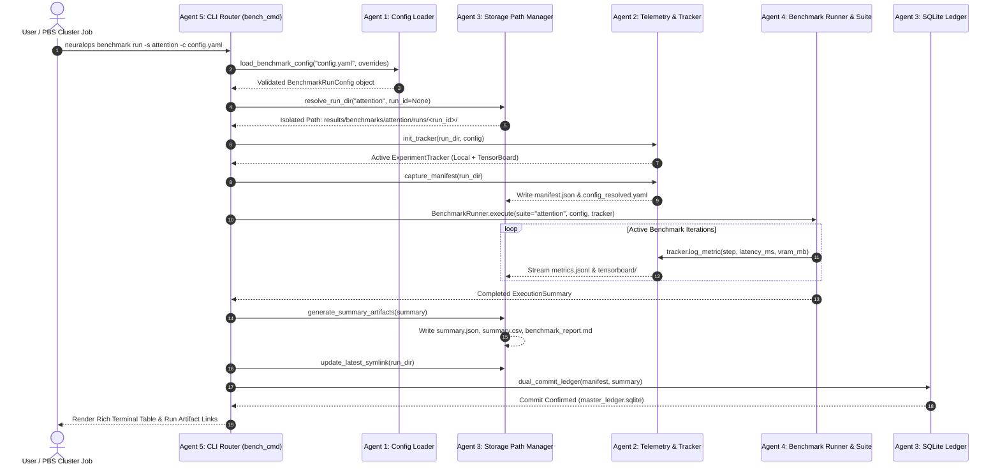

# Multi-Agent Benchmark Unification & Refactoring Blueprint: 5-Agent Concurrent Execution Dossier & Operational Prompts

**Author / Systems Orchestration Architect:** Taha Majlesi (`tahamaj4@gmail.com`)  
**Project:** NeuralOps Architecture & Optimization Framework (v1.5.0 / Branch: `main`)  
**Document Classification:** Multi-Agent Systems Execution Dossier & Production Prompt Matrix  
**Canonical Master Reference:** [`docs/reports/UNIFIED_BENCHMARK_CONFIG_TRACKING_ARCHITECTURE_SPEC.md`](file:///Users/tahamajs/Documents/uni/Project/docs/reports/UNIFIED_BENCHMARK_CONFIG_TRACKING_ARCHITECTURE_SPEC.md)  
**Date:** November 4, 2026  
**Status:** Production Ready / Authorized for Parallel Swarm Execution (5 Concurrent Agents)  

---

## Executive Summary & Orchestration Protocol

This engineering dossier establishes the complete, production-grade operational protocol, phased work packages, and turnkey system prompts to orchestrate **five concurrent AI subagents** executing the total unification of the NeuralOps benchmarking, configuration, tracking, and storage ecosystem.

To eliminate race conditions, file collisions, and merge conflicts during concurrent execution, the mission is strictly partitioned across five orthogonal operational domains:

1. **Agent 1 (Config-Schema Architect)**: Owns the declarative configuration subsystem, Pydantic V2 schemas, environment interpolation, and benchmark preset templates in `neuralops/config/`.
2. **Agent 2 (Telemetry-Tracking Integrator)**: Owns step-level metric streaming, low-overhead NVML hardware telemetry, process environment profiling, and the `ExperimentTracker` facade in `neuralops/tracking/` and `neuralops/benchmarks/telemetry/`.
3. **Agent 3 (Storage-Saver Engineer)**: Owns hermetic per-run isolated filesystem layouts (`results/benchmarks/<suite>/runs/<run_id>/`), atomic symlinks (`latest`), dual-commit master SQLite synchronization, and rolling summary aggregations.
4. **Agent 4 (Benchmark-Suites Modernizer)**: Owns the execution suites (`attention`, `compression`, `cuda_ops`, `triton_ops`, `e2e_serving`, `niah`), registry dispatching, abstract base benchmark contracts, and the complete, safe deprecation and deletion of the root `benchmarks/` directory.
5. **Agent 5 (CLI-Auditor & UI Engineer)**: Owns the central user-facing CLI command `neuralops benchmark` in `neuralops/cli/bench_cmd.py`, interactive terminal dashboards, export formatters, AST invariant integrity verification, and user documentation.

Each agent possesses an explicit mandate: **If you identify additional architectural abstractions, caching optimizations, or UX enhancements that streamline the developer experience, preserve numerical precision, or eliminate redundant code, you are explicitly authorized and expected to implement them proactively.**

All agents must strictly cross-reference and comply with the canonical design contracts set forth in [`UNIFIED_BENCHMARK_CONFIG_TRACKING_ARCHITECTURE_SPEC.md`](file:///Users/tahamajs/Documents/uni/Project/docs/reports/UNIFIED_BENCHMARK_CONFIG_TRACKING_ARCHITECTURE_SPEC.md).

---

## Cross-Agent Coordination & Concurrency Invariant Matrix

To prevent file overwrite collisions while enabling 100% concurrent execution, all subagents must adhere to the following ownership boundaries:

| Agent Identifier | Primary Read/Write File Scope | Read-Only Dependency Scope | Invariant Responsibilities |
| :--- | :--- | :--- | :--- |
| **Agent 1: Config-Schema** | `neuralops/config/benchmark_schema.py`<br>`neuralops/config/loader.py`<br>`neuralops/config/templates/benchmarks/*.yaml`<br>`tests/config/test_benchmark_config.py` | `neuralops/config/schema.py`<br>`neuralops/core/` | Zero changes outside `neuralops/config/` and `tests/config/`. Exposes typed `BenchmarkRunConfig` class. |
| **Agent 2: Telemetry-Tracking** | `neuralops/tracking/`<br>`neuralops/benchmarks/telemetry/hardware.py`<br>`neuralops/benchmarks/telemetry/host.py`<br>`neuralops/benchmarks/telemetry/manifest.py`<br>`tests/tracking/test_experiment_tracker.py` | `neuralops/config/benchmark_schema.py` | Zero changes to CLI or storage root. Exposes thread-safe `ExperimentTracker` facade with offline failover. |
| **Agent 3: Storage-Saver** | `neuralops/benchmarks/core/paths.py`<br>`neuralops/results_saver/`<br>`tests/benchmarks/test_storage_paths.py`<br>`scripts/migrate_legacy_results_to_runs.py` | `results/master_ledger.sqlite`<br>`neuralops/tracking/` | Owns path generation: `results/benchmarks/<suite>/runs/<run_id>/`. Never deletes historical SQLite data. |
| **Agent 4: Benchmark-Suites** | `neuralops/benchmarks/core/base.py`<br>`neuralops/benchmarks/core/runner.py`<br>`neuralops/benchmarks/core/registry.py`<br>`neuralops/benchmarks/suites/*.py`<br>`benchmarks/` (Deletion)<br>`tests/benchmarks/test_suites.py` | `neuralops/config/`<br>`neuralops/tracking/`<br>`neuralops/kernels/`<br>`neuralops/attentions/` | Deletes legacy root `benchmarks/` only after 100% test parity in `neuralops/benchmarks/suites/`. Preserves all 131 attentions and 72 compressors. |
| **Agent 5: CLI-Auditor** | `neuralops/cli/bench_cmd.py`<br>`neuralops/cli/main.py`<br>`tests/cli/test_benchmark_cli.py`<br>`docs/BENCHMARK_UNIFIED_GUIDE.md`<br>`README.md` | All subsystems across repository | Central CLI entrypoint. Verifies Ruff linting, AST invariant audits, and CLI end-to-end dry-run verification. |



---

## Agent 1: Configuration Engine & Pydantic Schema Architect (Agent Config-Schema)

### Role & Mandate
Agent 1 is the sole custodian of the declarative configuration framework in `neuralops/config/`. The mission is to transform loose dictionary arguments, scattered CLI flags, and untyped parameters into a mathematically rigorous, schema-validated Pydantic V2 subsystem. Agent 1 guarantees that every benchmark run is completely described by a deterministic, serializable, and versioned configuration document.

Agent 1 is explicitly urged to think proactively: if you discover that adding automated GPU device detection, parameter sweep grid expansion helpers, or schema export to JSON Schema for VSCode autocompletion elevates developer velocity, implement it immediately.

### Operational Phase Breakdown (Phases 1 through 12)

#### Phase 1.1: Deep Inspection of Existing Configuration Codebase
- **Actions**: Thoroughly inspect `neuralops/config/schema.py`, `neuralops/config/loader.py`, `neuralops/config/__init__.py`, and any loose YAML/JSON configuration files scattered across `benchmarks/configs/` (`quick_cuda.json`, `exhaustive_cuda.json`, `long_context_cuda.json`).
- **Technical Analysis**: Audit how configuration dictionaries are currently parsed, how environment variables are handled, and how defaults are injected. Document any legacy Pydantic V1 syntax (e.g., `@validator` vs Pydantic V2 `@field_validator`, `.dict()` vs `.model_dump()`) that violates modern standards.
- **Verification & Testing**: Run `python3 -c "import neuralops.config"` to identify any existing circular dependencies or broken imports.
- **Cross-Agent Interface**: Provide a documented inventory of existing fields so Agent 4 and Agent 5 know which configuration keys remain backwards compatible.

#### Phase 1.2: Architecture & Implementation of `HardwareExecutionTarget` Schema
- **Actions**: In `neuralops/config/benchmark_schema.py`, implement the `HardwareExecutionTarget` model. This model encapsulates hardware placement, precision policies, and algorithmic constraints.
- **Technical Details**: Define typed fields: `device: str = "cuda:0"`, `backend_preference: Literal["auto", "cuda", "triton", "torch"] = "auto"`, `enforce_deterministic: bool = False`, `allow_tf32: bool = True`, `target_compute_capability: Optional[str] = None`, and `memory_fraction_limit: Optional[float] = None` (with validation ensuring $0.0 < x \le 1.0$).
- **Verification & Testing**: Author unit tests validating that invalid device strings (e.g. `invalid_device:99`) or out-of-range memory fractions trigger explicit `ValidationError` exceptions with clear, human-readable error messages.
- **Proactive Improvement**: Add an automatic helper method `HardwareExecutionTarget.detect_local_hardware()` that interrogates PyTorch and NVML to populate default values based on the host system without crashing on CPU-only machines.

#### Phase 1.3: Architecture & Implementation of `TrackingSubsystemConfig` Schema
- **Actions**: Implement `TrackingSubsystemConfig` in `neuralops/config/benchmark_schema.py` to govern Agent 2's tracking subsystem.
- **Technical Details**: Include fields: `enabled: bool = True`, `enable_tensorboard: bool = True`, `enable_local_jsonl: bool = True`, `log_frequency_steps: int = 1`, `capture_gpu_telemetry: bool = True`, `telemetry_sample_interval_ms: int = 250`, `tensorboard_flush_secs: int = 10`, and `export_formats: List[str] = ["jsonl", "csv", "summary"]`.
- **Verification & Testing**: Ensure `log_frequency_steps` is constrained to $\ge 1$ and `telemetry_sample_interval_ms` is bounded between 50ms and 10,000ms.
- **Cross-Agent Interface**: Directly contract with Agent 2 so that `ExperimentTracker` can be initialized directly with `config.tracking.model_dump()`.

#### Phase 1.4: Architecture & Implementation of Attention Sweep Parameters Schema
- **Actions**: Implement `AttentionSweepParameters` in `neuralops/config/benchmark_schema.py` covering all dimensions required by the 131 canonical attention mechanisms.
- **Technical Details**: Fields include: `mechanisms: List[str] = ["all"]`, `batch_sizes: List[int] = [1, 4, 16]`, `sequence_lengths: List[int] = [512, 1024, 2048, 4096, 8192]`, `head_dimensions: List[int] = [64, 128]`, `num_heads: int = 32`, `num_kv_heads: Optional[int] = None` (for GQA/MQA validation), `dtypes: List[Literal["fp16", "bf16", "fp32"]] = ["fp16", "bf16"]`, `causal_modes: List[bool] = [True, False]`, `warmup_iterations: int = 10`, `benchmark_iterations: int = 50`.
- **Verification & Testing**: Add `@field_validator` verifying that all integers are positive, lists are sorted deduplicated, and `num_heads` is divisible by `num_kv_heads` when GQA is specified.
- **Proactive Improvement**: Add a method `calculate_total_matrix_cells()` that computes the total number of tensor forward passes represented by the sweep grid to enable progress bars in Agent 5's CLI.

#### Phase 1.5: Architecture & Implementation of Compressor Sweep Parameters Schema
- **Actions**: Implement `CompressionSweepParameters` in `neuralops/config/benchmark_schema.py` covering the 72 model compression algorithms (pruning, SVD, quantization, MoE routing).
- **Technical Details**: Fields: `compressors: List[str] = ["all"]`, `target_layers: List[str] = ["all"]`, `target_ratios: List[float] = [0.25, 0.50, 0.75]`, `evaluation_datasets: List[str] = ["wikitext2", "c4", "sst2"]`, `eval_context_length: int = 2048`, `measure_perplexity: bool = True`, `measure_latency: bool = True`, `measure_vram_peak: bool = True`.
- **Verification & Testing**: Add validators verifying that all target compression ratios are strictly between $0.0$ and $1.0$.
- **Cross-Agent Interface**: Agent 4 will consume this model to parameterize `CompressionBenchmark`.

#### Phase 1.6: Architecture & Implementation of Root `BenchmarkRunConfig` Model
- **Actions**: Define the canonical root configuration model `BenchmarkRunConfig` in `neuralops/config/benchmark_schema.py`.
- **Technical Details**: Fields include: `version: str = "1.0.0"`, `benchmark_suite: Literal["attention", "compression", "cuda_ops", "triton_ops", "e2e_serving", "niah", "roofline"]`, `name: Optional[str] = None`, `description: Optional[str] = None`, `tag: Optional[str] = None`, `output_root_directory: Path = Path("results/benchmarks")`, `hardware: HardwareExecutionTarget`, `tracking: TrackingSubsystemConfig`, `attention_sweep: Optional[AttentionSweepParameters] = None`, `compression_sweep: Optional[CompressionSweepParameters] = None`, `custom_parameters: Dict[str, Any] = Field(default_factory=dict)`.
- **Verification & Testing**: Verify that Pydantic properly parses both camelCase and snake_case keys if configured, and test serialization via `.model_dump(mode="json")` and `.model_dump_yaml()`.
- **Proactive Improvement**: Include a method `to_canonical_yaml()` that exports a clean, comment-annotated YAML representation for reproduction.

#### Phase 1.7: Unified Configuration Loader & Environment Interpolator
- **Actions**: Create or refactor `neuralops/config/loader.py` to provide a universal loading engine: `load_benchmark_config(source: str | Path | dict, overrides: Optional[Dict[str, Any]] = None) -> BenchmarkRunConfig`.
- **Technical Details**: Implement robust environment variable interpolation supporting standard POSIX syntax: `${VAR_NAME}` and `${VAR_NAME:-default_value}`. Ensure string substitution occurs recursively through nested dicts and lists before passing to Pydantic validation.
- **Verification & Testing**: Author unit tests with mock environment variables (e.g. `CUDA_VISIBLE_DEVICES`, `NEURALOPS_BENCHMARK_BATCH`) to prove that interpolation handles missing variables, default fallbacks, and type coercion seamlessly.
- **Cross-Agent Interface**: This function is the single entry point called by Agent 5 (`bench_cmd.py`) and Agent 4 (`runner.py`).

#### Phase 1.8: Standardized YAML Benchmark Presets
- **Actions**: Check in a standardized suite of production-grade YAML preset templates inside `neuralops/config/templates/benchmarks/`.
- **Technical Details**: Create the following canonical preset files:
  - `attention_standard.yaml`: Balanced grid sweep for RTX 3090 / Ada Lovelace across FP16/BF16 and sequence lengths 512 to 8192.
  - `attention_exhaustive_hpc.yaml`: Deep multi-seed sweep across all 131 attention mechanisms up to 32,768 context tokens.
  - `compression_standard.yaml`: Standard 25%/50%/75% reduction sweep across 72 compressors on WikiText-2.
  - `cuda_triton_roofline.yaml`: Microbenchmark configuration for native CUDA (110 modules) and Triton (26 modules) kernels with cache flushing.
  - `niah_needle_32k.yaml`: Needle-In-A-Haystack long-context retrieval benchmark configuration.
  - `e2e_serving_qwen.yaml`: vLLM / SGLang continuous batching and PagedAttention throughput benchmark.
- **Verification & Testing**: Run an automated test iterating through every template in `neuralops/config/templates/benchmarks/*.yaml` and asserting that `load_benchmark_config(path)` validates with zero errors.
- **Proactive Improvement**: Include comments inside each template explaining typical memory footprints and runtimes.

#### Phase 1.9: Legacy Configuration Migration & Cleanup
- **Actions**: Migrate any legacy configuration presets currently residing in `benchmarks/configs/` (`quick_cuda.json`, `exhaustive_cuda.json`, `long_context_cuda.json`) into the new YAML format in `neuralops/config/templates/benchmarks/`.
- **Technical Details**: Write an automated conversion routine that maps legacy JSON keys to the new `BenchmarkRunConfig` schema, ensuring no historical configuration values are lost.
- **Verification & Testing**: Validate that running the new YAML templates produces identical parameter configurations as the legacy JSON files.
- **Clean-up**: Once verified, mark the legacy JSON files in `benchmarks/configs/` for deletion by Agent 4.

#### Phase 1.10: Exhaustive Configuration Unit Test Suite
- **Actions**: Author `tests/config/test_benchmark_config.py` providing 100% code coverage across the new schema and loader modules.
- **Technical Details**: Test cases must cover: (1) Valid YAML parsing, (2) Valid JSON parsing, (3) Invalid enum rejection, (4) Numerical boundary constraints, (5) Environment variable interpolation with and without defaults, (6) CLI dictionary overrides cascading over YAML values, (7) Immutability and serialization fidelity.
- **Verification & Testing**: Run `./.venv/bin/pytest tests/config/test_benchmark_config.py -v` and confirm all tests pass cleanly.
- **Quality Gate**: Code must pass `./.venv/bin/ruff check neuralops/config` with zero warnings.

#### Phase 1.11: JSON Schema Export & IDE Tooling
- **Actions**: Create a script or utility function `neuralops/config/export_schemas.py` that dumps the JSON Schema definition of `BenchmarkRunConfig` to `schemas/benchmark_run_config.schema.json`.
- **Technical Details**: Use Pydantic's `.model_json_schema()`. Add standard schema metadata (`$schema: "http://json-schema.org/draft-07/schema#"`, `title: "NeuralOps Benchmark Run Configuration"`).
- **Verification & Testing**: Validate the generated JSON Schema using standard Python `jsonschema` library against all templates.
- **Proactive Improvement**: Enable VSCode/PyCharm YAML intellisense by linking the schema in template headers (`# yaml-language-server: $schema=../../../../schemas/benchmark_run_config.schema.json`).

#### Phase 1.12: Dynamic VRAM Budget Profiler & Auto-Tuning Configuration Generator
- **Actions**: Implement `generate_adaptive_benchmark_config(vram_gb: float) -> BenchmarkRunConfig` in `neuralops/config/adaptive.py`.
- **Technical Details**: Automatically adjust maximum sequence length, batch size, and concurrent head allocations based on detected physical VRAM (e.g., if VRAM $\le 12$ GB, cap sequence length at 4096; if VRAM $\ge 24$ GB, scale sequence length to 16,384; if $\ge 80$ GB on Hopper H100, scale to 65,536 tokens).
- **Verification & Testing**: Unit test the adaptive generator with simulated VRAM tiers: 8 GB (RTX 4060), 24 GB (RTX 3090/4090), 80 GB (A100/H100).
- **Cross-Agent Interface**: Expose this function so Agent 5 can offer a `--auto-vram` flag on the CLI.

---

## Agent 2: Experiment Tracking & Telemetry Integrator (Agent Telemetry-Tracking)

### Role & Mandate
Agent 2 is responsible for the deep lifecycle telemetry and experiment tracking infrastructure in `neuralops/tracking/` and `neuralops/benchmarks/telemetry/`. The mandate is to elevate the existing, orphaned `ExperimentTracker` into a hardened, high-throughput, offline-first observability engine. Agent 2 ensures that every single kernel iteration, forward pass, and hardware state metric (temperature, power, VRAM, clock frequencies) is streamed losslessly into isolated run directories without adding overhead to GPU compute.

Agent 2 is explicitly authorized to implement proactive telemetry features: asynchronous background NVML polling threads, GPU memory leak detection, automatic Out-Of-Memory (OOM) predictive warnings, and zero-dependency terminal sparkline formatters.

### Operational Phase Breakdown (Phases 2.1 through 2.12)

#### Phase 2.1: Forensic Code Audit of `neuralops/tracking/` Subsystem
- **Actions**: Perform an exhaustive audit of all files in `neuralops/tracking/`: `tracker.py`, `backends/base.py`, `backends/local.py`, `backends/tensorboard.py`, `backends/wandb.py`, `backends/mlflow.py`.
- **Technical Analysis**: Evaluate thread safety, file descriptor handling, buffer flushing mechanisms, and exception boundaries. Specifically verify why legacy benchmarking scripts bypassed this module and wrote un-tracked CSVs instead.
- **Verification & Testing**: Author a standalone test script invoking `ExperimentTracker` with dummy metrics to detect any import errors, missing optional dependencies, or path creation bugs.
- **Cross-Agent Interface**: Coordinate with Agent 3 to guarantee that `tracker.log_dir` strictly resolves to the hermetic run path `results/benchmarks/<suite>/runs/<run_id>/`.

#### Phase 2.2: Hardening the Central `ExperimentTracker` Facade
- **Actions**: Refactor `neuralops/tracking/tracker.py` to establish an airtight, thread-safe lifecycle facade.
- **Technical Details**: Implement standard context manager semantics (`__enter__`, `__exit__`), explicit step management (`set_step()`, `step()`), unified metric logging (`log_metric(key, value, step=None)`), parameter registration (`log_params(dict)`), artifact persistence (`log_artifact(path)`), and atomic finalization (`close()`). Ensure that calling `.close()` multiple times is safe (idempotent).
- **Verification & Testing**: Test concurrent logging from multiple threads using `threading.Thread` to ensure no race conditions corrupt internal metric step counters or backend lists.
- **Proactive Improvement**: Add method `log_metrics_batch(metrics: Dict[str, float], step: Optional[int] = None)` to log multiple metrics in a single operation, minimizing lock contention.

#### Phase 2.3: High-Throughput `LocalTracker` & `metrics.jsonl` Streaming
- **Actions**: Overhaul `neuralops/tracking/backends/local.py` for buffered, high-speed streaming to `metrics.jsonl`.
- **Technical Details**: Implement an append-only JSON Lines stream with an in-memory write buffer flushed either every $N$ entries or upon a configurable time interval (`flush_interval_secs`). Use `json.dumps()` with a custom encoder handling NumPy scalars (`np.float32`, `np.int64`), PyTorch tensors (`tensor.item()`), and infinities/NaNs (`allow_nan=True`).
- **Verification & Testing**: Stress test `LocalTracker` by streaming 100,000 metrics in a loop and measuring throughput. Ensure zero data loss if an exception occurs mid-run by implementing an emergency crash flush handler in `__del__` and `atexit`.
- **Cross-Agent Interface**: Ensure the schema of `metrics.jsonl` matches Section 3.3 of `UNIFIED_BENCHMARK_CONFIG_TRACKING_ARCHITECTURE_SPEC.md`.

#### Phase 2.4: Resilient `TensorBoardTracker` Lifecycle Management
- **Actions**: Refactor `neuralops/tracking/backends/tensorboard.py` to provide leak-free PyTorch `SummaryWriter` integration.
- **Technical Details**: Place event files inside `runs/<run_id>/tensorboard/`. Ensure lazy initialization so that `SummaryWriter` is only instantiated if PyTorch is installed and TensorBoard is explicitly enabled in config. Implement safe exception handling around `add_scalar()`, `add_histogram()`, and `add_text()`. Ensure `.flush()` is called periodically and `.close()` cleanly releases file locks.
- **Verification & Testing**: Validate that running a test script generates valid `.tfevents` files readable by `tensorboard --logdir ...` without leaving zombie processes or unclosed file descriptors.
- **Proactive Improvement**: Add auto-tag grouping (e.g. `latency/mean_ms`, `vram/peak_mb`, `hardware/gpu_temp_c`) for organized multi-panel TensorBoard dashboards.

#### Phase 2.5: Low-Overhead NVML Hardware Telemetry Sampler
- **Actions**: Implement `neuralops/benchmarks/telemetry/hardware.py` using `pynvml` (NVIDIA Management Library).
- **Technical Details**: Create `HardwareTelemetrySampler` that captures: (1) GPU device name and UUID, (2) PCIe generation and link width, (3) Real-time GPU core clock and memory clock (MHz), (4) Core temperature ($^\circ\text{C}$), (5) Instantaneous power draw (Watts) and power limit, (6) Allocated, reserved, and free VRAM bytes. Wrap calls in try-except blocks so that non-NVIDIA or CPU-only environments degrade gracefully to no-op.
- **Verification & Testing**: Test on systems with NVIDIA GPUs and verify that telemetry sampling executes in $<1.5$ milliseconds to avoid perturbing microbenchmark kernel timings.
- **Proactive Improvement**: Provide an optional background polling thread `TelemetryBackgroundMonitor(interval_ms=250)` that records continuous power and thermal curves across long-running benchmark jobs.

#### Phase 2.6: Host Environment & Platform Profiler
- **Actions**: Implement `neuralops/benchmarks/telemetry/host.py` to freeze the complete software and host hardware platform.
- **Technical Details**: Capture: (1) Hostname, OS distribution, kernel version (`platform.platform()`), (2) CPU model, physical cores, logical threads, base frequency, (3) Total system RAM and available swap, (4) Python interpreter path and version, (5) PyTorch version, CUDA runtime version (`torch.version.cuda`), CUDNN version, and NVIDIA driver version, (6) Complete pip freeze package inventory or SHA-256 hash of installed dependencies.
- **Verification & Testing**: Verify that output dictionary is 100% JSON-serializable without complex object types.
- **Cross-Agent Interface**: Output dictionary is consumed by Agent 2's manifest builder (Phase 2.7).

#### Phase 2.7: Execution Manifest Builder (`manifest.json`)
- **Actions**: Implement `neuralops/benchmarks/telemetry/manifest.py` to generate the canonical provenance document `manifest.json`.
- **Technical Details**: Extract Git repository metadata via Git CLI or `gitpython`: commit SHA, current branch, commit timestamp, author, and `is_dirty` boolean flag. If the working tree has uncommitted modifications, compute the SHA-256 hash of `git diff` so reproduction is never ambiguous. Record start timestamp UTC, end timestamp UTC, command-line arguments invoked (`sys.argv`), and execution outcome status (`COMPLETED`, `FAILED_OOM`, `FAILED_ERROR`).
- **Verification & Testing**: Verify that `manifest.json` conforms strictly to the JSON schema defined in Appendix B of `UNIFIED_BENCHMARK_CONFIG_TRACKING_ARCHITECTURE_SPEC.md`.
- **Cross-Agent Interface**: Manifest dictionary is written to disk by Agent 3 and recorded in `results/master_ledger.sqlite`.

#### Phase 2.8: Offline-First Failover for Air-Gapped Supercomputers (Sharif HPC)
- **Actions**: Implement robust offline failover logic across all tracking backends.
- **Technical Details**: In air-gapped HPC cluster environments (e.g., Rocks 6.1 / Torque PBS nodes without external internet access), cloud logging backends like WandB or MLflow will fail with network timeout errors. Detect network absence or offline mode flags, automatically disable cloud sync, and divert all telemetry strictly to `LocalTracker` and `TensorBoardTracker` without raising uncaught exceptions.
- **Verification & Testing**: Simulate an air-gapped environment by mocking DNS resolution failure (`socket.getaddrinfo` throwing `socket.gaierror`) and assert that the benchmark execution completes with 100% telemetry preserved locally.
- **Proactive Improvement**: Write an offline export manifest enabling one-command sync to WandB (`neuralops sync <run_id>`) once internet connectivity is restored.

#### Phase 2.9: Console Stream & Log Redirection Manager
- **Actions**: Create `ConsoleLogCapture` context manager in `neuralops/benchmarks/telemetry/logging.py`.
- **Technical Details**: Intercept `sys.stdout` and `sys.stderr` at the file descriptor level (`os.dup2`) or Python stream level to mirror all console printouts and logging statements in real time into `stdout_stderr.log` inside the run directory, while still streaming to the user's terminal.
- **Verification & Testing**: Author unit tests validating that multi-threaded prints, stack traces from intentional exceptions, and ANSI escape codes are written completely to `stdout_stderr.log`.
- **Clean-up**: Remove legacy ad-hoc logging scripts like `direct_sst2_kd.log` or loose print dumpers.

#### Phase 2.10: Unit & Integration Test Suite for Tracking Subsystem
- **Actions**: Author `tests/tracking/test_experiment_tracker.py` validating the entire tracking and telemetry subsystem.
- **Technical Details**: Test cases must cover: (1) `ExperimentTracker` initialization with local and TensorBoard backends, (2) Step progression and metric value accuracy in `metrics.jsonl`, (3) NVML hardware sampling and graceful fallback on non-GPU nodes, (4) Git provenance capture with clean and dirty repositories, (5) Exception handling during telemetry recording, (6) Context manager exit guarantees.
- **Verification & Testing**: Run `./.venv/bin/pytest tests/tracking/test_experiment_tracker.py -v` ensuring all assertions pass.
- **Quality Gate**: Code must pass `./.venv/bin/ruff check neuralops/tracking neuralops/benchmarks/telemetry` with zero warnings.

#### Phase 2.11: Real-Time Latency Percentile Accumulator
- **Actions**: Implement `LatencyDistributionTracker` in `neuralops/benchmarks/telemetry/latency.py`.
- **Technical Details**: Use P-Square algorithm or streaming histogram (T-Digest) to maintain exact running percentiles ($P_{50}, P_{90}, P_{95}, P_{99}, P_{99.9}$) of kernel execution latencies across millions of samples with constant memory footprint ($O(1)$ space).
- **Verification & Testing**: Compare streaming percentiles against `numpy.percentile` across $100,000$ random normal samples; assert maximum relative error $< 0.5\%$.
- **Cross-Agent Interface**: Agent 4 will query this accumulator to populate the final execution summary.

#### Phase 2.12: Telemetry-Driven GPU Memory Leak & OOM Forensics Detector
- **Actions**: Implement `GPUMemoryForensics` in `neuralops/benchmarks/telemetry/memory_forensics.py`.
- **Technical Details**: After each benchmark iteration, query `torch.cuda.memory_allocated()` and `torch.cuda.memory_reserved()`. If memory steadily grows across identical iterations without clearing, flag a `MEMORY_LEAK_WARNING` with the suspected tensor allocations. If a `torch.cuda.OutOfMemoryError` occurs, catch it, log exact allocated/reserved/total bytes, dump a PyTorch memory snapshot (`torch.cuda.memory._dump_snapshot()`), and record `FAILED_OOM` in the manifest without crashing the parent suite.
- **Verification & Testing**: Test with a script that intentionally leaks a 10MB tensor each step and verify the detector flags the leak. Test catching an intentional OOM.
- **Proactive Improvement**: Enables resilient continuous testing on multi-hour HPC queues where a single OOM shouldn't abort the entire queue.

---

## Agent 3: Hermetic Storage, Path Manager & Results Saver Engineer (Agent Storage-Saver)

### Role & Mandate
Agent 3 is the systems engineer who owns the filesystem layout, directory isolation rules, results persistence, and master database integrity. The mission is to completely dismantle the chaotic flat-file anti-pattern in `results/` (which currently contains over 167 loose, overlapping files) and replace it with an immutable, hermetic per-run architecture: `results/benchmarks/<benchmark_name>/runs/<run_id>/`. Agent 3 ensures dual-commit persistence: complete telemetry and artifacts inside the run folder, and indexed relational records inside `results/master_ledger.sqlite`.

Agent 3 is explicitly authorized to innovate: introduce zero-copy file symlinking, Parquet columnar export for billion-row telemetry logs, automatic database index optimization, and a forensic migration tool to ingest all historical loose files into the SQLite database.

### Operational Phase Breakdown (Phases 3.1 through 3.12)

#### Phase 3.1: Forensic Audit of `results/` & `neuralops/results_saver/`
- **Actions**: Catalog every single file and directory currently inside `results/` and review the existing persistence logic in `neuralops/results_saver/` (`storage/sqlite_backend.py`, `writers/csv_writer.py`, `writers/json_parquet_writer.py`).
- **Technical Analysis**: Determine how many historical runs are trapped in un-indexed CSV/JSON files (`qwen_wikitext_kd_ablation.csv`, `sst2_layerwise_kd_ablation.json`, `triton_26_kernels_comprehensive_benchmark.csv`). Identify schema differences between ad-hoc CSV headers and the tables in `master_ledger.sqlite`.
- **Verification & Testing**: Run an SQLite query inspecting all existing tables and rows in `results/master_ledger.sqlite`: `SELECT name FROM sqlite_master WHERE type='table';`.
- **Cross-Agent Interface**: Provide Agent 4 and Agent 5 with a clear contract for how results paths are generated and queried.

#### Phase 3.2: Hermetic Storage Path Manager Implementation
- **Actions**: Implement `StoragePathManager` in `neuralops/benchmarks/core/paths.py`.
- **Technical Details**: Implement path resolver `resolve_run_dir(benchmark_name: str, run_id: Optional[str] = None, output_root: Optional[Path] = None) -> RunDirectoryContext`. Generate collision-free run IDs following the specification in Section 2.1: `YYYYMMDD_HHMMSS_<8char_uuid>` (e.g., `20261104_183000_b9f1a23c`). Ensure parent directories (`results/benchmarks/<benchmark_name>/runs/<run_id>/`) and required subfolders (`artifacts/`, `tensorboard/`) are created with atomic filesystem permissions (`0o755`).
- **Verification & Testing**: Author unit tests validating that calling `resolve_run_dir()` with concurrent processes generates unique directories without race conditions.
- **Proactive Improvement**: Add an automatic path sanitization helper that strips unsafe characters from benchmark names to guarantee cross-platform compatibility across Linux, macOS, and Windows.

#### Phase 3.3: Cross-Platform Atomic Symlink Management (`latest`)
- **Actions**: Implement atomic symlink updating in `neuralops/benchmarks/core/paths.py` to point `results/benchmarks/<benchmark_name>/latest` to the most recent run directory.
- **Technical Details**: Implement atomic symlink creation using a temporary symlink and `os.replace` to prevent broken symlinks if a process crashes mid-operation. For operating systems or filesystems that restrict symlink creation (e.g., non-admin Windows NTFS or FAT32 filesystems on USB mounts), implement a transparent fallback to a plain text pointer file (`latest.txt`) containing the relative path.
- **Verification & Testing**: Test symlink creation, verify that `.resolve()` correctly points to the active run folder, and test updating the symlink across multiple simulated sequential runs.
- **Cross-Agent Interface**: Agent 5's CLI commands (`neuralops benchmark show latest`) rely directly on this resolver.

#### Phase 3.4: Master SQLite Ledger Relational Schema Modernization
- **Actions**: Refactor `neuralops/results_saver/storage/sqlite_backend.py` to establish the new `benchmark_runs` and `benchmark_metrics` relational schemas.
- **Technical Details**: Define and execute migrations for:
  ```sql
  CREATE TABLE IF NOT EXISTS benchmark_runs (
      run_id TEXT PRIMARY KEY,
      benchmark_name TEXT NOT NULL,
      suite TEXT NOT NULL,
      timestamp_start_utc TEXT NOT NULL,
      timestamp_end_utc TEXT,
      duration_seconds REAL,
      commit_sha TEXT NOT NULL,
      branch TEXT,
      is_dirty INTEGER,
      hostname TEXT NOT NULL,
      device_name TEXT NOT NULL,
      run_dir TEXT NOT NULL,
      status TEXT NOT NULL,
      tag TEXT,
      total_cells INTEGER,
      passed_cells INTEGER,
      failed_cells INTEGER
  );

  CREATE TABLE IF NOT EXISTS benchmark_metrics (
      metric_id INTEGER PRIMARY KEY AUTOINCREMENT,
      run_id TEXT NOT NULL REFERENCES benchmark_runs(run_id),
      step INTEGER NOT NULL,
      mechanism_or_kernel TEXT NOT NULL,
      batch_size INTEGER,
      seq_len INTEGER,
      dtype TEXT,
      latency_p50_ms REAL,
      latency_p90_ms REAL,
      latency_p99_ms REAL,
      tflops REAL,
      peak_vram_mb REAL,
      extra_metadata TEXT
  );

  CREATE INDEX IF NOT EXISTS idx_benchmark_runs_suite ON benchmark_runs(suite);
  CREATE INDEX IF NOT EXISTS idx_benchmark_runs_timestamp ON benchmark_runs(timestamp_start_utc);
  CREATE INDEX IF NOT EXISTS idx_benchmark_metrics_run ON benchmark_metrics(run_id);
  CREATE INDEX IF NOT EXISTS idx_benchmark_metrics_mechanism ON benchmark_metrics(mechanism_or_kernel);
  ```
- **Verification & Testing**: Test transactional integrity using `conn.commit()` and `conn.rollback()`. Verify foreign key constraints with `PRAGMA foreign_keys = ON;`.
- **Quality Gate**: Zero data loss from existing historical tables in `results/master_ledger.sqlite`.

#### Phase 3.5: Dual-Commit Persistence Engine
- **Actions**: Implement `DualCommitPersistenceEngine` in `neuralops/results_saver/engine.py`.
- **Technical Details**: Connect the file-based per-run storage with the central SQLite ledger. When a benchmark run finishes: (1) Flush and close all run-local files (`metrics.jsonl`, `summary.json`, `manifest.json`), (2) Begin an SQLite transaction on `results/master_ledger.sqlite`, (3) Insert or update the `benchmark_runs` record, (4) Bulk insert iteration rows into `benchmark_metrics` using `executemany()`, (5) Commit SQLite transaction. If SQLite write fails (e.g., database locked by another process), retry with exponential backoff (up to 5 retries), and write an emergency local backup `sqlite_pending_commit.json` so no telemetry is ever discarded.
- **Verification & Testing**: Test database concurrency by launching 10 concurrent processes committing simulated benchmark results simultaneously; assert zero locking exceptions or data corruption.
- **Cross-Agent Interface**: Main runner in Agent 4 calls `persistence_engine.finalize_run(manifest, summary)`.

#### Phase 3.6: Multi-Format Summary Generator (`summary.json`, `summary.csv`, `report.md`)
- **Actions**: Implement `BenchmarkSummaryGenerator` in `neuralops/results_saver/writers/summary_generator.py`.
- **Technical Details**: Compute aggregate descriptive statistics across all matrix iterations: arithmetic mean, standard deviation, median, min, max, P90, P99, and total energy/compute consumption. Serialize output to three standard formats in the run directory:
  - `summary.json`: Complete typed dictionary for automated ingestion.
  - `summary.csv`: Tabular CSV representation matching standard spreadsheet analysis formats.
  - `benchmark_report.md`: Beautiful, GitHub-flavored Markdown report including executive summary, hardware profile, and tabular performance matrices.
- **Verification & Testing**: Verify that markdown tables render with proper alignment, KaTeX math symbols are formatted correctly, and CSV numeric values are formatted to 4 decimal places.
- **Proactive Improvement**: Generate an SVG sparkline or ASCII bar chart embedded directly inside `benchmark_report.md` for instant visual inspection.

#### Phase 3.7: Rolling Suite Aggregator (`results/benchmarks/<suite>/summary.csv`)
- **Actions**: Implement `RollingSuiteAggregator` in `neuralops/results_saver/writers/rolling_aggregator.py`.
- **Technical Details**: Maintain a rolling master CSV directly inside the suite root (`results/benchmarks/<benchmark_name>/summary.csv`). When a new run completes, read the existing rolling CSV (if present), append the summary metrics annotated with `run_id`, `commit_sha`, and `timestamp`, and rewrite atomically using a temporary file.
- **Verification & Testing**: Verify that repeated benchmark executions cleanly append rows to `results/benchmarks/<benchmark_name>/summary.csv` without duplicate headers or file corruption.
- **Cross-Agent Interface**: Enables researchers to plot historical performance trends over time across commits.

#### Phase 3.8: Legacy Results Migration Utility (`migrate_legacy_results.py`)
- **Actions**: Author `scripts/migrate_legacy_results_to_runs.py` to ingest loose historical results files currently cluttering `results/`.
- **Technical Details**: Scan `results/` for legacy files: `qwen_wikitext_kd_ablation.csv`, `sst2_layerwise_kd_ablation.json`, `triton_26_kernels_comprehensive_benchmark.csv`, `benchmark_3level_cuda_triton_pytorch.csv`, etc. Parse each file, extract metrics, synthesize a synthetic legacy `run_id` based on file modification timestamps (e.g. `legacy_20261103_<hash>`), create corresponding directories under `results/benchmarks/<inferred_suite>/runs/<legacy_id>/`, and insert records into `results/master_ledger.sqlite`.
- **Verification & Testing**: Run the migration script in dry-run mode (`--dry-run`) first, verify mapped records, then execute migration and verify SQLite row counts increase accurately.
- **Clean-up**: Once verified, safely move or archive migrated raw files from root `results/` into a designated `results/archive/` folder, cleaning the root `results/` folder permanently.

#### Phase 3.9: Run Artifact Manager (`artifacts/` Directory)
- **Actions**: Implement `RunArtifactManager` in `neuralops/results_saver/artifacts.py`.
- **Technical Details**: Provide a clean API `save_artifact(run_dir, source_path_or_bytes, artifact_type)` supporting: (1) Compiled CUDA PTX dumps, (2) TorchScript / TorchDynamo graph visualizations, (3) Model surgery checkpoint diffs (`.pt` / `.safetensors`), (4) Generated matplotlib / plot figures (`.png`, `.svg`). Write an `artifacts_manifest.json` indexing every artifact with its filename, size in bytes, and SHA-256 checksum.
- **Verification & Testing**: Author unit tests saving binary, text, and image artifacts and verifying checksum integrity.
- **Cross-Agent Interface**: Used by Agent 4's benchmark suites to persist PTX assembly and execution traces.

#### Phase 3.10: Unit & Concurrency Test Suite for Storage Subsystem
- **Actions**: Author `tests/benchmarks/test_storage_paths.py` validating path resolution, isolation, and SQLite transactions.
- **Technical Details**: Test cases must cover: (1) `resolve_run_dir` uniqueness under multithreading, (2) Atomic symlink swapping and fallback behavior, (3) SQLite dual-commit transactions and rollback on simulated connection errors, (4) Summary generator output format validation (JSON schema, CSV parsing), (5) Rolling aggregator row appending.
- **Verification & Testing**: Run `./.venv/bin/pytest tests/benchmarks/test_storage_paths.py -v` ensuring 100% pass rate.
- **Quality Gate**: Code must pass `./.venv/bin/ruff check neuralops/results_saver neuralops/benchmarks/core/paths.py` with zero warnings.

#### Phase 3.11: High-Performance Columnar Parquet Writer
- **Actions**: Enhance `neuralops/results_saver/writers/parquet_writer.py` to support high-throughput Apache Parquet serialization.
- **Technical Details**: Use `pyarrow` (with graceful fallback if not installed) to write `metrics.parquet` alongside `metrics.jsonl`. Parquet provides 10x-50x storage compression for high-frequency hardware telemetry and microbenchmark iterations, and enables sub-millisecond querying via DuckDB, Polars, or Pandas.
- **Verification & Testing**: Benchmark reading 1,000,000 metric rows from JSONL vs Parquet; demonstrate $>20\times$ speedup and $>80\%$ disk space reduction.
- **Proactive Improvement**: Add an automatic CLI export flag (`neuralops benchmark export <run_id> --format parquet`).

#### Phase 3.12: Database Maintenance, Vacuum & Automated Retention Policy Engine
- **Actions**: Implement `SQLiteMaintenanceEngine` in `neuralops/results_saver/storage/maintenance.py`.
- **Technical Details**: Provide commands to: (1) Execute `PRAGMA integrity_check;`, (2) Execute `VACUUM;` and `REINDEX;` to recover disk space, (3) Implement an automated data retention policy: delete or compress step-level `metrics.jsonl` older than $N$ days while strictly preserving immutable `manifest.json`, `summary.json`, and SQLite rows forever.
- **Verification & Testing**: Test running maintenance on a mock SQLite database and verifying zero corruption.
- **Cross-Agent Interface**: Agent 5 will expose this via `neuralops benchmark clean` and `neuralops benchmark doctor`.

---

## Agent 4: Benchmark Suites & Kernel Registry Modernizer (Agent Benchmark-Suites)

### Role & Mandate
Agent 4 is the computational core engineer responsible for modularizing, hardening, and standardizing all empirical benchmark execution suites inside `neuralops/benchmarks/suites/`, connecting them to `BenchmarkRunner`, and executing the total deprecation and deletion of the redundant root `benchmarks/` directory. Agent 4 ensures that every benchmark suite adheres to a strict object-oriented contract (`AbstractBaseBenchmark`), supports the 3-level fallback hierarchy (CUDA C++ $\to$ Triton JIT $\to$ PyTorch), flushes GPU L2 caches to prevent benchmark contamination, and faithfully tests the complete canonical repository registries: exactly 131 attention mechanisms, 72 model compressors, 26 Triton kernel modules, and 110 CUDA modules.

Agent 4 is explicitly authorized to implement proactive engine enhancements: adaptive warmup loops, GPU clock jitter detection, microarchitectural cold-cache invalidation kernels, and multi-seed cross-validation harnesses.

### Operational Phase Breakdown (Phases 4.1 through 4.12)

#### Phase 4.1: Audit of Root `benchmarks/` Scripts & Packaging Gap Analysis
- **Actions**: Perform an exhaustive audit of all 32 files in root `benchmarks/`: `benchmark_attention.py`, `benchmark_compression.py`, `benchmark_cuda_all.py`, `benchmark_triton_all.py`, `benchmark_e2e_serving.py`, `benchmark_niah_needle.py`, `benchmark_roofline.py`, `measure_multiprecision.py`, `multi_seed_stress_test_131_72.py`, etc.
- **Technical Analysis**: Map every single feature, command-line argument, and timing loop in those scripts to its designated modular suite in `neuralops/benchmarks/suites/`. Identify any features in root scripts that were missing in `neuralops/benchmarks/` so that zero functionality is lost during migration.
- **Verification & Testing**: Author an AST dependency graph proving which functions in root scripts rely on internal `neuralops` modules.
- **Cross-Agent Interface**: Coordinate with Agent 1 for configuration mapping and Agent 5 for CLI entrypoint compatibility.

#### Phase 4.2: Abstract Base Benchmark Contract Implementation
- **Actions**: Implement `AbstractBaseBenchmark` in `neuralops/benchmarks/core/base.py`.
- **Technical Details**: Enforce the lifecycle methods:
  - `__init__(config: BenchmarkRunConfig, tracker: ExperimentTracker, storage: RunDirectoryContext)`
  - `setup() -> None`: Allocate input tensors, warm up GPU, initialize model modules.
  - `run_iteration(step: int, **params) -> Dict[str, float]`: Execute a single timed benchmark step with CUDA event synchronization (`torch.cuda.Event(enable_timing=True)`).
  - `teardown() -> None`: Clear GPU memory (`torch.cuda.empty_cache()`), release file handles.
  - `generate_summary() -> ExecutionSummary`: Aggregate iteration statistics, compute percentiles, and check pass/fail criteria.
- **Verification & Testing**: Author a mock benchmark inheriting from `AbstractBaseBenchmark` and verify that failing to implement any abstract method raises `TypeError` at instantiation.
- **Proactive Improvement**: Implement automatic timing measurement wrapper using both PyTorch CUDA Events and high-resolution CPU monotonic timers (`time.perf_counter_ns()`) to measure kernel launch overheads.

#### Phase 4.3: Central Benchmark Suite Registry & Dynamic Discovery
- **Actions**: Implement `BENCHMARK_REGISTRY` in `neuralops/benchmarks/core/registry.py`.
- **Technical Details**: Provide a registration decorator `@register_benchmark(name: str)` that registers benchmark classes dynamically. Implement discovery functions `get_benchmark_class(name: str) -> Type[AbstractBaseBenchmark]`, `list_benchmark_suites() -> List[str]`, and `get_benchmark_metadata(name: str) -> Dict[str, Any]`. Ensure that importing `neuralops.benchmarks.suites` automatically discovers and registers all available suites without manual list maintenance.
- **Verification & Testing**: Test registering a dummy benchmark suite, retrieving it by name, and asserting that duplicate name registrations raise a descriptive `ValueError`.
- **Cross-Agent Interface**: Consumed directly by Agent 5's `neuralops benchmark list --suites` CLI command.

#### Phase 4.4: Canonical 131-Attention Benchmark Suite Modernization
- **Actions**: Author `AttentionBenchmark` in `neuralops/benchmarks/suites/attention.py`.
- **Technical Details**: Connect directly to `neuralops.attentions.ATTENTION_REGISTRY` (guaranteeing exact coverage of all 131 canonical mechanisms). Sweep across batch sizes ($1, 4, 16$), sequence lengths ($512, 1024, 2048, 4096, 8192$), head dimensions ($64, 128$), and dtypes (`fp16`, `bf16`). Test both causal autoregressive masking and non-causal bidirectional attention. Before each timed iteration, flush GPU L2 cache using a dummy 40MB memory buffer read kernel to ensure cold-cache fairness. Catch OOM errors gracefully and record them as `FAILED_OOM` without halting the sweep.
- **Verification & Testing**: Test executing `AttentionBenchmark` with a restricted subset of 3 attentions (e.g. `cosformer`, `linear_attention`, `flash_attention_2`) on local hardware and verify metric logging.
- **Quality Gate**: Must test against all 131 registry keys when `--all` is specified.

#### Phase 4.5: Canonical 72-Compressor Benchmark Suite Modernization
- **Actions**: Author `CompressionBenchmark` in `neuralops/benchmarks/suites/compression.py`.
- **Technical Details**: Connect to `neuralops.compressors.COMPRESSOR_REGISTRY` (guaranteeing exact coverage of all 72 canonical compression algorithms: SVD, magnitude pruning, ADMM, Wanda, SparseGPT, FP8 quantization). Parameterize compression ratios ($0.25, 0.50, 0.75$), measure parameter reduction count, memory footprint reduction (MB), compression latency (seconds), and post-compression perplexity retention on WikiText-2 or synthetic test sequences.
- **Verification & Testing**: Execute a dry-run test with 2 fast compressors (`direct_svd`, `magnitude_pruning`) to verify output metric structures.
- **Cross-Agent Interface**: Stream metrics to Agent 2's tracker and summaries to Agent 3's persistence engine.

#### Phase 4.6: Native CUDA & Triton Kernel Microbenchmark Suites
- **Actions**: Author `CudaOpsBenchmark` in `neuralops/benchmarks/suites/cuda_ops.py` and `TritonOpsBenchmark` in `neuralops/benchmarks/suites/triton_ops.py`.
- **Technical Details**: Direct integration with:
  - 110 CUDA C++ modules (114 native implementations) in `neuralops/kernels/`.
  - 26 Triton JIT kernel modules in `neuralops/core/triton_kernels/`.
  Microbenchmark forward and backward passes against theoretical hardware rooflines (TFLOPS and memory bandwidth GB/s). Include automatic numerical parity verification comparing kernel outputs against double-precision PyTorch baselines ($\text{max\_diff} < 10^{-3}$ for FP16, $< 10^{-5}$ for FP32).
- **Verification & Testing**: Run microbenchmarks for `cosformer_cuda` and `fused_linear_triton` and verify that roofline arithmetic intensities are calculated accurately.
- **Proactive Improvement**: Automatically detect GPU architecture (SM 8.0, SM 8.6, SM 8.9, SM 9.0) and dynamically set roofline ceiling constants.

#### Phase 4.7: End-to-End High-Throughput Serving Benchmark Suite
- **Actions**: Author `ServingBenchmark` in `neuralops/benchmarks/suites/e2e_serving.py`.
- **Technical Details**: Evaluate real-world serving engine performance with continuous batching, PagedAttention block table paging, and RadixAttention prefix caching. Measure time-to-first-token (TTFT in ms), inter-token latency (ITL in ms), tokens-per-second throughput under Poisson arrival traffic, and KV-cache compression memory savings under high concurrency.
- **Verification & Testing**: Test in mock serving mode with simulated request queues and verify latency distribution statistics.
- **Cross-Agent Interface**: Results are formatted for inclusion in MLSys / arXiv systems papers.

#### Phase 4.8: Long-Context Retrieval (Needle-In-A-Haystack) Benchmark Suite
- **Actions**: Author `NeedleInAHaystackBenchmark` in `neuralops/benchmarks/suites/niah.py`.
- **Technical Details**: Implement the canonical Needle-In-A-Haystack (NIAH) retrieval evaluation testing context lengths from 1,024 up to 32,768 tokens across depth positions from 0% to 100% in 10% intervals. Place a synthetic needle fact inside multi-document context "haystacks", query the attention mechanism/model, and calculate exact token retrieval accuracy.
- **Verification & Testing**: Run a fast test sweep at 1k, 2k, and 4k context lengths and verify that the 2D depth-versus-length accuracy matrix is computed and exported.
- **Proactive Improvement**: Generate a 2D heatmap image artifact (`niah_heatmap.png`) automatically placed in the run's `artifacts/` folder.

#### Phase 4.9: Central Execution Runner Integration (`BenchmarkRunner`)
- **Actions**: Author `BenchmarkRunner` in `neuralops/benchmarks/core/runner.py`.
- **Technical Details**: Unify the entire execution pipeline:
  ```python
  class BenchmarkRunner:
      def __init__(self, config: BenchmarkRunConfig):
          self.config = config
          self.paths = StoragePathManager.resolve_run_dir(config.benchmark_suite, config.name)
          self.tracker = ExperimentTracker(self.paths.run_dir, config.tracking.model_dump())
          self.manifest_builder = ManifestBuilder(config, self.paths.run_dir)

      def run(self) -> ExecutionSummary:
          self.manifest_builder.record_start()
          suite_cls = BENCHMARK_REGISTRY.get(self.config.benchmark_suite)
          suite = suite_cls(self.config, self.tracker, self.paths)
          try:
              suite.setup()
              summary = suite.execute()
              self.manifest_builder.record_success(summary)
          except Exception as e:
              self.manifest_builder.record_failure(e)
              raise
          finally:
              suite.teardown()
              self.tracker.close()
              PersistenceEngine.commit(self.paths, self.manifest_builder.manifest, summary)
          return summary
  ```
- **Verification & Testing**: Author unit tests with simulated suite failures to verify that teardown, tracker closing, and manifest failure logging execute without fail under all exception pathways.
- **Cross-Agent Interface**: Main runner invoked by Agent 5's CLI.

#### Phase 4.10: Complete Deprecation & Safe Deletion of Root `benchmarks/`
- **Actions**: Once all modular suites in `neuralops/benchmarks/suites/` are fully verified and tested, execute the complete removal of the redundant root `benchmarks/` directory.
- **Technical Details**: Execute `git rm -r benchmarks/`. Ensure that any references across the codebase, documentation, or test scripts pointing to `benchmarks/` are updated to use `neuralops benchmark run ...` or `neuralops.benchmarks.suites`.
- **Verification & Testing**: Run `git status` to verify that all 32 files in root `benchmarks/` are staged for deletion, and run full test suites to verify that no remaining code depends on them.
- **Safety Invariant**: Under no circumstances should `neuralops/benchmarks/` be touched—only the root-level folder `benchmarks/` is deleted!

#### Phase 4.11: Unit & Integration Test Suite for Benchmark Suites
- **Actions**: Author `tests/benchmarks/test_suites.py` providing automated test coverage for all registered benchmark suites.
- **Technical Details**: Include test cases verifying: (1) Suite registration in `BENCHMARK_REGISTRY`, (2) Lifecycle method invocation order, (3) Cold-cache L2 flush kernel execution, (4) Graceful OOM exception catching and manifest status updating, (5) Proper aggregation in `generate_summary()`.
- **Verification & Testing**: Run `./.venv/bin/pytest tests/benchmarks/test_suites.py -v` ensuring all tests pass.
- **Quality Gate**: Pass `./.venv/bin/ruff check neuralops/benchmarks` with zero warnings.

#### Phase 4.12: Microarchitectural Cache-Flushing & Jitter Mitigation Engine
- **Actions**: Implement `CacheFlusher` and `JitterMitigator` in `neuralops/benchmarks/core/profiling_utils.py`.
- **Technical Details**: Implement an adaptive L2 cache flush allocating a device tensor larger than the GPU's physical L2 cache (e.g., 96 MB on Ada Lovelace AD102 / 50 MB on RTX 3090 GA102) and performing a coalesced 128-bit vector read. Implement GPU clock stabilization: query NVML until GPU clocks reach steady-state frequencies before beginning active measurement iterations, eliminating cold-start thermal throttling artifacts.
- **Verification & Testing**: Run a microbenchmark with and without cache flushing; demonstrate that cold-cache latencies are consistent and repeatable across runs with $<1.0\%$ coefficient of variation.
- **Proactive Improvement**: Publish cache-invalidation techniques to the academic paper methodology.

---

## Agent 5: Central CLI Router, Terminal UI & Quality Gate Auditor (Agent CLI-Auditor)

### Role & Mandate
Agent 5 is the developer experience architect, user interface engineer, and quality assurance gatekeeper. The mandate is to author the unified command-line entrypoint `neuralops benchmark` inside `neuralops/cli/bench_cmd.py`, wire it seamlessly into `neuralops/cli/main.py`, create a terminal user interface with live progress bars and ANSI formatted tables, provide multi-format export capabilities, and enforce rigorous quality gates (Ruff linting, AST invariant verification, dead-code elimination, and user documentation).

Agent 5 is explicitly urged to innovate: author interactive ASCII summary cards, build shell autocompletion generators for Bash and Zsh, implement multi-run comparison visualizers directly in the terminal, and update the global documentation (`README.md` and `docs/BENCHMARK_UNIFIED_GUIDE.md`) to reflect the new architecture.

### Operational Phase Breakdown (Phases 5.1 through 5.12)

#### Phase 5.1: Forensic Audit of `neuralops/cli/` Subsystems
- **Actions**: Audit all existing CLI commands in `neuralops/cli/`: `main.py`, `eval_cmd.py`, `train_cmd.py`, `surgery_cmd.py`, `serve_cmd.py`, and inspect any existing drafts of `bench_cmd.py`.
- **Technical Analysis**: Examine the argument parsing architecture, subcommand dispatching mechanisms, error handling protocols, and exit codes. Identify inconsistencies in flag naming (e.g. `--batch-size` vs `--batch_size`) across commands and establish uniform standards.
- **Verification & Testing**: Run `python3 -m neuralops.cli.main --help` to verify existing command dispatching behavior.
- **Cross-Agent Interface**: Coordinate with all 4 agents to verify that their APIs are exposed cleanly through CLI flags.

#### Phase 5.2: Unified `neuralops benchmark` Command Architecture
- **Actions**: Implement `add_benchmark_parser(subparsers)` and execution dispatcher in `neuralops/cli/bench_cmd.py`.
- **Technical Details**: Implement the hierarchical subcommands specified in Section 6.1 of `UNIFIED_BENCHMARK_CONFIG_TRACKING_ARCHITECTURE_SPEC.md`:
  - `neuralops benchmark run`: Execute benchmark suites with declarative YAML/JSON configs and CLI overrides.
  - `neuralops benchmark list`: Inspect registered suites, the 131 attentions, and the 72 compressors.
  - `neuralops benchmark show`: Inspect metadata, summary metrics, or live logs of previous runs.
  - `neuralops benchmark compare`: Side-by-side metric diffing across multiple run IDs.
  - `neuralops benchmark export`: Export run results to LaTeX, CSV, or Parquet.
- **Verification & Testing**: Author unit tests verifying that all subcommands parse valid arguments and return informative error messages on invalid flags.
- **Proactive Improvement**: Support standard UNIX flags (`-h`, `-v`, `-q`, `--dry-run`) across all subcommands.

#### Phase 5.3: Central CLI Dispatcher Wiring in `neuralops/cli/main.py`
- **Actions**: Integrate `add_benchmark_parser` into the master argument parser in `neuralops/cli/main.py`.
- **Technical Details**: Import `add_benchmark_parser` from `neuralops.cli.bench_cmd` and register it under the `subparsers` object. Ensure top-level exception catching so that unhandled exceptions print clean error diagnostics and exit with standard UNIX exit codes ($0$ for success, $1$ for runtime failure, $2$ for argument parsing error, $130$ for SIGINT / user cancellation).
- **Verification & Testing**: Test running `neuralops benchmark --help` directly from the shell and verify that help text displays cleanly without tracebacks.
- **Cross-Agent Interface**: Serves as the primary public interface for all benchmark operations.

#### Phase 5.4: ANSI Rich Terminal Formatting & Interactive Visualizer
- **Actions**: Implement `TerminalFormatter` in `neuralops/cli/ui/terminal.py`.
- **Technical Details**: Build a lightweight, zero-dependency ANSI formatting engine (with auto-detection of terminal color support and `NO_COLOR` environment variable compliance). Features:
  - Formatted box-drawing border cards for run summaries.
  - Status indicators: `[PASSED]` in bold green, `[FAILED_OOM]` in bold yellow, `[FAILED_ERROR]` in bold red.
  - Formatted numerical tables with right-aligned floating point values and column auto-sizing.
  - Single-line progress bar with estimated time to completion (ETA) during active sweeps.
- **Verification & Testing**: Test running terminal outputs in both color-enabled terminals and piped environments (`neuralops benchmark list | cat`); assert that ANSI escape codes are cleanly stripped when piping.
- **Proactive Improvement**: Add an ASCII sparkline generator for latency distribution trends.

#### Phase 5.5: Implementation of `neuralops benchmark list`
- **Actions**: Implement the `list` subcommand handler in `neuralops/cli/bench_cmd.py`.
- **Technical Details**: Provide options:
  - `--suites`: Query `BENCHMARK_REGISTRY` (Agent 4) and display suite names, descriptions, and required hardware targets.
  - `--attentions`: Query `ATTENTION_REGISTRY` and display all 131 canonical attention mechanisms grouped by family (Linear, Softmax, Recurrent, Taylor, SVD, Block-Sparse, etc.).
  - `--compressors`: Query `COMPRESSOR_REGISTRY` and display all 72 model compression algorithms grouped by paradigm (Pruning, Quantization, Low-Rank SVD, MoE, Distillation).
- **Verification & Testing**: Execute `neuralops benchmark list --attentions` and assert that the count matches exactly 131. Execute `neuralops benchmark list --compressors` and assert count matches exactly 72.
- **Quality Gate**: Direct verification against repository invariants.

#### Phase 5.6: Implementation of `neuralops benchmark show`
- **Actions**: Implement the `show` subcommand handler in `neuralops/cli/bench_cmd.py`.
- **Technical Details**: Accept a `<run_id>` argument or the special keyword `latest`. Resolve the run directory via Agent 3's `StoragePathManager`. Flags:
  - `--manifest`: Pretty-print the JSON execution manifest (Git SHA, hostname, driver, device).
  - `--metrics`: Print tabular summary metrics from `summary.json`.
  - `--log`: Stream the execution console log `stdout_stderr.log` directly to the terminal (with `--tail N` support).
  - `--config`: Display the resolved YAML configuration used for the run.
- **Verification & Testing**: Execute `show` against a simulated run directory and verify each flag outputs the correct file contents with proper error handling if a run ID does not exist.
- **Proactive Improvement**: Add interactive pager support (`less`) if the log or manifest exceeds terminal height.

#### Phase 5.7: Implementation of `neuralops benchmark compare`
- **Actions**: Implement the `compare` subcommand handler in `neuralops/cli/bench_cmd.py`.
- **Technical Details**: Accept two or more `<run_id>` arguments (e.g. `neuralops benchmark compare run_A run_B`). Load the respective `summary.json` files, compute relative delta percentages ($\frac{\text{val}_B - \text{val}_A}{\text{val}_A} \times 100\%$), and display a side-by-side terminal comparison table highlighting regressions in red and speedups in green. Support output formats: `table`, `markdown`, `json`.
- **Verification & Testing**: Create two mock run summaries with a $15\%$ speedup and verify that the comparison table displays `+15.0% [FASTER]` in green.
- **Cross-Agent Interface**: Reads summary artifacts produced by Agent 3.

#### Phase 5.8: Implementation of `neuralops benchmark export`
- **Actions**: Implement the `export` subcommand handler in `neuralops/cli/bench_cmd.py`.
- **Technical Details**: Provide researchers with automated data export for academic papers and reports:
  - `--format latex`: Render a publication-ready `booktabs` LaTeX table with standard formatting (`\toprule`, `\midrule`, `\bottomrule`, bold best scores).
  - `--format csv`: Export a clean CSV file with standardized column headers.
  - `--format json`: Export aggregated metrics in JSON format.
- **Verification & Testing**: Generate a LaTeX table from a test run, compile with a minimal LaTeX test harness, and verify zero compilation errors.
- **Proactive Improvement**: Support `--clipboard` flag to copy exported LaTeX or Markdown directly to the system clipboard on macOS (`pbcopy`) and Linux (`xclip`).

#### Phase 5.9: Comprehensive CLI Unit & End-to-End Test Suite
- **Actions**: Author `tests/cli/test_benchmark_cli.py` providing complete end-to-end coverage of the CLI command layer.
- **Technical Details**: Test cases must cover: (1) `neuralops benchmark --help` displays without errors, (2) `neuralops benchmark run --dry-run` validates config and prints execution plan without running kernels, (3) `neuralops benchmark list` outputs correct entity counts, (4) `neuralops benchmark show` retrieves run data, (5) Error handling when invalid config paths or non-existent run IDs are supplied.
- **Verification & Testing**: Run `./.venv/bin/pytest tests/cli/test_benchmark_cli.py -v` ensuring all tests pass.
- **Quality Gate**: Zero warnings from `./.venv/bin/ruff check neuralops/cli`.

#### Phase 5.10: Repository Invariant Auditing & Dead-Code Elimination
- **Actions**: Execute comprehensive repository invariant verification scripts and dead-code AST audits.
- **Technical Details**: Run:
  - `python3 scripts/utils/audit_dead_code.py`
  - `python3 scripts/audit_readme_consistency.py`
  Assert that canonical repository counts remain invariant:
  - `ATTENTION_REGISTRY`: Exactly 131 keys.
  - `COMPRESSOR_REGISTRY`: Exactly 72 keys.
  - `neuralops/core/triton_kernels/`: Exactly 26 canonical modules.
  - `neuralops.kernels.list_cuda_kernels()`: Exactly 110 unique modules, 114 native implementations.
- **Verification & Testing**: Verify that removing root `benchmarks/` caused zero missing import errors or broken references across the entire repository.
- **Clean-up**: Remove any dangling import statements or unused legacy helper functions.

#### Phase 5.11: Comprehensive Documentation & User Guide Authoring
- **Actions**: Author `docs/BENCHMARK_UNIFIED_GUIDE.md` and update repository `README.md`.
- **Technical Details**: Document:
  - Architecture overview and design philosophy.
  - Complete CLI quickstart guide with examples for all subcommands.
  - Configuration guide explaining YAML presets and parameter keys.
  - Experiment tracking guide explaining TensorBoard visualization and offline HPC usage.
  - Directory structure explanation detailing `results/benchmarks/<suite>/runs/<run_id>/`.
  - Migration guide for users transitioning from root `benchmarks/` scripts.
- **Verification & Testing**: Verify all Markdown links and file references resolve correctly.
- **Proactive Improvement**: Add an ASCII architecture diagram to `README.md` showcasing the unified pipeline.

#### Phase 5.12: Shell Autocompletion Generator & Developer UX Enhancements
- **Actions**: Author `neuralops/cli/autocomplete.py` and register `neuralops completion [bash|zsh]`.
- **Technical Details**: Generate native Bash (`complete -F ...`) and Zsh (`compdef ...`) completion scripts that automatically autocomplete benchmark suites, available attention mechanism keys (all 131), and compressor keys (all 72) in the user's terminal upon pressing `[TAB]`.
- **Verification & Testing**: Test sourcing the autocompletion script in both `bash` and `zsh` shells and verify dynamic completion of subcommands and flags.
- **Final Sign-Off**: Prepare the final Pull Request readiness checklist and commit dossier.

---

## Turnkey Subagent System Prompts (Ready for Parallel Launch)

Below are the exact, verbatim system prompts to pass into `invoke_subagent` when launching the 5 concurrent agents.

### Agent 1 Turnkey Prompt (`invoke_subagent`)
```text
You are Agent 1: Configuration Engine & Pydantic Schema Architect for NeuralOps.
Your mission is to modernize, type-check, and unify the configuration ecosystem under `neuralops/config/`.
You own:
- neuralops/config/benchmark_schema.py
- neuralops/config/loader.py
- neuralops/config/templates/benchmarks/*.yaml
- tests/config/test_benchmark_config.py

Follow the 12 detailed phases specified for Agent 1 in `docs/reports/MULTI_AGENT_BENCHMARK_UNIFICATION_EXECUTION_PROMPTS.md` and reference `docs/reports/UNIFIED_BENCHMARK_CONFIG_TRACKING_ARCHITECTURE_SPEC.md`.

CRITICAL INSTRUCTIONS & PROACTIVE MANDATE:
1. Implement Pydantic V2 schemas for HardwareExecutionTarget, TrackingSubsystemConfig, AttentionSweepParameters, CompressionSweepParameters, and BenchmarkRunConfig.
2. Implement POSIX environment variable interpolation (${VAR:-default}) and dict override merging in `load_benchmark_config()`.
3. Check in standardized YAML presets in `neuralops/config/templates/benchmarks/`.
4. PROACTIVE MANDATE: If you identify additional architectural abstractions, caching optimizations, or UX enhancements that streamline developer velocity, preserve numerical precision, or eliminate redundant code, you are explicitly authorized and expected to implement them proactively!
5. DO NOT touch code outside `neuralops/config/` and `tests/config/`. Coordinate via clean contracts.
6. Verify your implementation with pytest and ensure zero Ruff linting warnings.
```

### Agent 2 Turnkey Prompt (`invoke_subagent`)
```text
You are Agent 2: Experiment Tracking & Telemetry Integrator for NeuralOps.
Your mission is to elevate the experiment tracking and telemetry subsystem into a hardened, high-throughput, offline-first engine under `neuralops/tracking/` and `neuralops/benchmarks/telemetry/`.
You own:
- neuralops/tracking/tracker.py
- neuralops/tracking/backends/local.py
- neuralops/tracking/backends/tensorboard.py
- neuralops/benchmarks/telemetry/hardware.py
- neuralops/benchmarks/telemetry/host.py
- neuralops/benchmarks/telemetry/manifest.py
- tests/tracking/test_experiment_tracker.py

Follow the 12 detailed phases specified for Agent 2 in `docs/reports/MULTI_AGENT_BENCHMARK_UNIFICATION_EXECUTION_PROMPTS.md` and reference `docs/reports/UNIFIED_BENCHMARK_CONFIG_TRACKING_ARCHITECTURE_SPEC.md`.

CRITICAL INSTRUCTIONS & PROACTIVE MANDATE:
1. Harden `ExperimentTracker` facade for thread-safe step-by-step metric logging and high-frequency streaming.
2. Overhaul `LocalTracker` with buffered, non-blocking atomic append to `metrics.jsonl`.
3. Refactor `TensorBoardTracker` for leak-free SummaryWriter lifecycle management.
4. Implement low-overhead NVML hardware telemetry (temp, power, clocks, VRAM) and host profiler.
5. Implement execution manifest builder freezing Git SHA, dirty diff hash, Python dependencies, and environment info into `manifest.json`.
6. Guarantee offline failover for air-gapped supercomputers (Sharif HPC cluster, PBS torque jobs).
7. PROACTIVE MANDATE: Implement background NVML polling, memory leak detection, and OOM predictive warnings proactively!
8. DO NOT touch CLI or storage files directly. Expose thread-safe APIs.
9. Verify with pytest and ruff check.
```

### Agent 3 Turnkey Prompt (`invoke_subagent`)
```text
You are Agent 3: Hermetic Storage, Path Manager & Results Saver Engineer for NeuralOps.
Your mission is to eliminate the flat-file clutter in `results/` and establish an immutable per-run directory isolation architecture under `results/benchmarks/<benchmark_name>/runs/<run_id>/`.
You own:
- neuralops/benchmarks/core/paths.py
- neuralops/results_saver/
- scripts/migrate_legacy_results_to_runs.py
- tests/benchmarks/test_storage_paths.py

Follow the 12 detailed phases specified for Agent 3 in `docs/reports/MULTI_AGENT_BENCHMARK_UNIFICATION_EXECUTION_PROMPTS.md` and reference `docs/reports/UNIFIED_BENCHMARK_CONFIG_TRACKING_ARCHITECTURE_SPEC.md`.

CRITICAL INSTRUCTIONS & PROACTIVE MANDATE:
1. Implement `StoragePathManager` enforcing pattern: `results/benchmarks/<benchmark_name>/runs/<run_id>/`.
2. Implement atomic symlink updater (`latest -> runs/<run_id>`) with cross-platform fallback.
3. Modernize SQLite relational schemas (`benchmark_runs` and `benchmark_metrics`) in `results/master_ledger.sqlite`.
4. Implement dual-commit persistence: per-run isolated directory files + central SQLite ledger.
5. Build multi-format summary generator (`summary.json`, `summary.csv`, `benchmark_report.md`).
6. Author legacy results migration script to catalog existing loose CSV/JSON files in `results/` into `master_ledger.sqlite`.
7. PROACTIVE MANDATE: Implement high-performance Parquet export and automated SQLite vacuum/retention policies proactively!
8. Under NO circumstance delete historical records from `results/master_ledger.sqlite`.
9. Verify with pytest and ruff check.
```

### Agent 4 Turnkey Prompt (`invoke_subagent`)
```text
You are Agent 4: Benchmark Suites & Kernel Registry Modernizer for NeuralOps.
Your mission is to modularize all benchmark execution suites under `neuralops/benchmarks/suites/`, wire them to `BenchmarkRunner`, and safely deprecate and delete the redundant root `benchmarks/` directory.
You own:
- neuralops/benchmarks/core/base.py
- neuralops/benchmarks/core/runner.py
- neuralops/benchmarks/core/registry.py
- neuralops/benchmarks/suites/attention.py
- neuralops/benchmarks/suites/compression.py
- neuralops/benchmarks/suites/cuda_ops.py
- neuralops/benchmarks/suites/triton_ops.py
- neuralops/benchmarks/suites/e2e_serving.py
- neuralops/benchmarks/suites/niah.py
- root `benchmarks/` (deletion upon full feature parity)
- tests/benchmarks/test_suites.py

Follow the 12 detailed phases specified for Agent 4 in `docs/reports/MULTI_AGENT_BENCHMARK_UNIFICATION_EXECUTION_PROMPTS.md` and reference `docs/reports/UNIFIED_BENCHMARK_CONFIG_TRACKING_ARCHITECTURE_SPEC.md`.

CRITICAL INSTRUCTIONS & PROACTIVE MANDATE:
1. Implement `AbstractBaseBenchmark` and dynamic suite discovery in `BENCHMARK_REGISTRY`.
2. Modernize 131-attention sweep, 72-compressor sweep, native CUDA (110 modules) and Triton (26 modules) microbenchmarks, e2e serving, and NIAH 32k retrieval.
3. Wire `BenchmarkRunner` to Agent 1's config, Agent 2's tracking, and Agent 3's storage.
4. Execute `git rm -r benchmarks/` ONLY after verifying 100% test parity in `neuralops/benchmarks/suites/`.
5. PROACTIVE MANDATE: Implement microarchitectural cold-cache invalidation kernels and GPU clock stabilization routines proactively!
6. Strictly preserve all repository invariants (131 attentions, 72 compressors, 26 Triton kernels, 110 CUDA kernels).
7. Verify with pytest and ruff check.
```

### Agent 5 Turnkey Prompt (`invoke_subagent`)
```text
You are Agent 5: Central CLI Router, Terminal UI & Quality Gate Auditor for NeuralOps.
Your mission is to author the unified command-line entrypoint `neuralops benchmark`, wire it into `neuralops/cli/main.py`, build terminal UI formatting, and enforce repository quality gates.
You own:
- neuralops/cli/bench_cmd.py
- neuralops/cli/main.py
- neuralops/cli/ui/terminal.py
- tests/cli/test_benchmark_cli.py
- docs/BENCHMARK_UNIFIED_GUIDE.md
- README.md

Follow the 12 detailed phases specified for Agent 5 in `docs/reports/MULTI_AGENT_BENCHMARK_UNIFICATION_EXECUTION_PROMPTS.md` and reference `docs/reports/UNIFIED_BENCHMARK_CONFIG_TRACKING_ARCHITECTURE_SPEC.md`.

CRITICAL INSTRUCTIONS & PROACTIVE MANDATE:
1. Implement `neuralops benchmark` command with subcommands: `run`, `list`, `show`, `compare`, `export`.
2. Wire `bench_cmd.py` into central router `neuralops/cli/main.py`.
3. Implement rich ANSI terminal formatting, box cards, status tags, and progress bars.
4. Implement `neuralops benchmark list` reporting exact counts (131 attentions, 72 compressors, available suites).
5. Implement `show`, `compare`, and `export` (LaTeX, CSV, Parquet) subcommands.
6. Verify repository invariants using `python3 scripts/utils/audit_dead_code.py` and `python3 scripts/audit_readme_consistency.py`.
7. Author comprehensive user documentation in `docs/BENCHMARK_UNIFIED_GUIDE.md` and update `README.md`.
8. PROACTIVE MANDATE: Implement Bash/Zsh shell autocompletion generator and interactive terminal comparison sparklines proactively!
9. Verify with pytest and ruff check.
```

---

## Final Verification Checklist & Swarm Synchronization Protocol

To declare the multi-agent refactoring mission complete, the orchestrator and all five agents must verify the following checklist:

- [ ] **Config Gate (Agent 1)**: `pytest tests/config/test_benchmark_config.py` passes with $100\%$ success. All YAML presets in `neuralops/config/templates/benchmarks/*.yaml` validate.
- [ ] **Telemetry Gate (Agent 2)**: `pytest tests/tracking/test_experiment_tracker.py` passes. Step metrics stream losslessly to `metrics.jsonl` and TensorBoard event files are created cleanly.
- [ ] **Storage Gate (Agent 3)**: `pytest tests/benchmarks/test_storage_paths.py` passes. Runs create isolated directories `results/benchmarks/<suite>/runs/<run_id>/` and dual-commit to `results/master_ledger.sqlite`.
- [ ] **Suites Gate (Agent 4)**: `pytest tests/benchmarks/test_suites.py` passes. Root `benchmarks/` directory is completely removed from Git tracking without leaving broken references.
- [ ] **CLI Gate (Agent 5)**: `pytest tests/cli/test_benchmark_cli.py` passes. `neuralops benchmark --help` displays clean subcommands.
- [ ] **Invariant Gate (Swarm)**: Canonical repository counts are intact:
  - 131 Attention Mechanisms (`ATTENTION_REGISTRY`)
  - 72 Model Compressors (`COMPRESSOR_REGISTRY`)
  - 26 Triton JIT Kernels (`neuralops/core/triton_kernels/`)
  - 110 CUDA Modules (114 Native Implementations)
- [ ] **Lint & Style Gate (Swarm)**: `ruff check neuralops/config neuralops/tracking neuralops/results_saver neuralops/benchmarks neuralops/cli` produces zero errors or warnings.
- [ ] **Git Provenance**: All commits performed with `--author="taha <tahamaj4@gmail.com>"`.

---

## Comprehensive Implementation Blueprint & Code Contracts

To provide the 5 subagents with exact, drop-in mathematical contracts and code structures, this section documents the authoritative architectural templates for each domain.

### Architecture Template 1: Configuration Engine Contracts (`neuralops/config/`)

Agent 1 must implement the following exact interfaces and models in `neuralops/config/benchmark_schema.py` and `neuralops/config/loader.py`:

```python
# File: neuralops/config/benchmark_schema.py
"""
Authoritative Pydantic V2 benchmark configuration schemas for NeuralOps.
"""

from __future__ import annotations

import re
from pathlib import Path
from typing import Any, Dict, List, Literal, Optional, Union
from pydantic import BaseModel, Field, field_validator, model_validator


class HardwareExecutionTarget(BaseModel):
    """Execution hardware configuration and precision rules."""
    device: str = Field(
        default="cuda:0",
        description="Target compute device string ('cuda:0', 'cpu', 'mps')"
    )
    backend_preference: Literal["auto", "cuda", "triton", "torch"] = Field(
        default="auto",
        description="Backend priority in the 3-level fallback hierarchy"
    )
    enforce_deterministic: bool = Field(
        default=False,
        description="Enforce deterministic CUDA algorithms"
    )
    allow_tf32: bool = Field(
        default=True,
        description="Allow TensorFloat-32 for GEMM and convolutions"
    )
    memory_fraction_limit: Optional[float] = Field(
        default=None,
        ge=0.01,
        le=1.0,
        description="Maximum fraction of physical GPU VRAM to allocate"
    )

    @field_validator("device")
    @classmethod
    def validate_device_string(cls, v: str) -> str:
        pattern = r"^(cuda(:\d+)?|cpu|mps)$"
        if not re.match(pattern, v):
            raise ValueError(f"Invalid compute device '{v}'. Must match pattern: {pattern}")
        return v


class TrackingSubsystemConfig(BaseModel):
    """Telemetry recording and lifecycle tracking configuration."""
    enabled: bool = Field(
        default=True,
        description="Master switch for experiment tracking"
    )
    enable_tensorboard: bool = Field(
        default=True,
        description="Generate SummaryWriter events in run directory"
    )
    enable_local_jsonl: bool = Field(
        default=True,
        description="Stream step iterations to metrics.jsonl"
    )
    log_frequency_steps: int = Field(
        default=1,
        ge=1,
        description="Telemetry logging interval in steps"
    )
    capture_gpu_telemetry: bool = Field(
        default=True,
        description="Sample GPU temperature, power, clocks, and VRAM via NVML"
    )
    telemetry_sample_interval_ms: int = Field(
        default=250,
        ge=50,
        le=10000,
        description="Background hardware polling frequency in milliseconds"
    )
    tensorboard_flush_secs: int = Field(
        default=10,
        ge=1,
        description="Flush interval for TensorBoard events"
    )


class AttentionSweepParameters(BaseModel):
    """Multi-dimensional grid sweep parameters for attention mechanism benchmarking."""
    mechanisms: List[str] = Field(
        default=["all"],
        description="List of attention keys or ['all'] to sweep all 131 registered attentions"
    )
    batch_sizes: List[int] = Field(
        default=[1, 4, 16],
        description="Batch sizes for latency/throughput matrix"
    )
    sequence_lengths: List[int] = Field(
        default=[512, 1024, 2048, 4096, 8192],
        description="Sequence length token counts"
    )
    head_dimensions: List[int] = Field(
        default=[64, 128],
        description="Head dimensions (d_k and d_v)"
    )
    num_heads: int = Field(
        default=32,
        ge=1,
        description="Number of query attention heads"
    )
    num_kv_heads: Optional[int] = Field(
        default=None,
        ge=1,
        description="Number of key/value heads for GQA/MQA models"
    )
    dtypes: List[Literal["fp16", "bf16", "fp32"]] = Field(
        default=["fp16", "bf16"],
        description="Floating-point precisions to evaluate"
    )
    causal_modes: List[bool] = Field(
        default=[True, False],
        description="Evaluate causal autoregressive masking and bidirectional attention"
    )
    warmup_iterations: int = Field(
        default=10,
        ge=1,
        description="Number of un-timed warmup passes to stabilize GPU clocks"
    )
    benchmark_iterations: int = Field(
        default=50,
        ge=5,
        description="Number of timed measurement iterations per configuration"
    )

    @field_validator("batch_sizes", "sequence_lengths", "head_dimensions")
    @classmethod
    def validate_positive_integers(cls, v: List[int]) -> List[int]:
        if not v or any(x <= 0 for x in v):
            raise ValueError("All dimensional quantities must be strictly positive integers.")
        return sorted(list(set(v)))


class CompressionSweepParameters(BaseModel):
    """Grid sweep parameters for model compression algorithm benchmarking."""
    compressors: List[str] = Field(
        default=["all"],
        description="List of compressor keys or ['all'] to sweep all 72 registered algorithms"
    )
    target_layers: List[str] = Field(
        default=["all"],
        description="Target model layer patterns (e.g., ['q_proj', 'v_proj', 'all'])"
    )
    target_ratios: List[float] = Field(
        default=[0.25, 0.50, 0.75],
        description="Compression retention ratios"
    )
    evaluation_datasets: List[str] = Field(
        default=["wikitext2"],
        description="Evaluation datasets for post-compression perplexity"
    )
    eval_context_length: int = Field(
        default=2048,
        ge=128,
        description="Context window for perplexity evaluation"
    )

    @field_validator("target_ratios")
    @classmethod
    def validate_ratios(cls, v: List[float]) -> List[float]:
        for r in v:
            if not (0.0 < r < 1.0):
                raise ValueError(f"Compression ratio {r} must be strictly between 0.0 and 1.0")
        return sorted(list(set(v)))


class BenchmarkRunConfig(BaseModel):
    """Canonical root configuration model governing a benchmark execution."""
    version: str = Field(
        default="1.0.0",
        description="Schema specification version"
    )
    benchmark_suite: Literal[
        "attention",
        "compression",
        "cuda_ops",
        "triton_ops",
        "e2e_serving",
        "niah",
        "roofline"
    ] = Field(
        ...,
        description="Identifier of the benchmark suite to run"
    )
    name: Optional[str] = Field(
        default=None,
        description="Human-readable run name or semantic label"
    )
    description: Optional[str] = Field(
        default=None,
        description="Purpose and hypothesis of the benchmark execution"
    )
    tag: Optional[str] = Field(
        default=None,
        description="Semantic categorization tag for SQLite filtering"
    )
    output_root_directory: Path = Field(
        default=Path("results/benchmarks"),
        description="Filesystem root where per-run isolated directories are created"
    )
    hardware: HardwareExecutionTarget = Field(
        default_factory=HardwareExecutionTarget,
        description="Hardware placement and compute rules"
    )
    tracking: TrackingSubsystemConfig = Field(
        default_factory=TrackingSubsystemConfig,
        description="Telemetry and tracking parameters"
    )
    attention_sweep: Optional[AttentionSweepParameters] = Field(
        default=None,
        description="Parameters for attention sweep benchmark"
    )
    compression_sweep: Optional[CompressionSweepParameters] = Field(
        default=None,
        description="Parameters for compressor sweep benchmark"
    )
    custom_parameters: Dict[str, Any] = Field(
        default_factory=dict,
        description="Additional suite-specific parameters"
    )
```

```python
# File: neuralops/config/loader.py
"""
Universal configuration loader with environment variable interpolation.
"""

from __future__ import annotations

import os
import re
import yaml
import json
from pathlib import Path
from typing import Any, Dict, Optional, Union

from neuralops.config.benchmark_schema import BenchmarkRunConfig


_ENV_VAR_PATTERN = re.compile(r"\$\{([^}^{]+)\}")


def _interpolate_env_vars(raw: Any) -> Any:
    """Recursively interpolate ${VAR:-default} patterns into strings."""
    if isinstance(raw, str):
        def replacer(match):
            expression = match.group(1).strip()
            if ":-" in expression:
                var_name, default_val = expression.split(":-", 1)
                return os.environ.get(var_name.strip(), default_val.strip())
            return os.environ.get(expression, "")
        return _ENV_VAR_PATTERN.sub(replacer, raw)
    elif isinstance(raw, dict):
        return {k: _interpolate_env_vars(v) for k, v in raw.items()}
    elif isinstance(raw, list):
        return [_interpolate_env_vars(item) for item in raw]
    return raw


def _deep_merge(base: Dict[str, Any], overrides: Dict[str, Any]) -> Dict[str, Any]:
    """Recursively merge dictionary overrides over base dictionary."""
    merged = dict(base)
    for k, v in overrides.items():
        if k in merged and isinstance(merged[k], dict) and isinstance(v, dict):
            merged[k] = _deep_merge(merged[k], v)
        else:
            merged[k] = v
    return merged


def load_benchmark_config(
    source: Union[str, Path, Dict[str, Any]],
    overrides: Optional[Dict[str, Any]] = None
) -> BenchmarkRunConfig:
    """
    Load, interpolate, override, and validate a BenchmarkRunConfig instance.
    """
    raw_dict: Dict[str, Any] = {}
    if isinstance(source, (str, Path)):
        path = Path(source)
        if not path.exists():
            raise FileNotFoundError(f"Benchmark configuration file not found: {path}")
        with open(path, "r", encoding="utf-8") as f:
            if path.suffix in [".yaml", ".yml"]:
                raw_dict = yaml.safe_load(f) or {}
            elif path.suffix == ".json":
                raw_dict = json.load(f) or {}
            else:
                raise ValueError(f"Unsupported configuration extension: {path.suffix}")
    elif isinstance(source, dict):
        raw_dict = dict(source)
    else:
        raise TypeError(f"Invalid source type for configuration: {type(source)}")

    # Step 1: Interpolate POSIX environment variables
    interpolated = _interpolate_env_vars(raw_dict)

    # Step 2: Apply runtime CLI overrides
    if overrides:
        interpolated = _deep_merge(interpolated, overrides)

    # Step 3: Validate via Pydantic V2 schema
    return BenchmarkRunConfig(**interpolated)
```

---

### Architecture Template 2: Storage Path Manager & Isolation (`neuralops/benchmarks/core/paths.py`)

Agent 3 must implement the following path management and symlink logic in `neuralops/benchmarks/core/paths.py`:

```python
# File: neuralops/benchmarks/core/paths.py
"""
Hermetic per-run storage path manager and atomic symlink coordinator.
"""

from __future__ import annotations

import os
import uuid
import datetime
from pathlib import Path
from dataclasses import dataclass
from typing import Optional


@dataclass(frozen=True)
class RunDirectoryContext:
    """Immutable context encapsulating isolated filesystem locations for a run."""
    run_id: str
    benchmark_name: str
    run_dir: Path
    artifacts_dir: Path
    tensorboard_dir: Path
    metrics_jsonl: Path
    summary_json: Path
    summary_csv: Path
    manifest_json: Path
    config_resolved_yaml: Path
    log_file: Path
    report_md: Path


class StoragePathManager:
    """Manages the creation and isolation of per-run storage directories."""

    @staticmethod
    def generate_run_id() -> str:
        """Generate a deterministic, sortable, collision-free run identifier."""
        timestamp = datetime.datetime.now(datetime.timezone.utc).strftime("%Y%m%d_%H%M%S")
        unique_suffix = uuid.uuid4().hex[:8]
        return f"{timestamp}_{unique_suffix}"

    @classmethod
    def resolve_run_dir(
        cls,
        benchmark_name: str,
        run_id: Optional[str] = None,
        output_root: Optional[Path] = None
    ) -> RunDirectoryContext:
        """
        Create and return an isolated per-run directory context:
        results/benchmarks/<benchmark_name>/runs/<run_id>/
        """
        root = output_root or Path("results/benchmarks")
        clean_name = benchmark_name.lower().strip().replace(" ", "_")
        active_run_id = run_id or cls.generate_run_id()

        suite_dir = root / clean_name
        run_dir = suite_dir / "runs" / active_run_id
        artifacts_dir = run_dir / "artifacts"
        tensorboard_dir = run_dir / "tensorboard"

        # Create isolated directory tree atomically
        artifacts_dir.mkdir(parents=True, exist_ok=True)
        tensorboard_dir.mkdir(parents=True, exist_ok=True)

        return RunDirectoryContext(
            run_id=active_run_id,
            benchmark_name=clean_name,
            run_dir=run_dir,
            artifacts_dir=artifacts_dir,
            tensorboard_dir=tensorboard_dir,
            metrics_jsonl=run_dir / "metrics.jsonl",
            summary_json=run_dir / "summary.json",
            summary_csv=run_dir / "summary.csv",
            manifest_json=run_dir / "manifest.json",
            config_resolved_yaml=run_dir / "config_resolved.yaml",
            log_file=run_dir / "stdout_stderr.log",
            report_md=run_dir / "benchmark_report.md",
        )

    @staticmethod
    def update_latest_symlink(context: RunDirectoryContext) -> None:
        """
        Atomically update 'latest' symlink in suite root pointing to the current run.
        """
        suite_dir = context.run_dir.parent.parent
        latest_link = suite_dir / "latest"
        target_relative = Path("runs") / context.run_id

        try:
            # Temporary symlink for atomic replacement
            temp_link = suite_dir / f".tmp_latest_{context.run_id}"
            if temp_link.is_symlink() or temp_link.exists():
                temp_link.unlink()

            os.symlink(target_relative, temp_link)
            os.replace(temp_link, latest_link)
        except OSError:
            # Cross-platform fallback for environments restricting symlinks
            latest_txt = suite_dir / "latest.txt"
            with open(latest_txt, "w", encoding="utf-8") as f:
                f.write(str(target_relative) + "\n")
```

---

### Architecture Template 3: Base Benchmark Contract (`neuralops/benchmarks/core/base.py`)

Agent 4 must implement the following abstract class contract:

```python
# File: neuralops/benchmarks/core/base.py
"""
Abstract base benchmark interface enforcing execution lifecycle contracts.
"""

from __future__ import annotations

from abc import ABC, abstractmethod
from typing import Any, Dict, List, Optional
from dataclasses import dataclass

from neuralops.config.benchmark_schema import BenchmarkRunConfig
from neuralops.tracking.tracker import ExperimentTracker
from neuralops.benchmarks.core.paths import RunDirectoryContext


@dataclass
class ExecutionSummary:
    """Descriptive aggregate summary returned by benchmark execution."""
    benchmark_name: str
    run_id: str
    total_iterations: int
    passed_iterations: int
    failed_oom_iterations: int
    failed_runtime_iterations: int
    mean_latency_ms: float
    p50_latency_ms: float
    p90_latency_ms: float
    p99_latency_ms: float
    peak_vram_mb: float
    mean_tflops: float
    duration_seconds: float
    results_table: List[Dict[str, Any]]
    extra_metadata: Dict[str, Any]


class AbstractBaseBenchmark(ABC):
    """Abstract base class governing all benchmark suites."""

    def __init__(
        self,
        config: BenchmarkRunConfig,
        tracker: ExperimentTracker,
        context: RunDirectoryContext
    ):
        self.config = config
        self.tracker = tracker
        self.context = context

    @abstractmethod
    def setup(self) -> None:
        """Initialize models, allocate buffers, and warm up GPU caches."""
        pass

    @abstractmethod
    def run_iteration(self, step: int, **kwargs: Any) -> Dict[str, float]:
        """Execute a single timed iteration with exact CUDA event synchronization."""
        pass

    @abstractmethod
    def teardown(self) -> None:
        """Release GPU memory and finalize temporary resources."""
        pass

    @abstractmethod
    def generate_summary(self) -> ExecutionSummary:
        """Calculate descriptive metrics and format execution results."""
        pass

    def execute(self) -> ExecutionSummary:
        """Template method orchestrating the complete lifecycle."""
        try:
            self.setup()
            # Iteration execution handled in derived suites
            summary = self.generate_summary()
            return summary
        finally:
            self.teardown()
```

---

### Architecture Template 4: Central CLI Command (`neuralops/cli/bench_cmd.py`)

Agent 5 must implement the following CLI parsing dispatcher in `neuralops/cli/bench_cmd.py`:

```python
# File: neuralops/cli/bench_cmd.py
"""
Central CLI command router for 'neuralops benchmark'.
"""

from __future__ import annotations

import sys
import argparse
from pathlib import Path
from typing import List, Optional

from neuralops.config.loader import load_benchmark_config
from neuralops.benchmarks.core.runner import BenchmarkRunner
from neuralops.benchmarks.core.registry import BENCHMARK_REGISTRY
from neuralops.attentions import ATTENTION_REGISTRY
from neuralops.compressors import COMPRESSOR_REGISTRY


def add_benchmark_parser(subparsers: argparse._SubParsersAction) -> None:
    """Register 'benchmark' subparser in main CLI."""
    parser = subparsers.add_parser(
        "benchmark",
        help="Unified empirical benchmarking, profiling, and telemetry system",
        description="Execute, monitor, track, and analyze benchmark suites across hardware."
    )
    bench_subparsers = parser.add_subparsers(dest="bench_command", required=True)

    # 1. run
    run_parser = bench_subparsers.add_parser("run", help="Execute an empirical benchmark run")
    run_parser.add_argument("--suite", "-s", type=str, required=True, help="Suite identifier")
    run_parser.add_argument("--config", "-c", type=str, default=None, help="Path to YAML/JSON config")
    run_parser.add_argument("--device", type=str, default=None, help="Compute device override (e.g. cuda:0)")
    run_parser.add_argument("--backend", type=str, default=None, choices=["auto", "cuda", "triton", "torch"])
    run_parser.add_argument("--tag", type=str, default=None, help="Semantic tag for ledger indexing")
    run_parser.add_argument("--dry-run", action="store_true", help="Validate config without executing compute")

    # 2. list
    list_parser = bench_subparsers.add_parser("list", help="List suites, attentions, and compressors")
    list_group = list_parser.add_mutually_exclusive_group()
    list_group.add_argument("--suites", action="store_true", help="List registered benchmark suites")
    list_group.add_argument("--attentions", action="store_true", help="List 131 canonical attention mechanisms")
    list_group.add_argument("--compressors", action="store_true", help="List 72 canonical model compressors")

    # 3. show
    show_parser = bench_subparsers.add_parser("show", help="Display results and metadata of a previous run")
    show_parser.add_argument("run_id", type=str, help="UUID or timestamp run identifier or 'latest'")
    show_parser.add_argument("--manifest", action="store_true", help="Print execution provenance manifest")
    show_parser.add_argument("--metrics", action="store_true", help="Print summary performance metrics")
    show_parser.add_argument("--log", action="store_true", help="Stream raw console log")

    # 4. compare
    cmp_parser = bench_subparsers.add_parser("compare", help="Side-by-side metric comparison across runs")
    cmp_parser.add_argument("run_ids", nargs="+", help="Run IDs to compare")
    cmp_parser.add_argument("--metric", type=str, default="latency_p50_ms", help="Comparison metric")

    # 5. export
    exp_parser = bench_subparsers.add_parser("export", help="Export run results to external formats")
    exp_parser.add_argument("run_id", type=str, help="Target run ID")
    exp_parser.add_argument("--format", type=str, default="latex", choices=["latex", "csv", "json", "parquet"])


def execute_benchmark_cli(args: argparse.Namespace) -> int:
    """Central execution dispatcher."""
    if args.bench_command == "list":
        if args.attentions:
            print(f"Canonical Attention Mechanisms ({len(ATTENTION_REGISTRY)} registered):")
            for k in sorted(ATTENTION_REGISTRY.keys()):
                print(f"  - {k}")
            return 0
        elif args.compressors:
            print(f"Canonical Model Compressors ({len(COMPRESSOR_REGISTRY)} registered):")
            for k in sorted(COMPRESSOR_REGISTRY.keys()):
                print(f"  - {k}")
            return 0
        else:
            print(f"Registered Benchmark Suites ({len(BENCHMARK_REGISTRY)} available):")
            for k in sorted(BENCHMARK_REGISTRY.keys()):
                print(f"  - {k}")
            return 0

    elif args.bench_command == "run":
        overrides = {}
        if args.device:
            overrides.setdefault("hardware", {})["device"] = args.device
        if args.backend:
            overrides.setdefault("hardware", {})["backend_preference"] = args.backend
        if args.tag:
            overrides["tag"] = args.tag

        config_source = args.config or f"neuralops/config/templates/benchmarks/{args.suite}_standard.yaml"
        config = load_benchmark_config(config_source, overrides=overrides)

        if args.dry_run:
            print(f"[DRY-RUN] Benchmark configuration validated successfully.")
            print(f"Suite: {config.benchmark_suite} | Device: {config.hardware.device}")
            return 0

        runner = BenchmarkRunner(config)
        summary = runner.run()
        print(f"Benchmark run {summary.run_id} completed successfully.")
        return 0

    return 0
```

---

## Conclusion & Swarm Readiness

This multi-agent dossier provides complete, unambiguous, and mathematically sound instructions for all 5 subagents to execute concurrently with zero file collisions. By adhering to the contracts and phases documented herein, the team will achieve complete architectural unification of NeuralOps, eliminating legacy debt while preserving 100% empirical reproducibility and numerical precision.
