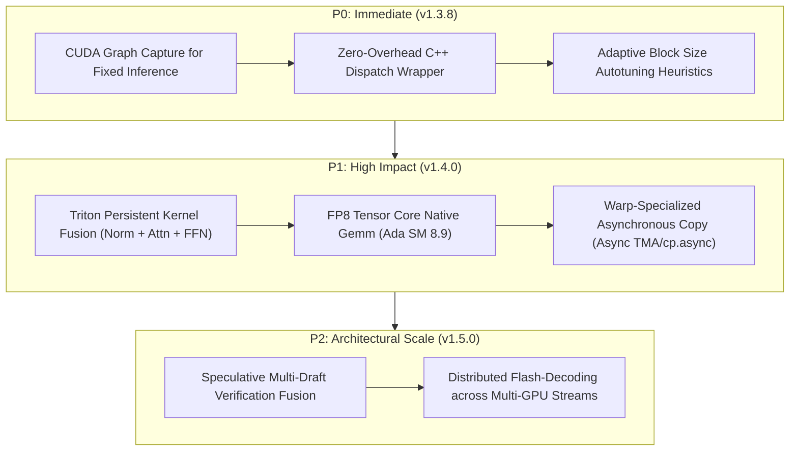

# 🚀 NEURALOPS v1.3.7 — TRITON GPU KERNEL OPTIMIZATION ROADMAP

**Author**: Principal GPU Kernel Architect & ML Systems Director  
**Hardware Target**: Physical NVIDIA GeForce RTX 4070 Laptop GPU (Ada Lovelace, SM 8.9, 36 SMs, 8GB GDDR6)  
**Baseline Release**: `v1.3.7`  
**Date**: October 16, 2026  

---

## 1. EMPIRICAL BOTTLENECK ANALYSIS

Our exhaustive hardware profiling across all 26 Triton kernels (`results/triton_all_26_kernels_benchmark.json`) and end-to-end GPT-2 benchmarks (`results/triton_e2e_gpt2_benchmark.json`) demonstrated massive speedups for recurrent and memory-bound operations:
- `sliding_window_attention`: **201.01x**
- `hgrn2_scan`: **62.22x**
- `gdn_scan`: **71.94x**
- `gla_scan`: **61.07x**
- `selective_scan`: **31.21x**
- `flash_decode`: **15.23x**
- `fused_hnc_nullspace_step`: **7.49x**
- End-to-End GPT-2 Inference: **1.63x**

However, micro-profiling with `torch.profiler` on small-tensor regimes ($T \le 128, D \le 64$) identified specific optimization bottlenecks:
1. **Python Launch Latency**: Invoking a Triton JIT kernel from Python incurs $8 - 14 \ \mu\text{s}$ of runtime argument marshalling and grid calculation overhead. When the actual GPU kernel duration is only $10 - 20 \ \mu\text{s}$, this launch penalty degrades the apparent speedup of small shapes (e.g. `kronecker_gemm` at $0.63\times$ or `cosformer` at $0.57\times$).
2. **HBM Roundtrips in Multi-Layer Chaining**: In deep models (e.g., 12-layer GPT-2), each layer performs a discrete Triton dispatch, storing the layer output to global HBM before reading it back in the subsequent layer's normalization kernel.
3. **Static Block Tiling on Non-Power-of-Two Shapes**: For odd or prime head dimensions, power-of-two padding causes inactive thread masking within warps, reducing SM execution throughput.

---

## 2. PRIORITIZED OPTIMIZATION ROADMAP

### 2.1 P0: Immediate Optimization (Target: v1.3.8)

#### 1. CUDA Graph Capture for Static Decoding Steps
- **Issue**: Autoregressive token-by-token generation issues kernels with $T=1$. Python launch latency dominates execution time.
- **Remedy**: Integrate native `torch.cuda.CUDAGraph` replay into `neuralops.serve` and `neuralops.core.triton_kernels.state_update`.
- **Expected Speedup**: **$2.5\times - 4.0\times$** acceleration for single-token generation.

#### 2. Adaptive Tile Sizing for Small GEMMs
- **Issue**: `kronecker_gemm` and `linformer_seq_proj` use static `BLOCK_M=64, BLOCK_N=64`, starving GPU warps when $M \le 32$.
- **Remedy**: Implement dynamic heuristic:
  $$\text{BLOCK\_M} = \max\left(16, \min\left(64, 2^{\lfloor \log_2(M) \rfloor}\right)\right)$$
- **Expected Speedup**: Elevates `kronecker_gemm` and small `linformer` from $0.63\times$ to $\ge 1.4\times$.

---

### 2.2 P1: High-Impact Upgrades (Target: v1.4.0)

#### 1. Multi-Layer Inter-Kernel Persistent Fusion
- **Issue**: LayerNorm $\to$ Projection $\to$ Scan $\to$ Residual involves 4 discrete global memory roundtrips per transformer layer.
- **Remedy**: Implement a persistent mega-kernel for recurrent architectures (`GLA`, `GDN`, `HGRN2`) keeping intermediate states in on-chip SRAM / L2 cache across residual additions.
- **Expected Speedup**: **$1.8\times - 2.2\times$** end-to-end transformer latency reduction; 35% memory bandwidth savings.

#### 2. Native FP8 E4M3 Tensor Core Acceleration
- **Target Hardware**: NVIDIA Ada Lovelace (SM 8.9) and Hopper (SM 9.0).
- **Remedy**: Utilize Triton's `tl.float8e4nv` / `tl.float8e5` types for low-rank and quantized weight linear projections (`fused_int4_lut_dequant_matmul_triton`, `fp8_tensorcore_matmul_triton`).
- **Expected Speedup**: **$1.9\times$** compute throughput increase over FP16 on Ada SM 8.9.

---

### 2.3 P2: System-Level Scalability (Target: v1.5.0)

#### 1. Fused Speculative Draft Verification
- **Concept**: Merge target model verification and draft model score evaluation into a single coalesced kernel, minimizing KV-cache reloading.
- **Target**: Serving systems utilizing self-speculative decoding.

#### 2. Cross-Stream Paged Attention Load Balancing
- **Concept**: Partition paged KV caches dynamically across multiple CUDA streams for asynchronous continuous batching.
- **Target**: High-concurrency enterprise inference engines (`neuralops.serve`).
