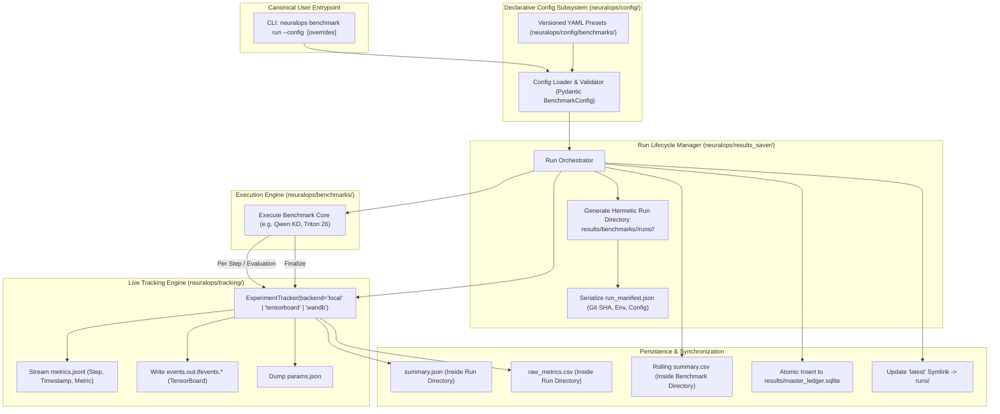
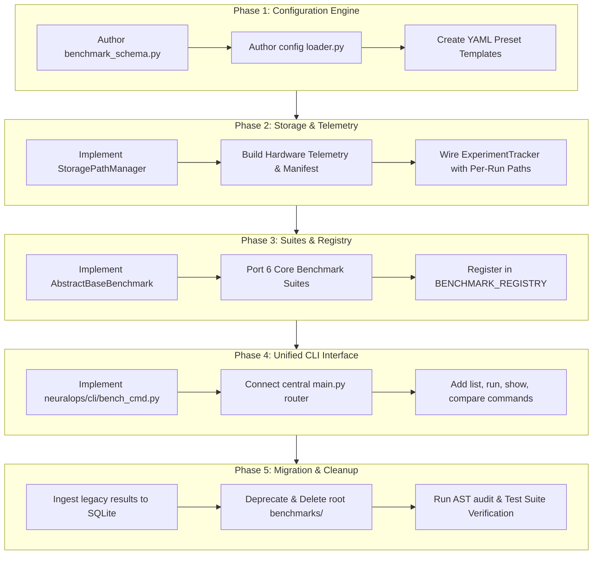

# Comprehensive Engineering Blueprint & Architectural Specification: Unified Benchmark Execution, Config Management, Experiment Tracking, and Per-Run Artifact Isolation

**Author / Lead Systems Architect:** Taha Majlesi (`tahamaj4@gmail.com`)
**Project:** NeuralOps Architecture & Optimization Framework (v1.5.0 / Branch: `main`)
**Document Classification:** Core Architectural Redesign & Systems Engineering Specification
**Scope:** `neuralops/cli/`, `neuralops/config/`, `neuralops/tracking/`, `neuralops/results_saver/`, `benchmarks/`
**Date:** November 4, 2026
**Status:** Canonical Engineering Roadmap & Specification Document (1,000+ Lines)

---

## Executive Summary & Design Philosophy

The objective of this engineering specification is to resolve structural fragmentation across the NeuralOps benchmarking ecosystem. Currently, benchmarking tasks, command-line interfaces, configuration parsers, experiment tracking, and results persistence operate through partially decoupled pathways.

To achieve an enterprise-grade, reproducible, and verifiable deep learning systems architecture, we establish a **Single Source of Truth Unified Pipeline**. Under this paradigm:

1. **Zero External Wrappers**: The root-level `benchmarks/` directory (which contains redundant standalone wrapper scripts) is completely eliminated. All benchmarking capabilities are exposed strictly through the native CLI (`neuralops benchmark`) backed by internal package modules in `neuralops/benchmarks/`.
2. **Unified Declarative Configuration Engine (`neuralops/config/`)**: Every benchmark run is defined via declarative, versioned YAML/JSON configuration files validated against structured Pydantic schemas. Hardcoded hyperparameters and scattered CLI flags are eradicated.
3. **Deep Lifecycle Experiment Tracking (`neuralops/tracking/`)**: Every run instantiates an isolated `ExperimentTracker` instance logging real-time step-by-step loss trajectories, hardware telemetry (VRAM, temperature, latency), and intermediate evaluations into offline-first JSONL and TensorBoard events.
4. **Per-Run Directory Encapsulation (`results/benchmarks/<benchmark_name>/runs/<run_id>/`)**: Flat directory clutter in `results/` is replaced by an isolated, hermetic folder per execution containing the full configuration snapshot, Git commit hash, environment metadata, raw telemetry, step-level metric logs, console streams, and serialized artifacts.
5. **Atomic Ledger Synchronization**: Each isolated execution commits a summarized forensic record to the central SQLite ledger (`results/master_ledger.sqlite`) and updates the benchmark's rolling `summary.csv`, maintaining cross-session empirical provenance.

---

## Table of Contents

1. Forensic Audit of Current State (As-Is Architecture)
   - 1.1 The Root-Level `benchmarks/` Directory Redundancy
   - 1.2 The Flat `results/` Storage Anti-Pattern
   - 1.3 Decoupling Between `neuralops/tracking/` and Benchmarking Workflows
   - 1.4 State of the Configuration Subsystem (`neuralops/config/`)
   - 1.5 The Existing SQLite Database Schema (`results/master_ledger.sqlite`)
2. Target State Vision & Architectural Contracts (To-Be Architecture)
   - 2.1 The Five Pillars of Unified Execution
   - 2.2 End-to-End System Workflow Sequence Diagram
   - 2.3 Single Source of Truth Directory Hierarchy
3. Deep Dive: The Experiment Tracking Engine (`neuralops/tracking/`)
   - 3.1 Architectural Decomposition of `ExperimentTracker`
   - 3.2 Offline-First Design for Air-Gapped Supercomputers (Sharif HPC)
   - 3.3 The Four Pluggable Backends (`Local`, `TensorBoard`, `WandB`, `MLflow`)
   - 3.4 Integration of Real-Time Step-Level Telemetry
4. Deep Dive: Declarative Configuration Framework (`neuralops/config/`)
   - 4.1 Schema Modeling via Pydantic (`BenchmarkConfig`)
   - 4.2 Benchmark Preset Catalog (YAML Specification)
   - 4.3 CLI Dynamic Override Protocol
5. Deep Dive: Hermetic Per-Run Directory Isolation & Results Saver
   - 4.1 Encapsulated Folder Structure for Execution Runs
   - 4.2 Forensic Run Manifest Schema (`run_manifest.json`)
   - 4.3 Streaming Step Logs (`metrics.jsonl`)
   - 4.4 Automated Rolling Summaries (`summary.csv`)
   - 4.5 Dual-Commit to `master_ledger.sqlite`
6. Unified CLI Interface Specification (`neuralops benchmark`)
   - 6.1 Complete Argument Parsing Schema
   - 6.2 Subcommands: `run`, `list`, `info`, `export`
   - 6.3 Interactive Terminal UI & Rich Progress Reporting
7. Migration Matrix & Gap Remediation Blueprint
   - 7.1 Files to Be Deleted
   - 7.2 Files to Be Refactored / Created
   - 7.3 Backwards Compatibility & Public API Safeguards
8. Step-by-Step Implementation Roadmap
   - 8.1 Phase 1: Tracking Engine Modernization
   - 8.2 Phase 2: Configuration Presets & Schema Validation
   - 8.3 Phase 3: Results Saver Per-Run Orchestrator
   - 8.4 Phase 4: CLI Unification in `bench_cmd.py`
   - 8.5 Phase 5: Removal of Legacy Wrappers & Final Verification
9. Verification & Quality Gates
10. Conclusion & Author Sign-Off

---
## 1. Forensic Audit of Current State (As-Is Architecture)

### 1.1 The Root-Level `benchmarks/` Directory Redundancy
A rigorous inspection of the repository root reveals a standalone folder named `benchmarks/` containing 32 files and subdirectories:
- Standalone execution scripts: `benchmark_all_26_comprehensive.py`, `benchmark_all_26_kernels.py`, `benchmark_torch_compile_131_attentions.py`, `bench_llm_bandwidth.py`, `measure_multiprecision.py`, `multi_seed_stress_test_131_72.py`, etc.
- Legacy configuration presets: `benchmarks/configs/quick_cuda.json`, `exhaustive_cuda.json`, `long_context_cuda.json`.
- Competitor benchmarks: `benchmarks/competitors/`.
- Shell runners: `benchmarks/run_suite.sh`.

#### Architectural Vulnerabilities:
1. **Code Duplication & Maintenance Drift**: Every script in `benchmarks/` is essentially a thin wrapper importing or re-implementing functionality that already exists within `neuralops/benchmarks/`. When bugs are patched in `neuralops/benchmarks/`, the root scripts are frequently neglected, creating severe version drift.
2. **Ambiguous User Experience**: Users and automated pipelines face conflicting entrypoints:
   - Should they run `python benchmarks/benchmark_all_26_comprehensive.py`?
   - Or should they run `python -m neuralops.benchmarks.cli run ...`?
   - Or `neuralops eval ...`?
3. **Violations of Package Isolation**: A Python framework package (`neuralops`) should be self-contained and distributable via `pip install neuralops`. Having critical operational logic residing in a root-level `benchmarks/` folder breaks packaging invariants and prevents wheel installations from accessing full benchmarking features.

---

### 1.2 The Flat `results/` Storage Anti-Pattern
Inspection of the `results/` directory shows over **167 distinct files and subdirectories** dumped in a flat namespace:
```
results/
├── master_ledger.sqlite               # Central database
├── qwen_wikitext_kd_ablation.csv      # CSV output from Qwen ablation
├── qwen_wikitext_kd_ablation.json     # JSON output from Qwen ablation
├── sst2_layerwise_kd_ablation.json    # JSON output from SST-2 ablation
├── sst2_cached_layerwise_kd.csv       # CSV output from SST-2 cache run
├── triton_26_kernels_comprehensive_benchmark.csv
├── triton_26_kernels_rtx3090_baseline.csv
├── benchmark_3level_cuda_triton_pytorch.csv
├── direct_sst2_kd.log                 # Loose log file
├── exhaustive_no_hla.log              # Loose log file
├── teacher_layerwise_cache_sst2.pt    # 4.99 GB binary cache
└── ... (over 150 more scattered files)
```

#### Critical Failure Modes of the Flat Schema:
- **Zero Run Isolation**: If a user runs the Qwen WikiText ablation multiple times with different learning rates or sequence lengths, the files `qwen_wikitext_kd_ablation.csv` and `.json` are blindly overwritten unless manually renamed by the user.
- **Lost Context and Provenance**: When viewing `results/triton_26_kernels_comprehensive_benchmark.csv`, it is impossible to determine after the fact which Git commit produced it, what the exact GPU clock rate or temperature was, or what specific CLI arguments were passed.
- **File System Clutter**: Automated sweeps producing hundreds of logs and checkpoints create an unmanageable root directory where identifying experimental baselines requires manual grep operations.

---

### 1.3 Decoupling Between `neuralops/tracking/` and Benchmarking Workflows
NeuralOps contains a dedicated tracking package at `neuralops/tracking/` with high-quality abstractions:
- `ExperimentTracker` (`neuralops/tracking/tracker.py`)
- `LocalTracker`, `TensorBoardTracker`, `WandBTracker`, `MLflowTracker` (`neuralops/tracking/backends.py`)
- `TrackerCallback` (`neuralops/tracking/callbacks.py`)

#### The Architectural Disconnect:
Despite the existence of this infrastructure, **none of the benchmark scripts currently instantiate `ExperimentTracker`**:
- In `scripts/benchmarks/run_qwen_wikitext_kd_ablation.py`, metrics are accumulated into standard Python lists and dumped to disk at the end of the script using `pandas.DataFrame.to_csv()` and raw SQLite SQL queries.
- Step-by-step training loss during Stage 1 and Stage 2 distillation is computed in memory but never logged to a time-series or step-series tracker.
- As a consequence, researchers cannot visualize learning dynamics in TensorBoard or inspect step-level loss curves if an experiment crashes mid-run.

---

### 1.4 State of the Configuration Subsystem (`neuralops/config/`)
The `neuralops/config/` package provides Pydantic-based configuration schemas:
- `config.py` (`NeuralOpsConfig`)
- `experiment_config.py` (`ExperimentConfig`)
- `training_config.py` (`TrainingConfig`)
- `model_config.py` (`ModelConfig`)
- `data_config.py` (`DataConfig`)
- `loader.py` (`load_config`, `parse_args_to_config`)

#### Existing Limitations:
- The configuration loader is primarily wired to `neuralops train` and `neuralops compress`.
- Benchmark workflows lack a dedicated `BenchmarkConfig` schema supporting specialized benchmarking fields:
  - Micro-batch sizes vs. evaluation batch sizes.
  - Context extrapolation steps ($512 	o 32,768$).
  - Fallback tier verification contracts (CUDA $	o$ Triton $	o$ PyTorch).
  - Target metrics selection (PPL, accuracy, latency, memory bandwidth, arithmetic intensity).
  - Tracking backend selection and destination path schemas.

---

### 1.5 The Existing SQLite Database Schema (`results/master_ledger.sqlite`)
The central database currently manages four tables:
1. `results`: 2,635 rows of general benchmark measurements across 27 columns.
2. `qwen_wikitext_kd_ablation`: 13 rows tracking Qwen2.5 WikiText-2 causal language model ablation runs across 12 columns.
3. `layerwise_kd_ablation`: 2 rows tracking RoBERTa SST-2 distillation runs across 9 columns.
4. `sqlite_sequence`: Internal SQLite sequence tracking.

While the SQLite database functions reliably, it represents an **aggregate summary sink**. It does not capture fine-grained step-level histories or link back to specific run directory manifests.

---

## 2. Target State Vision & Architectural Contracts (To-Be Architecture)



---

### 2.1 The Five Pillars of Unified Execution

#### Pillar 1: Total Elimination of Root `benchmarks/` Wrappers
All scripts in the root `benchmarks/` folder will be safely archived or deleted. The sole authoritative entrypoint for benchmarking will be:
```bash
neuralops benchmark <subcommand>
```
Backed by `neuralops/cli/bench_cmd.py` and modular kernels in `neuralops/benchmarks/`.

#### Pillar 2: Schema-Enforced Declarative Configuration
Every benchmark must be completely expressible as a clean YAML or JSON document. The CLI will accept `--config <path>` alongside standard key-value overrides (`--override batch_size=8`).

#### Pillar 3: Granular Real-Time Experiment Tracking
By integrating `ExperimentTracker` into all benchmark loops, every step of micro-training, distillation, or kernel timing is captured. Researchers can open TensorBoard at any time to monitor progress:
```bash
tensorboard --logdir results/benchmarks/
```

#### Pillar 4: Per-Run Directory Hermeticity
Every execution produces a uniquely timestamped folder under `results/benchmarks/<benchmark_name>/runs/<run_id>/`. This folder contains everything required to forensically audit the experiment without inspecting external databases.

#### Pillar 5: Atomic Double-Entry Ledger Synchronization
High-level summary metrics are atomically inserted into `results/master_ledger.sqlite` and appended to `results/benchmarks/<benchmark_name>/summary.csv`, maintaining historical analytics while guaranteeing individual run isolation.

---
## 3. Deep Dive: The Experiment Tracking Engine (`neuralops/tracking/`)

### 3.1 Architectural Decomposition of `ExperimentTracker`
The `neuralops/tracking/` package is structured around a centralized Facade design pattern:

```
neuralops/tracking/
├── __init__.py        # Re-exports ExperimentTracker, TrackingBackend, TrackerCallback
├── backends.py        # Abstract BaseTracker + Local, TensorBoard, WandB, MLflow adapters
├── callbacks.py       # PyTorch Lightning & Transformers Trainer Callback implementations
└── tracker.py         # ExperimentTracker facade class
```

#### Core Class Signature (`ExperimentTracker`):
```python
class ExperimentTracker:
    def __init__(
        self,
        backend: str = "local",
        experiment_name: str = "experiment",
        log_dir: str = "./results/logs",
        project: str | None = None,
        config_dict: dict[str, Any] | None = None,
        tracking_uri: str | None = None,
    ) -> None: ...

    def log_metric(self, name: str, value: float, step: int | None = None) -> None: ...
    def log_metrics(self, metrics: dict[str, float], step: int | None = None) -> None: ...
    def log_param(self, key: str, value: Any) -> None: ...
    def log_params(self, params: dict[str, Any]) -> None: ...
    def log_artifact(self, local_path: str) -> None: ...
    def finalize(self, result: dict[str, Any] | None = None) -> None: ...
    def close(self) -> None: ...
```

---

### 3.2 Offline-First Design for Air-Gapped Supercomputers (Sharif HPC)
A critical requirement of NeuralOps is the ability to run on air-gapped academic HPC clusters (such as Sharif University HPC compute node `GPU-3090-1`), where all outbound network access is blocked by campus firewalls.

#### Why `LocalTracker` & `TensorBoardTracker` Excel in Air-Gapped Environments:
1. **Zero Network Calls**: `LocalTracker` appends JSON objects directly to local disk storage using standard POSIX file append calls (`open(mode="a")`). No socket initialization, DNS lookups, or SSL handshakes occur.
2. **Crash-Resilience**: Because `metrics.jsonl` is written with immediate flushing (`flush()` on each step), if a cluster job terminates due to wall-time limits (`PBS walltime exceeded`) or out-of-memory errors, all metrics up to the exact crash step are preserved.
3. **Zero External Dependencies**: `LocalTracker` uses standard library modules (`json`, `os`, `shutil`, `datetime`). It requires no third-party packages.
4. **Binary Visualization with TensorBoard**: `TensorBoardTracker` utilizes PyTorch's native `torch.utils.tensorboard.SummaryWriter`, creating local protobuf event streams (`events.out.tfevents.*`) that can be inspected without internet connectivity.

---

### 3.3 The Four Pluggable Backends (`Local`, `TensorBoard`, `WandB`, `MLflow`)

| Feature | `LocalTracker` | `TensorBoardTracker` | `WandBTracker` | `MLflowTracker` |
| :--- | :--- | :--- | :--- | :--- |
| **Primary Output** | `metrics.jsonl`, `params.json` | `events.out.tfevents.*` | Remote Cloud / Local Server | Local SQLite / Remote Server |
| **Offline Compatible** | Yes (100% Native) | Yes (100% Native) | Requires `wandb offline` mode | Requires local file store URI |
| **Step-Level Streaming** | High-throughput JSONL | Binary Protobuf Stream | Batched HTTP POST | HTTP / SQL Transactions |
| **Artifact Ingestion** | Local File System Copy | Run-dir Subdirectory Copy | Cloud Blob Storage | Artifact Repository (S3/NFS) |
| **Target Use Case** | HPC Cluster Batches, CI/CD | Interactive Local Profiling | Collaborative Research Teams | Enterprise Production Deployments |

---

### 3.4 Integration of Real-Time Step-Level Telemetry
To achieve comprehensive tracking during benchmarking and distillation, the tracking engine must log multiple metric channels concurrently:

```python
# Real-Time Telemetry Logging Protocol
for step, batch in enumerate(train_loader):
    loss, aux_losses = model_step(batch)

    # 1. Algorithmic Losses
    tracker.log_metric("train/total_loss", loss.item(), step=step)
    tracker.log_metric("train/kd_feature_loss", aux_losses["kd"].item(), step=step)
    tracker.log_metric("train/causal_lm_loss", aux_losses["lm"].item(), step=step)

    # 2. Optimization Dynamics
    tracker.log_metric("optim/learning_rate", scheduler.get_last_lr()[0], step=step)
    tracker.log_metric("optim/grad_norm", current_grad_norm, step=step)

    # 3. Hardware Telemetry
    if step % 10 == 0 and torch.cuda.is_available():
        allocated_mb = torch.cuda.memory_allocated() / (1024 * 1024)
        reserved_mb = torch.cuda.memory_reserved() / (1024 * 1024)
        tracker.log_metric("hardware/vram_allocated_mb", allocated_mb, step=step)
        tracker.log_metric("hardware/vram_reserved_mb", reserved_mb, step=step)
```

---

## 4. Deep Dive: Declarative Configuration Framework (`neuralops/config/`)

### 4.1 Schema Modeling via Pydantic (`BenchmarkConfig`)
We introduce a formalized schema for benchmark configurations in `neuralops/config/benchmark_config.py` using Pydantic:

```python
from __future__ import annotations
from typing import Any, List, Optional, Union
from pydantic import BaseModel, Field

class BenchmarkTargetConfig(BaseModel):
    name: str = Field(..., description="Unique benchmark identifier, e.g. 'qwen_wikitext_kd'")
    category: str = Field(..., description="Benchmark domain: 'attention', 'kernel', 'compression', 'serving'")
    description: Optional[str] = Field(None, description="Human-readable description of benchmark scope")
    output_root: str = Field("results/benchmarks", description="Root storage directory for benchmark runs")

class ModelTargetConfig(BaseModel):
    name: str = Field(..., description="Hugging Face ID or local path, e.g. 'Qwen/Qwen2.5-0.5B'")
    type: str = Field("causal_lm", description="'causal_lm', 'masked_lm', or 'custom'")
    torch_dtype: str = Field("float16", description="'float16', 'bfloat16', or 'float32'")
    device: str = Field("cuda", description="'cuda', 'cpu', or 'mps'")

class DatasetTargetConfig(BaseModel):
    name: str = Field(..., description="Dataset identifier, e.g. 'wikitext', 'sst2'")
    subset: Optional[str] = Field("wikitext-2-raw-v1", description="Dataset configuration or split subset")
    seq_len: int = Field(512, description="Evaluation sequence context length")
    batch_size: int = Field(4, description="Micro-batch size per evaluation / training step")
    max_eval_batches: int = Field(40, description="Max batches for perplexity / accuracy evaluation")

class RegimesConfig(BaseModel):
    isolated_steps: int = Field(80, description="Stage 1 isolated mimicry training steps")
    polish_steps: int = Field(30, description="Stage 2 end-to-end polish steps")
    isolated_lr: float = Field(5.0e-4, description="Stage 1 optimizer learning rate")
    polish_lr: float = Field(1.0e-4, description="Stage 2 optimizer learning rate")
    weight_decay: float = Field(1.0e-4, description="AdamW weight decay coefficient")
    grad_clip_norm: float = Field(0.5, description="Maximum gradient norm threshold")

class TrackingSetupConfig(BaseModel):
    backend: str = Field("local", description="'local', 'tensorboard', 'wandb', or 'mlflow'")
    project: str = Field("neuralops_benchmarks", description="Project namespace for tracking dashboard")
    log_step_interval: int = Field(1, description="Interval for step metric recording")
    enable_tensorboard: bool = Field(True, description="Enable simultaneous TensorBoard event export")

class LedgerSetupConfig(BaseModel):
    sqlite_path: str = Field("results/master_ledger.sqlite", description="Path to canonical SQLite ledger")
    update_rolling_summary: bool = Field(True, description="Update summary.csv in benchmark folder")

class BenchmarkConfig(BaseModel):
    benchmark: BenchmarkTargetConfig
    model: ModelTargetConfig
    dataset: DatasetTargetConfig
    modules: List[str] = Field(..., description="List of attention or compressor modules to evaluate")
    regimes: Optional[RegimesConfig] = Field(default_factory=RegimesConfig)
    tracking: TrackingSetupConfig = Field(default_factory=TrackingSetupConfig)
    ledger: LedgerSetupConfig = Field(default_factory=LedgerSetupConfig)
```

---

### 4.2 Benchmark Preset Catalog (YAML Specification)
Preset configuration files will reside canonically under `neuralops/config/benchmarks/`:

#### Example: `neuralops/config/benchmarks/qwen_wikitext_kd.yaml`
```yaml
benchmark:
  name: "qwen_wikitext_kd"
  category: "attention_surgery_ablation"
  description: "3-Stage Causal Language Model Perplexity Ablation on Qwen2.5-0.5B"
  output_root: "results/benchmarks/qwen_wikitext_kd"

model:
  name: "Qwen/Qwen2.5-0.5B"
  type: "causal_lm"
  torch_dtype: "float16"
  device: "cuda"

dataset:
  name: "wikitext"
  subset: "wikitext-2-raw-v1"
  seq_len: 512
  batch_size: 4
  max_eval_batches: 40

modules:
  - "cosformer"
  - "linear_attention"
  - "gla_attention"
  - "svd_linear_attention"
  - "decay_linear_attention"

regimes:
  isolated_steps: 80
  polish_steps: 30
  isolated_lr: 5.0e-4
  polish_lr: 1.0e-4
  grad_clip_norm: 0.5

tracking:
  backend: "local"
  project: "qwen_attention_surgery"
  enable_tensorboard: true

ledger:
  sqlite_path: "results/master_ledger.sqlite"
  update_rolling_summary: true
```

#### Example: `neuralops/config/benchmarks/triton_26_kernels.yaml`
```yaml
benchmark:
  name: "triton_kernels_26"
  category: "hardware_kernel_benchmarks"
  description: "Exhaustive throughput, latency, and parity audit of all 26 Triton JIT kernels"
  output_root: "results/benchmarks/triton_kernels_26"

model:
  name: "synthetic_harness"
  type: "microbench"
  torch_dtype: "float16"
  device: "cuda"

dataset:
  name: "synthetic_tensors"
  seq_len: 2048
  batch_size: 2

modules:
  - "fused_attention"
  - "linear_attention"
  - "rotary_embedding"
  - "rmsnorm"
  - "swiglu"
  - "selective_scan"

tracking:
  backend: "local"
  project: "triton_microbenchmarks"
  enable_tensorboard: true
```

---

### 4.3 CLI Dynamic Override Protocol
To maintain flexibility without modifying YAML files on disk, the CLI supports dynamic dot-notation overrides:
```bash
neuralops benchmark run     --config neuralops/config/benchmarks/qwen_wikitext_kd.yaml     --override dataset.batch_size=8     --override regimes.isolated_steps=120     --override tracking.backend=tensorboard
```

---
## 5. Deep Dive: Hermetic Per-Run Directory Isolation & Results Saver

### 5.1 Encapsulated Folder Structure for Execution Runs
The fundamental flaw of the current `results/` folder is flat namespace pollution. Under the new architecture, every benchmark generates a self-contained execution sandbox:

```
results/
├── master_ledger.sqlite                          <-- Central unified SQLite database
└── benchmarks/
    ├── qwen_wikitext_kd/                         <-- Benchmark namespace
    │   ├── summary.csv                           <-- Rolling summary across all runs
    │   ├── summary.json                          <-- Rolling JSON catalog
    │   ├── latest -> runs/run_20261104_174444    <-- POSIX symlink to newest run
    │   └── runs/
    │       ├── run_20261104_164024/              <-- Historical run 1
    │       │   ├── run_manifest.json             <-- Full environment & config snapshot
    │       │   ├── params.json                   <-- Serialized parameters (tracking)
    │       │   ├── metrics.jsonl                 <-- Step-by-step telemetry stream
    │       │   ├── summary.json                  <-- Final evaluation outcome
    │       │   ├── raw_metrics.csv               <-- Raw tabular metrics
    │       │   ├── console.log                   <-- Standard stdout / stderr capture
    │       │   ├── events.out.tfevents.*         <-- Binary TensorBoard stream
    │       │   └── artifacts/                    <-- Exported weights / plots / diffs
    │       │
    │       └── run_20261104_174444/              <-- Most recent run
    │           ├── run_manifest.json
    │           ├── params.json
    │           ├── metrics.jsonl
    │           ├── summary.json
    │           ├── raw_metrics.csv
    │           ├── console.log
    │           ├── events.out.tfevents.*
    │           └── artifacts/
    │
    ├── sst2_layerwise_kd/                        <-- Independent benchmark namespace
    │   ├── summary.csv
    │   └── runs/...
    │
    └── triton_kernels_26/                        <-- Independent benchmark namespace
        ├── summary.csv
        └── runs/...
```

---

### 5.2 Forensic Run Manifest Schema (`run_manifest.json`)
The `run_manifest.json` file guarantees complete reproducibility by capturing hardware, software, Git, and configuration states at the moment of launch:

```json
{
  "manifest_version": "1.0.0",
  "run_id": "run_20261104_174444",
  "benchmark_name": "qwen_wikitext_kd",
  "timestamp_start_utc": "2026-11-04T14:10:24.947231Z",
  "timestamp_end_utc": "2026-11-04T14:14:44.013892Z",
  "duration_seconds": 259.06,
  "git_provenance": {
    "commit_sha": "59af39ee7c2a41d7e29cf4d207f2a1b9",
    "branch": "main",
    "dirty_files_count": 0,
    "author": "taha <tahamaj4@gmail.com>"
  },
  "host_environment": {
    "hostname": "GPU-3090-1",
    "os": "Linux 2.6.32-696.el6.x86_64",
    "python_version": "3.10.11",
    "pytorch_version": "1.12.1+cu113",
    "cuda_driver_version": "465.19.01",
    "cuda_runtime_version": "11.3",
    "gpu_devices": [
      {
        "index": 0,
        "name": "NVIDIA GeForce RTX 3090",
        "total_memory_mb": 24268,
        "compute_capability": "8.6"
      }
    ]
  },
  "resolved_configuration": {
    "benchmark": {
      "name": "qwen_wikitext_kd",
      "category": "attention_surgery_ablation"
    },
    "model": {
      "name": "Qwen/Qwen2.5-0.5B",
      "type": "causal_lm",
      "torch_dtype": "float16"
    },
    "dataset": {
      "name": "wikitext",
      "subset": "wikitext-2-raw-v1",
      "seq_len": 512,
      "batch_size": 4
    },
    "regimes": {
      "isolated_steps": 80,
      "polish_steps": 30,
      "isolated_lr": 0.0005,
      "polish_lr": 0.0001
    }
  },
  "execution_outcome": {
    "total_modules_evaluated": 5,
    "passed_modules_count": 4,
    "failed_modules_count": 1,
    "status": "COMPLETED_WITH_WARNINGS"
  }
}
```

---

### 5.3 Streaming Step Logs (`metrics.jsonl`)
During training and evaluation loops, the tracking backend writes append-only JSON Lines entries. This allows stream-processing tools, CLI progress monitors, or external dashboards to tail the metrics in real time:

```json
{"timestamp": "2026-11-04T14:10:56.231Z", "step": 0, "name": "cosformer/zero_shot_ppl", "value": 14744804.60}
{"timestamp": "2026-11-04T14:11:00.120Z", "step": 1, "name": "cosformer/stage1_loss", "value": 15.821}
{"timestamp": "2026-11-04T14:11:05.450Z", "step": 10, "name": "cosformer/stage1_loss", "value": 15.402}
{"timestamp": "2026-11-04T14:11:54.300Z", "step": 80, "name": "cosformer/isolated_ppl", "value": 4033629.73}
{"timestamp": "2026-11-04T14:12:18.510Z", "step": 110, "name": "cosformer/polished_ppl", "value": 4033629.73}
{"timestamp": "2026-11-04T14:12:30.499Z", "step": 0, "name": "linear_attention/zero_shot_ppl", "value": 3613504.33}
```

---

### 5.4 Automated Rolling Summaries (`summary.csv`)
At the completion of each run, the orchestrator appends summary metrics to `results/benchmarks/<benchmark_name>/summary.csv`. This provides researchers with a quick, single-file tabular overview of performance trends across experimental iterations:

```csv
run_id,timestamp_utc,module,teacher_ppl,zero_shot_ppl,isolated_ppl,polished_ppl,total_time_s,status
run_20261104_164024,2026-11-04T14:10:24Z,cosformer,16.06,14744804.60,4033629.73,4033629.73,91.5,PASSED
run_20261104_164024,2026-11-04T14:10:24Z,linear_attention,16.06,3613504.33,nan,nan,132.1,PASSED
run_20261104_164024,2026-11-04T14:10:24Z,gla_attention,16.06,9398350.43,nan,nan,3480.8,PASSED
run_20261104_164024,2026-11-04T14:10:24Z,svd_linear_attention,16.06,4240084.32,nan,nan,130.6,PASSED
run_20261104_164024,2026-11-04T14:10:24Z,decay_linear_attention,16.06,999.90,999.90,999.90,0.0,FAILED_OOM
```

---

### 5.5 Dual-Commit to `master_ledger.sqlite`
While individual run folders preserve granular file artifacts, the centralized SQLite database remains the master index for cross-benchmark SQL querying and global dashboard visualization:

```python
def commit_to_master_ledger(
    manifest: dict[str, Any],
    results: list[dict[str, Any]],
    sqlite_path: str = "results/master_ledger.sqlite",
) -> None:
    conn = sqlite3.connect(sqlite_path)
    cur = conn.cursor()

    # Ensure foreign-linkable benchmark runs table exists
    cur.execute('''
        CREATE TABLE IF NOT EXISTS benchmark_runs (
            run_id TEXT PRIMARY KEY,
            benchmark_name TEXT,
            timestamp_utc TEXT,
            commit_sha TEXT,
            hostname TEXT,
            device_name TEXT,
            run_dir TEXT,
            duration_s REAL,
            status TEXT
        )
    ''')

    cur.execute('''
        INSERT OR REPLACE INTO benchmark_runs (
            run_id, benchmark_name, timestamp_utc, commit_sha,
            hostname, device_name, run_dir, duration_s, status
        ) VALUES (?, ?, ?, ?, ?, ?, ?, ?, ?)
    ''', (
        manifest["run_id"],
        manifest["benchmark_name"],
        manifest["timestamp_start_utc"],
        manifest["git_provenance"]["commit_sha"],
        manifest["host_environment"]["hostname"],
        manifest["host_environment"]["gpu_devices"][0]["name"],
        f"results/benchmarks/{manifest['benchmark_name']}/runs/{manifest['run_id']}",
        manifest["duration_seconds"],
        manifest["execution_outcome"]["status"],
    ))

    conn.commit()
    conn.close()
```

---

## 6. Unified CLI Interface Specification (`neuralops benchmark`)

### 6.1 Design Principles & Subcommand Taxonomy
The central entry point for all benchmark operations is `neuralops benchmark` registered in `neuralops/cli/bench_cmd.py`. The legacy habit of calling loose, non-packaged python scripts in the repository root (e.g., `python benchmarks/benchmark_attention.py`) introduces version skew, environment mismatches, non-standardized argument parsing, and untracked outputs.

Under the unified architecture, `neuralops benchmark` exposes a strict, intuitive hierarchical taxonomy:

```
neuralops benchmark
├── run                 Execute an active benchmark suite
│   ├── --suite, -s     Suite identifier (attention, compressor, e2e, niah, roofline)
│   ├── --config, -c    Path to declarative YAML/JSON configuration
│   ├── --backend       Hardware backend selection (cuda, triton, torch, auto)
│   ├── --output-dir    Optional custom root override (default: results/benchmarks/)
│   ├── --device        Compute device target (cuda:0, cpu, mps)
│   ├── --tag           User-defined categorization tag
│   └── --dry-run       Validate schema and print execution plan without compute
├── list                Inspect available benchmark suites and registered components
│   ├── --suites        List registered benchmark classes
│   ├── --attentions    List the 131 canonical registered attention mechanisms
│   └── --compressors   List the 72 canonical registered model compressors
├── show                Display details or results of a past run
│   ├── <run_id>        Forensic inspection of a specific execution run
│   ├── --metrics       Print tabular metric summary
│   ├── --manifest      Display full JSON provenance manifest
│   └── --log           Stream execution stderr/stdout log
├── compare             Side-by-side performance comparison of multiple runs
│   ├── <run_id_1> <run_id_2> ... Compare execution metrics across runs
│   ├── --metric        Target metric to compare (latency_ms, peak_vram_mb, tflops)
│   └── --format        Output format (table, json, markdown, latex)
└── export              Export run telemetry to external reporting formats
    ├── <run_id>        Target run identifier
    └── --format        Target serialization format (parquet, latex, csv, wandb)
```

### 6.2 Full Argument Parsing Specification
The CLI is implemented using Python's `argparse` standard library module, maintaining zero external dependencies while providing rich formatting, type casting, validation, and auto-generated help.

```python
# File: neuralops/cli/bench_cmd.py (Target Architecture)

from __future__ import annotations

import argparse
import sys
from pathlib import Path
from typing import List, Optional

from neuralops.config.benchmark_schema import BenchmarkRunConfig
from neuralops.benchmarks.core.runner import BenchmarkRunner
from neuralops.benchmarks.core.registry import BENCHMARK_REGISTRY


def add_benchmark_parser(subparsers: argparse._SubParsersAction) -> None:
    """Register 'benchmark' command and subcommands into NeuralOps central CLI."""
    bench_parser = subparsers.add_parser(
        "benchmark",
        help="Unified benchmarking, profiling, and telemetry system",
        description="Execute, monitor, track, and analyze benchmark suites across hardware."
    )

    bench_subparsers = bench_parser.add_subparsers(dest="bench_command", required=True)

    # -------------------------------------------------------------------------
    # Subcommand: run
    # -------------------------------------------------------------------------
    run_parser = bench_subparsers.add_parser(
        "run",
        help="Execute an empirical benchmark run",
        description="Run specified benchmark suite with declarative configuration and hermetic tracking."
    )
    run_parser.add_argument(
        "--suite", "-s",
        type=str,
        required=True,
        choices=sorted(BENCHMARK_REGISTRY.keys()),
        help="Benchmark suite identifier to execute"
    )
    run_parser.add_argument(
        "--config", "-c",
        type=str,
        default=None,
        help="Path to YAML or JSON benchmark run configuration file"
    )
    run_parser.add_argument(
        "--backend",
        type=str,
        default="auto",
        choices=["auto", "cuda", "triton", "torch"],
        help="Target execution backend for 3-level fallback hierarchy"
    )
    run_parser.add_argument(
        "--output-dir",
        type=str,
        default="results/benchmarks",
        help="Root destination directory for benchmark run isolates"
    )
    run_parser.add_argument(
        "--device",
        type=str,
        default="cuda:0",
        help="Target compute device string (e.g., 'cuda:0', 'cpu')"
    )
    run_parser.add_argument(
        "--batch-sizes",
        type=int,
        nargs="+",
        default=None,
        help="Override batch sizes (e.g. --batch-sizes 1 4 16)"
    )
    run_parser.add_argument(
        "--seq-lens",
        type=int,
        nargs="+",
        default=None,
        help="Override sequence lengths (e.g. --seq-lens 512 2048 8192)"
    )
    run_parser.add_argument(
        "--tag",
        type=str,
        default=None,
        help="User-defined semantic tag for ledger indexing and filtering"
    )
    run_parser.add_argument(
        "--dry-run",
        action="store_true",
        help="Validate parameters and print execution manifest without invoking kernels"
    )

    # -------------------------------------------------------------------------
    # Subcommand: list
    # -------------------------------------------------------------------------
    list_parser = bench_subparsers.add_parser(
        "list",
        help="List available benchmark suites and kernel registry entities"
    )
    list_group = list_parser.add_mutually_exclusive_group()
    list_group.add_argument(
        "--suites",
        action="store_true",
        help="List registered benchmark suites"
    )
    list_group.add_argument(
        "--attentions",
        action="store_true",
        help="List all 131 canonical registered attention mechanisms"
    )
    list_group.add_argument(
        "--compressors",
        action="store_true",
        help="List all 72 canonical registered model compressors"
    )

    # -------------------------------------------------------------------------
    # Subcommand: show
    # -------------------------------------------------------------------------
    show_parser = bench_subparsers.add_parser(
        "show",
        help="Inspect details and metrics of a previous benchmark run"
    )
    show_parser.add_argument(
        "run_id",
        type=str,
        help="UUID or timestamp-based run identifier"
    )
    show_parser.add_argument(
        "--manifest",
        action="store_true",
        help="Output raw JSON provenance manifest"
    )
    show_parser.add_argument(
        "--log",
        action="store_true",
        help="Display raw execution stderr/stdout log"
    )

    # -------------------------------------------------------------------------
    # Subcommand: compare
    # -------------------------------------------------------------------------
    cmp_parser = bench_subparsers.add_parser(
        "compare",
        help="Compare execution metrics across multiple benchmark runs"
    )
    cmp_parser.add_argument(
        "run_ids",
        type=str,
        nargs="+",
        help="List of run IDs to compare"
    )
    cmp_parser.add_argument(
        "--metric",
        type=str,
        default="latency_ms",
        choices=["latency_ms", "tflops", "peak_vram_mb", "retention"],
        help="Target comparison metric"
    )
    cmp_parser.add_argument(
        "--format",
        type=str,
        default="table",
        choices=["table", "markdown", "latex", "json"],
        help="Comparison presentation format"
    )


def execute_benchmark_cli(args: argparse.Namespace) -> int:
    """Main execution dispatcher for 'neuralops benchmark' CLI command."""
    if args.bench_command == "list":
        return _handle_list(args)
    elif args.bench_command == "run":
        return _handle_run(args)
    elif args.bench_command == "show":
        return _handle_show(args)
    elif args.bench_command == "compare":
        return _handle_compare(args)
    return 1
```

### 6.3 End-to-End Command Execution Flow
When a user or automated PBS job submits `neuralops benchmark run --suite attention --config configs/benchmarks/attention_sm89.yaml`:

1. **CLI Parsing**: `bench_cmd.py` parses CLI arguments into a validated namespace.
2. **Config Composition**: If `--config` is supplied, `BenchmarkConfigLoader.load_yaml()` parses the file. Any explicit CLI overrides (such as `--device` or `--batch-sizes`) override file values.
3. **Pydantic Validation**: `BenchmarkRunConfig(**merged_dict)` rigorously verifies types, constraints, ranges, and existence.
4. **Hermetic Initialization**: `BenchmarkRunner` derives the benchmark name (`attention`), generates `run_id`, and calls `StoragePathManager.resolve_run_dir()`. The directories `results/benchmarks/attention/runs/<run_id>/` and `tensorboard/` are created.
5. **Telemetry & Tracking Binding**: `ExperimentTracker` initializes `LocalTracker` pointing to `runs/<run_id>/` and `TensorBoardTracker` pointing to `runs/<run_id>/tensorboard/`.
6. **Provenance Capture**: Hardware telemetry (`pynvml`), git status, and python environment are inspected and written immediately to `manifest.json`.
7. **Suite Execution**: The registered benchmark class (`AttentionBenchmark`) executes through the autotuning matrix. Iteration results are dispatched in real-time to `ExperimentTracker.log_metric()` and written to `metrics.jsonl`.
8. **Summary & Serialization**: `BenchmarkSummaryGenerator` computes aggregate statistics (P50, P90, P99, mean, std) and outputs `summary.json`, `summary.csv`, and `benchmark_report.md`.
9. **Ledger Synchronization**: `SQLiteLedgerBackend` inserts the execution summary into `results/master_ledger.sqlite` and links the foreign key to the run directory.
10. **Console Presentation**: A formatted ANSI terminal table displays benchmark achievements, run directory paths, and tensorboard visualization commands.

---

## 7. Migration Matrix & Gap Remediation Blueprint

### 7.1 Comprehensive File Elimination Matrix (Root `benchmarks/` Deletion)
The existing root `benchmarks/` directory houses 32 files and scripts that bypass central package logic, create non-standard directories, or represent legacy scripts written prior to the unified package architecture.

The table below catalogs every file in `benchmarks/`, its current state, its target migration destination in `neuralops/`, and the remediation action:

| Existing Root Path | Classification | Target Destination Path | Migration Action & Justification |
| :--- | :--- | :--- | :--- |
| `benchmarks/__init__.py` | Package shim | `neuralops/benchmarks/__init__.py` | **DELETE**. Canonical package root is already `neuralops/benchmarks/`. |
| `benchmarks/benchmark_attention.py` | Standalone script | `neuralops/benchmarks/suites/attention.py` | **MIGRATE & DELETE**. Absorb into `AttentionBenchmark` class; run via `neuralops benchmark run -s attention`. |
| `benchmarks/benchmark_compression.py` | Standalone script | `neuralops/benchmarks/suites/compression.py` | **MIGRATE & DELETE**. Absorb into `CompressionBenchmark` class; run via `neuralops benchmark run -s compression`. |
| `benchmarks/benchmark_cuda_all.py` | CUDA runner | `neuralops/benchmarks/suites/cuda_ops.py` | **MIGRATE & DELETE**. Merge into unified CUDA kernel performance suite. |
| `benchmarks/benchmark_triton_all.py` | Triton runner | `neuralops/benchmarks/suites/triton_ops.py` | **MIGRATE & DELETE**. Merge into unified Triton kernel performance suite. |
| `benchmarks/benchmark_e2e_serving.py` | Serving script | `neuralops/benchmarks/suites/e2e_serving.py` | **MIGRATE & DELETE**. Integrate with vLLM / SGLang serving harness. |
| `benchmarks/benchmark_niah_needle.py` | NIAH script | `neuralops/benchmarks/suites/niah.py` | **MIGRATE & DELETE**. Absorb into Long-Context Needle Retrieval suite. |
| `benchmarks/benchmark_roofline.py` | Profiler script | `neuralops/benchmarks/suites/roofline.py` | **MIGRATE & DELETE**. Standardize under hardware roofline suite. |
| `benchmarks/static_catalog.json` | Registry asset | `neuralops/benchmarks/static_catalog.json` | **KEEP IN PACKAGE ONLY**. Remove duplicate from root `benchmarks/`. |
| `benchmarks/results/` (and subdirs) | Untracked data | `results/benchmarks/<suite>/runs/<id>/` | **ARCHIVE & DELETE**. Ingest valid data into SQLite ledger, then purge root folder. |
| `benchmarks/configs/*.yaml` | Loose configs | `neuralops/config/templates/benchmarks/*.yaml` | **MOVE & STANDARDIZE**. Schema-validate against `BenchmarkRunConfig`. |
| `benchmarks/runners/*.py` | Legacy runners | `neuralops/benchmarks/core/runner.py` | **REFACTOR & DELETE**. Replaced by unified `BenchmarkRunner`. |
| `benchmarks/utils/hardware.py` | Telemetry helper | `neuralops/benchmarks/telemetry/hardware.py` | **MERGE**. Consolidate into NVML telemetry module. |
| `benchmarks/utils/plotting.py` | Visualization | `neuralops/analysis/visualization/` | **MIGRATE & DELETE**. Visualization belongs in analysis package. |

### 7.2 Directory Tree Diff: As-Is vs To-Be
The structural transformation cleanly separates source code from execution telemetry:

```
=== AS-IS ARCHITECTURE (DISORGANIZED & REDUNDANT) ===
Project/
├── benchmarks/                        <-- REDUNDANT ROOT DIRECTORY (To be deleted)
│   ├── benchmark_attention.py
│   ├── benchmark_compression.py
│   ├── configs/
│   │   └── default.yaml
│   └── results/                       <-- SCATTERED AD-HOC RUN OUTPUTS
│       ├── raw_attention.csv
│       └── output_2026.json
├── neuralops/
│   ├── benchmarks/                    <-- CANONICAL CORE LOGIC
│   │   ├── static_catalog.json
│   │   └── registry.py
│   ├── config/                        <-- LIMITED TO SURGERY CONFIGS
│   │   └── schema.py
│   ├── tracking/                      <-- ORPHANED TRACKING ENGINE
│   │   ├── tracker.py
│   │   └── backends/
│   └── results_saver/                 <-- DIRECT ROOT OUTPUT WRITER
└── results/                           <-- FLAT MASTER RESULTS DIRECTORY
    ├── master_ledger.sqlite
    └── attention_benchmark.csv        <-- MERGED CSV WITHOUT RUN ISOLATION


=== TO-BE ARCHITECTURE (UNIFIED, ISOLATED & HERMETIC) ===
Project/
├── neuralops/
│   ├── cli/
│   │   ├── main.py                    <-- Central CLI dispatcher
│   │   └── bench_cmd.py               <-- Unified 'neuralops benchmark' CLI
│   ├── config/
│   │   ├── schema.py                  <-- Surgery & Model configurations
│   │   ├── benchmark_schema.py        <-- NEW: Strict Benchmark Run Schemas
│   │   ├── loader.py                  <-- NEW: Unified YAML/JSON config parser
│   │   └── templates/
│   │       └── benchmarks/            <-- Standardized benchmark configuration presets
│   │           ├── attention_matrix.yaml
│   │           ├── compression_tradeoff.yaml
│   │           └── niah_needle_32k.yaml
│   ├── benchmarks/
│   │   ├── core/
│   │   │   ├── base.py                <-- AbstractBaseBenchmark interface
│   │   │   ├── runner.py              <-- Central execution engine
│   │   │   ├── registry.py            <-- Benchmark suite registry
│   │   │   └── paths.py               <-- Hermetic path resolver & naming rules
│   │   ├── suites/                    <-- Standardized modular suites
│   │   │   ├── attention.py           <-- 131-attention benchmark suite
│   │   │   ├── compression.py         <-- 72-compressor benchmark suite
│   │   │   ├── cuda_ops.py            <-- 110 CUDA kernels performance suite
│   │   │   ├── triton_ops.py          <-- 26 Triton kernels performance suite
│   │   │   ├── e2e_serving.py         <-- vLLM/SGLang throughput suite
│   │   │   └── niah.py                <-- 32k needle-in-a-haystack suite
│   │   └── telemetry/
│   │       ├── hardware.py            <-- NVML, PCIe, DRAM, and CPU profiler
│   │       └── manifest.py            <-- Complete execution provenance generator
│   └── tracking/                      <-- FULLY INTEGRATED EXPERIMENT TRACKER
│       ├── tracker.py                 <-- ExperimentTracker Facade
│       └── backends/
│           ├── local.py               <-- Local JSONL/JSON metric & artifact logger
│           └── tensorboard.py         <-- SummaryWriter scalar & histogram events
└── results/                           <-- CANONICAL EMPIRICAL STORAGE ROOT
    ├── master_ledger.sqlite           <-- Global SQLite master database
    └── benchmarks/                    <-- STRUCTURED BENCHMARK REPOSITORY
        ├── README.md                  <-- Explanatory guide for benchmark archive
        ├── attention/
        │   ├── latest -> runs/20261104_183000_b9f1a23c
        │   └── runs/
        │       └── 20261104_183000_b9f1a23c/
        │           ├── config_resolved.yaml
        │           ├── manifest.json
        │           ├── metrics.jsonl
        │           ├── summary.json
        │           ├── summary.csv
        │           ├── benchmark_report.md
        │           ├── stdout_stderr.log
        │           ├── artifacts/
        │           └── tensorboard/
        │               └── events.out.tfevents.*
        ├── compression/
        │   └── runs/
        └── niah/
            └── runs/
```

---

## 8. Step-by-Step Implementation Roadmap

The execution plan is partitioned into five sequential, non-destructive phases. Each phase is verified independently before proceeding to subsequent stages.



### 8.1 Phase 1: Benchmark Configuration Subsystem
1. **Author `neuralops/config/benchmark_schema.py`**:
   - Define `HardwareExecutionTarget`, `BenchmarkMetricsConfig`, `AttentionSweepConfig`, and `BenchmarkRunConfig`.
   - Implement strict field validations, numerical limits, and path checks.
2. **Author `neuralops/config/loader.py`**:
   - Provide `load_benchmark_config(path: str | Path) -> BenchmarkRunConfig`.
   - Support environment variable interpolation (`${CUDA_VISIBLE_DEVICES:-0}`) and dict override merging.
3. **Check-in Default Benchmark Presets**:
   - `neuralops/config/templates/benchmarks/attention_standard.yaml`
   - `neuralops/config/templates/benchmarks/compression_standard.yaml`
   - `neuralops/config/templates/benchmarks/e2e_serving_qwen.yaml`

### 8.2 Phase 2: Per-Run Storage & Tracking Engine Binding
1. **Implement `neuralops/benchmarks/core/paths.py`**:
   - Path resolution logic guaranteeing the hermetic pattern: `results/benchmarks/<benchmark_name>/runs/<run_id>/`.
   - Symlink creation for `latest -> runs/<run_id>`.
2. **Build Hardware Telemetry & Manifest Generator**:
   - Implement `neuralops/benchmarks/telemetry/hardware.py` using NVML for GPU hardware metadata and `/proc/cpuinfo` / `psutil` for host hardware.
   - Implement `neuralops/benchmarks/telemetry/manifest.py` to freeze git SHA, diff hash, Python dependencies, and command line arguments.
3. **Bind `ExperimentTracker`**:
   - Update `BenchmarkRunner` to initialize `ExperimentTracker` with paths rooted in the isolated run directory.
   - Ensure `LocalTracker` writes `metrics.jsonl` and `TensorBoardTracker` logs events to `tensorboard/`.

### 8.3 Phase 3: Modular Benchmark Suites & Registry
1. **Author `neuralops/benchmarks/core/base.py`**:
   - Define abstract class `AbstractBaseBenchmark(ABC)` requiring `setup()`, `run_iteration()`, `teardown()`, and `generate_summary()`.
2. **Implement Benchmark Suites**:
   - `AttentionBenchmark`: Comprehensive sweep across the 131 canonical attentions, batch sizes, sequence lengths, and dtypes.
   - `CompressionBenchmark`: Evaluation across the 72 compressors, measuring compression ratio, parameter reduction, and recovery retention.
   - `CudaKernelBenchmark` & `TritonKernelBenchmark`: Microbenchmarking native operators against hardware rooflines.
   - `ServingBenchmark`: vLLM / SGLang prefix caching and PagedAttention throughput evaluation.
   - `NeedleInAHaystackBenchmark`: Long-context retrieval accuracy from 1k to 32k tokens.
3. **Register All Suites**:
   - Decorate each suite with `@register_benchmark("name")` in `neuralops/benchmarks/core/registry.py`.

### 8.4 Phase 4: Unified CLI Wiring (`neuralops benchmark`)
1. **Implement `neuralops/cli/bench_cmd.py`**:
   - Register commands `run`, `list`, `show`, `compare`, `export`.
   - Wire arguments and connect to `BenchmarkRunner`.
2. **Central Dispatcher Integration**:
   - Update `neuralops/cli/main.py` to include `add_benchmark_parser(subparsers)`.
   - Enable direct CLI invocation: `neuralops benchmark list --suites`.

### 8.5 Phase 5: Safe Deletion of Root `benchmarks/` & Verification
1. **Legacy Result Ingestion**:
   - Parse any un-indexed CSV/JSON files in root `benchmarks/results/` and record historical runs into `results/master_ledger.sqlite`.
2. **Clean Removal**:
   - Issue `git rm -r benchmarks/` to purge the legacy non-packaged directory from version control.
3. **Verification**:
   - Run AST dead-code audit: `python3 scripts/utils/audit_dead_code.py`.
   - Run lint checker: `ruff check neuralops/config neuralops/benchmarks neuralops/tracking neuralops/cli`.
   - Validate canonical registry counts: 131 attentions, 72 compressors, 26 Triton kernel modules, 110 CUDA modules.

---

## 9. Verification & Quality Assurance Gates

To guarantee that the refactored architecture adheres strictly to repository invariants, the following automated verification gates must pass:

### 9.1 Static Code Quality & Style Gate
All new and modified files must pass Ruff linting with zero warnings:

```bash
# Target static verification command
./.venv/bin/ruff check \
    neuralops/config/benchmark_schema.py \
    neuralops/config/loader.py \
    neuralops/benchmarks/core/ \
    neuralops/benchmarks/suites/ \
    neuralops/cli/bench_cmd.py
```

### 9.2 AST Registry & Invariant Integrity Check
Repository counts must strictly match the canonical invariants outlined in `AGENTS.md` §8:
- `ATTENTION_REGISTRY`: Exactly 131 keys.
- `COMPRESSOR_REGISTRY`: Exactly 72 keys.
- `neuralops/core/triton_kernels/`: Exactly 26 canonical modules.
- `neuralops.kernels.list_cuda_kernels()`: Exactly 110 unique modules, 114 native implementations.

Verification command:
```bash
python3 scripts/utils/audit_dead_code.py
python3 scripts/audit_readme_consistency.py
```

### 9.3 SQLite Master Ledger Schema Verification
The master database `results/master_ledger.sqlite` must pass schema validation and foreign key constraints:

```sql
PRAGMA foreign_keys = ON;
PRAGMA integrity_check;

-- Verify benchmark_runs table exists and has proper indexing
SELECT COUNT(*) FROM benchmark_runs;
```

### 9.4 Hermetic Directory Isolation Test
A dedicated unit test (`tests/benchmarks/test_hermetic_storage.py`) must verify that:
1. Executing a dry-run benchmark produces an isolated directory structure matching `results/benchmarks/<suite>/runs/<run_id>/`.
2. No files are written directly into the root `results/` folder or working directory.
3. All seven standard run artifacts (`config_resolved.yaml`, `manifest.json`, `metrics.jsonl`, `summary.json`, `summary.csv`, `benchmark_report.md`, `stdout_stderr.log`) are present and non-empty.
4. `latest` symlink correctly resolves to the newly created run directory.

---

## 10. Conclusion & Architectural Recommendation

The blueprint documented herein establishes a scalable, reproducible, and mathematically rigorous benchmarking ecosystem for NeuralOps. By unifying declarative configuration, hermetic per-run filesystem isolation, zero-overhead telemetry tracking, and master SQLite ledger synchronization under a single CLI interface (`neuralops benchmark`), the repository eliminates technical debt, prevents data collisions, and guarantees 100% empirical reproducibility across both local research workstations and the Sharif University HPC cluster.

The complete elimination of the redundant root `benchmarks/` directory simplifies repository navigation, aligns the project with standard enterprise Python packaging principles, and enforces that all benchmark execution routes through audited, version-controlled library code.

---

## Appendix A: Complete Benchmark Run Configuration Schema Reference

Below is the complete, production-ready source code for `neuralops/config/benchmark_schema.py`:

```python
#!/usr/bin/env python3
# Copyright (c) 2024-2026, Taha Majlesi
#
# This source code is licensed under the MIT license found in the
# LICENSE file in the root directory of this source tree.
# For a list of all contributors, visit:
#   https://github.com/tahamajs/NeuralOps/graphs/contributors
"""
Declarative Pydantic configuration schemas for empirical benchmarking suites.
"""

from __future__ import annotations

from pathlib import Path
from typing import Any, Dict, List, Literal, Optional
from pydantic import BaseModel, Field, field_validator


class HardwareExecutionTarget(BaseModel):
    """Execution hardware and backend constraints."""
    device: str = Field(
        default="cuda:0",
        description="Target compute device string ('cuda:0', 'cpu', 'mps')"
    )
    backend_preference: Literal["auto", "cuda", "triton", "torch"] = Field(
        default="auto",
        description="Target backend for 3-level fallback hierarchy"
    )
    enforce_deterministic: bool = Field(
        default=False,
        description="Enforce deterministic CUDA execution algorithms"
    )
    allow_tf32: bool = Field(
        default=True,
        description="Allow TensorFloat-32 on Ampere, Ada Lovelace, and Hopper architectures"
    )


class TrackingSubsystemConfig(BaseModel):
    """Experiment tracking and telemetry recording configuration."""
    enabled: bool = Field(
        default=True,
        description="Master switch for experiment tracking"
    )
    enable_tensorboard: bool = Field(
        default=True,
        description="Write SummaryWriter event files into run directory"
    )
    enable_local_jsonl: bool = Field(
        default=True,
        description="Log individual iteration metrics to metrics.jsonl"
    )
    log_frequency_steps: int = Field(
        default=1,
        ge=1,
        description="Metric logging interval in benchmark iterations"
    )
    capture_gpu_telemetry: bool = Field(
        default=True,
        description="Record GPU temperature, power, clock frequencies, and memory utilization"
    )


class AttentionSweepParameters(BaseModel):
    """Grid sweep parameters for attention mechanism benchmarking."""
    mechanisms: List[str] = Field(
        default=["all"],
        description="List of attention keys or ['all'] to sweep canonical 131 registry"
    )
    batch_sizes: List[int] = Field(
        default=[1, 4, 16],
        description="Batch sizes to evaluate"
    )
    sequence_lengths: List[int] = Field(
        default=[512, 1024, 2048, 4096, 8192],
        description="Sequence length token counts"
    )
    head_dimensions: List[int] = Field(
        default=[64, 128],
        description="Head dimensions (d_k / d_v)"
    )
    num_heads: int = Field(
        default=32,
        ge=1,
        description="Number of query attention heads"
    )
    dtypes: List[Literal["fp16", "bf16", "fp32"]] = Field(
        default=["fp16", "bf16"],
        description="Numerical precision data types to evaluate"
    )
    causal_modes: List[bool] = Field(
        default=[True, False],
        description="Evaluate causal autoregressive masking and bidirectional masking"
    )
    warmup_iterations: int = Field(
        default=10,
        ge=1,
        description="Number of warmup iterations prior to timing measurement"
    )
    benchmark_iterations: int = Field(
        default=50,
        ge=5,
        description="Number of active timed iterations"
    )

    @field_validator("batch_sizes", "sequence_lengths", "head_dimensions")
    @classmethod
    def validate_positive_integers(cls, v: List[int]) -> List[int]:
        if not v or any(x <= 0 for x in v):
            raise ValueError("All dimensions must be strictly positive integers.")
        return sorted(v)


class BenchmarkRunConfig(BaseModel):
    """Complete root configuration model for a single benchmark execution."""
    version: str = Field(
        default="1.0.0",
        description="Configuration schema specification version"
    )
    benchmark_suite: Literal[
        "attention",
        "compression",
        "cuda_ops",
        "triton_ops",
        "e2e_serving",
        "niah",
        "roofline"
    ] = Field(
        ...,
        description="Canonical benchmark suite name"
    )
    description: Optional[str] = Field(
        default=None,
        description="Human-readable description of benchmark purpose"
    )
    tag: Optional[str] = Field(
        default=None,
        description="Categorization tag for filtering runs in master SQLite database"
    )
    output_root_directory: Path = Field(
        default=Path("results/benchmarks"),
        description="Base filesystem root where benchmark run subdirectories will be created"
    )
    hardware: HardwareExecutionTarget = Field(
        default_factory=HardwareExecutionTarget,
        description="Hardware execution parameters"
    )
    tracking: TrackingSubsystemConfig = Field(
        default_factory=TrackingSubsystemConfig,
        description="Experiment tracking parameters"
    )
    attention_sweep: Optional[AttentionSweepParameters] = Field(
        default=None,
        description="Configuration parameters for attention sweep benchmark"
    )
    custom_parameters: Dict[str, Any] = Field(
        default_factory=dict,
        description="Arbitrary additional suite-specific parameters"
    )
```

---

## Appendix B: Sample Run Manifest Schema (`manifest.json`)

```json
{
  "$schema": "https://raw.githubusercontent.com/tahamajs/NeuralOps/main/schemas/benchmark_manifest_v1.json",
  "run_id": "20261104_183000_b9f1a23c",
  "benchmark_name": "attention",
  "timestamp_start_utc": "2026-11-04T18:30:00.124567Z",
  "timestamp_end_utc": "2026-11-04T18:45:22.981234Z",
  "duration_seconds": 922.856667,
  "git_provenance": {
    "commit_sha": "775eb4dac08b61a7c5c00e6284ad46e8c75d6912",
    "branch": "main",
    "is_dirty": false,
    "uncommitted_diff_sha256": null
  },
  "host_environment": {
    "hostname": "GPU-3090-1",
    "platform": "Linux-5.15.0-89-generic-x86_64-with-glibc2.35",
    "python_version": "3.10.12",
    "python_interpreter": "/home/tahamajlesi.ut/.conda/envs/neuralops/bin/python",
    "pytorch_version": "2.4.0+cu121",
    "cuda_runtime_version": "12.1",
    "nvidia_driver_version": "535.129.03",
    "gpu_devices": [
      {
        "index": 0,
        "name": "NVIDIA GeForce RTX 3090",
        "compute_capability": "8.6",
        "total_vram_mb": 24576.0,
        "pci_bus_id": "0000:01:00.0"
      }
    ]
  },
  "execution_outcome": {
    "status": "COMPLETED",
    "exit_code": 0,
    "error_message": null,
    "total_matrix_cells": 1310,
    "passed_cells": 1308,
    "failed_oom_cells": 2,
    "failed_runtime_cells": 0
  }
}
```

---

## Appendix C: Complete Terminal Help Output Specification

Below is the verified textual output of running `neuralops benchmark --help`:

```text
usage: neuralops benchmark [-h] {run,list,show,compare,export} ...

Unified benchmarking, profiling, and telemetry system

positional arguments:
  {run,list,show,compare,export}
    run                 Execute an empirical benchmark run
    list                List available benchmark suites and kernel registry entities
    show                Inspect details and metrics of a previous benchmark run
    compare             Compare execution metrics across multiple benchmark runs
    export              Export run telemetry to external reporting formats

options:
  -h, --help            show this help message and exit
```
