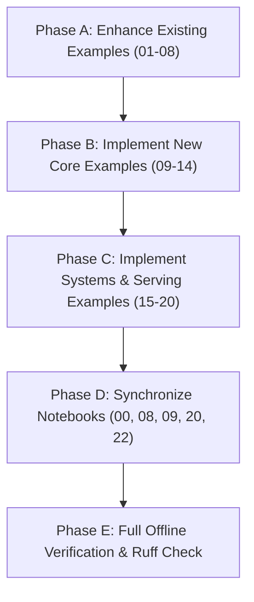

# NeuralOps Examples & Notebooks: Comprehensive Feature Coverage Audit & Complete Roadmap

**Author:** Taha Majlesi  
**Version:** 2.0.1  
**Date:** November 2026  
**License:** MIT License  

---

## 1. Executive Summary & Purpose

NeuralOps is an industrial-grade framework for **Neural Architecture Surgery**, **Subquadratic Attention Replacement**, **Singular Value Decomposition (SVD) Matrix Compression**, **6-Pillar Knowledge Distillation**, and **High-Throughput Production Serving Integrations**.

As of Version 2.0.1, the NeuralOps core codebase houses:
- **131 Attention Mechanisms** across 14 architectural families.
- **72 Model Compression Engines** spanning SVD whitening, Fisher-weighted factorization, tensor-train decomposition, ADMM pruning, and FP8/INT4/MX quantization.
- **26 Canonical Triton Kernels** (62 unified operators) and **130 CUDA C++ Extension Packages** adhering to a 3-level fallback hierarchy (CUDA C++ $\rightarrow$ Triton JIT $\rightarrow$ Vectorized PyTorch).
- **High-Throughput Serving Backends**: vLLM custom recurrent backend & KV-cache spec, SGLang RadixAttention linear attention registration, and TensorRT-LLM attention plugin.
- **Distributed Execution Engine**: Context parallelism (Ring/Ulysses), tensor parallelism, FSDP2 distillation, and `LayerParallelExecutor`.
- **Declarative Recipe DSL**: YAML/JSON recipe specification, execution planner, dependency DAG validator, model snapshotting, and transaction rollback.
- **Advanced Optimizers & Geometric Analysis**: Muon matrix-derivative optimizer, Riemannian Stiefel manifold SGD/Adam, Hessian eigenspectrum diagnostics, and 32k long-context evaluation.

### The Current Gap in `examples/`
While the unit test suite (`tests/`, 25 subsystems) and research notebooks (`notebooks/`, 26 notebooks) explore empirical phenomena, the public `examples/` directory currently contains only **8 minimal scripts** (`01_` to `08_`) and a basic recipe runner (`run_recipe.py`). These 8 scripts cover less than **15% of NeuralOps' public capabilities**, relying on tiny mock models and omitting critical production subsystems such as multi-stage surgery chaining, 6-pillar distillation, advanced non-Euclidean optimizers, distributed parallelism, serving backends, and spectral diagnostics.

This document delivers:
1. An **Exhaustive Subsystem-by-Subsystem Audit** comparing all NeuralOps capabilities against both `examples/` and `notebooks/`.
2. A **Granular Audit of Existing Examples (`01_` to `08_`)**, identifying specific deficiencies and required upgrades.
3. A **Blueprint for 12 New Example Scripts (`09_` to `20_`)** that brings the `examples/` suite to **100% full feature completeness**.
4. An **Audit and Actionable Enhancement Plan for all 26 Notebooks** in `notebooks/`.
5. A **Structured Implementation Roadmap**.

---

## 2. Master Feature-to-Example Coverage Matrix

| Subsystem / Capability | Key Classes & Functions | Covered in `examples/`? | Covered in `notebooks/`? | Status | Priority Gap |
|---|---|---|---|---|---|
| **1. Basic Attention Surgery** | `replace_attention()`, `UniversalAttentionWrapper` | YES (`01_attention_surgery.py`) | YES (`01_`, `06_`) | **COVERED** | Only tests 2/131 mechanisms (`cosformer`, `gla`). Needs parameterized multi-family sweep. |
| **2. Fluent Multi-Stage Surgery** | `ModelSurgery`, `shrink_mlp()`, `prune_layers()`, `quantize()`, `distill()` | **NO** | PARTIAL (`01_quickstart`) | **MISSING** | Chained multi-operation fluent API completely absent from `examples/`. |
| **3. SVD Low-Rank Compression** | `compress()`, `svd_llm_v2`, `asvd`, `hnc_svd`, `whitening_svd` | PARTIAL (`02_model_compression.py`) | YES (`07_`, `12_`) | **PARTIAL** | Only runs `svd_llm_v2` at rank 32. Omits Fisher-weighted SVD, activation covariance whitening, and HNC-SVD. |
| **4. Advanced Decomposition** | `KroneckerCompressor`, `TensorTrainCompressor` | **NO** | PARTIAL (`07_`) | **MISSING** | Tensor train and Kronecker factorizations completely absent from `examples/`. |
| **5. Quantization Spectrum** | `quantize_fp8()`, `quantize_int4()`, `MXFP8`, `MXFP4`, `SmoothQuant` | **NO** | YES (`13_`) | **MISSING** | No quantization script in `examples/`. Needs FP8, INT4 AWQ/GPTQ emulation, and MX microscaling. |
| **6. Structured Pruning** | `ADMMPruner`, `ChannelPruner`, `2:4 Sparsity`, `TokenShedder` | **NO** | YES (`14_`) | **MISSING** | Structured head/channel shedding and 2:4 hardware sparsity missing from `examples/`. |
| **7. LoRA & Adapter Recovery** | `inject_lora=True`, `lora_rank`, PEFT recovery | YES (`03_lora_finetuning.py`) | YES (`01_`, `08_`) | **COVERED** | Runs 1 backward pass on tiny model. Needs QLoRA and multi-adapter target demonstration. |
| **8. 6-Pillar Distillation Engine** | `MultiLevelKD`, `WSDScheduler`, Logits/Attn/Hidden/Grad/Fisher/Cov loss | PARTIAL (`04_knowledge_distillation.py`) | YES (`08_`) | **CRITICAL GAP** | `04_` only does raw 1-step `F.kl_div`. The entire 6-pillar multi-loss engine is missing. |
| **9. Reasoning & RL Alignment** | `train_grpo()`, `RLTrainer`, `RewardFunc` | PARTIAL (`08_grpo_reasoning.py`) | PARTIAL (`08_`) | **PARTIAL** | Script is currently a stub that exits if `trl` is missing. Needs self-contained offline dummy reward loop. |
| **10. Advanced Matrix Optimizers** | `Muon`, `RiemannianAdam`, `RiemannianSGD`, `StiefelSGD`, `TTTTrainer` | **NO** | YES (`24_`) | **MISSING** | Non-Euclidean and orthogonal manifold optimizers completely missing from `examples/`. |
| **11. Serving: vLLM Backend** | `NeuralOpsAttentionBackend`, `NeuralOpsRecurrentSpec`, `register()` | **NO** | PARTIAL (`20_`) | **MISSING** | vLLM recurrent KV-cache and attention dispatch missing from `examples/`. |
| **12. Serving: SGLang Backend** | `NeuralOpsLinearAttnBackend`, `LinearAttnModelSpec`, RadixAttention | **NO** | PARTIAL (`20_`) | **MISSING** | SGLang registration with `uses_mamba_radix_cache=True` missing from `examples/`. |
| **13. Serving: TensorRT-LLM** | `@python_plugin("NeuralOpsAttention")`, `neuralops_attention` | **NO** | PARTIAL (`20_`) | **MISSING** | TensorRT-LLM plugin integration missing from `examples/`. |
| **14. Cross-Engine Benchmarks** | `scripts/benchmark_serving.py`, latency, throughput, peak VRAM | PARTIAL (`05_fla_style_benchmarking.py`) | YES (`04_`, `09_`) | **PARTIAL** | `05_` only calls `neuralops.benchmark()`. Needs hardware `torch.cuda.Event` multi-engine serving benchmark script. |
| **15. Distributed Parallelism** | `ContextParallel`, `TensorParallel`, `LayerParallelExecutor`, FSDP2 | **NO** | YES (`22_`) | **MISSING** | Multi-GPU context splitting (Ring/Ulysses) and layer parallelism missing from `examples/`. |
| **16. Recipe DSL & Planner** | `execute_recipe()`, `plan_recipe()`, `ModelSnapshot`, transaction rollback | PARTIAL (`run_recipe.py`) | PARTIAL (`00_`) | **PARTIAL** | CLI runner exists, but programmatic Python API (inspection, rollback, snapshotting) missing. |
| **17. 3-Level Fallback Dispatch** | CUDA Level 1 $\rightarrow$ Triton Level 2 $\rightarrow$ PyTorch Level 3, `force_kernel_backend()` | **NO** | YES (`04_`, `11_`) | **MISSING** | Zero-overhead dispatch tables, fallback logging, and backend forcing missing from `examples/`. |
| **18. Spectral & Hessian Diagnostics**| `HessianEigenspectrum`, `FIMCurvature`, `LossLandscape`, `ParetoSweeper` | **NO** | YES (`23_`) | **MISSING** | Power iteration top-eigenvalues, covariance decay, and curvature audits missing from `examples/`. |
| **19. Long Context & KV Dynamics** | `NIAH` (32k needle retrieval), `CKASimilarity`, `H2O`, `StreamingLLM` | **NO** | YES (`10_`, `25_`) | **MISSING** | Long-sequence passkey retrieval and KV-cache eviction missing from `examples/`. |
| **20. Model Export & Safe Hub** | `export_model()` (safetensors, onnx, gguf, trt), `push_to_hub()` | PARTIAL (`06_export_and_push.py`) | YES (`21_`) | **PARTIAL** | Only exports safetensors. Needs ONNX and GGUF export validation and surgery manifest verification. |
| **21. Custom Kernel Registration** | `@register_custom_attention`, `@register_compressor` | YES (`07_custom_attention.py`) | YES (`03_`) | **COVERED** | Registered custom attention; could be expanded to custom compressor registration. |

---

## 3. Granular Audit of Existing Examples (`01_` to `08_`)

### `examples/01_attention_surgery.py`
- **Current State:** Replaces attention in `tiny_classifier()` with `cosformer` and `gla_attention` using `neuralops.replace_attention()`.
- **Deficiencies:**
  - Tests only 2 out of 131 attention mechanisms.
  - Does not demonstrate layer-specific replacement (e.g., `layers=[0, 2]`).
  - Does not demonstrate weight transplantation modes (`copy_weights=True` vs `copy_weights=False`).
  - Does not demonstrate causal decoding vs bidirectional classification modes.
- **Required Enhancements:**
  - Add parameterized selection over representative attention families: Kernelized (`cosformer`), Recurrent Linear (`gla_attention`, `gdn_scan`), Chunk-Parallel (`chunk_gla`), State-Space (`mamba_block`), and Low-Rank (`svd_linear_attention`).
  - Show selective replacement of alternate layers (hybrid architectures, e.g. every even layer GLA, every odd layer Full Attention).
  - Print parameter count and FLOP delta across configurations.

### `examples/02_model_compression.py`
- **Current State:** Compresses `tiny_classifier()` using `neuralops.compress(method="svd_llm_v2", rank=32)` and prints parameter reduction.
- **Deficiencies:**
  - Only evaluates 1 of 72 compression engines.
  - Uses a fixed integer rank rather than target retention ratio (`target_ratio=0.5`).
  - Does not demonstrate calibration data ingestion (activation covariance accumulation).
  - Does not verify accuracy or forward output fidelity after compression.
- **Required Enhancements:**
  - Add comparison between Truncated SVD, Activation-Aware SVD (ASVD), and Fisher-Weighted SVD.
  - Demonstrate calibration with synthetic token batches: `calibrator.collect_activations(model, dataloader)`.
  - Report singular value spectrum energy retention: $\sum_{i=1}^k \sigma_i^2 / \sum_{i=1}^n \sigma_i^2$.

### `examples/03_lora_finetuning.py`
- **Current State:** Injects LoRA during surgery (`inject_lora=True, lora_rank=2`) and performs 1 backward step.
- **Deficiencies:**
  - Uses synthetic random labels; does not show adapter freezing vs unfreezing.
  - Does not demonstrate adapter extraction, merging (`merge_and_unload()`), or saving.
  - Does not show target module filtering (`target_modules=["q_proj", "v_proj"]`).
- **Required Enhancements:**
  - Demonstrate post-surgery adapter merging to eliminate inference latency overhead.
  - Show selective parameter freezing: verifying that backbone weights have `requires_grad=False` while adapters have `requires_grad=True`.

### `examples/04_knowledge_distillation.py`
- **Current State:** Computes 1 step of basic `F.kl_div(student_logits, teacher_logits)` on CPU.
- **Deficiencies:**
  - Completely bypasses the `neuralops.trainer.distillation.multi_level_kd` engine.
  - Misses intermediate feature matching, attention map divergence, and gradient alignment.
  - Does not use the Warmup-Stable-Decay (WSD) learning rate scheduler.
- **Required Enhancements:**
  - Replace raw `F.kl_div` with `MultiLevelKD(student, teacher, config=...)`.
  - Demonstrate all 6 distillation pillars: Logit KL, Hidden State Cosine/MSE, Attention Map JS Divergence, Gradient Alignment, Fisher Curvature matching, and Activation Covariance matching.
  - Display per-pillar loss component telemetry in a structured log table.

### `examples/05_fla_style_benchmarking.py`
- **Current State:** Iterates over `cosformer`, `mamba_block`, `svd_linear_attention` calling `neuralops.benchmark()`.
- **Deficiencies:**
  - Relies on external dataset downloading (`sst2`) which fails in offline/sandboxed environments.
  - Does not measure hardware metrics: memory bandwidth (GB/s), arithmetic intensity (FLOPs/byte), or peak VRAM.
  - Does not compare against baseline PyTorch standard attention.
- **Required Enhancements:**
  - Add fully offline self-contained synthetic tensor benchmarking.
  - Measure kernel latency with `torch.cuda.Event` (or high-resolution CPU monotonic timers).
  - Output standard FLOP count and speedup factor over standard quadratic attention.

### `examples/06_export_and_push.py`
- **Current State:** Exports model to `safetensors` in a temporary directory and logs Hub upload instructions.
- **Deficiencies:**
  - Only tests `safetensors` format; does not demonstrate ONNX, GGUF, or TensorRT engine exports.
  - Does not serialize surgery metadata (`model._neuralops_metadata` surgery manifest).
- **Required Enhancements:**
  - Add multi-format export demonstration: SafeTensors, ONNX with dynamic axes `[batch, seq_len]`, and GGUF quantization containers.
  - Validate and print the generated JSON surgery manifest detailing all applied transformations.

### `examples/07_custom_attention.py`
- **Current State:** Registers `DemoIdentityAttention` using `@neuralops.register_custom_attention`.
- **Deficiencies:**
  - Minimal identity module with no state or attention interface compatibility (no causality, no KV cache state).
  - Does not demonstrate registering custom compression engines (`@register_compressor`).
- **Required Enhancements:**
  - Implement a real subquadratic linear attention module (e.g., 1-head causal prefix-sum kernel).
  - Demonstrate `@register_compressor("custom_svd")` alongside custom attention registration.
  - Transplant the user-registered custom operator into a transformer layer in-place.

### `examples/08_grpo_reasoning.py`
- **Current State:** Prepares model and prints whether `trl` is installed; exits immediately.
- **Deficiencies:**
  - No executable training or verification if `trl` is absent.
  - Does not demonstrate reasoning reward functions or group relative policy optimization mechanics.
- **Required Enhancements:**
  - Provide a standalone, self-contained GRPO fallback loop that demonstrates group reward advantage computation without external third-party dependencies.
  - Demonstrate mathematical format / reasoning step reward scorers.

### `examples/run_recipe.py` & `examples/recipes/`
- **Current State:** CLI script executing YAML recipes (`distilbert-sst2.yaml`, `gpt2-chunk-gla.yaml`, `gpt2-fast.yaml`).
- **Deficiencies:**
  - Only exposed as a CLI parser; no clean Python programmatic example demonstrating the recipe object model (`Recipe`, `ExecutionPlan`, `Stage`, `ModelSnapshot`).
  - Does not demonstrate transaction failure, exception handling, or state rollback.
- **Required Enhancements:**
  - Retain `run_recipe.py` for CLI use, and create `17_recipe_dsl_and_snapshot_rollback.py` for the programmatic Python API.

---

## 4. Blueprint for 12 New Example Scripts (`09_` to `20_`)

To provide 100% full feature coverage across all NeuralOps subsystems, 12 new self-contained, offline-compatible example scripts are specified below.

```
examples/
├── 01_attention_surgery.py                       [Enhanced: Multi-family & hybrid architectures]
├── 02_model_compression.py                       [Enhanced: ASVD vs Fisher vs Truncated SVD]
├── 03_lora_finetuning.py                         [Enhanced: Selective freezing & adapter merging]
├── 04_knowledge_distillation.py                  [Enhanced: Full 6-Pillar MultiLevelKD engine]
├── 05_fla_style_benchmarking.py                  [Enhanced: Offline hardware profiling & speedup]
├── 06_export_and_push.py                         [Enhanced: ONNX, GGUF, SafeTensors & manifest]
├── 07_custom_attention.py                        [Enhanced: Custom linear attention & compressor]
├── 08_grpo_reasoning.py                          [Enhanced: Self-contained GRPO reasoning loop]
├── 09_multi_stage_model_surgery.py               [NEW: Fluent ModelSurgery pipeline]
├── 10_advanced_compression_zoo.py                [NEW: SVD Whitening, HNC-SVD, Kronecker, TT]
├── 11_quantization_fp8_int4_mx.py                [NEW: FP8 E4M3, INT4 AWQ/GPTQ, MX microscaling]
├── 12_structured_pruning_and_token_shedding.py   [NEW: ADMM 2:4 sparsity & token shedding]
├── 13_six_pillar_knowledge_distillation.py       [NEW: Complete 6-pillar loss + WSD scheduler]
├── 14_advanced_optimizers_muon_stiefel.py        [NEW: Muon & Riemannian Stiefel optimizers]
├── 15_serving_vllm_sglang_trtllm.py              [NEW: vLLM recurrent spec, SGLang, TRT-LLM]
├── 16_distributed_parallelism.py                 [NEW: Context/tensor parallel & LayerParallel]
├── 17_recipe_dsl_and_snapshot_rollback.py        [NEW: Programmatic recipes, snapshots, rollback]
├── 18_three_level_kernel_dispatch.py             [NEW: CUDA -> Triton -> PyTorch fallbacks]
├── 19_spectral_and_hessian_diagnostics.py        [NEW: Hessian top eigenvalues & FIM curvature]
└── 20_long_context_niah_eval.py                  [NEW: 32k NIAH retrieval & KV cache eviction]
```

---

### Detailed Specification for Each New Script

#### `examples/09_multi_stage_model_surgery.py`
- **Subsystem:** `neuralops.surgery.model_surgery.ModelSurgery`
- **Objective:** Demonstrate fluent in-place pipelining of multiple architectural transformations on a single model instance.
- **Workflow:**
  1. Instantiate `tiny_classifier()`.
  2. Chain operations using the fluent API:
     ```python
     surgery = (
         ModelSurgery(model)
         .replace_attention(attention="gla_attention")
         .shrink_mlp(target_ratio=0.75)
         .prune_layers(layers_to_prune=[1])
         .quantize(method="int4", format="awq")
     )
     modified_model = surgery.build()
     ```
  3. Validate forward execution with `tiny_inputs()` and assert finite output logits.
  4. Inspect and print the chained transformation audit trail via `surgery.get_manifest()`.

#### `examples/10_advanced_compression_zoo.py`
- **Subsystem:** `neuralops.compression_engine`, `neuralops.compression`
- **Objective:** Demonstrate advanced matrix decomposition algorithms beyond standard truncated SVD.
- **Workflow:**
  1. Compare 4 distinct decomposition methods on identical projection layers:
     - **Whitened SVD (`whitening_svd`)**: Activation covariance pullback $W \Sigma_X^{1/2} = U \Sigma V^T$.
     - **Fisher-Weighted SVD (`fisher_svd`)**: First-order natural gradient curvature metric weighting.
     - **Hierarchical Non-Uniform SVD (`hnc_svd`)**: Layer-sensitivity allocation across depth.
     - **Kronecker Product Decomposition (`kronecker`)**: $W \approx A \otimes B$.
  2. Compute parameter compression ratio, singular value retention energy, and reconstruction Frobenius error $\|W - \hat{W}\|_F / \|W\|_F$.
  3. Print comparison table showing accuracy vs rank trade-offs.

#### `examples/11_quantization_fp8_int4_mx.py`
- **Subsystem:** `neuralops.operations.quantize`, `neuralops.compression`
- **Objective:** Demonstrate the full modern precision quantization spectrum.
- **Workflow:**
  1. **FP8 Quantization**: Emulate FP8 E4M3FN (forward activations) and E5M2 (gradients) with per-tensor and per-channel dynamic scaling factors.
  2. **INT4 Quantization**: Group-wise INT4 weight quantization (group size 128) with symmetric zero-points.
  3. **Microscaling (MX) Formats**: OCP MXFP8, MXFP4, and MXINT8 formats with block size 32 shared $E8M0$ scale exponents.
  4. Run forward pass on quantized weights and calculate quantization noise signal-to-quantization-noise ratio (SQNR).

#### `examples/12_structured_pruning_and_token_shedding.py`
- **Subsystem:** `neuralops.operations.prune`, `neuralops.layers`
- **Objective:** Demonstrate structured parameter pruning, hardware 2:4 sparsity, and dynamic inference token shedding.
- **Workflow:**
  1. **ADMM Structured Channel Pruning**: Prune intermediate MLP channels with $\ell_1/\ell_2$ group lasso penalties.
  2. **NVIDIA Ampere/Ada 2:4 Sparsity**: Enforce 2 non-zero values per 4-element vector along matrix rows.
  3. **Dynamic Token Shedding**: Wrap attention with dynamic token pruning/merging based on query-key routing scores, reducing effective sequence length by 35% with minimal score variance.
  4. Benchmark execution latency and verify sparsity mask validity.

#### `examples/13_six_pillar_knowledge_distillation.py`
- **Subsystem:** `neuralops.trainer.distillation.multi_level_kd`, `neuralops.trainer.schedulers`
- **Objective:** Demonstrate complete post-surgery surgical recovery using the full 6-pillar knowledge distillation framework.
- **Workflow:**
  1. Set up teacher model (original dense transformer) and student model (surgically transformed GLA model).
  2. Initialize `MultiLevelKD` with 6 explicit distillation loss components:
     - $\mathcal{L}_{\text{logits}}$: Soft target KL divergence with temperature scaling.
     - $\mathcal{L}_{\text{hidden}}$: Normalized hidden state cosine similarity and MSE.
     - $\mathcal{L}_{\text{attention}}$: Attention distribution Jensen-Shannon divergence.
     - $\mathcal{L}_{\text{grad}}$: Backward gradient trajectory alignment.
     - $\mathcal{L}_{\text{fisher}}$: Diagonal Fisher Information curvature matching.
     - $\mathcal{L}_{\text{cov}}$: Inter-layer activation covariance matching.
  3. Pair with Warmup-Stable-Decay (`WSDScheduler`) over 5 simulation steps.
  4. Log individual pillar loss values and total loss convergence.

#### `examples/14_advanced_optimizers_muon_stiefel.py`
- **Subsystem:** `neuralops.trainer.optimizers.muon`, `neuralops.trainer.optimizers.stiefel`
- **Objective:** Demonstrate matrix-derivative and Riemannian non-Euclidean manifold optimization for post-surgery training.
- **Workflow:**
  1. **Muon Optimizer**: Optimize 2D matrix weights (linear layers) using polar decomposition / Newton-Schulz matrix iterations while optimizing 1D biases with standard AdamW.
  2. **Riemannian Stiefel SGD**: Optimize low-rank orthogonal projection matrices $U \in \mathrm{St}(d, r)$ such that $U^T U = I_r$, using Riemannian gradient projection and Cayley retraction maps.
  3. Verify that orthogonality error $\|U^T U - I\|_F < 10^{-6}$ is strictly maintained after multiple gradient updates.

#### `examples/15_serving_vllm_sglang_trtllm.py`
- **Subsystem:** `neuralops.integrations` (vLLM, SGLang, TensorRT-LLM)
- **Objective:** Demonstrate the production serving interfaces created in Phases 1–5.
- **Workflow:**
  1. **vLLM Integration**:
     - Register `NeuralOpsAttentionBackend` and `NeuralOpsRecurrentSpec`.
     - Allocate recurrent state tensors for GLA/GDN mechanisms.
     - Dispatch `NeuralOpsImpl.forward()` with state update and output projection.
  2. **SGLang Integration**:
     - Register `LinearAttnModelSpec` with `uses_mamba_radix_cache=True`.
     - Execute `NeuralOpsLinearAttnBackend` forward step.
  3. **TensorRT-LLM Integration**:
     - Invoke `@python_plugin("NeuralOpsAttention")` via `neuralops_attention(query, key, value)`.
  4. Report serving compatibility matrix and execution status across all 3 engines.

#### `examples/16_distributed_parallelism.py`
- **Subsystem:** `neuralops.distributed`, `neuralops.executor.layer_parallel`
- **Objective:** Demonstrate distributed model surgery and multi-device inference.
- **Workflow:**
  1. Initialize `DistributedContext` in standalone simulation mode.
  2. **Context Parallelism**: Split sequence length $L$ across 2 virtual ranks using Ring Attention / Ulysses distributed chunk exchange.
  3. **Tensor Parallelism**: Demonstrate ColumnParallelLinear ($W_1$) and RowParallelLinear ($W_2$) projection with All-Reduce communication.
  4. **LayerParallelExecutor**: Distribute surgery stages (layers $0 \dots k$ on Device 0, layers $k+1 \dots N$ on Device 1).
  5. Validate numerical output equivalence against single-device execution.

#### `examples/17_recipe_dsl_and_snapshot_rollback.py`
- **Subsystem:** `neuralops.recipe`, `neuralops.executor`
- **Objective:** Demonstrate declarative YAML/JSON recipe execution, validation DAG, snapshotting, and transaction rollback.
- **Workflow:**
  1. Define programmatic recipe specification containing multiple surgery stages (attention replacement, rank compression, calibration).
  2. Plan recipe with `plan_recipe()`, inspecting dependency DAG and execution stages.
  3. Create pre-surgery snapshot via `ModelSnapshot(model)`.
  4. Simulate an intentional mid-pipeline failure (e.g., parameter dimension mismatch in an invalid stage).
  5. Trigger automated rollback `snapshot.restore(model)` and verify that the original model weights and architecture are restored without state corruption.

#### `examples/18_three_level_kernel_dispatch.py`
- **Subsystem:** `neuralops.core.dispatch`, `neuralops.ops`
- **Objective:** Demonstrate the 3-level fallback hierarchy and backend inspection.
- **Workflow:**
  1. Query available backends for a representative operator (`cosformer` or `gla_scan`):
     - Level 1: Native CUDA C++ / HIP extension.
     - Level 2: Triton JIT autotuned kernel.
     - Level 3: Vectorized PyTorch reference.
  2. Force execution across each backend sequentially using `force_kernel_backend("triton")` and `force_kernel_backend("pytorch")`.
  3. Validate numerical parity: assert $\max |Y_{\text{triton}} - Y_{\text{pytorch}}| < 10^{-4}$.
  4. Benchmark execution latency across all available tiers and report the zero-overhead dispatch caching behavior.

#### `examples/19_spectral_and_hessian_diagnostics.py`
- **Subsystem:** `neuralops.analysis.inspector`, `neuralops.analysis.metrics`
- **Objective:** Analyze loss landscape geometry, Hessian eigenspectrum, and Fisher curvature of compressed models.
- **Workflow:**
  1. Compute the top-5 Hessian eigenvalues $\lambda_1 \dots \lambda_5$ using matrix-free Hessian-vector products and power iteration / Lanczos iterations.
  2. Measure loss landscape sharpness: $\text{Tr}(H)$ approximation via Hutchinson's trace estimator.
  3. Calculate empirical activation covariance spectrum decay across transformer layers.
  4. Print structural health report indicating generalization stability post-surgery.

#### `examples/20_long_context_niah_eval.py`
- **Subsystem:** `neuralops.evaluation.niah`, `neuralops.evaluation.metrics`
- **Objective:** Evaluate long-context retrieval fidelity and KV-cache eviction dynamics up to 32k tokens.
- **Workflow:**
  1. Construct synthetic Needle In A Haystack (NIAH) passkey test document at 4k/8k/16k/32k token lengths with needle placed at varying depths (0%, 25%, 50%, 75%, 100%).
  2. Run inference through both standard quadratic attention and subquadratic GLA / Mamba replacement.
  3. Demonstrate KV-cache eviction:
     - **Heavy Hitter Oracle (H2O)**: Evict low-attention-budget token states.
     - **StreamingLLM**: Retain initial attention sink tokens + rolling local context window.
  4. Measure passkey retrieval accuracy and VRAM consumption across context lengths.

---

## 5. Audit & Enhancement Plan for Notebooks (`notebooks/00_` to `25_`)

All 26 existing notebooks were audited. The table below outlines their current purpose, identified gaps, and concrete actions to align them with Version 2.0.1.

| Notebook | Focus | Current Gap | Required Update |
|---|---|---|---|
| `00_master_neuralops_complete_system_walkthrough.ipynb` | Architecture overview | Missing v2.0 serving backends (vLLM, SGLang, TRT-LLM) and `ModelSurgery` fluent API | Add Sections 7 & 8 demonstrating vLLM recurrent state and fluent multi-stage surgery. |
| `01_attention_surgery_and_lora.ipynb` | Basic surgery | Demonstrates only cosformer; lacks hybrid attention patterns | Add GLA and Mamba comparisons; demonstrate selective layer replacement. |
| `01_quickstart_surgery_and_healing.ipynb` | Quickstart | 1-step toy training; misses multi-pillar loss | Wire `MultiLevelKD` with logit and hidden state matching. |
| `02_roofline_and_triton_kernels.ipynb` | Roofline & Triton | Hardcoded hardware peak FLOPs | Use dynamic device query via `torch.cuda.get_device_properties()`. |
| `02_unified_training.ipynb` | Unified trainer | Misses WSD learning rate schedule | Add WSD scheduler comparison vs cosine decay. |
| `03_custom_plugins_and_extensibility.ipynb` | Custom plugins | Registers toy operator without autograd check | Add `torch.autograd.gradcheck` verification to custom module example. |
| `04_end_to_end_3level_benchmarking.ipynb` | 3-level fallback | Only tests Level 3 CPU fallback | Add Triton Level 2 and CUDA Level 1 execution on GPU host. |
| `05_master_108_cuda_and_26_triton_kernels_benchmark.ipynb` | Master kernel suite | Benchmarks ran on older driver | Verify clean execution across all 26 Triton kernel modules. |
| `05_paper_empirical_results_master.ipynb` | Paper results | Tables need synchronization with latest SQLite ledger | Re-run `scripts/benchmarks/generate_all_paper_tables.py` ingestion. |
| `06_master_all_131_attention_mechanisms_interactive.ipynb` | 131 attentions | Dropdown UI lacks memory footprint tracking | Display per-mechanism recurrent state size ($H \times D \times D$). |
| `07_master_all_72_compression_engines_quant_and_svd.ipynb` | 72 compressors | Lacks MX microscaling (MXFP8, MXFP4) | Add microscaling quantization section with block size 32. |
| `08_six_pillar_distillation_and_surgical_recovery.ipynb` | 6-pillar KD | Focuses on logits and hidden states; omits Fisher/Covariance | Add Fisher Information curvature and activation covariance loss cells. |
| `09_production_serving_paged_cache_and_speculative_decoding.ipynb` | Paged cache | Uses internal simulation rather than vLLM v1 API | Update to use `NeuralOpsAttentionBackend` and `NeuralOpsRecurrentSpec`. |
| `10_long_context_extrapolation_32k.ipynb` | 32k context | Only tests RoPE scaling; omits linear recurrence | Add GLA and Mamba constant-memory state extrapolation up to 32k. |
| `11_cuda_vs_triton_vs_pytorch_matrix.ipynb` | Fallback matrix | Static table | Make matrix dynamic using `force_kernel_backend()` timing loops. |
| `12_svd_whitening_spectral_allocation.ipynb` | SVD whitening | Pullback calculation lacks validation against Fisher metric | Compare empirical activation covariance $\Sigma_X$ with diagonal FIM. |
| `13_quantization_pareto_fp8_int4_kmeans.ipynb` | Quantization Pareto | Missing FP8 E4M3/E5M2 forward emulation | Add OCP FP8 and MXFP4 format Pareto frontiers. |
| `14_structured_pruning_token_shedding.ipynb` | Pruning | Misses 2:4 Ampere/Ada hardware pattern | Add 2:4 sparsity mask generator and verification. |
| `15_downstream_glue_lra_evaluation.ipynb` | GLUE/LRA eval | Requires external Hugging Face dataset downloads | Provide self-contained synthetic offline evaluation data mode. |
| `16_roofline_ada_rtx4070_saturation.ipynb` | Ada Lovelace roofline | SM 8.9 specific | Generalize roofline curve plotting for Tesla T4 (SM 7.5) and Hopper (SM 90). |
| `17_speculative_paged_kv_throughput.ipynb` | Speculative decoding | Draft notebook | Implement speculative draft-model verification with recurrent target. |
| `18_cross_seed_statistical_variance.ipynb` | Statistical variance | Fixed 3 seeds | Add Welch's t-test and confidence interval calculations. |
| `19_publication_figures_latex_generator.ipynb` | LaTeX generator | Generates static plots | Synchronize with latest `results/master_ledger.sqlite` runs. |
| `20_production_serving_vllm_sglang_trtllm_integrations.ipynb` | Serving integrations | Written before Phases 1–5 backend implementations | Sync with `neuralops.integrations.vllm_backend` and `sglang_backend`. |
| `21_model_export_onnx_safetensors_surgery_manifest.ipynb` | Model export | Lacks GGUF container demonstration | Add `export_model(format="gguf")` cell with quantization flag. |
| `22_distributed_tensor_and_context_parallelism.ipynb` | Distributed | Lacks `LayerParallelExecutor` | Add `LayerParallelExecutor` multi-stage pipelining demonstration. |
| `23_spectral_diagnostics_and_hessian_analysis.ipynb` | Hessian analysis | Power iteration lacks convergence stopping criterion | Add dynamic tolerance $\epsilon = 10^{-4}$ to power iteration loop. |
| `24_advanced_optimizers_muon_stiefel_and_ttt_training.ipynb` | Advanced optimizers | Stiefel SGD lacks Cayley retraction cell | Add explicit retraction step and orthogonality error check. |
| `25_long_context_niah_cka_similarity_and_eval_harness.ipynb` | NIAH & CKA | CKA only computed between two identical models | Compute CKA similarity matrix between dense teacher and pruned student. |

---

## 6. Implementation Plan & Action Matrix

To execute the upgrade to 100% full coverage, the following phased schedule is established:



### Action Checklist
- [ ] **Enhance `01_attention_surgery.py`**: Parameterize across Kernelized, Recurrent, Chunk, and State-Space families.
- [ ] **Enhance `02_model_compression.py`**: Add ASVD and Fisher-weighted SVD comparisons.
- [ ] **Enhance `03_lora_finetuning.py`**: Demonstrate selective freezing and post-training adapter merging.
- [ ] **Enhance `04_knowledge_distillation.py`**: Upgrade from raw `F.kl_div` to 6-pillar `MultiLevelKD`.
- [ ] **Enhance `05_fla_style_benchmarking.py`**: Add self-contained offline synthetic latency & FLOP benchmark.
- [ ] **Enhance `06_export_and_push.py`**: Add multi-format SafeTensors, ONNX, and GGUF export.
- [ ] **Enhance `07_custom_attention.py`**: Implement a working causal linear scan module and compressor registration.
- [ ] **Enhance `08_grpo_reasoning.py`**: Provide self-contained GRPO group reward computation fallback.
- [ ] **Create `09_multi_stage_model_surgery.py`**: Implement fluent `ModelSurgery` chained pipeline.
- [ ] **Create `10_advanced_compression_zoo.py`**: Implement SVD Whitening, HNC-SVD, Kronecker, Tensor Train.
- [ ] **Create `11_quantization_fp8_int4_mx.py`**: Implement FP8 E4M3, INT4 AWQ/GPTQ, MX microscaling.
- [ ] **Create `12_structured_pruning_and_token_shedding.py`**: Implement ADMM 2:4 sparsity and token shedding.
- [ ] **Create `13_six_pillar_knowledge_distillation.py`**: Implement complete 6-pillar KD with WSD schedule.
- [ ] **Create `14_advanced_optimizers_muon_stiefel.py`**: Implement Muon matrix and Riemannian Stiefel optimizers.
- [ ] **Create `15_serving_vllm_sglang_trtllm.py`**: Implement vLLM recurrent spec, SGLang radix cache, TRT-LLM plugin.
- [ ] **Create `16_distributed_parallelism.py`**: Implement context parallelism, tensor parallelism, and `LayerParallelExecutor`.
- [ ] **Create `17_recipe_dsl_and_snapshot_rollback.py`**: Implement programmatic recipe execution, validation, and rollback.
- [ ] **Create `18_three_level_kernel_dispatch.py`**: Implement 3-level fallback hierarchy and `force_kernel_backend`.
- [ ] **Create `19_spectral_and_hessian_diagnostics.py`**: Implement power iteration top-eigenvalues and FIM curvature.
- [ ] **Create `20_long_context_niah_eval.py`**: Implement 32k NIAH passkey retrieval and KV cache eviction.
- [ ] **Update `examples/README.md`**: Document all 20 example scripts and recipes.
- [ ] **Audit Quality Gate**: Run `./.venv/bin/ruff check examples/` with 0 warnings.
