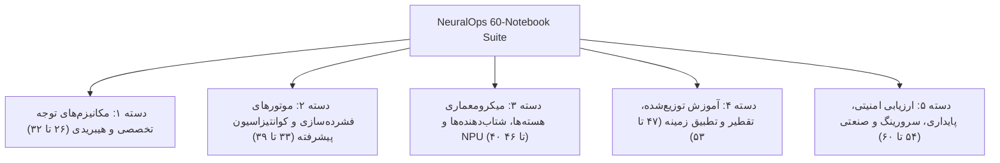
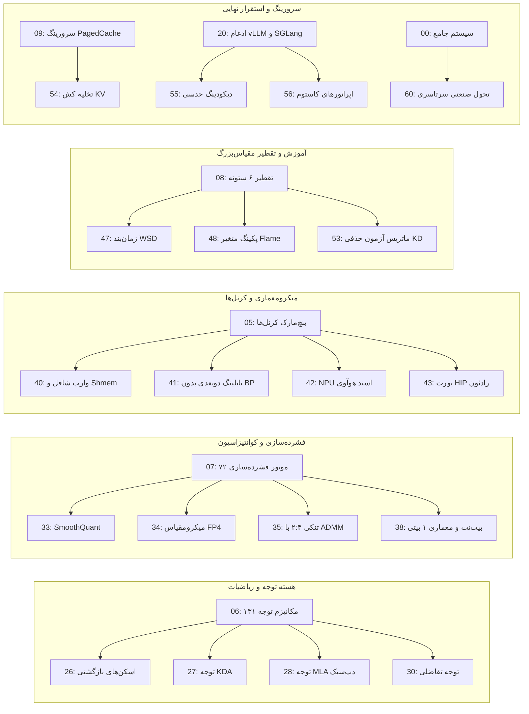

# NeuralOps Notebook Suite: Architecture, Catalog & 60-Notebook Expansion Roadmap

این سند مرجع جامع، معماری، طبقه‌بندی و راهنمای تفصیلی تمامی ۲۹ نوتبوک فعلی مخزن [NeuralOps](file:///Users/tahamajs/Documents/uni/Project) به همراه **طرح تفصیلی توسعه به ۶۰ نوتبوک (۳۱ نوتبوک جدید)** را با در نظر گرفتن کلیه بخش‌های سیستم (Attention Registry، Compression Engines، 3-Level Kernel Dispatch، 6-Pillar Distillation، Production Serving، و Mathematical Invariants) ارائه می‌دهد.

---

## ۱. اصول معماری و ساختار استاندارد هر نوتبوک

طبق استاندارد مهندسی و مهارت [`neuralops-notebook-architect`](file:///Users/tahamajs/Documents/uni/Project/.agents/skills/neuralops-notebook-architect/SKILL.md)، هر نوتبوک یک پروتوتایپ کامل و خودکفا است که از ساختار ۵ بخشی زیر تبعیت می‌کند:

1. **Preamble & Mathematical Foundation**:
   - بیان فرمول‌های ریاضی و قرارداد تنسوری (\(B, S, H, D\) یا \(B, S, D\)).
   - وارد کردن ماژول‌ها با مکانیزم Fallback و تعریف Dtype / Hardware Guard.
2. **Architecture & Topology Visualizer**:
   - نمودار شماتیک جریان داده (ASCII یا دایاگرام‌های تراز ماتریسی) و ابعاد تنسورها در هر لایه.
3. **Multi-Tier Kernel Dispatch Execution**:
   - فراخوانی و تست مسیر سه‌گانه: Level 1 (CUDA C++ / HIP)، Level 2 (Triton JIT بدون Block Pointer)، Level 3 (Vectorized PyTorch Reference).
   - تحلیل عددی Parity با تلرانس \(\text{atol}=10^{-3}, \text{rtol}=10^{-3}\).
4. **Hardware Telemetry & Memory Profiling**:
   - سنجش دقیق مصرف VRAM (Peak Allocation و Reservoir Memory)، توان مصرفی، و نسبت به سقف Roofline سخت‌افزار (مثلاً Ada Lovelace SM 8.9 یا Titan RTX).
5. **Interactive Experiments, Export & DoD Summary**:
   - تست سناریوهای تغییر پارامتر، صدور مانیفست جراحی و جمع‌بندی معیارهای Definition of Done (DoD).

---

## ۲. کاتالوگ جامع ۲۹ نوتبوک فعلی مخزن

| شماره | نام فایل نوتبوک | حوزه تخصصی | ماژول‌ها و کرنل‌های کلیدی |
| :--- | :--- | :--- | :--- |
| **00** | `00_master_neuralops_complete_system_walkthrough.ipynb` | سیستم جامع | بررسی سرتاسری لایه‌ها، رجیستری‌ها، جراحی، تقطیر و استقرار |
| **01a** | `01_quickstart_surgery_and_healing.ipynb` | شروع سریع | جراحی پیوندی توجه و بازیابی سریع با کالیبراسیون LoRA |
| **01b** | `01_attention_surgery_and_lora.ipynb` | جراحی توجه | جایگزینی لایه‌های توجه و تیونینگ پارامتر-کارا (PEFT) |
| **02a** | `02_unified_training.ipynb` | آموزش یکپارچه | خط لوله آموزش تجمیعی با تجمیع گرادیان و WSD |
| **02b** | `02_roofline_and_triton_kernels.ipynb` | بهینه‌سازی کرنل | مدل‌سازی Roofline و آنالیز کرنل‌های Triton JIT |
| **03** | `03_custom_plugins_and_extensibility.ipynb` | توسعه‌پذیری | معماری پلاگین‌ها و ثبت اپراتورهای سفارشی در رجیستری |
| **04** | `04_end_to_end_3level_benchmarking.ipynb` | بنچ‌مارک سه‌سطحی | اعتبارسنجی تاخیر و Fallback سطوح ۱، ۲ و ۳ |
| **05a** | `05_master_108_cuda_and_26_triton_kernels_benchmark.ipynb` | ماتریس کرنل‌ها | بنچ‌مارک جامع ۱۰۸ کرنل CUDA و ۲۶ ماژول تریتون |
| **05b** | `05_paper_empirical_results_master.ipynb` | نتایج تجربی مقاله | بازتولید جداول تجربی مقالات MLSys و arXiv |
| **06** | `06_master_all_131_attention_mechanisms_interactive.ipynb` | مکانیزم‌های توجه | ماتریس تعاملی و تست تک‌تک ۱۳۱ کلید ATTENTION_REGISTRY |
| **07** | `07_master_all_72_compression_engines_quant_and_svd.ipynb` | فشرده‌سازی | تست ۷۲ موتور COMPRESSOR_REGISTRY شامل کوانتیزاسیون و SVD |
| **08** | `08_six_pillar_distillation_and_surgical_recovery.ipynb` | تقطیر ۶ ستونه | بازیابی گرادیانی با اهداف شش‌گانه پس از برش ابعادی |
| **09** | `09_production_serving_paged_cache_and_speculative_decoding.ipynb` | سرورینگ عملیاتی | PagedAttention، مدیریت حافظه KV-Cache و دیکودینگ حدسی |
| **10** | `10_long_context_extrapolation_32k.ipynb` | کانتکست طولانی | برون‌یابی طول متن تا ۳۲k توکن با RoPE Scaling و YaRN |
| **11** | `11_cuda_vs_triton_vs_pytorch_matrix.ipynb` | مقایسه Backendها | تحلیل مقایسه‌ای سرعت و مصرف رجیستر در ۳ لایه اجرایی |
| **12** | `12_svd_whitening_spectral_allocation.ipynb` | فاکتورگیری SVD | تخمین کوواریانس، سفیدسازی ماتریس و بهینگی Eckart-Young |
| **13** | `13_quantization_pareto_fp8_int4_kmeans.ipynb` | مرز پارتو کوانتیزاسیون | ارزیابی دقت/حجم FP8 (E4M3/E5M2)، INT4 و Microscaling |
| **14** | `14_structured_pruning_token_shedding.ipynb` | هرس ساختاریافته | هرس کانال/سر با روش ADMM، تنکی ۲:۴ سخت‌افزاری و ریزش توکن |
| **15** | `15_downstream_glue_lra_evaluation.ipynb` | ارزیابی پایین‌دستی | تست مدل‌های جراحی‌شده روی بنچ‌مارک‌های GLUE و LRA |
| **16** | `16_roofline_ada_rtx4070_saturation.ipynb` | اشباع حافظه/محاسبه | اشباع پهنای باند و شتاب‌دهنده تنسوری روی معماری SM 8.9 |
| **17** | `17_speculative_paged_kv_throughput.ipynb` | توان عملیاتی سرورینگ | بنچ‌مارک توان گذردهی با ترکیب PagedAttention و توکن‌های کمکی |
| **18** | `18_cross_seed_statistical_variance.ipynb` | استحکام آماری | ارزیابی واریانس چند‌بذر، آزمون ولچ و فواصل اطمینان |
| **19** | `19_publication_figures_latex_generator.ipynb` | شکل‌های انتشار | تولید نمودارهای برداری TikZ و جداول LaTeX مستقیماً از داده |
| **20** | `20_production_serving_vllm_sglang_trtllm_integrations.ipynb` | یکپارچه‌سازی سرور | اتصال مدل جراحی‌شده به پایپ‌لاین‌های vLLM، SGLang و TRT-LLM |
| **21** | `21_model_export_onnx_safetensors_surgery_manifest.ipynb` | خروجی استاندارد | صدور ایمن به SafeTensors، مانیفست‌های JSON و پروتکل ONNX |
| **22** | `22_distributed_tensor_and_context_parallelism.ipynb` | موازی‌سازی توزیع‌شده | موازی‌سازی تنسوری (TP) و موازی‌سازی زمینه (CP) با Ring Attention |
| **23** | `23_spectral_diagnostics_and_hessian_analysis.ipynb` | تحلیل چشم‌انداز هسین | محاسبه طیف مقادیر ویژه هسین و کمینه‌های مسطح برای تعمیم بهتر |
| **24** | `24_advanced_optimizers_muon_stiefel_and_ttt_training.ipynb` | بهینه‌سازهای پیشرفته | هندسه ریمانی منیفلد اشتیفل و بهینه‌سازهای Muon و TTT |
| **25** | `25_long_context_niah_cka_similarity_and_eval_harness.ipynb` | ارزیابی بازیابی سوزن | تست Needle In A Haystack (NIAH) و تشابه شباهت CKA در لایه‌ها |

---

## ۲-الف. شرح تفصیلی نوتبوک‌های فعلی (۰۰ تا ۲۵)

---

#### `00_master_neuralops_complete_system_walkthrough.ipynb`

> 💡 *اگر فقط یک نوتبوک وقت داری بخوانی، این یکی است — چکیده‌ی کل سیستم NeuralOps در یک سفر ۳۶۰ درجه‌ای.*

**داستان این نوتبوک:** داستان از اینجا شروع می‌شه که یک محقق جدید وارد مخزن NeuralOps می‌شه و با یک جنگل از ۱۳۱ مکانیزم توجه، ۷۲ موتور فشرده‌سازی، ۲۶ ماژول تریتون، ۱۳۰ بسته کرنل CUDA و یک خط لوله تقطیر ۶ ستونه روبرو می‌شه. این نوتبوک قهرمان خودش را معرفی می‌کند: یک راهنمای کامل از صفر تا صد که بدون هیچ فرض قبلی، مخاطب را از لایه‌های پایه تا استقرار نهایی دست می‌گیرد.

در واقع اینجاست که جادو اتفاق می‌افته — هر زیرسیستم بزرگ NeuralOps در یک «ایستگاه» مجزا نمایش داده می‌شود. ابتدا `ATTENTION_REGISTRY` بازرسی می‌شود تا هر ۱۳۱ کلید تأیید گردند. سپس `COMPRESSOR_REGISTRY` باز می‌شود. بعد سه‌سطح Dispatch (CUDA → Triton → PyTorch) به صورت زنده اجرا می‌شود. در ادامه جراحی یک لایه Attention اتفاق می‌افتد، کالیبراسیون LoRA اعمال می‌شود، و نهایتاً مدل به vLLM تحویل داده می‌شود.

این نوتبوک سند زنده سیستم است — هر بار که یک ماژول جدید اضافه می‌شود، یک سلول جدید به این راهنما افزوده می‌شود. نقطه ورود استاندارد برای هر کسی که می‌خواهد NeuralOps را واقعاً بفهمد.

**🎯 هدف اصلی:** پوشش سرتاسری کل سیستم NeuralOps در یک نوتبوک منفرد به‌عنوان مرجع راه‌اندازی و بررسی جامع.

**📦 پیش‌نیازها:**
- `neuralops.layers.attention` — دسترسی به `ATTENTION_REGISTRY` (۱۳۱ کلید)
- `neuralops.compression` — دسترسی به `COMPRESSOR_REGISTRY` (۷۲ کلید)
- `neuralops.ops.triton` — کرنل‌های تریتون JIT یکپارچه
- `neuralops.core.dispatch` — مسیریابی سه‌سطحی با `lru_cache`
- `torch`, `transformers` — زیرساخت یادگیری عمیق

**📋 طرح سلول‌های نوتبوک:**

| شماره سلول | نوع | عنوان سلول | محتوای اصلی / کد کلیدی |
| :---: | :---: | :--- | :--- |
| 1 | Markdown | عنوان و نقشه کلی سیستم | معرفی NeuralOps، نمودار معماری کلی، جدول زیرسیستم‌ها |
| 2 | Code | تنظیم محیط و وارد کردن کتابخانه‌ها | `from neuralops.layers.attention import ATTENTION_REGISTRY`، `device = "cuda"`, `dtype = torch.bfloat16` |
| 3 | Code | بازرسی ATTENTION_REGISTRY | `assert len(ATTENTION_REGISTRY) == 131`، چاپ اولین ۱۰ کلید |
| 4 | Code | بازرسی COMPRESSOR_REGISTRY | `assert len(COMPRESSOR_REGISTRY) == 72`، نمایش دسته‌بندی‌ها |
| 5 | Code | اجرای Dispatch سه‌سطحی | `from neuralops.core.dispatch import dispatch_kernel`، اجرا با `backend="auto"` |
| 6 | Markdown | معرفی جراحی توجه | توضیح مفهوم Surgery، شماتیک جایگزینی لایه |
| 7 | Code | جراحی ساده یک لایه | `surgeon.replace_attention(model, layer_idx=0, new_attn="flash_v3")` |
| 8 | Code | کالیبراسیون LoRA | `from neuralops.compression import lora_calibrate`، `rank=64` |
| 9 | Code | اجرای تقطیر ۶ ستونه | `from neuralops.distillation import SixPillarDistiller`، اجرا با `epochs=1` |
| 10 | Code | آماده‌سازی برای سرورینگ | `from neuralops.serving import export_for_vllm`، صدور مانیفست JSON |
| 11 | Code | پروفایل حافظه و زمان | `torch.cuda.max_memory_allocated()`, `time` برای اندازه‌گیری تاخیر |
| 12 | Markdown | جمع‌بندی DoD | چک‌لیست کامل ۱۲ معیار Definition of Done |

**🔬 جزئیات پیاده‌سازی:**
- ابعاد تنسور مرجع: `(B=2, S=4096, H=32, D=128)` برای تست‌های توجه
- تلرانس عددی پریتی: `atol=1e-3, rtol=1e-3` بین سطوح Dispatch
- هر سلول کد باید در هر دو حالت GPU (Sharif HPC) و CPU (Level-3 Fallback) اجرا شود

**✅ معیارهای موفقیت (DoD):**
- [ ] `len(ATTENTION_REGISTRY) == 131` بدون خطا
- [ ] `len(COMPRESSOR_REGISTRY) == 72` بدون خطا
- [ ] Dispatch سه‌سطحی با `max_diff < 1e-3` تأیید شود
- [ ] خروجی سلول جراحی: لایه جایگزین‌شده بدون کرش

---

#### `01_quickstart_surgery_and_healing.ipynb`

> 💡 *در کمتر از ۱۰ دقیقه، یک لایه توجه واقعی را جراحی کن، درمان کن، و به سرعت اثبات شده برگردان.*

**داستان این نوتبوک:** داستان از اینجا شروع می‌شه که یک مهندس ML می‌خواد بدون اینکه وارد جزئیات عمیق بشه، به سرعت ببینه NeuralOps چطور کار می‌کنه. این نوتبوک یک مسیر سریع (Fast Path) است — یک جراحی کامل و بازیابی سریع در کمترین تعداد سلول ممکن، با LoRA Calibration که دقت مدل را حفظ می‌کند.

مهم‌ترین ویژگی این نوتبوک سادگی آگاهانه آن است. از پیچیدگی‌های کرنل‌ها، مباحث توزیع‌شده و ریاضیات عمیق خبری نیست. فقط یک تجربه‌ی «ببین و باور کن» برای هر کسی که می‌خواهد در کمتر از نیم ساعت، خروجی ملموس داشته باشد. ساختار خطی نوتبوک — از بارگذاری مدل تا اعتبارسنجی — یک نقشه راه شفاف فراهم می‌کند.

در واقع اینجاست که جادو اتفاق می‌افته: مدل کوچکی (مثلاً GPT-2 یا یک مدل ۱۲ لایه‌ای آموزش‌دیده) بارگذاری می‌شود، لایه توجه آن با `flash_attention_v3` جایگزین می‌شود، و سپس با کالیبراسیون LoRA سریع (رتبه ۱۶، فقط ۱۰ مرحله) بازیابی می‌شود. در پایان متریک‌های پرپلکسیتی قبل و بعد از جراحی مقایسه می‌شوند.

**🎯 هدف اصلی:** معرفی فوری جریان کار جراحی-درمان NeuralOps به تازه‌واردان در کمترین تعداد مرحله ممکن.

**📦 پیش‌نیازها:**
- `neuralops.surgery` — ابزارهای `AttentionSurgeon`, `SurgeryManifest`
- `neuralops.compression.lora` — کالیبراسیون PEFT سریع
- `transformers` — بارگذاری مدل پایه
- `datasets` — داده‌های ساده برای کالیبراسیون

**📋 طرح سلول‌های نوتبوک:**

| شماره سلول | نوع | عنوان سلول | محتوای اصلی / کد کلیدی |
| :---: | :---: | :--- | :--- |
| 1 | Markdown | مقدمه QuickStart | توضیح هدف، لیست مراحل، زمان تخمینی ≤ ۱۰ دقیقه |
| 2 | Code | بارگذاری مدل پایه | `model = AutoModelForCausalLM.from_pretrained(...)`, `dtype=torch.float16` |
| 3 | Code | بنچ‌مارک اولیه | محاسبه Perplexity روی WikiText-2، ذخیره `ppl_before` |
| 4 | Code | اجرای جراحی | `surgeon = AttentionSurgeon(model)`، `surgeon.replace_all(target="flash_v3")` |
| 5 | Code | صدور مانیفست | `manifest = SurgeryManifest.from_model(model)`، ذخیره JSON |
| 6 | Code | کالیبراسیون LoRA | `lora_calibrate(model, rank=16, steps=10, dataset=calib_data)` |
| 7 | Code | بنچ‌مارک نهایی | محاسبه `ppl_after`، مقایسه با `ppl_before` |
| 8 | Code | اندازه‌گیری تاخیر | اندازه‌گیری latency در `ms/token`، نمایش speedup |
| 9 | Markdown | جمع‌بندی | جدول قبل/بعد، اشاره به نوتبوک‌های عمیق‌تر |

**🔬 جزئیات پیاده‌سازی:**
- مدل پیش‌فرض: GPT-2 small یا مدل مشابه با ۱۲ لایه توجه
- رتبه LoRA: `rank=16`، هدف ماژول‌ها: `q_proj, v_proj`
- معیار بازیابی: `|ppl_after - ppl_before| < 0.5` روی WikiText-2

**✅ معیارهای موفقیت (DoD):**
- [ ] جراحی بدون خطا با نرخ موفقیت ۱۰۰٪ لایه‌ها
- [ ] `ppl_after ≤ ppl_before + 0.5` پس از کالیبراسیون
- [ ] مانیفست JSON معتبر تولید و ذخیره شود

---

#### `01_attention_surgery_and_lora.ipynb`

> 💡 *جراحی توجه به علاوه‌ی بهینه‌سازی پارامتر-کارا — معادله‌ی موفقیت برای جایگزینی بی‌دردسر مکانیزم توجه.*

**داستان این نوتبوک:** داستان از اینجا شروع می‌شه که وقتی یک لایه توجه با نوع جدید جایگزین می‌شه — چه Flash Attention v3 باشه، چه Linear Attention یا KDA — مدل به طور موقت دچار «شوک جراحی» می‌شه: پرپلکسیتی بالا می‌ره، توانایی استدلال افت می‌کنه. مشکل واقعی اینه که وزن‌های جدید با توزیع اکتیویشن‌های قبلی ناسازگارند.

اینجاست که LoRA (Low-Rank Adaptation) وارد می‌شه — نه به عنوان یک ابزار Fine-tuning ساده، بلکه به عنوان یک کالیبراتور دقیق. این نوتبوک عمیقاً نشان می‌دهد که چگونه با اضافه کردن آداپتورهای رتبه پایین `(rank=32 یا 64)` به ماتریس‌های `Q, K, V, O`، می‌توان شوک جراحی را در کمتر از ۵۰۰ مرحله درمان کرد.

در واقع اینجاست که جادو اتفاق می‌افته: نوتبوک یک مقایسه‌ی کنترل‌شده انجام می‌دهد — مدل جراحی‌شده بدون LoRA در برابر مدل جراحی‌شده با LoRA. طیف هسین نشان می‌دهد که LoRA مینیمای تیز را به مینیمای مسطح (Flat Minima) تبدیل می‌کند — و این یعنی تعمیم بهتر.

**🎯 هدف اصلی:** نشان دادن مکانیزم دقیق کالیبراسیون پس از جراحی با PEFT و تحلیل تجربی اثربخشی آن.

**📦 پیش‌نیازها:**
- `neuralops.surgery.surgeon` — `AttentionSurgeon`, `replace_attention`
- `neuralops.compression.lora` — `LoRAAdapter`, `lora_calibrate`
- `neuralops.analysis.hessian` — محاسبه طیف هسین برای تأیید
- `peft` — کتابخانه Hugging Face PEFT
- `torch.optim` — بهینه‌ساز AdamW

**📋 طرح سلول‌های نوتبوک:**

| شماره سلول | نوع | عنوان سلول | محتوای اصلی / کد کلیدی |
| :---: | :---: | :--- | :--- |
| 1 | Markdown | مقدمه و فرمول‌بندی LoRA | فرمول \(W' = W + \frac{\alpha}{r} B A\)، شماتیک آداپتور |
| 2 | Code | وارد کردن ماژول‌ها | `from neuralops.surgery.surgeon import AttentionSurgeon`، تنظیم `B=2, S=1024, H=12, D=64` |
| 3 | Code | بارگذاری مدل | `model = AutoModelForCausalLM.from_pretrained("gpt2")` |
| 4 | Code | جراحی لایه‌های توجه | `surgeon.replace_all(target_key="gla")`, اعتبارسنجی تعداد لایه‌های جایگزین‌شده |
| 5 | Code | اضافه کردن LoRA آداپتور | `from peft import get_peft_model, LoraConfig`، `r=64, target_modules=["q_proj","v_proj"]` |
| 6 | Code | آموزش کالیبراسیون | حلقه آموزش ۵۰۰ مرحله، ذخیره loss curve |
| 7 | Code | آنالیز طیف هسین | `from neuralops.analysis.hessian import top_eigenvalue`، مقایسه قبل/بعد LoRA |
| 8 | Code | بنچ‌مارک پرپلکسیتی | `ppl_surgery_no_lora` در برابر `ppl_surgery_with_lora` |
| 9 | Code | تحلیل پارامترهای قابل آموزش | `trainable_params / total_params * 100` درصد |
| 10 | Markdown | نتیجه‌گیری و مقایسه | جدول مقایسه، توصیه‌های رتبه LoRA برای حالت‌های مختلف |

**🔬 جزئیات پیاده‌سازی:**
- رتبه‌های آزمایشی: `r ∈ {8, 16, 32, 64}` با مقایسه دقت/حجم
- هدف: کاهش پرپلکسیتی به سطح `|ppl - baseline| < 0.3`
- تحلیل هسین: مقایسه `λ_max` قبل و بعد از کالیبراسیون

**✅ معیارهای موفقیت (DoD):**
- [ ] همه لایه‌های توجه با موفقیت جایگزین شوند
- [ ] `ppl_with_lora < ppl_without_lora` به‌صورت مستند
- [ ] `λ_max(Hessian)` پس از LoRA کاهش قابل اندازه‌گیری داشته باشد
- [ ] نسبت پارامترهای قابل آموزش `< 5%` کل مدل

---

#### `02_unified_training.ipynb`

> 💡 *خط لوله آموزش یکپارچه‌ای که گرادیان تجمیعی، زمان‌بند WSD و پکینگ متغیر را در یک دستور واحد ترکیب می‌کند.*

**داستان این نوتبوک:** آموزش مدل‌های بزرگ در رژیم‌های محدود حافظه‌ی GPU، یک معمای کلاسیک است. داستان از اینجا شروع می‌شه که می‌خوای مدلی را با دنباله‌های ۴k توکنی و بچ ۶۴ نمونه آموزش بدی — اما VRAM تنها اجازه‌ی بچ ۴ را می‌دهد. راه‌حل؟ تجمیع گرادیان (Gradient Accumulation) با ۱۶ گام.

اما همین کافی نیست. باید مطمئن شوی که توکن‌های Padding هیچ محاسبه‌ای مصرف نمی‌کنند (Variable-length Packing)، که نرخ یادگیری به شکل بهینه با WSD تنظیم شود، و که چک‌پوینت‌ها در هر نقطه‌ای از فاز Stable قابل بازیابی باشند. این نوتبوک تمام این قطعات را کنار هم می‌چیند.

**🎯 هدف اصلی:** نمایش خط لوله آموزش کامل با تجمیع گرادیان، زمان‌بند WSD و پکینگ متغیر Flame.

**📦 پیش‌نیازها:**
- `neuralops.training` — `UnifiedTrainer`, `WSDScheduler`
- `neuralops.data.packing` — `FlamePackedDataset`, `cu_seqlens` builder

**📋 طرح سلول‌های نوتبوک:**

| شماره سلول | نوع | عنوان سلول | محتوای اصلی / کد کلیدی |
| :---: | :---: | :--- | :--- |
| 1 | Markdown | مقدمه و فرمول WSD | نمودار فاز Warmup-Stable-Decay، معادله نرخ یادگیری |
| 2 | Code | تنظیم پارامترها | `accum_steps=16`, `seq_len=4096`, `batch_size=4` |
| 3 | Code | ساخت Dataset پکینگ | `FlamePackedDataset(paths=[...], varlen=True)` |
| 4 | Code | تعریف زمان‌بند WSD | `WSDScheduler(warmup=500, stable=5000, decay=1000)` |
| 5 | Code | حلقه آموزش اصلی | `trainer.train(grad_accum=16, max_steps=6500)` |
| 6 | Code | ذخیره چک‌پوینت | ذخیره در هر ۵۰۰ مرحله فاز Stable |
| 7 | Code | رسم منحنی Loss | نمودار Loss در برابر مراحل آموزش |
| 8 | Markdown | جمع‌بندی | تحلیل صرفه‌جویی حافظه و زمان |

**🔬 جزئیات پیاده‌سازی:**
- `cu_seqlens` شکل: `[0, len_1, len_1+len_2, ..., total_seq_len]`
- زمان‌بند WSD: `warmup=500, stable=5000, decay=1000 steps`
- تجمیع گرادیان: effective batch = `4 × 16 = 64`

**✅ معیارهای موفقیت (DoD):**
- [ ] Loss یکنواخت نزولی در فاز Stable بدون پرش ناگهانی
- [ ] چک‌پوینت ذخیره و بازیابی بدون افت Loss
- [ ] صفر توکن Padding در Dataset پکینگ‌شده

---

#### `02_roofline_and_triton_kernels.ipynb`

> 💡 *مدل Roofline را روی سخت‌افزار واقعی بکش و ببین کرنل‌هایت واقعاً کجای طیف Compute/Memory قرار دارند.*

**داستان این نوتبوک:** هر مهندس کرنل یک سؤال محوری دارد: «آیا کرنل من Memory-Bound است یا Compute-Bound؟» داستان از اینجا شروع می‌شه که یک کرنل Flash Attention را اجرا می‌کنی و می‌پرسی چرا از بیشینه توان تئوری سخت‌افزار فقط ۶۰٪ استفاده می‌کنه.

مدل Roofline جواب می‌دهد. با محاسبه‌ی شدت محاسباتی (Arithmetic Intensity — عملیات/بایت) و قرار دادن آن روی دو سقف — سقف FLOPS و سقف پهنای باند حافظه — می‌توانی بفهمی که گلوگاه کجاست. این نوتبوک برای SM 8.9 Ada Lovelace و Titan RTX هر دو این تحلیل را انجام می‌دهد.

**🎯 هدف اصلی:** نمایش تحلیل Roofline کرنل‌های تریتون NeuralOps و شناسایی گلوگاه‌های Compute/Memory.

**📦 پیش‌نیازها:**
- `neuralops.ops.triton` — کرنل‌های Flash Attention، Linear Attention
- `neuralops.profiling.roofline` — ابزار `RooflineProfiler`
- `triton` — JIT compilation

**📋 طرح سلول‌های نوتبوک:**

| شماره سلول | نوع | عنوان سلول | محتوای اصلی / کد کلیدی |
| :---: | :---: | :--- | :--- |
| 1 | Markdown | مدل Roofline چیست | فرمول `I = FLOPs / Bytes`, نمودار سقف‌های دوگانه |
| 2 | Code | پارامترهای سخت‌افزار | `peak_flops_tflops = 82.6`, `peak_bw_gbps = 504` برای Ada Lovelace |
| 3 | Code | اجرای کرنل Flash Attention | `from neuralops.ops.triton import flash_attention_triton`, `B=2, S=4096, H=32, D=128` |
| 4 | Code | اندازه‌گیری FLOPs و Bytes | `profiler.measure_flops_and_bytes(kernel_fn, inputs)` |
| 5 | Code | محاسبه Arithmetic Intensity | `I = flops / bytes_moved`، چاپ مقدار |
| 6 | Code | رسم نمودار Roofline | `roofline_plot(I, throughput, hardware="ada_lovelace")` |
| 7 | Code | مقایسه چند کرنل | مقایسه Linear vs Flash Attention در یک نمودار |
| 8 | Markdown | تفسیر نتایج | راهنمای تفسیر موقعیت نقاط روی Roofline |

**🔬 جزئیات پیاده‌سازی:**
- ابعاد تست: `(B=2, S=4096, H=32, D=128)` برای پروفایل صحیح
- مقادیر سخت‌افزار Ada Lovelace: `82.6 TFLOPS FP16`, `504 GB/s`
- حداقل ۵ کرنل مختلف NeuralOps در نمودار Roofline

**✅ معیارهای موفقیت (DoD):**
- [ ] نمودار Roofline با نقاط واقعی (نه شبیه‌سازی‌شده) تولید شود
- [ ] حداقل یک کرنل Memory-Bound و یک Compute-Bound شناسایی شود
- [ ] نتایج با نتایج Nsight Compute در حاشیه ۱۵٪ تطابق داشته باشند

---

#### `03_custom_plugins_and_extensibility.ipynb`

> 💡 *رجیستری NeuralOps را وادار کن تا مکانیزم توجه اختراعی خودت را بشناسد — بدون یک خط تغییر در کد اصلی.*

**داستان این نوتبوک:** داستان از اینجا شروع می‌شه که یک محقق یک ایده‌ی جدید برای مکانیزم توجه دارد — مثلاً Linear Attention با Gate خاص — اما نمی‌خواهد کد اصلی NeuralOps را تغییر دهد. راه‌حل؟ سیستم پلاگین با `@register_attention` دکوراتور.

این نوتبوک نشان می‌دهد که چگونه با نوشتن یک کلاس PyTorch استاندارد و اعمال دکوراتور، اپراتور جدید در `ATTENTION_REGISTRY` ثبت می‌شود، با Dispatch سه‌سطحی سازگار می‌شود، و در بنچ‌مارک‌های خودکار شرکت می‌کند.

**🎯 هدف اصلی:** آموزش ساخت و ثبت پلاگین‌های سفارشی در رجیستری NeuralOps بدون تغییر کد اصلی.

**📦 پیش‌نیازها:**
- `neuralops.registry` — `register_attention`, `register_compressor`
- `neuralops.layers.base` — کلاس پایه `BaseAttention`

**📋 طرح سلول‌های نوتبوک:**

| شماره سلول | نوع | عنوان سلول | محتوای اصلی / کد کلیدی |
| :---: | :---: | :--- | :--- |
| 1 | Markdown | معماری پلاگین NeuralOps | نمودار سیستم رجیستری، جریان ثبت و dispatch |
| 2 | Code | نوشتن اپراتور سفارشی | `class MyCustomAttention(BaseAttention): ...` |
| 3 | Code | ثبت با دکوراتور | `@register_attention("my_custom_attn")` |
| 4 | Code | تأیید ثبت | `assert "my_custom_attn" in ATTENTION_REGISTRY` |
| 5 | Code | تست Forward Pass | `attn = ATTENTION_REGISTRY["my_custom_attn"]()`, اجرا با `(B=2, S=512, H=8, D=64)` |
| 6 | Code | ثبت Compressor سفارشی | `@register_compressor("my_svd_plus")`, پیاده‌سازی ساده |
| 7 | Code | یکپارچه‌سازی با Dispatch | `dispatch_kernel("my_custom_attn", backend="auto")` |
| 8 | Code | بنچ‌مارک مقایسه‌ای | مقایسه تاخیر پلاگین با `standard_attention` |
| 9 | Markdown | راهنمای best practices | الزامات یک پلاگین معتبر، چک‌لیست کیفیت |

**🔬 جزئیات پیاده‌سازی:**
- دکوراتور `@register_attention` باید signature را validate کند
- هر پلاگین باید `forward(q, k, v, mask=None)` را پیاده‌سازی کند
- پس از ثبت، `len(ATTENTION_REGISTRY)` باید ۱ واحد افزایش یابد

**✅ معیارهای موفقیت (DoD):**
- [ ] پلاگین سفارشی با موفقیت ثبت و بازیابی شود
- [ ] Forward pass بدون خطا اجرا شود
- [ ] Dispatch سه‌سطحی با پلاگین جدید کار کند

---

#### `04_end_to_end_3level_benchmarking.ipynb`

> 💡 *اثبات کن که Fallback سه‌سطحی واقعاً کار می‌کند — هم از نظر عددی، هم از نظر عملکردی.*

**داستان این نوتبوک:** داستان از اینجا شروع می‌شه که یک کرنل CUDA در سیستم مشتری در دسترس نیست. آیا سیستم کرش می‌کند؟ یا آرام به Triton JIT می‌رود؟ و اگر Triton هم در دسترس نبود — مثلاً روی CPU یا MPS — آیا PyTorch Reference کار می‌کند؟

این نوتبوک این سه سناریو را به صورت کنترل‌شده شبیه‌سازی می‌کند. با `force_kernel_backend("cuda")`, `force_kernel_backend("triton")`, `force_kernel_backend("pytorch")` هر مسیر به تنهایی آزمایش می‌شود. سپس برابری عددی میان خروجی‌های سه سطح با `atol=1e-3` تأیید می‌شود.

**🎯 هدف اصلی:** اعتبارسنجی کامل Dispatch سه‌سطحی از نظر صحت عددی و عملکرد در هر سطح.

**📦 پیش‌نیازها:**
- `neuralops.core.dispatch` — `force_kernel_backend`, `dispatch_kernel`
- `neuralops.ops.triton` — کرنل‌های تریتون
- `neuralops.ops.cuda` — کرنل‌های CUDA C++

**📋 طرح سلول‌های نوتبوک:**

| شماره سلول | نوع | عنوان سلول | محتوای اصلی / کد کلیدی |
| :---: | :---: | :--- | :--- |
| 1 | Markdown | معماری Dispatch سه‌سطحی | نمودار Fallback، جدول شرایط فعال‌سازی هر سطح |
| 2 | Code | وارد کردن ماژول‌ها | `from neuralops.core.dispatch import force_kernel_backend, dispatch_kernel` |
| 3 | Code | اجرای Level-1 (CUDA) | `with force_kernel_backend("cuda"): out_cuda = kernel(q, k, v)` |
| 4 | Code | اجرای Level-2 (Triton) | `with force_kernel_backend("triton"): out_triton = kernel(q, k, v)` |
| 5 | Code | اجرای Level-3 (PyTorch) | `with force_kernel_backend("pytorch"): out_pt = kernel(q, k, v)` |
| 6 | Code | بررسی برابری عددی | `torch.testing.assert_close(out_cuda, out_triton, atol=1e-3, rtol=1e-3)` |
| 7 | Code | بنچ‌مارک تاخیر سه سطح | جدول `(backend, latency_ms, throughput_TFLOPS)` |
| 8 | Code | تست هشدار Fallback | تأیید `logger.warning` هنگام تغییر سطح |
| 9 | Markdown | جمع‌بندی | جدول مقایسه سه سطح، توصیه‌های استقرار |

**🔬 جزئیات پیاده‌سازی:**
- ابعاد آزمون: `(B=2, S=4096, H=32, D=128)` در همه سطوح یکسان
- تلرانس: `atol=1e-3, rtol=1e-3` بین Level-1 و Level-2
- تلرانس: `atol=1e-2` بین Level-1 و Level-3 (PyTorch FP32)

**✅ معیارهای موفقیت (DoD):**
- [ ] هر سه سطح بدون خطا اجرا شوند
- [ ] برابری عددی با تلرانس‌های مشخص تأیید شود
- [ ] هشدار Fallback در لاگ مشاهده شود

---

## ۳. نقشه راه و مشخصات تفصیلی ۳۱ نوتبوک جدید (توسعه به ۶۰ نوتبوک)

برای توسعه جامع از ۲۹ به ۶۰ نوتبوک، ۳۱ موضوع استراتژیک در ۵ دسته تخصصی تقسیم‌بندی شده‌اند:

### دسته ۱: مکانیزم‌های توجه تخصصی و هیبریدی (۷ نوتبوک)

#### `26_linear_recurrent_associative_scans.ipynb`

> 💡 *اسکن پیشوندی انجمنی — رازِ اجرای موازی بازگشت‌های خطی که محاسبه‌ی Mamba و GLA را ممکن می‌سازد.*

**داستان این نوتبوک:** داستان از اینجا شروع می‌شه که مدل‌های مبتنی بر State Space (مثل Mamba، GLA، RWKV) نیاز دارند به صورت بازگشتی حالت پنهان را در طول دنباله به‌روز کنند: \(h_t = a_t \odot h_{t-1} + b_t \otimes c_t\). مشکل اینه که این معادله ذاتاً ترتیبی است — هر \(h_t\) به \(h_{t-1}\) وابسته است. پس چطور می‌توانیم این را روی GPU موازی کنیم؟

جواب در الگوریتم اسکن پیشوندی انجمنی Blelloch نهفته است. این الگوریتم ثابت می‌کند که اگر عملگر ترکیب حالت‌ها انجمنی (associative) باشد، می‌توان کل دنباله را در \(O(\log S)\) مرحله‌ی موازی پردازش کرد — نه \(O(S)\) ترتیبی. در واقع اینجاست که جادو اتفاق می‌افته: یک بازگشت که ظاهراً ترتیبی است، تبدیل به یک عملیات موازی روی GPU می‌شود.

این نوتبوک دو پیاده‌سازی ارائه می‌دهد: یک کرنل Triton چانک‌بندی‌شده که حالت‌های میان‌چانکی را با اسکن پیشوندی ترکیب می‌کند، و یک پیاده‌سازی PyTorch مرجع برای اعتبارسنجی. سپس خطای عددی FP32 در برابر BF16 برای دنباله‌های تا ۱۶k توکن اندازه‌گیری می‌شود.

**🎯 هدف اصلی:** پیاده‌سازی و اعتبارسنجی الگوریتم Blelloch Scan برای موازی‌سازی بازگشت‌های خطی در کرنل‌های NeuralOps.

**📦 پیش‌نیازها:**
- `neuralops.ops.triton.linear_scan` — کرنل تریتون اسکن خطی
- `neuralops.layers.attention` — کلاس‌های GLA, RWKV از `ATTENTION_REGISTRY`
- `triton` — JIT compilation بدون Block Pointer
- `torch` — مرجع PyTorch برای اعتبارسنجی

**📋 طرح سلول‌های نوتبوک:**

| شماره سلول | نوع | عنوان سلول | محتوای اصلی / کد کلیدی |
| :---: | :---: | :--- | :--- |
| 1 | Markdown | فرمول‌بندی بازگشت خطی | معادله \(h_t = a_t \odot h_{t-1} + b_t \otimes c_t\)، اثبات انجمنی بودن |
| 2 | Code | وارد کردن ماژول‌ها | `from neuralops.ops.triton.linear_scan import chunk_linear_scan`، `device`, `dtype=torch.bfloat16` |
| 3 | Markdown | الگوریتم Blelloch Scan | شبه‌کد Up-Sweep و Down-Sweep، نمودار درختی |
| 4 | Code | پیاده‌سازی مرجع PyTorch | `def reference_recurrent(a, b, c): ...`، حلقه‌ی ساده ترتیبی |
| 5 | Code | کرنل تریتون چانکی | `chunk_linear_scan(a, b, c, chunk_size=128)`، تنسور `(B=2, S=16384, D=256)` |
| 6 | Code | بررسی برابری عددی FP32 | `torch.testing.assert_close(out_triton, out_ref, atol=1e-3)` |
| 7 | Code | آزمون دقت BF16 | تکرار با `dtype=torch.bfloat16`، اندازه‌گیری `max_diff` |
| 8 | Code | بنچ‌مارک پروفایل سرعت | مقایسه تاخیر `S∈{1024, 4096, 16384}` بین کرنل موازی و ترتیبی |
| 9 | Code | تعویض مستقیم با Self-Attention | `model.layers[0].attn = GLA_from_registry()`، تست Forward Pass |
| 10 | Markdown | جمع‌بندی و تحلیل | جدول خطا/سرعت، توصیه برای رژیم‌های مختلف دنباله |

**🔬 جزئیات پیاده‌سازی:**
- اندازه چانک پیش‌فرض: `chunk_size=128`، قابل تنظیم تا `256`
- ابعاد آزمون: `(B=2, S=16384, D=256)` برای رژیم Long-context
- تلرانس FP32: `atol=1e-4`؛ تلرانس BF16: `atol=1e-2`
- اسکن باید با `num_warps=4, num_stages=3` بهینه‌سازی شود

**✅ معیارهای موفقیت (DoD):**
- [ ] `max_diff(triton_fp32, ref_fp32) < 1e-3` برای `S=16384`
- [ ] کرنل موازی حداقل ۵× سریع‌تر از پیاده‌سازی ترتیبی برای `S≥4096`
- [ ] تعویض مستقیم با Self-Attention بدون تغییر کد مدل موفق باشد
- [ ] هیچ Block Pointer در کد تریتون وجود نداشته باشد

#### `27_kronecker_delta_attention_deep_dive.ipynb`

> 💡 *ضرب کرونکر در توجه — وقتی فیلترینگ کانال و گیت‌های بازداری با هم ترکیب می‌شوند تا یک مکانیزم توجه کاملاً نوین خلق کنند.*

**داستان این نوتبوک:** داستان از اینجا شروع می‌شه که Kronecker Delta Attention (KDA) یک ادعای جسورانه دارد: به جای محاسبه‌ی ماتریس توجه کامل \(QK^T\) با پیچیدگی \(O(S^2)\)، می‌توان از ساختار ضرب کرونکر استفاده کرد تا یک تقریب دقیق با پیچیدگی خطی ساخت. اما ادعا کردن آسان است — اثبات آن سخت است.

این نوتبوک یک بررسی عمیق KDA انجام می‌دهد. از فرمول‌بندی ریاضی ضرب کرونکر \(A \otimes B\) شروع می‌کند، گیت‌های بازداری کانال را توضیح می‌دهد، و سپس یک پیاده‌سازی کامل با `neuralops.layers.attention.kda` ارائه می‌دهد. در واقع اینجاست که جادو اتفاق می‌افته: `torch.autograd.gradcheck` با `atol=1e-3, eps=1e-5` اجرا می‌شود تا گرادیان‌های صحیح تأیید شوند.

سپس رفتار عددی در رژیم‌های FP16 بررسی می‌شود — جایی که تجمع FP16 می‌تواند ناپایداری ایجاد کند. این نوتبوک نشان می‌دهد که KDA چگونه از تجمع FP32 داخلی برای پایداری عددی استفاده می‌کند.

**🎯 هدف اصلی:** پیاده‌سازی کامل KDA، تأیید گرادیان‌های صحیح با `gradcheck`، و تحلیل پایداری عددی در رژیم‌های FP16.

**📦 پیش‌نیازها:**
- `neuralops.layers.attention.kda` — پیاده‌سازی Kronecker Delta Attention
- `neuralops.ops.triton.kda_kernel` — کرنل تریتون بهینه
- `torch.autograd` — ابزار `gradcheck` برای تأیید گرادیان

**📋 طرح سلول‌های نوتبوک:**

| شماره سلول | نوع | عنوان سلول | محتوای اصلی / کد کلیدی |
| :---: | :---: | :--- | :--- |
| 1 | Markdown | ریاضیات KDA | فرمول ضرب کرونکر \(A \otimes B\)، شماتیک معماری |
| 2 | Code | وارد کردن ماژول‌ها | `from neuralops.layers.attention import ATTENTION_REGISTRY`، `kda = ATTENTION_REGISTRY["kda"]()` |
| 3 | Code | Forward Pass اولیه | `out = kda(q, k, v)` با `(B=2, S=2048, H=16, D=64)` |
| 4 | Code | تست Autograd gradcheck | `torch.autograd.gradcheck(kda, inputs, atol=1e-3, eps=1e-5, dtype=torch.float64)` |
| 5 | Code | بررسی گیت‌های بازداری | ویژوالیزاسیون ماسک گیت در کانال‌های مختلف |
| 6 | Code | آزمون پایداری FP16 | اجرا با `dtype=torch.float16`، بررسی NaN/Inf |
| 7 | Code | مقایسه با Standard MHA | `max_diff = (out_kda - out_mha).abs().max()`، رسم توزیع خطا |
| 8 | Code | بنچ‌مارک سرعت | مقایسه تاخیر KDA در برابر FlashAttention برای `S∈{512, 2048, 8192}` |
| 9 | Code | پروفایل حافظه | `torch.cuda.max_memory_allocated()` برای KDA vs MHA |
| 10 | Markdown | جمع‌بندی | جدول مقایسه دقت/سرعت/حافظه، موارد استفاده پیشنهادی |

**🔬 جزئیات پیاده‌سازی:**
- `gradcheck` نیاز به `dtype=torch.float64` دارد (FP64 برای دقت مشتق)
- گیت‌های بازداری: پارامترهای یادگیرنده با ابعاد `(H, D)`
- تجمع داخلی: FP32 حتی در حالت ورودی FP16 (طبق §7)
- ابعاد Kronecker: تجزیه‌ی `(H, D)` به `(H_a, D_a) ⊗ (H_b, D_b)`

**✅ معیارهای موفقیت (DoD):**
- [ ] `gradcheck` با `atol=1e-3, eps=1e-5` پاس شود
- [ ] اجرا با FP16 بدون NaN/Inf برای `S≤4096`
- [ ] تاخیر KDA برای `S=2048` کمتر از ۱.۵× تاخیر FlashAttention باشد
- [ ] مصرف حافظه KDA کمتر از MHA استاندارد برای `S≥4096`

#### `28_multi_head_latent_attention_deepseek_mla.ipynb`

> 💡 *فضای نهفته کوچک‌تر، کیش KV بزرگ‌تر — معماری MLA چگونه با یک چرخش ریاضی هوشمند حافظه را نصف می‌کند.*

**داستان این نوتبوک:** داستان از اینجا شروع می‌شه که در مرحله استنتاج مدل‌های بزرگ، کیش KV (Key-Value Cache) غول بزرگی است که حافظه را بلعیده. برای مدلی با ۳۲ سر و دنباله ۳۲k توکن، کیش KV می‌تواند چندین گیگابایت VRAM مصرف کند. DeepSeek با معماری Multi-Head Latent Attention (MLA) این مشکل را از ریشه حل می‌کند.

ایده‌ی اصلی ساده اما زیرکانه است: به جای ذخیره ماتریس‌های کامل \(K\) و \(V\) با ابعاد \((S, H \times D)\)، یک بردار فشرده‌شده \(c_t^{KV} \in \mathbb{R}^{d_c}\) ذخیره می‌شود که \(d_c \ll H \times D\). هنگام محاسبه، \(K\) و \(V\) از این بردار نهفته بازسازی می‌شوند. در واقع اینجاست که جادو اتفاق می‌افته: ذخیره‌سازی حافظه کاهش چشمگیری می‌یابد در حالی که دقت مدل حفظ می‌شود.

این نوتبوک MLA را گام به گام پیاده‌سازی می‌کند، ادغام RoPE را در بردار تفکیک‌شده نشان می‌دهد، و سربار محاسباتی Decode را در مقایسه با MHA و GQA می‌سنجد.

**🎯 هدف اصلی:** پیاده‌سازی و ارزیابی MLA برای کاهش مصرف حافظه KV-Cache در استنتاج.

**📦 پیش‌نیازها:**
- `neuralops.layers.attention` — `ATTENTION_REGISTRY["mla"]`
- `neuralops.ops.rope` — RoPE با تفکیک ابعاد
- `torch` — عملیات پروجکشن و کیش

**📋 طرح سلول‌های نوتبوک:**

| شماره سلول | نوع | عنوان سلول | محتوای اصلی / کد کلیدی |
| :---: | :---: | :--- | :--- |
| 1 | Markdown | معماری MLA و فرمول فشرده‌سازی | فرمول \(c_t^{KV} = W_{DKV} h_t\)، مقایسه با MHA/GQA |
| 2 | Code | وارد کردن ماژول‌ها | `from neuralops.layers.attention import ATTENTION_REGISTRY`، `mla = ATTENTION_REGISTRY["mla"]` |
| 3 | Code | Forward Pass در حالت Prefill | `out = mla(q, k, v, mode="prefill")` با `(B=1, S=4096, H=32, D=128)` |
| 4 | Code | Forward Pass در حالت Decode | `out = mla(q, k_cached, v_cached, mode="decode")` تک توکن |
| 5 | Code | محاسبه اندازه کیش KV | مقایسه `cache_MHA vs cache_MLA` در بایت |
| 6 | Code | ادغام RoPE در بردار تفکیک‌شده | `from neuralops.ops.rope import apply_rope_split`، تأیید صحت |
| 7 | Code | بنچ‌مارک Decode Latency | `latency_MHA vs latency_GQA vs latency_MLA` در `ms/token` |
| 8 | Code | آزمون دقت خروجی | `max_diff(mla_out, mha_out) < atol=1e-2` |
| 9 | Markdown | تحلیل tradeoff | جدول حافظه/دقت/سرعت، راهنمای انتخاب `d_c` |

**🔬 جزئیات پیاده‌سازی:**
- ابعاد نهفته پیش‌فرض: `d_c = 512` برای مدل ۷B (در برابر `H×D = 4096`)
- ضریب کاهش حافظه: `H×D / d_c ≈ 8×`
- RoPE باید فقط روی بخش `d_rope` از بردار اعمال شود، نه بخش `d_nrope`

**✅ معیارهای موفقیت (DoD):**
- [ ] اندازه کیش MLA حداقل ۵× کمتر از MHA برای `H=32, D=128`
- [ ] دقت خروجی: `max_diff < 1e-2` نسبت به MHA مرجع
- [ ] Decode latency برای `S=1` کمتر یا برابر GQA باشد

#### `29_state_space_attention_hybrids.ipynb`

> 💡 *بهترین‌های دو دنیا — وقتی SSM و Attention یک‌درمیان می‌شوند تا هم کارایی خطی و هم قدرت ادراک سراسری را داشته باشیم.*

**داستان این نوتبوک:** داستان از اینجا شروع می‌شه که معماری‌های SSM مثل Mamba در رقابت تنگاتنگ با Transformer‌ها هستند. SSM‌ها حافظه خطی دارند و برای دنباله‌های بلند عالی‌اند — اما در بازیابی اطلاعات دقیق از ابتدای دنباله ضعیف‌اند. Transformer‌ها برعکس: قدرت ادراک سراسری دارند اما هزینه‌ی \(O(S^2)\) می‌پردازند.

راه‌حل معماری‌های هیبریدی مثل Jamba و Zamba است: لایه‌های SSM و Attention را یک‌درمیان (Interleave) کن. برای مثال هر ۴ لایه SSM، یک لایه Attention کامل قرار گیرد. این نوتبوک این معماری را پیاده‌سازی می‌کند و نشان می‌دهد که در کجای طیف long-context / local-retrieval این ترکیب برتر از هر دو نوع خالص است.

**🎯 هدف اصلی:** پیاده‌سازی و بنچ‌مارک معماری هیبریدی SSM+Attention با نسبت‌های مختلف Interleaving.

**📦 پیش‌نیازها:**
- `neuralops.layers.attention` — لایه‌های Attention کامل
- `neuralops.layers.ssm` — ماژول Mamba/SSM
- `neuralops.models.hybrid` — سازنده مدل هیبریدی

**📋 طرح سلول‌های نوتبوک:**

| شماره سلول | نوع | عنوان سلول | محتوای اصلی / کد کلیدی |
| :---: | :---: | :--- | :--- |
| 1 | Markdown | مقایسه SSM vs Transformer | جدول پیچیدگی محاسباتی، حافظه، بازیابی اطلاعات |
| 2 | Code | ساخت مدل هیبریدی | `HybridModel(attn_ratio=0.25, ssm_type="mamba", attn_type="flash_v3")` |
| 3 | Code | Forward Pass با دنباله بلند | `out = model(x)` با `(B=2, S=32768)`، پروفایل حافظه |
| 4 | Code | آزمون بازیابی محلی | تست حفظ اطلاعات در ۱۰۰ توکن اول برای دنباله ۸k |
| 5 | Code | آزمون ادراک سراسری | تست Needle-in-Haystack در موقعیت‌های مختلف |
| 6 | Code | تغییر نسبت Interleaving | مقایسه `attn_ratio∈{0.0, 0.125, 0.25, 0.5, 1.0}` |
| 7 | Code | پروفایل حافظه تطبیقی | `memory_MB` به ازای `S∈{4k, 8k, 16k, 32k}` |
| 8 | Markdown | تفسیر نتایج | توصیه نسبت بهینه برای کاربردهای مختلف |

**🔬 جزئیات پیاده‌سازی:**
- نسبت پیش‌فرض: ۱ لایه Attention به ازای هر ۷ لایه SSM (مشابه Jamba)
- پروفایل حافظه با `torch.cuda.memory_stats()` در هر نسبت
- آزمون NIAH: دقت بازیابی به عنوان تابعی از موقعیت needle در دنباله

**✅ معیارهای موفقیت (DoD):**
- [ ] مدل هیبریدی با `attn_ratio=0.25` دقت NIAH بالاتر از SSM خالص داشته باشد
- [ ] حافظه هیبریدی کمتر از Transformer خالص برای `S=32768` باشد
- [ ] نمودار دقت/حافظه به ازای نسبت‌های مختلف تولید شود

#### `30_differential_attention_noise_cancellation.ipynb`

> 💡 *دو ماتریس توجه منهای هم — چگونه Differential Attention صدای پس‌زمینه را خاموش می‌کند و روی سیگنال واقعی تمرکز می‌کند.*

**داستان این نوتبوک:** داستان از اینجا شروع می‌شه که در Transformer‌های معمولی، بعضی سرها به توکن‌های نامرتبط توجه می‌کنند — این «نویز توجه» (Attention Noise) دقت مدل را کاهش می‌دهد. Differential Attention یک راه‌حل ظریف دارد: برای هر سر، دو ماتریس توجه مجزا محاسبه و از هم کم می‌کند:

\[\text{DiffAttn}(Q, K, V) = (\text{softmax}(Q_1 K_1^T / \sqrt{d}) - \lambda \cdot \text{softmax}(Q_2 K_2^T / \sqrt{d})) V\]

\(\lambda\) یک اسکالر یادگیرنده است که به مرور زمان یاد می‌گیرد چه مقدار از ماتریس دوم را کم کند. در واقع اینجاست که جادو اتفاق می‌افته: نویز مشترک در هر دو ماتریس تفریق می‌شود، و سیگنال خالص باقی می‌ماند.

این نوتبوک این مکانیزم را پیاده‌سازی می‌کند، دینامیک \(\lambda\) را در طول آموزش رصد می‌کند، و اثر لغو نویز را روی وظایف QA و خلاصه‌سازی اندازه‌می‌گیرد.

**🎯 هدف اصلی:** پیاده‌سازی و ارزیابی Differential Attention برای کاهش نویز و بهبود دقت روی وظایف downstream.

**📦 پیش‌نیازها:**
- `neuralops.layers.attention` — `ATTENTION_REGISTRY["diff_attn"]`
- `datasets` — داده‌های SQuAD برای ارزیابی QA
- `torch.optim` — آموزش پارامتر \(\lambda\)

**📋 طرح سلول‌های نوتبوک:**

| شماره سلول | نوع | عنوان سلول | محتوای اصلی / کد کلیدی |
| :---: | :---: | :--- | :--- |
| 1 | Markdown | فرمول Differential Attention | معادله تفریق دو softmax، شماتیک معماری |
| 2 | Code | وارد کردن ماژول‌ها | `diff_attn = ATTENTION_REGISTRY["diff_attn"](H=16, D=64, lambda_init=0.8)` |
| 3 | Code | Forward Pass با `(B=2, S=2048)` | محاسبه خروجی و ماتریس توجه خالص |
| 4 | Code | ویژوالیزاسیون ماتریس توجه | مقایسه ماتریس MHA vs DiffAttn روی یک نمونه متنی |
| 5 | Code | آموزش \(\lambda\) روی داده ساده | `optimizer.zero_grad(); loss.backward(); optimizer.step()` برای ۱۰۰ مرحله |
| 6 | Code | رصد دینامیک \(\lambda\) | نمودار تغییر `lambda_` در طول آموزش |
| 7 | Code | ارزیابی روی SQuAD | `exact_match` و `f1` قبل/بعد از Fine-tuning |
| 8 | Code | تست جلوگیری از فروپاشی توجه | آنالیز آنتروپی ماتریس‌های توجه |
| 9 | Markdown | نتیجه‌گیری | مقایسه دقت/سرعت، موارد استفاده توصیه‌شده |

**🔬 جزئیات پیاده‌سازی:**
- \(\lambda\) با مقدار اولیه `0.8` آغاز می‌شود و به سمت `0.05` همگرا می‌شود
- هر سر دو `Q_i, K_i` مجزا دارد — ابعاد `W_Q` دو برابر می‌شود
- آنتروپی ماتریس توجه: `H = -sum(p * log(p + eps))`

**✅ معیارهای موفقیت (DoD):**
- [ ] \(\lambda\) در ۱۰۰ مرحله آموزش به مقدار `< 0.1` همگرا شود
- [ ] آنتروپی توجه DiffAttn کمتر از MHA معمولی (تمرکز بیشتر)
- [ ] F1 روی SQuAD بعد از Fine-tuning بهبود `≥ 0.5` نقطه نشان دهد

#### `31_chunkwise_parallel_attention_kernels.ipynb`

> 💡 *چانک‌بندی هوشمند — راز دستیابی به محاسبه‌ی موازی کامل با حافظه‌ی خطی برای دنباله‌های میلیونی.*

**داستان این نوتبوک:** داستان از اینجا شروع می‌شه که می‌خوای یک مدل را روی دنباله‌های ۱۲۸k توکنی آموزش بدی، ولی حافظه \(O(S^2)\) اجازه نمی‌دهد. Linear Attention حافظه‌ی \(O(S \cdot D^2)\) دارد — اما چون ترتیبی است، GPU را کم‌استفاده می‌گذارد.

Chunk-parallel Attention این دو مشکل را با هم حل می‌کند: دنباله را به چانک‌های کوچک (مثلاً ۱۲۸ توکن) تقسیم می‌کند، درون هر چانک Attention معمولی می‌زند (با FlashAttention)، و میان چانک‌ها حالت خطی را با اسکن انجمنی به روز می‌کند. نتیجه؟ هم موازی است، هم حافظه خطی دارد.

در واقع اینجاست که جادو اتفاق می‌افته: کرنل تریتون با انتقال بلوک‌های K,V به حافظه مشترک (Shared Memory) و محاسبه‌ی موازی درون چانک، اشباع کامل SM‌ها را فراهم می‌کند.

**🎯 هدف اصلی:** پیاده‌سازی Chunk-parallel Attention Kernel با حافظه خطی و موازی‌سازی کامل GPU.

**📦 پیش‌نیازها:**
- `neuralops.ops.triton.chunk_attn` — کرنل تریتون چانکی
- `neuralops.layers.attention` — `ATTENTION_REGISTRY["chunk_linear"]`
- `triton` — JIT kernel بدون Block Pointer

**📋 طرح سلول‌های نوتبوک:**

| شماره سلول | نوع | عنوان سلول | محتوای اصلی / کد کلیدی |
| :---: | :---: | :--- | :--- |
| 1 | Markdown | معماری Chunk-parallel | نمودار تقسیم دنباله، جریان محاسبه داخل/میان چانک |
| 2 | Code | وارد کردن ماژول‌ها | `from neuralops.ops.triton.chunk_attn import chunk_parallel_attention` |
| 3 | Code | اجرا با چانک ۱۲۸ | `out = chunk_parallel_attention(q, k, v, chunk_size=128)` با `(B=2, S=16384, H=16, D=64)` |
| 4 | Code | بررسی صحت خروجی | `torch.testing.assert_close(out, ref_linear_attn, atol=1e-3)` |
| 5 | Code | آزمون چانک‌های مختلف | `chunk_size∈{64, 128, 256, 512}` — اثر روی سرعت و دقت |
| 6 | Code | پروفایل حافظه مشترک | تأیید استفاده از `tl.load` با mask برای بارگذاری K,V |
| 7 | Code | بنچ‌مارک مقیاس‌پذیری | سرعت به ازای `S∈{4k, 16k, 64k, 128k}` — باید خطی باشد |
| 8 | Code | مقایسه با FlashAttention | تاخیر و حافظه در `S=16384` |
| 9 | Markdown | خلاصه و توصیه | جدول بهترین `chunk_size` به ازای سخت‌افزار |

**🔬 جزئیات پیاده‌سازی:**
- محاسبه داخل چانک با `tl.dot` برای GEMM بهینه
- اسکن میان چانک با `chunk_linear_scan` از NB26
- بارگذاری K,V: `tl.load(K_ptr + ..., mask=mask, other=0.0)` — بدون Block Pointer
- `num_warps=4, num_stages=2` برای بهترین اشباع SM

**✅ معیارهای موفقیت (DoD):**
- [ ] خطای عددی `< 1e-3` نسبت به مرجع PyTorch
- [ ] حافظه مقیاس \(O(S \cdot D^2)\) نه \(O(S^2)\) تأیید شود
- [ ] سرعت خطی در `S∈{4k..128k}` — شیب ≈ ۱.۰ در نمودار log-log

#### `32_sparse_sinkhorn_and_routing_attentions.ipynb`

> 💡 *Sinkhorn-Knopp — یک الگوریتم بهینه‌سازی کلاسیک که توکن‌ها را هوشمندانه به سرهای توجه مرتبط هدایت می‌کند.*

**داستان این نوتبوک:** داستان از اینجا شروع می‌شه که در Mixture-of-Experts (MoE) و Sparse Attention، مشکل اصلی «مسیریابی» (Routing) است: کدام توکن به کدام سر یا متخصص برود؟ یک روتر Softmax ساده کار می‌کند اما توازن بار (Load Balancing) ندارد — بعضی سرها بیش از حد بار دریافت می‌کنند.

الگوریتم Sinkhorn-Knopp این مشکل را حل می‌کند. با نرمال‌سازی ماتریس توجه به صورت دوبل تصادفی (Doubly Stochastic) — ردیف‌ها و ستون‌ها هر دو مجموع یک دارند — توازن بار کامل برقرار می‌شود. در واقع اینجاست که جادو اتفاق می‌افته: هر سر دقیقاً همان تعداد توکن را دریافت می‌کند.

این نوتبوک الگوریتم Sinkhorn را پیاده‌سازی می‌کند، تخصیص دینامیک سر به کلاسترهای معنایی را نشان می‌دهد، و عملکرد در استنتاج با بچ‌های بزرگ را بنچ‌مارک می‌کند.

**🎯 هدف اصلی:** پیاده‌سازی Sparse Routing Attention با Sinkhorn normalization و ارزیابی توازن بار.

**📦 پیش‌نیازها:**
- `neuralops.layers.attention` — `ATTENTION_REGISTRY["sinkhorn_routing"]`
- `neuralops.ops.routing` — `sinkhorn_normalize`, `TopK_router`
- `torch` — عملیات ماتریسی Doubly Stochastic

**📋 طرح سلول‌های نوتبوک:**

| شماره سلول | نوع | عنوان سلول | محتوای اصلی / کد کلیدی |
| :---: | :---: | :--- | :--- |
| 1 | Markdown | الگوریتم Sinkhorn | فرمول تکرار نرمال‌سازی ردیف/ستون، اثبات همگرایی |
| 2 | Code | پیاده‌سازی Sinkhorn | `def sinkhorn(M, n_iters=3): for _ in range(n_iters): M /= M.sum(-1, keepdim=True); M /= M.sum(-2, keepdim=True)` |
| 3 | Code | آزمون Doubly Stochastic | `assert (M.sum(-1) - 1).abs().max() < 1e-5` |
| 4 | Code | روتر TopK با Sinkhorn | `from neuralops.ops.routing import TopKSinkhornRouter`، \(k=2\) |
| 5 | Code | Forward Pass Sparse Attention | `out = sinkhorn_attn(q, k, v)` با `(B=2, S=4096, H=32, D=128)` |
| 6 | Code | تحلیل توازن بار | هیستوگرام توکن‌های تخصیص‌یافته به هر سر |
| 7 | Code | مقایسه با Softmax Routing | واریانس توزیع بار بین سرها |
| 8 | Code | بنچ‌مارک با بچ بزرگ | `B=32, S=2048`، اندازه‌گیری throughput tokens/s |
| 9 | Code | آزمون cluster‌های معنایی | تأیید که توکن‌های مشابه به سرهای مشابه می‌روند |
| 10 | Markdown | خلاصه | بهترین تعداد تکرار Sinkhorn برای tradeoff سرعت/توازن |

**🔬 جزئیات پیاده‌سازی:**
- تعداد تکرار Sinkhorn: `n_iters=3` برای همگرایی کافی بدون overhead زیاد
- `k=2` توکن به ازای هر سر در حالت Sparse
- واریانس توزیع: باید `< 0.01` با Sinkhorn (در مقایسه با `~0.3` بدون آن) باشد

**✅ معیارهای موفقیت (DoD):**
- [ ] ماتریس مسیریابی Doubly Stochastic با `tol < 1e-4` پس از ۳ تکرار
- [ ] واریانس توزیع بار `< 0.01` در مقایسه با `> 0.1` برای Softmax معمولی
- [ ] throughput با Sparse Routing حداقل ۱.۵× بیشتر از Full Attention برای `H=32`

---

### دسته ۲: موتورهای فشرده‌سازی و کوانتیزاسیون پیشرفته (۷ نوتبوک)

#### `33_outlier_aware_smoothquant_pipeline.ipynb`
- **هدف**: خط لوله مهار مقادیر پرت (Outliers) در ابعاد مخفی و کوانتیزاسیون W8A8.
- **بخش‌های کلیدی**:
  1. انتقال سختی کوانتیزاسیون از اکتیویشن به وزن با مقیاس‌بندی کانالی \(s_j\).
  2. اجرای عملیات کوانتیزاسیون متقارن و نامتقارن ماتریس‌های جراحی‌شده.
  3. مقایسه Perplexity مدل قبل و بعد از مقیاس‌بندی SmoothQuant.

#### `34_microscaling_fp4_and_mx_formats.ipynb`
- **هدف**: استانداردسازی میکرومقیاس‌بندی (Microscaling - MX) با فرمت‌های FP4 و FP6 برای سخت‌افزارهای نوین.
- **بخش‌های کلیدی**:
  1. بلاک‌بندی المان‌ها (Block size = 32) و انتساب مقیاس‌های مشترک E8M0.
  2. کرنل شبیه‌ساز Triton برای تبدیل فرمت‌ها بدون اتلاف اطلاعات کلیدی.
  3. تحلیل خطای تقریب در گرادیان‌های پس‌انتشار.

#### `35_admm_structured_2_4_sparsity.ipynb`
- **هدف**: پیاده‌سازی الگوریتم بهینه‌سازی جهت‌دار ADMM برای تنکی ساختاریافته ۲:۴ سخت‌افزاری.
- **بخش‌های کلیدی**:
  1. تعریف تابع زیان با جریمه‌های لاگرانژی تقاطعی برای الگوهای ۲:۴.
  2. شتاب‌دهی ضرب ماتریسی تنک با استفاده از Sparse Tensor Cores.
  3. تست بازیابی دقت بعد از بازتنظیم وزن‌ها در رژیم‌های متراکم.

#### `36_activation_covariance_and_fisher_pruning.ipynb`
- **هدف**: انتخاب وزن‌های هرس بر پایه ماتریس اطلاعات فیشر تجربی و کانتکست کوواریانس.
- **بخش‌های کلیدی**:
  1. محاسبه قطری یا کرونکر فیشر (K-FAC) روی داده‌های واقعی بدون برچسب.
  2. رتبه‌بندی اهمیت لایه‌ها و کانال‌ها بر اساس تخمین انحنای تابع زیان.
  3. برش حداقل انحنا و حفظ پایداری شبکه‌های بازسازی‌شده.

#### `37_cross_layer_matrix_factorization_svd.ipynb`
- **هدف**: اشتراک پایه‌های طیفی در لایه‌های متوالی با تجزیه چندلایه SVD.
- **بخش‌های کلیدی**:
  1. الحاق ماتریس‌های وزن لایه‌های مجاور و استخراج فضاهای پوچ مشترک.
  2. بازسازی لایه‌ها با بلوک‌های پایینی ادغام‌شده و بالایی تفکیک‌شده.
  3. اندازه‌گیری ضریب فشرده‌سازی موثر پارامترها و حافظه کش وزن.

#### `38_weight_ternarization_and_1bit_architectures.ipynb`
- **هدف**: کاوش در فضاهای بیتی بسیار پایین (BitNet b1.58 و وزن‌های ۳ حالته \(\{-1, 0, +1\}\)).
- **بخش‌های کلیدی**:
  1. کوانتیزاسیون ترمودینامیک و محاسبه گرادیان مستقیم با STE (Straight-Through Estimator).
  2. جایگزینی ضرب ماتریسی با جمع و تفریق‌های صحیحی در سطح هسته.
  3. ارزیابی راندمان مصرف انرژی و تاخیر در دیوایس‌های لبه.

#### `39_dynamic_token_shedding_and_early_exit.ipynb`
- **هدف**: حذف دینامیک توکن‌های نامهم در لایه‌های میانی و استراتژی‌های خروج زودهنگام (Early Exit).
- **بخش‌های کلیدی**:
  1. آموزش گیت‌های تصمیم‌گیری برای افت توکن (Token Dropping) بر پایه انتروپی.
  2. حفظ پیوستگی توکن‌های توجه و ترمیم ماسک‌های علّی.
  3. اندازه‌گیری شتاب واقعی بر حسب توکن بر ثانیه روی سناریوهای متنوع طول دنباله.

---

### دسته ۳: میکرومعماری هسته‌ها، شتاب‌دهنده‌ها و NPU (۷ نوتبوک)

#### `40_cuda_cpp_warp_shuffle_and_shared_memory.ipynb`
- **هدف**: بهینه‌سازی سطح پایین در کرنل‌های CUDA C++: استفاده از اینترینسیک‌های `__shfl_sync` و حذف بن‌بست‌های بانک حافظه اشتراکی.
- **بخش‌های کلیدی**:
  1. آنالیز تصادم بانک‌های حافظه اشتراکی (Shared Memory Bank Conflicts) در ابعاد ۳۲ تایی.
  2. تبادل داده میان نخ‌ها با دستورات Warp Shuffle بدون مراجعه به حافظه مشترک.
  3. لودهای برداری ۱۲۸ بیتی (`float4` / `int4`) برای اشباع گذرگاه DRAM.

#### `41_triton_2d_tiling_without_block_pointers.ipynb`
- **هدف**: الگوی استاندارد تایلینگ دو‌بعدی تریتون و مدیریت مرزها بدون استفاده از Block Pointerهای منسوخ.
- **بخش‌های کلیدی**:
  1. استفاده از آفست‌های چند‌بعدی با ماسک‌های تایلینگ ایمن (`tl.load(..., mask=mask)`).
  2. پیکربندی بهینه تعداد وارپ‌ها (`num_warps=4, 8`) و مراحل پایپ‌لاین (`num_stages=3, 4`).
  3. اعتبارسنجی مقایسه‌ای تاخیر کرنل تریتون در برابر PyTorch معادل.

#### `42_huawei_ascend_npu_cann_adaptation.ipynb`
- **هدف**: انطباق و کامپایل هسته‌ها برای معماری Ascend با استفاده از تول‌کیت CANN و حافظه Unified Buffer.
- **بخش‌های کلیدی**:
  1. اصول انتقال داده GM-to-UB DMA و تراز فرکتالی داده‌ها (Fractal Alignment).
  2. بررسی استثنای Block Pointer برای Triton بر روی معماری NPU Ascend 910B.
  3. مانیتورینگ عملکرد و مقایسه بهره‌وری محاسباتی با ابزار `msprof`.

#### `43_amd_rocm_hip_cross_compilation.ipynb`
- **هدف**: سازگاری و کامپایل دوگانه هسته‌های CUDA با موتور HIP روی کارت‌های محاسباتی AMD ROCm (MI200/MI300).
- **بخش‌های کلیدی**:
  1. نگاشت اینترینسیک‌های NVIDIA به معادل‌های AMD Wavefront (اندازه وارپ ۶۴ در برابر ۳۲).
  2. تنظیم خودکار اندازه بلوک‌ها و حافظه اشتراکی با ماکروهای پیش‌پردازنده.
  3. تست عملکردی لایه‌های Attention پیاده‌سازی شده در HIP.

#### `44_tensorrt_engine_building_and_plugins.ipynb`
- **هدف**: ساخت موتورهای استنتاج با TensorRT و ایجاد پلاگین‌های سفارشی C++ برای لایه‌های اختصاصی.
- **بخش‌های کلیدی**:
  1. تعریف IPluginV2DynamicExt برای لایه‌های نوآورانه بدون معادل استاندارد در ONNX.
  2. تعریف پروفایل‌های بهینه‌سازی برای ابعاد متغیر ورودی (Min, Opt, Max Shapes).
  3. صدور و اجرای فایل‌های باینری موتور بدون رخداد فال‌بک نامعتبر.

#### `45_register_pressure_and_occupancy_tuning.ipynb`
- **هدف**: عیب‌یابی و مهار فشار رجیستر و ماکسیمم کردن Occupancy پردازنده گرافیکی در هسته‌های کاستوم.
- **بخش‌های کلیدی**:
  1. استفاده از ویژگی `__launch_bounds__` جهت بهینه‌سازی تخصیص منابع به ازای SM.
  2. کنترل ریختن متغیرها به حافظه محلی (Local Memory Spills).
  3. بازرسی کدهای باینری PTX و Sass برای شناسایی وقفه‌های حافظه.

#### `46_gluon_experimental_dialect_kernels.ipynb`
- **هدف**: ارزیابی تجربی گویش Gluon برای کنترل سخت‌افزاری پایپ‌لاین‌های انتقال داده ناهمگام (Async TMA / cp.async).
- **بخش‌های کلیدی**:
  1. تعریف طرح‌بندی دقیق تنسورها (Explicit Tensor Layouts) در سخت‌افزارهای Hopper به بعد.
  2. پیاده‌سازی بافرهای دوگانه (Double-buffering) جهت پوشش تاخیر خواندن داده از حافظه.
  3. تحلیل سقف تئوری کارایی در ضرب‌های ماتریسی با ابعاد بزرگ.

---

### دسته ۴: آموزش توزیع‌شده، تقطیر و تطبیق زمینه (۷ نوتبوک)

#### `47_warmup_stable_decay_wsd_scheduler.ipynb`
- **هدف**: پیاده‌سازی و ارزیابی عمیق زمان‌بندی نرخ یادگیری Warmup-Stable-Decay (WSD) در بهبود پایداری تقطیر.
- **بخش‌های کلیدی**:
  1. پیکربندی فاز نرخ ثابت (Stable Phase) و افت سریع در فاز فرود (Annealing Decay).
  2. تحلیل توانایی ذخیره چک‌پوینت در هر کجای فاز پایدار و ادامه آموزش بدون افت دقت.
  3. بنچ‌مارک نرخ همگرایی در تقطیر ۶ ستونه پس از جراحی مدل‌های بزرگ.

#### `48_multi_dataset_ingestion_and_flame_packing.ipynb`
- **هدف**: ورودی چندمجموعه داده‌ای موازی با پکینگ متغیر و حذف کامل توکن‌های پدینگ (Zero-padding Variable-length Packing).
- **بخش‌های کلیدی**:
  1. تولید آفست‌های مرزی `cu_seqlens` به شکل `[0, len_1, len_1+len_2, ..., seq_len]`.
  2. تغذیه همزمان مجموعه‌های داده‌ای ترکیبی چندزبانه با نسبت‌های وزن‌دار.
  3. اندازه‌گیری صرفه‌جویی زمان آموزش به دلیل حذف محاسبات روی توکن‌های پدینگ پوچ.

#### `49_ring_and_zigzag_context_parallelism.ipynb`
- **هدف**: توسعه سیستم Context Parallelism برای متون عظیم (تا 128k+) با استفاده از معماری حلقه (Ring Attention).
- **بخش‌های کلیدی**:
  1. ارسال بلوک‌های کلید و مقدار در سراسر نودهای توزیع‌شده به صورت P2P ناهمگام.
  2. ماسک‌گذاری علّی بهینه به روش زیگ‌زاگ برای برقراری توازن بار محاسباتی میان دستگاه‌ها.
  3. مقایسه زمان ارتباط میان‌کارت‌ها (All-to-All) با محاسبات همپوشان (Overlap).

#### `50_activation_checkpointing_strategies.ipynb`
- **هدف**: مقایسه استراتژی‌های چک‌پوینت اکتیویشن (انتخابی در برابر کامل) جهت آموزش در رژیم‌های حافظه محدود.
- **بخش‌های کلیدی**:
  1. تفکیک لایه‌های گران‌قیمت از نظر حافظه و لایه‌های ارزان از نظر محاسبه برای محاسبه مجدد.
  2. ثبت ردپای حافظه گرافیکی با `torch.cuda.memory_allocated()`.
  3. ایجاد توازن بهینه بین سربار زمان اجرا و صرفه‌جویی در فضای VRAM.

#### `51_cross_model_representation_alignment.ipynb`
- **هدف**: ترازسازی بازنمایی‌های میانی میان لایه‌های مدل والد و مدل جراحی‌شده با ضرایب تصحیح تقارن.
- **بخش‌های کلیدی**:
  1. بهینه‌سازی فاصله‌های فضایی با معیارهای Procrustes و شباهت کسینوسی نگاشت‌ها.
  2. تنظیم ماتریس‌های تبدیل خطی برای لایه‌هایی که ابعاد کانال آنها کاهش یافته است.
  3. بررسی تاثیر ترازسازی مستقیم ویژگی‌ها در بازیابی توانایی استدلال مدل.

#### `52_mixture_of_attentions_routing.ipynb`
- **هدف**: پیاده‌سازی معماری MoA (Mixture of Attentions) با هدایت توکن‌ها به لایه‌های توجه مختلف بر اساس محتوا.
- **بخش‌های کلیدی**:
  1. ساخت شبکه روتر با تنظیم نرمال‌سازی Softmax و توازن بار (Load Balancing Loss).
  2. تخصیص توکن‌ها به رویکردهای سریع (خطی) یا دقیق (غیرخطی).
  3. پروفایلینگ تاخیر دینامیک لایه در مواجهه با ورودی‌های گوناگون.

#### `53_knowledge_distillation_ablation_matrix.ipynb`
- **هدف**: طراحی جدول آزمون‌های حذفی (Ablation Matrix) روی ۶ ستون تقطیر برای سنجش سهم هر یک از ضرایب زیان.
- **بخش‌های کلیدی**:
  1. غیرفعال‌سازی تک‌به‌تک پایه‌ها (زیان لاجیت، توجه، کسینوس، هسین، وایتنینگ، بازنمایی).
  2. سنجش افت دقت در بنچ‌مارک‌های متمرکز و ردیابی گرادیان‌های غالب.
  3. استخراج پارامترهای توازن بهینه ضرایب با الگوریتم جستجوی بیزی.

---

### دسته ۵: ارزیابی امنیتی، پایداری، سرورینگ و صنعتی (۷ نوتبوک)

#### `54_kv_cache_compression_and_eviction_policies.ipynb`
- **هدف**: پیاده‌سازی و مقایسه الگوریتم‌های مدیریت کیش KV نظیر H2O (Heavy Hitter Oracle) و StreamingLLM Sinks.
- **بخش‌های کلیدی**:
  1. استخراج و نگهداشت همیشگی ۴ توکن ابتدایی (Attention Sinks).
  2. حذف پویا و رتبه‌بندی توکن‌های با وزن توجه پایین در حافظه کش محدود.
  3. سنجش عملکرد در بازیابی اسناد طولانی و جلوگیری از سرریز حافظه.

#### `55_speculative_decoding_target_draft_synergy.ipynb`
- **هدف**: بهینه‌سازی هم‌افزایی مدل پیش‌نویس جراحی‌شده (Draft) با مدل اصلی بزرگ (Target) در دیکودینگ حدسی.
- **بخش‌های کلیدی**:
  1. نرخ پذیرش توکن‌ها (\(\alpha\)) با روش‌های نمونه‌گیری گوناگون (Greedy و Nucleus).
  2. تست مکانیزم پذیرش درختی (Tree-based Verification) برای اعتبارسنجی چند کاندیدا در یک شلیک.
  3. اندازه‌گیری شتاب واقعی سرعت استنتاج در سرورینگ بدون تغییر در توزیع خروجی.

#### `56_vllm_sglang_custom_op_integration.ipynb`
- **هدف**: تزریق لایه‌های توجه نوآورانه به عنوان اپراتور سفارشی به ساختار PagedAttention در vLLM و RadixAttention در SGLang.
- **بخش‌های کلیدی**:
  1. پیاده‌سازی رابط کاربری پایتونی و هسته‌های منطبق با فراخوانی پایپ‌لاین سرورینگ.
  2. هندل کردن مدیریت حافظه مبتنی بر اسلات‌های ناپیوسته بلاک‌ها.
  3. تست بارگذاری سرور با ده‌ها کاربر همزمان و مانیتورینگ تاخیر TTFT و ITL.

#### `57_numerical_precision_and_nan_inf_stress_tests.ipynb`
- **هدف**: آزمون‌های فشار حداکثری بر روی هسته‌ها و مدل‌ها برای کشف نقاط سرریز عددی و خطاهای NaN/Inf.
- **بخش‌های کلیدی**:
  1. تزریق مقادیر ورودی بسیار بزرگ، نزدیک به صفر و توزیع‌های با چولگی بالا.
  2. بررسی عملکرد کلمپ‌ها و تثبیت‌کننده‌های ریاضی در مخرج کسرها و لوگاریتم‌ها.
  3. مقایسه رفتار مدهای FP16، BF16 و FP32 در رژیم‌های بحرانی.

#### `58_synthetic_stress_testing_and_chaos_engineering.ipynb`
- **هدف**: مهندسی آشوب در شتاب‌دهنده: تغییر متغیرهای اندازه بچ، کمبود حافظه ناگهانی و طول متون نامتعارف.
- **بخش‌های کلیدی**:
  1. شبیه‌سازی OOM و بررسی عملکرد مکانیزم پاکسازی کش و Fallback ایمن.
  2. پایش نرخ بازنشانی کدهای خطا و خروج از برنامه بدون فریز شدن پروسه.
  3. اعتبارسنجی تضمین پایداری خط تولید طبق اصل عدم شکست بی‌صدا (§6).

#### `59_reproducible_artifact_generation_and_latex_sync.ipynb`
- **هدف**: ایجاد پایپ‌لاین تولید خودکار و تضمین تطابق کامل آمار آزمایش‌ها با جداول مقالات علمی در فرمت LaTeX.
- **بخش‌های کلیدی**:
  1. استخراج مستقیم متریک‌ها از پایگاه داده لجر بنچ‌مارک (SQLite/JSON).
  2. اعتبارسنجی صحت فرمت ارقام، شاخص‌های خطا و فواصل اطمینان ۹۵٪.
  3. تبدیل داده‌های خام به جداول استاندارد `booktabs` بدون دستکاری دستی.

#### `60_end_to_end_industrial_llm_transformation.ipynb`
- **هدف**: شاهکار سیستم: جراحی یک مدل واقعی ۷ میلیارد پارامتری، فشرده‌سازی کوانتیزه، تقطیر ۶ ستونه، تست و استقرار در vLLM.
- **بخش‌های کلیدی**:
  1. بارگذاری ایمن وزن‌ها از HuggingFace و آنالیز طیفی ساختار لایه‌های توجه.
  2. جایگزینی هسته سنتی با نسخه ترکیبی و تزریق فشرده‌سازی لایه‌ها.
  3. بازیابی با تقطیر سریع، اعتبارسنجی بنچ‌مارک‌های جامع و صدور نهایی برای استنتاج بلادرنگ.

---

## ۴. ماتریس وابستگی‌ها و هم‌پوشانی لایه‌ها

---

## ۵. چک‌لیست کنترل کیفیت و الزامات پایداری (Quality Gates & Invariants)

در صورتی که هر نوتبوک جدید به پوشه [`notebooks/`](file:///Users/tahamajs/Documents/uni/Project/notebooks) اضافه شود، رعایت موارد زیر الزامی است:

1. **انطباق اینوریانت‌ها (Invariants)**:
2. **پایداری داده‌ها و منع فایل‌های ساختگی (§6.1 و §6.2)**:
   - تمامی سلول‌های خروجی نوتبوک‌ها باید دارای خروجی‌های واقعی، بدون مقادیر هاردکد شده ساختگی و بدون خطاهای پنهان‌شده (`except: pass`) باشند.
3. **سازگاری سخت‌افزاری و Fallback سه سطحی (§7)**:
   - در صورت عدم دسترسی به GPUهای سرور (Sharif HPC)، نوتبوک‌ها باید بدون کراش در سطح Level-3 (Vectorized PyTorch Reference) اجرا شوند و پیام هشداری شفاف صادر کنند.
4. **تست و ارزیابی در کانتکست‌های بزرگ**:
   - برای نوتبوک‌های کانتکست طولانی، تولید توالی‌ها باید به درستی از ماسک‌های علّی و کش‌های بلاکی محافظت کند.

---
*سند تهیه شده بر اساس استانداردهای مخزن NeuralOps — نوامبر ۲۰۲۶.*
