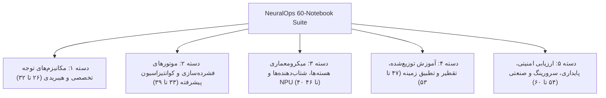
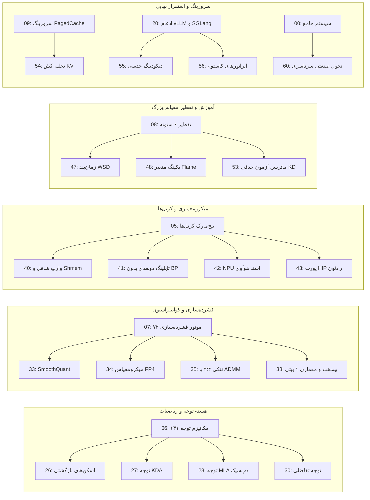

# NeuralOps Notebook Suite: Architecture, Catalog & 60-Notebook Expansion Roadmap

این سند مرجع جامع، معماری، طبقه‌بندی و راهنمای تفصیلی تمامی ۲۹ نوتبوک فعلی مخزن [NeuralOps](file:///Users/tahamajs/Documents/uni/Project) به همراه **طرح تفصیلی توسعه به ۶۰ نوتبوک (۳۱ نوتبوک جدید)** را با در نظر گرفتن کلیه بخش‌های سیستم (Attention Registry، Compression Engines، 3-Level Kernel Dispatch، 6-Pillar Distillation، Production Serving، و Mathematical Invariants) ارائه می‌دهد.

---

## ۱. اصول معماری و ساختار استاندارد هر نوتبوک

طبق استاندارد مهندسی و مهارت [`neuralops-notebook-architect`](file:///Users/tahamajs/Documents/uni/Project/.agents/skills/neuralops-notebook-architect/SKILL.md)، هر نوتبوک یک پروتوتایپ کامل و خودکفا است که از ساختار ۵ بخشی زیر تبعیت می‌کند:

1. **Preamble & Mathematical Foundation**:
   - بیان فرمول‌های ریاضی و قرارداد تنسوری (\(B, S, H, D\) یا \(B, S, D\)).
   - وارد کردن ماژول‌ها با مکانیزم Fallback و تعریف Dtype / Hardware Guard.
2. **Architecture & Topology Visualizer**:
   - نمودار شماتیک جریان داده (ASCII یا دایاگرام‌های تراز ماتریسی) و ابعاد تنسورها در هر لایه.
3. **Multi-Tier Kernel Dispatch Execution**:
   - فراخوانی و تست مسیر سه‌گانه: Level 1 (CUDA C++ / HIP)، Level 2 (Triton JIT بدون Block Pointer)، Level 3 (Vectorized PyTorch Reference).
   - تحلیل عددی Parity با تلرانس \(\text{atol}=10^{-3}, \text{rtol}=10^{-3}\).
4. **Hardware Telemetry & Memory Profiling**:
   - سنجش دقیق مصرف VRAM (Peak Allocation و Reservoir Memory)، توان مصرفی، و نسبت به سقف Roofline سخت‌افزار (مثلاً Ada Lovelace SM 8.9 یا Titan RTX).
5. **Interactive Experiments, Export & DoD Summary**:
   - تست سناریوهای تغییر پارامتر، صدور مانیفست جراحی و جمع‌بندی معیارهای Definition of Done (DoD).

---

## ۲. کاتالوگ جامع ۲۹ نوتبوک فعلی مخزن

| شماره | نام فایل نوتبوک | حوزه تخصصی | ماژول‌ها و کرنل‌های کلیدی |
| :--- | :--- | :--- | :--- |
| **00** | `00_master_neuralops_complete_system_walkthrough.ipynb` | سیستم جامع | بررسی سرتاسری لایه‌ها، رجیستری‌ها، جراحی، تقطیر و استقرار |
| **01a** | `01_quickstart_surgery_and_healing.ipynb` | شروع سریع | جراحی پیوندی توجه و بازیابی سریع با کالیبراسیون LoRA |
| **01b** | `01_attention_surgery_and_lora.ipynb` | جراحی توجه | جایگزینی لایه‌های توجه و تیونینگ پارامتر-کارا (PEFT) |
| **02a** | `02_unified_training.ipynb` | آموزش یکپارچه | خط لوله آموزش تجمیعی با تجمیع گرادیان و WSD |
| **02b** | `02_roofline_and_triton_kernels.ipynb` | بهینه‌سازی کرنل | مدل‌سازی Roofline و آنالیز کرنل‌های Triton JIT |
| **03** | `03_custom_plugins_and_extensibility.ipynb` | توسعه‌پذیری | معماری پلاگین‌ها و ثبت اپراتورهای سفارشی در رجیستری |
| **04** | `04_end_to_end_3level_benchmarking.ipynb` | بنچ‌مارک سه‌سطحی | اعتبارسنجی تاخیر و Fallback سطوح ۱، ۲ و ۳ |
| **05a** | `05_master_108_cuda_and_26_triton_kernels_benchmark.ipynb` | ماتریس کرنل‌ها | بنچ‌مارک جامع ۱۰۸ کرنل CUDA و ۲۶ ماژول تریتون |
| **05b** | `05_paper_empirical_results_master.ipynb` | نتایج تجربی مقاله | بازتولید جداول تجربی مقالات MLSys و arXiv |
| **06** | `06_master_all_131_attention_mechanisms_interactive.ipynb` | مکانیزم‌های توجه | ماتریس تعاملی و تست تک‌تک ۱۳۱ کلید ATTENTION_REGISTRY |
| **07** | `07_master_all_72_compression_engines_quant_and_svd.ipynb` | فشرده‌سازی | تست ۷۲ موتور COMPRESSOR_REGISTRY شامل کوانتیزاسیون و SVD |
| **08** | `08_six_pillar_distillation_and_surgical_recovery.ipynb` | تقطیر ۶ ستونه | بازیابی گرادیانی با اهداف شش‌گانه پس از برش ابعادی |
| **09** | `09_production_serving_paged_cache_and_speculative_decoding.ipynb` | سرورینگ عملیاتی | PagedAttention، مدیریت حافظه KV-Cache و دیکودینگ حدسی |
| **10** | `10_long_context_extrapolation_32k.ipynb` | کانتکست طولانی | برون‌یابی طول متن تا ۳۲k توکن با RoPE Scaling و YaRN |
| **11** | `11_cuda_vs_triton_vs_pytorch_matrix.ipynb` | مقایسه Backendها | تحلیل مقایسه‌ای سرعت و مصرف رجیستر در ۳ لایه اجرایی |
| **12** | `12_svd_whitening_spectral_allocation.ipynb` | فاکتورگیری SVD | تخمین کوواریانس، سفیدسازی ماتریس و بهینگی Eckart-Young |
| **13** | `13_quantization_pareto_fp8_int4_kmeans.ipynb` | مرز پارتو کوانتیزاسیون | ارزیابی دقت/حجم FP8 (E4M3/E5M2)، INT4 و Microscaling |
| **14** | `14_structured_pruning_token_shedding.ipynb` | هرس ساختاریافته | هرس کانال/سر با روش ADMM، تنکی ۲:۴ سخت‌افزاری و ریزش توکن |
| **15** | `15_downstream_glue_lra_evaluation.ipynb` | ارزیابی پایین‌دستی | تست مدل‌های جراحی‌شده روی بنچ‌مارک‌های GLUE و LRA |
| **16** | `16_roofline_ada_rtx4070_saturation.ipynb` | اشباع حافظه/محاسبه | اشباع پهنای باند و شتاب‌دهنده تنسوری روی معماری SM 8.9 |
| **17** | `17_speculative_paged_kv_throughput.ipynb` | توان عملیاتی سرورینگ | بنچ‌مارک توان گذردهی با ترکیب PagedAttention و توکن‌های کمکی |
| **18** | `18_cross_seed_statistical_variance.ipynb` | استحکام آماری | ارزیابی واریانس چند‌بذر، آزمون ولچ و فواصل اطمینان |
| **19** | `19_publication_figures_latex_generator.ipynb` | شکل‌های انتشار | تولید نمودارهای برداری TikZ و جداول LaTeX مستقیماً از داده |
| **20** | `20_production_serving_vllm_sglang_trtllm_integrations.ipynb` | یکپارچه‌سازی سرور | اتصال مدل جراحی‌شده به پایپ‌لاین‌های vLLM، SGLang و TRT-LLM |
| **21** | `21_model_export_onnx_safetensors_surgery_manifest.ipynb` | خروجی استاندارد | صدور ایمن به SafeTensors، مانیفست‌های JSON و پروتکل ONNX |
| **22** | `22_distributed_tensor_and_context_parallelism.ipynb` | موازی‌سازی توزیع‌شده | موازی‌سازی تنسوری (TP) و موازی‌سازی زمینه (CP) با Ring Attention |
| **23** | `23_spectral_diagnostics_and_hessian_analysis.ipynb` | تحلیل چشم‌انداز هسین | محاسبه طیف مقادیر ویژه هسین و کمینه‌های مسطح برای تعمیم بهتر |
| **24** | `24_advanced_optimizers_muon_stiefel_and_ttt_training.ipynb` | بهینه‌سازهای پیشرفته | هندسه ریمانی منیفلد اشتیفل و بهینه‌سازهای Muon و TTT |
| **25** | `25_long_context_niah_cka_similarity_and_eval_harness.ipynb` | ارزیابی بازیابی سوزن | تست Needle In A Haystack (NIAH) و تشابه شباهت CKA در لایه‌ها |

---

## ۳. نقشه راه و مشخصات تفصیلی ۳۱ نوتبوک جدید (توسعه به ۶۰ نوتبوک)

برای توسعه جامع از ۲۹ به ۶۰ نوتبوک، ۳۱ موضوع استراتژیک در ۵ دسته تخصصی تقسیم‌بندی شده‌اند:

### دسته ۱: مکانیزم‌های توجه تخصصی و هیبریدی (۷ نوتبوک)

#### `26_linear_recurrent_associative_scans.ipynb`
- **هدف**: تحلیل الگوریتم اسکن پیشوندی انجمنی (Blelloch Scan) و بازگشت‌های بلوکی موازی در لایه‌های توجه خطی (مانند Mamba، GLA، RWKV).
- **بخش‌های کلیدی**:
  1. فرمول‌بندی حالت بازگشتی \(h_t = a_t \odot h_{t-1} + b_t \otimes c_t\).
  2. کرنل تریتون بازگشتی تراز شده با حافظه مشترک و رجیسترها.
  3. مقایسه خطای عددی FP32 و BF16 در دنباله‌های طولانی (16k+).
  4. تست تعویض مستقیم با لایه Self-Attention سنتی.

#### `27_kronecker_delta_attention_deep_dive.ipynb`
- **هدف**: پیاده‌سازی و کالیبراسیون عمیق Kronecker Delta Attention (KDA) و اثر فیلترینگ جهش داده.
- **بخش‌های کلیدی**:
  1. محاسبات تانسوری ضرب کرونکر و گیت‌های بازداری کانال.
  2. تست گرادیان Autograd با \(\text{atol}=10^{-3}, \text{eps}=10^{-5}\).
  3. بررسی رفتار حافظه و پایداری در رژیم‌های دقیق با فعال‌سازی FP16.

#### `28_multi_head_latent_attention_deepseek_mla.ipynb`
- **هدف**: بازسازی و ارزیابی معماری فشرده‌سازی کیش چند-سره نهفته (MLA) مشابه DeepSeek.
- **بخش‌های کلیدی**:
  1. فشرده‌سازی بردار کلید-مقدار در یک زیرفضای نهفته با ابعاد پایین \(d_c\).
  2. ادغام RoPE در بردار تفکیک‌شده و تحلیل ذخیره‌سازی حافظه KV.
  3. تست سربار محاسباتی Decode در مقایسه با MHA و GQA.

#### `29_state_space_attention_hybrids.ipynb`
- **هدف**: مطالعه ساختارهای ترکیبی Attention و State Space Model (SSM) نظیر Jamba و Zamba.
- **بخش‌های کلیدی**:
  1. لایه‌بندی یک‌درمیان (Interleaving) لایه‌های اسکن خطی و Attention کامل.
  2. پروفایلینگ حافظه فعال حین آموزش با کانتکست‌های متغیر.
  3. تحلیل بازیابی اطلاعات محلی در برابر ادراک سراسری دنباله.

#### `30_differential_attention_noise_cancellation.ipynb`
- **هدف**: بررسی مکانیزم Differential Attention جهت حذف نویز پس‌زمینه و تمرکز روی توکن‌های حساس.
- **بخش‌های کلیدی**:
  1. تفریق دو ماتریس توجه سافت‌مکس با پارامترهای یادگیرنده مقیاس \(\lambda\).
  2. سنجش گرادیان‌ها در طول فرآیند Fine-tuning و جلوگیری از فروپاشی توجه.
  3. اثر لغو نویز روی بنچ‌مارک‌های خلاصه‌سازی و پرسش و پاسخ.

#### `31_chunkwise_parallel_attention_kernels.ipynb`
- **هدف**: پیاده‌سازی محاسبات تیکه‌ای موازی (Chunk-parallel) برای تعمیم خطی حافظه.
- **بخش‌های کلیدی**:
  1. تقسیم دنباله به چانک‌های با اندازه ثابت (مثلاً ۱۲۸ یا ۲۵۶).
  2. ادغام ضرب‌های داخل چانک و اسکن حالت میان چانک‌ها.
  3. شبیه‌سازی انتقال داده DMA به حافظه مشترک (Shared Memory).

#### `32_sparse_sinkhorn_and_routing_attentions.ipynb`
- **هدف**: الگوریتم‌های مرتب‌سازی و جایگشت نرم با نرمال‌سازی Sinkhorn برای مسیریابی تنک توکن‌ها.
- **بخش‌های کلیدی**:
  1. تکرار تقریب‌های دوبل تصادفی (Doubly Stochastic Normalization).
  2. تخصیص دینامیک سر به کلاسترهای معنایی توکن‌ها.
  3. بهینه‌سازی تاخیر و حافظه در سناریوهای استنتاج با بچ‌های بزرگ.

---

### دسته ۲: موتورهای فشرده‌سازی و کوانتیزاسیون پیشرفته (۷ نوتبوک)

#### `33_outlier_aware_smoothquant_pipeline.ipynb`
- **هدف**: خط لوله مهار مقادیر پرت (Outliers) در ابعاد مخفی و کوانتیزاسیون W8A8.
- **بخش‌های کلیدی**:
  1. انتقال سختی کوانتیزاسیون از اکتیویشن به وزن با مقیاس‌بندی کانالی \(s_j\).
  2. اجرای عملیات کوانتیزاسیون متقارن و نامتقارن ماتریس‌های جراحی‌شده.
  3. مقایسه Perplexity مدل قبل و بعد از مقیاس‌بندی SmoothQuant.

#### `34_microscaling_fp4_and_mx_formats.ipynb`
- **هدف**: استانداردسازی میکرومقیاس‌بندی (Microscaling - MX) با فرمت‌های FP4 و FP6 برای سخت‌افزارهای نوین.
- **بخش‌های کلیدی**:
  1. بلاک‌بندی المان‌ها (Block size = 32) و انتساب مقیاس‌های مشترک E8M0.
  2. کرنل شبیه‌ساز Triton برای تبدیل فرمت‌ها بدون اتلاف اطلاعات کلیدی.
  3. تحلیل خطای تقریب در گرادیان‌های پس‌انتشار.

#### `35_admm_structured_2_4_sparsity.ipynb`
- **هدف**: پیاده‌سازی الگوریتم بهینه‌سازی جهت‌دار ADMM برای تنکی ساختاریافته ۲:۴ سخت‌افزاری.
- **بخش‌های کلیدی**:
  1. تعریف تابع زیان با جریمه‌های لاگرانژی تقاطعی برای الگوهای ۲:۴.
  2. شتاب‌دهی ضرب ماتریسی تنک با استفاده از Sparse Tensor Cores.
  3. تست بازیابی دقت بعد از بازتنظیم وزن‌ها در رژیم‌های متراکم.

#### `36_activation_covariance_and_fisher_pruning.ipynb`
- **هدف**: انتخاب وزن‌های هرس بر پایه ماتریس اطلاعات فیشر تجربی و کانتکست کوواریانس.
- **بخش‌های کلیدی**:
  1. محاسبه قطری یا کرونکر فیشر (K-FAC) روی داده‌های واقعی بدون برچسب.
  2. رتبه‌بندی اهمیت لایه‌ها و کانال‌ها بر اساس تخمین انحنای تابع زیان.
  3. برش حداقل انحنا و حفظ پایداری شبکه‌های بازسازی‌شده.

#### `37_cross_layer_matrix_factorization_svd.ipynb`
- **هدف**: اشتراک پایه‌های طیفی در لایه‌های متوالی با تجزیه چندلایه SVD.
- **بخش‌های کلیدی**:
  1. الحاق ماتریس‌های وزن لایه‌های مجاور و استخراج فضاهای پوچ مشترک.
  2. بازسازی لایه‌ها با بلوک‌های پایینی ادغام‌شده و بالایی تفکیک‌شده.
  3. اندازه‌گیری ضریب فشرده‌سازی موثر پارامترها و حافظه کش وزن.

#### `38_weight_ternarization_and_1bit_architectures.ipynb`
- **هدف**: کاوش در فضاهای بیتی بسیار پایین (BitNet b1.58 و وزن‌های ۳ حالته \(\{-1, 0, +1\}\)).
- **بخش‌های کلیدی**:
  1. کوانتیزاسیون ترمودینامیک و محاسبه گرادیان مستقیم با STE (Straight-Through Estimator).
  2. جایگزینی ضرب ماتریسی با جمع و تفریق‌های صحیحی در سطح هسته.
  3. ارزیابی راندمان مصرف انرژی و تاخیر در دیوایس‌های لبه.

#### `39_dynamic_token_shedding_and_early_exit.ipynb`
- **هدف**: حذف دینامیک توکن‌های نامهم در لایه‌های میانی و استراتژی‌های خروج زودهنگام (Early Exit).
- **بخش‌های کلیدی**:
  1. آموزش گیت‌های تصمیم‌گیری برای افت توکن (Token Dropping) بر پایه انتروپی.
  2. حفظ پیوستگی توکن‌های توجه و ترمیم ماسک‌های علّی.
  3. اندازه‌گیری شتاب واقعی بر حسب توکن بر ثانیه روی سناریوهای متنوع طول دنباله.

---

### دسته ۳: میکرومعماری هسته‌ها، شتاب‌دهنده‌ها و NPU (۷ نوتبوک)

#### `40_cuda_cpp_warp_shuffle_and_shared_memory.ipynb`
- **هدف**: بهینه‌سازی سطح پایین در کرنل‌های CUDA C++: استفاده از اینترینسیک‌های `__shfl_sync` و حذف بن‌بست‌های بانک حافظه اشتراکی.
- **بخش‌های کلیدی**:
  1. آنالیز تصادم بانک‌های حافظه اشتراکی (Shared Memory Bank Conflicts) در ابعاد ۳۲ تایی.
  2. تبادل داده میان نخ‌ها با دستورات Warp Shuffle بدون مراجعه به حافظه مشترک.
  3. لودهای برداری ۱۲۸ بیتی (`float4` / `int4`) برای اشباع گذرگاه DRAM.

#### `41_triton_2d_tiling_without_block_pointers.ipynb`
- **هدف**: الگوی استاندارد تایلینگ دو‌بعدی تریتون و مدیریت مرزها بدون استفاده از Block Pointerهای منسوخ.
- **بخش‌های کلیدی**:
  1. استفاده از آفست‌های چند‌بعدی با ماسک‌های تایلینگ ایمن (`tl.load(..., mask=mask)`).
  2. پیکربندی بهینه تعداد وارپ‌ها (`num_warps=4, 8`) و مراحل پایپ‌لاین (`num_stages=3, 4`).
  3. اعتبارسنجی مقایسه‌ای تاخیر کرنل تریتون در برابر PyTorch معادل.

#### `42_huawei_ascend_npu_cann_adaptation.ipynb`
- **هدف**: انطباق و کامپایل هسته‌ها برای معماری Ascend با استفاده از تول‌کیت CANN و حافظه Unified Buffer.
- **بخش‌های کلیدی**:
  1. اصول انتقال داده GM-to-UB DMA و تراز فرکتالی داده‌ها (Fractal Alignment).
  2. بررسی استثنای Block Pointer برای Triton بر روی معماری NPU Ascend 910B.
  3. مانیتورینگ عملکرد و مقایسه بهره‌وری محاسباتی با ابزار `msprof`.

#### `43_amd_rocm_hip_cross_compilation.ipynb`
- **هدف**: سازگاری و کامپایل دوگانه هسته‌های CUDA با موتور HIP روی کارت‌های محاسباتی AMD ROCm (MI200/MI300).
- **بخش‌های کلیدی**:
  1. نگاشت اینترینسیک‌های NVIDIA به معادل‌های AMD Wavefront (اندازه وارپ ۶۴ در برابر ۳۲).
  2. تنظیم خودکار اندازه بلوک‌ها و حافظه اشتراکی با ماکروهای پیش‌پردازنده.
  3. تست عملکردی لایه‌های Attention پیاده‌سازی شده در HIP.

#### `44_tensorrt_engine_building_and_plugins.ipynb`
- **هدف**: ساخت موتورهای استنتاج با TensorRT و ایجاد پلاگین‌های سفارشی C++ برای لایه‌های اختصاصی.
- **بخش‌های کلیدی**:
  1. تعریف IPluginV2DynamicExt برای لایه‌های نوآورانه بدون معادل استاندارد در ONNX.
  2. تعریف پروفایل‌های بهینه‌سازی برای ابعاد متغیر ورودی (Min, Opt, Max Shapes).
  3. صدور و اجرای فایل‌های باینری موتور بدون رخداد فال‌بک نامعتبر.

#### `45_register_pressure_and_occupancy_tuning.ipynb`
- **هدف**: عیب‌یابی و مهار فشار رجیستر و ماکسیمم کردن Occupancy پردازنده گرافیکی در هسته‌های کاستوم.
- **بخش‌های کلیدی**:
  1. استفاده از ویژگی `__launch_bounds__` جهت بهینه‌سازی تخصیص منابع به ازای SM.
  2. کنترل ریختن متغیرها به حافظه محلی (Local Memory Spills).
  3. بازرسی کدهای باینری PTX و Sass برای شناسایی وقفه‌های حافظه.

#### `46_gluon_experimental_dialect_kernels.ipynb`
- **هدف**: ارزیابی تجربی گویش Gluon برای کنترل سخت‌افزاری پایپ‌لاین‌های انتقال داده ناهمگام (Async TMA / cp.async).
- **بخش‌های کلیدی**:
  1. تعریف طرح‌بندی دقیق تنسورها (Explicit Tensor Layouts) در سخت‌افزارهای Hopper به بعد.
  2. پیاده‌سازی بافرهای دوگانه (Double-buffering) جهت پوشش تاخیر خواندن داده از حافظه.
  3. تحلیل سقف تئوری کارایی در ضرب‌های ماتریسی با ابعاد بزرگ.

---

### دسته ۴: آموزش توزیع‌شده، تقطیر و تطبیق زمینه (۷ نوتبوک)

#### `47_warmup_stable_decay_wsd_scheduler.ipynb`
- **هدف**: پیاده‌سازی و ارزیابی عمیق زمان‌بندی نرخ یادگیری Warmup-Stable-Decay (WSD) در بهبود پایداری تقطیر.
- **بخش‌های کلیدی**:
  1. پیکربندی فاز نرخ ثابت (Stable Phase) و افت سریع در فاز فرود (Annealing Decay).
  2. تحلیل توانایی ذخیره چک‌پوینت در هر کجای فاز پایدار و ادامه آموزش بدون افت دقت.
  3. بنچ‌مارک نرخ همگرایی در تقطیر ۶ ستونه پس از جراحی مدل‌های بزرگ.

#### `48_multi_dataset_ingestion_and_flame_packing.ipynb`
- **هدف**: ورودی چندمجموعه داده‌ای موازی با پکینگ متغیر و حذف کامل توکن‌های پدینگ (Zero-padding Variable-length Packing).
- **بخش‌های کلیدی**:
  1. تولید آفست‌های مرزی `cu_seqlens` به شکل `[0, len_1, len_1+len_2, ..., seq_len]`.
  2. تغذیه همزمان مجموعه‌های داده‌ای ترکیبی چندزبانه با نسبت‌های وزن‌دار.
  3. اندازه‌گیری صرفه‌جویی زمان آموزش به دلیل حذف محاسبات روی توکن‌های پدینگ پوچ.

#### `49_ring_and_zigzag_context_parallelism.ipynb`
- **هدف**: توسعه سیستم Context Parallelism برای متون عظیم (تا 128k+) با استفاده از معماری حلقه (Ring Attention).
- **بخش‌های کلیدی**:
  1. ارسال بلوک‌های کلید و مقدار در سراسر نودهای توزیع‌شده به صورت P2P ناهمگام.
  2. ماسک‌گذاری علّی بهینه به روش زیگ‌زاگ برای برقراری توازن بار محاسباتی میان دستگاه‌ها.
  3. مقایسه زمان ارتباط میان‌کارت‌ها (All-to-All) با محاسبات همپوشان (Overlap).

#### `50_activation_checkpointing_strategies.ipynb`
- **هدف**: مقایسه استراتژی‌های چک‌پوینت اکتیویشن (انتخابی در برابر کامل) جهت آموزش در رژیم‌های حافظه محدود.
- **بخش‌های کلیدی**:
  1. تفکیک لایه‌های گران‌قیمت از نظر حافظه و لایه‌های ارزان از نظر محاسبه برای محاسبه مجدد.
  2. ثبت ردپای حافظه گرافیکی با `torch.cuda.memory_allocated()`.
  3. ایجاد توازن بهینه بین سربار زمان اجرا و صرفه‌جویی در فضای VRAM.

#### `51_cross_model_representation_alignment.ipynb`
- **هدف**: ترازسازی بازنمایی‌های میانی میان لایه‌های مدل والد و مدل جراحی‌شده با ضرایب تصحیح تقارن.
- **بخش‌های کلیدی**:
  1. بهینه‌سازی فاصله‌های فضایی با معیارهای Procrustes و شباهت کسینوسی نگاشت‌ها.
  2. تنظیم ماتریس‌های تبدیل خطی برای لایه‌هایی که ابعاد کانال آنها کاهش یافته است.
  3. بررسی تاثیر ترازسازی مستقیم ویژگی‌ها در بازیابی توانایی استدلال مدل.

#### `52_mixture_of_attentions_routing.ipynb`
- **هدف**: پیاده‌سازی معماری MoA (Mixture of Attentions) با هدایت توکن‌ها به لایه‌های توجه مختلف بر اساس محتوا.
- **بخش‌های کلیدی**:
  1. ساخت شبکه روتر با تنظیم نرمال‌سازی Softmax و توازن بار (Load Balancing Loss).
  2. تخصیص توکن‌ها به رویکردهای سریع (خطی) یا دقیق (غیرخطی).
  3. پروفایلینگ تاخیر دینامیک لایه در مواجهه با ورودی‌های گوناگون.

#### `53_knowledge_distillation_ablation_matrix.ipynb`
- **هدف**: طراحی جدول آزمون‌های حذفی (Ablation Matrix) روی ۶ ستون تقطیر برای سنجش سهم هر یک از ضرایب زیان.
- **بخش‌های کلیدی**:
  1. غیرفعال‌سازی تک‌به‌تک پایه‌ها (زیان لاجیت، توجه، کسینوس، هسین، وایتنینگ، بازنمایی).
  2. سنجش افت دقت در بنچ‌مارک‌های متمرکز و ردیابی گرادیان‌های غالب.
  3. استخراج پارامترهای توازن بهینه ضرایب با الگوریتم جستجوی بیزی.

---

### دسته ۵: ارزیابی امنیتی، پایداری، سرورینگ و صنعتی (۷ نوتبوک)

#### `54_kv_cache_compression_and_eviction_policies.ipynb`
- **هدف**: پیاده‌سازی و مقایسه الگوریتم‌های مدیریت کیش KV نظیر H2O (Heavy Hitter Oracle) و StreamingLLM Sinks.
- **بخش‌های کلیدی**:
  1. استخراج و نگهداشت همیشگی ۴ توکن ابتدایی (Attention Sinks).
  2. حذف پویا و رتبه‌بندی توکن‌های با وزن توجه پایین در حافظه کش محدود.
  3. سنجش عملکرد در بازیابی اسناد طولانی و جلوگیری از سرریز حافظه.

#### `55_speculative_decoding_target_draft_synergy.ipynb`
- **هدف**: بهینه‌سازی هم‌افزایی مدل پیش‌نویس جراحی‌شده (Draft) با مدل اصلی بزرگ (Target) در دیکودینگ حدسی.
- **بخش‌های کلیدی**:
  1. نرخ پذیرش توکن‌ها (\(\alpha\)) با روش‌های نمونه‌گیری گوناگون (Greedy و Nucleus).
  2. تست مکانیزم پذیرش درختی (Tree-based Verification) برای اعتبارسنجی چند کاندیدا در یک شلیک.
  3. اندازه‌گیری شتاب واقعی سرعت استنتاج در سرورینگ بدون تغییر در توزیع خروجی.

#### `56_vllm_sglang_custom_op_integration.ipynb`
- **هدف**: تزریق لایه‌های توجه نوآورانه به عنوان اپراتور سفارشی به ساختار PagedAttention در vLLM و RadixAttention در SGLang.
- **بخش‌های کلیدی**:
  1. پیاده‌سازی رابط کاربری پایتونی و هسته‌های منطبق با فراخوانی پایپ‌لاین سرورینگ.
  2. هندل کردن مدیریت حافظه مبتنی بر اسلات‌های ناپیوسته بلاک‌ها.
  3. تست بارگذاری سرور با ده‌ها کاربر همزمان و مانیتورینگ تاخیر TTFT و ITL.

#### `57_numerical_precision_and_nan_inf_stress_tests.ipynb`
- **هدف**: آزمون‌های فشار حداکثری بر روی هسته‌ها و مدل‌ها برای کشف نقاط سرریز عددی و خطاهای NaN/Inf.
- **بخش‌های کلیدی**:
  1. تزریق مقادیر ورودی بسیار بزرگ، نزدیک به صفر و توزیع‌های با چولگی بالا.
  2. بررسی عملکرد کلمپ‌ها و تثبیت‌کننده‌های ریاضی در مخرج کسرها و لوگاریتم‌ها.
  3. مقایسه رفتار مدهای FP16، BF16 و FP32 در رژیم‌های بحرانی.

#### `58_synthetic_stress_testing_and_chaos_engineering.ipynb`
- **هدف**: مهندسی آشوب در شتاب‌دهنده: تغییر متغیرهای اندازه بچ، کمبود حافظه ناگهانی و طول متون نامتعارف.
- **بخش‌های کلیدی**:
  1. شبیه‌سازی OOM و بررسی عملکرد مکانیزم پاکسازی کش و Fallback ایمن.
  2. پایش نرخ بازنشانی کدهای خطا و خروج از برنامه بدون فریز شدن پروسه.
  3. اعتبارسنجی تضمین پایداری خط تولید طبق اصل عدم شکست بی‌صدا (§6).

#### `59_reproducible_artifact_generation_and_latex_sync.ipynb`
- **هدف**: ایجاد پایپ‌لاین تولید خودکار و تضمین تطابق کامل آمار آزمایش‌ها با جداول مقالات علمی در فرمت LaTeX.
- **بخش‌های کلیدی**:
  1. استخراج مستقیم متریک‌ها از پایگاه داده لجر بنچ‌مارک (SQLite/JSON).
  2. اعتبارسنجی صحت فرمت ارقام، شاخص‌های خطا و فواصل اطمینان ۹۵٪.
  3. تبدیل داده‌های خام به جداول استاندارد `booktabs` بدون دستکاری دستی.

#### `60_end_to_end_industrial_llm_transformation.ipynb`
- **هدف**: شاهکار سیستم: جراحی یک مدل واقعی ۷ میلیارد پارامتری، فشرده‌سازی کوانتیزه، تقطیر ۶ ستونه، تست و استقرار در vLLM.
- **بخش‌های کلیدی**:
  1. بارگذاری ایمن وزن‌ها از HuggingFace و آنالیز طیفی ساختار لایه‌های توجه.
  2. جایگزینی هسته سنتی با نسخه ترکیبی و تزریق فشرده‌سازی لایه‌ها.
  3. بازیابی با تقطیر سریع، اعتبارسنجی بنچ‌مارک‌های جامع و صدور نهایی برای استنتاج بلادرنگ.

---

## ۴. ماتریس وابستگی‌ها و هم‌پوشانی لایه‌ها

---

## ۵. چک‌لیست کنترل کیفیت و الزامات پایداری (Quality Gates & Invariants)

در صورتی که هر نوتبوک جدید به پوشه [`notebooks/`](file:///Users/tahamajs/Documents/uni/Project/notebooks) اضافه شود، رعایت موارد زیر الزامی است:

1. **انطباق اینوریانت‌ها (Invariants)**:
   - در فایل‌های `AGENTS.md` و `README.md` و اسکریپت `scripts/audit_readme_consistency.py` تعداد نوتبوک‌ها باید به‌صورت هماهنگ به‌روزرسانی شود تا تضاد در گیت کنترل کیفیت رخ ندهد.
2. **پایداری داده‌ها و منع فایل‌های ساختگی (§6.1 و §6.2)**:
   - تمامی سلول‌های خروجی نوتبوک‌ها باید دارای خروجی‌های واقعی، بدون مقادیر هاردکد شده ساختگی و بدون خطاهای پنهان‌شده (`except: pass`) باشند.
3. **سازگاری سخت‌افزاری و Fallback سه سطحی (§7)**:
   - در صورت عدم دسترسی به GPUهای سرور (Sharif HPC)، نوتبوک‌ها باید بدون کراش در سطح Level-3 (Vectorized PyTorch Reference) اجرا شوند و پیام هشداری شفاف صادر کنند.
4. **تست و ارزیابی در کانتکست‌های بزرگ**:
   - برای نوتبوک‌های کانتکست طولانی، تولید توالی‌ها باید به درستی از ماسک‌های علّی و کش‌های بلاکی محافظت کند.

---
*سند تهیه شده بر اساس استانداردهای مخزن NeuralOps — نوامبر ۲۰۲۶.*
