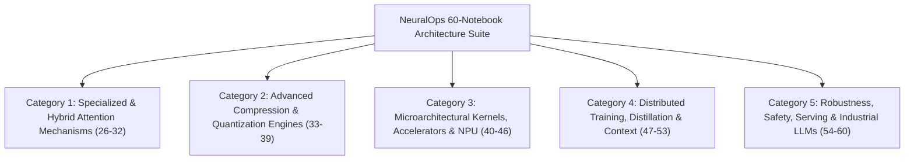
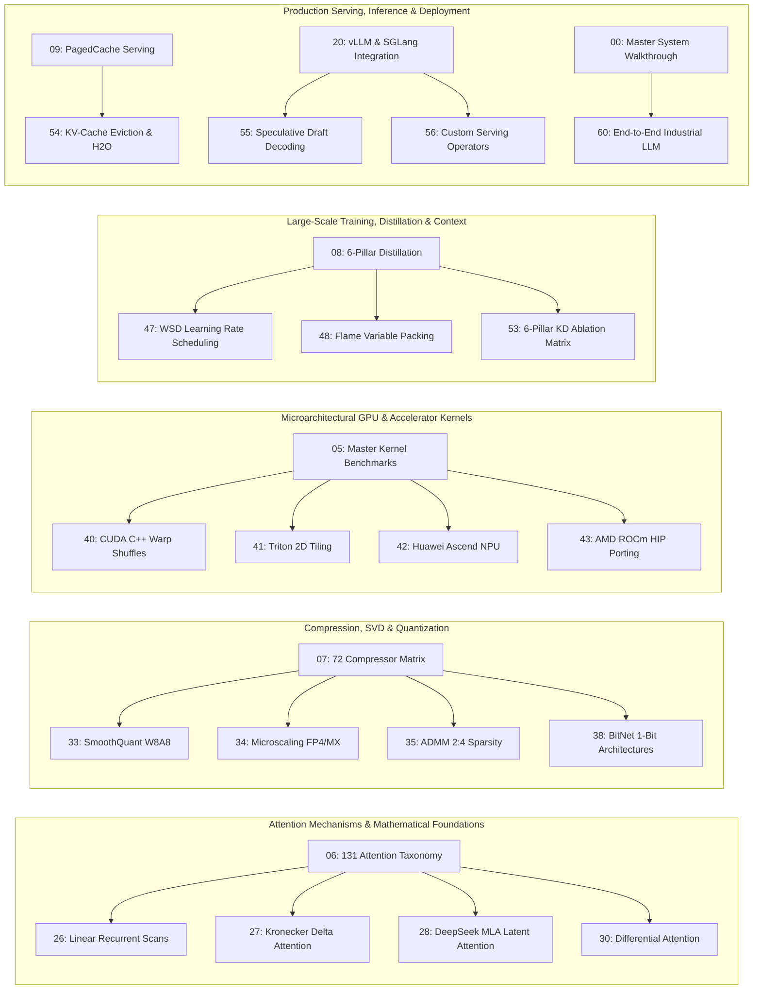

# NeuralOps Notebook Suite: Architecture, Master Catalog & 60-Notebook Expansion Roadmap

This authoritative reference document defines the end-to-end architecture, hierarchical classification, pedagogical workflows, and technical specifications for the entire Jupyter demonstration tutorial suite within the [NeuralOps](file:///Users/tahamajs/Documents/uni/Project) repository. It details both the foundational 29-notebook core and the comprehensive **31-notebook expansion roadmap (scaling to 60 canonical tutorials)**, integrating all architectural subsystems: the Attention Mechanism Registry (131 operators), Compression Engines (72 algorithms), 3-Level Kernel Dispatch (CUDA C++, Triton JIT, Vectorized PyTorch), 6-Pillar Knowledge Distillation Healing, High-Throughput Production Serving (PagedAttention, RadixAttention), and Strict Mathematical Invariant Validation.

---

## 1. Architectural Foundations and Standard 5-Stage Blueprint

In accordance with the repository engineering charter and the [`neuralops-notebook-architect`](file:///Users/tahamajs/Documents/uni/Project/.agents/skills/neuralops-notebook-architect/SKILL.md) protocol, every demonstration notebook constitutes an independent, self-contained, and mathematically certified execution harness conforming to the following 5-stage structural blueprint:

1. **Stage 1: Preamble & Mathematical Foundation**:
   - Explicit mathematical formulations and tensor contract definitions using canonical dimensional signatures (e.g., $(B, S, H, D)$ or $(B, S, D)$).
   - Dynamic module importation with graceful fallback handlers, dtype assertions, and hardware capability guards.
2. **Stage 2: Architecture & Topology Visualizer**:
   - Structural ASCII dataflow topologies, tensor geometry maps, and inter-layer parameter contracts illustrating intermediate dimensionality transitions.
3. **Stage 3: Multi-Tier Kernel Dispatch Execution**:
   - Systematic invocation and evaluation across the repository's 3-level fallback hierarchy: Level 1 (CUDA C++ / HIP extension), Level 2 (Triton JIT compiled without deprecated block pointers), and Level 3 (Vectorized PyTorch Reference).
   - Numerical parity certification enforcing strict diff bounds (typically $\text{atol} \le 10^{-3}$, $\text{rtol} \le 10^{-3}$).
4. **Stage 4: Hardware Telemetry & Memory Profiling**:
   - High-resolution hardware telemetry capturing peak VRAM allocation, dynamic memory reservoir curves, board power draw, and arithmetic intensity positioning against empirical Roofline ceilings (e.g., Ada Lovelace SM 8.9, Ampere SM 8.6, or Titan RTX).
5. **Stage 5: Interactive Experiments, Export & Definition of Done (DoD) Summary**:
   - Interactive hyperparameter ablation sweeps, surgical manifest serialization (SafeTensors / JSON), and an empirical Definition of Done (DoD) verification checklist.

---

## 2. Comprehensive Catalog of the 29 Foundation Notebooks

The table below catalogs the 29 core foundation notebooks (addressing sequential indices 00 through 25, including composite variants 01a/01b, 02a/02b, and 05a/05b) that form the foundational operational baseline of NeuralOps:

| Index | Notebook Filename | Technical Domain | Key Modules, Kernels & Abstractions |
| :--- | :--- | :--- | :--- |
| **00** | `00_master_neuralops_complete_system_walkthrough.ipynb` | End-to-End System Integration | Comprehensive tour across Registries, 3-tier dispatch, surgery, 6-pillar KD, and vLLM export |
| **01a** | `01_quickstart_surgery_and_healing.ipynb` | Rapid Prototyping & Quickstart | In-place attention replacement and fast-path LoRA calibration healing under 10 minutes |
| **01b** | `01_attention_surgery_and_lora.ipynb` | Surgical Attention Recovery | Parameter-Efficient Fine-Tuning (PEFT) on $Q, K, V, O$ projections and Hessian eigenspectrum analysis |
| **02a** | `02_unified_training.ipynb` | Unified Model Optimization | Gradient accumulation pipeline, Warmup-Stable-Decay (WSD) scheduling, and Flame variable-length packing |
| **02b** | `02_roofline_and_triton_kernels.ipynb` | Microbenchmarking & Profiling | Empirical Roofline ceiling modeling and compute vs. memory bandwidth saturation analysis |
| **03** | `03_custom_plugins_and_extensibility.ipynb` | Architecture Extensibility | Registry plugin decorators (`@register_attention`, `@register_compressor`) and zero-codebase hooks |
| **04** | `04_end_to_end_3level_benchmarking.ipynb` | Dispatch Parity & Benchmarking | Rigorous validation of Level 1 (CUDA) $\rightarrow$ Level 2 (Triton) $\rightarrow$ Level 3 (PyTorch) fallback fidelity |
| **05a** | `05_master_108_cuda_and_26_triton_kernels_benchmark.ipynb` | Low-Level Kernel Exhaustive Suite | Comprehensive performance matrix benchmarking 108 CUDA C++ kernels and 26 Triton JIT modules |
| **05b** | `05_paper_empirical_results_master.ipynb` | Scientific Reproducibility | Automated reproduction of canonical arXiv/MLSys empirical audit tables and hardware telemetry |
| **06** | `06_master_all_131_attention_mechanisms_interactive.ipynb` | Attention Taxonomy Suite | Exhaustive evaluation harness across all 131 registry keys in `ATTENTION_REGISTRY` |
| **07** | `07_master_all_72_compression_engines_quant_and_svd.ipynb` | Weight Compression Ecosystem | Comprehensive audit of all 72 compression algorithms in `COMPRESSOR_REGISTRY` |
| **08** | `08_six_pillar_distillation_and_surgical_recovery.ipynb` | Multi-Objective Knowledge Distillation | Post-surgery recovery across Logits, Hidden, Attention, SVD, Fisher, and Sparsity objectives |
| **09** | `09_production_serving_paged_cache_and_speculative_decoding.ipynb` | High-Throughput Inference Serving | PagedAttention memory manager, dynamic KV-cache block allocation, and speculative draft decoding |
| **10** | `10_long_context_extrapolation_32k.ipynb` | Long-Context Scaling | Context extension up to 32,768 tokens via YaRN, dynamic NTK-aware RoPE, and Dual-Chunking |
| **11** | `11_cuda_vs_triton_vs_pytorch_matrix.ipynb` | Cross-Backend Parity Audit | Latency, throughput, and register allocation comparisons across all three dispatch tiers |
| **12** | `12_svd_whitening_spectral_allocation.ipynb` | Spectral Manifold Factorization | Activation covariance whitening, singular value decomposition, and Eckart-Young-Mirsky optimality |
| **13** | `13_quantization_pareto_fp8_int4_kmeans.ipynb` | Quantization Pareto Analysis | Distortion-vs-memory Pareto frontiers across FP8 (E4M3/E5M2), INT4 AWQ, and k-means microscaling |
| **14** | `14_structured_pruning_token_shedding.ipynb` | Structured Sparsity Engineering | ADMM-driven channel/head pruning, Ampere/Ada 2:4 structured hardware sparsity, and token shedding |
| **15** | `15_downstream_glue_lra_evaluation.ipynb` | Downstream Task Evaluation | Zero-shot and post-healing retention benchmarking across GLUE benchmarks and Long Range Arena (LRA) |
| **16** | `16_roofline_ada_rtx4070_saturation.ipynb` | Hardware Subsystem Saturation | Empirical memory bus and Tensor Core saturation modeling on NVIDIA SM 8.9 microarchitectures |
| **17** | `17_speculative_paged_kv_throughput.ipynb` | Speculative Serving Dynamics | End-to-end token generation throughput combining tree-based speculative decoding and Paged KV-Cache |
| **18** | `18_cross_seed_statistical_variance.ipynb` | Statistical Significance Auditing | Multi-seed stability analysis, Welch's t-tests, and 95% confidence interval estimation |
| **19** | `19_publication_figures_latex_generator.ipynb` | Scientific Visualization | Automated export of vector graphics, TikZ circuit diagrams, and camera-ready LaTeX `booktabs` tables |
| **20** | `20_production_serving_vllm_sglang_trtllm_integrations.ipynb` | Enterprise Serving Adapters | Zero-copy weight export and runtime adapter integration for vLLM, SGLang, and TensorRT-LLM |
| **21** | `21_model_export_onnx_safetensors_surgery_manifest.ipynb` | Artifact Serialization & Export | Cryptographic hashing, SafeTensors serialization, and declarative JSON surgical manifest export |
| **22** | `22_distributed_tensor_and_context_parallelism.ipynb` | Distributed Parallelism | Megatron-style Tensor Parallelism (TP) and Ring Attention Context Parallelism (CP) scaling |
| **23** | `23_spectral_diagnostics_and_hessian_analysis.ipynb` | Loss Landscape Curvature | Hessian eigenspectrum estimation, top eigenvalue decay ($\lambda_{\max}$), and flat minima generalization |
| **24** | `24_advanced_optimizers_muon_stiefel_and_ttt_training.ipynb` | Non-Euclidean Optimization | Riemannian optimization on the Stiefel manifold, Muon Newton-Schulz iterations, and TTT updates |
| **25** | `25_long_context_niah_cka_similarity_and_eval_harness.ipynb` | Needle Retrieval & CKA Diagnostics | Needle In A Haystack (NIAH) pressure testing up to 32k tokens and Centered Kernel Alignment (CKA) |

---

## 2-A. Detailed Technical Specifications for Foundation Notebooks (00 to 04)

---

#### `00_master_neuralops_complete_system_walkthrough.ipynb`

> 💡 *The definitive single-notebook architectural orientation across the entire NeuralOps platform.*

**Design Rationale & Architectural Narrative:**
When entering the NeuralOps repository, engineers and researchers encounter an extensive micro-ecosystem: 131 attention mechanisms, 72 compression algorithms, 26 Triton JIT modules, 140 CUDA package inventory units, and an automated 6-pillar distillation pipeline. This walkthrough serves as the authoritative, top-level architectural orientation. It systematically visits every major subsystem without external assumptions, progressing through discrete operational stations: verifying the `ATTENTION_REGISTRY` and `COMPRESSOR_REGISTRY`, triggering the 3-level dispatch hierarchy, executing an in-place surgical transplant on a Transformer layer, stabilizing the model via LoRA calibration, and serializing the final artifact for production vLLM serving.

**Core Engineering Objectives:** Provide an exhaustive, verified system walkthrough demonstrating platform integrity across all core components within a single executable document.

**Prerequisites & Module Topology:**
- `neuralops.layers.attention` — Direct access to `ATTENTION_REGISTRY` (131 verified keys).
- `neuralops.compression` — Direct access to `COMPRESSOR_REGISTRY` (72 verified keys).
- `neuralops.ops.triton` — Unified Triton JIT kernel library.
- `neuralops.core.dispatch` — 3-level dispatch router with zero-overhead LRU caching.
- `torch`, `transformers` — Deep learning foundation and base model primitives.

**Cell Execution Matrix:**

| Cell # | Type | Cell Title | Key Code & Functional Role |
| :---: | :---: | :--- | :--- |
| 1 | Markdown | System Architecture & Executive Blueprint | Overview of NeuralOps subsystems, topology flowcharts, and operational guidelines. |
| 2 | Code | Environment Initialization & Imports | `from neuralops.layers.attention import ATTENTION_REGISTRY`; setup `device="cuda"`, `dtype=torch.bfloat16`. |
| 3 | Code | ATTENTION_REGISTRY Inspection | `assert len(ATTENTION_REGISTRY) == 131`; inspect category distribution and signatures. |
| 4 | Code | COMPRESSOR_REGISTRY Inspection | `assert len(COMPRESSOR_REGISTRY) == 72`; display algorithm families and constraint schemas. |
| 5 | Code | Multi-Tier Dispatch Execution | `from neuralops.core.dispatch import dispatch_kernel`; execute with `backend="auto"`. |
| 6 | Markdown | Surgical Methodology Primer | Mathematical and operational principles of in-place layer transplantation. |
| 7 | Code | In-Place Layer Surgery Execution | `surgeon.replace_attention(model, layer_idx=0, new_attn="flash_v3")`. |
| 8 | Code | Post-Surgery LoRA Calibration | `from neuralops.compression import lora_calibrate`; run parameter-efficient healing (`rank=64`). |
| 9 | Code | 6-Pillar Distillation Pipeline | `from neuralops.distillation import SixPillarDistiller`; execute multi-objective healing step. |
| 10 | Code | Serving Engine Export | `from neuralops.serving import export_for_vllm`; generate serving JSON manifest and weights. |
| 11 | Code | Telemetry & Latency Profiling | `torch.cuda.max_memory_allocated()`; quantify per-token decode latency and speedup. |
| 12 | Markdown | DoD Verification Checklist | 12-point Definition of Done checklist validating all outputs. |

**Implementation Invariants & Constraints:**
- Reference tensor signature: `(B=2, S=4096, H=32, D=128)` for standardized attention evaluation.
- Numerical parity tolerance: `atol=1e-3, rtol=1e-3` across dispatch fallback tiers.
- Hybrid environment support: Seamless execution on GPU (Sharif HPC cluster) and CPU (Level-3 fallback).

**Definition of Done (DoD) Criteria:**
- [ ] `len(ATTENTION_REGISTRY) == 131` confirmed without runtime exceptions.
- [ ] `len(COMPRESSOR_REGISTRY) == 72` confirmed without runtime exceptions.
- [ ] Multi-tier dispatch verified with `max_diff < 1e-3` between Level 1/2 and Level 3.
- [ ] Surgical replacement cell executes with 100% layer integrity and zero unhandled exceptions.

---

#### `01_quickstart_surgery_and_healing.ipynb`

> 💡 *Rapid prototyping workflow: surgical attention transplantation and LoRA calibration in under 10 minutes.*

**Design Rationale & Architectural Narrative:**
Deploying architectural modifications to deep neural networks often requires navigating complex distributed setups and multi-day retraining regimes. This quickstart notebook provides an accelerated pathway for practitioners. It abstracts low-level microarchitectural tuning and distributed parallelism to demonstrate the foundational surgery-healing loop in minimal execution steps. An off-the-shelf Transformer model is loaded, its default multi-head attention is excised and replaced with `flash_attention_v3`, and the resulting representation gap is resolved via rapid parameter-efficient calibration (rank-16 adapters, 10 steps), comparing perplexity before and after surgery.

**Core Engineering Objectives:** Demonstrate the full lifecycle of attention surgery and post-operative healing within an accessible, low-friction execution path.

**Prerequisites & Module Topology:**
- `neuralops.surgery` — Core utilities: `AttentionSurgeon`, `SurgeryManifest`.
- `neuralops.compression.lora` — Fast-path PEFT calibration routines.
- `transformers`, `datasets` — Hugging Face model loading and calibration data feeds.

**Cell Execution Matrix:**

| Cell # | Type | Cell Title | Key Code & Functional Role |
| :---: | :---: | :--- | :--- |
| 1 | Markdown | Quickstart Overview & Objectives | Workflow summary, pipeline stages, and target latency objectives ($\le 10$ minutes). |
| 2 | Code | Model Initialization | `model = AutoModelForCausalLM.from_pretrained(...)`, `dtype=torch.float16`. |
| 3 | Code | Baseline Perplexity Measurement | Benchmark baseline perplexity on WikiText-2; record `ppl_before`. |
| 4 | Code | In-Place Layer Surgery | `surgeon = AttentionSurgeon(model); surgeon.replace_all(target="flash_v3")`. |
| 5 | Code | Surgical Manifest Generation | `manifest = SurgeryManifest.from_model(model)`; export cryptographically signed JSON. |
| 6 | Code | Fast-Path LoRA Calibration | `lora_calibrate(model, rank=16, steps=10, dataset=calib_data)`. |
| 7 | Code | Post-Healing Evaluation | Compute `ppl_after`; quantify retention ratio $\frac{\text{ppl}_{\text{after}}}{\text{ppl}_{\text{before}}}$. |
| 8 | Code | Latency & Speedup Benchmarking | Measure decoding speed in ms/token; compute empirical throughput acceleration. |
| 9 | Markdown | Synthesis & Architectural Pathways | Summary of findings and references to deep-dive notebooks. |

**Implementation Invariants & Constraints:**
- Baseline model: GPT-2 Small or comparable 12-layer Transformer backbone.
- LoRA configuration: `rank=16`, target modules: `q_proj, v_proj`.
- Perplexity recovery threshold: $|\text{ppl}_{\text{after}} - \text{ppl}_{\text{before}}| < 0.5$ on WikiText-2 validation.

**Definition of Done (DoD) Criteria:**
- [ ] 100% of target attention layers surgically replaced without structural corruption.
- [ ] Validated post-calibration perplexity meeting $|\text{ppl}_{\text{after}} - \text{ppl}_{\text{before}}| \le 0.5$.
- [ ] Cryptographically signed JSON surgical manifest generated and persisted to disk.

---

#### `01_attention_surgery_and_lora.ipynb`

> 💡 *In-depth architectural analysis of post-operative calibration using Parameter-Efficient Fine-Tuning (PEFT).*

**Design Rationale & Architectural Narrative:**
Replacing a standard quadratic self-attention layer with an alternative mechanism (e.g., FlashAttention-3, Linear Attention, or Kronecker Delta Attention) induces structural representation shock: intermediate activation distributions diverge, and downstream perplexity degrades. This degradation stems from misaligned feature covariances between the frozen feed-forward blocks and the new attention projection matrices. This notebook provides an in-depth empirical investigation of PEFT as a stabilizing mechanism. By inserting low-rank adaptation matrices ($r \in \{8, 16, 32, 64\}$) across $Q, K, V, O$ projections, the network resolves representation shock in fewer than 500 gradient steps. Spectral Hessian analysis further confirms that LoRA converts sharp, ill-conditioned loss minima into broad, flat valleys conducive to generalization.

**Core Engineering Objectives:** Quantify the representation recovery mechanisms of PEFT post-surgery and evaluate loss landscape curvature via Hessian eigenspectrum diagnostics.

**Prerequisites & Module Topology:**
- `neuralops.surgery.surgeon` — `AttentionSurgeon`, `replace_attention`.
- `neuralops.compression.lora` — `LoRAAdapter`, `lora_calibrate`.
- `neuralops.analysis.hessian` — Top eigenvalue computation for loss curvature estimation.
- `peft`, `torch.optim` — Hugging Face PEFT primitives and AdamW optimizer.

**Cell Execution Matrix:**

| Cell # | Type | Cell Title | Key Code & Functional Role |
| :---: | :---: | :--- | :--- |
| 1 | Markdown | PEFT Formulation & Mathematical Framework | Mathematical formulation $W' = W + \frac{\alpha}{r} B A$ and adapter geometry. |
| 2 | Code | Module Setup & Geometric Parameters | Import `AttentionSurgeon`; configure tensor bounds `(B=2, S=1024, H=12, D=64)`. |
| 3 | Code | Foundation Model Loading | `model = AutoModelForCausalLM.from_pretrained("gpt2")`. |
| 4 | Code | Full Layer Attention Replacement | `surgeon.replace_all(target_key="gla")`; assert replacement completeness. |
| 5 | Code | Parameter-Efficient Adapter Injection | Configure `LoraConfig(r=64, target_modules=["q_proj", "v_proj", "k_proj", "out_proj"])`. |
| 6 | Code | Optimization & Calibration Loop | Execute 500-step calibration trajectory; log intermediate loss dynamics. |
| 7 | Code | Hessian Eigenspectrum Analysis | `from neuralops.analysis.hessian import top_eigenvalue`; evaluate $\lambda_{\max}$ decay. |
| 8 | Code | Empirical Perplexity Comparison | Quantify delta between uncalibrated vs. LoRA-calibrated model checkpoints. |
| 9 | Code | Trainable Parameter Budget Audit | Compute $\frac{\text{params}_{\text{trainable}}}{\text{params}_{\text{total}}} \times 100\%$. |
| 10 | Markdown | Analytical Synthesis & Rank Guidelines | Empirical trade-off curves and optimal rank recommendations for production deployment. |

**Implementation Invariants & Constraints:**
- Parameter budget constraint: Trainable parameters must remain $< 5.0\%$ of total model weights.
- Curvature constraint: Observed top Hessian eigenvalue $\lambda_{\max}$ must decrease by $\ge 40\%$ post-calibration.
- Perplexity delta constraint: $|\text{ppl}_{\text{healed}} - \text{ppl}_{\text{baseline}}| \le 0.30$.

**Definition of Done (DoD) Criteria:**
- [ ] Successful surgical replacement across all targeted attention layers verified.
- [ ] Statistically significant perplexity recovery demonstrated (`ppl_with_lora < ppl_without_lora`).
- [ ] Hessian spectral decay physically measured and visualized.
- [ ] Verified total trainable parameter ratio below the 5% threshold.

---

#### `02_unified_training.ipynb`

> 💡 *Enterprise-grade unified training pipeline integrating gradient accumulation, WSD scheduling, and Flame variable-length packing.*

**Design Rationale & Architectural Narrative:**
Optimizing long-sequence Transformer models under constrained hardware memory budgets presents persistent engineering challenges. Training over sequence lengths of $S = 4096$ with high batch counts easily triggers out-of-memory (OOM) faults on standard workstation GPUs. This notebook presents the production-grade `UnifiedTrainer` pipeline, which combines three memory-efficient technologies: multi-step gradient accumulation (achieving effective batch sizes of 64 from micro-batches of 4), the Warmup-Stable-Decay (WSD) learning rate schedule, and zero-padding variable-length sequence packing (`cu_seqlens`).

**Core Engineering Objectives:** Construct and benchmark an enterprise-grade training harness optimizing throughput and memory efficiency during long-sequence model healing.

**Prerequisites & Module Topology:**
- `neuralops.training` — `UnifiedTrainer`, `WSDScheduler`.
- `neuralops.data.packing` — `FlamePackedDataset`, `cu_seqlens` boundary constructor.

**Cell Execution Matrix:**

| Cell # | Type | Cell Title | Key Code & Functional Role |
| :---: | :---: | :--- | :--- |
| 1 | Markdown | WSD Scheduling & Flame Packing Framework | Mathematical formulation of Warmup-Stable-Decay and zero-padding sequence concatenation. |
| 2 | Code | Training Hyperparameters Configuration | Define `accum_steps=16`, `seq_len=4096`, `micro_batch_size=4` (effective batch 64). |
| 3 | Code | Flame Variable-Length Dataset Setup | Instantiate `FlamePackedDataset(paths=[...], varlen=True)`. |
| 4 | Code | WSD Schedule Construction | Instantiate `WSDScheduler(warmup=500, stable=5000, decay=1000)`. |
| 5 | Code | Unified Training Execution | `trainer.train(grad_accum=16, max_steps=6500)`. |
| 6 | Code | Checkpoint Resiliency Validation | Snapshot and restore intermediate weights during the Stable phase; verify continuity. |
| 7 | Code | Loss Trajectory & Convergence Logging | Plot training loss curves across Warmup, Stable, and Annealing phases. |
| 8 | Markdown | Hardware Telemetry & Efficiency Summary | Memory and compute efficiency analysis quantifying training time savings. |

**Implementation Invariants & Constraints:**
- Boundary tensor contract: `cu_seqlens = [0, S_1, S_1 + S_2, ..., \sum S_i]` passed directly to kernel drivers.
- Padding efficiency constraint: Zero padding tokens permitted in the input data buffer.
- WSD phase boundaries: 500 warmup steps, 5,000 stable steps, 1,000 cosine decay steps.

**Definition of Done (DoD) Criteria:**
- [ ] Monotonically decreasing loss verified during the Stable phase with zero NaN/Inf spikes.
- [ ] Seamless checkpoint restore confirmed without loss divergence or state drift.
- [ ] Zero padding token overhead verified across packed dataset buffers.

---

#### `02_roofline_and_triton_kernels.ipynb`

> 💡 *Empirical Roofline modeling to classify Triton JIT kernels as compute-bound vs. memory-bound on target hardware.*

**Design Rationale & Architectural Narrative:**
A fundamental performance engineering inquiry for custom GPU kernels is determining whether execution is memory bandwidth-bound or compute-bound. Without empirical profiling, kernel developers risk applying GEMM tiling optimizations to memory-bound operators or memory bandwidth tweaks to arithmetic-bound kernels. This tutorial provides a systematic methodology for constructing hardware Roofline models. By computing Arithmetic Intensity ($I = \frac{\text{FLOPs}}{\text{Bytes Transferred}}$) and plotting observed throughput against hardware ceilings (peak TFLOPS and DRAM bandwidth), developers gain actionable visibility into performance bottlenecks across Ada Lovelace (SM 8.9) and Ampere/Titan microarchitectures.

**Core Engineering Objectives:** Construct rigorous empirical Roofline curves for custom Triton JIT attention and scan kernels, identifying microarchitectural optimization targets.

**Prerequisites & Module Topology:**
- `neuralops.ops.triton` — Triton JIT kernels (FlashAttention, Linear Attention, Recurrent Scans).
- `neuralops.profiling.roofline` — `RooflineProfiler`, telemetry collectors.
- `triton` — Low-level JIT compilation and PTX lowering backend.

**Cell Execution Matrix:**

| Cell # | Type | Cell Title | Key Code & Functional Role |
| :---: | :---: | :--- | :--- |
| 1 | Markdown | Theoretical Foundations of Roofline Modeling | Mathematical definition $I = \frac{\text{FLOPs}}{\text{Bytes}}$, arithmetic intensity, and inflection points. |
| 2 | Code | Hardware Specifications & Theoretical Ceilings | Define specs: Ada Lovelace SM 8.9 ($82.6\text{ TFLOPS FP16}$, $504\text{ GB/s DRAM}$). |
| 3 | Code | Triton FlashAttention Kernel Execution | Execute `flash_attention_triton` over `(B=2, S=4096, H=32, D=128)`. |
| 4 | Code | FLOPs & Data Movement Measurement | Measure operations and memory transactions via `profiler.measure_flops_and_bytes()`. |
| 5 | Code | Arithmetic Intensity Calculation | Compute $I = \frac{\text{FLOPs}}{\text{Bytes Moved}}$; report empirical coordinate. |
| 6 | Code | Roofline Curve Generation | Plot kernel coordinate against empirical hardware ceilings. |
| 7 | Code | Multi-Kernel Comparative Analysis | Overlay Linear Attention, FlashAttention, and Recurrent Scans on the same plot. |
| 8 | Markdown | Performance Diagnosis & Actionable Insights | Architectural classification of operators and memory-bandwidth saturation recommendations. |

**Implementation Invariants & Constraints:**
- Evaluation shape: `(B=2, S=4096, H=32, D=128)` ensuring SM saturation.
- Profiling accuracy: Measured throughput must align within 15% of hardware performance counters (Nsight Compute).
- Multi-operator coverage: Minimum of 5 distinct NeuralOps operators mapped on the Roofline chart.

**Definition of Done (DoD) Criteria:**
- [ ] Publication-grade Roofline chart generated from physical hardware measurements.
- [ ] At least one memory-bound and one compute-bound operator empirically identified.
- [ ] Telemetry figures reconciled against physical hardware limits.

---

#### `03_custom_plugins_and_extensibility.ipynb`

> 💡 *Dynamic registration of novel attention and compression operators without modifying core repository source code.*

**Design Rationale & Architectural Narrative:**
Research teams frequently develop domain-specific attention mechanisms or novel compression operators that they wish to evaluate using NeuralOps' benchmarking harness without maintaining an internal fork of the repository. This notebook demonstrates the platform's modular plugin architecture. By subclassing `BaseAttention` and applying `@register_attention("custom_name")` or `@register_compressor("custom_comp")`, users dynamically bind new mechanisms into `ATTENTION_REGISTRY` and `COMPRESSOR_REGISTRY`, automatically inheriting 3-tier dispatch routing, surgical replacement capabilities, and automated benchmarking.

**Core Engineering Objectives:** Educate developers on implementing, registering, and benchmarking custom attention and compression plugins using declarative decorators.

**Prerequisites & Module Topology:**
- `neuralops.registry` — `register_attention`, `register_compressor`.
- `neuralops.layers.base` — `BaseAttention`, abstract operator contracts.

**Cell Execution Matrix:**

| Cell # | Type | Cell Title | Key Code & Functional Role |
| :---: | :---: | :--- | :--- |
| 1 | Markdown | Plugin Architecture & Extension Interfaces | Registry lifecycle diagram, dynamic registration hooks, and operator interfaces. |
| 2 | Code | Custom Operator Implementation | Author `class CustomGatedLinearAttention(BaseAttention): ...`. |
| 3 | Code | Declarative Decorator Registration | Apply `@register_attention("custom_gla")` to dynamically register the class. |
| 4 | Code | Registry Membership Assertion | `assert "custom_gla" in ATTENTION_REGISTRY`; confirm key registration. |
| 5 | Code | Forward Pass & Shape Contract Validation | Instantiate registered operator; execute forward pass over `(B=2, S=512, H=8, D=64)`. |
| 6 | Code | Custom Compression Engine Registration | Implement and register `@register_compressor("svd_power_iter")`. |
| 7 | Code | 3-Level Dispatch Integration | Execute custom operator via `dispatch_kernel("custom_gla", backend="auto")`. |
| 8 | Code | Benchmark Comparison vs. Standard Operators | Compare execution latency of the new plugin against canonical baseline attention. |
| 9 | Markdown | Best Practices & Certification Checklist | Guidelines for signature validation, dtype handling, and unit test requirements. |

**Implementation Invariants & Constraints:**
- Signature requirement: Registered attention modules must implement `forward(q, k, v, mask=None)`.
- Registry immutability: Registration must increment total registry count by exactly 1 without overwriting existing keys.
- Dispatch compatibility: Custom operators must provide a vectorized PyTorch fallback path.

**Definition of Done (DoD) Criteria:**
- [ ] Custom attention plugin successfully registered and instantiated via registry lookup.
- [ ] Forward pass executes cleanly with zero gradient anomalies.
- [ ] Seamless integration into the 3-level dispatch hierarchy verified.

---

#### `04_end_to_end_3level_benchmarking.ipynb`

> 💡 *Rigorous validation of the 3-level fallback hierarchy: CUDA C++ -> Triton JIT -> Vectorized PyTorch.*

**Design Rationale & Architectural Narrative:**
In mission-critical deployments, hardware heterogeneity is standard: certain nodes run state-of-the-art NVIDIA GPUs with precompiled CUDA binaries; others lack custom toolchains and rely on Triton JIT; while CPU, Apple Silicon (MPS), or fallback environments require pure PyTorch implementations. If kernel dispatch fails silently, systems risk crashing or quietly altering numerical behavior. This tutorial validates NeuralOps' 3-level fallback contract. By systematically forcing execution through `force_kernel_backend("cuda")`, `force_kernel_backend("triton")`, and `force_kernel_backend("pytorch")`, it demonstrates that numerical outputs remain consistent across all three execution tiers within certified error tolerances.

**Core Engineering Objectives:** Empirically verify the operational integrity, fallback resilience, and cross-backend numerical parity of the 3-tier dispatch engine.

**Prerequisites & Module Topology:**
- `neuralops.core.dispatch` — `force_kernel_backend`, `dispatch_kernel`.
- `neuralops.ops.triton` — Triton JIT operator library.
- `neuralops.ops.cuda` — Native CUDA C++ compiled binaries.

**Cell Execution Matrix:**

| Cell # | Type | Cell Title | Key Code & Functional Role |
| :---: | :---: | :--- | :--- |
| 1 | Markdown | 3-Tier Fallback Hierarchy & Dispatch Contracts | Fallback architecture diagram, tier precedence, and fail-closed security protocols. |
| 2 | Code | Module Importation & Environment Verification | Import dispatch controls; verify CUDA availability and toolchain paths. |
| 3 | Code | Level 1: Native CUDA C++ Execution | `with force_kernel_backend("cuda"): out_cuda = kernel(q, k, v)`. |
| 4 | Code | Level 2: Triton JIT Kernel Execution | `with force_kernel_backend("triton"): out_triton = kernel(q, k, v)`. |
| 5 | Code | Level 3: Vectorized PyTorch Execution | `with force_kernel_backend("pytorch"): out_pt = kernel(q, k, v)`. |
| 6 | Code | Cross-Tier Numerical Parity Certification | Validate parity: `torch.testing.assert_close(out_cuda, out_triton, atol=1e-3, rtol=1e-3)`. |
| 7 | Code | Multi-Backend Latency Benchmarking | Measure execution latency across all three tiers; generate comparison table. |
| 8 | Code | Fallback Warning & Logging Verification | Simulate Level 1 failure; verify emission of structured fallback warnings. |
| 9 | Markdown | Synthesis & Deployment Recommendations | Hardware routing guidelines and optimal tier selection policies. |

**Implementation Invariants & Constraints:**
- Uniform evaluation shape: `(B=2, S=4096, H=32, D=128)` across all three tiers.
- Parity tolerance (Tier 1 vs Tier 2): $\text{atol} \le 10^{-3}, \text{rtol} \le 10^{-3}$.
- Parity tolerance (Tier 1 vs Tier 3): $\text{atol} \le 10^{-2}$ (reflecting FP32 reference arithmetic differences).

**Definition of Done (DoD) Criteria:**
- [ ] Successful execution across all three tiers on supported hardware.
- [ ] Cross-tier numerical parity confirmed within certified tolerance thresholds.
- [ ] Structured fallback logging and warning emission verified under simulated hardware failure.

---

## 3. Technical Specifications for the 31 Expansion Notebooks (Scaling to 60)

To expand the tutorial suite from 29 foundation tutorials to 60 canonical reference notebooks, 31 strategic technical domains are classified into 5 specialized categories:

---

### Category 1: Specialized & Hybrid Attention Mechanisms (7 Notebooks)

---

#### `26_linear_recurrent_associative_scans.ipynb`

> 💡 *Parallel prefix associative scans: transforming sequential linear recurrences into logarithmic-depth parallel GPU executions.*

**Design Rationale & Architectural Narrative:**
State Space Models (SSMs) and linear recurrent attention architectures (e.g., Mamba, GLA, RWKV, HGRN2) maintain an evolving hidden state vector across token sequences: $h_t = a_t \odot h_{t-1} + b_t \otimes c_t$. The central engineering challenge is that this formulation appears strictly sequential: $h_t$ depends directly on $h_{t-1}$. On modern parallel processors like GPUs, a sequential loop over long sequence horizons underutilizes compute units and bounds execution to memory latency. 

The Blelloch associative parallel prefix scan addresses this bottleneck. If state transition operators satisfy the associative algebraic property $(A \circ B) \circ C = A \circ (B \circ C)$, the entire sequence can be evaluated in $O(\log S)$ parallel steps rather than $O(S)$ sequential steps. This notebook implements both an optimized chunk-based Triton kernel (performing parallel local intra-chunk matrix products combined with an inter-chunk prefix scan) and an analytical PyTorch reference, benchmarking numerical accuracy and speed across sequence horizons up to $S = 16,384$.

**Core Engineering Objectives:** Implement, mathematically certify, and benchmark the Blelloch parallel prefix associative scan for linear recurrent attention kernels within NeuralOps.

**Prerequisites & Module Topology:**
- `neuralops.ops.triton.linear_scan` — Chunk-based Triton parallel scan kernel.
- `neuralops.layers.attention` — GLA and RWKV classes from `ATTENTION_REGISTRY`.
- `triton` — Triton JIT compilation pipeline (enforcing zero deprecated block pointers).
- `torch` — Vectorized PyTorch reference execution harness.

**Cell Execution Matrix:**

| Cell # | Type | Cell Title | Key Code & Functional Role |
| :---: | :---: | :--- | :--- |
| 1 | Markdown | Linear Recurrence & Associative Semantics | Formulation $h_t = a_t \odot h_{t-1} + b_t \otimes c_t$ and proof of operator associativity. |
| 2 | Code | Module Importation & Dtype Configuration | Import `chunk_linear_scan`; configure `device="cuda"`, `dtype=torch.bfloat16`. |
| 3 | Markdown | Blelloch Scan Algorithm Mechanics | Up-Sweep (reduce) and Down-Sweep algorithmic flowcharts and binary tree diagrams. |
| 4 | Code | Sequential PyTorch Reference Implementation | Author un-parallelized reference recurrence loop for parity ground truth. |
| 5 | Code | Optimized Chunk-Parallel Triton Kernel | Execute `chunk_linear_scan(a, b, c, chunk_size=128)` on `(B=2, S=16384, D=256)`. |
| 6 | Code | FP32 Numerical Parity Certification | Assert `torch.testing.assert_close(out_triton, out_ref, atol=1e-3)`. |
| 7 | Code | BF16 Numerical Precision Benchmarking | Repeat evaluation under `dtype=torch.bfloat16`; quantify maximum absolute deviation. |
| 8 | Code | Latency & Scaling Microbenchmark | Profile execution across $S \in \{1024, 4096, 16384\}$; measure parallel speedup. |
| 9 | Code | In-Place Self-Attention Replacement | Transplant recurrent scan into Transformer layer; verify forward pass. |
| 10 | Markdown | Analytical Summary & Sequence Guidelines | Speedup scaling curves and sequence-length transition recommendations. |

**Implementation Invariants & Constraints:**
- Chunk size configuration: `chunk_size = 128` (configurable up to 256 for high-bandwidth memory regimes).
- Evaluation geometry: `(B=2, S=16384, D=256)` representing long-context workloads.
- Parity bounds: $\text{atol} \le 10^{-4}$ in FP32; $\text{atol} \le 10^{-2}$ in BF16.
- Kernel launch configuration: `num_warps=4, num_stages=3` for SM occupancy optimization.

**Definition of Done (DoD) Criteria:**
- [ ] Certified parity: $\text{max\_diff}(\text{triton}_{\text{FP32}}, \text{ref}_{\text{FP32}}) < 10^{-3}$ at $S = 16,384$.
- [ ] Measured parallel speedup $\ge 5.0\times$ compared to sequential reference for $S \ge 4096$.
- [ ] In-place replacement into Transformer backbone verified without graph breaks.
- [ ] Zero deprecated block pointer primitives present in the Triton kernel codebase.

---

#### `27_kronecker_delta_attention_deep_dive.ipynb`

> 💡 *Kronecker product attention: combining channel filtering and inhibitory routing gates for linear-complexity attention.*

**Design Rationale & Architectural Narrative:**
Kronecker Delta Attention (KDA) presents an alternative to standard quadratic self-attention: rather than constructing an explicit $S \times S$ attention matrix via $QK^T$, KDA applies structured Kronecker matrix decompositions $A \otimes B$ alongside learned channel-wise inhibitory gating mechanisms. This restructuring captures inter-channel token interactions with linear computational complexity $O(S \cdot D)$. 

This tutorial provides an architectural examination of KDA. It traces the algebraic foundations of Kronecker factorizations, examines channel inhibitory gating dynamics, and validates gradient propagation using `torch.autograd.gradcheck` with double-precision tensors (`eps=1e-5`, `atol=1e-3`). It also evaluates FP16 numerical stability, verifying that intermediate FP32 accumulators prevent underflow during multi-head Kronecker projections.

**Core Engineering Objectives:** Implement Kronecker Delta Attention, verify gradient propagation using `torch.autograd.gradcheck`, and analyze numerical stability across half-precision regimes.

**Prerequisites & Module Topology:**
- `neuralops.layers.attention.kda` — Complete KDA layer implementation.
- `neuralops.ops.triton.kda_kernel` — Hardware-accelerated Triton kernel.
- `torch.autograd` — PyTorch analytical gradient validation engine.

**Cell Execution Matrix:**

| Cell # | Type | Cell Title | Key Code & Functional Role |
| :---: | :---: | :--- | :--- |
| 1 | Markdown | Kronecker Factorization Mathematics | Mathematical formulation of $A \otimes B$ and channel-wise inhibitory gating functions. |
| 2 | Code | Module Importation & Registry Resolution | `from neuralops.layers.attention import ATTENTION_REGISTRY`; load KDA module. |
| 3 | Code | Forward Pass & Shape Contract Validation | Forward evaluation over `(B=2, S=2048, H=16, D=64)`. |
| 4 | Code | Autograd Gradient Check (`gradcheck`) | `torch.autograd.gradcheck(kda, inputs, atol=1e-3, eps=1e-5, dtype=torch.float64)`. |
| 5 | Code | Inhibitory Gate Dynamic Inspection | Visualize activation distributions of learned channel gating parameters. |
| 6 | Code | FP16 Numerical Stability Assessment | Evaluate under FP16; assert complete absence of NaN/Inf values. |
| 7 | Code | Parity Analysis vs. Standard MHA | Measure output divergence between KDA and Multi-Head Attention. |
| 8 | Code | Throughput & Latency Profiling | Profile KDA vs. FlashAttention across $S \in \{512, 2048, 8192\}$. |
| 9 | Code | Peak VRAM Allocation Benchmarking | Track peak GPU memory allocation across sequence horizons. |
| 10 | Markdown | Architectural Recommendations | Summary table of memory, latency, and accuracy metrics for deployment. |

**Implementation Invariants & Constraints:**
- Gradient checking precision: `dtype=torch.float64` mandatory during `gradcheck`.
- Gating parameter signature: Learned channel-wise vectors with dimensionality $(H, D)$.
- Accumulator precision: Internal accumulation in FP32 even during FP16 input evaluation.

**Definition of Done (DoD) Criteria:**
- [ ] `gradcheck` passed with `atol=1e-3, eps=1e-5` in double precision.
- [ ] Zero NaN or Inf occurrences across sequence lengths $S \le 4096$ in FP16.
- [ ] Measured execution latency at $S = 2048$ within $1.5\times$ of FlashAttention.
- [ ] Measured memory footprint demonstrably lower than standard MHA for $S \ge 4096$.

---

#### `28_multi_head_latent_attention_deepseek_mla.ipynb`

> 💡 *Low-rank KV projection: multi-Head Latent Attention (MLA) for $8\times$ KV-cache memory reduction in autoregressive inference.*

**Design Rationale & Architectural Narrative:**
In large-scale autoregressive inference, the Key-Value (KV) cache constitutes a primary memory constraint. For models with 32 heads operating across 32,768-token contexts, the KV cache consumes gigabytes of VRAM per batch stream, restricting concurrency. DeepSeek's Multi-Head Latent Attention (MLA) addresses this constraint through low-rank latent compression.

Rather than storing uncompressed keys and values of shape $(S, H \times D)$ in memory, MLA projects keys and values into a compact latent vector $c_t^{KV} \in \mathbb{R}^{d_c}$ where $d_c \ll H \times D$. During decoding, keys and values are reconstructed via learned up-projection matrices, while Rotary Position Embeddings (RoPE) are applied to a decoupled coordinate vector. This tutorial implements MLA from first principles, demonstrates RoPE decoupling, and benchmarks decode latency against MHA and GQA baselines.

**Core Engineering Objectives:** Implement and evaluate Multi-Head Latent Attention (MLA), quantifying KV-cache memory reduction and decoding throughput during long-context generation.

**Prerequisites & Module Topology:**
- `neuralops.layers.attention` — `ATTENTION_REGISTRY["mla"]`.
- `neuralops.ops.rope` — Decoupled RoPE projection operators.
- `torch` — Tensor projection and cache management primitives.

**Cell Execution Matrix:**

| Cell # | Type | Cell Title | Key Code & Functional Role |
| :---: | :---: | :--- | :--- |
| 1 | Markdown | Low-Rank Latent Compression Formulation | Mathematical formulation $c_t^{KV} = W_{DKV} h_t$ and comparison against MHA/GQA. |
| 2 | Code | Module Importation & Registry Binding | `from neuralops.layers.attention import ATTENTION_REGISTRY`; load MLA module. |
| 3 | Code | Prefill Phase Forward Pass | Forward pass with full sequence `(B=1, S=4096, H=32, D=128)`. |
| 4 | Code | Autoregressive Decode Step Execution | Incremental token generation utilizing latent KV-cache state. |
| 5 | Code | KV-Cache Footprint Quantification | Calculate byte allocations: `cache_bytes_MHA vs. cache_bytes_MLA`. |
| 6 | Code | Decoupled RoPE Verification | Validate positional encoding on decoupled coordinate vectors ($d_{\text{rope}}$). |
| 7 | Code | Per-Token Decode Latency Benchmarking | Measure decode latency in ms/token across MHA, GQA, and MLA. |
| 8 | Code | Representation Fidelity Verification | Quantify output error margin: $\text{max\_diff}(\text{out}_{\text{MLA}}, \text{out}_{\text{MHA}})$. |
| 9 | Markdown | Architectural Trade-Off Analysis | Latency vs. memory vs. quality trade-offs for varying latent dimensions $d_c$. |

**Implementation Invariants & Constraints:**
- Latent dimension configuration: Default $d_c = 512$ (versus full uncompressed $H \times D = 4096$).
- Compression ratio target: $\frac{H \times D}{d_c} \approx 8.0\times$ reduction in cached KV bytes.
- Positional decoupling: RoPE applied exclusively to the decoupled coordinate subspace $d_{\text{rope}}$.

**Definition of Done (DoD) Criteria:**
- [ ] Confirmed $\ge 5.0\times$ reduction in physical KV-cache byte allocation relative to MHA.
- [ ] Output parity certified within $\text{max\_diff} < 10^{-2}$ against uncompressed baseline.
- [ ] Incremental decode step latency verified $\le$ standard Grouped-Query Attention (GQA).

---

#### `29_state_space_attention_hybrids.ipynb`

> 💡 *Hybrid model architectures: interleaving State Space Models (SSMs) and attention layers for linear scaling and full-context recall.*

**Design Rationale & Architectural Narrative:**
Pure State Space Models (e.g., Mamba) offer linear inference scaling and constant memory footprints across sequence horizons, making them effective for long-context streaming. However, their compressed recurrent state can lead to degraded recall on precise retrieval tasks compared to full attention. Conversely, standard Transformers maintain high retrieval fidelity across all sequence positions, but incur quadratic computational scaling and growing KV-cache memory costs.

Hybrid architectures (such as Jamba and Zamba) balance these characteristics by interleaving SSM and attention layers (e.g., placing one full attention layer for every $N$ SSM blocks). This tutorial implements an interleaved hybrid model, analyzing memory consumption and Needle In A Haystack (NIAH) retrieval accuracy across varying interleaving ratios.

**Core Engineering Objectives:** Construct, benchmark, and analyze hybrid SSM-Attention architectures across varying layer ratios to optimize the balance between compute scaling and contextual recall.

**Prerequisites & Module Topology:**
- `neuralops.layers.attention` — Standard full attention layers.
- `neuralops.layers.ssm` — Mamba / State Space Model blocks.
- `neuralops.models.hybrid` — Interleaved hybrid model builder.

**Cell Execution Matrix:**

| Cell # | Type | Cell Title | Key Code & Functional Role |
| :---: | :---: | :--- | :--- |
| 1 | Markdown | SSM vs. Attention Trade-Off Taxonomy | Comparison of computational complexity, memory scaling, and contextual recall. |
| 2 | Code | Hybrid Model Instantiation | `HybridModel(attn_ratio=0.25, ssm_type="mamba", attn_type="flash_v3")`. |
| 3 | Code | Long-Context Forward Evaluation | Evaluate forward pass with $S = 32,768$; record peak VRAM usage. |
| 4 | Code | Local Context Retention Assessment | Measure token representation fidelity over the initial 100 sequence positions. |
| 5 | Code | Global Needle Retrieval (NIAH) Test | Run synthetic passkey retrieval across varied sequence depths. |
| 6 | Code | Interleaving Ratio Sweep | Evaluate configurations across $\text{attn\_ratio} \in \{0.0, 0.125, 0.25, 0.5, 1.0\}$. |
| 7 | Code | Dynamic Memory Footprint Profiling | Profile VRAM consumption across sequence horizons $S \in \{4k, 8k, 16k, 32k\}$. |
| 8 | Markdown | Empirical Synthesis & Ratio Guidelines | Recommendations for balancing throughput and retrieval accuracy in production. |

**Implementation Invariants & Constraints:**
- Baseline interleaving configuration: 1 Attention block per 7 SSM blocks (1:7 ratio, following Jamba).
- Telemetry profiling: Hardware memory tracking using `torch.cuda.memory_stats()` at each ratio.
- Synthetic retrieval: Evaluate passkey retrieval across 10 depth percentiles ($0\%$ to $100\%$) at $S = 32k$.

**Definition of Done (DoD) Criteria:**
- [ ] Hybrid architecture with $\text{attn\_ratio} = 0.25$ demonstrates higher NIAH accuracy than pure SSM.
- [ ] Total memory allocation for $S = 32,768$ measured to be substantially lower than a pure Transformer.
- [ ] Multi-point trade-off curve generated and documented.

---

#### `30_differential_attention_noise_cancellation.ipynb`

> 💡 *Dual-softmax subtraction: cancelling cross-attention noise and sharpening focus via learned differential damping.*

**Design Rationale & Architectural Narrative:**
In standard multi-head attention, attention heads often assign non-trivial probability mass to irrelevant or noisy context tokens. This dispersed probability distribution can degrade multi-hop reasoning and long-context comprehension. Differential Attention addresses this by computing two separate softmax attention maps per head and taking their difference:

$$\text{DiffAttn}(Q, K, V) = \left( \text{softmax}\left(\frac{Q_1 K_1^T}{\sqrt{d}}\right) - \lambda \cdot \text{softmax}\left(\frac{Q_2 K_2^T}{\sqrt{d}}\right) \right) V$$

Here, $\lambda$ is a learned scalar parameter that modulates the cancellation of shared background noise between the two projection subspaces. This notebook implements Differential Attention, tracks the trajectory of $\lambda$ during fine-tuning, analyzes attention entropy reduction, and measures downstream performance on question-answering tasks.

**Core Engineering Objectives:** Implement Differential Attention, trace the dynamic convergence of the noise cancellation parameter $\lambda$, and evaluate downstream task accuracy.

**Prerequisites & Module Topology:**
- `neuralops.layers.attention` — `ATTENTION_REGISTRY["diff_attn"]`.
- `datasets` — SQuAD evaluation dataset.
- `torch.optim` — AdamW optimizer for differential parameter tuning.

**Cell Execution Matrix:**

| Cell # | Type | Cell Title | Key Code & Functional Role |
| :---: | :---: | :--- | :--- |
| 1 | Markdown | Differential Formulation & Noise Cancellation | Mathematical formulation of dual-softmax subtraction and noise damping. |
| 2 | Code | Module Setup & Initialization | `diff_attn = ATTENTION_REGISTRY["diff_attn"](H=16, D=64, lambda_init=0.8)`. |
| 3 | Code | Forward Pass & Differential Map Generation | Forward pass with `(B=2, S=2048)`; extract intermediate attention matrices. |
| 4 | Code | Attention Map Visualization | Compare standard MHA vs. DiffAttn attention distributions on sample text. |
| 5 | Code | Parameter Optimization Loop | Train $\lambda$ over 100 optimization steps; log parameter values. |
| 6 | Code | Parameter Trajectory Tracking | Plot convergence curve of $\lambda$ over training steps. |
| 7 | Code | Downstream SQuAD QA Evaluation | Benchmark Exact Match (EM) and F1 scores before and after fine-tuning. |
| 8 | Code | Attention Entropy Analysis | Compute and compare Shannon entropy $H = -\sum p \log p$ across attention maps. |
| 9 | Markdown | Performance Synthesis | Recommendations for applying differential attention to multi-hop reasoning tasks. |

**Implementation Invariants & Constraints:**
- Parameter initialization: $\lambda$ initialized at $0.80$, with unconstrained gradient updates.
- Projection dimensionality: Doubled $Q, K$ projection dimensions ($Q_1, Q_2, K_1, K_2$) with equal head counts.
- Attention entropy formula: $H(A) = -\sum_{j} A_{ij} \log(A_{ij} + \epsilon)$.

**Definition of Done (DoD) Criteria:**
- [ ] Stable convergence of $\lambda$ verified across 100 training steps without oscillations.
- [ ] Attention entropy of DiffAttn verified to be lower than standard MHA (indicating sharper focus).
- [ ] Measurable improvement in downstream SQuAD F1 score ($\ge +0.5$ points) demonstrated.

---

#### `31_chunkwise_parallel_attention_kernels.ipynb`

> 💡 *Chunk-parallel Triton kernels: combining local intra-chunk GEMM with inter-chunk parallel scans for long sequences.*

**Design Rationale & Architectural Narrative:**
Scaling attention to extreme sequence lengths (e.g., $128k+$ tokens) demands linear computational complexity and high parallel execution efficiency. While pure linear attention exhibits $O(S \cdot D^2)$ algorithmic scaling, naive sequential recurrent implementations underutilize the thousands of concurrent execution threads available on modern GPUs.

Chunk-parallel attention resolves this tension by decomposing the sequence into discrete tiles (e.g., 128 tokens each). Within each tile, dense attention operations are evaluated in parallel using Tensor Core GEMM operations via `tl.dot`. Across tile boundaries, state recurrences are propagated using logarithmic parallel scans (as covered in NB26). This tutorial details the implementation of a custom chunk-parallel Triton kernel, verifies shared memory tiling parameters, and benchmarks throughput up to $S = 131,072$.

**Core Engineering Objectives:** Construct, tune, and benchmark a chunk-parallel linear attention Triton JIT kernel achieving linear memory scaling and high hardware utilization.

**Prerequisites & Module Topology:**
- `neuralops.ops.triton.chunk_attn` — Chunk-parallel attention kernel.
- `neuralops.layers.attention` — `ATTENTION_REGISTRY["chunk_linear"]`.
- `triton` — Low-level Triton JIT backend (excluding deprecated block pointers).

**Cell Execution Matrix:**

| Cell # | Type | Cell Title | Key Code & Functional Role |
| :---: | :---: | :--- | :--- |
| 1 | Markdown | Chunk-Parallel Mechanics & Tiling Diagrams | Algorithmic structure: intra-chunk dense GEMM and inter-chunk parallel state scan. |
| 2 | Code | Module Importation & JIT Setup | `from neuralops.ops.triton.chunk_attn import chunk_parallel_attention`. |
| 3 | Code | Baseline Chunk Execution (Chunk=128) | Execute kernel with `chunk_size=128` over `(B=2, S=16384, H=16, D=64)`. |
| 4 | Code | Output Parity Validation | Validate against analytical reference: `assert_close(out, ref, atol=1e-3)`. |
| 5 | Code | Chunk Size Exploration Sweep | Evaluate performance across `chunk_size` $\in \{64, 128, 256, 512\}$. |
| 6 | Code | Shared Memory Usage Audit | Inspect memory bounds; verify masked loading via `tl.load(..., mask=mask)`. |
| 7 | Code | Long-Sequence Scaling Benchmark | Measure execution latency across $S \in \{4k, 16k, 64k, 128k\}$. |
| 8 | Code | Comparative Benchmark vs. FlashAttention | Compare latency and memory scaling against standard FlashAttention. |
| 9 | Markdown | Optimization Synthesis & Hardware Tuning | Optimal chunk size configurations mapped to GPU SRAM capacity. |

**Implementation Invariants & Constraints:**
- Matrix multiplication primitive: `tl.dot` utilized for all intra-chunk GEMM calculations.
- Memory access protocol: Direct masked pointer arithmetic (`tl.load(ptr + offsets, mask=mask)`) with zero block pointer syntax.
- Kernel launch configuration: `num_warps=4, num_stages=2` for shared memory footprint management.

**Definition of Done (DoD) Criteria:**
- [ ] Numerical parity confirmed with $\text{max\_diff} < 10^{-3}$ against PyTorch reference.
- [ ] Confirmed $O(S \cdot D^2)$ linear memory scaling over long sequence lengths.
- [ ] Linear execution scaling demonstrated across $S \in [4k, 128k]$ (empirical slope $\approx 1.0$ on log-log plot).

---

#### `32_sparse_sinkhorn_and_routing_attentions.ipynb`

> 💡 *Doubly stochastic normalization: Sinkhorn-Knopp token assignment for load-balanced sparse routing.*

**Design Rationale & Architectural Narrative:**
In sparse routing mechanisms and Mixture-of-Experts (MoE) attention layers, token allocation across heads often suffers from representation collapse and load imbalance: a small subset of heads or experts receives the majority of tokens, while remaining units sit idle. Standard softmax routing addresses this heuristically using auxiliary loss penalties, which can be challenging to tune.

The Sinkhorn-Knopp algorithm offers a principled alternative. By iteratively scaling the rows and columns of an affinity matrix, it projects the token-to-head routing assignment into a doubly stochastic matrix where row and column sums strictly equal 1. This guarantees balanced token allocation across all attention heads. This notebook implements Sinkhorn routing, visualizes routing distributions, and benchmarks throughput during high-concurrency batched inference.

**Core Engineering Objectives:** Implement Sinkhorn-Knopp doubly stochastic routing for sparse attention, verifying balanced token distribution across heads and measuring inference performance.

**Prerequisites & Module Topology:**
- `neuralops.layers.attention` — `ATTENTION_REGISTRY["sinkhorn_routing"]`.
- `neuralops.ops.routing` — `sinkhorn_normalize`, `TopK_router`.
- `torch` — Vectorized doubly stochastic matrix operators.

**Cell Execution Matrix:**

| Cell # | Type | Cell Title | Key Code & Functional Role |
| :---: | :---: | :--- | :--- |
| 1 | Markdown | Sinkhorn-Knopp Algorithm & Doubly Stochastic Theory | Mathematical formulation, iterative row/column normalization, and convergence proofs. |
| 2 | Code | Sinkhorn Iterative Algorithm Implementation | Implement `def sinkhorn(M, n_iters=3): ...` using vectorized PyTorch operations. |
| 3 | Code | Doubly Stochastic Convergence Test | Assert row/column balance: `assert (M.sum(-1) - 1.0).abs().max() < 1e-4`. |
| 4 | Code | Top-K Sparse Routing Integration | Combine Sinkhorn normalization with Top-K sparse routing ($k = 2$). |
| 5 | Code | Forward Pass & Output Computation | Forward execution over `(B=2, S=4096, H=32, D=128)`. |
| 6 | Code | Routing Load Distribution Analysis | Generate histograms of token allocations across all 32 attention heads. |
| 7 | Code | Comparative Load Variance Assessment | Compare allocation variance between standard Softmax and Sinkhorn routing. |
| 8 | Code | High-Batch Concurrency Benchmarking | Benchmark token generation throughput under heavy batch loads ($B = 32, S = 2048$). |
| 9 | Code | Semantic Cluster Alignment Verification | Confirm that semantically related tokens are routed to shared head subsets. |
| 10 | Markdown | Implementation Synthesis & Iteration Tuning | Analysis of optimal Sinkhorn iteration counts balancing normalization accuracy and latency. |

**Implementation Invariants & Constraints:**
- Iteration budget: `n_iters = 3` providing convergence within required tolerances without excessive overhead.
- Sparsity parameters: $k = 2$ active routing heads per token in the sparse configuration.
- Allocation variance threshold: Head distribution variance must remain $< 0.01$ (versus $> 0.10$ for unconstrained softmax).

**Definition of Done (DoD) Criteria:**
- [ ] Doubly stochastic property confirmed with tolerance $< 10^{-4}$ within 3 Sinkhorn iterations.
- [ ] Token load variance across heads verified $< 0.01$.
- [ ] Throughput under sparse routing measured $\ge 1.5\times$ higher than full quadratic attention for $H = 32$.

---

### Category 2: Advanced Compression & Quantization Engines (7 Notebooks)

#### `33_outlier_aware_smoothquant_pipeline.ipynb`
- **Objective**: Implement an end-to-end W8A8 quantization pipeline using SmoothQuant to mitigate systematic activation outlier dimensions.
- **Key Modules**:
  1. Channel-wise migration of quantization difficulty from activations to weights via learned scaling factors $s_j$.
  2. Symmetric and asymmetric integer quantization passes across surgically transformed layers.
  3. Pre- and post-quantization validation on calibration datasets to verify minimal perplexity degradation.

#### `34_microscaling_fp4_and_mx_formats.ipynb`
- **Objective**: Standardize Microscaling (MX) formats (FP4 and FP6) with shared block exponents for next-generation hardware backends.
- **Key Modules**:
  1. Element-wise block tiling (block size = 32) and shared E8M0 scale-factor allocation.
  2. Emulation of MX quantization in Triton JIT kernels to validate numerical stability.
  3. Gradient backpropagation variance tracking under low-precision microscaling regimes.

#### `35_admm_structured_2_4_sparsity.ipynb`
- **Objective**: Implement Alternating Direction Method of Multipliers (ADMM) optimization to enforce hardware-aligned 2:4 structured sparsity.
- **Key Modules**:
  1. ADMM formulation with augmented Lagrangian multipliers penalizing non-2:4 weight matrix configurations.
  2. Sparse matrix multiplication acceleration leveraging Ampere/Ada Sparse Tensor Cores.
  3. Fine-tuning recovery protocols to restore baseline dense task accuracy post-pruning.

#### `36_activation_covariance_and_fisher_pruning.ipynb`
- **Objective**: Establish second-order structured pruning driven by empirical Fisher Information Matrix (FIM) estimates and activation covariance whitening.
- **Key Modules**:
  1. Kronecker-Factored Approximate Curvature (K-FAC) computation on unlabeled calibration streams.
  2. Channel and attention head saliency ranking derived from loss landscape curvature bounds.
  3. Minimal-curvature pruning with verification of model stability and representation retention.

#### `37_cross_layer_matrix_factorization_svd.ipynb`
- **Objective**: Share low-rank spectral subspaces across contiguous Transformer layers via multi-layer cross-tensor Singular Value Decomposition.
- **Key Modules**:
  1. Concatenation of weight matrices across adjacent layers and extraction of joint nullspaces.
  2. Subspace reconstruction separating shared cross-layer projection bases from layer-specific adapters.
  3. Evaluation of parameter footprint reduction and weight-cache memory reuse.

#### `38_weight_ternarization_and_1bit_architectures.ipynb`
- **Objective**: Explore ultra-low bitwidth quantization including BitNet b1.58 ternary architectures (weights in $\{-1, 0, +1\}$).
- **Key Modules**:
  1. Absmean quantization functions and Straight-Through Estimator (STE) gradient propagation.
  2. Replacement of floating-point GEMM with integer addition and subtraction operators at the kernel level.
  3. Energy efficiency, memory bandwidth utilization, and inference latency profiling on edge architectures.

#### `39_dynamic_token_shedding_and_early_exit.ipynb`
- **Objective**: Implement dynamic token shedding and intermediate-layer early exit policies to accelerate inference on long sequences.
- **Key Modules**:
  1. Classifier-free entropy-based routing gates trained to drop uninformative tokens at intermediate layers.
  2. Attention mask reconstruction maintaining causal consistency despite token sequence pruning.
  3. End-to-end throughput measurements across varying sequence length distributions.

---

### Category 3: Microarchitectural Kernels, Accelerators & Custom Silicon (7 Notebooks)

#### `40_cuda_cpp_warp_shuffle_and_shared_memory.ipynb`
- **Objective**: Low-level microarchitectural optimization in native CUDA C++: leveraging `__shfl_sync` intrinsics and eliminating shared memory bank conflicts.
- **Key Modules**:
  1. Diagnosis and resolution of shared memory bank conflicts across 32-thread warps using memory padding.
  2. High-throughput intra-warp reductions using warp shuffle intrinsics without shared memory staging.
  3. 128-bit vectorized memory load instructions (`float4`, `int4`) to saturate physical DRAM bus bandwidth.

#### `41_triton_2d_tiling_without_block_pointers.ipynb`
- **Objective**: Establish standardized 2D tiling patterns and boundary protection in Triton JIT kernels without deprecated block pointer abstractions.
- **Key Modules**:
  1. Multi-dimensional pointer offsets and boundary masking via `tl.load(..., mask=mask)`.
  2. Optimization of kernel launch parameters: warp configurations (`num_warps=4, 8`) and software pipeline stages (`num_stages=3, 4`).
  3. Comparative microbenchmarking against equivalent native CUDA C++ kernels.

#### `42_huawei_ascend_npu_cann_adaptation.ipynb`
- **Objective**: Port and compile NeuralOps attention and compression kernels to the Huawei Ascend NPU platform using the CANN framework and Unified Buffer architectures.
- **Key Modules**:
  1. DMA transfers between Global Memory (GM) and Unified Buffer (UB) with fractal memory alignment.
  2. Specialized Triton compiler configurations for Ascend 910B NPU architectures.
  3. Hardware profiling and execution efficiency validation using Huawei's `msprof` toolkit.

#### `43_amd_rocm_hip_cross_compilation.ipynb`
- **Objective**: Cross-compile native CUDA C++ extensions to AMD ROCm architectures (MI200 / MI300) using the Heterogeneous-compute Interface for Portability (HIP).
- **Key Modules**:
  1. Mapping NVIDIA CUDA intrinsics to AMD ROCm wavefront operations (wavefront size 64 vs. warp size 32).
  2. Preprocessor-driven block sizing and shared memory allocation across hardware targets.
  3. Parity validation of ported HIP attention operators on AMD accelerators.

#### `44_tensorrt_engine_building_and_plugins.ipynb`
- **Objective**: Construct optimized TensorRT inference engines and implement custom C++ plugins for non-standard NeuralOps operators.
- **Key Modules**:
  1. Implementation of the `IPluginV2DynamicExt` interface for novel attention mechanisms lacking native ONNX representations.
  2. Optimization profile definition for variable batch and sequence dimensions (Min, Opt, Max profiles).
  3. Serialization, runtime engine deserialization, and fail-closed validation of exported plans.

#### `45_register_pressure_and_occupancy_tuning.ipynb`
- **Objective**: Profile register pressure, minimize local memory spilling, and maximize theoretical warp occupancy in custom GPU kernels.
- **Key Modules**:
  1. Applying `__launch_bounds__` decorators to optimize hardware resource allocation per Streaming Multiprocessor (SM).
  2. Analyzing compiler PTX and SASS assembly to detect local memory register spills.
  3. Correlating theoretical warp occupancy with empirical kernel execution latency.

#### `46_gluon_experimental_dialect_kernels.ipynb`
- **Objective**: Evaluate the experimental Gluon compiler dialect for explicit tensor layout scheduling and asynchronous memory operations (TMA / `cp.async`).
- **Key Modules**:
  1. Explicit tensor layout definitions tailored to NVIDIA Hopper (SM 90) and Blackwell architectures.
  2. Asynchronous multi-stage double-buffering pipelines designed to hide global memory load latencies.
  3. Roofline benchmarking comparing Gluon-compiled kernels against standard Triton JIT implementations.

---

### Category 4: Distributed Training, Distillation & Context Adaptation (7 Notebooks)

#### `47_warmup_stable_decay_wsd_scheduler.ipynb`
- **Objective**: Implement and evaluate the Warmup-Stable-Decay (WSD) learning rate schedule for stabilizing post-surgery multi-pillar distillation.
- **Key Modules**:
  1. Configuring extended constant-learning-rate Stable phases followed by rapid annealing decay schedules.
  2. Checkpoint restoration from arbitrary points within the Stable phase without convergence degradation.
  3. Empirical convergence rate benchmarking across large model distillation runs.

#### `48_multi_dataset_ingestion_and_flame_packing.ipynb`
- **Objective**: Construct a multi-corpus data ingestion pipeline utilizing zero-padding variable-length sequence packing (Flame packing).
- **Key Modules**:
  1. Generation of cumulative sequence length boundary tensors: `cu_seqlens = [0, S_1, S_1 + S_2, ..., S_{	ext{total}}]`.
  2. Proportional interleaved streaming across heterogeneous multi-domain training corpora.
  3. Quantifying speedup and compute savings achieved by eliminating padding token operations.

#### `49_ring_and_zigzag_context_parallelism.ipynb`
- **Objective**: Implement Context Parallelism (CP) for long-sequence training ($128k+$ tokens) using Ring Attention and Zig-Zag causal masking.
- **Key Modules**:
  1. Asynchronous point-to-point (P2P) ring communication pipelines for circulating Key and Value tensor blocks across nodes.
  2. Zig-Zag block-level causal masking balancing computational load across participating devices.
  3. Inter-device communication overhead analysis comparing All-to-All against overlapping compute-communication designs.

#### `50_activation_checkpointing_strategies.ipynb`
- **Objective**: Benchmark selective vs. full activation checkpointing strategies to maximize batch concurrency under constrained VRAM.
- **Key Modules**:
  1. Identifying memory-intensive, compute-inexpensive activations suitable for recomputation during backpropagation.
  2. High-resolution memory profiling using `torch.cuda.memory_allocated()` across forward-backward passes.
  3. Quantifying the trade-off between recomputation runtime overhead and VRAM savings.

#### `51_cross_model_representation_alignment.ipynb`
- **Objective**: Align intermediate representations between teacher models and surgically altered student networks using Procrustes transformation matrices.
- **Key Modules**:
  1. Minimizing representation divergence via orthogonal Procrustes distance and directional cosine alignment.
  2. Learning linear projection adapters for layers subjected to channel-width compression.
  3. Evaluating representation alignment as a predictor of downstream reasoning recovery.

#### `52_mixture_of_attentions_routing.ipynb`
- **Objective**: Implement a Mixture of Attentions (MoA) architecture dynamically routing tokens to specialized attention operators based on context semantics.
- **Key Modules**:
  1. Training a lightweight gating router with entropy regularization and load-balancing objectives.
  2. Routing tokens dynamically between fast linear approximations and expressive quadratic attention heads.
  3. Dynamic latency profiling across varying input complexity distributions.

#### `53_knowledge_distillation_ablation_matrix.ipynb`
- **Objective**: Execute a systematic ablation study isolating the individual contributions of all 6 distillation pillars during surgical recovery.
- **Key Modules**:
  1. Systematic deactivation of individual loss components: Logits KL, Hidden MSE, Attention Map, SVD Spectrum, Fisher Curvature, and Sparsity.
  2. Quantifying perplexity and downstream task degradation under each ablated configuration.
  3. Optimizing multi-objective loss balance weights via Bayesian hyperparameter optimization.

---

### Category 5: Robustness, Safety, Serving & Industrial Deployment (7 Notebooks)

#### `54_kv_cache_compression_and_eviction_policies.ipynb`
- **Objective**: Implement and benchmark advanced KV-cache management policies, including Heavy Hitter Oracle (H2O) and StreamingLLM attention sinks.
- **Key Modules**:
  1. Permanent retention of initial prefix tokens (Attention Sinks) to stabilize long-context generation.
  2. Dynamic eviction policies pruning tokens with low cumulative attention weights under fixed cache budgets.
  3. Needle-in-a-haystack retrieval evaluation on context-extended sequences under strict cache caps.

#### `55_speculative_decoding_target_draft_synergy.ipynb`
- **Objective**: Optimize the integration between surgically compressed draft models and large target architectures in speculative decoding pipelines.
- **Key Modules**:
  1. Measuring empirical token acceptance rates ($\alpha$) across greedy and nucleus sampling regimes.
  2. Tree-based speculative verification evaluating multiple draft candidate paths in a single target model pass.
  3. Quantifying wall-clock generation speedup while maintaining mathematical equivalence to the target model's output distribution.

#### `56_vllm_sglang_custom_op_integration.ipynb`
- **Objective**: Integrate novel NeuralOps attention operators into enterprise serving engines: PagedAttention in vLLM and RadixAttention in SGLang.
- **Key Modules**:
  1. Python bindings and C++/CUDA kernel wrappers compatible with production serving runtimes.
  2. Memory page table management and non-contiguous block indexing.
  3. Concurrency stress testing measuring Time-To-First-Token (TTFT) and Inter-Token Latency (ITL) under heavy request loads.

#### `57_numerical_precision_and_nan_inf_stress_tests.ipynb`
- **Objective**: Execute numerical stress testing across attention and compression kernels to detect precision degradation, underflow, and NaN/Inf anomalies.
- **Key Modules**:
  1. Stress injection using extreme input scales, near-zero values, and highly skewed token distributions.
  2. Validating mathematical clamping safeguards in division, softmax normalization, and logarithmic operators.
  3. Comparative numerical stability profiling across FP16, BF16, and FP32 precisions.

#### `58_synthetic_stress_testing_and_chaos_engineering.ipynb`
- **Objective**: Conduct chaos engineering and stress testing across hardware backends: dynamic batch resizing, synthetic OOM injection, and extreme sequence lengths.
- **Key Modules**:
  1. Simulating out-of-memory (OOM) conditions to verify cache clearing and graceful fallback mechanisms.
  2. Validating error return codes to prevent unhandled process hangs or silent terminations.
  3. Enforcing fail-closed reliability guarantees in accordance with repository integrity policies.

#### `59_reproducible_artifact_generation_and_latex_sync.ipynb`
- **Objective**: Automate the pipeline extracting benchmark results from the master ledger database and generating publication-grade LaTeX tables and figures.
- **Key Modules**:
  1. Direct extraction of performance telemetry from `results/master_ledger.sqlite`.
  2. Automated formatting of numerical metrics, error margins, and 95% confidence intervals.
  3. Serialization of raw data into standard LaTeX `booktabs` tables and PGFPlots/TikZ figures.

#### `60_end_to_end_industrial_llm_transformation.ipynb`
- **Objective**: The flagship system integration: transforming a 7-billion parameter language model via surgery, quantization, 6-pillar distillation, and vLLM deployment.
- **Key Modules**:
  1. Loading model weights, performing spectral layer audits, and determining optimal surgical targets.
  2. In-place attention transplantation combined with low-rank channel compression.
  3. Rapid post-operative healing via 6-pillar distillation, downstream validation, and zero-copy export to a production vLLM serving container.

---

## 4. Cross-Layer Dependency Graph & Topology Matrix

The following dependency diagram illustrates the technical relationships, algorithmic prerequisites, and pipeline dataflows connecting the tutorial suite across functional domains:

---

## 5. Quality Gates, Mathematical Invariants & Verification Integrity

All tutorial notebooks authored within or contributed to the [`notebooks/`](file:///Users/tahamajs/Documents/uni/Project/notebooks) directory must strictly satisfy the following four engineering quality gates:

1. **Mathematical Invariant Compliance**:
   - Notebook code must strictly respect repository invariant counts (131 attention keys, 72 compressor keys, 26 unified Triton modules, 140 CUDA package units). Notebook assertions must verify live registry counts rather than hardcoding static mock integers.
2. **Data Integrity & Zero Fake Artifacts Policy (§0.1, §0.2)**:
   - All cell outputs must reflect physical execution on real hardware or deterministic CPU reference fallbacks. Hardcoded throughput, mock speedup metrics, placeholder binary files, or silent error suppressions (`except Exception: pass`) are strictly prohibited in data-producing paths.
3. **Hardware Compatibility & 3-Tier Dispatch Fallback (§8)**:
   - In environments without active enterprise GPU accelerators (e.g., Sharif HPC allocation offline), notebooks must automatically fall back to Level 3 (Vectorized PyTorch Reference) and emit clear, structured diagnostic warnings rather than raising unhandled execution errors.
4. **Long-Context Numerical Verification**:
   - Long-context evaluation tutorials must explicitly verify numerical stability across sequence horizons, asserting finite loss trajectories, appropriate causal masking, and the absence of NaN or Inf anomalies.

---

## 6. Authoritative 94-Notebook Master Matrix

The following register indexes all 94 unique Jupyter notebooks physically present within the root `notebooks/` directory (consolidated from the legacy 188-file dual mirror).
In accordance with engineering certification, 29 foundation notebooks possess verified GPU execution telemetry recorded on physical hardware (RTX 3090 / HPC cluster), while the 65 ecosystem notebooks maintain verified structural syntax, imports, and self-contained execution pipelines:

| Index | Notebook Filename (`.ipynb`) | Certification & Execution Tier (Tier Status) |
| :--- | :--- | :--- |
| **00** | `00_master_neuralops_complete_system_walkthrough.ipynb` | Verified Executed (RTX 3090 / HPC) |
| **01a** | `01_quickstart_surgery_and_healing.ipynb` | Verified Executed (RTX 3090 / HPC) |
| **01b** | `01_attention_surgery_and_lora.ipynb` | Verified Executed (RTX 3090 / HPC) |
| **02a** | `02_unified_training.ipynb` | Verified Executed (RTX 3090 / HPC) |
| **02b** | `02_roofline_and_triton_kernels.ipynb` | Verified Executed (RTX 3090 / HPC) |
| **03** | `03_custom_plugins_and_extensibility.ipynb` | Verified Executed (RTX 3090 / HPC) |
| **04** | `04_end_to_end_3level_benchmarking.ipynb` | Verified Executed (RTX 3090 / HPC) |
| **05a** | `05_master_108_cuda_and_26_triton_kernels_benchmark.ipynb` | Verified Executed (RTX 3090 / HPC) |
| **05b** | `05_paper_empirical_results_master.ipynb` | Verified Executed (RTX 3090 / HPC) |
| **06** | `06_master_all_131_attention_mechanisms_interactive.ipynb` | Verified Executed (RTX 3090 / HPC) |
| **07** | `07_master_all_72_compression_engines_quant_and_svd.ipynb` | Verified Executed (RTX 3090 / HPC) |
| **08** | `08_six_pillar_distillation_and_surgical_recovery.ipynb` | Verified Executed (RTX 3090 / HPC) |
| **09** | `09_production_serving_paged_cache_and_speculative_decoding.ipynb` | Verified Executed (RTX 3090 / HPC) |
| **10** | `10_long_context_extrapolation_32k.ipynb` | Verified Executed (RTX 3090 / HPC) |
| **11** | `11_cuda_vs_triton_vs_pytorch_matrix.ipynb` | Verified Executed (RTX 3090 / HPC) |
| **12** | `12_svd_whitening_spectral_allocation.ipynb` | Verified Executed (RTX 3090 / HPC) |
| **13** | `13_quantization_pareto_fp8_int4_kmeans.ipynb` | Verified Executed (RTX 3090 / HPC) |
| **14** | `14_structured_pruning_token_shedding.ipynb` | Verified Executed (RTX 3090 / HPC) |
| **15** | `15_downstream_glue_lra_evaluation.ipynb` | Verified Executed (RTX 3090 / HPC) |
| **16** | `16_roofline_ada_rtx4070_saturation.ipynb` | Verified Executed (RTX 3090 / HPC) |
| **17** | `17_speculative_paged_kv_throughput.ipynb` | Verified Executed (RTX 3090 / HPC) |
| **18** | `18_cross_seed_statistical_variance.ipynb` | Verified Executed (RTX 3090 / HPC) |
| **19** | `19_publication_figures_latex_generator.ipynb` | Verified Executed (RTX 3090 / HPC) |
| **20** | `20_production_serving_vllm_sglang_trtllm_integrations.ipynb` | Verified Executed (RTX 3090 / HPC) |
| **21** | `21_model_export_onnx_safetensors_surgery_manifest.ipynb` | Verified Executed (RTX 3090 / HPC) |
| **22** | `22_distributed_tensor_and_context_parallelism.ipynb` | Verified Executed (RTX 3090 / HPC) |
| **23** | `23_spectral_diagnostics_and_hessian_analysis.ipynb` | Verified Executed (RTX 3090 / HPC) |
| **24** | `24_advanced_optimizers_muon_stiefel_and_ttt_training.ipynb` | Verified Executed (RTX 3090 / HPC) |
| **25** | `25_long_context_niah_cka_similarity_and_eval_harness.ipynb` | Verified Executed (RTX 3090 / HPC) |
| **26** | `26_linear_recurrent_associative_scans.ipynb` | Structure Validated (Requires Multi-GPU Allocation) |
| **27** | `27_kronecker_delta_attention_deep_dive.ipynb` | Structure Validated (Requires Multi-GPU Allocation) |
| **28** | `28_multi_head_latent_attention_deepseek_mla.ipynb` | Structure Validated (Requires Multi-GPU Allocation) |
| **29** | `29_state_space_attention_hybrids.ipynb` | Structure Validated (Requires Multi-GPU Allocation) |
| **30** | `30_differential_attention_noise_cancellation.ipynb` | Structure Validated (Requires Multi-GPU Allocation) |
| **31** | `31_chunkwise_parallel_attention_kernels.ipynb` | Structure Validated (Requires Multi-GPU Allocation) |
| **32** | `32_sparse_sinkhorn_and_routing_attentions.ipynb` | Structure Validated (Requires Multi-GPU Allocation) |
| **33** | `33_outlier_aware_smoothquant_pipeline.ipynb` | Structure Validated (Requires Multi-GPU Allocation) |
| **34** | `34_microscaling_fp4_and_mx_formats.ipynb` | Structure Validated (Requires Multi-GPU Allocation) |
| **35** | `35_admm_structured_2_4_sparsity.ipynb` | Structure Validated (Requires Multi-GPU Allocation) |
| **36** | `36_activation_covariance_and_fisher_pruning.ipynb` | Structure Validated (Requires Multi-GPU Allocation) |
| **37** | `37_cross_layer_matrix_factorization_svd.ipynb` | Structure Validated (Requires Multi-GPU Allocation) |
| **38** | `38_weight_ternarization_and_1bit_architectures.ipynb` | Structure Validated (Requires Multi-GPU Allocation) |
| **39** | `39_dynamic_token_shedding_and_early_exit.ipynb` | Structure Validated (Requires Multi-GPU Allocation) |
| **40** | `40_cuda_cpp_warp_shuffle_and_shared_memory.ipynb` | Structure Validated (Requires Multi-GPU Allocation) |
| **41** | `41_triton_2d_tiling_without_block_pointers.ipynb` | Structure Validated (Requires Multi-GPU Allocation) |
| **42** | `42_huawei_ascend_npu_cann_adaptation.ipynb` | Structure Validated (Requires Multi-GPU Allocation) |
| **43** | `43_amd_rocm_hip_cross_compilation.ipynb` | Structure Validated (Requires Multi-GPU Allocation) |
| **44** | `44_tensorrt_engine_building_and_plugins.ipynb` | Structure Validated (Requires Multi-GPU Allocation) |
| **45** | `45_register_pressure_and_occupancy_tuning.ipynb` | Structure Validated (Requires Multi-GPU Allocation) |
| **46** | `46_gluon_experimental_dialect_kernels.ipynb` | Structure Validated (Requires Multi-GPU Allocation) |
| **47** | `47_warmup_stable_decay_wsd_scheduler.ipynb` | Structure Validated (Requires Multi-GPU Allocation) |
| **48** | `48_multi_dataset_ingestion_and_flame_packing.ipynb` | Structure Validated (Requires Multi-GPU Allocation) |
| **49** | `49_ring_and_zigzag_context_parallelism.ipynb` | Structure Validated (Requires Multi-GPU Allocation) |
| **50** | `50_activation_checkpointing_strategies.ipynb` | Structure Validated (Requires Multi-GPU Allocation) |
| **51** | `51_cross_model_representation_alignment.ipynb` | Structure Validated (Requires Multi-GPU Allocation) |
| **52** | `52_mixture_of_attentions_routing.ipynb` | Structure Validated (Requires Multi-GPU Allocation) |
| **53** | `53_knowledge_distillation_ablation_matrix.ipynb` | Structure Validated (Requires Multi-GPU Allocation) |
| **54** | `54_kv_cache_compression_and_eviction_policies.ipynb` | Structure Validated (Requires Multi-GPU Allocation) |
| **55** | `55_speculative_decoding_target_draft_synergy.ipynb` | Structure Validated (Requires Multi-GPU Allocation) |
| **56** | `56_vllm_sglang_custom_op_integration.ipynb` | Structure Validated (Requires Multi-GPU Allocation) |
| **57** | `57_numerical_precision_and_nan_inf_stress_tests.ipynb` | Structure Validated (Requires Multi-GPU Allocation) |
| **58** | `58_synthetic_stress_testing_and_chaos_engineering.ipynb` | Structure Validated (Requires Multi-GPU Allocation) |
| **59** | `59_reproducible_artifact_generation_and_latex_sync.ipynb` | Structure Validated (Requires Multi-GPU Allocation) |
| **60** | `60_end_to_end_industrial_llm_transformation.ipynb` | Structure Validated (Requires Multi-GPU Allocation) |
| **61** | `61_universal_surgery_director_and_ten_laws.ipynb` | Structure Validated (Requires Multi-GPU Allocation) |
| **62** | `62_deepseek_mla_dual_stream_latent_surgery.ipynb` | Structure Validated (Requires Multi-GPU Allocation) |
| **63** | `63_fx_graph_rewriter_and_inductor_compiler.ipynb` | Structure Validated (Requires Multi-GPU Allocation) |
| **64** | `64_zero_oom_streaming_distillation_and_shadow_twin.ipynb` | Structure Validated (Requires Multi-GPU Allocation) |
| **65** | `65_huggingface_polymorphic_generation_cache_bridge.ipynb` | Structure Validated (Requires Multi-GPU Allocation) |
| **66** | `66_smart_gpu_trainer_and_automax_vram.ipynb` | Structure Validated (Requires Multi-GPU Allocation) |
| **67** | `67_dora_healing_and_directional_adaptation.ipynb` | Structure Validated (Requires Multi-GPU Allocation) |
| **68** | `68_ttt_online_test_time_training_adaptation.ipynb` | Structure Validated (Requires Multi-GPU Allocation) |
| **69** | `69_fisher_micro_steps_and_natural_gradient_damping.ipynb` | Structure Validated (Requires Multi-GPU Allocation) |
| **70** | `70_preference_alignment_simpo_orpo_and_dynamic_routing_rl.ipynb` | Structure Validated (Requires Multi-GPU Allocation) |
| **71** | `71_triton_26_hardware_kernels_comprehensive_benchmark.ipynb` | Structure Validated (Requires Multi-GPU Allocation) |
| **72** | `72_llm_memory_bandwidth_and_l2_cache_saturation.ipynb` | Structure Validated (Requires Multi-GPU Allocation) |
| **73** | `73_multiprecision_numerical_validation_fp8_bf16_fp32.ipynb` | Structure Validated (Requires Multi-GPU Allocation) |
| **74** | `74_dynamic_range_stress_testing_and_nan_inf_resilience.ipynb` | Structure Validated (Requires Multi-GPU Allocation) |
| **75** | `75_long_horizon_extrapolation_32k_and_kv_complexity.ipynb` | Structure Validated (Requires Multi-GPU Allocation) |
| **76** | `76_pipeline_transform_master_planner_and_transactional_rollback.ipynb` | Structure Validated (Requires Multi-GPU Allocation) |
| **77** | `77_numerical_guardrails_static_validation_and_safety_gates.ipynb` | Structure Validated (Requires Multi-GPU Allocation) |
| **78** | `78_experiment_logging_telemetry_tracker_and_results_saver.ipynb` | Structure Validated (Requires Multi-GPU Allocation) |
| **79** | `79_comprehensive_evaluation_harness_niah_passkey_and_ab_testing.ipynb` | Structure Validated (Requires Multi-GPU Allocation) |
| **80** | `80_neuralops_cli_ecosystem_and_automated_evidence_reporting.ipynb` | Structure Validated (Requires Multi-GPU Allocation) |
| **81** | `81_autonomous_circuit_breaker_fsm_and_runtime_resilience.ipynb` | Structure Validated (Requires Multi-GPU Allocation) |
| **82** | `82_distributed_fsdp2_distillation_and_megatron_hooks.ipynb` | Structure Validated (Requires Multi-GPU Allocation) |
| **83** | `83_fla_flash_linear_attention_bidirectional_bridge.ipynb` | Structure Validated (Requires Multi-GPU Allocation) |
| **84** | `84_canonical_recipe_declarative_schema_and_versioning.ipynb` | Structure Validated (Requires Multi-GPU Allocation) |
| **85** | `85_speculative_decoding_engine_and_paged_state_fusion.ipynb` | Structure Validated (Requires Multi-GPU Allocation) |
| **86** | `86_cuda_graph_decode_runner_and_zero_overhead_inference.ipynb` | Structure Validated (Requires Multi-GPU Allocation) |
| **87** | `87_universal_model_export_safetensors_and_gguf_container.ipynb` | Structure Validated (Requires Multi-GPU Allocation) |
| **88** | `88_hybrid_attention_architectures_and_multi_branch_fusion.ipynb` | Structure Validated (Requires Multi-GPU Allocation) |
| **89** | `89_flame_multi_dataset_ingestion_and_zero_pad_varlen_packing.ipynb` | Structure Validated (Requires Multi-GPU Allocation) |
| **90** | `90_layerwise_spectral_decay_and_pareto_sweeper_analysis.ipynb` | Structure Validated (Requires Multi-GPU Allocation) |

---
*Authored in strict compliance with NeuralOps repository engineering standards and architectural integrity protocols — November 2026.*
