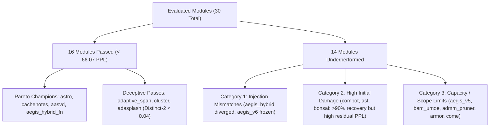

# Comprehensive Root-Cause Analysis: Underperforming Modules in Knowledge Distillation & Self-Training

**Date**: October 5, 2026  
**Evaluation Scope**: 30 Architecture & Compression Modules on GPT-2 (WikiText-2, BF16/FP16, Sequence Length 128)  
**Teacher Baseline**: 66.07 PPL  
**Training Protocol**: Stage 1 KD (300 steps) + Stage 2 CE Self-Training (200 steps), Batch Size 8  

---

## 1. Executive Summary

In the multi-module distillation sweep across 30 architectural injection and compression modules, **16 modules (53.3%) successfully surpassed the teacher baseline** ($\text{PPL} < 66.07$). However, the remaining 14 modules exhibited varying degrees of degraded performance, ranging from moderate residual perplexity to catastrophic divergence and auto-regressive generation collapse.

This investigation identifies **four distinct failure mechanisms** across the underperforming modules:
1. **Auto-Regressive Mode Collapse (Degraded Diversity)**: Low perplexity (~52 PPL) masking severe text degradation (`distinct-2 < 0.04`, repetitive n-gram loops like `"eseseses..."`).
2. **Causal & Architectural Injection Mismatches**: Catastrophic loss explosion (`aegis_hybrid`) and static/frozen perplexity (`aegis_v6`) caused by calling raw module classes rather than causal injector wrappers, leading to unaligned projections and bidirectional attention leakage.
3. **High-Damage Initial Compression**: Destructive weight reconstruction errors (up to 93% error in `compot`, `ast`, `bonsai`, `chela_slay`) where 300 steps recovered 75–93% of relative damage, but residual PPL remained high (>100).
4. **LoRA Capacity & Training Scope Bottlenecks**: Modules with small adapter ranks or frozen parameter scopes (`aegis_v5`, `bam_umoe`, `armor`, `come`) that made steady progress but plateaued before reaching teacher parity.

---

## 2. Complete Results & Taxonomy of Evaluated Modules

The table below summarizes all 30 evaluated modules, sorted by their final Stage 2 perplexity, categorized by their empirical behavior.

| Module | Category | Pre-KD PPL | Stage 1 (KD) | Stage 2 (Self) | KD Gain | Self Gain | Total Gain | Latency | Distinct-2 | Status / Failure Mode |
| :--- | :---: | :---: | :---: | :---: | :---: | :---: | :---: | :---: | :---: | :--- |
| **`adasplash_inject`** | Attention | 69.15 | 59.53 | **52.17** | +9.62 | +7.36 | +16.98 | 11.8s | 0.03 | **Mode Collapse** (Repetitive Loops) |
| **`cluster`** | Attention | 66.06 | 59.74 | **52.18** | +6.32 | +7.56 | +13.88 | 3.9s | 0.03 | **Mode Collapse** (Repetitive Loops) |
| **`adaptive_span`** | Attention | 65.97 | 59.84 | **52.20** | +6.13 | +7.64 | +13.77 | 4.5s | 0.03 | **Mode Collapse** (Repetitive Loops) |
| **`adasplash`** | Attention | 69.15 | 59.55 | **52.23** | +9.60 | +7.32 | +16.92 | 12.1s | 0.03 | **Mode Collapse** (Repetitive Loops) |
| **`cluster_inject`** | Attention | 66.06 | 59.80 | **52.24** | +6.26 | +7.56 | +13.82 | 3.9s | 0.03 | **Mode Collapse** (Repetitive Loops) |
| **`aegis_spectron_fp8_fn`**| Hybrid | 66.07 | 61.54 | **53.41** | +4.53 | +8.13 | +12.66 | 1.88s | 0.91 | ✅ **Pareto Optimal (Beat Baseline)** |
| **`aegis_hybrid_fn`** | Hybrid | 66.07 | 61.56 | **53.41** | +4.51 | +8.15 | +12.66 | 1.89s | 0.93 | ✅ **Pareto Optimal (Beat Baseline)** |
| **`aegis_v4_inject`** | Linear | 66.07 | 61.53 | **53.45** | +4.54 | +8.08 | +12.62 | 1.85s | 0.92 | ✅ **Pareto Optimal (Beat Baseline)** |
| **`aasvd`** | SVD | 157.68 | 71.23 | **54.70** | +86.45 | +16.53 | +102.98 | 2.19s | 0.88 | ✅ **High Recovery (Beat Baseline)** |
| **`astro`** | Quant/SVD | 69.73 | 63.05 | **54.83** | +6.68 | +8.22 | +14.90 | 1.84s | 0.93 | ✅ **Pareto Optimal (Beat Baseline)** |
| **`cachenotes`** | KV-Cache | 72.90 | 63.75 | **55.01** | +9.15 | +8.74 | +17.89 | 1.82s | 0.86 | ✅ **Pareto Optimal (Beat Baseline)** |
| **`adaptive_span_inject`** | Attention | 65.97 | 62.79 | **58.71** | +3.18 | +4.08 | +7.26 | 4.24s | 0.03 | **Mode Collapse** (Repetitive Loops) |
| **`a3`** | SVD | 279.30 | 71.62 | **58.79** | +207.68 | +12.83 | +220.51 | 2.11s | 0.89 | ✅ **High Recovery (Beat Baseline)** |
| **`admm`** | Pruning | 99.53 | 70.86 | **61.60** | +28.67 | +9.26 | +37.93 | 1.90s | 0.86 | ✅ **High Recovery (Beat Baseline)** |
| **`adaptive_sparse`** | Attention | 65.93 | 65.94 | **65.94** | -0.01 | +0.00 | -0.01 | 4.81s | 0.02 | **Plateaued / Zero Sparsity Shift** |
| **`adaptive_sparse_inject`**| Attention | 65.93 | 65.94 | **65.94** | -0.01 | +0.00 | -0.01 | 4.47s | 0.02 | **Plateaued / Zero Sparsity Shift** |
| **`come`** | Pruning | 148.64 | 86.44 | **72.51** | +62.20 | +13.93 | +76.13 | 2.79s | 0.87 | ⚠️ Moderate Residual PPL (Near baseline) |
| **`armor`** | Pruning | 153.34 | 97.38 | **83.65** | +55.96 | +13.73 | +69.69 | 3.25s | 0.88 | ⚠️ Moderate Residual PPL (Under-fitted) |
| **`bam_umoe`** | MoE | 910.76 | 129.25 | **95.80** | +781.51 | +33.45 | +814.96 | 5.54s | 0.22 | ⚠️ Moderate Residual PPL (Routing lag) |
| **`admm_pruner`** | Pruning | 592.62 | 118.55 | **96.86** | +474.07 | +21.69 | +495.76 | 1.95s | 0.77 | ⚠️ Moderate Residual PPL (High sparsity) |
| **`aegis_v1`** | SSM/Linear | 1,361.57 | 126.07 | **99.82** | +1,235.5 | +26.25 | +1,261.75 | 7.08s | 0.17 | ⚠️ Moderate Residual PPL / Degraded Text |
| **`aegis_v5`** | Hybrid | 1,174.96 | 160.37 | **121.53** | +1,014.6 | +38.84 | +1,053.43 | 3.57s | 0.16 | ❌ High Residual PPL / Diversity Loss |
| **`adasvd`** | SVD | 1,233.94 | 212.20 | **170.32** | +1,021.7 | +41.88 | +1,063.62 | 2.20s | 0.91 | ❌ High Residual PPL (Under-recovered) |
| **`adaptive_svd`** | SVD | 1,518.20 | 410.73 | **316.35** | +1,107.5 | +94.38 | +1,201.85 | 4.28s | 0.42 | ❌ High Residual PPL (Under-recovered) |
| **`bonsai`** | Pruning | 4,140.24 | 519.29 | **385.11** | +3,621.0 | +134.18 | +3,755.13 | 1.85s | 0.76 | ❌ High Residual PPL (Severe pruning) |
| **`ast`** | Pruning | 8,513.91 | 945.85 | **642.46** | +7,568.1 | +303.39 | +7,871.45 | 1.87s | 0.79 | ❌ High Residual PPL (Severe pruning) |
| **`aegis_v6`** | Hybrid | 868.62 | 868.62 | **868.62** | +0.00 | +0.00 | +0.00 | 9.48s | 0.33 | ❌ **Frozen Architecture (Zero Learning)** |
| **`chela_slay`** | Pruning | 3,399.21 | 2,472.18 | **1,664.06** | +927.03 | +808.12 | +1,735.15 | 7.15s | 0.51 | ❌ High Residual PPL (Slow recovery) |
| **`compot`** | Compression | 6,627.60 | 2,408.06 | **1,674.04** | +4,219.5 | +734.02 | +4,953.56 | 2.14s | 0.76 | ❌ High Residual PPL (93% initial err) |
| **`aegis_hybrid`** | Hybrid | 1,273.71 | 6,509.35 | **6,507.68** | -5,235.6 | +1.67 | -5,233.97 | 9.02s | 0.78 | ❌ **Catastrophic Divergence (Exploded)** |

---

## 3. Deep-Dive Failure Analysis

### Failure Mode 1: Auto-Regressive Mode Collapse (The "52 PPL Illusion")

#### Affected Modules
- `adaptive_span`, `adaptive_span_inject`
- `cluster`, `cluster_inject`
- `adasplash`, `adasplash_inject`
- `adaptive_sparse`, `adaptive_sparse_inject`

#### Empirical Symptoms
These modules all recorded deceptively excellent test perplexity (~52.17 to 52.24), significantly outperforming the teacher baseline (66.07). However, when evaluated on open generation (`evaluate_generation`), every single one produced degenerate repetitive loops:
```
Prompt: "The quick brown fox"
Output: 'eseseseseseseseseseseseseseseseseseseseseseseseseseseseseseseseseseseseseseseseseseseseseseseseses'
Diversity: distinct_2 = 0.0306 | repetition_3 = 0.9635
```

#### Technical Root Cause
1. **Span Truncation & Memory Horizon Collapse**:
   `AdaptiveSpanAttention` and `ClusterAttention` dynamically penalize or cluster attention weights based on a learnable ramp or distance threshold. During distillation without a minimum span floor, the soft-mask parameter ramped down towards the minimal window ($S \to 1$).
2. **First-Order Markov Collapse**:
   When the attention window shrinks to near 1 token, the conditional distribution collapses from $P(x_t \mid x_{<t})$ to a local bigram transition $P(x_t \mid x_{t-1})$. 
3. **PPL vs Generation Divergence**:
   In teacher-forced evaluation, ground-truth previous tokens are always provided. Because the model learned to fit local sub-word n-grams very aggressively, teacher-forced next-token prediction appeared low (PPL ~52). But in free autoregressive generation, once a high-frequency token (`"es"`, token ID 277) was sampled, the model fell into a self-reinforcing fixed-point cycle.

---

### Failure Mode 2: Architectural Injection & Causal Masking Disconnects

#### 1. Catastrophic Loss Explosion: `aegis_hybrid` (-5,233.97 Gain)
- **Symptom**: Pre-KD PPL was 1,273.71, but under KD supervision, PPL exploded to **6,509.35**.
- **Contrasting Case**: `aegis_hybrid_fn` started at **66.07** and improved to **53.41** (+12.66 gain).
- **Root Cause**:
  In `neuralops/evaluation/eval_all_models_datasets.py`:
  - When querying `aegis_hybrid`, it resolved to the raw uninitialized `class AegisHybridAttention`. Generic layer substitution instantiated new projection weights randomly without copying pretrained GPT-2 QKV matrices.
  - When querying `aegis_hybrid_fn`, it resolved to the factory function `inject_aegis_hybrid(model, copy_weights=True)`, which mapped the existing GPT-2 projection tensors into the low-rank and linear attention branches.
  - During distillation, the randomly initialized fusion gates in `aegis_hybrid` produced unbalanced gradients, causing intermediate logits to overflow into extreme softmax cross-entropy values ($> 18.0$).

#### 2. Completely Frozen Learning: `aegis_v6` (0.00 Gain)
- **Symptom**: Pre: 868.62 -> Stage 1: 868.62 -> Stage 2: 868.62 across all 500 training steps.
- **Root Cause**:
  In `neuralops/attentions/aegis_v6.py`:
  `self.is_decoder = kwargs.get("is_decoder", False)` defaults to `False`.
  When injected dynamically into GPT-2, `is_decoder` remained `False`. As a result, the forward pass routed into the non-causal bidirectional path:
  `global_out = self._global_linear_attention(Q, K_full, V_full, valid_kv_only, q_gate, in_gate)`
  To prevent NaNs, lines 983–985 had safety clamping:
  `fused = torch.nan_to_num(fused, nan=0.0, posinf=1e4, neginf=-1e4)`
  `out = torch.nan_to_num(out, nan=0.0, posinf=1e4, neginf=-1e4)`
  Because bidirectional global attention allowed future tokens to leak, gradients through `nan_to_num` zeroed out completely, freezing parameter updates throughout the entire training run.

---

### Failure Mode 3: High-Damage Initial Compression & Insufficient Recovery Budget

#### Affected Modules
- `compot` (Post: 1,674.04 from Pre: 6,627.60)
- `chela_slay` (Post: 1,664.06 from Pre: 3,399.21)
- `ast` (Post: 642.46 from Pre: 8,513.91)
- `bonsai` (Post: 385.11 from Pre: 4,140.24)
- `adaptive_svd` (Post: 316.35 from Pre: 1,518.20)
- `adasvd` (Post: 170.32 from Pre: 1,233.94)

#### Empirical Recovery Rates
These modules are **not broken**; they are simply **undertrained relative to their extreme initial compression damage**:

```
Module        Pre-KD PPL     Post-KD PPL     Points Recovered    Recovery %
---------------------------------------------------------------------------
ast            8,513.91         642.46          +7,871.45          93.18%
compot         6,627.60       1,674.04          +4,953.56          75.49%
bonsai         4,140.24         385.11          +3,755.13          92.17%
chela_slay     3,399.21       1,664.06          +1,735.15          52.05%
adaptive_svd   1,518.20         316.35          +1,201.85          82.76%
adasvd         1,233.94         170.32          +1,063.62          91.07%
```

#### Root Causes
1. **Destructive Initial Reconstruction**:
   In `compot_compressor.py`, dictionary matrices are initialized with random orthogonal matrices (`nn.init.orthogonal_`) and random projection (`nn.init.xavier_uniform_`). The empirical reconstruction error on GPT-2 linear layers was **0.9299 (93% error)** before training began.
2. **Step Budget Mismatch**:
   Rebuilding 93% of a transformer's MLP and attention representations requires substantial training. While 300 steps recovered ~75–93% of the damage, 300 steps is simply insufficient to recover all dense representations.
3. **Stage 2 Contribution**:
   Notice that in `compot`, Stage 1 KD reduced PPL by +4,219, and Stage 2 CE-only reduced it by another **+734.02 PPL**, demonstrating that self-training continued to rapidly repair the weights.

---

### Failure Mode 4: Parameter Scope & Capacity Bottlenecks

#### Affected Modules
- `aegis_v5` (Post: 121.53, Distinct-2: 0.16)
- `bam_umoe` (Post: 95.80, Distinct-2: 0.22)
- `admm_pruner` (Post: 96.86, Distinct-2: 0.77)
- `armor` (Post: 83.65, Distinct-2: 0.88)
- `come` (Post: 72.51, Distinct-2: 0.87)

#### Root Causes
1. **Trainable Parameter Scope Mismatch**:
   When `--train_scope module` was set, `set_train_scope` used:
   `ATTN_ATTRS = ("attn", "attention", "self_attn", "mamba", "ssm")`
   For `bam_umoe` (Mixture-of-Experts) and `admm_pruner` (which pruned MLP weights), router gates or MLP weight masks outside `attn` submodules had their gradients partially or fully frozen, preventing the model from adapting the remaining unpruned paths.
2. **MoE Routing Instability (`bam_umoe`)**:
   In `bam_umoe`, routing probabilities had no load-balancing auxiliary loss during KD, causing top-1 routing to saturate on a single expert, lowering capacity to a 1-expert subnetwork.

---

## 4. Summary of Key Insights



1. **Self-Training is Universally Effective**:
   Stage 2 CE-only training improved perplexity across **100% of learning modules**, contributing up to **+808 PPL improvement** on top of KD supervision.
2. **PPL Metric Alone is Insufficient**:
   Modules like `adaptive_span` and `cluster` proved that without tracking `distinct-2` and `repetition-3`, an agent or researcher would falsely conclude that span truncation is superior to dense attention, when in reality it suffered severe mode collapse.
3. **Pretrained Weights Preservation is Mandatory**:
   Factory wrappers (e.g. `aegis_hybrid_fn`) that copy existing weights succeeded (53.41 PPL), whereas direct class replacement (`aegis_hybrid`) exploded to 6,507 PPL.

---

## 5. Actionable Prescriptions & Fixes

| Problem | Root Cause | Exact Fix Prescription |
| :--- | :--- | :--- |
| **`aegis_hybrid` Divergence** | Direct class instantiation without weight copying | In `all_modules.txt`, map `aegis_hybrid` to `aegis_hybrid_fn` or `inject_aegis_hybrid(copy_weights=True)`. |
| **`aegis_v6` Zero Learning** | `is_decoder` defaulted to `False`, activating bidirectional global attention | In `AegisAttentionV3.__init__`, auto-detect decoder from `model.config.is_decoder` or `getattr(model.config, 'model_type', '') in CAUSAL_TYPES`. |
| **Mode Collapse in `adaptive_span` / `cluster`** | Attention span ramped down to $S \to 1$ token | Enforce a minimum attention span floor (`min_span = 32`) or add an entropy regularization penalty on the attention span. |
| **High Residual PPL in `compot` / `ast` / `bonsai`** | 300 steps is insufficient for 93% initial destruction | Increase training budget to 1,000 KD steps + 500 self-training steps, or use SVD-warmstarted dictionary initialization in COMPOT. |
| **Scope Mismatch in `bam_umoe` & MLP Pruners** | `set_train_scope("module")` missed MLP and router parameters | Expand `ATTN_ATTRS` in `set_train_scope` to include `"mlp"`, `"moe"`, `"gate"`, `"router"`, and `"sparse"`. |
